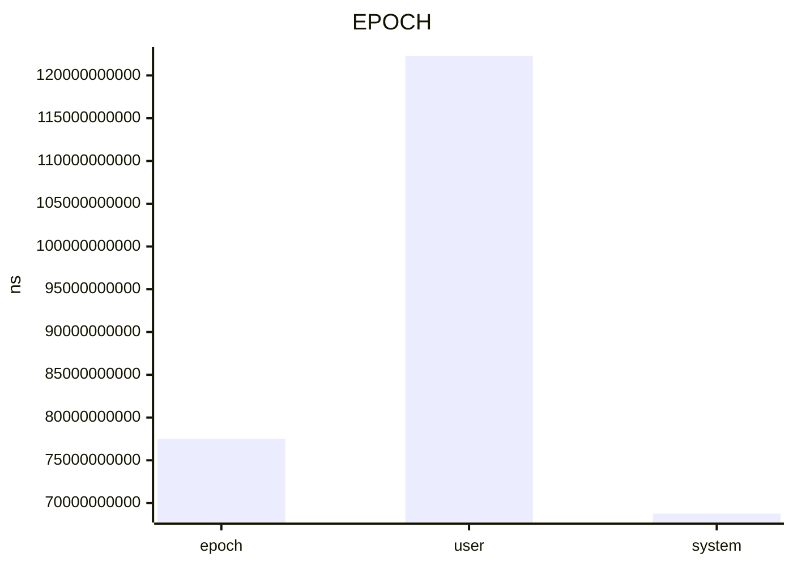

## epoch

+--------+-------+----------------------+--------------------+-----------------+-----------------+-------+------+------------------------------------------------------------------------------------------------------------------------------------------------------------------------------------------------------------------+
| key    | type  | value                | errorPercent       | min             | max             | calls | unit | samples                                                                                                                                                                                                          |
+========+=======+======================+====================+=================+=================+=======+======+==================================================================================================================================================================================================================+
| epoch  | float | 7.747886633333333e10 | 0.5871865729716688 | 7.6855692125e10 | 7.9091207625e10 | 1     | ns   | 7.9091207625e10, 7.757815158333334e10, 7.747886633333333e10, 7.702392083333333e10, 7.76138365e10, 7.694460966666667e10, 7.69984345e10, 7.6855692125e10, 7.705475629166666e10, 7.7799041e10, 7.811325054166667e10 |
+--------+-------+----------------------+--------------------+-----------------+-----------------+-------+------+------------------------------------------------------------------------------------------------------------------------------------------------------------------------------------------------------------------+
| user   | float | 1.22279897e11        | 0.3540451134007743 | 1.21534193e11   | 1.24095198e11   | 1     | ns   | 1.24095198e11, 1.22281462e11, 1.22366529e11, 1.21826915e11, 1.22781245e11, 1.21997392e11, 1.21791575e11, 1.21534193e11, 1.21970959e11, 1.22279897e11, 1.22712823e11                                              |
+--------+-------+----------------------+--------------------+-----------------+-----------------+-------+------+------------------------------------------------------------------------------------------------------------------------------------------------------------------------------------------------------------------+
| system | float | 6.8763345e10         | 0.6297250373727457 | 6.8254349e10    | 6.9927765e10    | 1     | ns   | 6.9927765e10, 6.886718e10, 6.8763345e10, 6.8330325e10, 6.9016236e10, 6.8254349e10, 6.8386454e10, 6.8266544e10, 6.855636e10, 6.9270053e10, 6.9458802e10                                                           |
+--------+-------+----------------------+--------------------+-----------------+-----------------+-------+------+------------------------------------------------------------------------------------------------------------------------------------------------------------------------------------------------------------------+

