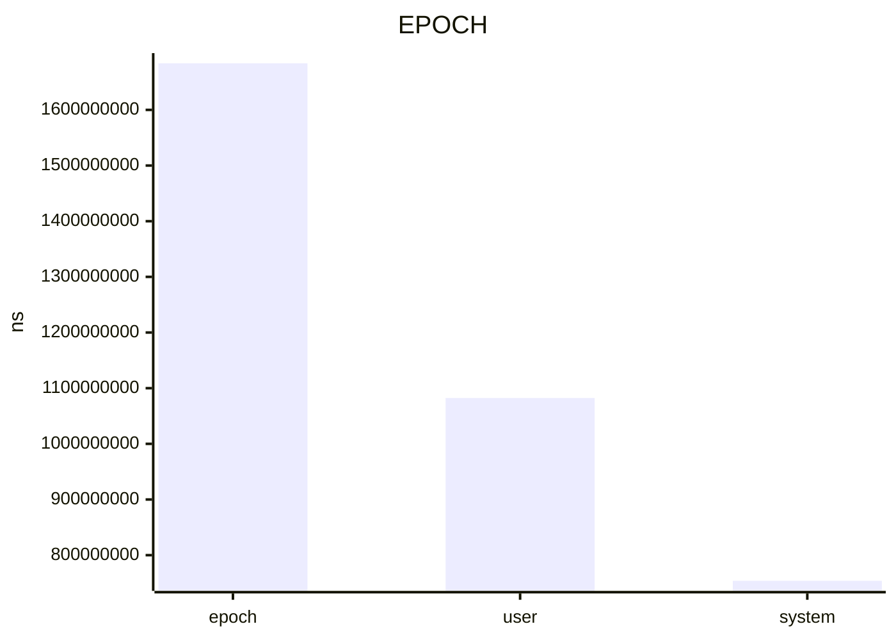

## epoch

+--------+-------+--------------+--------------------+---------------+---------------------+-------+------+------------------------------------------+
| key    | type  | value        | errorPercent       | min           | max                 | calls | unit | samples                                  |
+========+=======+==============+====================+===============+=====================+=======+======+==========================================+
| epoch  | float | 1.68374475e9 | 0.3617111006087322 | 1.659901125e9 | 2.158728333333333e9 | 1     | ns   | 2.158728333333333e9, 1.659901125e9, 1.66 |
|        |       |              |                    |               |                     |       |      | 3646166666667e9, 1.679614875e9, 1.686443 |
|        |       |              |                    |               |                     |       |      | 625e9, 1.689835041666667e9, 1.6819600833 |
|        |       |              |                    |               |                     |       |      | 33333e9, 1.688941916666667e9, 1.67505162 |
|        |       |              |                    |               |                     |       |      | 5e9, 1.68374475e9, 1.706056458333333e9   |
+--------+-------+--------------+--------------------+---------------+---------------------+-------+------+------------------------------------------+
| user   | float | 1.082408e9   | 0.7965573055631519 | 1.06104e9     | 1.105947e9          | 1     | ns   | 1.08488e9, 1.097597e9, 1.073786e9, 1.105 |
|        |       |              |                    |               |                     |       |      | 947e9, 1.064659e9, 1.077828e9, 1.06104e9 |
|        |       |              |                    |               |                     |       |      | , 1.082408e9, 1.089547e9, 1.081931e9, 1. |
|        |       |              |                    |               |                     |       |      | 09741e9                                  |
+--------+-------+--------------+--------------------+---------------+---------------------+-------+------+------------------------------------------+
| system | float | 7.53936e8    | 1.306742216845992  | 7.36387e8     | 7.69111e8           | 1     | ns   | 7.63788e8, 7.55821e8, 7.46287e8, 7.53936 |
|        |       |              |                    |               |                     |       |      | e8, 7.36743e8, 7.69111e8, 7.61582e8, 7.6 |
|        |       |              |                    |               |                     |       |      | 1425e8, 7.36387e8, 7.38517e8, 7.38817e8  |
+--------+-------+--------------+--------------------+---------------+---------------------+-------+------+------------------------------------------+

