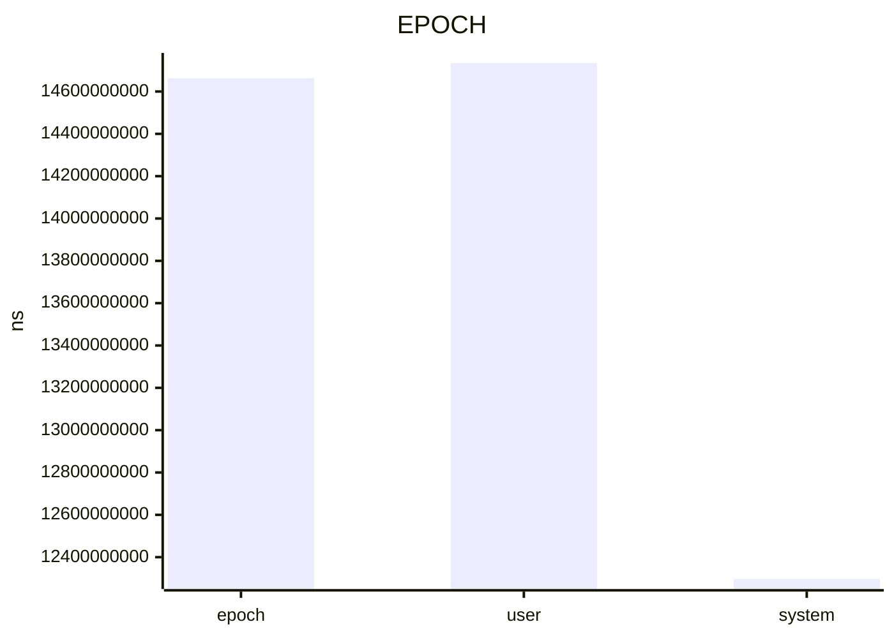

## epoch

+--------+-------+---------------+--------------+---------------+---------------+-------+------+---------------+
| key    | type  | value         | errorPercent | min           | max           | calls | unit | samples       |
+========+=======+===============+==============+===============+===============+=======+======+===============+
| epoch  | float | 1.46630272e10 | 0.0          | 1.46630272e10 | 1.46630272e10 | 1     | ns   | 1.46630272e10 |
+--------+-------+---------------+--------------+---------------+---------------+-------+------+---------------+
| user   | float | 1.4734375e10  | 0.0          | 1.4734375e10  | 1.4734375e10  | 1     | ns   | 1.4734375e10  |
+--------+-------+---------------+--------------+---------------+---------------+-------+------+---------------+
| system | float | 1.2296875e10  | 0.0          | 1.2296875e10  | 1.2296875e10  | 1     | ns   | 1.2296875e10  |
+--------+-------+---------------+--------------+---------------+---------------+-------+------+---------------+

## sample

+--------------------------------------------------------------------------------------------------------------------------------------------------------------------------------------------------------------------------------------------------------------------+-------+---------+--------------+---------+---------+-------+-------+---------+----------+---------------------+--------------------+
| key                                                                                                                                                                                                                                                                | type  | value   | errorPercent | min     | max     | calls | unit  | samples | baseline | change              | probability        |
+====================================================================================================================================================================================================================================================================+=======+=========+==============+=========+=========+=======+=======+=========+==========+=====================+====================+
| nt associate wait completion packet                                                                                                                                                                                                                                | float | 185.0   | 0.0          | 185.0   | 185.0   | 1     | count | 185     | 1.0      | 18400.0             | 0.3173105078629141 |
+--------------------------------------------------------------------------------------------------------------------------------------------------------------------------------------------------------------------------------------------------------------------+-------+---------+--------------+---------+---------+-------+-------+---------+----------+---------------------+--------------------+
| tp set wait ex                                                                                                                                                                                                                                                     | float | 199.0   | 0.0          | 199.0   | 199.0   | 1     | count | 199     |          |                     |                    |
+--------------------------------------------------------------------------------------------------------------------------------------------------------------------------------------------------------------------------------------------------------------------+-------+---------+--------------+---------+---------+-------+-------+---------+----------+---------------------+--------------------+
| rtl wow64 get shared info process                                                                                                                                                                                                                                  | float | 1.0     | 0.0          | 1.0     | 1.0     | 1     | count | 1       |          |                     |                    |
+--------------------------------------------------------------------------------------------------------------------------------------------------------------------------------------------------------------------------------------------------------------------+-------+---------+--------------+---------+---------+-------+-------+---------+----------+---------------------+--------------------+
| rtl subscribe wnf state change notification                                                                                                                                                                                                                        | float | 1.0     | 0.0          | 1.0     | 1.0     | 1     | count | 1       | 1.0      | 0.0                 | 1.0                |
+--------------------------------------------------------------------------------------------------------------------------------------------------------------------------------------------------------------------------------------------------------------------+-------+---------+--------------+---------+---------+-------+-------+---------+----------+---------------------+--------------------+
| rtl query process lock information                                                                                                                                                                                                                                 | float | 1.0     | 0.0          | 1.0     | 1.0     | 1     | count | 1       | 1.0      | 0.0                 | 1.0                |
+--------------------------------------------------------------------------------------------------------------------------------------------------------------------------------------------------------------------------------------------------------------------+-------+---------+--------------+---------+---------+-------+-------+---------+----------+---------------------+--------------------+
| etw event write no registration                                                                                                                                                                                                                                    | float | 34.0    | 0.0          | 34.0    | 34.0    | 1     | count | 34      | 53.0     | -35.84905660377358  | 0.3173105078629141 |
+--------------------------------------------------------------------------------------------------------------------------------------------------------------------------------------------------------------------------------------------------------------------+-------+---------+--------------+---------+---------+-------+-------+---------+----------+---------------------+--------------------+
| ldr initialize thunk                                                                                                                                                                                                                                               | float | 36.0    | 0.0          | 36.0    | 36.0    | 1     | count | 36      | 54.0     | -33.33333333333333  | 0.3173105078629141 |
+--------------------------------------------------------------------------------------------------------------------------------------------------------------------------------------------------------------------------------------------------------------------+-------+---------+--------------+---------+---------+-------+-------+---------+----------+---------------------+--------------------+
| zw query performance counter                                                                                                                                                                                                                                       | float | 1.0     | 0.0          | 1.0     | 1.0     | 1     | count | 1       |          |                     |                    |
+--------------------------------------------------------------------------------------------------------------------------------------------------------------------------------------------------------------------------------------------------------------------+-------+---------+--------------+---------+---------+-------+-------+---------+----------+---------------------+--------------------+
| rtl append unicode string to string                                                                                                                                                                                                                                | float | 22.0    | 0.0          | 22.0    | 22.0    | 1     | count | 22      | 23.0     | -4.347826086956522  | 0.3173105078629141 |
+--------------------------------------------------------------------------------------------------------------------------------------------------------------------------------------------------------------------------------------------------------------------+-------+---------+--------------+---------+---------+-------+-------+---------+----------+---------------------+--------------------+
| rtl UTF8 to unicode N                                                                                                                                                                                                                                              | float | 8.0     | 0.0          | 8.0     | 8.0     | 1     | count | 8       | 8.0      | 0.0                 | 1.0                |
+--------------------------------------------------------------------------------------------------------------------------------------------------------------------------------------------------------------------------------------------------------------------+-------+---------+--------------+---------+---------+-------+-------+---------+----------+---------------------+--------------------+
| rtl valid acl                                                                                                                                                                                                                                                      | float | 20.0    | 0.0          | 20.0    | 20.0    | 1     | count | 20      | 24.0     | -16.66666666666666  | 0.3173105078629141 |
+--------------------------------------------------------------------------------------------------------------------------------------------------------------------------------------------------------------------------------------------------------------------+-------+---------+--------------+---------+---------+-------+-------+---------+----------+---------------------+--------------------+
| rtl deactivate activation context unsafe fast                                                                                                                                                                                                                      | float | 7.0     | 0.0          | 7.0     | 7.0     | 1     | count | 7       | 7.0      | 0.0                 | 1.0                |
+--------------------------------------------------------------------------------------------------------------------------------------------------------------------------------------------------------------------------------------------------------------------+-------+---------+--------------+---------+---------+-------+-------+---------+----------+---------------------+--------------------+
| ldr get dll handle ex                                                                                                                                                                                                                                              | float | 38.0    | 0.0          | 38.0    | 38.0    | 1     | count | 38      | 40.0     | -5.0                | 0.3173105078629141 |
+--------------------------------------------------------------------------------------------------------------------------------------------------------------------------------------------------------------------------------------------------------------------+-------+---------+--------------+---------+---------+-------+-------+---------+----------+---------------------+--------------------+
| ldr load dll                                                                                                                                                                                                                                                       | float | 24.0    | 0.0          | 24.0    | 24.0    | 1     | count | 24      | 24.0     | 0.0                 | 1.0                |
+--------------------------------------------------------------------------------------------------------------------------------------------------------------------------------------------------------------------------------------------------------------------+-------+---------+--------------+---------+---------+-------+-------+---------+----------+---------------------+--------------------+
| rtl dos search path U                                                                                                                                                                                                                                              | float | 6.0     | 0.0          | 6.0     | 6.0     | 1     | count | 6       | 5.0      | 20.0                | 0.3173105078629141 |
+--------------------------------------------------------------------------------------------------------------------------------------------------------------------------------------------------------------------------------------------------------------------+-------+---------+--------------+---------+---------+-------+-------+---------+----------+---------------------+--------------------+
| wcstombs                                                                                                                                                                                                                                                           | float | 3.0     | 0.0          | 3.0     | 3.0     | 1     | count | 3       | 3.0      | 0.0                 | 1.0                |
+--------------------------------------------------------------------------------------------------------------------------------------------------------------------------------------------------------------------------------------------------------------------+-------+---------+--------------+---------+---------+-------+-------+---------+----------+---------------------+--------------------+
| vsnwprintf                                                                                                                                                                                                                                                         | float | 1.0     | 0.0          | 1.0     | 1.0     | 1     | count | 1       | 3.0      | -66.66666666666666  | 0.3173105078629141 |
+--------------------------------------------------------------------------------------------------------------------------------------------------------------------------------------------------------------------------------------------------------------------+-------+---------+--------------+---------+---------+-------+-------+---------+----------+---------------------+--------------------+
| create semaphore ex W                                                                                                                                                                                                                                              | float | 1.0     | 0.0          | 1.0     | 1.0     | 1     | count | 1       |          |                     |                    |
+--------------------------------------------------------------------------------------------------------------------------------------------------------------------------------------------------------------------------------------------------------------------+-------+---------+--------------+---------+---------+-------+-------+---------+----------+---------------------+--------------------+
| arm feature usage subscriber flush notification                                                                                                                                                                                                                    | float | 1.0     | 0.0          | 1.0     | 1.0     | 1     | count | 1       |          |                     |                    |
+--------------------------------------------------------------------------------------------------------------------------------------------------------------------------------------------------------------------------------------------------------------------+-------+---------+--------------+---------+---------+-------+-------+---------+----------+---------------------+--------------------+
| get locale info helper                                                                                                                                                                                                                                             | float | 2.0     | 0.0          | 2.0     | 2.0     | 1     | count | 2       |          |                     |                    |
+--------------------------------------------------------------------------------------------------------------------------------------------------------------------------------------------------------------------------------------------------------------------+-------+---------+--------------+---------+---------+-------+-------+---------+----------+---------------------+--------------------+
| get application restart settings                                                                                                                                                                                                                                   | float | 1.0     | 0.0          | 1.0     | 1.0     | 1     | count | 1       |          |                     |                    |
+--------------------------------------------------------------------------------------------------------------------------------------------------------------------------------------------------------------------------------------------------------------------+-------+---------+--------------+---------+---------+-------+-------+---------+----------+---------------------+--------------------+
| create process internal W                                                                                                                                                                                                                                          | float | 10.0    | 0.0          | 10.0    | 10.0    | 1     | count | 10      | 6.0      | 66.66666666666666   | 0.3173105078629141 |
+--------------------------------------------------------------------------------------------------------------------------------------------------------------------------------------------------------------------------------------------------------------------+-------+---------+--------------+---------+---------+-------+-------+---------+----------+---------------------+--------------------+
| rtl wow64 suspend thread                                                                                                                                                                                                                                           | float | 25.0    | 0.0          | 25.0    | 25.0    | 1     | count | 25      | 33.0     | -24.24242424242424  | 0.3173105078629141 |
+--------------------------------------------------------------------------------------------------------------------------------------------------------------------------------------------------------------------------------------------------------------------+-------+---------+--------------+---------+---------+-------+-------+---------+----------+---------------------+--------------------+
| rtl raise exception                                                                                                                                                                                                                                                | float | 31.0    | 0.0          | 31.0    | 31.0    | 1     | count | 31      | 41.0     | -24.39024390243902  | 0.3173105078629141 |
+--------------------------------------------------------------------------------------------------------------------------------------------------------------------------------------------------------------------------------------------------------------------+-------+---------+--------------+---------+---------+-------+-------+---------+----------+---------------------+--------------------+
| rtl delete element generic table avl ex                                                                                                                                                                                                                            | float | 17.0    | 0.0          | 17.0    | 17.0    | 1     | count | 17      | 25.0     | -32.0               | 0.3173105078629141 |
+--------------------------------------------------------------------------------------------------------------------------------------------------------------------------------------------------------------------------------------------------------------------+-------+---------+--------------+---------+---------+-------+-------+---------+----------+---------------------+--------------------+
| ldr get procedure address for caller                                                                                                                                                                                                                               | float | 34.0    | 0.0          | 34.0    | 34.0    | 1     | count | 34      | 37.0     | -8.108108108108109  | 0.3173105078629141 |
+--------------------------------------------------------------------------------------------------------------------------------------------------------------------------------------------------------------------------------------------------------------------+-------+---------+--------------+---------+---------+-------+-------+---------+----------+---------------------+--------------------+
| ldr unload dll                                                                                                                                                                                                                                                     | float | 23.0    | 0.0          | 23.0    | 23.0    | 1     | count | 23      | 25.0     | -8.0                | 0.3173105078629141 |
+--------------------------------------------------------------------------------------------------------------------------------------------------------------------------------------------------------------------------------------------------------------------+-------+---------+--------------+---------+---------+-------+-------+---------+----------+---------------------+--------------------+
| zw open key                                                                                                                                                                                                                                                        | float | 1.0     | 0.0          | 1.0     | 1.0     | 1     | count | 1       | 3.0      | -66.66666666666666  | 0.3173105078629141 |
+--------------------------------------------------------------------------------------------------------------------------------------------------------------------------------------------------------------------------------------------------------------------+-------+---------+--------------+---------+---------+-------+-------+---------+----------+---------------------+--------------------+
| apphelp dll                                                                                                                                                                                                                                                        | float | 1.0     | 0.0          | 1.0     | 1.0     | 1     | count | 1       | 3.0      | -66.66666666666666  | 0.3173105078629141 |
+--------------------------------------------------------------------------------------------------------------------------------------------------------------------------------------------------------------------------------------------------------------------+-------+---------+--------------+---------+---------+-------+-------+---------+----------+---------------------+--------------------+
| SE initialize engine                                                                                                                                                                                                                                               | float | 4.0     | 0.0          | 4.0     | 4.0     | 1     | count | 4       | 7.0      | -42.85714285714285  | 0.3173105078629141 |
+--------------------------------------------------------------------------------------------------------------------------------------------------------------------------------------------------------------------------------------------------------------------+-------+---------+--------------+---------+---------+-------+-------+---------+----------+---------------------+--------------------+
| sdb close database                                                                                                                                                                                                                                                 | float | 2.0     | 0.0          | 2.0     | 2.0     | 1     | count | 2       |          |                     |                    |
+--------------------------------------------------------------------------------------------------------------------------------------------------------------------------------------------------------------------------------------------------------------------+-------+---------+--------------+---------+---------+-------+-------+---------+----------+---------------------+--------------------+
| SE COM lookup                                                                                                                                                                                                                                                      | float | 1.0     | 0.0          | 1.0     | 1.0     | 1     | count | 1       |          |                     |                    |
+--------------------------------------------------------------------------------------------------------------------------------------------------------------------------------------------------------------------------------------------------------------------+-------+---------+--------------+---------+---------+-------+-------+---------+----------+---------------------+--------------------+
| ldr unlock loader lock                                                                                                                                                                                                                                             | float | 6.0     | 0.0          | 6.0     | 6.0     | 1     | count | 6       | 10.0     | -40.0               | 0.3173105078629141 |
+--------------------------------------------------------------------------------------------------------------------------------------------------------------------------------------------------------------------------------------------------------------------+-------+---------+--------------+---------+---------+-------+-------+---------+----------+---------------------+--------------------+
| nt apphelp cache control                                                                                                                                                                                                                                           | float | 7.0     | 0.0          | 7.0     | 7.0     | 1     | count | 7       | 2.0      | 250.0               | 0.3173105078629141 |
+--------------------------------------------------------------------------------------------------------------------------------------------------------------------------------------------------------------------------------------------------------------------+-------+---------+--------------+---------+---------+-------+-------+---------+----------+---------------------+--------------------+
| sdb get binary tag data                                                                                                                                                                                                                                            | float | 3.0     | 0.0          | 3.0     | 3.0     | 1     | count | 3       | 2.0      | 50.0                | 0.3173105078629141 |
+--------------------------------------------------------------------------------------------------------------------------------------------------------------------------------------------------------------------------------------------------------------------+-------+---------+--------------+---------+---------+-------+-------+---------+----------+---------------------+--------------------+
| ordinal20                                                                                                                                                                                                                                                          | float | 2.0     | 0.0          | 2.0     | 2.0     | 1     | count | 2       | 1.0      | 100.0               | 0.3173105078629141 |
+--------------------------------------------------------------------------------------------------------------------------------------------------------------------------------------------------------------------------------------------------------------------+-------+---------+--------------+---------+---------+-------+-------+---------+----------+---------------------+--------------------+
| zw release worker factory worker                                                                                                                                                                                                                                   | float | 77.0    | 0.0          | 77.0    | 77.0    | 1     | count | 77      | 19.0     | 305.2631578947369   | 0.3173105078629141 |
+--------------------------------------------------------------------------------------------------------------------------------------------------------------------------------------------------------------------------------------------------------------------+-------+---------+--------------+---------+---------+-------+-------+---------+----------+---------------------+--------------------+
| rtl acquire SRW lock exclusive                                                                                                                                                                                                                                     | float | 70.0    | 0.0          | 70.0    | 70.0    | 1     | count | 70      | 21.0     | 233.3333333333333   | 0.3173105078629141 |
+--------------------------------------------------------------------------------------------------------------------------------------------------------------------------------------------------------------------------------------------------------------------+-------+---------+--------------+---------+---------+-------+-------+---------+----------+---------------------+--------------------+
| rtl clear thread work on behalf ticket                                                                                                                                                                                                                             | float | 1.0     | 0.0          | 1.0     | 1.0     | 1     | count | 1       | 2.0      | -50.0               | 0.3173105078629141 |
+--------------------------------------------------------------------------------------------------------------------------------------------------------------------------------------------------------------------------------------------------------------------+-------+---------+--------------+---------+---------+-------+-------+---------+----------+---------------------+--------------------+
| rtl release SRW lock exclusive                                                                                                                                                                                                                                     | float | 31.0    | 0.0          | 31.0    | 31.0    | 1     | count | 31      | 26.0     | 19.23076923076923   | 0.3173105078629141 |
+--------------------------------------------------------------------------------------------------------------------------------------------------------------------------------------------------------------------------------------------------------------------+-------+---------+--------------+---------+---------+-------+-------+---------+----------+---------------------+--------------------+
| rtl locate extended feature2                                                                                                                                                                                                                                       | float | 28.0    | 0.0          | 28.0    | 28.0    | 1     | count | 28      | 29.0     | -3.448275862068965  | 0.3173105078629141 |
+--------------------------------------------------------------------------------------------------------------------------------------------------------------------------------------------------------------------------------------------------------------------+-------+---------+--------------+---------+---------+-------+-------+---------+----------+---------------------+--------------------+
| tp callback may run long                                                                                                                                                                                                                                           | float | 3865.0  | 0.0          | 3865.0  | 3865.0  | 1     | count | 3865    | 541.0    | 614.4177449168207   | 0.3173105078629141 |
+--------------------------------------------------------------------------------------------------------------------------------------------------------------------------------------------------------------------------------------------------------------------+-------+---------+--------------+---------+---------+-------+-------+---------+----------+---------------------+--------------------+
| base thread init thunk                                                                                                                                                                                                                                             | float | 18090.0 | 0.0          | 18090.0 | 18090.0 | 1     | count | 18090   | 10730.0  | 68.59273066169618   | 0.3173105078629141 |
+--------------------------------------------------------------------------------------------------------------------------------------------------------------------------------------------------------------------------------------------------------------------+-------+---------+--------------+---------+---------+-------+-------+---------+----------+---------------------+--------------------+
| rtl user thread start                                                                                                                                                                                                                                              | float | 18089.0 | 0.0          | 18089.0 | 18089.0 | 1     | count | 18089   | 10729.0  | 68.59912386988536   | 0.3173105078629141 |
+--------------------------------------------------------------------------------------------------------------------------------------------------------------------------------------------------------------------------------------------------------------------+-------+---------+--------------+---------+---------+-------+-------+---------+----------+---------------------+--------------------+
| nt map view of section                                                                                                                                                                                                                                             | float | 4.0     | 0.0          | 4.0     | 4.0     | 1     | count | 4       | 33.0     | -87.87878787878788  | 0.3173105078629141 |
+--------------------------------------------------------------------------------------------------------------------------------------------------------------------------------------------------------------------------------------------------------------------+-------+---------+--------------+---------+---------+-------+-------+---------+----------+---------------------+--------------------+
| zw query attributes file                                                                                                                                                                                                                                           | float | 15.0    | 0.0          | 15.0    | 15.0    | 1     | count | 15      | 14.0     | 7.142857142857142   | 0.3173105078629141 |
+--------------------------------------------------------------------------------------------------------------------------------------------------------------------------------------------------------------------------------------------------------------------+-------+---------+--------------+---------+---------+-------+-------+---------+----------+---------------------+--------------------+
| ordinal8                                                                                                                                                                                                                                                           | float | 4.0     | 0.0          | 4.0     | 4.0     | 1     | count | 4       | 4.0      | 0.0                 | 1.0                |
+--------------------------------------------------------------------------------------------------------------------------------------------------------------------------------------------------------------------------------------------------------------------+-------+---------+--------------+---------+---------+-------+-------+---------+----------+---------------------+--------------------+
| rtl get full path name ustr ex                                                                                                                                                                                                                                     | float | 11.0    | 0.0          | 11.0    | 11.0    | 1     | count | 11      | 12.0     | -8.333333333333332  | 0.3173105078629141 |
+--------------------------------------------------------------------------------------------------------------------------------------------------------------------------------------------------------------------------------------------------------------------+-------+---------+--------------+---------+---------+-------+-------+---------+----------+---------------------+--------------------+
| nt open file                                                                                                                                                                                                                                                       | float | 6.0     | 0.0          | 6.0     | 6.0     | 1     | count | 6       | 16.0     | -62.5               | 0.3173105078629141 |
+--------------------------------------------------------------------------------------------------------------------------------------------------------------------------------------------------------------------------------------------------------------------+-------+---------+--------------+---------+---------+-------+-------+---------+----------+---------------------+--------------------+
| rtl insert element generic table full avl                                                                                                                                                                                                                          | float | 15.0    | 0.0          | 15.0    | 15.0    | 1     | count | 15      | 15.0     | 0.0                 | 1.0                |
+--------------------------------------------------------------------------------------------------------------------------------------------------------------------------------------------------------------------------------------------------------------------+-------+---------+--------------+---------+---------+-------+-------+---------+----------+---------------------+--------------------+
| rtl free activation context stack                                                                                                                                                                                                                                  | float | 4.0     | 0.0          | 4.0     | 4.0     | 1     | count | 4       | 5.0      | -20.0               | 0.3173105078629141 |
+--------------------------------------------------------------------------------------------------------------------------------------------------------------------------------------------------------------------------------------------------------------------+-------+---------+--------------+---------+---------+-------+-------+---------+----------+---------------------+--------------------+
| zw manage hot patch                                                                                                                                                                                                                                                | float | 1.0     | 0.0          | 1.0     | 1.0     | 1     | count | 1       |          |                     |                    |
+--------------------------------------------------------------------------------------------------------------------------------------------------------------------------------------------------------------------------------------------------------------------+-------+---------+--------------+---------+---------+-------+-------+---------+----------+---------------------+--------------------+
| nt close                                                                                                                                                                                                                                                           | float | 134.0   | 0.0          | 134.0   | 134.0   | 1     | count | 134     | 252.0    | -46.82539682539682  | 0.3173105078629141 |
+--------------------------------------------------------------------------------------------------------------------------------------------------------------------------------------------------------------------------------------------------------------------+-------+---------+--------------+---------+---------+-------+-------+---------+----------+---------------------+--------------------+
| rtl free heap                                                                                                                                                                                                                                                      | float | 774.0   | 0.0          | 774.0   | 774.0   | 1     | count | 774     | 965.0    | -19.79274611398964  | 0.3173105078629141 |
+--------------------------------------------------------------------------------------------------------------------------------------------------------------------------------------------------------------------------------------------------------------------+-------+---------+--------------+---------+---------+-------+-------+---------+----------+---------------------+--------------------+
| rtl free ansi string                                                                                                                                                                                                                                               | float | 1.0     | 0.0          | 1.0     | 1.0     | 1     | count | 1       |          |                     |                    |
+--------------------------------------------------------------------------------------------------------------------------------------------------------------------------------------------------------------------------------------------------------------------+-------+---------+--------------+---------+---------+-------+-------+---------+----------+---------------------+--------------------+
| SE dynamic shim                                                                                                                                                                                                                                                    | float | 6.0     | 0.0          | 6.0     | 6.0     | 1     | count | 6       | 16.0     | -62.5               | 0.3173105078629141 |
+--------------------------------------------------------------------------------------------------------------------------------------------------------------------------------------------------------------------------------------------------------------------+-------+---------+--------------+---------+---------+-------+-------+---------+----------+---------------------+--------------------+
| SE dll loaded                                                                                                                                                                                                                                                      | float | 6.0     | 0.0          | 6.0     | 6.0     | 1     | count | 6       | 13.0     | -53.84615384615385  | 0.3173105078629141 |
+--------------------------------------------------------------------------------------------------------------------------------------------------------------------------------------------------------------------------------------------------------------------+-------+---------+--------------+---------+---------+-------+-------+---------+----------+---------------------+--------------------+
| ldr get dll handle by name                                                                                                                                                                                                                                         | float | 7.0     | 0.0          | 7.0     | 7.0     | 1     | count | 7       | 13.0     | -46.15384615384615  | 0.3173105078629141 |
+--------------------------------------------------------------------------------------------------------------------------------------------------------------------------------------------------------------------------------------------------------------------+-------+---------+--------------+---------+---------+-------+-------+---------+----------+---------------------+--------------------+
| nt gdi init2                                                                                                                                                                                                                                                       | float | 1.0     | 0.0          | 1.0     | 1.0     | 1     | count | 1       |          |                     |                    |
+--------------------------------------------------------------------------------------------------------------------------------------------------------------------------------------------------------------------------------------------------------------------+-------+---------+--------------+---------+---------+-------+-------+---------+----------+---------------------+--------------------+
| set brush attributes                                                                                                                                                                                                                                               | float | 1.0     | 0.0          | 1.0     | 1.0     | 1     | count | 1       |          |                     |                    |
+--------------------------------------------------------------------------------------------------------------------------------------------------------------------------------------------------------------------------------------------------------------------+-------+---------+--------------+---------+---------+-------+-------+---------+----------+---------------------+--------------------+
| create color space W                                                                                                                                                                                                                                               | float | 1.0     | 0.0          | 1.0     | 1.0     | 1     | count | 1       |          |                     |                    |
+--------------------------------------------------------------------------------------------------------------------------------------------------------------------------------------------------------------------------------------------------------------------+-------+---------+--------------+---------+---------+-------+-------+---------+----------+---------------------+--------------------+
| gdi dll initialize                                                                                                                                                                                                                                                 | float | 1.0     | 0.0          | 1.0     | 1.0     | 1     | count | 1       |          |                     |                    |
+--------------------------------------------------------------------------------------------------------------------------------------------------------------------------------------------------------------------------------------------------------------------+-------+---------+--------------+---------+---------+-------+-------+---------+----------+---------------------+--------------------+
| exit windows ex                                                                                                                                                                                                                                                    | float | 1.0     | 0.0          | 1.0     | 1.0     | 1     | count | 1       | 3.0      | -66.66666666666666  | 0.3173105078629141 |
+--------------------------------------------------------------------------------------------------------------------------------------------------------------------------------------------------------------------------------------------------------------------+-------+---------+--------------+---------+---------+-------+-------+---------+----------+---------------------+--------------------+
| load library ex W                                                                                                                                                                                                                                                  | float | 20.0    | 0.0          | 20.0    | 20.0    | 1     | count | 20      | 20.0     | 0.0                 | 1.0                |
+--------------------------------------------------------------------------------------------------------------------------------------------------------------------------------------------------------------------------------------------------------------------+-------+---------+--------------+---------+---------+-------+-------+---------+----------+---------------------+--------------------+
| create DXGI factory2                                                                                                                                                                                                                                               | float | 3.0     | 0.0          | 3.0     | 3.0     | 1     | count | 3       | 1.0      | 200.0               | 0.3173105078629141 |
+--------------------------------------------------------------------------------------------------------------------------------------------------------------------------------------------------------------------------------------------------------------------+-------+---------+--------------+---------+---------+-------+-------+---------+----------+---------------------+--------------------+
| initterm                                                                                                                                                                                                                                                           | float | 4.0     | 0.0          | 4.0     | 4.0     | 1     | count | 4       | 4.0      | 0.0                 | 1.0                |
+--------------------------------------------------------------------------------------------------------------------------------------------------------------------------------------------------------------------------------------------------------------------+-------+---------+--------------+---------+---------+-------+-------+---------+----------+---------------------+--------------------+
| set app compat string pointer                                                                                                                                                                                                                                      | float | 3.0     | 0.0          | 3.0     | 3.0     | 1     | count | 3       |          |                     |                    |
+--------------------------------------------------------------------------------------------------------------------------------------------------------------------------------------------------------------------------------------------------------------------+-------+---------+--------------+---------+---------+-------+-------+---------+----------+---------------------+--------------------+
| zw trace control                                                                                                                                                                                                                                                   | float | 1.0     | 0.0          | 1.0     | 1.0     | 1     | count | 1       | 4.0      | -75.0               | 0.3173105078629141 |
+--------------------------------------------------------------------------------------------------------------------------------------------------------------------------------------------------------------------------------------------------------------------+-------+---------+--------------+---------+---------+-------+-------+---------+----------+---------------------+--------------------+
| rtl nt status to dos error                                                                                                                                                                                                                                         | float | 18.0    | 0.0          | 18.0    | 18.0    | 1     | count | 18      | 4.0      | 350.0               | 0.3173105078629141 |
+--------------------------------------------------------------------------------------------------------------------------------------------------------------------------------------------------------------------------------------------------------------------+-------+---------+--------------+---------+---------+-------+-------+---------+----------+---------------------+--------------------+
| etw notification register                                                                                                                                                                                                                                          | float | 1.0     | 0.0          | 1.0     | 1.0     | 1     | count | 1       | 4.0      | -75.0               | 0.3173105078629141 |
+--------------------------------------------------------------------------------------------------------------------------------------------------------------------------------------------------------------------------------------------------------------------+-------+---------+--------------+---------+---------+-------+-------+---------+----------+---------------------+--------------------+
| etw event register                                                                                                                                                                                                                                                 | float | 1.0     | 0.0          | 1.0     | 1.0     | 1     | count | 1       | 3.0      | -66.66666666666666  | 0.3173105078629141 |
+--------------------------------------------------------------------------------------------------------------------------------------------------------------------------------------------------------------------------------------------------------------------+-------+---------+--------------+---------+---------+-------+-------+---------+----------+---------------------+--------------------+
| DXGI report adapter configuration                                                                                                                                                                                                                                  | float | 21.0    | 0.0          | 21.0    | 21.0    | 1     | count | 21      | 16.0     | 31.25               | 0.3173105078629141 |
+--------------------------------------------------------------------------------------------------------------------------------------------------------------------------------------------------------------------------------------------------------------------+-------+---------+--------------+---------+---------+-------+-------+---------+----------+---------------------+--------------------+
| HRGN user free                                                                                                                                                                                                                                                     | float | 2.0     | 0.0          | 2.0     | 2.0     | 1     | count | 2       | 2.0      | 0.0                 | 1.0                |
+--------------------------------------------------------------------------------------------------------------------------------------------------------------------------------------------------------------------------------------------------------------------+-------+---------+--------------+---------+---------+-------+-------+---------+----------+---------------------+--------------------+
| rtl query environment variable                                                                                                                                                                                                                                     | float | 2.0     | 0.0          | 2.0     | 2.0     | 1     | count | 2       |          |                     |                    |
+--------------------------------------------------------------------------------------------------------------------------------------------------------------------------------------------------------------------------------------------------------------------+-------+---------+--------------+---------+---------+-------+-------+---------+----------+---------------------+--------------------+
| rtl query environment variable U                                                                                                                                                                                                                                   | float | 2.0     | 0.0          | 2.0     | 2.0     | 1     | count | 2       |          |                     |                    |
+--------------------------------------------------------------------------------------------------------------------------------------------------------------------------------------------------------------------------------------------------------------------+-------+---------+--------------+---------+---------+-------+-------+---------+----------+---------------------+--------------------+
| get environment variable A                                                                                                                                                                                                                                         | float | 2.0     | 0.0          | 2.0     | 2.0     | 1     | count | 2       |          |                     |                    |
+--------------------------------------------------------------------------------------------------------------------------------------------------------------------------------------------------------------------------------------------------------------------+-------+---------+--------------+---------+---------+-------+-------+---------+----------+---------------------+--------------------+
| get record info from type info                                                                                                                                                                                                                                     | float | 1.0     | 0.0          | 1.0     | 1.0     | 1     | count | 1       |          |                     |                    |
+--------------------------------------------------------------------------------------------------------------------------------------------------------------------------------------------------------------------------------------------------------------------+-------+---------+--------------+---------+---------+-------+-------+---------+----------+---------------------+--------------------+
| BSTR user unmarshal64                                                                                                                                                                                                                                              | float | 2.0     | 0.0          | 2.0     | 2.0     | 1     | count | 2       |          |                     |                    |
+--------------------------------------------------------------------------------------------------------------------------------------------------------------------------------------------------------------------------------------------------------------------+-------+---------+--------------+---------+---------+-------+-------+---------+----------+---------------------+--------------------+
| var weekday name                                                                                                                                                                                                                                                   | float | 1.0     | 0.0          | 1.0     | 1.0     | 1     | count | 1       |          |                     |                    |
+--------------------------------------------------------------------------------------------------------------------------------------------------------------------------------------------------------------------------------------------------------------------+-------+---------+--------------+---------+---------+-------+-------+---------+----------+---------------------+--------------------+
| var UI8 from cy                                                                                                                                                                                                                                                    | float | 1.0     | 0.0          | 1.0     | 1.0     | 1     | count | 1       |          |                     |                    |
+--------------------------------------------------------------------------------------------------------------------------------------------------------------------------------------------------------------------------------------------------------------------+-------+---------+--------------+---------+---------+-------+-------+---------+----------+---------------------+--------------------+
| nt user register window message                                                                                                                                                                                                                                    | float | 1.0     | 0.0          | 1.0     | 1.0     | 1     | count | 1       |          |                     |                    |
+--------------------------------------------------------------------------------------------------------------------------------------------------------------------------------------------------------------------------------------------------------------------+-------+---------+--------------+---------+---------+-------+-------+---------+----------+---------------------+--------------------+
| register clipboard format W                                                                                                                                                                                                                                        | float | 1.0     | 0.0          | 1.0     | 1.0     | 1     | count | 1       | 1.0      | 0.0                 | 1.0                |
+--------------------------------------------------------------------------------------------------------------------------------------------------------------------------------------------------------------------------------------------------------------------+-------+---------+--------------+---------+---------+-------+-------+---------+----------+---------------------+--------------------+
| create MRU list W                                                                                                                                                                                                                                                  | float | 1.0     | 0.0          | 1.0     | 1.0     | 1     | count | 1       |          |                     |                    |
+--------------------------------------------------------------------------------------------------------------------------------------------------------------------------------------------------------------------------------------------------------------------+-------+---------+--------------+---------+---------+-------+-------+---------+----------+---------------------+--------------------+
| flat SB set scroll info                                                                                                                                                                                                                                            | float | 3.0     | 0.0          | 3.0     | 3.0     | 1     | count | 3       | 2.0      | 50.0                | 0.3173105078629141 |
+--------------------------------------------------------------------------------------------------------------------------------------------------------------------------------------------------------------------------------------------------------------------+-------+---------+--------------+---------+---------+-------+-------+---------+----------+---------------------+--------------------+
| EVE exe                                                                                                                                                                                                                                                            | float | 17477.0 | 0.0          | 17477.0 | 17477.0 | 1     | count | 17477   | 8556.0   | 104.2660121552127   | 0.3173105078629141 |
+--------------------------------------------------------------------------------------------------------------------------------------------------------------------------------------------------------------------------------------------------------------------+-------+---------+--------------+---------+---------+-------+-------+---------+----------+---------------------+--------------------+
| rtl try enter critical section                                                                                                                                                                                                                                     | float | 30.0    | 0.0          | 30.0    | 30.0    | 1     | count | 30      | 29.0     | 3.448275862068965   | 0.3173105078629141 |
+--------------------------------------------------------------------------------------------------------------------------------------------------------------------------------------------------------------------------------------------------------------------+-------+---------+--------------+---------+---------+-------+-------+---------+----------+---------------------+--------------------+
| rtl query wnf state data with explicit scope                                                                                                                                                                                                                       | float | 23.0    | 0.0          | 23.0    | 23.0    | 1     | count | 23      | 16.0     | 43.75               | 0.3173105078629141 |
+--------------------------------------------------------------------------------------------------------------------------------------------------------------------------------------------------------------------------------------------------------------------+-------+---------+--------------+---------+---------+-------+-------+---------+----------+---------------------+--------------------+
| rtl size heap                                                                                                                                                                                                                                                      | float | 1552.0  | 0.0          | 1552.0  | 1552.0  | 1     | count | 1552    | 1572.0   | -1.272264631043257  | 0.3173105078629141 |
+--------------------------------------------------------------------------------------------------------------------------------------------------------------------------------------------------------------------------------------------------------------------+-------+---------+--------------+---------+---------+-------+-------+---------+----------+---------------------+--------------------+
| rtl allocate heap                                                                                                                                                                                                                                                  | float | 1205.0  | 0.0          | 1205.0  | 1205.0  | 1     | count | 1205    | 1210.0   | -0.4132231404958678 | 0.3173105078629141 |
+--------------------------------------------------------------------------------------------------------------------------------------------------------------------------------------------------------------------------------------------------------------------+-------+---------+--------------+---------+---------+-------+-------+---------+----------+---------------------+--------------------+
| get proc address                                                                                                                                                                                                                                                   | float | 9.0     | 0.0          | 9.0     | 9.0     | 1     | count | 9       | 7.0      | 28.57142857142857   | 0.3173105078629141 |
+--------------------------------------------------------------------------------------------------------------------------------------------------------------------------------------------------------------------------------------------------------------------+-------+---------+--------------+---------+---------+-------+-------+---------+----------+---------------------+--------------------+
| co query client blanket                                                                                                                                                                                                                                            | float | 2.0     | 0.0          | 2.0     | 2.0     | 1     | count | 2       | 1.0      | 100.0               | 0.3173105078629141 |
+--------------------------------------------------------------------------------------------------------------------------------------------------------------------------------------------------------------------------------------------------------------------+-------+---------+--------------+---------+---------+-------+-------+---------+----------+---------------------+--------------------+
| C std async stub buffer query interface                                                                                                                                                                                                                            | float | 6.0     | 0.0          | 6.0     | 6.0     | 1     | count | 6       | 5.0      | 20.0                | 0.3173105078629141 |
+--------------------------------------------------------------------------------------------------------------------------------------------------------------------------------------------------------------------------------------------------------------------+-------+---------+--------------+---------+---------+-------+-------+---------+----------+---------------------+--------------------+
| co uninitialize                                                                                                                                                                                                                                                    | float | 3.0     | 0.0          | 3.0     | 3.0     | 1     | count | 3       |          |                     |                    |
+--------------------------------------------------------------------------------------------------------------------------------------------------------------------------------------------------------------------------------------------------------------------+-------+---------+--------------+---------+---------+-------+-------+---------+----------+---------------------+--------------------+
| ordinal101                                                                                                                                                                                                                                                         | float | 1.0     | 0.0          | 1.0     | 1.0     | 1     | count | 1       |          |                     |                    |
+--------------------------------------------------------------------------------------------------------------------------------------------------------------------------------------------------------------------------------------------------------------------+-------+---------+--------------+---------+---------+-------+-------+---------+----------+---------------------+--------------------+
| internal set ole thunk wow ptr                                                                                                                                                                                                                                     | float | 1.0     | 0.0          | 1.0     | 1.0     | 1     | count | 1       | 1.0      | 0.0                 | 1.0                |
+--------------------------------------------------------------------------------------------------------------------------------------------------------------------------------------------------------------------------------------------------------------------+-------+---------+--------------+---------+---------+-------+-------+---------+----------+---------------------+--------------------+
| co initialize ex                                                                                                                                                                                                                                                   | float | 2.0     | 0.0          | 2.0     | 2.0     | 1     | count | 2       | 3.0      | -33.33333333333333  | 0.3173105078629141 |
+--------------------------------------------------------------------------------------------------------------------------------------------------------------------------------------------------------------------------------------------------------------------+-------+---------+--------------+---------+---------+-------+-------+---------+----------+---------------------+--------------------+
| create bind ctx                                                                                                                                                                                                                                                    | float | 1.0     | 0.0          | 1.0     | 1.0     | 1     | count | 1       | 3.0      | -66.66666666666666  | 0.3173105078629141 |
+--------------------------------------------------------------------------------------------------------------------------------------------------------------------------------------------------------------------------------------------------------------------+-------+---------+--------------+---------+---------+-------+-------+---------+----------+---------------------+--------------------+
| get window thread process id                                                                                                                                                                                                                                       | float | 1.0     | 0.0          | 1.0     | 1.0     | 1     | count | 1       |          |                     |                    |
+--------------------------------------------------------------------------------------------------------------------------------------------------------------------------------------------------------------------------------------------------------------------+-------+---------+--------------+---------+---------+-------+-------+---------+----------+---------------------+--------------------+
| enum windows                                                                                                                                                                                                                                                       | float | 1.0     | 0.0          | 1.0     | 1.0     | 1     | count | 1       | 1.0      | 0.0                 | 1.0                |
+--------------------------------------------------------------------------------------------------------------------------------------------------------------------------------------------------------------------------------------------------------------------+-------+---------+--------------+---------+---------+-------+-------+---------+----------+---------------------+--------------------+
| rtl image directory entry to data                                                                                                                                                                                                                                  | float | 9.0     | 0.0          | 9.0     | 9.0     | 1     | count | 9       | 12.0     | -25.0               | 0.3173105078629141 |
+--------------------------------------------------------------------------------------------------------------------------------------------------------------------------------------------------------------------------------------------------------------------+-------+---------+--------------+---------+---------+-------+-------+---------+----------+---------------------+--------------------+
| ldr resolve delay loaded API                                                                                                                                                                                                                                       | float | 14.0    | 0.0          | 14.0    | 14.0    | 1     | count | 14      | 18.0     | -22.22222222222222  | 0.3173105078629141 |
+--------------------------------------------------------------------------------------------------------------------------------------------------------------------------------------------------------------------------------------------------------------------+-------+---------+--------------+---------+---------+-------+-------+---------+----------+---------------------+--------------------+
| ctf imm notify                                                                                                                                                                                                                                                     | float | 1.0     | 0.0          | 1.0     | 1.0     | 1     | count | 1       |          |                     |                    |
+--------------------------------------------------------------------------------------------------------------------------------------------------------------------------------------------------------------------------------------------------------------------+-------+---------+--------------+---------+---------+-------+-------+---------+----------+---------------------+--------------------+
| ctf imm is text frame service disabled                                                                                                                                                                                                                             | float | 1.0     | 0.0          | 1.0     | 1.0     | 1     | count | 1       |          |                     |                    |
+--------------------------------------------------------------------------------------------------------------------------------------------------------------------------------------------------------------------------------------------------------------------+-------+---------+--------------+---------+---------+-------+-------+---------+----------+---------------------+--------------------+
| ctf imm dispatch def ime message                                                                                                                                                                                                                                   | float | 1.0     | 0.0          | 1.0     | 1.0     | 1     | count | 1       |          |                     |                    |
+--------------------------------------------------------------------------------------------------------------------------------------------------------------------------------------------------------------------------------------------------------------------+-------+---------+--------------+---------+---------+-------+-------+---------+----------+---------------------+--------------------+
| get capture                                                                                                                                                                                                                                                        | float | 4.0     | 0.0          | 4.0     | 4.0     | 1     | count | 4       | 3.0      | 33.33333333333333   | 0.3173105078629141 |
+--------------------------------------------------------------------------------------------------------------------------------------------------------------------------------------------------------------------------------------------------------------------+-------+---------+--------------+---------+---------+-------+-------+---------+----------+---------------------+--------------------+
| call window proc W                                                                                                                                                                                                                                                 | float | 70.0    | 0.0          | 70.0    | 70.0    | 1     | count | 70      | 563.0    | -87.56660746003553  | 0.3173105078629141 |
+--------------------------------------------------------------------------------------------------------------------------------------------------------------------------------------------------------------------------------------------------------------------+-------+---------+--------------+---------+---------+-------+-------+---------+----------+---------------------+--------------------+
| get focus                                                                                                                                                                                                                                                          | float | 69.0    | 0.0          | 69.0    | 69.0    | 1     | count | 69      | 563.0    | -87.74422735346359  | 0.3173105078629141 |
+--------------------------------------------------------------------------------------------------------------------------------------------------------------------------------------------------------------------------------------------------------------------+-------+---------+--------------+---------+---------+-------+-------+---------+----------+---------------------+--------------------+
| user32 initialize imm entry table                                                                                                                                                                                                                                  | float | 2.0     | 0.0          | 2.0     | 2.0     | 1     | count | 2       | 5.0      | -60.0               | 0.3173105078629141 |
+--------------------------------------------------------------------------------------------------------------------------------------------------------------------------------------------------------------------------------------------------------------------+-------+---------+--------------+---------+---------+-------+-------+---------+----------+---------------------+--------------------+
| ki user callback dispatcher                                                                                                                                                                                                                                        | float | 72.0    | 0.0          | 72.0    | 72.0    | 1     | count | 72      | 569.0    | -87.34622144112478  | 0.3173105078629141 |
+--------------------------------------------------------------------------------------------------------------------------------------------------------------------------------------------------------------------------------------------------------------------+-------+---------+--------------+---------+---------+-------+-------+---------+----------+---------------------+--------------------+
| nt user create window ex                                                                                                                                                                                                                                           | float | 5.0     | 0.0          | 5.0     | 5.0     | 1     | count | 5       | 8.0      | -37.5               | 0.3173105078629141 |
+--------------------------------------------------------------------------------------------------------------------------------------------------------------------------------------------------------------------------------------------------------------------+-------+---------+--------------+---------+---------+-------+-------+---------+----------+---------------------+--------------------+
| create window ex W                                                                                                                                                                                                                                                 | float | 5.0     | 0.0          | 5.0     | 5.0     | 1     | count | 5       | 8.0      | -37.5               | 0.3173105078629141 |
+--------------------------------------------------------------------------------------------------------------------------------------------------------------------------------------------------------------------------------------------------------------------+-------+---------+--------------+---------+---------+-------+-------+---------+----------+---------------------+--------------------+
| close handle                                                                                                                                                                                                                                                       | float | 150.0   | 0.0          | 150.0   | 150.0   | 1     | count | 150     | 257.0    | -41.63424124513619  | 0.3173105078629141 |
+--------------------------------------------------------------------------------------------------------------------------------------------------------------------------------------------------------------------------------------------------------------------+-------+---------+--------------+---------+---------+-------+-------+---------+----------+---------------------+--------------------+
| is composition active                                                                                                                                                                                                                                              | float | 1.0     | 0.0          | 1.0     | 1.0     | 1     | count | 1       | 2.0      | -50.0               | 0.3173105078629141 |
+--------------------------------------------------------------------------------------------------------------------------------------------------------------------------------------------------------------------------------------------------------------------+-------+---------+--------------+---------+---------+-------+-------+---------+----------+---------------------+--------------------+
| ordinal138                                                                                                                                                                                                                                                         | float | 1.0     | 0.0          | 1.0     | 1.0     | 1     | count | 1       |          |                     |                    |
+--------------------------------------------------------------------------------------------------------------------------------------------------------------------------------------------------------------------------------------------------------------------+-------+---------+--------------+---------+---------+-------+-------+---------+----------+---------------------+--------------------+
| ordinal49                                                                                                                                                                                                                                                          | float | 1.0     | 0.0          | 1.0     | 1.0     | 1     | count | 1       |          |                     |                    |
+--------------------------------------------------------------------------------------------------------------------------------------------------------------------------------------------------------------------------------------------------------------------+-------+---------+--------------+---------+---------+-------+-------+---------+----------+---------------------+--------------------+
| ordinal75                                                                                                                                                                                                                                                          | float | 2.0     | 0.0          | 2.0     | 2.0     | 1     | count | 2       | 3.0      | -33.33333333333333  | 0.3173105078629141 |
+--------------------------------------------------------------------------------------------------------------------------------------------------------------------------------------------------------------------------------------------------------------------+-------+---------+--------------+---------+---------+-------+-------+---------+----------+---------------------+--------------------+
| send message W                                                                                                                                                                                                                                                     | float | 7.0     | 0.0          | 7.0     | 7.0     | 1     | count | 7       | 1.0      | 600.0               | 0.3173105078629141 |
+--------------------------------------------------------------------------------------------------------------------------------------------------------------------------------------------------------------------------------------------------------------------+-------+---------+--------------+---------+---------+-------+-------+---------+----------+---------------------+--------------------+
| find window W                                                                                                                                                                                                                                                      | float | 1.0     | 0.0          | 1.0     | 1.0     | 1     | count | 1       |          |                     |                    |
+--------------------------------------------------------------------------------------------------------------------------------------------------------------------------------------------------------------------------------------------------------------------+-------+---------+--------------+---------+---------+-------+-------+---------+----------+---------------------+--------------------+
| rtl upper char                                                                                                                                                                                                                                                     | float | 1.0     | 0.0          | 1.0     | 1.0     | 1     | count | 1       | 1.0      | 0.0                 | 1.0                |
+--------------------------------------------------------------------------------------------------------------------------------------------------------------------------------------------------------------------------------------------------------------------+-------+---------+--------------+---------+---------+-------+-------+---------+----------+---------------------+--------------------+
| SHELL32 lookup back icon index                                                                                                                                                                                                                                     | float | 1.0     | 0.0          | 1.0     | 1.0     | 1     | count | 1       | 2.0      | -50.0               | 0.3173105078629141 |
+--------------------------------------------------------------------------------------------------------------------------------------------------------------------------------------------------------------------------------------------------------------------+-------+---------+--------------+---------+---------+-------+-------+---------+----------+---------------------+--------------------+
| path cleanup spec                                                                                                                                                                                                                                                  | float | 1.0     | 0.0          | 1.0     | 1.0     | 1     | count | 1       | 1.0      | 0.0                 | 1.0                |
+--------------------------------------------------------------------------------------------------------------------------------------------------------------------------------------------------------------------------------------------------------------------+-------+---------+--------------+---------+---------+-------+-------+---------+----------+---------------------+--------------------+
| get file attributes W                                                                                                                                                                                                                                              | float | 10.0    | 0.0          | 10.0    | 10.0    | 1     | count | 10      | 11.0     | -9.090909090909092  | 0.3173105078629141 |
+--------------------------------------------------------------------------------------------------------------------------------------------------------------------------------------------------------------------------------------------------------------------+-------+---------+--------------+---------+---------+-------+-------+---------+----------+---------------------+--------------------+
| get thread flags                                                                                                                                                                                                                                                   | float | 1.0     | 0.0          | 1.0     | 1.0     | 1     | count | 1       |          |                     |                    |
+--------------------------------------------------------------------------------------------------------------------------------------------------------------------------------------------------------------------------------------------------------------------+-------+---------+--------------+---------+---------+-------+-------+---------+----------+---------------------+--------------------+
| ordinal764                                                                                                                                                                                                                                                         | float | 1.0     | 0.0          | 1.0     | 1.0     | 1     | count | 1       |          |                     |                    |
+--------------------------------------------------------------------------------------------------------------------------------------------------------------------------------------------------------------------------------------------------------------------+-------+---------+--------------+---------+---------+-------+-------+---------+----------+---------------------+--------------------+
| path resolve                                                                                                                                                                                                                                                       | float | 3.0     | 0.0          | 3.0     | 3.0     | 1     | count | 3       | 1.0      | 200.0               | 0.3173105078629141 |
+--------------------------------------------------------------------------------------------------------------------------------------------------------------------------------------------------------------------------------------------------------------------+-------+---------+--------------+---------+---------+-------+-------+---------+----------+---------------------+--------------------+
| SH get folder path ex                                                                                                                                                                                                                                              | float | 3.0     | 0.0          | 3.0     | 3.0     | 1     | count | 3       | 1.0      | 200.0               | 0.3173105078629141 |
+--------------------------------------------------------------------------------------------------------------------------------------------------------------------------------------------------------------------------------------------------------------------+-------+---------+--------------+---------+---------+-------+-------+---------+----------+---------------------+--------------------+
| SH get special folder path W                                                                                                                                                                                                                                       | float | 3.0     | 0.0          | 3.0     | 3.0     | 1     | count | 3       | 1.0      | 200.0               | 0.3173105078629141 |
+--------------------------------------------------------------------------------------------------------------------------------------------------------------------------------------------------------------------------------------------------------------------+-------+---------+--------------+---------+---------+-------+-------+---------+----------+---------------------+--------------------+
| D write dll                                                                                                                                                                                                                                                        | float | 6.0     | 0.0          | 6.0     | 6.0     | 1     | count | 6       | 8.0      | -25.0               | 0.3173105078629141 |
+--------------------------------------------------------------------------------------------------------------------------------------------------------------------------------------------------------------------------------------------------------------------+-------+---------+--------------+---------+---------+-------+-------+---------+----------+---------------------+--------------------+
| nt create file                                                                                                                                                                                                                                                     | float | 311.0   | 0.0          | 311.0   | 311.0   | 1     | count | 311     | 1067.0   | -70.85285848172445  | 0.3173105078629141 |
+--------------------------------------------------------------------------------------------------------------------------------------------------------------------------------------------------------------------------------------------------------------------+-------+---------+--------------+---------+---------+-------+-------+---------+----------+---------------------+--------------------+
| get drive type W                                                                                                                                                                                                                                                   | float | 321.0   | 0.0          | 321.0   | 321.0   | 1     | count | 321     | 1089.0   | -70.52341597796143  | 0.3173105078629141 |
+--------------------------------------------------------------------------------------------------------------------------------------------------------------------------------------------------------------------------------------------------------------------+-------+---------+--------------+---------+---------+-------+-------+---------+----------+---------------------+--------------------+
| create file W                                                                                                                                                                                                                                                      | float | 324.0   | 0.0          | 324.0   | 324.0   | 1     | count | 324     | 1094.0   | -70.38391224862889  | 0.3173105078629141 |
+--------------------------------------------------------------------------------------------------------------------------------------------------------------------------------------------------------------------------------------------------------------------+-------+---------+--------------+---------+---------+-------+-------+---------+----------+---------------------+--------------------+
| sort get handle                                                                                                                                                                                                                                                    | float | 1.0     | 0.0          | 1.0     | 1.0     | 1     | count | 1       | 3.0      | -66.66666666666666  | 0.3173105078629141 |
+--------------------------------------------------------------------------------------------------------------------------------------------------------------------------------------------------------------------------------------------------------------------+-------+---------+--------------+---------+---------+-------+-------+---------+----------+---------------------+--------------------+
| compare string ordinal                                                                                                                                                                                                                                             | float | 1.0     | 0.0          | 1.0     | 1.0     | 1     | count | 1       | 2.0      | -50.0               | 0.3173105078629141 |
+--------------------------------------------------------------------------------------------------------------------------------------------------------------------------------------------------------------------------------------------------------------------+-------+---------+--------------+---------+---------+-------+-------+---------+----------+---------------------+--------------------+
| rtl run once execute once                                                                                                                                                                                                                                          | float | 2.0     | 0.0          | 2.0     | 2.0     | 1     | count | 2       | 3.0      | -33.33333333333333  | 0.3173105078629141 |
+--------------------------------------------------------------------------------------------------------------------------------------------------------------------------------------------------------------------------------------------------------------------+-------+---------+--------------+---------+---------+-------+-------+---------+----------+---------------------+--------------------+
| compare string ex                                                                                                                                                                                                                                                  | float | 1.0     | 0.0          | 1.0     | 1.0     | 1     | count | 1       | 3.0      | -66.66666666666666  | 0.3173105078629141 |
+--------------------------------------------------------------------------------------------------------------------------------------------------------------------------------------------------------------------------------------------------------------------+-------+---------+--------------+---------+---------+-------+-------+---------+----------+---------------------+--------------------+
| compare string W                                                                                                                                                                                                                                                   | float | 1.0     | 0.0          | 1.0     | 1.0     | 1     | count | 1       | 3.0      | -66.66666666666666  | 0.3173105078629141 |
+--------------------------------------------------------------------------------------------------------------------------------------------------------------------------------------------------------------------------------------------------------------------+-------+---------+--------------+---------+---------+-------+-------+---------+----------+---------------------+--------------------+
| D write create factory                                                                                                                                                                                                                                             | float | 2.0     | 0.0          | 2.0     | 2.0     | 1     | count | 2       | 2.0      | 0.0                 | 1.0                |
+--------------------------------------------------------------------------------------------------------------------------------------------------------------------------------------------------------------------------------------------------------------------+-------+---------+--------------+---------+---------+-------+-------+---------+----------+---------------------+--------------------+
| zw create thread ex                                                                                                                                                                                                                                                | float | 4.0     | 0.0          | 4.0     | 4.0     | 1     | count | 4       | 2.0      | 100.0               | 0.3173105078629141 |
+--------------------------------------------------------------------------------------------------------------------------------------------------------------------------------------------------------------------------------------------------------------------+-------+---------+--------------+---------+---------+-------+-------+---------+----------+---------------------+--------------------+
| create remote thread ex                                                                                                                                                                                                                                            | float | 4.0     | 0.0          | 4.0     | 4.0     | 1     | count | 4       | 2.0      | 100.0               | 0.3173105078629141 |
+--------------------------------------------------------------------------------------------------------------------------------------------------------------------------------------------------------------------------------------------------------------------+-------+---------+--------------+---------+---------+-------+-------+---------+----------+---------------------+--------------------+
| create thread                                                                                                                                                                                                                                                      | float | 4.0     | 0.0          | 4.0     | 4.0     | 1     | count | 4       | 2.0      | 100.0               | 0.3173105078629141 |
+--------------------------------------------------------------------------------------------------------------------------------------------------------------------------------------------------------------------------------------------------------------------+-------+---------+--------------+---------+---------+-------+-------+---------+----------+---------------------+--------------------+
| SH create directory ex A                                                                                                                                                                                                                                           | float | 1.0     | 0.0          | 1.0     | 1.0     | 1     | count | 1       | 4.0      | -75.0               | 0.3173105078629141 |
+--------------------------------------------------------------------------------------------------------------------------------------------------------------------------------------------------------------------------------------------------------------------+-------+---------+--------------+---------+---------+-------+-------+---------+----------+---------------------+--------------------+
| dll main                                                                                                                                                                                                                                                           | float | 2.0     | 0.0          | 2.0     | 2.0     | 1     | count | 2       | 2.0      | 0.0                 | 1.0                |
+--------------------------------------------------------------------------------------------------------------------------------------------------------------------------------------------------------------------------------------------------------------------+-------+---------+--------------+---------+---------+-------+-------+---------+----------+---------------------+--------------------+
| dll can unload now                                                                                                                                                                                                                                                 | float | 2.0     | 0.0          | 2.0     | 2.0     | 1     | count | 2       | 2.0      | 0.0                 | 1.0                |
+--------------------------------------------------------------------------------------------------------------------------------------------------------------------------------------------------------------------------------------------------------------------+-------+---------+--------------+---------+---------+-------+-------+---------+----------+---------------------+--------------------+
| get final path name by handle W                                                                                                                                                                                                                                    | float | 3.0     | 0.0          | 3.0     | 3.0     | 1     | count | 3       | 2.0      | 50.0                | 0.3173105078629141 |
+--------------------------------------------------------------------------------------------------------------------------------------------------------------------------------------------------------------------------------------------------------------------+-------+---------+--------------+---------+---------+-------+-------+---------+----------+---------------------+--------------------+
| get CP hash node                                                                                                                                                                                                                                                   | float | 1.0     | 0.0          | 1.0     | 1.0     | 1     | count | 1       |          |                     |                    |
+--------------------------------------------------------------------------------------------------------------------------------------------------------------------------------------------------------------------------------------------------------------------+-------+---------+--------------+---------+---------+-------+-------+---------+----------+---------------------+--------------------+
| get time zone information                                                                                                                                                                                                                                          | float | 1.0     | 0.0          | 1.0     | 1.0     | 1     | count | 1       |          |                     |                    |
+--------------------------------------------------------------------------------------------------------------------------------------------------------------------------------------------------------------------------------------------------------------------+-------+---------+--------------+---------+---------+-------+-------+---------+----------+---------------------+--------------------+
| heap free                                                                                                                                                                                                                                                          | float | 19.0    | 0.0          | 19.0    | 19.0    | 1     | count | 19      | 34.0     | -44.11764705882353  | 0.3173105078629141 |
+--------------------------------------------------------------------------------------------------------------------------------------------------------------------------------------------------------------------------------------------------------------------+-------+---------+--------------+---------+---------+-------+-------+---------+----------+---------------------+--------------------+
| alpc get message from completion list                                                                                                                                                                                                                              | float | 4.0     | 0.0          | 4.0     | 4.0     | 1     | count | 4       | 7.0      | -42.85714285714285  | 0.3173105078629141 |
+--------------------------------------------------------------------------------------------------------------------------------------------------------------------------------------------------------------------------------------------------------------------+-------+---------+--------------+---------+---------+-------+-------+---------+----------+---------------------+--------------------+
| get security descriptor length                                                                                                                                                                                                                                     | float | 1.0     | 0.0          | 1.0     | 1.0     | 1     | count | 1       | 1.0      | 0.0                 | 1.0                |
+--------------------------------------------------------------------------------------------------------------------------------------------------------------------------------------------------------------------------------------------------------------------+-------+---------+--------------+---------+---------+-------+-------+---------+----------+---------------------+--------------------+
| time                                                                                                                                                                                                                                                               | float | 2.0     | 0.0          | 2.0     | 2.0     | 1     | count | 2       | 1.0      | 100.0               | 0.3173105078629141 |
+--------------------------------------------------------------------------------------------------------------------------------------------------------------------------------------------------------------------------------------------------------------------+-------+---------+--------------+---------+---------+-------+-------+---------+----------+---------------------+--------------------+
| find packages by package family                                                                                                                                                                                                                                    | float | 1.0     | 0.0          | 1.0     | 1.0     | 1     | count | 1       | 1.0      | 0.0                 | 1.0                |
+--------------------------------------------------------------------------------------------------------------------------------------------------------------------------------------------------------------------------------------------------------------------+-------+---------+--------------+---------+---------+-------+-------+---------+----------+---------------------+--------------------+
| get packages by package family                                                                                                                                                                                                                                     | float | 1.0     | 0.0          | 1.0     | 1.0     | 1     | count | 1       | 1.0      | 0.0                 | 1.0                |
+--------------------------------------------------------------------------------------------------------------------------------------------------------------------------------------------------------------------------------------------------------------------+-------+---------+--------------+---------+---------+-------+-------+---------+----------+---------------------+--------------------+
| vk reset event                                                                                                                                                                                                                                                     | float | 73.0    | 0.0          | 73.0    | 73.0    | 1     | count | 73      | 120.0    | -39.16666666666666  | 0.3173105078629141 |
+--------------------------------------------------------------------------------------------------------------------------------------------------------------------------------------------------------------------------------------------------------------------+-------+---------+--------------+---------+---------+-------+-------+---------+----------+---------------------+--------------------+
| nt set information process                                                                                                                                                                                                                                         | float | 1.0     | 0.0          | 1.0     | 1.0     | 1     | count | 1       | 2.0      | -50.0               | 0.3173105078629141 |
+--------------------------------------------------------------------------------------------------------------------------------------------------------------------------------------------------------------------------------------------------------------------+-------+---------+--------------+---------+---------+-------+-------+---------+----------+---------------------+--------------------+
| zw enumerate value key                                                                                                                                                                                                                                             | float | 1.0     | 0.0          | 1.0     | 1.0     | 1     | count | 1       |          |                     |                    |
+--------------------------------------------------------------------------------------------------------------------------------------------------------------------------------------------------------------------------------------------------------------------+-------+---------+--------------+---------+---------+-------+-------+---------+----------+---------------------+--------------------+
| reg enum value W                                                                                                                                                                                                                                                   | float | 1.0     | 0.0          | 1.0     | 1.0     | 1     | count | 1       |          |                     |                    |
+--------------------------------------------------------------------------------------------------------------------------------------------------------------------------------------------------------------------------------------------------------------------+-------+---------+--------------+---------+---------+-------+-------+---------+----------+---------------------+--------------------+
| reg enum value A                                                                                                                                                                                                                                                   | float | 1.0     | 0.0          | 1.0     | 1.0     | 1     | count | 1       |          |                     |                    |
+--------------------------------------------------------------------------------------------------------------------------------------------------------------------------------------------------------------------------------------------------------------------+-------+---------+--------------+---------+---------+-------+-------+---------+----------+---------------------+--------------------+
| apply compat resolution quirking                                                                                                                                                                                                                                   | float | 9.0     | 0.0          | 9.0     | 9.0     | 1     | count | 9       | 11.0     | -18.18181818181818  | 0.3173105078629141 |
+--------------------------------------------------------------------------------------------------------------------------------------------------------------------------------------------------------------------------------------------------------------------+-------+---------+--------------+---------+---------+-------+-------+---------+----------+---------------------+--------------------+
| dxgi dll                                                                                                                                                                                                                                                           | float | 24.0    | 0.0          | 24.0    | 24.0    | 1     | count | 24      | 117.0    | -79.48717948717949  | 0.3173105078629141 |
+--------------------------------------------------------------------------------------------------------------------------------------------------------------------------------------------------------------------------------------------------------------------+-------+---------+--------------+---------+---------+-------+-------+---------+----------+---------------------+--------------------+
| create DXGI factory1                                                                                                                                                                                                                                               | float | 16.0    | 0.0          | 16.0    | 16.0    | 1     | count | 16      | 15.0     | 6.666666666666667   | 0.3173105078629141 |
+--------------------------------------------------------------------------------------------------------------------------------------------------------------------------------------------------------------------------------------------------------------------+-------+---------+--------------+---------+---------+-------+-------+---------+----------+---------------------+--------------------+
| rtl release SRW lock shared                                                                                                                                                                                                                                        | float | 1.0     | 0.0          | 1.0     | 1.0     | 1     | count | 1       | 2.0      | -50.0               | 0.3173105078629141 |
+--------------------------------------------------------------------------------------------------------------------------------------------------------------------------------------------------------------------------------------------------------------------+-------+---------+--------------+---------+---------+-------+-------+---------+----------+---------------------+--------------------+
| ldr find entry for address                                                                                                                                                                                                                                         | float | 1.0     | 0.0          | 1.0     | 1.0     | 1     | count | 1       |          |                     |                    |
+--------------------------------------------------------------------------------------------------------------------------------------------------------------------------------------------------------------------------------------------------------------------+-------+---------+--------------+---------+---------+-------+-------+---------+----------+---------------------+--------------------+
| nt gdi dd DDI query adapter info                                                                                                                                                                                                                                   | float | 21.0    | 0.0          | 21.0    | 21.0    | 1     | count | 21      | 11.0     | 90.90909090909091   | 0.3173105078629141 |
+--------------------------------------------------------------------------------------------------------------------------------------------------------------------------------------------------------------------------------------------------------------------+-------+---------+--------------+---------+---------+-------+-------+---------+----------+---------------------+--------------------+
| ordinal218                                                                                                                                                                                                                                                         | float | 4.0     | 0.0          | 4.0     | 4.0     | 1     | count | 4       | 5.0      | -20.0               | 0.3173105078629141 |
+--------------------------------------------------------------------------------------------------------------------------------------------------------------------------------------------------------------------------------------------------------------------+-------+---------+--------------+---------+---------+-------+-------+---------+----------+---------------------+--------------------+
| ordinal241                                                                                                                                                                                                                                                         | float | 4.0     | 0.0          | 4.0     | 4.0     | 1     | count | 4       | 5.0      | -20.0               | 0.3173105078629141 |
+--------------------------------------------------------------------------------------------------------------------------------------------------------------------------------------------------------------------------------------------------------------------+-------+---------+--------------+---------+---------+-------+-------+---------+----------+---------------------+--------------------+
| DX core create adapter factory                                                                                                                                                                                                                                     | float | 2.0     | 0.0          | 2.0     | 2.0     | 1     | count | 2       | 3.0      | -33.33333333333333  | 0.3173105078629141 |
+--------------------------------------------------------------------------------------------------------------------------------------------------------------------------------------------------------------------------------------------------------------------+-------+---------+--------------+---------+---------+-------+-------+---------+----------+---------------------+--------------------+
| directxdatabasehelper dll                                                                                                                                                                                                                                          | float | 18.0    | 0.0          | 18.0    | 18.0    | 1     | count | 18      | 20.0     | -10.0               | 0.3173105078629141 |
+--------------------------------------------------------------------------------------------------------------------------------------------------------------------------------------------------------------------------------------------------------------------+-------+---------+--------------+---------+---------+-------+-------+---------+----------+---------------------+--------------------+
| DXGI dump journal                                                                                                                                                                                                                                                  | float | 8.0     | 0.0          | 8.0     | 8.0     | 1     | count | 8       | 9.0      | -11.11111111111111  | 0.3173105078629141 |
+--------------------------------------------------------------------------------------------------------------------------------------------------------------------------------------------------------------------------------------------------------------------+-------+---------+--------------+---------+---------+-------+-------+---------+----------+---------------------+--------------------+
| memcpy                                                                                                                                                                                                                                                             | float | 7.0     | 0.0          | 7.0     | 7.0     | 1     | count | 7       | 1.0      | 600.0               | 0.3173105078629141 |
+--------------------------------------------------------------------------------------------------------------------------------------------------------------------------------------------------------------------------------------------------------------------+-------+---------+--------------+---------+---------+-------+-------+---------+----------+---------------------+--------------------+
| zw query value key                                                                                                                                                                                                                                                 | float | 2.0     | 0.0          | 2.0     | 2.0     | 1     | count | 2       | 2.0      | 0.0                 | 1.0                |
+--------------------------------------------------------------------------------------------------------------------------------------------------------------------------------------------------------------------------------------------------------------------+-------+---------+--------------+---------+---------+-------+-------+---------+----------+---------------------+--------------------+
| create directory W                                                                                                                                                                                                                                                 | float | 4.0     | 0.0          | 4.0     | 4.0     | 1     | count | 4       | 4.0      | 0.0                 | 1.0                |
+--------------------------------------------------------------------------------------------------------------------------------------------------------------------------------------------------------------------------------------------------------------------+-------+---------+--------------+---------+---------+-------+-------+---------+----------+---------------------+--------------------+
| nt user attach thread input                                                                                                                                                                                                                                        | float | 1.0     | 0.0          | 1.0     | 1.0     | 1     | count | 1       | 1.0      | 0.0                 | 1.0                |
+--------------------------------------------------------------------------------------------------------------------------------------------------------------------------------------------------------------------------------------------------------------------+-------+---------+--------------+---------+---------+-------+-------+---------+----------+---------------------+--------------------+
| rtl move memory                                                                                                                                                                                                                                                    | float | 27.0    | 0.0          | 27.0    | 27.0    | 1     | count | 27      | 26.0     | 3.846153846153846   | 0.3173105078629141 |
+--------------------------------------------------------------------------------------------------------------------------------------------------------------------------------------------------------------------------------------------------------------------+-------+---------+--------------+---------+---------+-------+-------+---------+----------+---------------------+--------------------+
| rtl re allocate heap                                                                                                                                                                                                                                               | float | 579.0   | 0.0          | 579.0   | 579.0   | 1     | count | 579     | 581.0    | -0.3442340791738382 | 0.3173105078629141 |
+--------------------------------------------------------------------------------------------------------------------------------------------------------------------------------------------------------------------------------------------------------------------+-------+---------+--------------+---------+---------+-------+-------+---------+----------+---------------------+--------------------+
| nt user enum display devices                                                                                                                                                                                                                                       | float | 1.0     | 0.0          | 1.0     | 1.0     | 1     | count | 1       | 1.0      | 0.0                 | 1.0                |
+--------------------------------------------------------------------------------------------------------------------------------------------------------------------------------------------------------------------------------------------------------------------+-------+---------+--------------+---------+---------+-------+-------+---------+----------+---------------------+--------------------+
| enum display devices W                                                                                                                                                                                                                                             | float | 2.0     | 0.0          | 2.0     | 2.0     | 1     | count | 2       | 2.0      | 0.0                 | 1.0                |
+--------------------------------------------------------------------------------------------------------------------------------------------------------------------------------------------------------------------------------------------------------------------+-------+---------+--------------+---------+---------+-------+-------+---------+----------+---------------------+--------------------+
| boost::serialization::singleton boost::archive::detail::iserializer sc xml iarchive SC SI PS ATTR CH ENTRY ::get const instance                                                                                                                                    | float | 20.0    | 0.0          | 20.0    | 20.0    | 1     | count | 20      | 19.0     | 5.263157894736842   | 0.3173105078629141 |
+--------------------------------------------------------------------------------------------------------------------------------------------------------------------------------------------------------------------------------------------------------------------+-------+---------+--------------+---------+---------+-------+-------+---------+----------+---------------------+--------------------+
| rtl time to seconds since1970                                                                                                                                                                                                                                      | float | 1.0     | 0.0          | 1.0     | 1.0     | 1     | count | 1       |          |                     |                    |
+--------------------------------------------------------------------------------------------------------------------------------------------------------------------------------------------------------------------------------------------------------------------+-------+---------+--------------+---------+---------+-------+-------+---------+----------+---------------------+--------------------+
| amdvlk64 dll                                                                                                                                                                                                                                                       | float | 3.0     | 0.0          | 3.0     | 3.0     | 1     | count | 3       | 4.0      | -25.0               | 0.3173105078629141 |
+--------------------------------------------------------------------------------------------------------------------------------------------------------------------------------------------------------------------------------------------------------------------+-------+---------+--------------+---------+---------+-------+-------+---------+----------+---------------------+--------------------+
| boost::serialization::singleton std::set boost::serialization::void cast detail::void caster const ptr64 boost::serialization::void cast detail::void caster compare std::allocator boost::serialization::void cast detail::void caster const ptr64 ::is destroyed | float | 37.0    | 0.0          | 37.0    | 37.0    | 1     | count | 37      | 85.0     | -56.47058823529412  | 0.3173105078629141 |
+--------------------------------------------------------------------------------------------------------------------------------------------------------------------------------------------------------------------------------------------------------------------+-------+---------+--------------+---------+---------+-------+-------+---------+----------+---------------------+--------------------+
| rtl virtual unwind2                                                                                                                                                                                                                                                | float | 6.0     | 0.0          | 6.0     | 6.0     | 1     | count | 6       | 6.0      | 0.0                 | 1.0                |
+--------------------------------------------------------------------------------------------------------------------------------------------------------------------------------------------------------------------------------------------------------------------+-------+---------+--------------+---------+---------+-------+-------+---------+----------+---------------------+--------------------+
| rtl walk frame chain                                                                                                                                                                                                                                               | float | 6.0     | 0.0          | 6.0     | 6.0     | 1     | count | 6       | 4.0      | 50.0                | 0.3173105078629141 |
+--------------------------------------------------------------------------------------------------------------------------------------------------------------------------------------------------------------------------------------------------------------------+-------+---------+--------------+---------+---------+-------+-------+---------+----------+---------------------+--------------------+
| rtl capture stack back trace                                                                                                                                                                                                                                       | float | 6.0     | 0.0          | 6.0     | 6.0     | 1     | count | 6       | 5.0      | 20.0                | 0.3173105078629141 |
+--------------------------------------------------------------------------------------------------------------------------------------------------------------------------------------------------------------------------------------------------------------------+-------+---------+--------------+---------+---------+-------+-------+---------+----------+---------------------+--------------------+
| SE get proc address for caller                                                                                                                                                                                                                                     | float | 8.0     | 0.0          | 8.0     | 8.0     | 1     | count | 8       | 6.0      | 33.33333333333333   | 0.3173105078629141 |
+--------------------------------------------------------------------------------------------------------------------------------------------------------------------------------------------------------------------------------------------------------------------+-------+---------+--------------+---------+---------+-------+-------+---------+----------+---------------------+--------------------+
| get proc address for caller                                                                                                                                                                                                                                        | float | 6.0     | 0.0          | 6.0     | 6.0     | 1     | count | 6       | 9.0      | -33.33333333333333  | 0.3173105078629141 |
+--------------------------------------------------------------------------------------------------------------------------------------------------------------------------------------------------------------------------------------------------------------------+-------+---------+--------------+---------+---------+-------+-------+---------+----------+---------------------+--------------------+
| nt read file                                                                                                                                                                                                                                                       | float | 1.0     | 0.0          | 1.0     | 1.0     | 1     | count | 1       | 45.0     | -97.77777777777777  | 0.3173105078629141 |
+--------------------------------------------------------------------------------------------------------------------------------------------------------------------------------------------------------------------------------------------------------------------+-------+---------+--------------+---------+---------+-------+-------+---------+----------+---------------------+--------------------+
| read file                                                                                                                                                                                                                                                          | float | 1.0     | 0.0          | 1.0     | 1.0     | 1     | count | 1       | 45.0     | -97.77777777777777  | 0.3173105078629141 |
+--------------------------------------------------------------------------------------------------------------------------------------------------------------------------------------------------------------------------------------------------------------------+-------+---------+--------------+---------+---------+-------+-------+---------+----------+---------------------+--------------------+
| nt open process token                                                                                                                                                                                                                                              | float | 1.0     | 0.0          | 1.0     | 1.0     | 1     | count | 1       |          |                     |                    |
+--------------------------------------------------------------------------------------------------------------------------------------------------------------------------------------------------------------------------------------------------------------------+-------+---------+--------------+---------+---------+-------+-------+---------+----------+---------------------+--------------------+
| open process token                                                                                                                                                                                                                                                 | float | 1.0     | 0.0          | 1.0     | 1.0     | 1     | count | 1       |          |                     |                    |
+--------------------------------------------------------------------------------------------------------------------------------------------------------------------------------------------------------------------------------------------------------------------+-------+---------+--------------+---------+---------+-------+-------+---------+----------+---------------------+--------------------+
| wcslen                                                                                                                                                                                                                                                             | float | 4.0     | 0.0          | 4.0     | 4.0     | 1     | count | 4       | 8.0      | -50.0               | 0.3173105078629141 |
+--------------------------------------------------------------------------------------------------------------------------------------------------------------------------------------------------------------------------------------------------------------------+-------+---------+--------------+---------+---------+-------+-------+---------+----------+---------------------+--------------------+
| rtl init unicode string ex                                                                                                                                                                                                                                         | float | 3.0     | 0.0          | 3.0     | 3.0     | 1     | count | 3       | 6.0      | -50.0               | 0.3173105078629141 |
+--------------------------------------------------------------------------------------------------------------------------------------------------------------------------------------------------------------------------------------------------------------------+-------+---------+--------------+---------+---------+-------+-------+---------+----------+---------------------+--------------------+
| reg query value ex W                                                                                                                                                                                                                                               | float | 3.0     | 0.0          | 3.0     | 3.0     | 1     | count | 3       | 1.0      | 200.0               | 0.3173105078629141 |
+--------------------------------------------------------------------------------------------------------------------------------------------------------------------------------------------------------------------------------------------------------------------+-------+---------+--------------+---------+---------+-------+-------+---------+----------+---------------------+--------------------+
| reg get value W                                                                                                                                                                                                                                                    | float | 1.0     | 0.0          | 1.0     | 1.0     | 1     | count | 1       |          |                     |                    |
+--------------------------------------------------------------------------------------------------------------------------------------------------------------------------------------------------------------------------------------------------------------------+-------+---------+--------------+---------+---------+-------+-------+---------+----------+---------------------+--------------------+
| vk icd get instance proc addr SG                                                                                                                                                                                                                                   | float | 39.0    | 0.0          | 39.0    | 39.0    | 1     | count | 39      | 141.0    | -72.3404255319149   | 0.3173105078629141 |
+--------------------------------------------------------------------------------------------------------------------------------------------------------------------------------------------------------------------------------------------------------------------+-------+---------+--------------+---------+---------+-------+-------+---------+----------+---------------------+--------------------+
| vk icd negotiate loader ICD interface version                                                                                                                                                                                                                      | float | 24.0    | 0.0          | 24.0    | 24.0    | 1     | count | 24      | 32.0     | -25.0               | 0.3173105078629141 |
+--------------------------------------------------------------------------------------------------------------------------------------------------------------------------------------------------------------------------------------------------------------------+-------+---------+--------------+---------+---------+-------+-------+---------+----------+---------------------+--------------------+
| get settings blobs all                                                                                                                                                                                                                                             | float | 24.0    | 0.0          | 24.0    | 24.0    | 1     | count | 24      | 30.0     | -20.0               | 0.3173105078629141 |
+--------------------------------------------------------------------------------------------------------------------------------------------------------------------------------------------------------------------------------------------------------------------+-------+---------+--------------+---------+---------+-------+-------+---------+----------+---------------------+--------------------+
| nt query virtual memory                                                                                                                                                                                                                                            | float | 1.0     | 0.0          | 1.0     | 1.0     | 1     | count | 1       | 1.0      | 0.0                 | 1.0                |
+--------------------------------------------------------------------------------------------------------------------------------------------------------------------------------------------------------------------------------------------------------------------+-------+---------+--------------+---------+---------+-------+-------+---------+----------+---------------------+--------------------+
| virtual query                                                                                                                                                                                                                                                      | float | 1.0     | 0.0          | 1.0     | 1.0     | 1     | count | 1       |          |                     |                    |
+--------------------------------------------------------------------------------------------------------------------------------------------------------------------------------------------------------------------------------------------------------------------+-------+---------+--------------+---------+---------+-------+-------+---------+----------+---------------------+--------------------+
| p setup concatenate paths                                                                                                                                                                                                                                          | float | 2.0     | 0.0          | 2.0     | 2.0     | 1     | count | 2       | 2.0      | 0.0                 | 1.0                |
+--------------------------------------------------------------------------------------------------------------------------------------------------------------------------------------------------------------------------------------------------------------------+-------+---------+--------------+---------+---------+-------+-------+---------+----------+---------------------+--------------------+
| setup di open class reg key ex W                                                                                                                                                                                                                                   | float | 2.0     | 0.0          | 2.0     | 2.0     | 1     | count | 2       | 2.0      | 0.0                 | 1.0                |
+--------------------------------------------------------------------------------------------------------------------------------------------------------------------------------------------------------------------------------------------------------------------+-------+---------+--------------+---------+---------+-------+-------+---------+----------+---------------------+--------------------+
| p setup get global flags                                                                                                                                                                                                                                           | float | 1.0     | 0.0          | 1.0     | 1.0     | 1     | count | 1       |          |                     |                    |
+--------------------------------------------------------------------------------------------------------------------------------------------------------------------------------------------------------------------------------------------------------------------+-------+---------+--------------+---------+---------+-------+-------+---------+----------+---------------------+--------------------+
| setup di create device info list ex W                                                                                                                                                                                                                              | float | 1.0     | 0.0          | 1.0     | 1.0     | 1     | count | 1       | 1.0      | 0.0                 | 1.0                |
+--------------------------------------------------------------------------------------------------------------------------------------------------------------------------------------------------------------------------------------------------------------------+-------+---------+--------------+---------+---------+-------+-------+---------+----------+---------------------+--------------------+
| setup di get class devs ex W                                                                                                                                                                                                                                       | float | 1.0     | 0.0          | 1.0     | 1.0     | 1     | count | 1       | 1.0      | 0.0                 | 1.0                |
+--------------------------------------------------------------------------------------------------------------------------------------------------------------------------------------------------------------------------------------------------------------------+-------+---------+--------------+---------+---------+-------+-------+---------+----------+---------------------+--------------------+
| setup di get class devs A                                                                                                                                                                                                                                          | float | 1.0     | 0.0          | 1.0     | 1.0     | 1     | count | 1       | 1.0      | 0.0                 | 1.0                |
+--------------------------------------------------------------------------------------------------------------------------------------------------------------------------------------------------------------------------------------------------------------------+-------+---------+--------------+---------+---------+-------+-------+---------+----------+---------------------+--------------------+
| rtl upcase unicode string                                                                                                                                                                                                                                          | float | 107.0   | 0.0          | 107.0   | 107.0   | 1     | count | 107     | 115.0    | -6.956521739130435  | 0.3173105078629141 |
+--------------------------------------------------------------------------------------------------------------------------------------------------------------------------------------------------------------------------------------------------------------------+-------+---------+--------------+---------+---------+-------+-------+---------+----------+---------------------+--------------------+
| load library ex A                                                                                                                                                                                                                                                  | float | 2.0     | 0.0          | 2.0     | 2.0     | 1     | count | 2       | 3.0      | -33.33333333333333  | 0.3173105078629141 |
+--------------------------------------------------------------------------------------------------------------------------------------------------------------------------------------------------------------------------------------------------------------------+-------+---------+--------------+---------+---------+-------+-------+---------+----------+---------------------+--------------------+
| p setup di invalidate helper modules                                                                                                                                                                                                                               | float | 2.0     | 0.0          | 2.0     | 2.0     | 1     | count | 2       | 2.0      | 0.0                 | 1.0                |
+--------------------------------------------------------------------------------------------------------------------------------------------------------------------------------------------------------------------------------------------------------------------+-------+---------+--------------+---------+---------+-------+-------+---------+----------+---------------------+--------------------+
| setup di destroy device info list                                                                                                                                                                                                                                  | float | 2.0     | 0.0          | 2.0     | 2.0     | 1     | count | 2       | 2.0      | 0.0                 | 1.0                |
+--------------------------------------------------------------------------------------------------------------------------------------------------------------------------------------------------------------------------------------------------------------------+-------+---------+--------------+---------+---------+-------+-------+---------+----------+---------------------+--------------------+
| vsnprintf                                                                                                                                                                                                                                                          | float | 2.0     | 0.0          | 2.0     | 2.0     | 1     | count | 2       |          |                     |                    |
+--------------------------------------------------------------------------------------------------------------------------------------------------------------------------------------------------------------------------------------------------------------------+-------+---------+--------------+---------+---------+-------+-------+---------+----------+---------------------+--------------------+
| rtl sleep condition variable CS                                                                                                                                                                                                                                    | float | 2.0     | 0.0          | 2.0     | 2.0     | 1     | count | 2       | 3.0      | -33.33333333333333  | 0.3173105078629141 |
+--------------------------------------------------------------------------------------------------------------------------------------------------------------------------------------------------------------------------------------------------------------------+-------+---------+--------------+---------+---------+-------+-------+---------+----------+---------------------+--------------------+
| ldr get dll handle                                                                                                                                                                                                                                                 | float | 2.0     | 0.0          | 2.0     | 2.0     | 1     | count | 2       | 2.0      | 0.0                 | 1.0                |
+--------------------------------------------------------------------------------------------------------------------------------------------------------------------------------------------------------------------------------------------------------------------+-------+---------+--------------+---------+---------+-------+-------+---------+----------+---------------------+--------------------+
| get module handle W                                                                                                                                                                                                                                                | float | 1.0     | 0.0          | 1.0     | 1.0     | 1     | count | 1       |          |                     |                    |
+--------------------------------------------------------------------------------------------------------------------------------------------------------------------------------------------------------------------------------------------------------------------+-------+---------+--------------+---------+---------+-------+-------+---------+----------+---------------------+--------------------+
| crypt SIP get reg working flags                                                                                                                                                                                                                                    | float | 1.0     | 0.0          | 1.0     | 1.0     | 1     | count | 1       |          |                     |                    |
+--------------------------------------------------------------------------------------------------------------------------------------------------------------------------------------------------------------------------------------------------------------------+-------+---------+--------------+---------+---------+-------+-------+---------+----------+---------------------+--------------------+
| WT helper cert find issuer certificate                                                                                                                                                                                                                             | float | 1.0     | 0.0          | 1.0     | 1.0     | 1     | count | 1       |          |                     |                    |
+--------------------------------------------------------------------------------------------------------------------------------------------------------------------------------------------------------------------------------------------------------------------+-------+---------+--------------+---------+---------+-------+-------+---------+----------+---------------------+--------------------+
| ms cat free hash tag                                                                                                                                                                                                                                               | float | 1.0     | 0.0          | 1.0     | 1.0     | 1     | count | 1       |          |                     |                    |
+--------------------------------------------------------------------------------------------------------------------------------------------------------------------------------------------------------------------------------------------------------------------+-------+---------+--------------+---------+---------+-------+-------+---------+----------+---------------------+--------------------+
| wintrust get default for usage                                                                                                                                                                                                                                     | float | 1.0     | 0.0          | 1.0     | 1.0     | 1     | count | 1       | 1.0      | 0.0                 | 1.0                |
+--------------------------------------------------------------------------------------------------------------------------------------------------------------------------------------------------------------------------------------------------------------------+-------+---------+--------------+---------+---------+-------+-------+---------+----------+---------------------+--------------------+
| win verify trust                                                                                                                                                                                                                                                   | float | 1.0     | 0.0          | 1.0     | 1.0     | 1     | count | 1       | 1.0      | 0.0                 | 1.0                |
+--------------------------------------------------------------------------------------------------------------------------------------------------------------------------------------------------------------------------------------------------------------------+-------+---------+--------------+---------+---------+-------+-------+---------+----------+---------------------+--------------------+
| boost::serialization::singleton boost::serialization::extended type info typeid SC CONSTANTUSAGE ::singleton boost::serialization::extended type info typeid SC CONSTANTUSAGE                                                                                      | float | 28.0    | 0.0          | 28.0    | 28.0    | 1     | count | 28      | 123.0    | -77.23577235772358  | 0.3173105078629141 |
+--------------------------------------------------------------------------------------------------------------------------------------------------------------------------------------------------------------------------------------------------------------------+-------+---------+--------------+---------+---------+-------+-------+---------+----------+---------------------+--------------------+
| icd present buffers                                                                                                                                                                                                                                                | float | 14.0    | 0.0          | 14.0    | 14.0    | 1     | count | 14      | 48.0     | -70.83333333333334  | 0.3173105078629141 |
+--------------------------------------------------------------------------------------------------------------------------------------------------------------------------------------------------------------------------------------------------------------------+-------+---------+--------------+---------+---------+-------+-------+---------+----------+---------------------+--------------------+
| nt gdi dd DDI make resident                                                                                                                                                                                                                                        | float | 1.0     | 0.0          | 1.0     | 1.0     | 1     | count | 1       |          |                     |                    |
+--------------------------------------------------------------------------------------------------------------------------------------------------------------------------------------------------------------------------------------------------------------------+-------+---------+--------------+---------+---------+-------+-------+---------+----------+---------------------+--------------------+
| rtl acquire SRW lock shared                                                                                                                                                                                                                                        | float | 2.0     | 0.0          | 2.0     | 2.0     | 1     | count | 2       |          |                     |                    |
+--------------------------------------------------------------------------------------------------------------------------------------------------------------------------------------------------------------------------------------------------------------------+-------+---------+--------------+---------+---------+-------+-------+---------+----------+---------------------+--------------------+
| nt gdi dd DDI escape                                                                                                                                                                                                                                               | float | 7.0     | 0.0          | 7.0     | 7.0     | 1     | count | 7       | 5.0      | 40.0                | 0.3173105078629141 |
+--------------------------------------------------------------------------------------------------------------------------------------------------------------------------------------------------------------------------------------------------------------------+-------+---------+--------------+---------+---------+-------+-------+---------+----------+---------------------+--------------------+
| get drive type A                                                                                                                                                                                                                                                   | float | 3.0     | 0.0          | 3.0     | 3.0     | 1     | count | 3       | 4.0      | -25.0               | 0.3173105078629141 |
+--------------------------------------------------------------------------------------------------------------------------------------------------------------------------------------------------------------------------------------------------------------------+-------+---------+--------------+---------+---------+-------+-------+---------+----------+---------------------+--------------------+
| rtl get search path                                                                                                                                                                                                                                                | float | 1.0     | 0.0          | 1.0     | 1.0     | 1     | count | 1       | 1.0      | 0.0                 | 1.0                |
+--------------------------------------------------------------------------------------------------------------------------------------------------------------------------------------------------------------------------------------------------------------------+-------+---------+--------------+---------+---------+-------+-------+---------+----------+---------------------+--------------------+
| get module handle ex A                                                                                                                                                                                                                                             | float | 1.0     | 0.0          | 1.0     | 1.0     | 1     | count | 1       |          |                     |                    |
+--------------------------------------------------------------------------------------------------------------------------------------------------------------------------------------------------------------------------------------------------------------------+-------+---------+--------------+---------+---------+-------+-------+---------+----------+---------------------+--------------------+
| VC absolute to normalized                                                                                                                                                                                                                                          | float | 1.0     | 0.0          | 1.0     | 1.0     | 1     | count | 1       | 1.0      | 0.0                 | 1.0                |
+--------------------------------------------------------------------------------------------------------------------------------------------------------------------------------------------------------------------------------------------------------------------+-------+---------+--------------+---------+---------+-------+-------+---------+----------+---------------------+--------------------+
| load library A                                                                                                                                                                                                                                                     | float | 1.0     | 0.0          | 1.0     | 1.0     | 1     | count | 1       | 4.0      | -75.0               | 0.3173105078629141 |
+--------------------------------------------------------------------------------------------------------------------------------------------------------------------------------------------------------------------------------------------------------------------+-------+---------+--------------+---------+---------+-------+-------+---------+----------+---------------------+--------------------+
| rtl get length without last full dos or nt path element                                                                                                                                                                                                            | float | 1.0     | 0.0          | 1.0     | 1.0     | 1     | count | 1       |          |                     |                    |
+--------------------------------------------------------------------------------------------------------------------------------------------------------------------------------------------------------------------------------------------------------------------+-------+---------+--------------+---------+---------+-------+-------+---------+----------+---------------------+--------------------+
| rtlp apply length function                                                                                                                                                                                                                                         | float | 1.0     | 0.0          | 1.0     | 1.0     | 1     | count | 1       |          |                     |                    |
+--------------------------------------------------------------------------------------------------------------------------------------------------------------------------------------------------------------------------------------------------------------------+-------+---------+--------------+---------+---------+-------+-------+---------+----------+---------------------+--------------------+
| create act ctx W worker                                                                                                                                                                                                                                            | float | 1.0     | 0.0          | 1.0     | 1.0     | 1     | count | 1       | 1.0      | 0.0                 | 1.0                |
+--------------------------------------------------------------------------------------------------------------------------------------------------------------------------------------------------------------------------------------------------------------------+-------+---------+--------------+---------+---------+-------+-------+---------+----------+---------------------+--------------------+
| init once execute once                                                                                                                                                                                                                                             | float | 1.0     | 0.0          | 1.0     | 1.0     | 1     | count | 1       | 1.0      | 0.0                 | 1.0                |
+--------------------------------------------------------------------------------------------------------------------------------------------------------------------------------------------------------------------------------------------------------------------+-------+---------+--------------+---------+---------+-------+-------+---------+----------+---------------------+--------------------+
| zw read virtual memory                                                                                                                                                                                                                                             | float | 1.0     | 0.0          | 1.0     | 1.0     | 1     | count | 1       |          |                     |                    |
+--------------------------------------------------------------------------------------------------------------------------------------------------------------------------------------------------------------------------------------------------------------------+-------+---------+--------------+---------+---------+-------+-------+---------+----------+---------------------+--------------------+
| K32 get module file name ex W                                                                                                                                                                                                                                      | float | 1.0     | 0.0          | 1.0     | 1.0     | 1     | count | 1       |          |                     |                    |
+--------------------------------------------------------------------------------------------------------------------------------------------------------------------------------------------------------------------------------------------------------------------+-------+---------+--------------+---------+---------+-------+-------+---------+----------+---------------------+--------------------+
| K32 get module file name ex A                                                                                                                                                                                                                                      | float | 1.0     | 0.0          | 1.0     | 1.0     | 1     | count | 1       |          |                     |                    |
+--------------------------------------------------------------------------------------------------------------------------------------------------------------------------------------------------------------------------------------------------------------------+-------+---------+--------------+---------+---------+-------+-------+---------+----------+---------------------+--------------------+
| amdihk64 dll                                                                                                                                                                                                                                                       | float | 1.0     | 0.0          | 1.0     | 1.0     | 1     | count | 1       | 2.0      | -50.0               | 0.3173105078629141 |
+--------------------------------------------------------------------------------------------------------------------------------------------------------------------------------------------------------------------------------------------------------------------+-------+---------+--------------+---------+---------+-------+-------+---------+----------+---------------------+--------------------+
| init                                                                                                                                                                                                                                                               | float | 1.0     | 0.0          | 1.0     | 1.0     | 1     | count | 1       | 2.0      | -50.0               | 0.3173105078629141 |
+--------------------------------------------------------------------------------------------------------------------------------------------------------------------------------------------------------------------------------------------------------------------+-------+---------+--------------+---------+---------+-------+-------+---------+----------+---------------------+--------------------+
| rtl find activation context section string                                                                                                                                                                                                                         | float | 3.0     | 0.0          | 3.0     | 3.0     | 1     | count | 3       | 1.0      | 200.0               | 0.3173105078629141 |
+--------------------------------------------------------------------------------------------------------------------------------------------------------------------------------------------------------------------------------------------------------------------+-------+---------+--------------+---------+---------+-------+-------+---------+----------+---------------------+--------------------+
| rtl dos apply file isolation redirection ustr                                                                                                                                                                                                                      | float | 10.0    | 0.0          | 10.0    | 10.0    | 1     | count | 10      | 10.0     | 0.0                 | 1.0                |
+--------------------------------------------------------------------------------------------------------------------------------------------------------------------------------------------------------------------------------------------------------------------+-------+---------+--------------+---------+---------+-------+-------+---------+----------+---------------------+--------------------+
| rtl delete boundary descriptor                                                                                                                                                                                                                                     | float | 17.0    | 0.0          | 17.0    | 17.0    | 1     | count | 17      | 14.0     | 21.42857142857143   | 0.3173105078629141 |
+--------------------------------------------------------------------------------------------------------------------------------------------------------------------------------------------------------------------------------------------------------------------+-------+---------+--------------+---------+---------+-------+-------+---------+----------+---------------------+--------------------+
| get file attributes A                                                                                                                                                                                                                                              | float | 1.0     | 0.0          | 1.0     | 1.0     | 1     | count | 1       |          |                     |                    |
+--------------------------------------------------------------------------------------------------------------------------------------------------------------------------------------------------------------------------------------------------------------------+-------+---------+--------------+---------+---------+-------+-------+---------+----------+---------------------+--------------------+
| nt gdi dd DDI create allocation                                                                                                                                                                                                                                    | float | 4.0     | 0.0          | 4.0     | 4.0     | 1     | count | 4       | 7.0      | -42.85714285714285  | 0.3173105078629141 |
+--------------------------------------------------------------------------------------------------------------------------------------------------------------------------------------------------------------------------------------------------------------------+-------+---------+--------------+---------+---------+-------+-------+---------+----------+---------------------+--------------------+
| ordinal1                                                                                                                                                                                                                                                           | float | 4.0     | 0.0          | 4.0     | 4.0     | 1     | count | 4       | 7.0      | -42.85714285714285  | 0.3173105078629141 |
+--------------------------------------------------------------------------------------------------------------------------------------------------------------------------------------------------------------------------------------------------------------------+-------+---------+--------------+---------+---------+-------+-------+---------+----------+---------------------+--------------------+
| bcryptprimitives dll                                                                                                                                                                                                                                               | float | 1.0     | 0.0          | 1.0     | 1.0     | 1     | count | 1       |          |                     |                    |
+--------------------------------------------------------------------------------------------------------------------------------------------------------------------------------------------------------------------------------------------------------------------+-------+---------+--------------+---------+---------+-------+-------+---------+----------+---------------------+--------------------+
| B crypt hash data                                                                                                                                                                                                                                                  | float | 1.0     | 0.0          | 1.0     | 1.0     | 1     | count | 1       |          |                     |                    |
+--------------------------------------------------------------------------------------------------------------------------------------------------------------------------------------------------------------------------------------------------------------------+-------+---------+--------------+---------+---------+-------+-------+---------+----------+---------------------+--------------------+
| nt gdi dd DDI map gpu virtual address                                                                                                                                                                                                                              | float | 2.0     | 0.0          | 2.0     | 2.0     | 1     | count | 2       | 1.0      | 100.0               | 0.3173105078629141 |
+--------------------------------------------------------------------------------------------------------------------------------------------------------------------------------------------------------------------------------------------------------------------+-------+---------+--------------+---------+---------+-------+-------+---------+----------+---------------------+--------------------+
| nt alert thread by thread id ex                                                                                                                                                                                                                                    | float | 2.0     | 0.0          | 2.0     | 2.0     | 1     | count | 2       |          |                     |                    |
+--------------------------------------------------------------------------------------------------------------------------------------------------------------------------------------------------------------------------------------------------------------------+-------+---------+--------------+---------+---------+-------+-------+---------+----------+---------------------+--------------------+
| rtl raise status                                                                                                                                                                                                                                                   | float | 2.0     | 0.0          | 2.0     | 2.0     | 1     | count | 2       | 4.0      | -50.0               | 0.3173105078629141 |
+--------------------------------------------------------------------------------------------------------------------------------------------------------------------------------------------------------------------------------------------------------------------+-------+---------+--------------+---------+---------+-------+-------+---------+----------+---------------------+--------------------+
| rtl leave critical section                                                                                                                                                                                                                                         | float | 8.0     | 0.0          | 8.0     | 8.0     | 1     | count | 8       | 8.0      | 0.0                 | 1.0                |
+--------------------------------------------------------------------------------------------------------------------------------------------------------------------------------------------------------------------------------------------------------------------+-------+---------+--------------+---------+---------+-------+-------+---------+----------+---------------------+--------------------+
| nt create section                                                                                                                                                                                                                                                  | float | 5.0     | 0.0          | 5.0     | 5.0     | 1     | count | 5       | 93.0     | -94.6236559139785   | 0.3173105078629141 |
+--------------------------------------------------------------------------------------------------------------------------------------------------------------------------------------------------------------------------------------------------------------------+-------+---------+--------------+---------+---------+-------+-------+---------+----------+---------------------+--------------------+
| create file mapping W                                                                                                                                                                                                                                              | float | 5.0     | 0.0          | 5.0     | 5.0     | 1     | count | 5       | 92.0     | -94.56521739130434  | 0.3173105078629141 |
+--------------------------------------------------------------------------------------------------------------------------------------------------------------------------------------------------------------------------------------------------------------------+-------+---------+--------------+---------+---------+-------+-------+---------+----------+---------------------+--------------------+
| rtl acquire resource exclusive                                                                                                                                                                                                                                     | float | 10.0    | 0.0          | 10.0    | 10.0    | 1     | count | 10      | 2.0      | 400.0               | 0.3173105078629141 |
+--------------------------------------------------------------------------------------------------------------------------------------------------------------------------------------------------------------------------------------------------------------------+-------+---------+--------------+---------+---------+-------+-------+---------+----------+---------------------+--------------------+
| rtl get suite mask                                                                                                                                                                                                                                                 | float | 18.0    | 0.0          | 18.0    | 18.0    | 1     | count | 18      | 11.0     | 63.63636363636363   | 0.3173105078629141 |
+--------------------------------------------------------------------------------------------------------------------------------------------------------------------------------------------------------------------------------------------------------------------+-------+---------+--------------+---------+---------+-------+-------+---------+----------+---------------------+--------------------+
| nt allocate virtual memory                                                                                                                                                                                                                                         | float | 5.0     | 0.0          | 5.0     | 5.0     | 1     | count | 5       | 4.0      | 25.0                | 0.3173105078629141 |
+--------------------------------------------------------------------------------------------------------------------------------------------------------------------------------------------------------------------------------------------------------------------+-------+---------+--------------+---------+---------+-------+-------+---------+----------+---------------------+--------------------+
| nt protect virtual memory                                                                                                                                                                                                                                          | float | 4.0     | 0.0          | 4.0     | 4.0     | 1     | count | 4       | 6.0      | -33.33333333333333  | 0.3173105078629141 |
+--------------------------------------------------------------------------------------------------------------------------------------------------------------------------------------------------------------------------------------------------------------------+-------+---------+--------------+---------+---------+-------+-------+---------+----------+---------------------+--------------------+
| zw create user process                                                                                                                                                                                                                                             | float | 1.0     | 0.0          | 1.0     | 1.0     | 1     | count | 1       | 1.0      | 0.0                 | 1.0                |
+--------------------------------------------------------------------------------------------------------------------------------------------------------------------------------------------------------------------------------------------------------------------+-------+---------+--------------+---------+---------+-------+-------+---------+----------+---------------------+--------------------+
| create process W                                                                                                                                                                                                                                                   | float | 7.0     | 0.0          | 7.0     | 7.0     | 1     | count | 7       | 4.0      | 75.0                | 0.3173105078629141 |
+--------------------------------------------------------------------------------------------------------------------------------------------------------------------------------------------------------------------------------------------------------------------+-------+---------+--------------+---------+---------+-------+-------+---------+----------+---------------------+--------------------+
| basep query app compat                                                                                                                                                                                                                                             | float | 3.0     | 0.0          | 3.0     | 3.0     | 1     | count | 3       | 1.0      | 200.0               | 0.3173105078629141 |
+--------------------------------------------------------------------------------------------------------------------------------------------------------------------------------------------------------------------------------------------------------------------+-------+---------+--------------+---------+---------+-------+-------+---------+----------+---------------------+--------------------+
| rtl query internal feature configuration                                                                                                                                                                                                                           | float | 2.0     | 0.0          | 2.0     | 2.0     | 1     | count | 2       | 1.0      | 100.0               | 0.3173105078629141 |
+--------------------------------------------------------------------------------------------------------------------------------------------------------------------------------------------------------------------------------------------------------------------+-------+---------+--------------+---------+---------+-------+-------+---------+----------+---------------------+--------------------+
| rtl query feature configuration                                                                                                                                                                                                                                    | float | 2.0     | 0.0          | 2.0     | 2.0     | 1     | count | 2       | 2.0      | 0.0                 | 1.0                |
+--------------------------------------------------------------------------------------------------------------------------------------------------------------------------------------------------------------------------------------------------------------------+-------+---------+--------------+---------+---------+-------+-------+---------+----------+---------------------+--------------------+
| find act ctx section guid                                                                                                                                                                                                                                          | float | 2.0     | 0.0          | 2.0     | 2.0     | 1     | count | 2       | 1.0      | 100.0               | 0.3173105078629141 |
+--------------------------------------------------------------------------------------------------------------------------------------------------------------------------------------------------------------------------------------------------------------------+-------+---------+--------------+---------+---------+-------+-------+---------+----------+---------------------+--------------------+
| locale name to LCID                                                                                                                                                                                                                                                | float | 2.0     | 0.0          | 2.0     | 2.0     | 1     | count | 2       | 1.0      | 100.0               | 0.3173105078629141 |
+--------------------------------------------------------------------------------------------------------------------------------------------------------------------------------------------------------------------------------------------------------------------+-------+---------+--------------+---------+---------+-------+-------+---------+----------+---------------------+--------------------+
| check allow decrypted remote destination policy                                                                                                                                                                                                                    | float | 2.0     | 0.0          | 2.0     | 2.0     | 1     | count | 2       |          |                     |                    |
+--------------------------------------------------------------------------------------------------------------------------------------------------------------------------------------------------------------------------------------------------------------------+-------+---------+--------------+---------+---------+-------+-------+---------+----------+---------------------+--------------------+
| zw unmap view of section                                                                                                                                                                                                                                           | float | 4.0     | 0.0          | 4.0     | 4.0     | 1     | count | 4       |          |                     |                    |
+--------------------------------------------------------------------------------------------------------------------------------------------------------------------------------------------------------------------------------------------------------------------+-------+---------+--------------+---------+---------+-------+-------+---------+----------+---------------------+--------------------+
| sdb release database                                                                                                                                                                                                                                               | float | 1.0     | 0.0          | 1.0     | 1.0     | 1     | count | 1       |          |                     |                    |
+--------------------------------------------------------------------------------------------------------------------------------------------------------------------------------------------------------------------------------------------------------------------+-------+---------+--------------+---------+---------+-------+-------+---------+----------+---------------------+--------------------+
| apphelp create appcompat data                                                                                                                                                                                                                                      | float | 1.0     | 0.0          | 1.0     | 1.0     | 1     | count | 1       | 1.0      | 0.0                 | 1.0                |
+--------------------------------------------------------------------------------------------------------------------------------------------------------------------------------------------------------------------------------------------------------------------+-------+---------+--------------+---------+---------+-------+-------+---------+----------+---------------------+--------------------+
| basep get app compat data                                                                                                                                                                                                                                          | float | 1.0     | 0.0          | 1.0     | 1.0     | 1     | count | 1       | 1.0      | 0.0                 | 1.0                |
+--------------------------------------------------------------------------------------------------------------------------------------------------------------------------------------------------------------------------------------------------------------------+-------+---------+--------------+---------+---------+-------+-------+---------+----------+---------------------+--------------------+
| strncpy                                                                                                                                                                                                                                                            | float | 12.0    | 0.0          | 12.0    | 12.0    | 1     | count | 12      | 6.0      | 100.0               | 0.3173105078629141 |
+--------------------------------------------------------------------------------------------------------------------------------------------------------------------------------------------------------------------------------------------------------------------+-------+---------+--------------+---------+---------+-------+-------+---------+----------+---------------------+--------------------+
| csr capture message buffer                                                                                                                                                                                                                                         | float | 1.0     | 0.0          | 1.0     | 1.0     | 1     | count | 1       |          |                     |                    |
+--------------------------------------------------------------------------------------------------------------------------------------------------------------------------------------------------------------------------------------------------------------------+-------+---------+--------------+---------+---------+-------+-------+---------+----------+---------------------+--------------------+
| zw query full attributes file                                                                                                                                                                                                                                      | float | 533.0   | 0.0          | 533.0   | 533.0   | 1     | count | 533     | 571.0    | -6.654991243432574  | 0.3173105078629141 |
+--------------------------------------------------------------------------------------------------------------------------------------------------------------------------------------------------------------------------------------------------------------------+-------+---------+--------------+---------+---------+-------+-------+---------+----------+---------------------+--------------------+
| get file attributes ex W                                                                                                                                                                                                                                           | float | 560.0   | 0.0          | 560.0   | 560.0   | 1     | count | 560     | 579.0    | -3.281519861830743  | 0.3173105078629141 |
+--------------------------------------------------------------------------------------------------------------------------------------------------------------------------------------------------------------------------------------------------------------------+-------+---------+--------------+---------+---------+-------+-------+---------+----------+---------------------+--------------------+
| nt set information file                                                                                                                                                                                                                                            | float | 3.0     | 0.0          | 3.0     | 3.0     | 1     | count | 3       | 4.0      | -25.0               | 0.3173105078629141 |
+--------------------------------------------------------------------------------------------------------------------------------------------------------------------------------------------------------------------------------------------------------------------+-------+---------+--------------+---------+---------+-------+-------+---------+----------+---------------------+--------------------+
| delete file W                                                                                                                                                                                                                                                      | float | 6.0     | 0.0          | 6.0     | 6.0     | 1     | count | 6       | 9.0      | -33.33333333333333  | 0.3173105078629141 |
+--------------------------------------------------------------------------------------------------------------------------------------------------------------------------------------------------------------------------------------------------------------------+-------+---------+--------------+---------+---------+-------+-------+---------+----------+---------------------+--------------------+
| SE COM hook interface                                                                                                                                                                                                                                              | float | 1.0     | 0.0          | 1.0     | 1.0     | 1     | count | 1       | 1.0      | 0.0                 | 1.0                |
+--------------------------------------------------------------------------------------------------------------------------------------------------------------------------------------------------------------------------------------------------------------------+-------+---------+--------------+---------+---------+-------+-------+---------+----------+---------------------+--------------------+
| ldr enumerate loaded modules                                                                                                                                                                                                                                       | float | 1.0     | 0.0          | 1.0     | 1.0     | 1     | count | 1       | 1.0      | 0.0                 | 1.0                |
+--------------------------------------------------------------------------------------------------------------------------------------------------------------------------------------------------------------------------------------------------------------------+-------+---------+--------------+---------+---------+-------+-------+---------+----------+---------------------+--------------------+
| sdb find next tag ref                                                                                                                                                                                                                                              | float | 1.0     | 0.0          | 1.0     | 1.0     | 1     | count | 1       | 2.0      | -50.0               | 0.3173105078629141 |
+--------------------------------------------------------------------------------------------------------------------------------------------------------------------------------------------------------------------------------------------------------------------+-------+---------+--------------+---------+---------+-------+-------+---------+----------+---------------------+--------------------+
| SE ldr entry removed                                                                                                                                                                                                                                               | float | 1.0     | 0.0          | 1.0     | 1.0     | 1     | count | 1       | 1.0      | 0.0                 | 1.0                |
+--------------------------------------------------------------------------------------------------------------------------------------------------------------------------------------------------------------------------------------------------------------------+-------+---------+--------------+---------+---------+-------+-------+---------+----------+---------------------+--------------------+
| SE process dying                                                                                                                                                                                                                                                   | float | 1.0     | 0.0          | 1.0     | 1.0     | 1     | count | 1       | 1.0      | 0.0                 | 1.0                |
+--------------------------------------------------------------------------------------------------------------------------------------------------------------------------------------------------------------------------------------------------------------------+-------+---------+--------------+---------+---------+-------+-------+---------+----------+---------------------+--------------------+
| SE WINRT hook object                                                                                                                                                                                                                                               | float | 1.0     | 0.0          | 1.0     | 1.0     | 1     | count | 1       | 1.0      | 0.0                 | 1.0                |
+--------------------------------------------------------------------------------------------------------------------------------------------------------------------------------------------------------------------------------------------------------------------+-------+---------+--------------+---------+---------+-------+-------+---------+----------+---------------------+--------------------+
| sdb init database                                                                                                                                                                                                                                                  | float | 1.0     | 0.0          | 1.0     | 1.0     | 1     | count | 1       | 1.0      | 0.0                 | 1.0                |
+--------------------------------------------------------------------------------------------------------------------------------------------------------------------------------------------------------------------------------------------------------------------+-------+---------+--------------+---------+---------+-------+-------+---------+----------+---------------------+--------------------+
| SE install before init                                                                                                                                                                                                                                             | float | 1.0     | 0.0          | 1.0     | 1.0     | 1     | count | 1       | 1.0      | 0.0                 | 1.0                |
+--------------------------------------------------------------------------------------------------------------------------------------------------------------------------------------------------------------------------------------------------------------------+-------+---------+--------------+---------+---------+-------+-------+---------+----------+---------------------+--------------------+
| assert                                                                                                                                                                                                                                                             | float | 28.0    | 0.0          | 28.0    | 28.0    | 1     | count | 28      | 22.0     | 27.27272727272727   | 0.3173105078629141 |
+--------------------------------------------------------------------------------------------------------------------------------------------------------------------------------------------------------------------------------------------------------------------+-------+---------+--------------+---------+---------+-------+-------+---------+----------+---------------------+--------------------+
| abort                                                                                                                                                                                                                                                              | float | 1065.0  | 0.0          | 1065.0  | 1065.0  | 1     | count | 1065    | 1060.0   | 0.4716981132075472  | 0.3173105078629141 |
+--------------------------------------------------------------------------------------------------------------------------------------------------------------------------------------------------------------------------------------------------------------------+-------+---------+--------------+---------+---------+-------+-------+---------+----------+---------------------+--------------------+
| truncl                                                                                                                                                                                                                                                             | float | 2.0     | 0.0          | 2.0     | 2.0     | 1     | count | 2       |          |                     |                    |
+--------------------------------------------------------------------------------------------------------------------------------------------------------------------------------------------------------------------------------------------------------------------+-------+---------+--------------+---------+---------+-------+-------+---------+----------+---------------------+--------------------+
| msys dll init                                                                                                                                                                                                                                                      | float | 10.0    | 0.0          | 10.0    | 10.0    | 1     | count | 10      | 9.0      | 11.11111111111111   | 0.3173105078629141 |
+--------------------------------------------------------------------------------------------------------------------------------------------------------------------------------------------------------------------------------------------------------------------+-------+---------+--------------+---------+---------+-------+-------+---------+----------+---------------------+--------------------+
| dll entry                                                                                                                                                                                                                                                          | float | 2.0     | 0.0          | 2.0     | 2.0     | 1     | count | 2       | 2.0      | 0.0                 | 1.0                |
+--------------------------------------------------------------------------------------------------------------------------------------------------------------------------------------------------------------------------------------------------------------------+-------+---------+--------------+---------+---------+-------+-------+---------+----------+---------------------+--------------------+
| zw alpc send wait receive port                                                                                                                                                                                                                                     | float | 2.0     | 0.0          | 2.0     | 2.0     | 1     | count | 2       | 2.0      | 0.0                 | 1.0                |
+--------------------------------------------------------------------------------------------------------------------------------------------------------------------------------------------------------------------------------------------------------------------+-------+---------+--------------+---------+---------+-------+-------+---------+----------+---------------------+--------------------+
| csr client call server                                                                                                                                                                                                                                             | float | 1.0     | 0.0          | 1.0     | 1.0     | 1     | count | 1       | 1.0      | 0.0                 | 1.0                |
+--------------------------------------------------------------------------------------------------------------------------------------------------------------------------------------------------------------------------------------------------------------------+-------+---------+--------------+---------+---------+-------+-------+---------+----------+---------------------+--------------------+
| get string type ex W                                                                                                                                                                                                                                               | float | 1.0     | 0.0          | 1.0     | 1.0     | 1     | count | 1       |          |                     |                    |
+--------------------------------------------------------------------------------------------------------------------------------------------------------------------------------------------------------------------------------------------------------------------+-------+---------+--------------+---------+---------+-------+-------+---------+----------+---------------------+--------------------+
| internal enum system locales                                                                                                                                                                                                                                       | float | 2.0     | 0.0          | 2.0     | 2.0     | 1     | count | 2       | 1.0      | 100.0               | 0.3173105078629141 |
+--------------------------------------------------------------------------------------------------------------------------------------------------------------------------------------------------------------------------------------------------------------------+-------+---------+--------------+---------+---------+-------+-------+---------+----------+---------------------+--------------------+
| enum system locales ex                                                                                                                                                                                                                                             | float | 2.0     | 0.0          | 2.0     | 2.0     | 1     | count | 2       | 1.0      | 100.0               | 0.3173105078629141 |
+--------------------------------------------------------------------------------------------------------------------------------------------------------------------------------------------------------------------------------------------------------------------+-------+---------+--------------+---------+---------+-------+-------+---------+----------+---------------------+--------------------+
| ntohs                                                                                                                                                                                                                                                              | float | 2.0     | 0.0          | 2.0     | 2.0     | 1     | count | 2       | 1.0      | 100.0               | 0.3173105078629141 |
+--------------------------------------------------------------------------------------------------------------------------------------------------------------------------------------------------------------------------------------------------------------------+-------+---------+--------------+---------+---------+-------+-------+---------+----------+---------------------+--------------------+
| localeconv                                                                                                                                                                                                                                                         | float | 1735.0  | 0.0          | 1735.0  | 1735.0  | 1     | count | 1735    | 1665.0   | 4.204204204204204   | 0.3173105078629141 |
+--------------------------------------------------------------------------------------------------------------------------------------------------------------------------------------------------------------------------------------------------------------------+-------+---------+--------------+---------+---------+-------+-------+---------+----------+---------------------+--------------------+
| difftime                                                                                                                                                                                                                                                           | float | 2.0     | 0.0          | 2.0     | 2.0     | 1     | count | 2       | 1.0      | 100.0               | 0.3173105078629141 |
+--------------------------------------------------------------------------------------------------------------------------------------------------------------------------------------------------------------------------------------------------------------------+-------+---------+--------------+---------+---------+-------+-------+---------+----------+---------------------+--------------------+
| strxfrm                                                                                                                                                                                                                                                            | float | 1.0     | 0.0          | 1.0     | 1.0     | 1     | count | 1       | 1.0      | 0.0                 | 1.0                |
+--------------------------------------------------------------------------------------------------------------------------------------------------------------------------------------------------------------------------------------------------------------------+-------+---------+--------------+---------+---------+-------+-------+---------+----------+---------------------+--------------------+
| wcsrchr                                                                                                                                                                                                                                                            | float | 1.0     | 0.0          | 1.0     | 1.0     | 1     | count | 1       |          |                     |                    |
+--------------------------------------------------------------------------------------------------------------------------------------------------------------------------------------------------------------------------------------------------------------------+-------+---------+--------------+---------+---------+-------+-------+---------+----------+---------------------+--------------------+
| rpc binding from string binding W                                                                                                                                                                                                                                  | float | 1.0     | 0.0          | 1.0     | 1.0     | 1     | count | 1       |          |                     |                    |
+--------------------------------------------------------------------------------------------------------------------------------------------------------------------------------------------------------------------------------------------------------------------+-------+---------+--------------+---------+---------+-------+-------+---------+----------+---------------------+--------------------+
| uuid to string W                                                                                                                                                                                                                                                   | float | 1.0     | 0.0          | 1.0     | 1.0     | 1     | count | 1       |          |                     |                    |
+--------------------------------------------------------------------------------------------------------------------------------------------------------------------------------------------------------------------------------------------------------------------+-------+---------+--------------+---------+---------+-------+-------+---------+----------+---------------------+--------------------+
| rpc exception filter                                                                                                                                                                                                                                               | float | 2.0     | 0.0          | 2.0     | 2.0     | 1     | count | 2       |          |                     |                    |
+--------------------------------------------------------------------------------------------------------------------------------------------------------------------------------------------------------------------------------------------------------------------+-------+---------+--------------+---------+---------+-------+-------+---------+----------+---------------------+--------------------+
| ndr get buffer                                                                                                                                                                                                                                                     | float | 1.0     | 0.0          | 1.0     | 1.0     | 1     | count | 1       |          |                     |                    |
+--------------------------------------------------------------------------------------------------------------------------------------------------------------------------------------------------------------------------------------------------------------------+-------+---------+--------------+---------+---------+-------+-------+---------+----------+---------------------+--------------------+
| ndr pointer unmarshall                                                                                                                                                                                                                                             | float | 2.0     | 0.0          | 2.0     | 2.0     | 1     | count | 2       |          |                     |                    |
+--------------------------------------------------------------------------------------------------------------------------------------------------------------------------------------------------------------------------------------------------------------------+-------+---------+--------------+---------+---------+-------+-------+---------+----------+---------------------+--------------------+
| ndr64 async client call                                                                                                                                                                                                                                            | float | 2.0     | 0.0          | 2.0     | 2.0     | 1     | count | 2       |          |                     |                    |
+--------------------------------------------------------------------------------------------------------------------------------------------------------------------------------------------------------------------------------------------------------------------+-------+---------+--------------+---------+---------+-------+-------+---------+----------+---------------------+--------------------+
| ndr client call3                                                                                                                                                                                                                                                   | float | 2.0     | 0.0          | 2.0     | 2.0     | 1     | count | 2       | 1.0      | 100.0               | 0.3173105078629141 |
+--------------------------------------------------------------------------------------------------------------------------------------------------------------------------------------------------------------------------------------------------------------------+-------+---------+--------------+---------+---------+-------+-------+---------+----------+---------------------+--------------------+
| sam free memory                                                                                                                                                                                                                                                    | float | 1.0     | 0.0          | 1.0     | 1.0     | 1     | count | 1       |          |                     |                    |
+--------------------------------------------------------------------------------------------------------------------------------------------------------------------------------------------------------------------------------------------------------------------+-------+---------+--------------+---------+---------+-------+-------+---------+----------+---------------------+--------------------+
| sam connect                                                                                                                                                                                                                                                        | float | 1.0     | 0.0          | 1.0     | 1.0     | 1     | count | 1       |          |                     |                    |
+--------------------------------------------------------------------------------------------------------------------------------------------------------------------------------------------------------------------------------------------------------------------+-------+---------+--------------+---------+---------+-------+-------+---------+----------+---------------------+--------------------+
| net user get info                                                                                                                                                                                                                                                  | float | 1.0     | 0.0          | 1.0     | 1.0     | 1     | count | 1       |          |                     |                    |
+--------------------------------------------------------------------------------------------------------------------------------------------------------------------------------------------------------------------------------------------------------------------+-------+---------+--------------+---------+---------+-------+-------+---------+----------+---------------------+--------------------+
| cuserid                                                                                                                                                                                                                                                            | float | 1737.0  | 0.0          | 1737.0  | 1737.0  | 1     | count | 1737    | 1665.0   | 4.324324324324325   | 0.3173105078629141 |
+--------------------------------------------------------------------------------------------------------------------------------------------------------------------------------------------------------------------------------------------------------------------+-------+---------+--------------+---------+---------+-------+-------+---------+----------+---------------------+--------------------+
| realloc                                                                                                                                                                                                                                                            | float | 2.0     | 0.0          | 2.0     | 2.0     | 1     | count | 2       |          |                     |                    |
+--------------------------------------------------------------------------------------------------------------------------------------------------------------------------------------------------------------------------------------------------------------------+-------+---------+--------------+---------+---------+-------+-------+---------+----------+---------------------+--------------------+
| wfindnexti64                                                                                                                                                                                                                                                       | float | 2.0     | 0.0          | 2.0     | 2.0     | 1     | count | 2       | 2.0      | 0.0                 | 1.0                |
+--------------------------------------------------------------------------------------------------------------------------------------------------------------------------------------------------------------------------------------------------------------------+-------+---------+--------------+---------+---------+-------+-------+---------+----------+---------------------+--------------------+
| ordinal164                                                                                                                                                                                                                                                         | float | 1.0     | 0.0          | 1.0     | 1.0     | 1     | count | 1       | 1.0      | 0.0                 | 1.0                |
+--------------------------------------------------------------------------------------------------------------------------------------------------------------------------------------------------------------------------------------------------------------------+-------+---------+--------------+---------+---------+-------+-------+---------+----------+---------------------+--------------------+
| CLSID from prog ID                                                                                                                                                                                                                                                 | float | 1.0     | 0.0          | 1.0     | 1.0     | 1     | count | 1       | 1.0      | 0.0                 | 1.0                |
+--------------------------------------------------------------------------------------------------------------------------------------------------------------------------------------------------------------------------------------------------------------------+-------+---------+--------------+---------+---------+-------+-------+---------+----------+---------------------+--------------------+
| ro get activation factory                                                                                                                                                                                                                                          | float | 2.0     | 0.0          | 2.0     | 2.0     | 1     | count | 2       | 1.0      | 100.0               | 0.3173105078629141 |
+--------------------------------------------------------------------------------------------------------------------------------------------------------------------------------------------------------------------------------------------------------------------+-------+---------+--------------+---------+---------+-------+-------+---------+----------+---------------------+--------------------+
| co release server process                                                                                                                                                                                                                                          | float | 2.0     | 0.0          | 2.0     | 2.0     | 1     | count | 2       | 1.0      | 100.0               | 0.3173105078629141 |
+--------------------------------------------------------------------------------------------------------------------------------------------------------------------------------------------------------------------------------------------------------------------+-------+---------+--------------+---------+---------+-------+-------+---------+----------+---------------------+--------------------+
| ordinal393                                                                                                                                                                                                                                                         | float | 2.0     | 0.0          | 2.0     | 2.0     | 1     | count | 2       | 1.0      | 100.0               | 0.3173105078629141 |
+--------------------------------------------------------------------------------------------------------------------------------------------------------------------------------------------------------------------------------------------------------------------+-------+---------+--------------+---------+---------+-------+-------+---------+----------+---------------------+--------------------+
| SH def extract icon W                                                                                                                                                                                                                                              | float | 3.0     | 0.0          | 3.0     | 3.0     | 1     | count | 3       | 2.0      | 50.0                | 0.3173105078629141 |
+--------------------------------------------------------------------------------------------------------------------------------------------------------------------------------------------------------------------------------------------------------------------+-------+---------+--------------+---------+---------+-------+-------+---------+----------+---------------------+--------------------+
| extract icon W                                                                                                                                                                                                                                                     | float | 3.0     | 0.0          | 3.0     | 3.0     | 1     | count | 3       | 2.0      | 50.0                | 0.3173105078629141 |
+--------------------------------------------------------------------------------------------------------------------------------------------------------------------------------------------------------------------------------------------------------------------+-------+---------+--------------+---------+---------+-------+-------+---------+----------+---------------------+--------------------+
| extract associated icon W                                                                                                                                                                                                                                          | float | 3.0     | 0.0          | 3.0     | 3.0     | 1     | count | 3       | 2.0      | 50.0                | 0.3173105078629141 |
+--------------------------------------------------------------------------------------------------------------------------------------------------------------------------------------------------------------------------------------------------------------------+-------+---------+--------------+---------+---------+-------+-------+---------+----------+---------------------+--------------------+
| rtl initialize critical section ex                                                                                                                                                                                                                                 | float | 1.0     | 0.0          | 1.0     | 1.0     | 1     | count | 1       |          |                     |                    |
+--------------------------------------------------------------------------------------------------------------------------------------------------------------------------------------------------------------------------------------------------------------------+-------+---------+--------------+---------+---------+-------+-------+---------+----------+---------------------+--------------------+
| initialize critical section ex                                                                                                                                                                                                                                     | float | 1.0     | 0.0          | 1.0     | 1.0     | 1     | count | 1       |          |                     |                    |
+--------------------------------------------------------------------------------------------------------------------------------------------------------------------------------------------------------------------------------------------------------------------+-------+---------+--------------+---------+---------+-------+-------+---------+----------+---------------------+--------------------+
| WIC convert bitmap source                                                                                                                                                                                                                                          | float | 1.0     | 0.0          | 1.0     | 1.0     | 1     | count | 1       | 1.0      | 0.0                 | 1.0                |
+--------------------------------------------------------------------------------------------------------------------------------------------------------------------------------------------------------------------------------------------------------------------+-------+---------+--------------+---------+---------+-------+-------+---------+----------+---------------------+--------------------+
| WIC set encoder format proxy                                                                                                                                                                                                                                       | float | 1.0     | 0.0          | 1.0     | 1.0     | 1     | count | 1       | 1.0      | 0.0                 | 1.0                |
+--------------------------------------------------------------------------------------------------------------------------------------------------------------------------------------------------------------------------------------------------------------------+-------+---------+--------------+---------+---------+-------+-------+---------+----------+---------------------+--------------------+
| ordinal414                                                                                                                                                                                                                                                         | float | 1.0     | 0.0          | 1.0     | 1.0     | 1     | count | 1       | 1.0      | 0.0                 | 1.0                |
+--------------------------------------------------------------------------------------------------------------------------------------------------------------------------------------------------------------------------------------------------------------------+-------+---------+--------------+---------+---------+-------+-------+---------+----------+---------------------+--------------------+
| DSA destroy                                                                                                                                                                                                                                                        | float | 1.0     | 0.0          | 1.0     | 1.0     | 1     | count | 1       | 1.0      | 0.0                 | 1.0                |
+--------------------------------------------------------------------------------------------------------------------------------------------------------------------------------------------------------------------------------------------------------------------+-------+---------+--------------+---------+---------+-------+-------+---------+----------+---------------------+--------------------+
| def subclass proc                                                                                                                                                                                                                                                  | float | 1.0     | 0.0          | 1.0     | 1.0     | 1     | count | 1       | 1.0      | 0.0                 | 1.0                |
+--------------------------------------------------------------------------------------------------------------------------------------------------------------------------------------------------------------------------------------------------------------------+-------+---------+--------------+---------+---------+-------+-------+---------+----------+---------------------+--------------------+
| nt user destroy cursor                                                                                                                                                                                                                                             | float | 1.0     | 0.0          | 1.0     | 1.0     | 1     | count | 1       |          |                     |                    |
+--------------------------------------------------------------------------------------------------------------------------------------------------------------------------------------------------------------------------------------------------------------------+-------+---------+--------------+---------+---------+-------+-------+---------+----------+---------------------+--------------------+
| ole flush clipboard                                                                                                                                                                                                                                                | float | 1.0     | 0.0          | 1.0     | 1.0     | 1     | count | 1       |          |                     |                    |
+--------------------------------------------------------------------------------------------------------------------------------------------------------------------------------------------------------------------------------------------------------------------+-------+---------+--------------+---------+---------+-------+-------+---------+----------+---------------------+--------------------+
| STGMEDIUM user unmarshal64                                                                                                                                                                                                                                         | float | 1.0     | 0.0          | 1.0     | 1.0     | 1     | count | 1       |          |                     |                    |
+--------------------------------------------------------------------------------------------------------------------------------------------------------------------------------------------------------------------------------------------------------------------+-------+---------+--------------+---------+---------+-------+-------+---------+----------+---------------------+--------------------+
| revoke drag drop                                                                                                                                                                                                                                                   | float | 3.0     | 0.0          | 3.0     | 3.0     | 1     | count | 3       | 3.0      | 0.0                 | 1.0                |
+--------------------------------------------------------------------------------------------------------------------------------------------------------------------------------------------------------------------------------------------------------------------+-------+---------+--------------+---------+---------+-------+-------+---------+----------+---------------------+--------------------+
| register drag drop                                                                                                                                                                                                                                                 | float | 4.0     | 0.0          | 4.0     | 4.0     | 1     | count | 4       | 5.0      | -20.0               | 0.3173105078629141 |
+--------------------------------------------------------------------------------------------------------------------------------------------------------------------------------------------------------------------------------------------------------------------+-------+---------+--------------+---------+---------+-------+-------+---------+----------+---------------------+--------------------+
| ldr get procedure address                                                                                                                                                                                                                                          | float | 1.0     | 0.0          | 1.0     | 1.0     | 1     | count | 1       |          |                     |                    |
+--------------------------------------------------------------------------------------------------------------------------------------------------------------------------------------------------------------------------------------------------------------------+-------+---------+--------------+---------+---------+-------+-------+---------+----------+---------------------+--------------------+
| wow64 set thread default guest machine                                                                                                                                                                                                                             | float | 1.0     | 0.0          | 1.0     | 1.0     | 1     | count | 1       |          |                     |                    |
+--------------------------------------------------------------------------------------------------------------------------------------------------------------------------------------------------------------------------------------------------------------------+-------+---------+--------------+---------+---------+-------+-------+---------+----------+---------------------+--------------------+
| ordinal68                                                                                                                                                                                                                                                          | float | 1.0     | 0.0          | 1.0     | 1.0     | 1     | count | 1       | 1.0      | 0.0                 | 1.0                |
+--------------------------------------------------------------------------------------------------------------------------------------------------------------------------------------------------------------------------------------------------------------------+-------+---------+--------------+---------+---------+-------+-------+---------+----------+---------------------+--------------------+
| internal reg open class key                                                                                                                                                                                                                                        | float | 1.0     | 0.0          | 1.0     | 1.0     | 1     | count | 1       | 1.0      | 0.0                 | 1.0                |
+--------------------------------------------------------------------------------------------------------------------------------------------------------------------------------------------------------------------------------------------------------------------+-------+---------+--------------+---------+---------+-------+-------+---------+----------+---------------------+--------------------+
| co initialize security                                                                                                                                                                                                                                             | float | 1.0     | 0.0          | 1.0     | 1.0     | 1     | count | 1       | 1.0      | 0.0                 | 1.0                |
+--------------------------------------------------------------------------------------------------------------------------------------------------------------------------------------------------------------------------------------------------------------------+-------+---------+--------------+---------+---------+-------+-------+---------+----------+---------------------+--------------------+
| C std stub buffer query interface                                                                                                                                                                                                                                  | float | 2.0     | 0.0          | 2.0     | 2.0     | 1     | count | 2       | 2.0      | 0.0                 | 1.0                |
+--------------------------------------------------------------------------------------------------------------------------------------------------------------------------------------------------------------------------------------------------------------------+-------+---------+--------------+---------+---------+-------+-------+---------+----------+---------------------+--------------------+
| windows delete string                                                                                                                                                                                                                                              | float | 2.0     | 0.0          | 2.0     | 2.0     | 1     | count | 2       | 2.0      | 0.0                 | 1.0                |
+--------------------------------------------------------------------------------------------------------------------------------------------------------------------------------------------------------------------------------------------------------------------+-------+---------+--------------+---------+---------+-------+-------+---------+----------+---------------------+--------------------+
| internal register window prop interface2                                                                                                                                                                                                                           | float | 2.0     | 0.0          | 2.0     | 2.0     | 1     | count | 2       | 2.0      | 0.0                 | 1.0                |
+--------------------------------------------------------------------------------------------------------------------------------------------------------------------------------------------------------------------------------------------------------------------+-------+---------+--------------+---------+---------+-------+-------+---------+----------+---------------------+--------------------+
| I rpc send receive                                                                                                                                                                                                                                                 | float | 1.0     | 0.0          | 1.0     | 1.0     | 1     | count | 1       |          |                     |                    |
+--------------------------------------------------------------------------------------------------------------------------------------------------------------------------------------------------------------------------------------------------------------------+-------+---------+--------------+---------+---------+-------+-------+---------+----------+---------------------+--------------------+
| ndr correlation free                                                                                                                                                                                                                                               | float | 1.0     | 0.0          | 1.0     | 1.0     | 1     | count | 1       |          |                     |                    |
+--------------------------------------------------------------------------------------------------------------------------------------------------------------------------------------------------------------------------------------------------------------------+-------+---------+--------------+---------+---------+-------+-------+---------+----------+---------------------+--------------------+
| ndrp client call2                                                                                                                                                                                                                                                  | float | 1.0     | 0.0          | 1.0     | 1.0     | 1     | count | 1       |          |                     |                    |
+--------------------------------------------------------------------------------------------------------------------------------------------------------------------------------------------------------------------------------------------------------------------+-------+---------+--------------+---------+---------+-------+-------+---------+----------+---------------------+--------------------+
| ndr client call2                                                                                                                                                                                                                                                   | float | 1.0     | 0.0          | 1.0     | 1.0     | 1     | count | 1       |          |                     |                    |
+--------------------------------------------------------------------------------------------------------------------------------------------------------------------------------------------------------------------------------------------------------------------+-------+---------+--------------+---------+---------+-------+-------+---------+----------+---------------------+--------------------+
| internal irot get object3                                                                                                                                                                                                                                          | float | 1.0     | 0.0          | 1.0     | 1.0     | 1     | count | 1       |          |                     |                    |
+--------------------------------------------------------------------------------------------------------------------------------------------------------------------------------------------------------------------------------------------------------------------+-------+---------+--------------+---------+---------+-------+-------+---------+----------+---------------------+--------------------+
| strlen                                                                                                                                                                                                                                                             | float | 1.0     | 0.0          | 1.0     | 1.0     | 1     | count | 1       | 1.0      | 0.0                 | 1.0                |
+--------------------------------------------------------------------------------------------------------------------------------------------------------------------------------------------------------------------------------------------------------------------+-------+---------+--------------+---------+---------+-------+-------+---------+----------+---------------------+--------------------+
| IID from string                                                                                                                                                                                                                                                    | float | 1.0     | 0.0          | 1.0     | 1.0     | 1     | count | 1       | 1.0      | 0.0                 | 1.0                |
+--------------------------------------------------------------------------------------------------------------------------------------------------------------------------------------------------------------------------------------------------------------------+-------+---------+--------------+---------+---------+-------+-------+---------+----------+---------------------+--------------------+
| co get current logical thread id                                                                                                                                                                                                                                   | float | 1.0     | 0.0          | 1.0     | 1.0     | 1     | count | 1       | 1.0      | 0.0                 | 1.0                |
+--------------------------------------------------------------------------------------------------------------------------------------------------------------------------------------------------------------------------------------------------------------------+-------+---------+--------------+---------+---------+-------+-------+---------+----------+---------------------+--------------------+
| internal C agg id release                                                                                                                                                                                                                                          | float | 1.0     | 0.0          | 1.0     | 1.0     | 1     | count | 1       | 1.0      | 0.0                 | 1.0                |
+--------------------------------------------------------------------------------------------------------------------------------------------------------------------------------------------------------------------------------------------------------------------+-------+---------+--------------+---------+---------+-------+-------+---------+----------+---------------------+--------------------+
| ro capture error context                                                                                                                                                                                                                                           | float | 1.0     | 0.0          | 1.0     | 1.0     | 1     | count | 1       | 1.0      | 0.0                 | 1.0                |
+--------------------------------------------------------------------------------------------------------------------------------------------------------------------------------------------------------------------------------------------------------------------+-------+---------+--------------+---------+---------+-------+-------+---------+----------+---------------------+--------------------+
| co get standard marshal                                                                                                                                                                                                                                            | float | 1.0     | 0.0          | 1.0     | 1.0     | 1     | count | 1       | 1.0      | 0.0                 | 1.0                |
+--------------------------------------------------------------------------------------------------------------------------------------------------------------------------------------------------------------------------------------------------------------------+-------+---------+--------------+---------+---------+-------+-------+---------+----------+---------------------+--------------------+
| co create instance                                                                                                                                                                                                                                                 | float | 3.0     | 0.0          | 3.0     | 3.0     | 1     | count | 3       | 2.0      | 50.0                | 0.3173105078629141 |
+--------------------------------------------------------------------------------------------------------------------------------------------------------------------------------------------------------------------------------------------------------------------+-------+---------+--------------+---------+---------+-------+-------+---------+----------+---------------------+--------------------+
| ole get clipboard                                                                                                                                                                                                                                                  | float | 1.0     | 0.0          | 1.0     | 1.0     | 1     | count | 1       | 3.0      | -66.66666666666666  | 0.3173105078629141 |
+--------------------------------------------------------------------------------------------------------------------------------------------------------------------------------------------------------------------------------------------------------------------+-------+---------+--------------+---------+---------+-------+-------+---------+----------+---------------------+--------------------+
| D3 D performance set marker                                                                                                                                                                                                                                        | float | 41.0    | 0.0          | 41.0    | 41.0    | 1     | count | 41      | 31.0     | 32.25806451612903   | 0.3173105078629141 |
+--------------------------------------------------------------------------------------------------------------------------------------------------------------------------------------------------------------------------------------------------------------------+-------+---------+--------------+---------+---------+-------+-------+---------+----------+---------------------+--------------------+
| D3 D performance get status                                                                                                                                                                                                                                        | float | 77.0    | 0.0          | 77.0    | 77.0    | 1     | count | 77      | 89.0     | -13.48314606741573  | 0.3173105078629141 |
+--------------------------------------------------------------------------------------------------------------------------------------------------------------------------------------------------------------------------------------------------------------------+-------+---------+--------------+---------+---------+-------+-------+---------+----------+---------------------+--------------------+
| D3 D11 create device and swap chain                                                                                                                                                                                                                                | float | 65.0    | 0.0          | 65.0    | 65.0    | 1     | count | 65      | 52.0     | 25.0                | 0.3173105078629141 |
+--------------------------------------------------------------------------------------------------------------------------------------------------------------------------------------------------------------------------------------------------------------------+-------+---------+--------------+---------+---------+-------+-------+---------+----------+---------------------+--------------------+
| D3 D performance end event                                                                                                                                                                                                                                         | float | 65.0    | 0.0          | 65.0    | 65.0    | 1     | count | 65      | 52.0     | 25.0                | 0.3173105078629141 |
+--------------------------------------------------------------------------------------------------------------------------------------------------------------------------------------------------------------------------------------------------------------------+-------+---------+--------------+---------+---------+-------+-------+---------+----------+---------------------+--------------------+
| D3 D11 create device                                                                                                                                                                                                                                               | float | 74.0    | 0.0          | 74.0    | 74.0    | 1     | count | 74      | 62.0     | 19.35483870967742   | 0.3173105078629141 |
+--------------------------------------------------------------------------------------------------------------------------------------------------------------------------------------------------------------------------------------------------------------------+-------+---------+--------------+---------+---------+-------+-------+---------+----------+---------------------+--------------------+
| D3 D11 core create layered device                                                                                                                                                                                                                                  | float | 85.0    | 0.0          | 85.0    | 85.0    | 1     | count | 85      | 162.0    | -47.53086419753087  | 0.3173105078629141 |
+--------------------------------------------------------------------------------------------------------------------------------------------------------------------------------------------------------------------------------------------------------------------+-------+---------+--------------+---------+---------+-------+-------+---------+----------+---------------------+--------------------+
| D3 D11 core create device                                                                                                                                                                                                                                          | float | 62.0    | 0.0          | 62.0    | 62.0    | 1     | count | 62      | 49.0     | 26.53061224489796   | 0.3173105078629141 |
+--------------------------------------------------------------------------------------------------------------------------------------------------------------------------------------------------------------------------------------------------------------------+-------+---------+--------------+---------+---------+-------+-------+---------+----------+---------------------+--------------------+
| rtl unicode to multi byte N                                                                                                                                                                                                                                        | float | 1.0     | 0.0          | 1.0     | 1.0     | 1     | count | 1       |          |                     |                    |
+--------------------------------------------------------------------------------------------------------------------------------------------------------------------------------------------------------------------------------------------------------------------+-------+---------+--------------+---------+---------+-------+-------+---------+----------+---------------------+--------------------+
| boost::serialization::singleton boost::serialization::extended type info typeid SC CBRCONSTVALUES ::singleton boost::serialization::extended type info typeid SC CBRCONSTVALUES                                                                                    | float | 78.0    | 0.0          | 78.0    | 78.0    | 1     | count | 78      | 178.0    | -56.17977528089888  | 0.3173105078629141 |
+--------------------------------------------------------------------------------------------------------------------------------------------------------------------------------------------------------------------------------------------------------------------+-------+---------+--------------+---------+---------+-------+-------+---------+----------+---------------------+--------------------+
| create direct3 D11 device from DXGI device                                                                                                                                                                                                                         | float | 62.0    | 0.0          | 62.0    | 62.0    | 1     | count | 62      | 50.0     | 24.0                | 0.3173105078629141 |
+--------------------------------------------------------------------------------------------------------------------------------------------------------------------------------------------------------------------------------------------------------------------+-------+---------+--------------+---------+---------+-------+-------+---------+----------+---------------------+--------------------+
| amd D3 D11 create device and swap chain ext                                                                                                                                                                                                                        | float | 56.0    | 0.0          | 56.0    | 56.0    | 1     | count | 56      | 116.0    | -51.72413793103448  | 0.3173105078629141 |
+--------------------------------------------------------------------------------------------------------------------------------------------------------------------------------------------------------------------------------------------------------------------+-------+---------+--------------+---------+---------+-------+-------+---------+----------+---------------------+--------------------+
| rtl ansi string to unicode string                                                                                                                                                                                                                                  | float | 1.0     | 0.0          | 1.0     | 1.0     | 1     | count | 1       | 1.0      | 0.0                 | 1.0                |
+--------------------------------------------------------------------------------------------------------------------------------------------------------------------------------------------------------------------------------------------------------------------+-------+---------+--------------+---------+---------+-------+-------+---------+----------+---------------------+--------------------+
| rtl create unicode string from asciiz                                                                                                                                                                                                                              | float | 1.0     | 0.0          | 1.0     | 1.0     | 1     | count | 1       |          |                     |                    |
+--------------------------------------------------------------------------------------------------------------------------------------------------------------------------------------------------------------------------------------------------------------------+-------+---------+--------------+---------+---------+-------+-------+---------+----------+---------------------+--------------------+
| reg open key ex internal A                                                                                                                                                                                                                                         | float | 2.0     | 0.0          | 2.0     | 2.0     | 1     | count | 2       |          |                     |                    |
+--------------------------------------------------------------------------------------------------------------------------------------------------------------------------------------------------------------------------------------------------------------------+-------+---------+--------------+---------+---------+-------+-------+---------+----------+---------------------+--------------------+
| reg open key ex A                                                                                                                                                                                                                                                  | float | 2.0     | 0.0          | 2.0     | 2.0     | 1     | count | 2       |          |                     |                    |
+--------------------------------------------------------------------------------------------------------------------------------------------------------------------------------------------------------------------------------------------------------------------+-------+---------+--------------+---------+---------+-------+-------+---------+----------+---------------------+--------------------+
| nt open key ex                                                                                                                                                                                                                                                     | float | 1.0     | 0.0          | 1.0     | 1.0     | 1     | count | 1       | 2.0      | -50.0               | 0.3173105078629141 |
+--------------------------------------------------------------------------------------------------------------------------------------------------------------------------------------------------------------------------------------------------------------------+-------+---------+--------------+---------+---------+-------+-------+---------+----------+---------------------+--------------------+
| map predefined handle internal                                                                                                                                                                                                                                     | float | 1.0     | 0.0          | 1.0     | 1.0     | 1     | count | 1       | 3.0      | -66.66666666666666  | 0.3173105078629141 |
+--------------------------------------------------------------------------------------------------------------------------------------------------------------------------------------------------------------------------------------------------------------------+-------+---------+--------------+---------+---------+-------+-------+---------+----------+---------------------+--------------------+
| create file A                                                                                                                                                                                                                                                      | float | 1.0     | 0.0          | 1.0     | 1.0     | 1     | count | 1       |          |                     |                    |
+--------------------------------------------------------------------------------------------------------------------------------------------------------------------------------------------------------------------------------------------------------------------+-------+---------+--------------+---------+---------+-------+-------+---------+----------+---------------------+--------------------+
| amdxx64 dll                                                                                                                                                                                                                                                        | float | 47.0    | 0.0          | 47.0    | 47.0    | 1     | count | 47      | 120.0    | -60.83333333333333  | 0.3173105078629141 |
+--------------------------------------------------------------------------------------------------------------------------------------------------------------------------------------------------------------------------------------------------------------------+-------+---------+--------------+---------+---------+-------+-------+---------+----------+---------------------+--------------------+
| amd dx gsa free compiled shader                                                                                                                                                                                                                                    | float | 6.0     | 0.0          | 6.0     | 6.0     | 1     | count | 6       | 7.0      | -14.28571428571428  | 0.3173105078629141 |
+--------------------------------------------------------------------------------------------------------------------------------------------------------------------------------------------------------------------------------------------------------------------+-------+---------+--------------+---------+---------+-------+-------+---------+----------+---------------------+--------------------+
| mm telemetry parser                                                                                                                                                                                                                                                | float | 3.0     | 0.0          | 3.0     | 3.0     | 1     | count | 3       |          |                     |                    |
+--------------------------------------------------------------------------------------------------------------------------------------------------------------------------------------------------------------------------------------------------------------------+-------+---------+--------------+---------+---------+-------+-------+---------+----------+---------------------+--------------------+
| nt query timer                                                                                                                                                                                                                                                     | float | 4.0     | 0.0          | 4.0     | 4.0     | 1     | count | 4       | 2.0      | 100.0               | 0.3173105078629141 |
+--------------------------------------------------------------------------------------------------------------------------------------------------------------------------------------------------------------------------------------------------------------------+-------+---------+--------------+---------+---------+-------+-------+---------+----------+---------------------+--------------------+
| rtl char to integer                                                                                                                                                                                                                                                | float | 67.0    | 0.0          | 67.0    | 67.0    | 1     | count | 67      | 47.0     | 42.5531914893617    | 0.3173105078629141 |
+--------------------------------------------------------------------------------------------------------------------------------------------------------------------------------------------------------------------------------------------------------------------+-------+---------+--------------+---------+---------+-------+-------+---------+----------+---------------------+--------------------+
| rtl create heap                                                                                                                                                                                                                                                    | float | 1.0     | 0.0          | 1.0     | 1.0     | 1     | count | 1       | 1.0      | 0.0                 | 1.0                |
+--------------------------------------------------------------------------------------------------------------------------------------------------------------------------------------------------------------------------------------------------------------------+-------+---------+--------------+---------+---------+-------+-------+---------+----------+---------------------+--------------------+
| heap create                                                                                                                                                                                                                                                        | float | 1.0     | 0.0          | 1.0     | 1.0     | 1     | count | 1       |          |                     |                    |
+--------------------------------------------------------------------------------------------------------------------------------------------------------------------------------------------------------------------------------------------------------------------+-------+---------+--------------+---------+---------+-------+-------+---------+----------+---------------------+--------------------+
| cfmakeraw                                                                                                                                                                                                                                                          | float | 2.0     | 0.0          | 2.0     | 2.0     | 1     | count | 2       | 1.0      | 100.0               | 0.3173105078629141 |
+--------------------------------------------------------------------------------------------------------------------------------------------------------------------------------------------------------------------------------------------------------------------+-------+---------+--------------+---------+---------+-------+-------+---------+----------+---------------------+--------------------+
| nt create event                                                                                                                                                                                                                                                    | float | 1.0     | 0.0          | 1.0     | 1.0     | 1     | count | 1       | 16.0     | -93.75              | 0.3173105078629141 |
+--------------------------------------------------------------------------------------------------------------------------------------------------------------------------------------------------------------------------------------------------------------------+-------+---------+--------------+---------+---------+-------+-------+---------+----------+---------------------+--------------------+
| create event W                                                                                                                                                                                                                                                     | float | 1.0     | 0.0          | 1.0     | 1.0     | 1     | count | 1       | 2.0      | -50.0               | 0.3173105078629141 |
+--------------------------------------------------------------------------------------------------------------------------------------------------------------------------------------------------------------------------------------------------------------------+-------+---------+--------------+---------+---------+-------+-------+---------+----------+---------------------+--------------------+
| D2 D1 make rotate matrix                                                                                                                                                                                                                                           | float | 3.0     | 0.0          | 3.0     | 3.0     | 1     | count | 3       | 2.0      | 50.0                | 0.3173105078629141 |
+--------------------------------------------------------------------------------------------------------------------------------------------------------------------------------------------------------------------------------------------------------------------+-------+---------+--------------+---------+---------+-------+-------+---------+----------+---------------------+--------------------+
| D2 D1 create factory                                                                                                                                                                                                                                               | float | 1.0     | 0.0          | 1.0     | 1.0     | 1     | count | 1       | 1.0      | 0.0                 | 1.0                |
+--------------------------------------------------------------------------------------------------------------------------------------------------------------------------------------------------------------------------------------------------------------------+-------+---------+--------------+---------+---------+-------+-------+---------+----------+---------------------+--------------------+
| D2 D1 sin cos                                                                                                                                                                                                                                                      | float | 1.0     | 0.0          | 1.0     | 1.0     | 1     | count | 1       | 1.0      | 0.0                 | 1.0                |
+--------------------------------------------------------------------------------------------------------------------------------------------------------------------------------------------------------------------------------------------------------------------+-------+---------+--------------+---------+---------+-------+-------+---------+----------+---------------------+--------------------+
| D2 D1 vec3 length                                                                                                                                                                                                                                                  | float | 2.0     | 0.0          | 2.0     | 2.0     | 1     | count | 2       | 2.0      | 0.0                 | 1.0                |
+--------------------------------------------------------------------------------------------------------------------------------------------------------------------------------------------------------------------------------------------------------------------+-------+---------+--------------+---------+---------+-------+-------+---------+----------+---------------------+--------------------+
| setpassent                                                                                                                                                                                                                                                         | float | 3.0     | 0.0          | 3.0     | 3.0     | 1     | count | 3       | 1.0      | 200.0               | 0.3173105078629141 |
+--------------------------------------------------------------------------------------------------------------------------------------------------------------------------------------------------------------------------------------------------------------------+-------+---------+--------------+---------+---------+-------+-------+---------+----------+---------------------+--------------------+
| cygwin split path                                                                                                                                                                                                                                                  | float | 3.0     | 0.0          | 3.0     | 3.0     | 1     | count | 3       | 2.0      | 50.0                | 0.3173105078629141 |
+--------------------------------------------------------------------------------------------------------------------------------------------------------------------------------------------------------------------------------------------------------------------+-------+---------+--------------+---------+---------+-------+-------+---------+----------+---------------------+--------------------+
| umask                                                                                                                                                                                                                                                              | float | 2.0     | 0.0          | 2.0     | 2.0     | 1     | count | 2       |          |                     |                    |
+--------------------------------------------------------------------------------------------------------------------------------------------------------------------------------------------------------------------------------------------------------------------+-------+---------+--------------+---------+---------+-------+-------+---------+----------+---------------------+--------------------+
| strncpy chk                                                                                                                                                                                                                                                        | float | 1.0     | 0.0          | 1.0     | 1.0     | 1     | count | 1       |          |                     |                    |
+--------------------------------------------------------------------------------------------------------------------------------------------------------------------------------------------------------------------------------------------------------------------+-------+---------+--------------+---------+---------+-------+-------+---------+----------+---------------------+--------------------+
| qsort r                                                                                                                                                                                                                                                            | float | 1772.0  | 0.0          | 1772.0  | 1772.0  | 1     | count | 1772    | 1699.0   | 4.29664508534432    | 0.3173105078629141 |
+--------------------------------------------------------------------------------------------------------------------------------------------------------------------------------------------------------------------------------------------------------------------+-------+---------+--------------+---------+---------+-------+-------+---------+----------+---------------------+--------------------+
| timegm                                                                                                                                                                                                                                                             | float | 1781.0  | 0.0          | 1781.0  | 1781.0  | 1     | count | 1781    | 1708.0   | 4.274004683840749   | 0.3173105078629141 |
+--------------------------------------------------------------------------------------------------------------------------------------------------------------------------------------------------------------------------------------------------------------------+-------+---------+--------------+---------+---------+-------+-------+---------+----------+---------------------+--------------------+
| getppid                                                                                                                                                                                                                                                            | float | 1731.0  | 0.0          | 1731.0  | 1731.0  | 1     | count | 1731    | 1661.0   | 4.214328717639976   | 0.3173105078629141 |
+--------------------------------------------------------------------------------------------------------------------------------------------------------------------------------------------------------------------------------------------------------------------+-------+---------+--------------+---------+---------+-------+-------+---------+----------+---------------------+--------------------+
| acl get perm                                                                                                                                                                                                                                                       | float | 1.0     | 0.0          | 1.0     | 1.0     | 1     | count | 1       | 1.0      | 0.0                 | 1.0                |
+--------------------------------------------------------------------------------------------------------------------------------------------------------------------------------------------------------------------------------------------------------------------+-------+---------+--------------+---------+---------+-------+-------+---------+----------+---------------------+--------------------+
| dns update machine presence                                                                                                                                                                                                                                        | float | 2.0     | 0.0          | 2.0     | 2.0     | 1     | count | 2       | 1.0      | 100.0               | 0.3173105078629141 |
+--------------------------------------------------------------------------------------------------------------------------------------------------------------------------------------------------------------------------------------------------------------------+-------+---------+--------------+---------+---------+-------+-------+---------+----------+---------------------+--------------------+
| dns get ddr info internal                                                                                                                                                                                                                                          | float | 2.0     | 0.0          | 2.0     | 2.0     | 1     | count | 2       |          |                     |                    |
+--------------------------------------------------------------------------------------------------------------------------------------------------------------------------------------------------------------------------------------------------------------------+-------+---------+--------------+---------+---------+-------+-------+---------+----------+---------------------+--------------------+
| dns query config alloc ex                                                                                                                                                                                                                                          | float | 1.0     | 0.0          | 1.0     | 1.0     | 1     | count | 1       | 1.0      | 0.0                 | 1.0                |
+--------------------------------------------------------------------------------------------------------------------------------------------------------------------------------------------------------------------------------------------------------------------+-------+---------+--------------+---------+---------+-------+-------+---------+----------+---------------------+--------------------+
| dns free proxy name                                                                                                                                                                                                                                                | float | 1.0     | 0.0          | 1.0     | 1.0     | 1     | count | 1       | 1.0      | 0.0                 | 1.0                |
+--------------------------------------------------------------------------------------------------------------------------------------------------------------------------------------------------------------------------------------------------------------------+-------+---------+--------------+---------+---------+-------+-------+---------+----------+---------------------+--------------------+
| get ip interface entry                                                                                                                                                                                                                                             | float | 1.0     | 0.0          | 1.0     | 1.0     | 1     | count | 1       | 1.0      | 0.0                 | 1.0                |
+--------------------------------------------------------------------------------------------------------------------------------------------------------------------------------------------------------------------------------------------------------------------+-------+---------+--------------+---------+---------+-------+-------+---------+----------+---------------------+--------------------+
| create ip net entry2                                                                                                                                                                                                                                               | float | 1.0     | 0.0          | 1.0     | 1.0     | 1     | count | 1       | 1.0      | 0.0                 | 1.0                |
+--------------------------------------------------------------------------------------------------------------------------------------------------------------------------------------------------------------------------------------------------------------------+-------+---------+--------------+---------+---------+-------+-------+---------+----------+---------------------+--------------------+
| get network params                                                                                                                                                                                                                                                 | float | 3.0     | 0.0          | 3.0     | 3.0     | 1     | count | 3       | 3.0      | 0.0                 | 1.0                |
+--------------------------------------------------------------------------------------------------------------------------------------------------------------------------------------------------------------------------------------------------------------------+-------+---------+--------------+---------+---------+-------+-------+---------+----------+---------------------+--------------------+
| inet makeaddr                                                                                                                                                                                                                                                      | float | 3.0     | 0.0          | 3.0     | 3.0     | 1     | count | 3       | 3.0      | 0.0                 | 1.0                |
+--------------------------------------------------------------------------------------------------------------------------------------------------------------------------------------------------------------------------------------------------------------------+-------+---------+--------------+---------+---------+-------+-------+---------+----------+---------------------+--------------------+
| nulstring                                                                                                                                                                                                                                                          | float | 2.0     | 0.0          | 2.0     | 2.0     | 1     | count | 2       | 2.0      | 0.0                 | 1.0                |
+--------------------------------------------------------------------------------------------------------------------------------------------------------------------------------------------------------------------------------------------------------------------+-------+---------+--------------+---------+---------+-------+-------+---------+----------+---------------------+--------------------+
| ndr free buffer                                                                                                                                                                                                                                                    | float | 1.0     | 0.0          | 1.0     | 1.0     | 1     | count | 1       |          |                     |                    |
+--------------------------------------------------------------------------------------------------------------------------------------------------------------------------------------------------------------------------------------------------------------------+-------+---------+--------------+---------+---------+-------+-------+---------+----------+---------------------+--------------------+
| ndr dll register proxy                                                                                                                                                                                                                                             | float | 1.0     | 0.0          | 1.0     | 1.0     | 1     | count | 1       |          |                     |                    |
+--------------------------------------------------------------------------------------------------------------------------------------------------------------------------------------------------------------------------------------------------------------------+-------+---------+--------------+---------+---------+-------+-------+---------+----------+---------------------+--------------------+
| dns get cache records                                                                                                                                                                                                                                              | float | 1.0     | 0.0          | 1.0     | 1.0     | 1     | count | 1       |          |                     |                    |
+--------------------------------------------------------------------------------------------------------------------------------------------------------------------------------------------------------------------------------------------------------------------+-------+---------+--------------+---------+---------+-------+-------+---------+----------+---------------------+--------------------+
| net info is addr config                                                                                                                                                                                                                                            | float | 1.0     | 0.0          | 1.0     | 1.0     | 1     | count | 1       |          |                     |                    |
+--------------------------------------------------------------------------------------------------------------------------------------------------------------------------------------------------------------------------------------------------------------------+-------+---------+--------------+---------+---------+-------+-------+---------+----------+---------------------+--------------------+
| dns query config                                                                                                                                                                                                                                                   | float | 2.0     | 0.0          | 2.0     | 2.0     | 1     | count | 2       | 1.0      | 100.0               | 0.3173105078629141 |
+--------------------------------------------------------------------------------------------------------------------------------------------------------------------------------------------------------------------------------------------------------------------+-------+---------+--------------+---------+---------+-------+-------+---------+----------+---------------------+--------------------+
| net info clean                                                                                                                                                                                                                                                     | float | 1.0     | 0.0          | 1.0     | 1.0     | 1     | count | 1       | 1.0      | 0.0                 | 1.0                |
+--------------------------------------------------------------------------------------------------------------------------------------------------------------------------------------------------------------------------------------------------------------------+-------+---------+--------------+---------+---------+-------+-------+---------+----------+---------------------+--------------------+
| create file2                                                                                                                                                                                                                                                       | float | 1.0     | 0.0          | 1.0     | 1.0     | 1     | count | 1       |          |                     |                    |
+--------------------------------------------------------------------------------------------------------------------------------------------------------------------------------------------------------------------------------------------------------------------+-------+---------+--------------+---------+---------+-------+-------+---------+----------+---------------------+--------------------+
| dlfork                                                                                                                                                                                                                                                             | float | 1.0     | 0.0          | 1.0     | 1.0     | 1     | count | 1       | 2.0      | -50.0               | 0.3173105078629141 |
+--------------------------------------------------------------------------------------------------------------------------------------------------------------------------------------------------------------------------------------------------------------------+-------+---------+--------------+---------+---------+-------+-------+---------+----------+---------------------+--------------------+
| nt user set window pos                                                                                                                                                                                                                                             | float | 6.0     | 0.0          | 6.0     | 6.0     | 1     | count | 6       | 5.0      | 20.0                | 0.3173105078629141 |
+--------------------------------------------------------------------------------------------------------------------------------------------------------------------------------------------------------------------------------------------------------------------+-------+---------+--------------+---------+---------+-------+-------+---------+----------+---------------------+--------------------+
| rtl free memory block lookaside                                                                                                                                                                                                                                    | float | 1.0     | 0.0          | 1.0     | 1.0     | 1     | count | 1       | 3.0      | -66.66666666666666  | 0.3173105078629141 |
+--------------------------------------------------------------------------------------------------------------------------------------------------------------------------------------------------------------------------------------------------------------------+-------+---------+--------------+---------+---------+-------+-------+---------+----------+---------------------+--------------------+
| sigfillset                                                                                                                                                                                                                                                         | float | 4.0     | 0.0          | 4.0     | 4.0     | 1     | count | 4       | 2.0      | 100.0               | 0.3173105078629141 |
+--------------------------------------------------------------------------------------------------------------------------------------------------------------------------------------------------------------------------------------------------------------------+-------+---------+--------------+---------+---------+-------+-------+---------+----------+---------------------+--------------------+
| nt get nls section ptr                                                                                                                                                                                                                                             | float | 1.0     | 0.0          | 1.0     | 1.0     | 1     | count | 1       |          |                     |                    |
+--------------------------------------------------------------------------------------------------------------------------------------------------------------------------------------------------------------------------------------------------------------------+-------+---------+--------------+---------+---------+-------+-------+---------+----------+---------------------+--------------------+
| path un expand env strings W                                                                                                                                                                                                                                       | float | 1.0     | 0.0          | 1.0     | 1.0     | 1     | count | 1       |          |                     |                    |
+--------------------------------------------------------------------------------------------------------------------------------------------------------------------------------------------------------------------------------------------------------------------+-------+---------+--------------+---------+---------+-------+-------+---------+----------+---------------------+--------------------+
| lstrcmp W                                                                                                                                                                                                                                                          | float | 1.0     | 0.0          | 1.0     | 1.0     | 1     | count | 1       | 1.0      | 0.0                 | 1.0                |
+--------------------------------------------------------------------------------------------------------------------------------------------------------------------------------------------------------------------------------------------------------------------+-------+---------+--------------+---------+---------+-------+-------+---------+----------+---------------------+--------------------+
| unlock                                                                                                                                                                                                                                                             | float | 1.0     | 0.0          | 1.0     | 1.0     | 1     | count | 1       |          |                     |                    |
+--------------------------------------------------------------------------------------------------------------------------------------------------------------------------------------------------------------------------------------------------------------------+-------+---------+--------------+---------+---------+-------+-------+---------+----------+---------------------+--------------------+
| cexit                                                                                                                                                                                                                                                              | float | 1.0     | 0.0          | 1.0     | 1.0     | 1     | count | 1       |          |                     |                    |
+--------------------------------------------------------------------------------------------------------------------------------------------------------------------------------------------------------------------------------------------------------------------+-------+---------+--------------+---------+---------+-------+-------+---------+----------+---------------------+--------------------+
| dirname                                                                                                                                                                                                                                                            | float | 8.0     | 0.0          | 8.0     | 8.0     | 1     | count | 8       | 7.0      | 14.28571428571428   | 0.3173105078629141 |
+--------------------------------------------------------------------------------------------------------------------------------------------------------------------------------------------------------------------------------------------------------------------+-------+---------+--------------+---------+---------+-------+-------+---------+----------+---------------------+--------------------+
| libintl setlocale                                                                                                                                                                                                                                                  | float | 1.0     | 0.0          | 1.0     | 1.0     | 1     | count | 1       |          |                     |                    |
+--------------------------------------------------------------------------------------------------------------------------------------------------------------------------------------------------------------------------------------------------------------------+-------+---------+--------------+---------+---------+-------+-------+---------+----------+---------------------+--------------------+
| seq exe                                                                                                                                                                                                                                                            | float | 5.0     | 0.0          | 5.0     | 5.0     | 1     | count | 5       | 2.0      | 150.0               | 0.3173105078629141 |
+--------------------------------------------------------------------------------------------------------------------------------------------------------------------------------------------------------------------------------------------------------------------+-------+---------+--------------+---------+---------+-------+-------+---------+----------+---------------------+--------------------+
| nt device io control file                                                                                                                                                                                                                                          | float | 1570.0  | 0.0          | 1570.0  | 1570.0  | 1     | count | 1570    | 1529.0   | 2.681491170699803   | 0.3173105078629141 |
+--------------------------------------------------------------------------------------------------------------------------------------------------------------------------------------------------------------------------------------------------------------------+-------+---------+--------------+---------+---------+-------+-------+---------+----------+---------------------+--------------------+
| device io control                                                                                                                                                                                                                                                  | float | 1368.0  | 0.0          | 1368.0  | 1368.0  | 1     | count | 1368    | 1621.0   | -15.60764959901296  | 0.3173105078629141 |
+--------------------------------------------------------------------------------------------------------------------------------------------------------------------------------------------------------------------------------------------------------------------+-------+---------+--------------+---------+---------+-------+-------+---------+----------+---------------------+--------------------+
| tp start async io operation                                                                                                                                                                                                                                        | float | 2057.0  | 0.0          | 2057.0  | 2057.0  | 1     | count | 2057    | 36.0     | 5613.888888888889   | 0.3173105078629141 |
+--------------------------------------------------------------------------------------------------------------------------------------------------------------------------------------------------------------------------------------------------------------------+-------+---------+--------------+---------+---------+-------+-------+---------+----------+---------------------+--------------------+
| write console W                                                                                                                                                                                                                                                    | float | 86.0    | 0.0          | 86.0    | 86.0    | 1     | count | 86      | 88.0     | -2.272727272727273  | 0.3173105078629141 |
+--------------------------------------------------------------------------------------------------------------------------------------------------------------------------------------------------------------------------------------------------------------------+-------+---------+--------------+---------+---------+-------+-------+---------+----------+---------------------+--------------------+
| nt open process                                                                                                                                                                                                                                                    | float | 696.0   | 0.0          | 696.0   | 696.0   | 1     | count | 696     | 645.0    | 7.906976744186046   | 0.3173105078629141 |
+--------------------------------------------------------------------------------------------------------------------------------------------------------------------------------------------------------------------------------------------------------------------+-------+---------+--------------+---------+---------+-------+-------+---------+----------+---------------------+--------------------+
| open process                                                                                                                                                                                                                                                       | float | 706.0   | 0.0          | 706.0   | 706.0   | 1     | count | 706     | 651.0    | 8.448540706605224   | 0.3173105078629141 |
+--------------------------------------------------------------------------------------------------------------------------------------------------------------------------------------------------------------------------------------------------------------------+-------+---------+--------------+---------+---------+-------+-------+---------+----------+---------------------+--------------------+
| nt release mutant                                                                                                                                                                                                                                                  | float | 193.0   | 0.0          | 193.0   | 193.0   | 1     | count | 193     | 169.0    | 14.20118343195266   | 0.3173105078629141 |
+--------------------------------------------------------------------------------------------------------------------------------------------------------------------------------------------------------------------------------------------------------------------+-------+---------+--------------+---------+---------+-------+-------+---------+----------+---------------------+--------------------+
| release mutex                                                                                                                                                                                                                                                      | float | 197.0   | 0.0          | 197.0   | 197.0   | 1     | count | 197     | 177.0    | 11.29943502824859   | 0.3173105078629141 |
+--------------------------------------------------------------------------------------------------------------------------------------------------------------------------------------------------------------------------------------------------------------------+-------+---------+--------------+---------+---------+-------+-------+---------+----------+---------------------+--------------------+
| init once begin initialize                                                                                                                                                                                                                                         | float | 29.0    | 0.0          | 29.0    | 29.0    | 1     | count | 29      |          |                     |                    |
+--------------------------------------------------------------------------------------------------------------------------------------------------------------------------------------------------------------------------------------------------------------------+-------+---------+--------------+---------+---------+-------+-------+---------+----------+---------------------+--------------------+
| get overlapped result                                                                                                                                                                                                                                              | float | 22.0    | 0.0          | 22.0    | 22.0    | 1     | count | 22      |          |                     |                    |
+--------------------------------------------------------------------------------------------------------------------------------------------------------------------------------------------------------------------------------------------------------------------+-------+---------+--------------+---------+---------+-------+-------+---------+----------+---------------------+--------------------+
| memchr                                                                                                                                                                                                                                                             | float | 3.0     | 0.0          | 3.0     | 3.0     | 1     | count | 3       | 2.0      | 50.0                | 0.3173105078629141 |
+--------------------------------------------------------------------------------------------------------------------------------------------------------------------------------------------------------------------------------------------------------------------+-------+---------+--------------+---------+---------+-------+-------+---------+----------+---------------------+--------------------+
| bring window to top                                                                                                                                                                                                                                                | float | 4.0     | 0.0          | 4.0     | 4.0     | 1     | count | 4       | 4.0      | 0.0                 | 1.0                |
+--------------------------------------------------------------------------------------------------------------------------------------------------------------------------------------------------------------------------------------------------------------------+-------+---------+--------------+---------+---------+-------+-------+---------+----------+---------------------+--------------------+
| rtl enter critical section                                                                                                                                                                                                                                         | float | 14.0    | 0.0          | 14.0    | 14.0    | 1     | count | 14      | 10.0     | 40.0                | 0.3173105078629141 |
+--------------------------------------------------------------------------------------------------------------------------------------------------------------------------------------------------------------------------------------------------------------------+-------+---------+--------------+---------+---------+-------+-------+---------+----------+---------------------+--------------------+
| TF get thread flags                                                                                                                                                                                                                                                | float | 3.0     | 0.0          | 3.0     | 3.0     | 1     | count | 3       |          |                     |                    |
+--------------------------------------------------------------------------------------------------------------------------------------------------------------------------------------------------------------------------------------------------------------------+-------+---------+--------------+---------+---------+-------+-------+---------+----------+---------------------+--------------------+
| ctf ime to ascii ex                                                                                                                                                                                                                                                | float | 2.0     | 0.0          | 2.0     | 2.0     | 1     | count | 2       |          |                     |                    |
+--------------------------------------------------------------------------------------------------------------------------------------------------------------------------------------------------------------------------------------------------------------------+-------+---------+--------------+---------+---------+-------+-------+---------+----------+---------------------+--------------------+
| has deferred input for core dispatcher                                                                                                                                                                                                                             | float | 1.0     | 0.0          | 1.0     | 1.0     | 1     | count | 1       | 1.0      | 0.0                 | 1.0                |
+--------------------------------------------------------------------------------------------------------------------------------------------------------------------------------------------------------------------------------------------------------------------+-------+---------+--------------+---------+---------+-------+-------+---------+----------+---------------------+--------------------+
| TF can uninitialize                                                                                                                                                                                                                                                | float | 2.0     | 0.0          | 2.0     | 2.0     | 1     | count | 2       | 1.0      | 100.0               | 0.3173105078629141 |
+--------------------------------------------------------------------------------------------------------------------------------------------------------------------------------------------------------------------------------------------------------------------+-------+---------+--------------+---------+---------+-------+-------+---------+----------+---------------------+--------------------+
| TF create thread mgr                                                                                                                                                                                                                                               | float | 1.0     | 0.0          | 1.0     | 1.0     | 1     | count | 1       | 1.0      | 0.0                 | 1.0                |
+--------------------------------------------------------------------------------------------------------------------------------------------------------------------------------------------------------------------------------------------------------------------+-------+---------+--------------+---------+---------+-------+-------+---------+----------+---------------------+--------------------+
| ctf ime create thread mgr                                                                                                                                                                                                                                          | float | 1.0     | 0.0          | 1.0     | 1.0     | 1     | count | 1       | 1.0      | 0.0                 | 1.0                |
+--------------------------------------------------------------------------------------------------------------------------------------------------------------------------------------------------------------------------------------------------------------------+-------+---------+--------------+---------+---------+-------+-------+---------+----------+---------------------+--------------------+
| ctf imm TIM activate                                                                                                                                                                                                                                               | float | 1.0     | 0.0          | 1.0     | 1.0     | 1     | count | 1       | 1.0      | 0.0                 | 1.0                |
+--------------------------------------------------------------------------------------------------------------------------------------------------------------------------------------------------------------------------------------------------------------------+-------+---------+--------------+---------+---------+-------+-------+---------+----------+---------------------+--------------------+
| imm get composition font W                                                                                                                                                                                                                                         | float | 1.0     | 0.0          | 1.0     | 1.0     | 1     | count | 1       | 2.0      | -50.0               | 0.3173105078629141 |
+--------------------------------------------------------------------------------------------------------------------------------------------------------------------------------------------------------------------------------------------------------------------+-------+---------+--------------+---------+---------+-------+-------+---------+----------+---------------------+--------------------+
| imm set active context                                                                                                                                                                                                                                             | float | 2.0     | 0.0          | 2.0     | 2.0     | 1     | count | 2       | 2.0      | 0.0                 | 1.0                |
+--------------------------------------------------------------------------------------------------------------------------------------------------------------------------------------------------------------------------------------------------------------------+-------+---------+--------------+---------+---------+-------+-------+---------+----------+---------------------+--------------------+
| get app compat flags                                                                                                                                                                                                                                               | float | 2.0     | 0.0          | 2.0     | 2.0     | 1     | count | 2       | 2.0      | 0.0                 | 1.0                |
+--------------------------------------------------------------------------------------------------------------------------------------------------------------------------------------------------------------------------------------------------------------------+-------+---------+--------------+---------+---------+-------+-------+---------+----------+---------------------+--------------------+
| get window dpi awareness context                                                                                                                                                                                                                                   | float | 67.0    | 0.0          | 67.0    | 67.0    | 1     | count | 67      | 561.0    | -88.05704099821747  | 0.3173105078629141 |
+--------------------------------------------------------------------------------------------------------------------------------------------------------------------------------------------------------------------------------------------------------------------+-------+---------+--------------+---------+---------+-------+-------+---------+----------+---------------------+--------------------+
| rtl set last win32 error                                                                                                                                                                                                                                           | float | 5.0     | 0.0          | 5.0     | 5.0     | 1     | count | 5       | 1.0      | 400.0               | 0.3173105078629141 |
+--------------------------------------------------------------------------------------------------------------------------------------------------------------------------------------------------------------------------------------------------------------------+-------+---------+--------------+---------+---------+-------+-------+---------+----------+---------------------+--------------------+
| rtl copy unicode string                                                                                                                                                                                                                                            | float | 1.0     | 0.0          | 1.0     | 1.0     | 1     | count | 1       |          |                     |                    |
+--------------------------------------------------------------------------------------------------------------------------------------------------------------------------------------------------------------------------------------------------------------------+-------+---------+--------------+---------+---------+-------+-------+---------+----------+---------------------+--------------------+
| bsearch                                                                                                                                                                                                                                                            | float | 1.0     | 0.0          | 1.0     | 1.0     | 1     | count | 1       |          |                     |                    |
+--------------------------------------------------------------------------------------------------------------------------------------------------------------------------------------------------------------------------------------------------------------------+-------+---------+--------------+---------+---------+-------+-------+---------+----------+---------------------+--------------------+
| rtl release activation context                                                                                                                                                                                                                                     | float | 1.0     | 0.0          | 1.0     | 1.0     | 1     | count | 1       |          |                     |                    |
+--------------------------------------------------------------------------------------------------------------------------------------------------------------------------------------------------------------------------------------------------------------------+-------+---------+--------------+---------+---------+-------+-------+---------+----------+---------------------+--------------------+
| rtl set thread error mode                                                                                                                                                                                                                                          | float | 1.0     | 0.0          | 1.0     | 1.0     | 1     | count | 1       |          |                     |                    |
+--------------------------------------------------------------------------------------------------------------------------------------------------------------------------------------------------------------------------------------------------------------------+-------+---------+--------------+---------+---------+-------+-------+---------+----------+---------------------+--------------------+
| ldr load alternate resource module ex                                                                                                                                                                                                                              | float | 1.0     | 0.0          | 1.0     | 1.0     | 1     | count | 1       |          |                     |                    |
+--------------------------------------------------------------------------------------------------------------------------------------------------------------------------------------------------------------------------------------------------------------------+-------+---------+--------------+---------+---------+-------+-------+---------+----------+---------------------+--------------------+
| ldr rsc is type exist                                                                                                                                                                                                                                              | float | 1.0     | 0.0          | 1.0     | 1.0     | 1     | count | 1       |          |                     |                    |
+--------------------------------------------------------------------------------------------------------------------------------------------------------------------------------------------------------------------------------------------------------------------+-------+---------+--------------+---------+---------+-------+-------+---------+----------+---------------------+--------------------+
| rtl find message                                                                                                                                                                                                                                                   | float | 1.0     | 0.0          | 1.0     | 1.0     | 1     | count | 1       |          |                     |                    |
+--------------------------------------------------------------------------------------------------------------------------------------------------------------------------------------------------------------------------------------------------------------------+-------+---------+--------------+---------+---------+-------+-------+---------+----------+---------------------+--------------------+
| ldr find resource U                                                                                                                                                                                                                                                | float | 1.0     | 0.0          | 1.0     | 1.0     | 1     | count | 1       | 1.0      | 0.0                 | 1.0                |
+--------------------------------------------------------------------------------------------------------------------------------------------------------------------------------------------------------------------------------------------------------------------+-------+---------+--------------+---------+---------+-------+-------+---------+----------+---------------------+--------------------+
| find resource ex W                                                                                                                                                                                                                                                 | float | 1.0     | 0.0          | 1.0     | 1.0     | 1     | count | 1       |          |                     |                    |
+--------------------------------------------------------------------------------------------------------------------------------------------------------------------------------------------------------------------------------------------------------------------+-------+---------+--------------+---------+---------+-------+-------+---------+----------+---------------------+--------------------+
| set thread dpi awareness context                                                                                                                                                                                                                                   | float | 1.0     | 0.0          | 1.0     | 1.0     | 1     | count | 1       |          |                     |                    |
+--------------------------------------------------------------------------------------------------------------------------------------------------------------------------------------------------------------------------------------------------------------------+-------+---------+--------------+---------+---------+-------+-------+---------+----------+---------------------+--------------------+
| get system metrics for dpi                                                                                                                                                                                                                                         | float | 1.0     | 0.0          | 1.0     | 1.0     | 1     | count | 1       |          |                     |                    |
+--------------------------------------------------------------------------------------------------------------------------------------------------------------------------------------------------------------------------------------------------------------------+-------+---------+--------------+---------+---------+-------+-------+---------+----------+---------------------+--------------------+
| load cursor W                                                                                                                                                                                                                                                      | float | 1.0     | 0.0          | 1.0     | 1.0     | 1     | count | 1       |          |                     |                    |
+--------------------------------------------------------------------------------------------------------------------------------------------------------------------------------------------------------------------------------------------------------------------+-------+---------+--------------+---------+---------+-------+-------+---------+----------+---------------------+--------------------+
| translate accelerator A                                                                                                                                                                                                                                            | float | 1.0     | 0.0          | 1.0     | 1.0     | 1     | count | 1       |          |                     |                    |
+--------------------------------------------------------------------------------------------------------------------------------------------------------------------------------------------------------------------------------------------------------------------+-------+---------+--------------+---------+---------+-------+-------+---------+----------+---------------------+--------------------+
| set window long ptr W                                                                                                                                                                                                                                              | float | 3.0     | 0.0          | 3.0     | 3.0     | 1     | count | 3       | 1.0      | 200.0               | 0.3173105078629141 |
+--------------------------------------------------------------------------------------------------------------------------------------------------------------------------------------------------------------------------------------------------------------------+-------+---------+--------------+---------+---------+-------+-------+---------+----------+---------------------+--------------------+
| ordinal2536                                                                                                                                                                                                                                                        | float | 2.0     | 0.0          | 2.0     | 2.0     | 1     | count | 2       | 1.0      | 100.0               | 0.3173105078629141 |
+--------------------------------------------------------------------------------------------------------------------------------------------------------------------------------------------------------------------------------------------------------------------+-------+---------+--------------+---------+---------+-------+-------+---------+----------+---------------------+--------------------+
| nt user message call                                                                                                                                                                                                                                               | float | 2.0     | 0.0          | 2.0     | 2.0     | 1     | count | 2       | 1.0      | 100.0               | 0.3173105078629141 |
+--------------------------------------------------------------------------------------------------------------------------------------------------------------------------------------------------------------------------------------------------------------------+-------+---------+--------------+---------+---------+-------+-------+---------+----------+---------------------+--------------------+
| is window enabled                                                                                                                                                                                                                                                  | float | 2.0     | 0.0          | 2.0     | 2.0     | 1     | count | 2       | 1.0      | 100.0               | 0.3173105078629141 |
+--------------------------------------------------------------------------------------------------------------------------------------------------------------------------------------------------------------------------------------------------------------------+-------+---------+--------------+---------+---------+-------+-------+---------+----------+---------------------+--------------------+
| nt query key                                                                                                                                                                                                                                                       | float | 1.0     | 0.0          | 1.0     | 1.0     | 1     | count | 1       | 1.0      | 0.0                 | 1.0                |
+--------------------------------------------------------------------------------------------------------------------------------------------------------------------------------------------------------------------------------------------------------------------+-------+---------+--------------+---------+---------+-------+-------+---------+----------+---------------------+--------------------+
| accessible object from window timeout                                                                                                                                                                                                                              | float | 1.0     | 0.0          | 1.0     | 1.0     | 1     | count | 1       |          |                     |                    |
+--------------------------------------------------------------------------------------------------------------------------------------------------------------------------------------------------------------------------------------------------------------------+-------+---------+--------------+---------+---------+-------+-------+---------+----------+---------------------+--------------------+
| accessible object from event                                                                                                                                                                                                                                       | float | 1.0     | 0.0          | 1.0     | 1.0     | 1     | count | 1       |          |                     |                    |
+--------------------------------------------------------------------------------------------------------------------------------------------------------------------------------------------------------------------------------------------------------------------+-------+---------+--------------+---------+---------+-------+-------+---------+----------+---------------------+--------------------+
| set input scope                                                                                                                                                                                                                                                    | float | 1.0     | 0.0          | 1.0     | 1.0     | 1     | count | 1       | 1.0      | 0.0                 | 1.0                |
+--------------------------------------------------------------------------------------------------------------------------------------------------------------------------------------------------------------------------------------------------------------------+-------+---------+--------------+---------+---------+-------+-------+---------+----------+---------------------+--------------------+
| set input scopes2                                                                                                                                                                                                                                                  | float | 1.0     | 0.0          | 1.0     | 1.0     | 1     | count | 1       | 2.0      | -50.0               | 0.3173105078629141 |
+--------------------------------------------------------------------------------------------------------------------------------------------------------------------------------------------------------------------------------------------------------------------+-------+---------+--------------+---------+---------+-------+-------+---------+----------+---------------------+--------------------+
| register window message A                                                                                                                                                                                                                                          | float | 1.0     | 0.0          | 1.0     | 1.0     | 1     | count | 1       | 1.0      | 0.0                 | 1.0                |
+--------------------------------------------------------------------------------------------------------------------------------------------------------------------------------------------------------------------------------------------------------------------+-------+---------+--------------+---------+---------+-------+-------+---------+----------+---------------------+--------------------+
| write console output character A                                                                                                                                                                                                                                   | float | 152.0   | 0.0          | 152.0   | 152.0   | 1     | count | 152     | 173.0    | -12.13872832369942  | 0.3173105078629141 |
+--------------------------------------------------------------------------------------------------------------------------------------------------------------------------------------------------------------------------------------------------------------------+-------+---------+--------------+---------+---------+-------+-------+---------+----------+---------------------+--------------------+
| get console process list                                                                                                                                                                                                                                           | float | 177.0   | 0.0          | 177.0   | 177.0   | 1     | count | 177     | 194.0    | -8.762886597938143  | 0.3173105078629141 |
+--------------------------------------------------------------------------------------------------------------------------------------------------------------------------------------------------------------------------------------------------------------------+-------+---------+--------------+---------+---------+-------+-------+---------+----------+---------------------+--------------------+
| PIX end capture                                                                                                                                                                                                                                                    | float | 1.0     | 0.0          | 1.0     | 1.0     | 1     | count | 1       |          |                     |                    |
+--------------------------------------------------------------------------------------------------------------------------------------------------------------------------------------------------------------------------------------------------------------------+-------+---------+--------------+---------+---------+-------+-------+---------+----------+---------------------+--------------------+
| compat string                                                                                                                                                                                                                                                      | float | 1.0     | 0.0          | 1.0     | 1.0     | 1     | count | 1       |          |                     |                    |
+--------------------------------------------------------------------------------------------------------------------------------------------------------------------------------------------------------------------------------------------------------------------+-------+---------+--------------+---------+---------+-------+-------+---------+----------+---------------------+--------------------+
| nt user show window                                                                                                                                                                                                                                                | float | 59.0    | 0.0          | 59.0    | 59.0    | 1     | count | 59      | 49.0     | 20.40816326530612   | 0.3173105078629141 |
+--------------------------------------------------------------------------------------------------------------------------------------------------------------------------------------------------------------------------------------------------------------------+-------+---------+--------------+---------+---------+-------+-------+---------+----------+---------------------+--------------------+
| nt clear event                                                                                                                                                                                                                                                     | float | 145.0   | 0.0          | 145.0   | 145.0   | 1     | count | 145     | 2.0      | 7150.0              | 0.3173105078629141 |
+--------------------------------------------------------------------------------------------------------------------------------------------------------------------------------------------------------------------------------------------------------------------+-------+---------+--------------+---------+---------+-------+-------+---------+----------+---------------------+--------------------+
| reset event                                                                                                                                                                                                                                                        | float | 153.0   | 0.0          | 153.0   | 153.0   | 1     | count | 153     | 5.0      | 2960.0              | 0.3173105078629141 |
+--------------------------------------------------------------------------------------------------------------------------------------------------------------------------------------------------------------------------------------------------------------------+-------+---------+--------------+---------+---------+-------+-------+---------+----------+---------------------+--------------------+
| nt free virtual memory                                                                                                                                                                                                                                             | float | 66.0    | 0.0          | 66.0    | 66.0    | 1     | count | 66      | 46.0     | 43.47826086956522   | 0.3173105078629141 |
+--------------------------------------------------------------------------------------------------------------------------------------------------------------------------------------------------------------------------------------------------------------------+-------+---------+--------------+---------+---------+-------+-------+---------+----------+---------------------+--------------------+
| rtl get process preferred UI languages                                                                                                                                                                                                                             | float | 33.0    | 0.0          | 33.0    | 33.0    | 1     | count | 33      | 19.0     | 73.68421052631578   | 0.3173105078629141 |
+--------------------------------------------------------------------------------------------------------------------------------------------------------------------------------------------------------------------------------------------------------------------+-------+---------+--------------+---------+---------+-------+-------+---------+----------+---------------------+--------------------+
| dbg print                                                                                                                                                                                                                                                          | float | 33.0    | 0.0          | 33.0    | 33.0    | 1     | count | 33      | 20.0     | 65.0                | 0.3173105078629141 |
+--------------------------------------------------------------------------------------------------------------------------------------------------------------------------------------------------------------------------------------------------------------------+-------+---------+--------------+---------+---------+-------+-------+---------+----------+---------------------+--------------------+
| rtl set process preferred UI languages                                                                                                                                                                                                                             | float | 67.0    | 0.0          | 67.0    | 67.0    | 1     | count | 67      | 55.0     | 21.81818181818182   | 0.3173105078629141 |
+--------------------------------------------------------------------------------------------------------------------------------------------------------------------------------------------------------------------------------------------------------------------+-------+---------+--------------+---------+---------+-------+-------+---------+----------+---------------------+--------------------+
| find first file ex W                                                                                                                                                                                                                                               | float | 1.0     | 0.0          | 1.0     | 1.0     | 1     | count | 1       | 1.0      | 0.0                 | 1.0                |
+--------------------------------------------------------------------------------------------------------------------------------------------------------------------------------------------------------------------------------------------------------------------+-------+---------+--------------+---------+---------+-------+-------+---------+----------+---------------------+--------------------+
| find first file A                                                                                                                                                                                                                                                  | float | 1.0     | 0.0          | 1.0     | 1.0     | 1     | count | 1       | 1.0      | 0.0                 | 1.0                |
+--------------------------------------------------------------------------------------------------------------------------------------------------------------------------------------------------------------------------------------------------------------------+-------+---------+--------------+---------+---------+-------+-------+---------+----------+---------------------+--------------------+
| nt query information process                                                                                                                                                                                                                                       | float | 107.0   | 0.0          | 107.0   | 107.0   | 1     | count | 107     | 118.0    | -9.322033898305085  | 0.3173105078629141 |
+--------------------------------------------------------------------------------------------------------------------------------------------------------------------------------------------------------------------------------------------------------------------+-------+---------+--------------+---------+---------+-------+-------+---------+----------+---------------------+--------------------+
| get exit code process                                                                                                                                                                                                                                              | float | 110.0   | 0.0          | 110.0   | 110.0   | 1     | count | 110     | 116.0    | -5.172413793103448  | 0.3173105078629141 |
+--------------------------------------------------------------------------------------------------------------------------------------------------------------------------------------------------------------------------------------------------------------------+-------+---------+--------------+---------+---------+-------+-------+---------+----------+---------------------+--------------------+
| zw set event                                                                                                                                                                                                                                                       | float | 117.0   | 0.0          | 117.0   | 117.0   | 1     | count | 117     | 10.0     | 1070.0              | 0.3173105078629141 |
+--------------------------------------------------------------------------------------------------------------------------------------------------------------------------------------------------------------------------------------------------------------------+-------+---------+--------------+---------+---------+-------+-------+---------+----------+---------------------+--------------------+
| set event                                                                                                                                                                                                                                                          | float | 124.0   | 0.0          | 124.0   | 124.0   | 1     | count | 124     | 9.0      | 1277.777777777778   | 0.3173105078629141 |
+--------------------------------------------------------------------------------------------------------------------------------------------------------------------------------------------------------------------------------------------------------------------+-------+---------+--------------+---------+---------+-------+-------+---------+----------+---------------------+--------------------+
| nt gdi dd DDI unlock2                                                                                                                                                                                                                                              | float | 1.0     | 0.0          | 1.0     | 1.0     | 1     | count | 1       |          |                     |                    |
+--------------------------------------------------------------------------------------------------------------------------------------------------------------------------------------------------------------------------------------------------------------------+-------+---------+--------------+---------+---------+-------+-------+---------+----------+---------------------+--------------------+
| nt gdi dd DDI create synchronization object                                                                                                                                                                                                                        | float | 1.0     | 0.0          | 1.0     | 1.0     | 1     | count | 1       |          |                     |                    |
+--------------------------------------------------------------------------------------------------------------------------------------------------------------------------------------------------------------------------------------------------------------------+-------+---------+--------------+---------+---------+-------+-------+---------+----------+---------------------+--------------------+
| rtl get current directory U                                                                                                                                                                                                                                        | float | 1.0     | 0.0          | 1.0     | 1.0     | 1     | count | 1       |          |                     |                    |
+--------------------------------------------------------------------------------------------------------------------------------------------------------------------------------------------------------------------------------------------------------------------+-------+---------+--------------+---------+---------+-------+-------+---------+----------+---------------------+--------------------+
| rtl dos search path ustr                                                                                                                                                                                                                                           | float | 1.0     | 0.0          | 1.0     | 1.0     | 1     | count | 1       |          |                     |                    |
+--------------------------------------------------------------------------------------------------------------------------------------------------------------------------------------------------------------------------------------------------------------------+-------+---------+--------------+---------+---------+-------+-------+---------+----------+---------------------+--------------------+
| get file version info ex W                                                                                                                                                                                                                                         | float | 1.0     | 0.0          | 1.0     | 1.0     | 1     | count | 1       |          |                     |                    |
+--------------------------------------------------------------------------------------------------------------------------------------------------------------------------------------------------------------------------------------------------------------------+-------+---------+--------------+---------+---------+-------+-------+---------+----------+---------------------+--------------------+
| mbtowc                                                                                                                                                                                                                                                             | float | 3.0     | 0.0          | 3.0     | 3.0     | 1     | count | 3       | 3.0      | 0.0                 | 1.0                |
+--------------------------------------------------------------------------------------------------------------------------------------------------------------------------------------------------------------------------------------------------------------------+-------+---------+--------------+---------+---------+-------+-------+---------+----------+---------------------+--------------------+
| mbrtoc16                                                                                                                                                                                                                                                           | float | 6.0     | 0.0          | 6.0     | 6.0     | 1     | count | 6       | 9.0      | -33.33333333333333  | 0.3173105078629141 |
+--------------------------------------------------------------------------------------------------------------------------------------------------------------------------------------------------------------------------------------------------------------------+-------+---------+--------------+---------+---------+-------+-------+---------+----------+---------------------+--------------------+
| nt gdi dd DDI share objects                                                                                                                                                                                                                                        | float | 1.0     | 0.0          | 1.0     | 1.0     | 1     | count | 1       |          |                     |                    |
+--------------------------------------------------------------------------------------------------------------------------------------------------------------------------------------------------------------------------------------------------------------------+-------+---------+--------------+---------+---------+-------+-------+---------+----------+---------------------+--------------------+
| D3 DKMT set vid pn source owner                                                                                                                                                                                                                                    | float | 3.0     | 0.0          | 3.0     | 3.0     | 1     | count | 3       | 2.0      | 50.0                | 0.3173105078629141 |
+--------------------------------------------------------------------------------------------------------------------------------------------------------------------------------------------------------------------------------------------------------------------+-------+---------+--------------+---------+---------+-------+-------+---------+----------+---------------------+--------------------+
| nt gdi dd DDI destroy synchronization object                                                                                                                                                                                                                       | float | 1.0     | 0.0          | 1.0     | 1.0     | 1     | count | 1       |          |                     |                    |
+--------------------------------------------------------------------------------------------------------------------------------------------------------------------------------------------------------------------------------------------------------------------+-------+---------+--------------+---------+---------+-------+-------+---------+----------+---------------------+--------------------+
| nt wait for single object                                                                                                                                                                                                                                          | float | 218.0   | 0.0          | 218.0   | 218.0   | 1     | count | 218     | 532.0    | -59.02255639097744  | 0.3173105078629141 |
+--------------------------------------------------------------------------------------------------------------------------------------------------------------------------------------------------------------------------------------------------------------------+-------+---------+--------------+---------+---------+-------+-------+---------+----------+---------------------+--------------------+
| wait for single object ex                                                                                                                                                                                                                                          | float | 222.0   | 0.0          | 222.0   | 222.0   | 1     | count | 222     | 230.0    | -3.478260869565217  | 0.3173105078629141 |
+--------------------------------------------------------------------------------------------------------------------------------------------------------------------------------------------------------------------------------------------------------------------+-------+---------+--------------+---------+---------+-------+-------+---------+----------+---------------------+--------------------+
| nt gdi dd DDI wait for synchronization object from gpu                                                                                                                                                                                                             | float | 4.0     | 0.0          | 4.0     | 4.0     | 1     | count | 4       | 8.0      | -50.0               | 0.3173105078629141 |
+--------------------------------------------------------------------------------------------------------------------------------------------------------------------------------------------------------------------------------------------------------------------+-------+---------+--------------+---------+---------+-------+-------+---------+----------+---------------------+--------------------+
| nt wait for work via worker factory                                                                                                                                                                                                                                | float | 421.0   | 0.0          | 421.0   | 421.0   | 1     | count | 421     | 13.0     | 3138.461538461538   | 0.3173105078629141 |
+--------------------------------------------------------------------------------------------------------------------------------------------------------------------------------------------------------------------------------------------------------------------+-------+---------+--------------+---------+---------+-------+-------+---------+----------+---------------------+--------------------+
| nt write file                                                                                                                                                                                                                                                      | float | 5.0     | 0.0          | 5.0     | 5.0     | 1     | count | 5       | 274.0    | -98.17518248175182  | 0.3173105078629141 |
+--------------------------------------------------------------------------------------------------------------------------------------------------------------------------------------------------------------------------------------------------------------------+-------+---------+--------------+---------+---------+-------+-------+---------+----------+---------------------+--------------------+
| write file                                                                                                                                                                                                                                                         | float | 5.0     | 0.0          | 5.0     | 5.0     | 1     | count | 5       | 277.0    | -98.19494584837545  | 0.3173105078629141 |
+--------------------------------------------------------------------------------------------------------------------------------------------------------------------------------------------------------------------------------------------------------------------+-------+---------+--------------+---------+---------+-------+-------+---------+----------+---------------------+--------------------+
| nt user invalidate rect                                                                                                                                                                                                                                            | float | 312.0   | 0.0          | 312.0   | 312.0   | 1     | count | 312     | 42.0     | 642.8571428571429   | 0.3173105078629141 |
+--------------------------------------------------------------------------------------------------------------------------------------------------------------------------------------------------------------------------------------------------------------------+-------+---------+--------------+---------+---------+-------+-------+---------+----------+---------------------+--------------------+
| nt user get message                                                                                                                                                                                                                                                | float | 55.0    | 0.0          | 55.0    | 55.0    | 1     | count | 55      | 18.0     | 205.5555555555555   | 0.3173105078629141 |
+--------------------------------------------------------------------------------------------------------------------------------------------------------------------------------------------------------------------------------------------------------------------+-------+---------+--------------+---------+---------+-------+-------+---------+----------+---------------------+--------------------+
| get message W                                                                                                                                                                                                                                                      | float | 55.0    | 0.0          | 55.0    | 55.0    | 1     | count | 55      | 19.0     | 189.4736842105263   | 0.3173105078629141 |
+--------------------------------------------------------------------------------------------------------------------------------------------------------------------------------------------------------------------------------------------------------------------+-------+---------+--------------+---------+---------+-------+-------+---------+----------+---------------------+--------------------+
| nt alert thread by thread id                                                                                                                                                                                                                                       | float | 23.0    | 0.0          | 23.0    | 23.0    | 1     | count | 23      |          |                     |                    |
+--------------------------------------------------------------------------------------------------------------------------------------------------------------------------------------------------------------------------------------------------------------------+-------+---------+--------------+---------+---------+-------+-------+---------+----------+---------------------+--------------------+
| rtl wake all condition variable                                                                                                                                                                                                                                    | float | 24.0    | 0.0          | 24.0    | 24.0    | 1     | count | 24      |          |                     |                    |
+--------------------------------------------------------------------------------------------------------------------------------------------------------------------------------------------------------------------------------------------------------------------+-------+---------+--------------+---------+---------+-------+-------+---------+----------+---------------------+--------------------+
| nt user post message                                                                                                                                                                                                                                               | float | 57.0    | 0.0          | 57.0    | 57.0    | 1     | count | 57      | 13.0     | 338.4615384615385   | 0.3173105078629141 |
+--------------------------------------------------------------------------------------------------------------------------------------------------------------------------------------------------------------------------------------------------------------------+-------+---------+--------------+---------+---------+-------+-------+---------+----------+---------------------+--------------------+
| post message W                                                                                                                                                                                                                                                     | float | 60.0    | 0.0          | 60.0    | 60.0    | 1     | count | 60      | 14.0     | 328.5714285714286   | 0.3173105078629141 |
+--------------------------------------------------------------------------------------------------------------------------------------------------------------------------------------------------------------------------------------------------------------------+-------+---------+--------------+---------+---------+-------+-------+---------+----------+---------------------+--------------------+
| zw cancel timer                                                                                                                                                                                                                                                    | float | 1.0     | 0.0          | 1.0     | 1.0     | 1     | count | 1       |          |                     |                    |
+--------------------------------------------------------------------------------------------------------------------------------------------------------------------------------------------------------------------------------------------------------------------+-------+---------+--------------+---------+---------+-------+-------+---------+----------+---------------------+--------------------+
| zw wait for alert by thread id                                                                                                                                                                                                                                     | float | 25.0    | 0.0          | 25.0    | 25.0    | 1     | count | 25      | 6.0      | 316.6666666666666   | 0.3173105078629141 |
+--------------------------------------------------------------------------------------------------------------------------------------------------------------------------------------------------------------------------------------------------------------------+-------+---------+--------------+---------+---------+-------+-------+---------+----------+---------------------+--------------------+
| rtl sleep condition variable SRW                                                                                                                                                                                                                                   | float | 36.0    | 0.0          | 36.0    | 36.0    | 1     | count | 36      | 9.0      | 300.0               | 0.3173105078629141 |
+--------------------------------------------------------------------------------------------------------------------------------------------------------------------------------------------------------------------------------------------------------------------+-------+---------+--------------+---------+---------+-------+-------+---------+----------+---------------------+--------------------+
| sleep condition variable SRW                                                                                                                                                                                                                                       | float | 39.0    | 0.0          | 39.0    | 39.0    | 1     | count | 39      | 9.0      | 333.3333333333334   | 0.3173105078629141 |
+--------------------------------------------------------------------------------------------------------------------------------------------------------------------------------------------------------------------------------------------------------------------+-------+---------+--------------+---------+---------+-------+-------+---------+----------+---------------------+--------------------+
| nt user dispatch message                                                                                                                                                                                                                                           | float | 5.0     | 0.0          | 5.0     | 5.0     | 1     | count | 5       | 510.0    | -99.01960784313727  | 0.3173105078629141 |
+--------------------------------------------------------------------------------------------------------------------------------------------------------------------------------------------------------------------------------------------------------------------+-------+---------+--------------+---------+---------+-------+-------+---------+----------+---------------------+--------------------+
| is window unicode                                                                                                                                                                                                                                                  | float | 4.0     | 0.0          | 4.0     | 4.0     | 1     | count | 4       | 509.0    | -99.21414538310412  | 0.3173105078629141 |
+--------------------------------------------------------------------------------------------------------------------------------------------------------------------------------------------------------------------------------------------------------------------+-------+---------+--------------+---------+---------+-------+-------+---------+----------+---------------------+--------------------+
| nt user get update rgn                                                                                                                                                                                                                                             | float | 1.0     | 0.0          | 1.0     | 1.0     | 1     | count | 1       |          |                     |                    |
+--------------------------------------------------------------------------------------------------------------------------------------------------------------------------------------------------------------------------------------------------------------------+-------+---------+--------------+---------+---------+-------+-------+---------+----------+---------------------+--------------------+
| get update rgn                                                                                                                                                                                                                                                     | float | 1.0     | 0.0          | 1.0     | 1.0     | 1     | count | 1       |          |                     |                    |
+--------------------------------------------------------------------------------------------------------------------------------------------------------------------------------------------------------------------------------------------------------------------+-------+---------+--------------+---------+---------+-------+-------+---------+----------+---------------------+--------------------+
| nt gdi dd DDI submit command                                                                                                                                                                                                                                       | float | 3.0     | 0.0          | 3.0     | 3.0     | 1     | count | 3       | 13.0     | -76.92307692307693  | 0.3173105078629141 |
+--------------------------------------------------------------------------------------------------------------------------------------------------------------------------------------------------------------------------------------------------------------------+-------+---------+--------------+---------+---------+-------+-------+---------+----------+---------------------+--------------------+
| rtl dos path name to relative nt path name U with status                                                                                                                                                                                                           | float | 19.0    | 0.0          | 19.0    | 19.0    | 1     | count | 19      | 16.0     | 18.75               | 0.3173105078629141 |
+--------------------------------------------------------------------------------------------------------------------------------------------------------------------------------------------------------------------------------------------------------------------+-------+---------+--------------+---------+---------+-------+-------+---------+----------+---------------------+--------------------+
| nt user get window placement                                                                                                                                                                                                                                       | float | 56.0    | 0.0          | 56.0    | 56.0    | 1     | count | 56      | 15.0     | 273.3333333333333   | 0.3173105078629141 |
+--------------------------------------------------------------------------------------------------------------------------------------------------------------------------------------------------------------------------------------------------------------------+-------+---------+--------------+---------+---------+-------+-------+---------+----------+---------------------+--------------------+
| rtl query performance counter                                                                                                                                                                                                                                      | float | 17.0    | 0.0          | 17.0    | 17.0    | 1     | count | 17      | 6.0      | 183.3333333333333   | 0.3173105078629141 |
+--------------------------------------------------------------------------------------------------------------------------------------------------------------------------------------------------------------------------------------------------------------------+-------+---------+--------------+---------+---------+-------+-------+---------+----------+---------------------+--------------------+
| nt gdi dd DDI present                                                                                                                                                                                                                                              | float | 1.0     | 0.0          | 1.0     | 1.0     | 1     | count | 1       | 22.0     | -95.45454545454545  | 0.3173105078629141 |
+--------------------------------------------------------------------------------------------------------------------------------------------------------------------------------------------------------------------------------------------------------------------+-------+---------+--------------+---------+---------+-------+-------+---------+----------+---------------------+--------------------+
| nt user validate rgn                                                                                                                                                                                                                                               | float | 1.0     | 0.0          | 1.0     | 1.0     | 1     | count | 1       |          |                     |                    |
+--------------------------------------------------------------------------------------------------------------------------------------------------------------------------------------------------------------------------------------------------------------------+-------+---------+--------------+---------+---------+-------+-------+---------+----------+---------------------+--------------------+
| nt gdi dd DDI signal synchronization object from gpu2                                                                                                                                                                                                              | float | 2.0     | 0.0          | 2.0     | 2.0     | 1     | count | 2       | 13.0     | -84.61538461538461  | 0.3173105078629141 |
+--------------------------------------------------------------------------------------------------------------------------------------------------------------------------------------------------------------------------------------------------------------------+-------+---------+--------------+---------+---------+-------+-------+---------+----------+---------------------+--------------------+
| sb select procedure                                                                                                                                                                                                                                                | float | 27.0    | 0.0          | 27.0    | 27.0    | 1     | count | 27      | 17.0     | 58.82352941176471   | 0.3173105078629141 |
+--------------------------------------------------------------------------------------------------------------------------------------------------------------------------------------------------------------------------------------------------------------------+-------+---------+--------------+---------+---------+-------+-------+---------+----------+---------------------+--------------------+
| get client rect                                                                                                                                                                                                                                                    | float | 8.0     | 0.0          | 8.0     | 8.0     | 1     | count | 8       | 1.0      | 700.0               | 0.3173105078629141 |
+--------------------------------------------------------------------------------------------------------------------------------------------------------------------------------------------------------------------------------------------------------------------+-------+---------+--------------+---------+---------+-------+-------+---------+----------+---------------------+--------------------+
| nt get tick count                                                                                                                                                                                                                                                  | float | 5.0     | 0.0          | 5.0     | 5.0     | 1     | count | 5       | 5.0      | 0.0                 | 1.0                |
+--------------------------------------------------------------------------------------------------------------------------------------------------------------------------------------------------------------------------------------------------------------------+-------+---------+--------------+---------+---------+-------+-------+---------+----------+---------------------+--------------------+
| terminate process on memory exhaustion                                                                                                                                                                                                                             | float | 6.0     | 0.0          | 6.0     | 6.0     | 1     | count | 6       | 2.0      | 200.0               | 0.3173105078629141 |
+--------------------------------------------------------------------------------------------------------------------------------------------------------------------------------------------------------------------------------------------------------------------+-------+---------+--------------+---------+---------+-------+-------+---------+----------+---------------------+--------------------+
| get current thread id                                                                                                                                                                                                                                              | float | 1.0     | 0.0          | 1.0     | 1.0     | 1     | count | 1       | 4.0      | -75.0               | 0.3173105078629141 |
+--------------------------------------------------------------------------------------------------------------------------------------------------------------------------------------------------------------------------------------------------------------------+-------+---------+--------------+---------+---------+-------+-------+---------+----------+---------------------+--------------------+
| getreent                                                                                                                                                                                                                                                           | float | 14.0    | 0.0          | 14.0    | 14.0    | 1     | count | 14      | 23.0     | -39.1304347826087   | 0.3173105078629141 |
+--------------------------------------------------------------------------------------------------------------------------------------------------------------------------------------------------------------------------------------------------------------------+-------+---------+--------------+---------+---------+-------+-------+---------+----------+---------------------+--------------------+
| screen to client                                                                                                                                                                                                                                                   | float | 3.0     | 0.0          | 3.0     | 3.0     | 1     | count | 3       |          |                     |                    |
+--------------------------------------------------------------------------------------------------------------------------------------------------------------------------------------------------------------------------------------------------------------------+-------+---------+--------------+---------+---------+-------+-------+---------+----------+---------------------+--------------------+
| nt gdi dd DDI wait for vertical blank event                                                                                                                                                                                                                        | float | 2.0     | 0.0          | 2.0     | 2.0     | 1     | count | 2       | 3.0      | -33.33333333333333  | 0.3173105078629141 |
+--------------------------------------------------------------------------------------------------------------------------------------------------------------------------------------------------------------------------------------------------------------------+-------+---------+--------------+---------+---------+-------+-------+---------+----------+---------------------+--------------------+
| tp release work                                                                                                                                                                                                                                                    | float | 5.0     | 0.0          | 5.0     | 5.0     | 1     | count | 5       | 7.0      | -28.57142857142857  | 0.3173105078629141 |
+--------------------------------------------------------------------------------------------------------------------------------------------------------------------------------------------------------------------------------------------------------------------+-------+---------+--------------+---------+---------+-------+-------+---------+----------+---------------------+--------------------+
| zw set timer                                                                                                                                                                                                                                                       | float | 1.0     | 0.0          | 1.0     | 1.0     | 1     | count | 1       | 1.0      | 0.0                 | 1.0                |
+--------------------------------------------------------------------------------------------------------------------------------------------------------------------------------------------------------------------------------------------------------------------+-------+---------+--------------+---------+---------+-------+-------+---------+----------+---------------------+--------------------+
| memmove                                                                                                                                                                                                                                                            | float | 5.0     | 0.0          | 5.0     | 5.0     | 1     | count | 5       | 1.0      | 400.0               | 0.3173105078629141 |
+--------------------------------------------------------------------------------------------------------------------------------------------------------------------------------------------------------------------------------------------------------------------+-------+---------+--------------+---------+---------+-------+-------+---------+----------+---------------------+--------------------+
| get temp path2 W                                                                                                                                                                                                                                                   | float | 2.0     | 0.0          | 2.0     | 2.0     | 1     | count | 2       | 6.0      | -66.66666666666666  | 0.3173105078629141 |
+--------------------------------------------------------------------------------------------------------------------------------------------------------------------------------------------------------------------------------------------------------------------+-------+---------+--------------+---------+---------+-------+-------+---------+----------+---------------------+--------------------+
| get last error                                                                                                                                                                                                                                                     | float | 1.0     | 0.0          | 1.0     | 1.0     | 1     | count | 1       | 1.0      | 0.0                 | 1.0                |
+--------------------------------------------------------------------------------------------------------------------------------------------------------------------------------------------------------------------------------------------------------------------+-------+---------+--------------+---------+---------+-------+-------+---------+----------+---------------------+--------------------+
| rtl get current service session id                                                                                                                                                                                                                                 | float | 6.0     | 0.0          | 6.0     | 6.0     | 1     | count | 6       | 6.0      | 0.0                 | 1.0                |
+--------------------------------------------------------------------------------------------------------------------------------------------------------------------------------------------------------------------------------------------------------------------+-------+---------+--------------+---------+---------+-------+-------+---------+----------+---------------------+--------------------+
| map view of file                                                                                                                                                                                                                                                   | float | 1.0     | 0.0          | 1.0     | 1.0     | 1     | count | 1       | 32.0     | -96.875             | 0.3173105078629141 |
+--------------------------------------------------------------------------------------------------------------------------------------------------------------------------------------------------------------------------------------------------------------------+-------+---------+--------------+---------+---------+-------+-------+---------+----------+---------------------+--------------------+
| get parent                                                                                                                                                                                                                                                         | float | 5.0     | 0.0          | 5.0     | 5.0     | 1     | count | 5       | 1.0      | 400.0               | 0.3173105078629141 |
+--------------------------------------------------------------------------------------------------------------------------------------------------------------------------------------------------------------------------------------------------------------------+-------+---------+--------------+---------+---------+-------+-------+---------+----------+---------------------+--------------------+
| rtl interlocked pop entry S list                                                                                                                                                                                                                                   | float | 1.0     | 0.0          | 1.0     | 1.0     | 1     | count | 1       |          |                     |                    |
+--------------------------------------------------------------------------------------------------------------------------------------------------------------------------------------------------------------------------------------------------------------------+-------+---------+--------------+---------+---------+-------+-------+---------+----------+---------------------+--------------------+
| wait for single object                                                                                                                                                                                                                                             | float | 3.0     | 0.0          | 3.0     | 3.0     | 1     | count | 3       | 4.0      | -25.0               | 0.3173105078629141 |
+--------------------------------------------------------------------------------------------------------------------------------------------------------------------------------------------------------------------------------------------------------------------+-------+---------+--------------+---------+---------+-------+-------+---------+----------+---------------------+--------------------+
| wait for multiple objects                                                                                                                                                                                                                                          | float | 1.0     | 0.0          | 1.0     | 1.0     | 1     | count | 1       | 6.0      | -83.33333333333334  | 0.3173105078629141 |
+--------------------------------------------------------------------------------------------------------------------------------------------------------------------------------------------------------------------------------------------------------------------+-------+---------+--------------+---------+---------+-------+-------+---------+----------+---------------------+--------------------+
| memset                                                                                                                                                                                                                                                             | float | 3.0     | 0.0          | 3.0     | 3.0     | 1     | count | 3       | 1.0      | 200.0               | 0.3173105078629141 |
+--------------------------------------------------------------------------------------------------------------------------------------------------------------------------------------------------------------------------------------------------------------------+-------+---------+--------------+---------+---------+-------+-------+---------+----------+---------------------+--------------------+
| rtl query information activation context                                                                                                                                                                                                                           | float | 4.0     | 0.0          | 4.0     | 4.0     | 1     | count | 4       | 1.0      | 300.0               | 0.3173105078629141 |
+--------------------------------------------------------------------------------------------------------------------------------------------------------------------------------------------------------------------------------------------------------------------+-------+---------+--------------+---------+---------+-------+-------+---------+----------+---------------------+--------------------+
| time get time                                                                                                                                                                                                                                                      | float | 1.0     | 0.0          | 1.0     | 1.0     | 1     | count | 1       |          |                     |                    |
+--------------------------------------------------------------------------------------------------------------------------------------------------------------------------------------------------------------------------------------------------------------------+-------+---------+--------------+---------+---------+-------+-------+---------+----------+---------------------+--------------------+
| tp is timer set                                                                                                                                                                                                                                                    | float | 2.0     | 0.0          | 2.0     | 2.0     | 1     | count | 2       | 1.0      | 100.0               | 0.3173105078629141 |
+--------------------------------------------------------------------------------------------------------------------------------------------------------------------------------------------------------------------------------------------------------------------+-------+---------+--------------+---------+---------+-------+-------+---------+----------+---------------------+--------------------+
| rtl get product info                                                                                                                                                                                                                                               | float | 2.0     | 0.0          | 2.0     | 2.0     | 1     | count | 2       |          |                     |                    |
+--------------------------------------------------------------------------------------------------------------------------------------------------------------------------------------------------------------------------------------------------------------------+-------+---------+--------------+---------+---------+-------+-------+---------+----------+---------------------+--------------------+
| tp set wait                                                                                                                                                                                                                                                        | float | 2.0     | 0.0          | 2.0     | 2.0     | 1     | count | 2       |          |                     |                    |
+--------------------------------------------------------------------------------------------------------------------------------------------------------------------------------------------------------------------------------------------------------------------+-------+---------+--------------+---------+---------+-------+-------+---------+----------+---------------------+--------------------+
| rtl release relative name                                                                                                                                                                                                                                          | float | 1.0     | 0.0          | 1.0     | 1.0     | 1     | count | 1       | 1.0      | 0.0                 | 1.0                |
+--------------------------------------------------------------------------------------------------------------------------------------------------------------------------------------------------------------------------------------------------------------------+-------+---------+--------------+---------+---------+-------+-------+---------+----------+---------------------+--------------------+
| exp interlocked pop entry S list end                                                                                                                                                                                                                               | float | 1.0     | 0.0          | 1.0     | 1.0     | 1     | count | 1       |          |                     |                    |
+--------------------------------------------------------------------------------------------------------------------------------------------------------------------------------------------------------------------------------------------------------------------+-------+---------+--------------+---------+---------+-------+-------+---------+----------+---------------------+--------------------+
| exp interlocked pop entry S list resume                                                                                                                                                                                                                            | float | 1.0     | 0.0          | 1.0     | 1.0     | 1     | count | 1       | 1.0      | 0.0                 | 1.0                |
+--------------------------------------------------------------------------------------------------------------------------------------------------------------------------------------------------------------------------------------------------------------------+-------+---------+--------------+---------+---------+-------+-------+---------+----------+---------------------+--------------------+
| zw unmap view of section ex                                                                                                                                                                                                                                        | float | 3.0     | 0.0          | 3.0     | 3.0     | 1     | count | 3       | 82.0     | -96.34146341463415  | 0.3173105078629141 |
+--------------------------------------------------------------------------------------------------------------------------------------------------------------------------------------------------------------------------------------------------------------------+-------+---------+--------------+---------+---------+-------+-------+---------+----------+---------------------+--------------------+
| unmap view of file                                                                                                                                                                                                                                                 | float | 3.0     | 0.0          | 3.0     | 3.0     | 1     | count | 3       | 82.0     | -96.34146341463415  | 0.3173105078629141 |
+--------------------------------------------------------------------------------------------------------------------------------------------------------------------------------------------------------------------------------------------------------------------+-------+---------+--------------+---------+---------+-------+-------+---------+----------+---------------------+--------------------+
| tp post work                                                                                                                                                                                                                                                       | float | 1.0     | 0.0          | 1.0     | 1.0     | 1     | count | 1       |          |                     |                    |
+--------------------------------------------------------------------------------------------------------------------------------------------------------------------------------------------------------------------------------------------------------------------+-------+---------+--------------+---------+---------+-------+-------+---------+----------+---------------------+--------------------+
| nt gdi dd DDI wait for synchronization object from cpu                                                                                                                                                                                                             | float | 1.0     | 0.0          | 1.0     | 1.0     | 1     | count | 1       | 9.0      | -88.88888888888889  | 0.3173105078629141 |
+--------------------------------------------------------------------------------------------------------------------------------------------------------------------------------------------------------------------------------------------------------------------+-------+---------+--------------+---------+---------+-------+-------+---------+----------+---------------------+--------------------+
| get number of console input events                                                                                                                                                                                                                                 | float | 2.0     | 0.0          | 2.0     | 2.0     | 1     | count | 2       | 1.0      | 100.0               | 0.3173105078629141 |
+--------------------------------------------------------------------------------------------------------------------------------------------------------------------------------------------------------------------------------------------------------------------+-------+---------+--------------+---------+---------+-------+-------+---------+----------+---------------------+--------------------+
| fwrite unlocked                                                                                                                                                                                                                                                    | float | 1.0     | 0.0          | 1.0     | 1.0     | 1     | count | 1       | 1.0      | 0.0                 | 1.0                |
+--------------------------------------------------------------------------------------------------------------------------------------------------------------------------------------------------------------------------------------------------------------------+-------+---------+--------------+---------+---------+-------+-------+---------+----------+---------------------+--------------------+
| query performance counter                                                                                                                                                                                                                                          | float | 1.0     | 0.0          | 1.0     | 1.0     | 1     | count | 1       |          |                     |                    |
+--------------------------------------------------------------------------------------------------------------------------------------------------------------------------------------------------------------------------------------------------------------------+-------+---------+--------------+---------+---------+-------+-------+---------+----------+---------------------+--------------------+
| strtosigno                                                                                                                                                                                                                                                         | float | 1.0     | 0.0          | 1.0     | 1.0     | 1     | count | 1       | 1.0      | 0.0                 | 1.0                |
+--------------------------------------------------------------------------------------------------------------------------------------------------------------------------------------------------------------------------------------------------------------------+-------+---------+--------------+---------+---------+-------+-------+---------+----------+---------------------+--------------------+
| main                                                                                                                                                                                                                                                               | float | 1.0     | 0.0          | 1.0     | 1.0     | 1     | count | 1       |          |                     |                    |
+--------------------------------------------------------------------------------------------------------------------------------------------------------------------------------------------------------------------------------------------------------------------+-------+---------+--------------+---------+---------+-------+-------+---------+----------+---------------------+--------------------+
| div                                                                                                                                                                                                                                                                | float | 1.0     | 0.0          | 1.0     | 1.0     | 1     | count | 1       |          |                     |                    |
+--------------------------------------------------------------------------------------------------------------------------------------------------------------------------------------------------------------------------------------------------------------------+-------+---------+--------------+---------+---------+-------+-------+---------+----------+---------------------+--------------------+
| create DXGI factory                                                                                                                                                                                                                                                | float | 1.0     | 0.0          | 1.0     | 1.0     | 1     | count | 1       |          |                     |                    |
+--------------------------------------------------------------------------------------------------------------------------------------------------------------------------------------------------------------------------------------------------------------------+-------+---------+--------------+---------+---------+-------+-------+---------+----------+---------------------+--------------------+
| nt user destroy window                                                                                                                                                                                                                                             | float | 4.0     | 0.0          | 4.0     | 4.0     | 1     | count | 4       | 4.0      | 0.0                 | 1.0                |
+--------------------------------------------------------------------------------------------------------------------------------------------------------------------------------------------------------------------------------------------------------------------+-------+---------+--------------+---------+---------+-------+-------+---------+----------+---------------------+--------------------+
| call next hook ex                                                                                                                                                                                                                                                  | float | 1.0     | 0.0          | 1.0     | 1.0     | 1     | count | 1       |          |                     |                    |
+--------------------------------------------------------------------------------------------------------------------------------------------------------------------------------------------------------------------------------------------------------------------+-------+---------+--------------+---------+---------+-------+-------+---------+----------+---------------------+--------------------+
| is dialog message A                                                                                                                                                                                                                                                | float | 1.0     | 0.0          | 1.0     | 1.0     | 1     | count | 1       | 1.0      | 0.0                 | 1.0                |
+--------------------------------------------------------------------------------------------------------------------------------------------------------------------------------------------------------------------------------------------------------------------+-------+---------+--------------+---------+---------+-------+-------+---------+----------+---------------------+--------------------+
| global unlock                                                                                                                                                                                                                                                      | float | 1.0     | 0.0          | 1.0     | 1.0     | 1     | count | 1       |          |                     |                    |
+--------------------------------------------------------------------------------------------------------------------------------------------------------------------------------------------------------------------------------------------------------------------+-------+---------+--------------+---------+---------+-------+-------+---------+----------+---------------------+--------------------+
| co revoke device catalog                                                                                                                                                                                                                                           | float | 1.0     | 0.0          | 1.0     | 1.0     | 1     | count | 1       |          |                     |                    |
+--------------------------------------------------------------------------------------------------------------------------------------------------------------------------------------------------------------------------------------------------------------------+-------+---------+--------------+---------+---------+-------+-------+---------+----------+---------------------+--------------------+
| co unmarshal interface                                                                                                                                                                                                                                             | float | 1.0     | 0.0          | 1.0     | 1.0     | 1     | count | 1       |          |                     |                    |
+--------------------------------------------------------------------------------------------------------------------------------------------------------------------------------------------------------------------------------------------------------------------+-------+---------+--------------+---------+---------+-------+-------+---------+----------+---------------------+--------------------+
| co release marshal data                                                                                                                                                                                                                                            | float | 1.0     | 0.0          | 1.0     | 1.0     | 1     | count | 1       |          |                     |                    |
+--------------------------------------------------------------------------------------------------------------------------------------------------------------------------------------------------------------------------------------------------------------------+-------+---------+--------------+---------+---------+-------+-------+---------+----------+---------------------+--------------------+
| ordinal9                                                                                                                                                                                                                                                           | float | 1.0     | 0.0          | 1.0     | 1.0     | 1     | count | 1       |          |                     |                    |
+--------------------------------------------------------------------------------------------------------------------------------------------------------------------------------------------------------------------------------------------------------------------+-------+---------+--------------+---------+---------+-------+-------+---------+----------+---------------------+--------------------+
| get icon info ex W                                                                                                                                                                                                                                                 | float | 1.0     | 0.0          | 1.0     | 1.0     | 1     | count | 1       |          |                     |                    |
+--------------------------------------------------------------------------------------------------------------------------------------------------------------------------------------------------------------------------------------------------------------------+-------+---------+--------------+---------+---------+-------+-------+---------+----------+---------------------+--------------------+
| remove directory W                                                                                                                                                                                                                                                 | float | 1.0     | 0.0          | 1.0     | 1.0     | 1     | count | 1       |          |                     |                    |
+--------------------------------------------------------------------------------------------------------------------------------------------------------------------------------------------------------------------------------------------------------------------+-------+---------+--------------+---------+---------+-------+-------+---------+----------+---------------------+--------------------+
| replace file ex internal                                                                                                                                                                                                                                           | float | 1.0     | 0.0          | 1.0     | 1.0     | 1     | count | 1       | 6.0      | -83.33333333333334  | 0.3173105078629141 |
+--------------------------------------------------------------------------------------------------------------------------------------------------------------------------------------------------------------------------------------------------------------------+-------+---------+--------------+---------+---------+-------+-------+---------+----------+---------------------+--------------------+
| replace file W                                                                                                                                                                                                                                                     | float | 1.0     | 0.0          | 1.0     | 1.0     | 1     | count | 1       | 6.0      | -83.33333333333334  | 0.3173105078629141 |
+--------------------------------------------------------------------------------------------------------------------------------------------------------------------------------------------------------------------------------------------------------------------+-------+---------+--------------+---------+---------+-------+-------+---------+----------+---------------------+--------------------+
| d2d1 dll                                                                                                                                                                                                                                                           | float | 1.0     | 0.0          | 1.0     | 1.0     | 1     | count | 1       |          |                     |                    |
+--------------------------------------------------------------------------------------------------------------------------------------------------------------------------------------------------------------------------------------------------------------------+-------+---------+--------------+---------+---------+-------+-------+---------+----------+---------------------+--------------------+
| D2 D1 invert matrix                                                                                                                                                                                                                                                | float | 1.0     | 0.0          | 1.0     | 1.0     | 1     | count | 1       |          |                     |                    |
+--------------------------------------------------------------------------------------------------------------------------------------------------------------------------------------------------------------------------------------------------------------------+-------+---------+--------------+---------+---------+-------+-------+---------+----------+---------------------+--------------------+
| D2 D1 make skew matrix                                                                                                                                                                                                                                             | float | 1.0     | 0.0          | 1.0     | 1.0     | 1     | count | 1       |          |                     |                    |
+--------------------------------------------------------------------------------------------------------------------------------------------------------------------------------------------------------------------------------------------------------------------+-------+---------+--------------+---------+---------+-------+-------+---------+----------+---------------------+--------------------+
| zw delay execution                                                                                                                                                                                                                                                 | float | 1.0     | 0.0          | 1.0     | 1.0     | 1     | count | 1       | 1.0      | 0.0                 | 1.0                |
+--------------------------------------------------------------------------------------------------------------------------------------------------------------------------------------------------------------------------------------------------------------------+-------+---------+--------------+---------+---------+-------+-------+---------+----------+---------------------+--------------------+
| rtl delay execution                                                                                                                                                                                                                                                | float | 1.0     | 0.0          | 1.0     | 1.0     | 1     | count | 1       | 1.0      | 0.0                 | 1.0                |
+--------------------------------------------------------------------------------------------------------------------------------------------------------------------------------------------------------------------------------------------------------------------+-------+---------+--------------+---------+---------+-------+-------+---------+----------+---------------------+--------------------+
| sleep ex                                                                                                                                                                                                                                                           | float | 1.0     | 0.0          | 1.0     | 1.0     | 1     | count | 1       | 1.0      | 0.0                 | 1.0                |
+--------------------------------------------------------------------------------------------------------------------------------------------------------------------------------------------------------------------------------------------------------------------+-------+---------+--------------+---------+---------+-------+-------+---------+----------+---------------------+--------------------+
| nt D composition destroy channel                                                                                                                                                                                                                                   | float | 1.0     | 0.0          | 1.0     | 1.0     | 1     | count | 1       |          |                     |                    |
+--------------------------------------------------------------------------------------------------------------------------------------------------------------------------------------------------------------------------------------------------------------------+-------+---------+--------------+---------+---------+-------+-------+---------+----------+---------------------+--------------------+
| D composition wait for compositor clock                                                                                                                                                                                                                            | float | 1.0     | 0.0          | 1.0     | 1.0     | 1     | count | 1       |          |                     |                    |
+--------------------------------------------------------------------------------------------------------------------------------------------------------------------------------------------------------------------------------------------------------------------+-------+---------+--------------+---------+---------+-------+-------+---------+----------+---------------------+--------------------+
| ordinal2501                                                                                                                                                                                                                                                        | float | 1.0     | 0.0          | 1.0     | 1.0     | 1     | count | 1       | 2.0      | -50.0               | 0.3173105078629141 |
+--------------------------------------------------------------------------------------------------------------------------------------------------------------------------------------------------------------------------------------------------------------------+-------+---------+--------------+---------+---------+-------+-------+---------+----------+---------------------+--------------------+
| zw query information thread                                                                                                                                                                                                                                        | float | 1.0     | 0.0          | 1.0     | 1.0     | 1     | count | 1       |          |                     |                    |
+--------------------------------------------------------------------------------------------------------------------------------------------------------------------------------------------------------------------------------------------------------------------+-------+---------+--------------+---------+---------+-------+-------+---------+----------+---------------------+--------------------+
| get exit code thread                                                                                                                                                                                                                                               | float | 1.0     | 0.0          | 1.0     | 1.0     | 1     | count | 1       |          |                     |                    |
+--------------------------------------------------------------------------------------------------------------------------------------------------------------------------------------------------------------------------------------------------------------------+-------+---------+--------------+---------+---------+-------+-------+---------+----------+---------------------+--------------------+
| free library                                                                                                                                                                                                                                                       | float | 5.0     | 0.0          | 5.0     | 5.0     | 1     | count | 5       | 1.0      | 400.0               | 0.3173105078629141 |
+--------------------------------------------------------------------------------------------------------------------------------------------------------------------------------------------------------------------------------------------------------------------+-------+---------+--------------+---------+---------+-------+-------+---------+----------+---------------------+--------------------+
| rtl avl insert node ex                                                                                                                                                                                                                                             | float | 3.0     | 0.0          | 3.0     | 3.0     | 1     | count | 3       | 1.0      | 200.0               | 0.3173105078629141 |
+--------------------------------------------------------------------------------------------------------------------------------------------------------------------------------------------------------------------------------------------------------------------+-------+---------+--------------+---------+---------+-------+-------+---------+----------+---------------------+--------------------+
| vk destroy instance                                                                                                                                                                                                                                                | float | 3.0     | 0.0          | 3.0     | 3.0     | 1     | count | 3       | 2.0      | 50.0                | 0.3173105078629141 |
+--------------------------------------------------------------------------------------------------------------------------------------------------------------------------------------------------------------------------------------------------------------------+-------+---------+--------------+---------+---------+-------+-------+---------+----------+---------------------+--------------------+
| nt user get prop                                                                                                                                                                                                                                                   | float | 1.0     | 0.0          | 1.0     | 1.0     | 1     | count | 1       |          |                     |                    |
+--------------------------------------------------------------------------------------------------------------------------------------------------------------------------------------------------------------------------------------------------------------------+-------+---------+--------------+---------+---------+-------+-------+---------+----------+---------------------+--------------------+
| get prop W                                                                                                                                                                                                                                                         | float | 1.0     | 0.0          | 1.0     | 1.0     | 1     | count | 1       |          |                     |                    |
+--------------------------------------------------------------------------------------------------------------------------------------------------------------------------------------------------------------------------------------------------------------------+-------+---------+--------------+---------+---------+-------+-------+---------+----------+---------------------+--------------------+
| close theme data                                                                                                                                                                                                                                                   | float | 1.0     | 0.0          | 1.0     | 1.0     | 1     | count | 1       | 6.0      | -83.33333333333334  | 0.3173105078629141 |
+--------------------------------------------------------------------------------------------------------------------------------------------------------------------------------------------------------------------------------------------------------------------+-------+---------+--------------+---------+---------+-------+-------+---------+----------+---------------------+--------------------+
| set windows hook ex AW                                                                                                                                                                                                                                             | float | 1.0     | 0.0          | 1.0     | 1.0     | 1     | count | 1       | 1.0      | 0.0                 | 1.0                |
+--------------------------------------------------------------------------------------------------------------------------------------------------------------------------------------------------------------------------------------------------------------------+-------+---------+--------------+---------+---------+-------+-------+---------+----------+---------------------+--------------------+
| TF create cic load mutex                                                                                                                                                                                                                                           | float | 1.0     | 0.0          | 1.0     | 1.0     | 1     | count | 1       | 1.0      | 0.0                 | 1.0                |
+--------------------------------------------------------------------------------------------------------------------------------------------------------------------------------------------------------------------------------------------------------------------+-------+---------+--------------+---------+---------+-------+-------+---------+----------+---------------------+--------------------+
| ctf ime destroy thread mgr                                                                                                                                                                                                                                         | float | 2.0     | 0.0          | 2.0     | 2.0     | 1     | count | 2       | 1.0      | 100.0               | 0.3173105078629141 |
+--------------------------------------------------------------------------------------------------------------------------------------------------------------------------------------------------------------------------------------------------------------------+-------+---------+--------------+---------+---------+-------+-------+---------+----------+---------------------+--------------------+
| ctf imm co uninitialize                                                                                                                                                                                                                                            | float | 2.0     | 0.0          | 2.0     | 2.0     | 1     | count | 2       | 1.0      | 100.0               | 0.3173105078629141 |
+--------------------------------------------------------------------------------------------------------------------------------------------------------------------------------------------------------------------------------------------------------------------+-------+---------+--------------+---------+---------+-------+-------+---------+----------+---------------------+--------------------+
| TF notify                                                                                                                                                                                                                                                          | float | 2.0     | 0.0          | 2.0     | 2.0     | 1     | count | 2       | 1.0      | 100.0               | 0.3173105078629141 |
+--------------------------------------------------------------------------------------------------------------------------------------------------------------------------------------------------------------------------------------------------------------------+-------+---------+--------------+---------+---------+-------+-------+---------+----------+---------------------+--------------------+
| get last active popup                                                                                                                                                                                                                                              | float | 2.0     | 0.0          | 2.0     | 2.0     | 1     | count | 2       | 2.0      | 0.0                 | 1.0                |
+--------------------------------------------------------------------------------------------------------------------------------------------------------------------------------------------------------------------------------------------------------------------+-------+---------+--------------+---------+---------+-------+-------+---------+----------+---------------------+--------------------+
| ctf ime create input context                                                                                                                                                                                                                                       | float | 1.0     | 0.0          | 1.0     | 1.0     | 1     | count | 1       |          |                     |                    |
+--------------------------------------------------------------------------------------------------------------------------------------------------------------------------------------------------------------------------------------------------------------------+-------+---------+--------------+---------+---------+-------+-------+---------+----------+---------------------+--------------------+
| ctf ime dispatch def ime message                                                                                                                                                                                                                                   | float | 1.0     | 0.0          | 1.0     | 1.0     | 1     | count | 1       | 1.0      | 0.0                 | 1.0                |
+--------------------------------------------------------------------------------------------------------------------------------------------------------------------------------------------------------------------------------------------------------------------+-------+---------+--------------+---------+---------+-------+-------+---------+----------+---------------------+--------------------+
| ro get agile reference                                                                                                                                                                                                                                             | float | 1.0     | 0.0          | 1.0     | 1.0     | 1     | count | 1       | 1.0      | 0.0                 | 1.0                |
+--------------------------------------------------------------------------------------------------------------------------------------------------------------------------------------------------------------------------------------------------------------------+-------+---------+--------------+---------+---------+-------+-------+---------+----------+---------------------+--------------------+
| internal revoke window prop interface                                                                                                                                                                                                                              | float | 1.0     | 0.0          | 1.0     | 1.0     | 1     | count | 1       |          |                     |                    |
+--------------------------------------------------------------------------------------------------------------------------------------------------------------------------------------------------------------------------------------------------------------------+-------+---------+--------------+---------+---------+-------+-------+---------+----------+---------------------+--------------------+
| release func descs                                                                                                                                                                                                                                                 | float | 1.0     | 0.0          | 1.0     | 1.0     | 1     | count | 1       | 1.0      | 0.0                 | 1.0                |
+--------------------------------------------------------------------------------------------------------------------------------------------------------------------------------------------------------------------------------------------------------------------+-------+---------+--------------+---------+---------+-------+-------+---------+----------+---------------------+--------------------+
| co decrement MTA usage                                                                                                                                                                                                                                             | float | 1.0     | 0.0          | 1.0     | 1.0     | 1     | count | 1       |          |                     |                    |
+--------------------------------------------------------------------------------------------------------------------------------------------------------------------------------------------------------------------------------------------------------------------+-------+---------+--------------+---------+---------+-------+-------+---------+----------+---------------------+--------------------+
| OA cleanup                                                                                                                                                                                                                                                         | float | 1.0     | 0.0          | 1.0     | 1.0     | 1     | count | 1       |          |                     |                    |
+--------------------------------------------------------------------------------------------------------------------------------------------------------------------------------------------------------------------------------------------------------------------+-------+---------+--------------+---------+---------+-------+-------+---------+----------+---------------------+--------------------+
| dll register server                                                                                                                                                                                                                                                | float | 1.0     | 0.0          | 1.0     | 1.0     | 1     | count | 1       | 1.0      | 0.0                 | 1.0                |
+--------------------------------------------------------------------------------------------------------------------------------------------------------------------------------------------------------------------------------------------------------------------+-------+---------+--------------+---------+---------+-------+-------+---------+----------+---------------------+--------------------+
| get state text A                                                                                                                                                                                                                                                   | float | 1.0     | 0.0          | 1.0     | 1.0     | 1     | count | 1       |          |                     |                    |
+--------------------------------------------------------------------------------------------------------------------------------------------------------------------------------------------------------------------------------------------------------------------+-------+---------+--------------+---------+---------+-------+-------+---------+----------+---------------------+--------------------+
| bsearch s                                                                                                                                                                                                                                                          | float | 2.0     | 0.0          | 2.0     | 2.0     | 1     | count | 2       | 2.0      | 0.0                 | 1.0                |
+--------------------------------------------------------------------------------------------------------------------------------------------------------------------------------------------------------------------------------------------------------------------+-------+---------+--------------+---------+---------+-------+-------+---------+----------+---------------------+--------------------+
| execute onexit table                                                                                                                                                                                                                                               | float | 2.0     | 0.0          | 2.0     | 2.0     | 1     | count | 2       | 2.0      | 0.0                 | 1.0                |
+--------------------------------------------------------------------------------------------------------------------------------------------------------------------------------------------------------------------------------------------------------------------+-------+---------+--------------+---------+---------+-------+-------+---------+----------+---------------------+--------------------+
| stricmp l                                                                                                                                                                                                                                                          | float | 2.0     | 0.0          | 2.0     | 2.0     | 1     | count | 2       | 2.0      | 0.0                 | 1.0                |
+--------------------------------------------------------------------------------------------------------------------------------------------------------------------------------------------------------------------------------------------------------------------+-------+---------+--------------+---------+---------+-------+-------+---------+----------+---------------------+--------------------+
| ldr shutdown process                                                                                                                                                                                                                                               | float | 3.0     | 0.0          | 3.0     | 3.0     | 1     | count | 3       | 3.0      | 0.0                 | 1.0                |
+--------------------------------------------------------------------------------------------------------------------------------------------------------------------------------------------------------------------------------------------------------------------+-------+---------+--------------+---------+---------+-------+-------+---------+----------+---------------------+--------------------+
| rtl exit user process                                                                                                                                                                                                                                              | float | 3.0     | 0.0          | 3.0     | 3.0     | 1     | count | 3       | 3.0      | 0.0                 | 1.0                |
+--------------------------------------------------------------------------------------------------------------------------------------------------------------------------------------------------------------------------------------------------------------------+-------+---------+--------------+---------+---------+-------+-------+---------+----------+---------------------+--------------------+
| exit process                                                                                                                                                                                                                                                       | float | 3.0     | 0.0          | 3.0     | 3.0     | 1     | count | 3       | 3.0      | 0.0                 | 1.0                |
+--------------------------------------------------------------------------------------------------------------------------------------------------------------------------------------------------------------------------------------------------------------------+-------+---------+--------------+---------+---------+-------+-------+---------+----------+---------------------+--------------------+
| DSA sort                                                                                                                                                                                                                                                           | float | 1.0     | 0.0          | 1.0     | 1.0     | 1     | count | 1       |          |                     |                    |
+--------------------------------------------------------------------------------------------------------------------------------------------------------------------------------------------------------------------------------------------------------------------+-------+---------+--------------+---------+---------+-------+-------+---------+----------+---------------------+--------------------+
| destroy property sheet page                                                                                                                                                                                                                                        | float | 1.0     | 0.0          | 1.0     | 1.0     | 1     | count | 1       |          |                     |                    |
+--------------------------------------------------------------------------------------------------------------------------------------------------------------------------------------------------------------------------------------------------------------------+-------+---------+--------------+---------+---------+-------+-------+---------+----------+---------------------+--------------------+
| ordinal234                                                                                                                                                                                                                                                         | float | 1.0     | 0.0          | 1.0     | 1.0     | 1     | count | 1       |          |                     |                    |
+--------------------------------------------------------------------------------------------------------------------------------------------------------------------------------------------------------------------------------------------------------------------+-------+---------+--------------+---------+---------+-------+-------+---------+----------+---------------------+--------------------+
| d3d11 dll                                                                                                                                                                                                                                                          | float | 1.0     | 0.0          | 1.0     | 1.0     | 1     | count | 1       | 1.0      | 0.0                 | 1.0                |
+--------------------------------------------------------------------------------------------------------------------------------------------------------------------------------------------------------------------------------------------------------------------+-------+---------+--------------+---------+---------+-------+-------+---------+----------+---------------------+--------------------+

## cswitch

+--------------------------------------------------------------------------------------------------------------------------------------------------------------------------------------------------------------------------------------------------------------------+-------+----------+--------------+----------+----------+-------+-------+---------+----------+-----------------------+--------------------+
| key                                                                                                                                                                                                                                                                | type  | value    | errorPercent | min      | max      | calls | unit  | samples | baseline | change                | probability        |
+====================================================================================================================================================================================================================================================================+=======+==========+==============+==========+==========+=======+=======+=========+==========+=======================+====================+
| nt map view of section                                                                                                                                                                                                                                             | float | 5.0      | 0.0          | 5.0      | 5.0      | 1     | count | 5       | 14.0     | -64.28571428571429    | 0.3173105078629141 |
+--------------------------------------------------------------------------------------------------------------------------------------------------------------------------------------------------------------------------------------------------------------------+-------+----------+--------------+----------+----------+-------+-------+---------+----------+-----------------------+--------------------+
| rtl append unicode string to string                                                                                                                                                                                                                                | float | 22.0     | 0.0          | 22.0     | 22.0     | 1     | count | 22      | 36.0     | -38.88888888888889    | 0.3173105078629141 |
+--------------------------------------------------------------------------------------------------------------------------------------------------------------------------------------------------------------------------------------------------------------------+-------+----------+--------------+----------+----------+-------+-------+---------+----------+-----------------------+--------------------+
| rtl deactivate activation context unsafe fast                                                                                                                                                                                                                      | float | 1.0      | 0.0          | 1.0      | 1.0      | 1     | count | 1       | 1.0      | 0.0                   | 1.0                |
+--------------------------------------------------------------------------------------------------------------------------------------------------------------------------------------------------------------------------------------------------------------------+-------+----------+--------------+----------+----------+-------+-------+---------+----------+-----------------------+--------------------+
| ldr get dll handle ex                                                                                                                                                                                                                                              | float | 61.0     | 0.0          | 61.0     | 61.0     | 1     | count | 61      | 69.0     | -11.59420289855072    | 0.3173105078629141 |
+--------------------------------------------------------------------------------------------------------------------------------------------------------------------------------------------------------------------------------------------------------------------+-------+----------+--------------+----------+----------+-------+-------+---------+----------+-----------------------+--------------------+
| ldr load dll                                                                                                                                                                                                                                                       | float | 36.0     | 0.0          | 36.0     | 36.0     | 1     | count | 36      | 38.0     | -5.263157894736842    | 0.3173105078629141 |
+--------------------------------------------------------------------------------------------------------------------------------------------------------------------------------------------------------------------------------------------------------------------+-------+----------+--------------+----------+----------+-------+-------+---------+----------+-----------------------+--------------------+
| rtl dos search path U                                                                                                                                                                                                                                              | float | 8.0      | 0.0          | 8.0      | 8.0      | 1     | count | 8       | 12.0     | -33.33333333333333    | 0.3173105078629141 |
+--------------------------------------------------------------------------------------------------------------------------------------------------------------------------------------------------------------------------------------------------------------------+-------+----------+--------------+----------+----------+-------+-------+---------+----------+-----------------------+--------------------+
| etw event write no registration                                                                                                                                                                                                                                    | float | 105.0    | 0.0          | 105.0    | 105.0    | 1     | count | 105     | 121.0    | -13.22314049586777    | 0.3173105078629141 |
+--------------------------------------------------------------------------------------------------------------------------------------------------------------------------------------------------------------------------------------------------------------------+-------+----------+--------------+----------+----------+-------+-------+---------+----------+-----------------------+--------------------+
| ldr initialize thunk                                                                                                                                                                                                                                               | float | 105.0    | 0.0          | 105.0    | 105.0    | 1     | count | 105     | 122.0    | -13.9344262295082     | 0.3173105078629141 |
+--------------------------------------------------------------------------------------------------------------------------------------------------------------------------------------------------------------------------------------------------------------------+-------+----------+--------------+----------+----------+-------+-------+---------+----------+-----------------------+--------------------+
| zw connect port                                                                                                                                                                                                                                                    | float | 3.0      | 0.0          | 3.0      | 3.0      | 1     | count | 3       | 4.0      | -25.0                 | 0.3173105078629141 |
+--------------------------------------------------------------------------------------------------------------------------------------------------------------------------------------------------------------------------------------------------------------------+-------+----------+--------------+----------+----------+-------+-------+---------+----------+-----------------------+--------------------+
| rtl create heap                                                                                                                                                                                                                                                    | float | 3.0      | 0.0          | 3.0      | 3.0      | 1     | count | 3       | 4.0      | -25.0                 | 0.3173105078629141 |
+--------------------------------------------------------------------------------------------------------------------------------------------------------------------------------------------------------------------------------------------------------------------+-------+----------+--------------+----------+----------+-------+-------+---------+----------+-----------------------+--------------------+
| csr client connect to server                                                                                                                                                                                                                                       | float | 5.0      | 0.0          | 5.0      | 5.0      | 1     | count | 5       | 7.0      | -28.57142857142857    | 0.3173105078629141 |
+--------------------------------------------------------------------------------------------------------------------------------------------------------------------------------------------------------------------------------------------------------------------+-------+----------+--------------+----------+----------+-------+-------+---------+----------+-----------------------+--------------------+
| lstrcmp W                                                                                                                                                                                                                                                          | float | 12.0     | 0.0          | 12.0     | 12.0     | 1     | count | 12      | 14.0     | -14.28571428571428    | 0.3173105078629141 |
+--------------------------------------------------------------------------------------------------------------------------------------------------------------------------------------------------------------------------------------------------------------------+-------+----------+--------------+----------+----------+-------+-------+---------+----------+-----------------------+--------------------+
| create process internal W                                                                                                                                                                                                                                          | float | 15.0     | 0.0          | 15.0     | 15.0     | 1     | count | 15      | 20.0     | -25.0                 | 0.3173105078629141 |
+--------------------------------------------------------------------------------------------------------------------------------------------------------------------------------------------------------------------------------------------------------------------+-------+----------+--------------+----------+----------+-------+-------+---------+----------+-----------------------+--------------------+
| rtl wow64 suspend thread                                                                                                                                                                                                                                           | float | 30.0     | 0.0          | 30.0     | 30.0     | 1     | count | 30      | 36.0     | -16.66666666666666    | 0.3173105078629141 |
+--------------------------------------------------------------------------------------------------------------------------------------------------------------------------------------------------------------------------------------------------------------------+-------+----------+--------------+----------+----------+-------+-------+---------+----------+-----------------------+--------------------+
| rtl raise exception                                                                                                                                                                                                                                                | float | 129.0    | 0.0          | 129.0    | 129.0    | 1     | count | 129     | 120.0    | 7.5                   | 0.3173105078629141 |
+--------------------------------------------------------------------------------------------------------------------------------------------------------------------------------------------------------------------------------------------------------------------+-------+----------+--------------+----------+----------+-------+-------+---------+----------+-----------------------+--------------------+
| rtl delete element generic table avl ex                                                                                                                                                                                                                            | float | 25.0     | 0.0          | 25.0     | 25.0     | 1     | count | 25      | 31.0     | -19.35483870967742    | 0.3173105078629141 |
+--------------------------------------------------------------------------------------------------------------------------------------------------------------------------------------------------------------------------------------------------------------------+-------+----------+--------------+----------+----------+-------+-------+---------+----------+-----------------------+--------------------+
| ldr get procedure address for caller                                                                                                                                                                                                                               | float | 35.0     | 0.0          | 35.0     | 35.0     | 1     | count | 35      | 42.0     | -16.66666666666666    | 0.3173105078629141 |
+--------------------------------------------------------------------------------------------------------------------------------------------------------------------------------------------------------------------------------------------------------------------+-------+----------+--------------+----------+----------+-------+-------+---------+----------+-----------------------+--------------------+
| ldr unload dll                                                                                                                                                                                                                                                     | float | 32.0     | 0.0          | 32.0     | 32.0     | 1     | count | 32      | 34.0     | -5.88235294117647     | 0.3173105078629141 |
+--------------------------------------------------------------------------------------------------------------------------------------------------------------------------------------------------------------------------------------------------------------------+-------+----------+--------------+----------+----------+-------+-------+---------+----------+-----------------------+--------------------+
| nt close                                                                                                                                                                                                                                                           | float | 23.0     | 0.0          | 23.0     | 23.0     | 1     | count | 23      | 75.0     | -69.33333333333334    | 0.3173105078629141 |
+--------------------------------------------------------------------------------------------------------------------------------------------------------------------------------------------------------------------------------------------------------------------+-------+----------+--------------+----------+----------+-------+-------+---------+----------+-----------------------+--------------------+
| rtl insert element generic table full avl                                                                                                                                                                                                                          | float | 25.0     | 0.0          | 25.0     | 25.0     | 1     | count | 25      | 46.0     | -45.65217391304348    | 0.3173105078629141 |
+--------------------------------------------------------------------------------------------------------------------------------------------------------------------------------------------------------------------------------------------------------------------+-------+----------+--------------+----------+----------+-------+-------+---------+----------+-----------------------+--------------------+
| rtl locate extended feature2                                                                                                                                                                                                                                       | float | 35.0     | 0.0          | 35.0     | 35.0     | 1     | count | 35      | 59.0     | -40.67796610169492    | 0.3173105078629141 |
+--------------------------------------------------------------------------------------------------------------------------------------------------------------------------------------------------------------------------------------------------------------------+-------+----------+--------------+----------+----------+-------+-------+---------+----------+-----------------------+--------------------+
| ldr unlock loader lock                                                                                                                                                                                                                                             | float | 1.0      | 0.0          | 1.0      | 1.0      | 1     | count | 1       | 5.0      | -80.0                 | 0.3173105078629141 |
+--------------------------------------------------------------------------------------------------------------------------------------------------------------------------------------------------------------------------------------------------------------------+-------+----------+--------------+----------+----------+-------+-------+---------+----------+-----------------------+--------------------+
| rtl UTF8 to unicode N                                                                                                                                                                                                                                              | float | 5.0      | 0.0          | 5.0      | 5.0      | 1     | count | 5       | 7.0      | -28.57142857142857    | 0.3173105078629141 |
+--------------------------------------------------------------------------------------------------------------------------------------------------------------------------------------------------------------------------------------------------------------------+-------+----------+--------------+----------+----------+-------+-------+---------+----------+-----------------------+--------------------+
| rtl valid acl                                                                                                                                                                                                                                                      | float | 30.0     | 0.0          | 30.0     | 30.0     | 1     | count | 30      | 38.0     | -21.05263157894737    | 0.3173105078629141 |
+--------------------------------------------------------------------------------------------------------------------------------------------------------------------------------------------------------------------------------------------------------------------+-------+----------+--------------+----------+----------+-------+-------+---------+----------+-----------------------+--------------------+
| rtl get full path name ustr ex                                                                                                                                                                                                                                     | float | 20.0     | 0.0          | 20.0     | 20.0     | 1     | count | 20      | 30.0     | -33.33333333333333    | 0.3173105078629141 |
+--------------------------------------------------------------------------------------------------------------------------------------------------------------------------------------------------------------------------------------------------------------------+-------+----------+--------------+----------+----------+-------+-------+---------+----------+-----------------------+--------------------+
| tp callback may run long                                                                                                                                                                                                                                           | float | 301092.0 | 0.0          | 301092.0 | 301092.0 | 1     | count | 301092  | 5442.0   | 5432.745314222712     | 0.3173105078629141 |
+--------------------------------------------------------------------------------------------------------------------------------------------------------------------------------------------------------------------------------------------------------------------+-------+----------+--------------+----------+----------+-------+-------+---------+----------+-----------------------+--------------------+
| base thread init thunk                                                                                                                                                                                                                                             | float | 317370.0 | 0.0          | 317370.0 | 317370.0 | 1     | count | 317370  | 313625.0 | 1.194101235552013     | 0.3173105078629141 |
+--------------------------------------------------------------------------------------------------------------------------------------------------------------------------------------------------------------------------------------------------------------------+-------+----------+--------------+----------+----------+-------+-------+---------+----------+-----------------------+--------------------+
| rtl user thread start                                                                                                                                                                                                                                              | float | 317370.0 | 0.0          | 317370.0 | 317370.0 | 1     | count | 317370  | 313624.0 | 1.194423896130398     | 0.3173105078629141 |
+--------------------------------------------------------------------------------------------------------------------------------------------------------------------------------------------------------------------------------------------------------------------+-------+----------+--------------+----------+----------+-------+-------+---------+----------+-----------------------+--------------------+
| nt wait for work via worker factory                                                                                                                                                                                                                                | float | 300699.0 | 0.0          | 300699.0 | 300699.0 | 1     | count | 300699  | 5352.0   | 5518.441704035875     | 0.3173105078629141 |
+--------------------------------------------------------------------------------------------------------------------------------------------------------------------------------------------------------------------------------------------------------------------+-------+----------+--------------+----------+----------+-------+-------+---------+----------+-----------------------+--------------------+
| zw query attributes file                                                                                                                                                                                                                                           | float | 8.0      | 0.0          | 8.0      | 8.0      | 1     | count | 8       | 10.0     | -20.0                 | 0.3173105078629141 |
+--------------------------------------------------------------------------------------------------------------------------------------------------------------------------------------------------------------------------------------------------------------------+-------+----------+--------------+----------+----------+-------+-------+---------+----------+-----------------------+--------------------+
| ordinal8                                                                                                                                                                                                                                                           | float | 7.0      | 0.0          | 7.0      | 7.0      | 1     | count | 7       | 7.0      | 0.0                   | 1.0                |
+--------------------------------------------------------------------------------------------------------------------------------------------------------------------------------------------------------------------------------------------------------------------+-------+----------+--------------+----------+----------+-------+-------+---------+----------+-----------------------+--------------------+
| nt create section                                                                                                                                                                                                                                                  | float | 1.0      | 0.0          | 1.0      | 1.0      | 1     | count | 1       | 31.0     | -96.7741935483871     | 0.3173105078629141 |
+--------------------------------------------------------------------------------------------------------------------------------------------------------------------------------------------------------------------------------------------------------------------+-------+----------+--------------+----------+----------+-------+-------+---------+----------+-----------------------+--------------------+
| zw wait for alert by thread id                                                                                                                                                                                                                                     | float | 10830.0  | 0.0          | 10830.0  | 10830.0  | 1     | count | 10830   | 1448.0   | 647.9281767955802     | 0.3173105078629141 |
+--------------------------------------------------------------------------------------------------------------------------------------------------------------------------------------------------------------------------------------------------------------------+-------+----------+--------------+----------+----------+-------+-------+---------+----------+-----------------------+--------------------+
| rtl sleep condition variable SRW                                                                                                                                                                                                                                   | float | 10768.0  | 0.0          | 10768.0  | 10768.0  | 1     | count | 10768   | 1395.0   | 671.8996415770609     | 0.3173105078629141 |
+--------------------------------------------------------------------------------------------------------------------------------------------------------------------------------------------------------------------------------------------------------------------+-------+----------+--------------+----------+----------+-------+-------+---------+----------+-----------------------+--------------------+
| rtl acquire SRW lock exclusive                                                                                                                                                                                                                                     | float | 15.0     | 0.0          | 15.0     | 15.0     | 1     | count | 15      | 4.0      | 275.0                 | 0.3173105078629141 |
+--------------------------------------------------------------------------------------------------------------------------------------------------------------------------------------------------------------------------------------------------------------------+-------+----------+--------------+----------+----------+-------+-------+---------+----------+-----------------------+--------------------+
| ldr resolve delay loaded API                                                                                                                                                                                                                                       | float | 22.0     | 0.0          | 22.0     | 22.0     | 1     | count | 22      | 30.0     | -26.66666666666667    | 0.3173105078629141 |
+--------------------------------------------------------------------------------------------------------------------------------------------------------------------------------------------------------------------------------------------------------------------+-------+----------+--------------+----------+----------+-------+-------+---------+----------+-----------------------+--------------------+
| alpc get message from completion list                                                                                                                                                                                                                              | float | 5.0      | 0.0          | 5.0      | 5.0      | 1     | count | 5       | 6.0      | -16.66666666666666    | 0.3173105078629141 |
+--------------------------------------------------------------------------------------------------------------------------------------------------------------------------------------------------------------------------------------------------------------------+-------+----------+--------------+----------+----------+-------+-------+---------+----------+-----------------------+--------------------+
| rtl release SRW lock exclusive                                                                                                                                                                                                                                     | float | 12.0     | 0.0          | 12.0     | 12.0     | 1     | count | 12      | 11.0     | 9.090909090909092     | 0.3173105078629141 |
+--------------------------------------------------------------------------------------------------------------------------------------------------------------------------------------------------------------------------------------------------------------------+-------+----------+--------------+----------+----------+-------+-------+---------+----------+-----------------------+--------------------+
| rtl add growable function table                                                                                                                                                                                                                                    | float | 1.0      | 0.0          | 1.0      | 1.0      | 1     | count | 1       | 2.0      | -50.0                 | 0.3173105078629141 |
+--------------------------------------------------------------------------------------------------------------------------------------------------------------------------------------------------------------------------------------------------------------------+-------+----------+--------------+----------+----------+-------+-------+---------+----------+-----------------------+--------------------+
| rtl avl insert node ex                                                                                                                                                                                                                                             | float | 1.0      | 0.0          | 1.0      | 1.0      | 1     | count | 1       | 2.0      | -50.0                 | 0.3173105078629141 |
+--------------------------------------------------------------------------------------------------------------------------------------------------------------------------------------------------------------------------------------------------------------------+-------+----------+--------------+----------+----------+-------+-------+---------+----------+-----------------------+--------------------+
| rtl free activation context stack                                                                                                                                                                                                                                  | float | 92.0     | 0.0          | 92.0     | 92.0     | 1     | count | 92      | 91.0     | 1.098901098901099     | 0.3173105078629141 |
+--------------------------------------------------------------------------------------------------------------------------------------------------------------------------------------------------------------------------------------------------------------------+-------+----------+--------------+----------+----------+-------+-------+---------+----------+-----------------------+--------------------+
| zw alpc send wait receive port                                                                                                                                                                                                                                     | float | 120.0    | 0.0          | 120.0    | 120.0    | 1     | count | 120     | 128.0    | -6.25                 | 0.3173105078629141 |
+--------------------------------------------------------------------------------------------------------------------------------------------------------------------------------------------------------------------------------------------------------------------+-------+----------+--------------+----------+----------+-------+-------+---------+----------+-----------------------+--------------------+
| csr client call server                                                                                                                                                                                                                                             | float | 15.0     | 0.0          | 15.0     | 15.0     | 1     | count | 15      | 19.0     | -21.05263157894737    | 0.3173105078629141 |
+--------------------------------------------------------------------------------------------------------------------------------------------------------------------------------------------------------------------------------------------------------------------+-------+----------+--------------+----------+----------+-------+-------+---------+----------+-----------------------+--------------------+
| heap free                                                                                                                                                                                                                                                          | float | 10.0     | 0.0          | 10.0     | 10.0     | 1     | count | 10      | 11.0     | -9.090909090909092    | 0.3173105078629141 |
+--------------------------------------------------------------------------------------------------------------------------------------------------------------------------------------------------------------------------------------------------------------------+-------+----------+--------------+----------+----------+-------+-------+---------+----------+-----------------------+--------------------+
| create act ctx W worker                                                                                                                                                                                                                                            | float | 9.0      | 0.0          | 9.0      | 9.0      | 1     | count | 9       | 10.0     | -10.0                 | 0.3173105078629141 |
+--------------------------------------------------------------------------------------------------------------------------------------------------------------------------------------------------------------------------------------------------------------------+-------+----------+--------------+----------+----------+-------+-------+---------+----------+-----------------------+--------------------+
| nt wait for single object                                                                                                                                                                                                                                          | float | 270.0    | 0.0          | 270.0    | 270.0    | 1     | count | 270     | 299435.0 | -99.90983018017265    | 0.3173105078629141 |
+--------------------------------------------------------------------------------------------------------------------------------------------------------------------------------------------------------------------------------------------------------------------+-------+----------+--------------+----------+----------+-------+-------+---------+----------+-----------------------+--------------------+
| rtl image directory entry to data                                                                                                                                                                                                                                  | float | 19.0     | 0.0          | 19.0     | 19.0     | 1     | count | 19      | 27.0     | -29.62962962962963    | 0.3173105078629141 |
+--------------------------------------------------------------------------------------------------------------------------------------------------------------------------------------------------------------------------------------------------------------------+-------+----------+--------------+----------+----------+-------+-------+---------+----------+-----------------------+--------------------+
| power determine platform role                                                                                                                                                                                                                                      | float | 1.0      | 0.0          | 1.0      | 1.0      | 1     | count | 1       | 2.0      | -50.0                 | 0.3173105078629141 |
+--------------------------------------------------------------------------------------------------------------------------------------------------------------------------------------------------------------------------------------------------------------------+-------+----------+--------------+----------+----------+-------+-------+---------+----------+-----------------------+--------------------+
| power unregister from effective power mode notifications                                                                                                                                                                                                           | float | 1.0      | 0.0          | 1.0      | 1.0      | 1     | count | 1       | 2.0      | -50.0                 | 0.3173105078629141 |
+--------------------------------------------------------------------------------------------------------------------------------------------------------------------------------------------------------------------------------------------------------------------+-------+----------+--------------+----------+----------+-------+-------+---------+----------+-----------------------+--------------------+
| exit windows ex                                                                                                                                                                                                                                                    | float | 13.0     | 0.0          | 13.0     | 13.0     | 1     | count | 13      | 6.0      | 116.6666666666667     | 0.3173105078629141 |
+--------------------------------------------------------------------------------------------------------------------------------------------------------------------------------------------------------------------------------------------------------------------+-------+----------+--------------+----------+----------+-------+-------+---------+----------+-----------------------+--------------------+
| load library ex W                                                                                                                                                                                                                                                  | float | 28.0     | 0.0          | 28.0     | 28.0     | 1     | count | 28      | 28.0     | 0.0                   | 1.0                |
+--------------------------------------------------------------------------------------------------------------------------------------------------------------------------------------------------------------------------------------------------------------------+-------+----------+--------------+----------+----------+-------+-------+---------+----------+-----------------------+--------------------+
| create DXGI factory2                                                                                                                                                                                                                                               | float | 4.0      | 0.0          | 4.0      | 4.0      | 1     | count | 4       | 7.0      | -42.85714285714285    | 0.3173105078629141 |
+--------------------------------------------------------------------------------------------------------------------------------------------------------------------------------------------------------------------------------------------------------------------+-------+----------+--------------+----------+----------+-------+-------+---------+----------+-----------------------+--------------------+
| initterm                                                                                                                                                                                                                                                           | float | 2.0      | 0.0          | 2.0      | 2.0      | 1     | count | 2       | 4.0      | -50.0                 | 0.3173105078629141 |
+--------------------------------------------------------------------------------------------------------------------------------------------------------------------------------------------------------------------------------------------------------------------+-------+----------+--------------+----------+----------+-------+-------+---------+----------+-----------------------+--------------------+
| set app compat string pointer                                                                                                                                                                                                                                      | float | 3.0      | 0.0          | 3.0      | 3.0      | 1     | count | 3       | 4.0      | -25.0                 | 0.3173105078629141 |
+--------------------------------------------------------------------------------------------------------------------------------------------------------------------------------------------------------------------------------------------------------------------+-------+----------+--------------+----------+----------+-------+-------+---------+----------+-----------------------+--------------------+
| nt gdi init2                                                                                                                                                                                                                                                       | float | 10.0     | 0.0          | 10.0     | 10.0     | 1     | count | 10      | 3.0      | 233.3333333333333     | 0.3173105078629141 |
+--------------------------------------------------------------------------------------------------------------------------------------------------------------------------------------------------------------------------------------------------------------------+-------+----------+--------------+----------+----------+-------+-------+---------+----------+-----------------------+--------------------+
| set brush attributes                                                                                                                                                                                                                                               | float | 10.0     | 0.0          | 10.0     | 10.0     | 1     | count | 10      | 3.0      | 233.3333333333333     | 0.3173105078629141 |
+--------------------------------------------------------------------------------------------------------------------------------------------------------------------------------------------------------------------------------------------------------------------+-------+----------+--------------+----------+----------+-------+-------+---------+----------+-----------------------+--------------------+
| create color space W                                                                                                                                                                                                                                               | float | 10.0     | 0.0          | 10.0     | 10.0     | 1     | count | 10      | 3.0      | 233.3333333333333     | 0.3173105078629141 |
+--------------------------------------------------------------------------------------------------------------------------------------------------------------------------------------------------------------------------------------------------------------------+-------+----------+--------------+----------+----------+-------+-------+---------+----------+-----------------------+--------------------+
| gdi dll initialize                                                                                                                                                                                                                                                 | float | 10.0     | 0.0          | 10.0     | 10.0     | 1     | count | 10      | 3.0      | 233.3333333333333     | 0.3173105078629141 |
+--------------------------------------------------------------------------------------------------------------------------------------------------------------------------------------------------------------------------------------------------------------------+-------+----------+--------------+----------+----------+-------+-------+---------+----------+-----------------------+--------------------+
| DPA destroy callback                                                                                                                                                                                                                                               | float | 1.0      | 0.0          | 1.0      | 1.0      | 1     | count | 1       | 1.0      | 0.0                   | 1.0                |
+--------------------------------------------------------------------------------------------------------------------------------------------------------------------------------------------------------------------------------------------------------------------+-------+----------+--------------+----------+----------+-------+-------+---------+----------+-----------------------+--------------------+
| create mapped bitmap                                                                                                                                                                                                                                               | float | 1.0      | 0.0          | 1.0      | 1.0      | 1     | count | 1       | 1.0      | 0.0                   | 1.0                |
+--------------------------------------------------------------------------------------------------------------------------------------------------------------------------------------------------------------------------------------------------------------------+-------+----------+--------------+----------+----------+-------+-------+---------+----------+-----------------------+--------------------+
| flat SB set scroll info                                                                                                                                                                                                                                            | float | 4.0      | 0.0          | 4.0      | 4.0      | 1     | count | 4       | 3.0      | 33.33333333333333     | 0.3173105078629141 |
+--------------------------------------------------------------------------------------------------------------------------------------------------------------------------------------------------------------------------------------------------------------------+-------+----------+--------------+----------+----------+-------+-------+---------+----------+-----------------------+--------------------+
| EVE exe                                                                                                                                                                                                                                                            | float | 16041.0  | 0.0          | 16041.0  | 16041.0  | 1     | count | 16041   | 9205.0   | 74.26398696360673     | 0.3173105078629141 |
+--------------------------------------------------------------------------------------------------------------------------------------------------------------------------------------------------------------------------------------------------------------------+-------+----------+--------------+----------+----------+-------+-------+---------+----------+-----------------------+--------------------+
| zw alpc connect port                                                                                                                                                                                                                                               | float | 5.0      | 0.0          | 5.0      | 5.0      | 1     | count | 5       | 6.0      | -16.66666666666666    | 0.3173105078629141 |
+--------------------------------------------------------------------------------------------------------------------------------------------------------------------------------------------------------------------------------------------------------------------+-------+----------+--------------+----------+----------+-------+-------+---------+----------+-----------------------+--------------------+
| is composition active                                                                                                                                                                                                                                              | float | 3.0      | 0.0          | 3.0      | 3.0      | 1     | count | 3       | 7.0      | -57.14285714285714    | 0.3173105078629141 |
+--------------------------------------------------------------------------------------------------------------------------------------------------------------------------------------------------------------------------------------------------------------------+-------+----------+--------------+----------+----------+-------+-------+---------+----------+-----------------------+--------------------+
| close theme data                                                                                                                                                                                                                                                   | float | 9.0      | 0.0          | 9.0      | 9.0      | 1     | count | 9       | 10.0     | -10.0                 | 0.3173105078629141 |
+--------------------------------------------------------------------------------------------------------------------------------------------------------------------------------------------------------------------------------------------------------------------+-------+----------+--------------+----------+----------+-------+-------+---------+----------+-----------------------+--------------------+
| theme init api hook                                                                                                                                                                                                                                                | float | 3.0      | 0.0          | 3.0      | 3.0      | 1     | count | 3       | 6.0      | -50.0                 | 0.3173105078629141 |
+--------------------------------------------------------------------------------------------------------------------------------------------------------------------------------------------------------------------------------------------------------------------+-------+----------+--------------+----------+----------+-------+-------+---------+----------+-----------------------+--------------------+
| user32 initialize imm entry table                                                                                                                                                                                                                                  | float | 6.0      | 0.0          | 6.0      | 6.0      | 1     | count | 6       | 10.0     | -40.0                 | 0.3173105078629141 |
+--------------------------------------------------------------------------------------------------------------------------------------------------------------------------------------------------------------------------------------------------------------------+-------+----------+--------------+----------+----------+-------+-------+---------+----------+-----------------------+--------------------+
| ki user callback dispatcher                                                                                                                                                                                                                                        | float | 169.0    | 0.0          | 169.0    | 169.0    | 1     | count | 169     | 2317.0   | -92.70608545533017    | 0.3173105078629141 |
+--------------------------------------------------------------------------------------------------------------------------------------------------------------------------------------------------------------------------------------------------------------------+-------+----------+--------------+----------+----------+-------+-------+---------+----------+-----------------------+--------------------+
| nt user create window ex                                                                                                                                                                                                                                           | float | 30.0     | 0.0          | 30.0     | 30.0     | 1     | count | 30      | 30.0     | 0.0                   | 1.0                |
+--------------------------------------------------------------------------------------------------------------------------------------------------------------------------------------------------------------------------------------------------------------------+-------+----------+--------------+----------+----------+-------+-------+---------+----------+-----------------------+--------------------+
| create window ex W                                                                                                                                                                                                                                                 | float | 30.0     | 0.0          | 30.0     | 30.0     | 1     | count | 30      | 30.0     | 0.0                   | 1.0                |
+--------------------------------------------------------------------------------------------------------------------------------------------------------------------------------------------------------------------------------------------------------------------+-------+----------+--------------+----------+----------+-------+-------+---------+----------+-----------------------+--------------------+
| ordinal93                                                                                                                                                                                                                                                          | float | 5.0      | 0.0          | 5.0      | 5.0      | 1     | count | 5       | 5.0      | 0.0                   | 1.0                |
+--------------------------------------------------------------------------------------------------------------------------------------------------------------------------------------------------------------------------------------------------------------------+-------+----------+--------------+----------+----------+-------+-------+---------+----------+-----------------------+--------------------+
| co initialize ex                                                                                                                                                                                                                                                   | float | 11.0     | 0.0          | 11.0     | 11.0     | 1     | count | 11      | 9.0      | 22.22222222222222     | 0.3173105078629141 |
+--------------------------------------------------------------------------------------------------------------------------------------------------------------------------------------------------------------------------------------------------------------------+-------+----------+--------------+----------+----------+-------+-------+---------+----------+-----------------------+--------------------+
| create bind ctx                                                                                                                                                                                                                                                    | float | 6.0      | 0.0          | 6.0      | 6.0      | 1     | count | 6       | 6.0      | 0.0                   | 1.0                |
+--------------------------------------------------------------------------------------------------------------------------------------------------------------------------------------------------------------------------------------------------------------------+-------+----------+--------------+----------+----------+-------+-------+---------+----------+-----------------------+--------------------+
| nt user set window long ptr                                                                                                                                                                                                                                        | float | 9.0      | 0.0          | 9.0      | 9.0      | 1     | count | 9       | 9.0      | 0.0                   | 1.0                |
+--------------------------------------------------------------------------------------------------------------------------------------------------------------------------------------------------------------------------------------------------------------------+-------+----------+--------------+----------+----------+-------+-------+---------+----------+-----------------------+--------------------+
| get focus                                                                                                                                                                                                                                                          | float | 133.0    | 0.0          | 133.0    | 133.0    | 1     | count | 133     | 2283.0   | -94.17433201927288    | 0.3173105078629141 |
+--------------------------------------------------------------------------------------------------------------------------------------------------------------------------------------------------------------------------------------------------------------------+-------+----------+--------------+----------+----------+-------+-------+---------+----------+-----------------------+--------------------+
| ordinal75                                                                                                                                                                                                                                                          | float | 20.0     | 0.0          | 20.0     | 20.0     | 1     | count | 20      | 17.0     | 17.64705882352941     | 0.3173105078629141 |
+--------------------------------------------------------------------------------------------------------------------------------------------------------------------------------------------------------------------------------------------------------------------+-------+----------+--------------+----------+----------+-------+-------+---------+----------+-----------------------+--------------------+
| send message W                                                                                                                                                                                                                                                     | float | 22.0     | 0.0          | 22.0     | 22.0     | 1     | count | 22      | 25.0     | -12.0                 | 0.3173105078629141 |
+--------------------------------------------------------------------------------------------------------------------------------------------------------------------------------------------------------------------------------------------------------------------+-------+----------+--------------+----------+----------+-------+-------+---------+----------+-----------------------+--------------------+
| co query client blanket                                                                                                                                                                                                                                            | float | 1.0      | 0.0          | 1.0      | 1.0      | 1     | count | 1       |          |                       |                    |
+--------------------------------------------------------------------------------------------------------------------------------------------------------------------------------------------------------------------------------------------------------------------+-------+----------+--------------+----------+----------+-------+-------+---------+----------+-----------------------+--------------------+
| call window proc W                                                                                                                                                                                                                                                 | float | 131.0    | 0.0          | 131.0    | 131.0    | 1     | count | 131     | 2281.0   | -94.25690486628672    | 0.3173105078629141 |
+--------------------------------------------------------------------------------------------------------------------------------------------------------------------------------------------------------------------------------------------------------------------+-------+----------+--------------+----------+----------+-------+-------+---------+----------+-----------------------+--------------------+
| find window W                                                                                                                                                                                                                                                      | float | 12.0     | 0.0          | 12.0     | 12.0     | 1     | count | 12      | 12.0     | 0.0                   | 1.0                |
+--------------------------------------------------------------------------------------------------------------------------------------------------------------------------------------------------------------------------------------------------------------------+-------+----------+--------------+----------+----------+-------+-------+---------+----------+-----------------------+--------------------+
| nt add atom ex                                                                                                                                                                                                                                                     | float | 2.0      | 0.0          | 2.0      | 2.0      | 1     | count | 2       | 2.0      | 0.0                   | 1.0                |
+--------------------------------------------------------------------------------------------------------------------------------------------------------------------------------------------------------------------------------------------------------------------+-------+----------+--------------+----------+----------+-------+-------+---------+----------+-----------------------+--------------------+
| global get atom name W                                                                                                                                                                                                                                             | float | 2.0      | 0.0          | 2.0      | 2.0      | 1     | count | 2       | 2.0      | 0.0                   | 1.0                |
+--------------------------------------------------------------------------------------------------------------------------------------------------------------------------------------------------------------------------------------------------------------------+-------+----------+--------------+----------+----------+-------+-------+---------+----------+-----------------------+--------------------+
| check init dde                                                                                                                                                                                                                                                     | float | 2.0      | 0.0          | 2.0      | 2.0      | 1     | count | 2       | 2.0      | 0.0                   | 1.0                |
+--------------------------------------------------------------------------------------------------------------------------------------------------------------------------------------------------------------------------------------------------------------------+-------+----------+--------------+----------+----------+-------+-------+---------+----------+-----------------------+--------------------+
| nt user build hwnd list                                                                                                                                                                                                                                            | float | 1.0      | 0.0          | 1.0      | 1.0      | 1     | count | 1       | 2.0      | -50.0                 | 0.3173105078629141 |
+--------------------------------------------------------------------------------------------------------------------------------------------------------------------------------------------------------------------------------------------------------------------+-------+----------+--------------+----------+----------+-------+-------+---------+----------+-----------------------+--------------------+
| enum windows                                                                                                                                                                                                                                                       | float | 1.0      | 0.0          | 1.0      | 1.0      | 1     | count | 1       | 3.0      | -66.66666666666666    | 0.3173105078629141 |
+--------------------------------------------------------------------------------------------------------------------------------------------------------------------------------------------------------------------------------------------------------------------+-------+----------+--------------+----------+----------+-------+-------+---------+----------+-----------------------+--------------------+
| nt user set window FNID                                                                                                                                                                                                                                            | float | 2.0      | 0.0          | 2.0      | 2.0      | 1     | count | 2       | 2.0      | 0.0                   | 1.0                |
+--------------------------------------------------------------------------------------------------------------------------------------------------------------------------------------------------------------------------------------------------------------------+-------+----------+--------------+----------+----------+-------+-------+---------+----------+-----------------------+--------------------+
| get capture                                                                                                                                                                                                                                                        | float | 33.0     | 0.0          | 33.0     | 33.0     | 1     | count | 33      | 29.0     | 13.79310344827586     | 0.3173105078629141 |
+--------------------------------------------------------------------------------------------------------------------------------------------------------------------------------------------------------------------------------------------------------------------+-------+----------+--------------+----------+----------+-------+-------+---------+----------+-----------------------+--------------------+
| SE dynamic shim                                                                                                                                                                                                                                                    | float | 11.0     | 0.0          | 11.0     | 11.0     | 1     | count | 11      | 17.0     | -35.29411764705883    | 0.3173105078629141 |
+--------------------------------------------------------------------------------------------------------------------------------------------------------------------------------------------------------------------------------------------------------------------+-------+----------+--------------+----------+----------+-------+-------+---------+----------+-----------------------+--------------------+
| SE dll loaded                                                                                                                                                                                                                                                      | float | 11.0     | 0.0          | 11.0     | 11.0     | 1     | count | 11      | 16.0     | -31.25                | 0.3173105078629141 |
+--------------------------------------------------------------------------------------------------------------------------------------------------------------------------------------------------------------------------------------------------------------------+-------+----------+--------------+----------+----------+-------+-------+---------+----------+-----------------------+--------------------+
| ldr get dll handle by name                                                                                                                                                                                                                                         | float | 11.0     | 0.0          | 11.0     | 11.0     | 1     | count | 11      | 16.0     | -31.25                | 0.3173105078629141 |
+--------------------------------------------------------------------------------------------------------------------------------------------------------------------------------------------------------------------------------------------------------------------+-------+----------+--------------+----------+----------+-------+-------+---------+----------+-----------------------+--------------------+
| ctf imm notify                                                                                                                                                                                                                                                     | float | 1.0      | 0.0          | 1.0      | 1.0      | 1     | count | 1       |          |                       |                    |
+--------------------------------------------------------------------------------------------------------------------------------------------------------------------------------------------------------------------------------------------------------------------+-------+----------+--------------+----------+----------+-------+-------+---------+----------+-----------------------+--------------------+
| ctf imm is text frame service disabled                                                                                                                                                                                                                             | float | 1.0      | 0.0          | 1.0      | 1.0      | 1     | count | 1       |          |                       |                    |
+--------------------------------------------------------------------------------------------------------------------------------------------------------------------------------------------------------------------------------------------------------------------+-------+----------+--------------+----------+----------+-------+-------+---------+----------+-----------------------+--------------------+
| ctf imm dispatch def ime message                                                                                                                                                                                                                                   | float | 1.0      | 0.0          | 1.0      | 1.0      | 1     | count | 1       |          |                       |                    |
+--------------------------------------------------------------------------------------------------------------------------------------------------------------------------------------------------------------------------------------------------------------------+-------+----------+--------------+----------+----------+-------+-------+---------+----------+-----------------------+--------------------+
| nt user get ime info ex                                                                                                                                                                                                                                            | float | 1.0      | 0.0          | 1.0      | 1.0      | 1     | count | 1       | 1.0      | 0.0                   | 1.0                |
+--------------------------------------------------------------------------------------------------------------------------------------------------------------------------------------------------------------------------------------------------------------------+-------+----------+--------------+----------+----------+-------+-------+---------+----------+-----------------------+--------------------+
| imm load IME                                                                                                                                                                                                                                                       | float | 2.0      | 0.0          | 2.0      | 2.0      | 1     | count | 2       | 2.0      | 0.0                   | 1.0                |
+--------------------------------------------------------------------------------------------------------------------------------------------------------------------------------------------------------------------------------------------------------------------+-------+----------+--------------+----------+----------+-------+-------+---------+----------+-----------------------+--------------------+
| get window dpi awareness context                                                                                                                                                                                                                                   | float | 116.0    | 0.0          | 116.0    | 116.0    | 1     | count | 116     | 2272.0   | -94.8943661971831     | 0.3173105078629141 |
+--------------------------------------------------------------------------------------------------------------------------------------------------------------------------------------------------------------------------------------------------------------------+-------+----------+--------------+----------+----------+-------+-------+---------+----------+-----------------------+--------------------+
| get locale info helper                                                                                                                                                                                                                                             | float | 1.0      | 0.0          | 1.0      | 1.0      | 1     | count | 1       | 1.0      | 0.0                   | 1.0                |
+--------------------------------------------------------------------------------------------------------------------------------------------------------------------------------------------------------------------------------------------------------------------+-------+----------+--------------+----------+----------+-------+-------+---------+----------+-----------------------+--------------------+
| get locale info W                                                                                                                                                                                                                                                  | float | 1.0      | 0.0          | 1.0      | 1.0      | 1     | count | 1       | 1.0      | 0.0                   | 1.0                |
+--------------------------------------------------------------------------------------------------------------------------------------------------------------------------------------------------------------------------------------------------------------------+-------+----------+--------------+----------+----------+-------+-------+---------+----------+-----------------------+--------------------+
| translate charset info                                                                                                                                                                                                                                             | float | 1.0      | 0.0          | 1.0      | 1.0      | 1     | count | 1       | 1.0      | 0.0                   | 1.0                |
+--------------------------------------------------------------------------------------------------------------------------------------------------------------------------------------------------------------------------------------------------------------------+-------+----------+--------------+----------+----------+-------+-------+---------+----------+-----------------------+--------------------+
| nt open file                                                                                                                                                                                                                                                       | float | 8.0      | 0.0          | 8.0      | 8.0      | 1     | count | 8       | 15.0     | -46.66666666666666    | 0.3173105078629141 |
+--------------------------------------------------------------------------------------------------------------------------------------------------------------------------------------------------------------------------------------------------------------------+-------+----------+--------------+----------+----------+-------+-------+---------+----------+-----------------------+--------------------+
| SHELL32 lookup back icon index                                                                                                                                                                                                                                     | float | 1.0      | 0.0          | 1.0      | 1.0      | 1     | count | 1       | 3.0      | -66.66666666666666    | 0.3173105078629141 |
+--------------------------------------------------------------------------------------------------------------------------------------------------------------------------------------------------------------------------------------------------------------------+-------+----------+--------------+----------+----------+-------+-------+---------+----------+-----------------------+--------------------+
| path cleanup spec                                                                                                                                                                                                                                                  | float | 1.0      | 0.0          | 1.0      | 1.0      | 1     | count | 1       | 3.0      | -66.66666666666666    | 0.3173105078629141 |
+--------------------------------------------------------------------------------------------------------------------------------------------------------------------------------------------------------------------------------------------------------------------+-------+----------+--------------+----------+----------+-------+-------+---------+----------+-----------------------+--------------------+
| C item store create instance                                                                                                                                                                                                                                       | float | 2.0      | 0.0          | 2.0      | 2.0      | 1     | count | 2       | 1.0      | 100.0                 | 0.3173105078629141 |
+--------------------------------------------------------------------------------------------------------------------------------------------------------------------------------------------------------------------------------------------------------------------+-------+----------+--------------+----------+----------+-------+-------+---------+----------+-----------------------+--------------------+
| SH create directory ex A                                                                                                                                                                                                                                           | float | 2.0      | 0.0          | 2.0      | 2.0      | 1     | count | 2       | 2.0      | 0.0                   | 1.0                |
+--------------------------------------------------------------------------------------------------------------------------------------------------------------------------------------------------------------------------------------------------------------------+-------+----------+--------------+----------+----------+-------+-------+---------+----------+-----------------------+--------------------+
| SH create shell item array from data object                                                                                                                                                                                                                        | float | 2.0      | 0.0          | 2.0      | 2.0      | 1     | count | 2       |          |                       |                    |
+--------------------------------------------------------------------------------------------------------------------------------------------------------------------------------------------------------------------------------------------------------------------+-------+----------+--------------+----------+----------+-------+-------+---------+----------+-----------------------+--------------------+
| create volatile property store                                                                                                                                                                                                                                     | float | 2.0      | 0.0          | 2.0      | 2.0      | 1     | count | 2       |          |                       |                    |
+--------------------------------------------------------------------------------------------------------------------------------------------------------------------------------------------------------------------------------------------------------------------+-------+----------+--------------+----------+----------+-------+-------+---------+----------+-----------------------+--------------------+
| dll can unload now                                                                                                                                                                                                                                                 | float | 2.0      | 0.0          | 2.0      | 2.0      | 1     | count | 2       |          |                       |                    |
+--------------------------------------------------------------------------------------------------------------------------------------------------------------------------------------------------------------------------------------------------------------------+-------+----------+--------------+----------+----------+-------+-------+---------+----------+-----------------------+--------------------+
| path resolve                                                                                                                                                                                                                                                       | float | 3.0      | 0.0          | 3.0      | 3.0      | 1     | count | 3       | 1.0      | 200.0                 | 0.3173105078629141 |
+--------------------------------------------------------------------------------------------------------------------------------------------------------------------------------------------------------------------------------------------------------------------+-------+----------+--------------+----------+----------+-------+-------+---------+----------+-----------------------+--------------------+
| SH get folder path ex                                                                                                                                                                                                                                              | float | 3.0      | 0.0          | 3.0      | 3.0      | 1     | count | 3       | 1.0      | 200.0                 | 0.3173105078629141 |
+--------------------------------------------------------------------------------------------------------------------------------------------------------------------------------------------------------------------------------------------------------------------+-------+----------+--------------+----------+----------+-------+-------+---------+----------+-----------------------+--------------------+
| SH get special folder path W                                                                                                                                                                                                                                       | float | 3.0      | 0.0          | 3.0      | 3.0      | 1     | count | 3       | 1.0      | 200.0                 | 0.3173105078629141 |
+--------------------------------------------------------------------------------------------------------------------------------------------------------------------------------------------------------------------------------------------------------------------+-------+----------+--------------+----------+----------+-------+-------+---------+----------+-----------------------+--------------------+
| get file attributes W                                                                                                                                                                                                                                              | float | 1.0      | 0.0          | 1.0      | 1.0      | 1     | count | 1       | 3.0      | -66.66666666666666    | 0.3173105078629141 |
+--------------------------------------------------------------------------------------------------------------------------------------------------------------------------------------------------------------------------------------------------------------------+-------+----------+--------------+----------+----------+-------+-------+---------+----------+-----------------------+--------------------+
| get thread flags                                                                                                                                                                                                                                                   | float | 1.0      | 0.0          | 1.0      | 1.0      | 1     | count | 1       |          |                       |                    |
+--------------------------------------------------------------------------------------------------------------------------------------------------------------------------------------------------------------------------------------------------------------------+-------+----------+--------------+----------+----------+-------+-------+---------+----------+-----------------------+--------------------+
| ordinal764                                                                                                                                                                                                                                                         | float | 1.0      | 0.0          | 1.0      | 1.0      | 1     | count | 1       |          |                       |                    |
+--------------------------------------------------------------------------------------------------------------------------------------------------------------------------------------------------------------------------------------------------------------------+-------+----------+--------------+----------+----------+-------+-------+---------+----------+-----------------------+--------------------+
| rtl move memory                                                                                                                                                                                                                                                    | float | 2.0      | 0.0          | 2.0      | 2.0      | 1     | count | 2       |          |                       |                    |
+--------------------------------------------------------------------------------------------------------------------------------------------------------------------------------------------------------------------------------------------------------------------+-------+----------+--------------+----------+----------+-------+-------+---------+----------+-----------------------+--------------------+
| rtl size heap                                                                                                                                                                                                                                                      | float | 132.0    | 0.0          | 132.0    | 132.0    | 1     | count | 132     | 618.0    | -78.64077669902912    | 0.3173105078629141 |
+--------------------------------------------------------------------------------------------------------------------------------------------------------------------------------------------------------------------------------------------------------------------+-------+----------+--------------+----------+----------+-------+-------+---------+----------+-----------------------+--------------------+
| rtl re allocate heap                                                                                                                                                                                                                                               | float | 54.0     | 0.0          | 54.0     | 54.0     | 1     | count | 54      | 197.0    | -72.58883248730965    | 0.3173105078629141 |
+--------------------------------------------------------------------------------------------------------------------------------------------------------------------------------------------------------------------------------------------------------------------+-------+----------+--------------+----------+----------+-------+-------+---------+----------+-----------------------+--------------------+
| nt create file                                                                                                                                                                                                                                                     | float | 50.0     | 0.0          | 50.0     | 50.0     | 1     | count | 50      | 351.0    | -85.75498575498575    | 0.3173105078629141 |
+--------------------------------------------------------------------------------------------------------------------------------------------------------------------------------------------------------------------------------------------------------------------+-------+----------+--------------+----------+----------+-------+-------+---------+----------+-----------------------+--------------------+
| attach console                                                                                                                                                                                                                                                     | float | 6.0      | 0.0          | 6.0      | 6.0      | 1     | count | 6       | 6.0      | 0.0                   | 1.0                |
+--------------------------------------------------------------------------------------------------------------------------------------------------------------------------------------------------------------------------------------------------------------------+-------+----------+--------------+----------+----------+-------+-------+---------+----------+-----------------------+--------------------+
| nt device io control file                                                                                                                                                                                                                                          | float | 296723.0 | 0.0          | 296723.0 | 296723.0 | 1     | count | 296723  | 296754.0 | -0.01044636298078543  | 0.3173105078629141 |
+--------------------------------------------------------------------------------------------------------------------------------------------------------------------------------------------------------------------------------------------------------------------+-------+----------+--------------+----------+----------+-------+-------+---------+----------+-----------------------+--------------------+
| get drive type W                                                                                                                                                                                                                                                   | float | 46.0     | 0.0          | 46.0     | 46.0     | 1     | count | 46      | 350.0    | -86.85714285714286    | 0.3173105078629141 |
+--------------------------------------------------------------------------------------------------------------------------------------------------------------------------------------------------------------------------------------------------------------------+-------+----------+--------------+----------+----------+-------+-------+---------+----------+-----------------------+--------------------+
| create file W                                                                                                                                                                                                                                                      | float | 46.0     | 0.0          | 46.0     | 46.0     | 1     | count | 46      | 351.0    | -86.89458689458689    | 0.3173105078629141 |
+--------------------------------------------------------------------------------------------------------------------------------------------------------------------------------------------------------------------------------------------------------------------+-------+----------+--------------+----------+----------+-------+-------+---------+----------+-----------------------+--------------------+
| D write dll                                                                                                                                                                                                                                                        | float | 6.0      | 0.0          | 6.0      | 6.0      | 1     | count | 6       | 9.0      | -33.33333333333333    | 0.3173105078629141 |
+--------------------------------------------------------------------------------------------------------------------------------------------------------------------------------------------------------------------------------------------------------------------+-------+----------+--------------+----------+----------+-------+-------+---------+----------+-----------------------+--------------------+
| rtl sleep condition variable CS                                                                                                                                                                                                                                    | float | 53.0     | 0.0          | 53.0     | 53.0     | 1     | count | 53      | 44.0     | 20.45454545454546     | 0.3173105078629141 |
+--------------------------------------------------------------------------------------------------------------------------------------------------------------------------------------------------------------------------------------------------------------------+-------+----------+--------------+----------+----------+-------+-------+---------+----------+-----------------------+--------------------+
| rtl enter critical section                                                                                                                                                                                                                                         | float | 24.0     | 0.0          | 24.0     | 24.0     | 1     | count | 24      | 12.0     | 100.0                 | 0.3173105078629141 |
+--------------------------------------------------------------------------------------------------------------------------------------------------------------------------------------------------------------------------------------------------------------------+-------+----------+--------------+----------+----------+-------+-------+---------+----------+-----------------------+--------------------+
| rtl query wnf state data with explicit scope                                                                                                                                                                                                                       | float | 6.0      | 0.0          | 6.0      | 6.0      | 1     | count | 6       | 5.0      | 20.0                  | 0.3173105078629141 |
+--------------------------------------------------------------------------------------------------------------------------------------------------------------------------------------------------------------------------------------------------------------------+-------+----------+--------------+----------+----------+-------+-------+---------+----------+-----------------------+--------------------+
| rtl allocate heap                                                                                                                                                                                                                                                  | float | 107.0    | 0.0          | 107.0    | 107.0    | 1     | count | 107     | 569.0    | -81.195079086116      | 0.3173105078629141 |
+--------------------------------------------------------------------------------------------------------------------------------------------------------------------------------------------------------------------------------------------------------------------+-------+----------+--------------+----------+----------+-------+-------+---------+----------+-----------------------+--------------------+
| nt user map desktop object                                                                                                                                                                                                                                         | float | 146.0    | 0.0          | 146.0    | 146.0    | 1     | count | 146     | 149.0    | -2.013422818791946    | 0.3173105078629141 |
+--------------------------------------------------------------------------------------------------------------------------------------------------------------------------------------------------------------------------------------------------------------------+-------+----------+--------------+----------+----------+-------+-------+---------+----------+-----------------------+--------------------+
| get window thread process id                                                                                                                                                                                                                                       | float | 146.0    | 0.0          | 146.0    | 146.0    | 1     | count | 146     | 149.0    | -2.013422818791946    | 0.3173105078629141 |
+--------------------------------------------------------------------------------------------------------------------------------------------------------------------------------------------------------------------------------------------------------------------+-------+----------+--------------+----------+----------+-------+-------+---------+----------+-----------------------+--------------------+
| nt user attach thread input                                                                                                                                                                                                                                        | float | 10.0     | 0.0          | 10.0     | 10.0     | 1     | count | 10      | 16.0     | -37.5                 | 0.3173105078629141 |
+--------------------------------------------------------------------------------------------------------------------------------------------------------------------------------------------------------------------------------------------------------------------+-------+----------+--------------+----------+----------+-------+-------+---------+----------+-----------------------+--------------------+
| get security descriptor length                                                                                                                                                                                                                                     | float | 2.0      | 0.0          | 2.0      | 2.0      | 1     | count | 2       | 4.0      | -50.0                 | 0.3173105078629141 |
+--------------------------------------------------------------------------------------------------------------------------------------------------------------------------------------------------------------------------------------------------------------------+-------+----------+--------------+----------+----------+-------+-------+---------+----------+-----------------------+--------------------+
| time                                                                                                                                                                                                                                                               | float | 2.0      | 0.0          | 2.0      | 2.0      | 1     | count | 2       | 4.0      | -50.0                 | 0.3173105078629141 |
+--------------------------------------------------------------------------------------------------------------------------------------------------------------------------------------------------------------------------------------------------------------------+-------+----------+--------------+----------+----------+-------+-------+---------+----------+-----------------------+--------------------+
| find packages by package family                                                                                                                                                                                                                                    | float | 2.0      | 0.0          | 2.0      | 2.0      | 1     | count | 2       | 4.0      | -50.0                 | 0.3173105078629141 |
+--------------------------------------------------------------------------------------------------------------------------------------------------------------------------------------------------------------------------------------------------------------------+-------+----------+--------------+----------+----------+-------+-------+---------+----------+-----------------------+--------------------+
| get packages by package family                                                                                                                                                                                                                                     | float | 2.0      | 0.0          | 2.0      | 2.0      | 1     | count | 2       | 4.0      | -50.0                 | 0.3173105078629141 |
+--------------------------------------------------------------------------------------------------------------------------------------------------------------------------------------------------------------------------------------------------------------------+-------+----------+--------------+----------+----------+-------+-------+---------+----------+-----------------------+--------------------+
| vk reset event                                                                                                                                                                                                                                                     | float | 65.0     | 0.0          | 65.0     | 65.0     | 1     | count | 65      | 98.0     | -33.6734693877551     | 0.3173105078629141 |
+--------------------------------------------------------------------------------------------------------------------------------------------------------------------------------------------------------------------------------------------------------------------+-------+----------+--------------+----------+----------+-------+-------+---------+----------+-----------------------+--------------------+
| get proc address for caller                                                                                                                                                                                                                                        | float | 7.0      | 0.0          | 7.0      | 7.0      | 1     | count | 7       | 11.0     | -36.36363636363637    | 0.3173105078629141 |
+--------------------------------------------------------------------------------------------------------------------------------------------------------------------------------------------------------------------------------------------------------------------+-------+----------+--------------+----------+----------+-------+-------+---------+----------+-----------------------+--------------------+
| rpc server register if3                                                                                                                                                                                                                                            | float | 7.0      | 0.0          | 7.0      | 7.0      | 1     | count | 7       | 7.0      | 0.0                   | 1.0                |
+--------------------------------------------------------------------------------------------------------------------------------------------------------------------------------------------------------------------------------------------------------------------+-------+----------+--------------+----------+----------+-------+-------+---------+----------+-----------------------+--------------------+
| rpc exception filter                                                                                                                                                                                                                                               | float | 84.0     | 0.0          | 84.0     | 84.0     | 1     | count | 84      | 85.0     | -1.176470588235294    | 0.3173105078629141 |
+--------------------------------------------------------------------------------------------------------------------------------------------------------------------------------------------------------------------------------------------------------------------+-------+----------+--------------+----------+----------+-------+-------+---------+----------+-----------------------+--------------------+
| ndr dll register proxy                                                                                                                                                                                                                                             | float | 15.0     | 0.0          | 15.0     | 15.0     | 1     | count | 15      | 15.0     | 0.0                   | 1.0                |
+--------------------------------------------------------------------------------------------------------------------------------------------------------------------------------------------------------------------------------------------------------------------+-------+----------+--------------+----------+----------+-------+-------+---------+----------+-----------------------+--------------------+
| rpc binding bind                                                                                                                                                                                                                                                   | float | 15.0     | 0.0          | 15.0     | 15.0     | 1     | count | 15      | 15.0     | 0.0                   | 1.0                |
+--------------------------------------------------------------------------------------------------------------------------------------------------------------------------------------------------------------------------------------------------------------------+-------+----------+--------------+----------+----------+-------+-------+---------+----------+-----------------------+--------------------+
| tower construct                                                                                                                                                                                                                                                    | float | 2.0      | 0.0          | 2.0      | 2.0      | 1     | count | 2       | 1.0      | 100.0                 | 0.3173105078629141 |
+--------------------------------------------------------------------------------------------------------------------------------------------------------------------------------------------------------------------------------------------------------------------+-------+----------+--------------+----------+----------+-------+-------+---------+----------+-----------------------+--------------------+
| I rpc B cache free                                                                                                                                                                                                                                                 | float | 5.0      | 0.0          | 5.0      | 5.0      | 1     | count | 5       | 4.0      | 25.0                  | 0.3173105078629141 |
+--------------------------------------------------------------------------------------------------------------------------------------------------------------------------------------------------------------------------------------------------------------------+-------+----------+--------------+----------+----------+-------+-------+---------+----------+-----------------------+--------------------+
| free game config store client                                                                                                                                                                                                                                      | float | 7.0      | 0.0          | 7.0      | 7.0      | 1     | count | 7       | 8.0      | -12.5                 | 0.3173105078629141 |
+--------------------------------------------------------------------------------------------------------------------------------------------------------------------------------------------------------------------------------------------------------------------+-------+----------+--------------+----------+----------+-------+-------+---------+----------+-----------------------+--------------------+
| create game config store client                                                                                                                                                                                                                                    | float | 6.0      | 0.0          | 6.0      | 6.0      | 1     | count | 6       | 5.0      | 20.0                  | 0.3173105078629141 |
+--------------------------------------------------------------------------------------------------------------------------------------------------------------------------------------------------------------------------------------------------------------------+-------+----------+--------------+----------+----------+-------+-------+---------+----------+-----------------------+--------------------+
| DXGI report adapter configuration                                                                                                                                                                                                                                  | float | 11.0     | 0.0          | 11.0     | 11.0     | 1     | count | 11      | 16.0     | -31.25                | 0.3173105078629141 |
+--------------------------------------------------------------------------------------------------------------------------------------------------------------------------------------------------------------------------------------------------------------------+-------+----------+--------------+----------+----------+-------+-------+---------+----------+-----------------------+--------------------+
| DXGI dump journal                                                                                                                                                                                                                                                  | float | 8.0      | 0.0          | 8.0      | 8.0      | 1     | count | 8       | 9.0      | -11.11111111111111    | 0.3173105078629141 |
+--------------------------------------------------------------------------------------------------------------------------------------------------------------------------------------------------------------------------------------------------------------------+-------+----------+--------------+----------+----------+-------+-------+---------+----------+-----------------------+--------------------+
| dxgi dll                                                                                                                                                                                                                                                           | float | 69.0     | 0.0          | 69.0     | 69.0     | 1     | count | 69      | 980.0    | -92.9591836734694     | 0.3173105078629141 |
+--------------------------------------------------------------------------------------------------------------------------------------------------------------------------------------------------------------------------------------------------------------------+-------+----------+--------------+----------+----------+-------+-------+---------+----------+-----------------------+--------------------+
| create DXGI factory1                                                                                                                                                                                                                                               | float | 10.0     | 0.0          | 10.0     | 10.0     | 1     | count | 10      | 16.0     | -37.5                 | 0.3173105078629141 |
+--------------------------------------------------------------------------------------------------------------------------------------------------------------------------------------------------------------------------------------------------------------------+-------+----------+--------------+----------+----------+-------+-------+---------+----------+-----------------------+--------------------+
| rpc binding from string binding W                                                                                                                                                                                                                                  | float | 13.0     | 0.0          | 13.0     | 13.0     | 1     | count | 13      | 12.0     | 8.333333333333332     | 0.3173105078629141 |
+--------------------------------------------------------------------------------------------------------------------------------------------------------------------------------------------------------------------------------------------------------------------+-------+----------+--------------+----------+----------+-------+-------+---------+----------+-----------------------+--------------------+
| ndr client call3                                                                                                                                                                                                                                                   | float | 75.0     | 0.0          | 75.0     | 75.0     | 1     | count | 75      | 77.0     | -2.597402597402597    | 0.3173105078629141 |
+--------------------------------------------------------------------------------------------------------------------------------------------------------------------------------------------------------------------------------------------------------------------+-------+----------+--------------+----------+----------+-------+-------+---------+----------+-----------------------+--------------------+
| zw alpc connect port ex                                                                                                                                                                                                                                            | float | 6.0      | 0.0          | 6.0      | 6.0      | 1     | count | 6       | 6.0      | 0.0                   | 1.0                |
+--------------------------------------------------------------------------------------------------------------------------------------------------------------------------------------------------------------------------------------------------------------------+-------+----------+--------------+----------+----------+-------+-------+---------+----------+-----------------------+--------------------+
| resource policy revert process affinity mask                                                                                                                                                                                                                       | float | 1.0      | 0.0          | 1.0      | 1.0      | 1     | count | 1       | 3.0      | -66.66666666666666    | 0.3173105078629141 |
+--------------------------------------------------------------------------------------------------------------------------------------------------------------------------------------------------------------------------------------------------------------------+-------+----------+--------------+----------+----------+-------+-------+---------+----------+-----------------------+--------------------+
| get drive type A                                                                                                                                                                                                                                                   | float | 1.0      | 0.0          | 1.0      | 1.0      | 1     | count | 1       |          |                       |                    |
+--------------------------------------------------------------------------------------------------------------------------------------------------------------------------------------------------------------------------------------------------------------------+-------+----------+--------------+----------+----------+-------+-------+---------+----------+-----------------------+--------------------+
| create directory W                                                                                                                                                                                                                                                 | float | 1.0      | 0.0          | 1.0      | 1.0      | 1     | count | 1       |          |                       |                    |
+--------------------------------------------------------------------------------------------------------------------------------------------------------------------------------------------------------------------------------------------------------------------+-------+----------+--------------+----------+----------+-------+-------+---------+----------+-----------------------+--------------------+
| nt user get class name                                                                                                                                                                                                                                             | float | 1.0      | 0.0          | 1.0      | 1.0      | 1     | count | 1       | 1.0      | 0.0                   | 1.0                |
+--------------------------------------------------------------------------------------------------------------------------------------------------------------------------------------------------------------------------------------------------------------------+-------+----------+--------------+----------+----------+-------+-------+---------+----------+-----------------------+--------------------+
| get class name W                                                                                                                                                                                                                                                   | float | 1.0      | 0.0          | 1.0      | 1.0      | 1     | count | 1       | 1.0      | 0.0                   | 1.0                |
+--------------------------------------------------------------------------------------------------------------------------------------------------------------------------------------------------------------------------------------------------------------------+-------+----------+--------------+----------+----------+-------+-------+---------+----------+-----------------------+--------------------+
| nt user query display config                                                                                                                                                                                                                                       | float | 1.0      | 0.0          | 1.0      | 1.0      | 1     | count | 1       |          |                       |                    |
+--------------------------------------------------------------------------------------------------------------------------------------------------------------------------------------------------------------------------------------------------------------------+-------+----------+--------------+----------+----------+-------+-------+---------+----------+-----------------------+--------------------+
| query display config                                                                                                                                                                                                                                               | float | 1.0      | 0.0          | 1.0      | 1.0      | 1     | count | 1       |          |                       |                    |
+--------------------------------------------------------------------------------------------------------------------------------------------------------------------------------------------------------------------------------------------------------------------+-------+----------+--------------+----------+----------+-------+-------+---------+----------+-----------------------+--------------------+
| nt user enum display devices                                                                                                                                                                                                                                       | float | 3.0      | 0.0          | 3.0      | 3.0      | 1     | count | 3       | 2.0      | 50.0                  | 0.3173105078629141 |
+--------------------------------------------------------------------------------------------------------------------------------------------------------------------------------------------------------------------------------------------------------------------+-------+----------+--------------+----------+----------+-------+-------+---------+----------+-----------------------+--------------------+
| enum display devices W                                                                                                                                                                                                                                             | float | 6.0      | 0.0          | 6.0      | 6.0      | 1     | count | 6       | 6.0      | 0.0                   | 1.0                |
+--------------------------------------------------------------------------------------------------------------------------------------------------------------------------------------------------------------------------------------------------------------------+-------+----------+--------------+----------+----------+-------+-------+---------+----------+-----------------------+--------------------+
| apply compat resolution quirking                                                                                                                                                                                                                                   | float | 740.0    | 0.0          | 740.0    | 740.0    | 1     | count | 740     | 680.0    | 8.823529411764707     | 0.3173105078629141 |
+--------------------------------------------------------------------------------------------------------------------------------------------------------------------------------------------------------------------------------------------------------------------+-------+----------+--------------+----------+----------+-------+-------+---------+----------+-----------------------+--------------------+
| WT helper get file handle                                                                                                                                                                                                                                          | float | 1.0      | 0.0          | 1.0      | 1.0      | 1     | count | 1       | 1.0      | 0.0                   | 1.0                |
+--------------------------------------------------------------------------------------------------------------------------------------------------------------------------------------------------------------------------------------------------------------------+-------+----------+--------------+----------+----------+-------+-------+---------+----------+-----------------------+--------------------+
| crypt SIP get reg working flags                                                                                                                                                                                                                                    | float | 1.0      | 0.0          | 1.0      | 1.0      | 1     | count | 1       | 1.0      | 0.0                   | 1.0                |
+--------------------------------------------------------------------------------------------------------------------------------------------------------------------------------------------------------------------------------------------------------------------+-------+----------+--------------+----------+----------+-------+-------+---------+----------+-----------------------+--------------------+
| trust open stores                                                                                                                                                                                                                                                  | float | 1.0      | 0.0          | 1.0      | 1.0      | 1     | count | 1       | 1.0      | 0.0                   | 1.0                |
+--------------------------------------------------------------------------------------------------------------------------------------------------------------------------------------------------------------------------------------------------------------------+-------+----------+--------------+----------+----------+-------+-------+---------+----------+-----------------------+--------------------+
| WT helper cert find issuer certificate                                                                                                                                                                                                                             | float | 1.0      | 0.0          | 1.0      | 1.0      | 1     | count | 1       | 1.0      | 0.0                   | 1.0                |
+--------------------------------------------------------------------------------------------------------------------------------------------------------------------------------------------------------------------------------------------------------------------+-------+----------+--------------+----------+----------+-------+-------+---------+----------+-----------------------+--------------------+
| load library ex A                                                                                                                                                                                                                                                  | float | 3.0      | 0.0          | 3.0      | 3.0      | 1     | count | 3       | 3.0      | 0.0                   | 1.0                |
+--------------------------------------------------------------------------------------------------------------------------------------------------------------------------------------------------------------------------------------------------------------------+-------+----------+--------------+----------+----------+-------+-------+---------+----------+-----------------------+--------------------+
| p setup concatenate paths                                                                                                                                                                                                                                          | float | 1.0      | 0.0          | 1.0      | 1.0      | 1     | count | 1       | 2.0      | -50.0                 | 0.3173105078629141 |
+--------------------------------------------------------------------------------------------------------------------------------------------------------------------------------------------------------------------------------------------------------------------+-------+----------+--------------+----------+----------+-------+-------+---------+----------+-----------------------+--------------------+
| setup di open class reg key ex W                                                                                                                                                                                                                                   | float | 1.0      | 0.0          | 1.0      | 1.0      | 1     | count | 1       | 2.0      | -50.0                 | 0.3173105078629141 |
+--------------------------------------------------------------------------------------------------------------------------------------------------------------------------------------------------------------------------------------------------------------------+-------+----------+--------------+----------+----------+-------+-------+---------+----------+-----------------------+--------------------+
| p setup di invalidate helper modules                                                                                                                                                                                                                               | float | 1.0      | 0.0          | 1.0      | 1.0      | 1     | count | 1       | 1.0      | 0.0                   | 1.0                |
+--------------------------------------------------------------------------------------------------------------------------------------------------------------------------------------------------------------------------------------------------------------------+-------+----------+--------------+----------+----------+-------+-------+---------+----------+-----------------------+--------------------+
| setup di destroy device info list                                                                                                                                                                                                                                  | float | 1.0      | 0.0          | 1.0      | 1.0      | 1     | count | 1       | 1.0      | 0.0                   | 1.0                |
+--------------------------------------------------------------------------------------------------------------------------------------------------------------------------------------------------------------------------------------------------------------------+-------+----------+--------------+----------+----------+-------+-------+---------+----------+-----------------------+--------------------+
| vk icd get instance proc addr SG                                                                                                                                                                                                                                   | float | 171.0    | 0.0          | 171.0    | 171.0    | 1     | count | 171     | 1080.0   | -84.16666666666667    | 0.3173105078629141 |
+--------------------------------------------------------------------------------------------------------------------------------------------------------------------------------------------------------------------------------------------------------------------+-------+----------+--------------+----------+----------+-------+-------+---------+----------+-----------------------+--------------------+
| vk icd negotiate loader ICD interface version                                                                                                                                                                                                                      | float | 27.0     | 0.0          | 27.0     | 27.0     | 1     | count | 27      | 33.0     | -18.18181818181818    | 0.3173105078629141 |
+--------------------------------------------------------------------------------------------------------------------------------------------------------------------------------------------------------------------------------------------------------------------+-------+----------+--------------+----------+----------+-------+-------+---------+----------+-----------------------+--------------------+
| get settings blobs all                                                                                                                                                                                                                                             | float | 24.0     | 0.0          | 24.0     | 24.0     | 1     | count | 24      | 30.0     | -20.0                 | 0.3173105078629141 |
+--------------------------------------------------------------------------------------------------------------------------------------------------------------------------------------------------------------------------------------------------------------------+-------+----------+--------------+----------+----------+-------+-------+---------+----------+-----------------------+--------------------+
| nt gdi dd DDI wait for synchronization object from cpu                                                                                                                                                                                                             | float | 31.0     | 0.0          | 31.0     | 31.0     | 1     | count | 31      | 37.0     | -16.21621621621622    | 0.3173105078629141 |
+--------------------------------------------------------------------------------------------------------------------------------------------------------------------------------------------------------------------------------------------------------------------+-------+----------+--------------+----------+----------+-------+-------+---------+----------+-----------------------+--------------------+
| nt gdi dd DDI create synchronization object                                                                                                                                                                                                                        | float | 1.0      | 0.0          | 1.0      | 1.0      | 1     | count | 1       |          |                       |                    |
+--------------------------------------------------------------------------------------------------------------------------------------------------------------------------------------------------------------------------------------------------------------------+-------+----------+--------------+----------+----------+-------+-------+---------+----------+-----------------------+--------------------+
| nt gdi dd DDI map gpu virtual address                                                                                                                                                                                                                              | float | 6.0      | 0.0          | 6.0      | 6.0      | 1     | count | 6       | 7.0      | -14.28571428571428    | 0.3173105078629141 |
+--------------------------------------------------------------------------------------------------------------------------------------------------------------------------------------------------------------------------------------------------------------------+-------+----------+--------------+----------+----------+-------+-------+---------+----------+-----------------------+--------------------+
| nt gdi dd DDI lock2                                                                                                                                                                                                                                                | float | 7.0      | 0.0          | 7.0      | 7.0      | 1     | count | 7       | 8.0      | -12.5                 | 0.3173105078629141 |
+--------------------------------------------------------------------------------------------------------------------------------------------------------------------------------------------------------------------------------------------------------------------+-------+----------+--------------+----------+----------+-------+-------+---------+----------+-----------------------+--------------------+
| boost::serialization::singleton boost::archive::detail::iserializer sc xml iarchive SC SI PS ATTR CH ENTRY ::get const instance                                                                                                                                    | float | 4.0      | 0.0          | 4.0      | 4.0      | 1     | count | 4       | 7.0      | -42.85714285714285    | 0.3173105078629141 |
+--------------------------------------------------------------------------------------------------------------------------------------------------------------------------------------------------------------------------------------------------------------------+-------+----------+--------------+----------+----------+-------+-------+---------+----------+-----------------------+--------------------+
| boost::serialization::singleton boost::serialization::extended type info typeid SC CONSTANTUSAGE ::singleton boost::serialization::extended type info typeid SC CONSTANTUSAGE                                                                                      | float | 135.0    | 0.0          | 135.0    | 135.0    | 1     | count | 135     | 1038.0   | -86.9942196531792     | 0.3173105078629141 |
+--------------------------------------------------------------------------------------------------------------------------------------------------------------------------------------------------------------------------------------------------------------------+-------+----------+--------------+----------+----------+-------+-------+---------+----------+-----------------------+--------------------+
| rtl free heap                                                                                                                                                                                                                                                      | float | 62.0     | 0.0          | 62.0     | 62.0     | 1     | count | 62      | 276.0    | -77.53623188405797    | 0.3173105078629141 |
+--------------------------------------------------------------------------------------------------------------------------------------------------------------------------------------------------------------------------------------------------------------------+-------+----------+--------------+----------+----------+-------+-------+---------+----------+-----------------------+--------------------+
| zw unmap view of section                                                                                                                                                                                                                                           | float | 1.0      | 0.0          | 1.0      | 1.0      | 1     | count | 1       | 2.0      | -50.0                 | 0.3173105078629141 |
+--------------------------------------------------------------------------------------------------------------------------------------------------------------------------------------------------------------------------------------------------------------------+-------+----------+--------------+----------+----------+-------+-------+---------+----------+-----------------------+--------------------+
| rtl get search path                                                                                                                                                                                                                                                | float | 1.0      | 0.0          | 1.0      | 1.0      | 1     | count | 1       |          |                       |                    |
+--------------------------------------------------------------------------------------------------------------------------------------------------------------------------------------------------------------------------------------------------------------------+-------+----------+--------------+----------+----------+-------+-------+---------+----------+-----------------------+--------------------+
| ldr get dll handle                                                                                                                                                                                                                                                 | float | 1.0      | 0.0          | 1.0      | 1.0      | 1     | count | 1       |          |                       |                    |
+--------------------------------------------------------------------------------------------------------------------------------------------------------------------------------------------------------------------------------------------------------------------+-------+----------+--------------+----------+----------+-------+-------+---------+----------+-----------------------+--------------------+
| get module handle ex A                                                                                                                                                                                                                                             | float | 1.0      | 0.0          | 1.0      | 1.0      | 1     | count | 1       |          |                       |                    |
+--------------------------------------------------------------------------------------------------------------------------------------------------------------------------------------------------------------------------------------------------------------------+-------+----------+--------------+----------+----------+-------+-------+---------+----------+-----------------------+--------------------+
| load library A                                                                                                                                                                                                                                                     | float | 6.0      | 0.0          | 6.0      | 6.0      | 1     | count | 6       | 7.0      | -14.28571428571428    | 0.3173105078629141 |
+--------------------------------------------------------------------------------------------------------------------------------------------------------------------------------------------------------------------------------------------------------------------+-------+----------+--------------+----------+----------+-------+-------+---------+----------+-----------------------+--------------------+
| rtl run once execute once                                                                                                                                                                                                                                          | float | 2.0      | 0.0          | 2.0      | 2.0      | 1     | count | 2       | 1.0      | 100.0                 | 0.3173105078629141 |
+--------------------------------------------------------------------------------------------------------------------------------------------------------------------------------------------------------------------------------------------------------------------+-------+----------+--------------+----------+----------+-------+-------+---------+----------+-----------------------+--------------------+
| init once execute once                                                                                                                                                                                                                                             | float | 2.0      | 0.0          | 2.0      | 2.0      | 1     | count | 2       | 1.0      | 100.0                 | 0.3173105078629141 |
+--------------------------------------------------------------------------------------------------------------------------------------------------------------------------------------------------------------------------------------------------------------------+-------+----------+--------------+----------+----------+-------+-------+---------+----------+-----------------------+--------------------+
| nt set value key                                                                                                                                                                                                                                                   | float | 1.0      | 0.0          | 1.0      | 1.0      | 1     | count | 1       |          |                       |                    |
+--------------------------------------------------------------------------------------------------------------------------------------------------------------------------------------------------------------------------------------------------------------------+-------+----------+--------------+----------+----------+-------+-------+---------+----------+-----------------------+--------------------+
| reg set value ex W                                                                                                                                                                                                                                                 | float | 1.0      | 0.0          | 1.0      | 1.0      | 1     | count | 1       |          |                       |                    |
+--------------------------------------------------------------------------------------------------------------------------------------------------------------------------------------------------------------------------------------------------------------------+-------+----------+--------------+----------+----------+-------+-------+---------+----------+-----------------------+--------------------+
| amdihk64 dll                                                                                                                                                                                                                                                       | float | 2.0      | 0.0          | 2.0      | 2.0      | 1     | count | 2       | 4.0      | -50.0                 | 0.3173105078629141 |
+--------------------------------------------------------------------------------------------------------------------------------------------------------------------------------------------------------------------------------------------------------------------+-------+----------+--------------+----------+----------+-------+-------+---------+----------+-----------------------+--------------------+
| init                                                                                                                                                                                                                                                               | float | 1.0      | 0.0          | 1.0      | 1.0      | 1     | count | 1       | 3.0      | -66.66666666666666    | 0.3173105078629141 |
+--------------------------------------------------------------------------------------------------------------------------------------------------------------------------------------------------------------------------------------------------------------------+-------+----------+--------------+----------+----------+-------+-------+---------+----------+-----------------------+--------------------+
| icd present buffers                                                                                                                                                                                                                                                | float | 30.0     | 0.0          | 30.0     | 30.0     | 1     | count | 30      | 41.0     | -26.82926829268293    | 0.3173105078629141 |
+--------------------------------------------------------------------------------------------------------------------------------------------------------------------------------------------------------------------------------------------------------------------+-------+----------+--------------+----------+----------+-------+-------+---------+----------+-----------------------+--------------------+
| sleep condition variable SRW                                                                                                                                                                                                                                       | float | 10760.0  | 0.0          | 10760.0  | 10760.0  | 1     | count | 10760   | 1388.0   | 675.2161383285302     | 0.3173105078629141 |
+--------------------------------------------------------------------------------------------------------------------------------------------------------------------------------------------------------------------------------------------------------------------+-------+----------+--------------+----------+----------+-------+-------+---------+----------+-----------------------+--------------------+
| boost::serialization::singleton std::set boost::serialization::void cast detail::void caster const ptr64 boost::serialization::void cast detail::void caster compare std::allocator boost::serialization::void cast detail::void caster const ptr64 ::is destroyed | float | 108.0    | 0.0          | 108.0    | 108.0    | 1     | count | 108     | 1022.0   | -89.43248532289628    | 0.3173105078629141 |
+--------------------------------------------------------------------------------------------------------------------------------------------------------------------------------------------------------------------------------------------------------------------+-------+----------+--------------+----------+----------+-------+-------+---------+----------+-----------------------+--------------------+
| nt allocate virtual memory                                                                                                                                                                                                                                         | float | 1.0      | 0.0          | 1.0      | 1.0      | 1     | count | 1       | 1.0      | 0.0                   | 1.0                |
+--------------------------------------------------------------------------------------------------------------------------------------------------------------------------------------------------------------------------------------------------------------------+-------+----------+--------------+----------+----------+-------+-------+---------+----------+-----------------------+--------------------+
| rtl get suite mask                                                                                                                                                                                                                                                 | float | 2.0      | 0.0          | 2.0      | 2.0      | 1     | count | 2       | 5.0      | -60.0                 | 0.3173105078629141 |
+--------------------------------------------------------------------------------------------------------------------------------------------------------------------------------------------------------------------------------------------------------------------+-------+----------+--------------+----------+----------+-------+-------+---------+----------+-----------------------+--------------------+
| close handle                                                                                                                                                                                                                                                       | float | 4.0      | 0.0          | 4.0      | 4.0      | 1     | count | 4       | 46.0     | -91.30434782608695    | 0.3173105078629141 |
+--------------------------------------------------------------------------------------------------------------------------------------------------------------------------------------------------------------------------------------------------------------------+-------+----------+--------------+----------+----------+-------+-------+---------+----------+-----------------------+--------------------+
| tp start async io operation                                                                                                                                                                                                                                        | float | 286.0    | 0.0          | 286.0    | 286.0    | 1     | count | 286     | 17.0     | 1582.352941176471     | 0.3173105078629141 |
+--------------------------------------------------------------------------------------------------------------------------------------------------------------------------------------------------------------------------------------------------------------------+-------+----------+--------------+----------+----------+-------+-------+---------+----------+-----------------------+--------------------+
| tp wait for work                                                                                                                                                                                                                                                   | float | 10.0     | 0.0          | 10.0     | 10.0     | 1     | count | 10      | 10.0     | 0.0                   | 1.0                |
+--------------------------------------------------------------------------------------------------------------------------------------------------------------------------------------------------------------------------------------------------------------------+-------+----------+--------------+----------+----------+-------+-------+---------+----------+-----------------------+--------------------+
| rtl upcase unicode string                                                                                                                                                                                                                                          | float | 4.0      | 0.0          | 4.0      | 4.0      | 1     | count | 4       | 2.0      | 100.0                 | 0.3173105078629141 |
+--------------------------------------------------------------------------------------------------------------------------------------------------------------------------------------------------------------------------------------------------------------------+-------+----------+--------------+----------+----------+-------+-------+---------+----------+-----------------------+--------------------+
| zw create user process                                                                                                                                                                                                                                             | float | 2.0      | 0.0          | 2.0      | 2.0      | 1     | count | 2       | 3.0      | -33.33333333333333    | 0.3173105078629141 |
+--------------------------------------------------------------------------------------------------------------------------------------------------------------------------------------------------------------------------------------------------------------------+-------+----------+--------------+----------+----------+-------+-------+---------+----------+-----------------------+--------------------+
| create process W                                                                                                                                                                                                                                                   | float | 4.0      | 0.0          | 4.0      | 4.0      | 1     | count | 4       | 5.0      | -20.0                 | 0.3173105078629141 |
+--------------------------------------------------------------------------------------------------------------------------------------------------------------------------------------------------------------------------------------------------------------------+-------+----------+--------------+----------+----------+-------+-------+---------+----------+-----------------------+--------------------+
| assert                                                                                                                                                                                                                                                             | float | 651.0    | 0.0          | 651.0    | 651.0    | 1     | count | 651     | 599.0    | 8.681135225375627     | 0.3173105078629141 |
+--------------------------------------------------------------------------------------------------------------------------------------------------------------------------------------------------------------------------------------------------------------------+-------+----------+--------------+----------+----------+-------+-------+---------+----------+-----------------------+--------------------+
| nt query security object                                                                                                                                                                                                                                           | float | 2.0      | 0.0          | 2.0      | 2.0      | 1     | count | 2       | 5.0      | -60.0                 | 0.3173105078629141 |
+--------------------------------------------------------------------------------------------------------------------------------------------------------------------------------------------------------------------------------------------------------------------+-------+----------+--------------+----------+----------+-------+-------+---------+----------+-----------------------+--------------------+
| system function040                                                                                                                                                                                                                                                 | float | 1.0      | 0.0          | 1.0      | 1.0      | 1     | count | 1       |          |                       |                    |
+--------------------------------------------------------------------------------------------------------------------------------------------------------------------------------------------------------------------------------------------------------------------+-------+----------+--------------+----------+----------+-------+-------+---------+----------+-----------------------+--------------------+
| system function028                                                                                                                                                                                                                                                 | float | 1.0      | 0.0          | 1.0      | 1.0      | 1     | count | 1       |          |                       |                    |
+--------------------------------------------------------------------------------------------------------------------------------------------------------------------------------------------------------------------------------------------------------------------+-------+----------+--------------+----------+----------+-------+-------+---------+----------+-----------------------+--------------------+
| system function036                                                                                                                                                                                                                                                 | float | 1.0      | 0.0          | 1.0      | 1.0      | 1     | count | 1       |          |                       |                    |
+--------------------------------------------------------------------------------------------------------------------------------------------------------------------------------------------------------------------------------------------------------------------+-------+----------+--------------+----------+----------+-------+-------+---------+----------+-----------------------+--------------------+
| fts set clientptr                                                                                                                                                                                                                                                  | float | 1.0      | 0.0          | 1.0      | 1.0      | 1     | count | 1       |          |                       |                    |
+--------------------------------------------------------------------------------------------------------------------------------------------------------------------------------------------------------------------------------------------------------------------+-------+----------+--------------+----------+----------+-------+-------+---------+----------+-----------------------+--------------------+
| wcstold                                                                                                                                                                                                                                                            | float | 1.0      | 0.0          | 1.0      | 1.0      | 1     | count | 1       |          |                       |                    |
+--------------------------------------------------------------------------------------------------------------------------------------------------------------------------------------------------------------------------------------------------------------------+-------+----------+--------------+----------+----------+-------+-------+---------+----------+-----------------------+--------------------+
| arc4random buf                                                                                                                                                                                                                                                     | float | 1.0      | 0.0          | 1.0      | 1.0      | 1     | count | 1       |          |                       |                    |
+--------------------------------------------------------------------------------------------------------------------------------------------------------------------------------------------------------------------------------------------------------------------+-------+----------+--------------+----------+----------+-------+-------+---------+----------+-----------------------+--------------------+
| msys dll init                                                                                                                                                                                                                                                      | float | 120.0    | 0.0          | 120.0    | 120.0    | 1     | count | 120     | 122.0    | -1.639344262295082    | 0.3173105078629141 |
+--------------------------------------------------------------------------------------------------------------------------------------------------------------------------------------------------------------------------------------------------------------------+-------+----------+--------------+----------+----------+-------+-------+---------+----------+-----------------------+--------------------+
| dll entry                                                                                                                                                                                                                                                          | float | 4.0      | 0.0          | 4.0      | 4.0      | 1     | count | 4       | 3.0      | 33.33333333333333     | 0.3173105078629141 |
+--------------------------------------------------------------------------------------------------------------------------------------------------------------------------------------------------------------------------------------------------------------------+-------+----------+--------------+----------+----------+-------+-------+---------+----------+-----------------------+--------------------+
| get string type ex W                                                                                                                                                                                                                                               | float | 2.0      | 0.0          | 2.0      | 2.0      | 1     | count | 2       | 2.0      | 0.0                   | 1.0                |
+--------------------------------------------------------------------------------------------------------------------------------------------------------------------------------------------------------------------------------------------------------------------+-------+----------+--------------+----------+----------+-------+-------+---------+----------+-----------------------+--------------------+
| internal enum system locales                                                                                                                                                                                                                                       | float | 2.0      | 0.0          | 2.0      | 2.0      | 1     | count | 2       | 2.0      | 0.0                   | 1.0                |
+--------------------------------------------------------------------------------------------------------------------------------------------------------------------------------------------------------------------------------------------------------------------+-------+----------+--------------+----------+----------+-------+-------+---------+----------+-----------------------+--------------------+
| enum system locales ex                                                                                                                                                                                                                                             | float | 2.0      | 0.0          | 2.0      | 2.0      | 1     | count | 2       | 2.0      | 0.0                   | 1.0                |
+--------------------------------------------------------------------------------------------------------------------------------------------------------------------------------------------------------------------------------------------------------------------+-------+----------+--------------+----------+----------+-------+-------+---------+----------+-----------------------+--------------------+
| ntohs                                                                                                                                                                                                                                                              | float | 2.0      | 0.0          | 2.0      | 2.0      | 1     | count | 2       | 2.0      | 0.0                   | 1.0                |
+--------------------------------------------------------------------------------------------------------------------------------------------------------------------------------------------------------------------------------------------------------------------+-------+----------+--------------+----------+----------+-------+-------+---------+----------+-----------------------+--------------------+
| localeconv                                                                                                                                                                                                                                                         | float | 296229.0 | 0.0          | 296229.0 | 296229.0 | 1     | count | 296229  | 296435.0 | -0.06949246883802519  | 0.3173105078629141 |
+--------------------------------------------------------------------------------------------------------------------------------------------------------------------------------------------------------------------------------------------------------------------+-------+----------+--------------+----------+----------+-------+-------+---------+----------+-----------------------+--------------------+
| difftime                                                                                                                                                                                                                                                           | float | 2.0      | 0.0          | 2.0      | 2.0      | 1     | count | 2       | 2.0      | 0.0                   | 1.0                |
+--------------------------------------------------------------------------------------------------------------------------------------------------------------------------------------------------------------------------------------------------------------------+-------+----------+--------------+----------+----------+-------+-------+---------+----------+-----------------------+--------------------+
| strxfrm                                                                                                                                                                                                                                                            | float | 2.0      | 0.0          | 2.0      | 2.0      | 1     | count | 2       | 2.0      | 0.0                   | 1.0                |
+--------------------------------------------------------------------------------------------------------------------------------------------------------------------------------------------------------------------------------------------------------------------+-------+----------+--------------+----------+----------+-------+-------+---------+----------+-----------------------+--------------------+
| reg enum key W                                                                                                                                                                                                                                                     | float | 3.0      | 0.0          | 3.0      | 3.0      | 1     | count | 3       | 4.0      | -25.0                 | 0.3173105078629141 |
+--------------------------------------------------------------------------------------------------------------------------------------------------------------------------------------------------------------------------------------------------------------------+-------+----------+--------------+----------+----------+-------+-------+---------+----------+-----------------------+--------------------+
| rpc ss destroy client context                                                                                                                                                                                                                                      | float | 3.0      | 0.0          | 3.0      | 3.0      | 1     | count | 3       | 4.0      | -25.0                 | 0.3173105078629141 |
+--------------------------------------------------------------------------------------------------------------------------------------------------------------------------------------------------------------------------------------------------------------------+-------+----------+--------------+----------+----------+-------+-------+---------+----------+-----------------------+--------------------+
| is valid sid                                                                                                                                                                                                                                                       | float | 6.0      | 0.0          | 6.0      | 6.0      | 1     | count | 6       | 7.0      | -14.28571428571428    | 0.3173105078629141 |
+--------------------------------------------------------------------------------------------------------------------------------------------------------------------------------------------------------------------------------------------------------------------+-------+----------+--------------+----------+----------+-------+-------+---------+----------+-----------------------+--------------------+
| lookup privilege value W                                                                                                                                                                                                                                           | float | 9.0      | 0.0          | 9.0      | 9.0      | 1     | count | 9       | 10.0     | -10.0                 | 0.3173105078629141 |
+--------------------------------------------------------------------------------------------------------------------------------------------------------------------------------------------------------------------------------------------------------------------+-------+----------+--------------+----------+----------+-------+-------+---------+----------+-----------------------+--------------------+
| issetugid                                                                                                                                                                                                                                                          | float | 3.0      | 0.0          | 3.0      | 3.0      | 1     | count | 3       | 4.0      | -25.0                 | 0.3173105078629141 |
+--------------------------------------------------------------------------------------------------------------------------------------------------------------------------------------------------------------------------------------------------------------------+-------+----------+--------------+----------+----------+-------+-------+---------+----------+-----------------------+--------------------+
| ttyslot                                                                                                                                                                                                                                                            | float | 5.0      | 0.0          | 5.0      | 5.0      | 1     | count | 5       | 6.0      | -16.66666666666666    | 0.3173105078629141 |
+--------------------------------------------------------------------------------------------------------------------------------------------------------------------------------------------------------------------------------------------------------------------+-------+----------+--------------+----------+----------+-------+-------+---------+----------+-----------------------+--------------------+
| cuserid                                                                                                                                                                                                                                                            | float | 296860.0 | 0.0          | 296860.0 | 296860.0 | 1     | count | 296860  | 297023.0 | -0.05487790507805793  | 0.3173105078629141 |
+--------------------------------------------------------------------------------------------------------------------------------------------------------------------------------------------------------------------------------------------------------------------+-------+----------+--------------+----------+----------+-------+-------+---------+----------+-----------------------+--------------------+
| lsa lookup privilege name                                                                                                                                                                                                                                          | float | 4.0      | 0.0          | 4.0      | 4.0      | 1     | count | 4       | 4.0      | 0.0                   | 1.0                |
+--------------------------------------------------------------------------------------------------------------------------------------------------------------------------------------------------------------------------------------------------------------------+-------+----------+--------------+----------+----------+-------+-------+---------+----------+-----------------------+--------------------+
| I rpc negotiate transfer syntax                                                                                                                                                                                                                                    | float | 6.0      | 0.0          | 6.0      | 6.0      | 1     | count | 6       | 6.0      | 0.0                   | 1.0                |
+--------------------------------------------------------------------------------------------------------------------------------------------------------------------------------------------------------------------------------------------------------------------+-------+----------+--------------+----------+----------+-------+-------+---------+----------+-----------------------+--------------------+
| lsa lookup open local policy                                                                                                                                                                                                                                       | float | 7.0      | 0.0          | 7.0      | 7.0      | 1     | count | 7       | 8.0      | -12.5                 | 0.3173105078629141 |
+--------------------------------------------------------------------------------------------------------------------------------------------------------------------------------------------------------------------------------------------------------------------+-------+----------+--------------+----------+----------+-------+-------+---------+----------+-----------------------+--------------------+
| lookup account sid local W                                                                                                                                                                                                                                         | float | 13.0     | 0.0          | 13.0     | 13.0     | 1     | count | 13      | 13.0     | 0.0                   | 1.0                |
+--------------------------------------------------------------------------------------------------------------------------------------------------------------------------------------------------------------------------------------------------------------------+-------+----------+--------------+----------+----------+-------+-------+---------+----------+-----------------------+--------------------+
| lookup account sid W                                                                                                                                                                                                                                               | float | 8.0      | 0.0          | 8.0      | 8.0      | 1     | count | 8       | 8.0      | 0.0                   | 1.0                |
+--------------------------------------------------------------------------------------------------------------------------------------------------------------------------------------------------------------------------------------------------------------------+-------+----------+--------------+----------+----------+-------+-------+---------+----------+-----------------------+--------------------+
| lsa lookup close                                                                                                                                                                                                                                                   | float | 7.0      | 0.0          | 7.0      | 7.0      | 1     | count | 7       | 7.0      | 0.0                   | 1.0                |
+--------------------------------------------------------------------------------------------------------------------------------------------------------------------------------------------------------------------------------------------------------------------+-------+----------+--------------+----------+----------+-------+-------+---------+----------+-----------------------+--------------------+
| abort                                                                                                                                                                                                                                                              | float | 296226.0 | 0.0          | 296226.0 | 296226.0 | 1     | count | 296226  | 296435.0 | -0.07050449508323917  | 0.3173105078629141 |
+--------------------------------------------------------------------------------------------------------------------------------------------------------------------------------------------------------------------------------------------------------------------+-------+----------+--------------+----------+----------+-------+-------+---------+----------+-----------------------+--------------------+
| net local group get info                                                                                                                                                                                                                                           | float | 20.0     | 0.0          | 20.0     | 20.0     | 1     | count | 20      | 20.0     | 0.0                   | 1.0                |
+--------------------------------------------------------------------------------------------------------------------------------------------------------------------------------------------------------------------------------------------------------------------+-------+----------+--------------+----------+----------+-------+-------+---------+----------+-----------------------+--------------------+
| net local group add members                                                                                                                                                                                                                                        | float | 1.0      | 0.0          | 1.0      | 1.0      | 1     | count | 1       | 1.0      | 0.0                   | 1.0                |
+--------------------------------------------------------------------------------------------------------------------------------------------------------------------------------------------------------------------------------------------------------------------+-------+----------+--------------+----------+----------+-------+-------+---------+----------+-----------------------+--------------------+
| net user get info                                                                                                                                                                                                                                                  | float | 18.0     | 0.0          | 18.0     | 18.0     | 1     | count | 18      | 16.0     | 12.5                  | 0.3173105078629141 |
+--------------------------------------------------------------------------------------------------------------------------------------------------------------------------------------------------------------------------------------------------------------------+-------+----------+--------------+----------+----------+-------+-------+---------+----------+-----------------------+--------------------+
| sam free memory                                                                                                                                                                                                                                                    | float | 5.0      | 0.0          | 5.0      | 5.0      | 1     | count | 5       | 5.0      | 0.0                   | 1.0                |
+--------------------------------------------------------------------------------------------------------------------------------------------------------------------------------------------------------------------------------------------------------------------+-------+----------+--------------+----------+----------+-------+-------+---------+----------+-----------------------+--------------------+
| sam connect                                                                                                                                                                                                                                                        | float | 5.0      | 0.0          | 5.0      | 5.0      | 1     | count | 5       | 5.0      | 0.0                   | 1.0                |
+--------------------------------------------------------------------------------------------------------------------------------------------------------------------------------------------------------------------------------------------------------------------+-------+----------+--------------+----------+----------+-------+-------+---------+----------+-----------------------+--------------------+
| sam enumerate domains in sam server                                                                                                                                                                                                                                | float | 2.0      | 0.0          | 2.0      | 2.0      | 1     | count | 2       | 1.0      | 100.0                 | 0.3173105078629141 |
+--------------------------------------------------------------------------------------------------------------------------------------------------------------------------------------------------------------------------------------------------------------------+-------+----------+--------------+----------+----------+-------+-------+---------+----------+-----------------------+--------------------+
| sam lookup domain in sam server                                                                                                                                                                                                                                    | float | 2.0      | 0.0          | 2.0      | 2.0      | 1     | count | 2       | 2.0      | 0.0                   | 1.0                |
+--------------------------------------------------------------------------------------------------------------------------------------------------------------------------------------------------------------------------------------------------------------------+-------+----------+--------------+----------+----------+-------+-------+---------+----------+-----------------------+--------------------+
| sam open domain                                                                                                                                                                                                                                                    | float | 5.0      | 0.0          | 5.0      | 5.0      | 1     | count | 5       | 5.0      | 0.0                   | 1.0                |
+--------------------------------------------------------------------------------------------------------------------------------------------------------------------------------------------------------------------------------------------------------------------+-------+----------+--------------+----------+----------+-------+-------+---------+----------+-----------------------+--------------------+
| sam set information alias                                                                                                                                                                                                                                          | float | 4.0      | 0.0          | 4.0      | 4.0      | 1     | count | 4       | 4.0      | 0.0                   | 1.0                |
+--------------------------------------------------------------------------------------------------------------------------------------------------------------------------------------------------------------------------------------------------------------------+-------+----------+--------------+----------+----------+-------+-------+---------+----------+-----------------------+--------------------+
| sam lookup names in domain                                                                                                                                                                                                                                         | float | 4.0      | 0.0          | 4.0      | 4.0      | 1     | count | 4       | 4.0      | 0.0                   | 1.0                |
+--------------------------------------------------------------------------------------------------------------------------------------------------------------------------------------------------------------------------------------------------------------------+-------+----------+--------------+----------+----------+-------+-------+---------+----------+-----------------------+--------------------+
| sam open user                                                                                                                                                                                                                                                      | float | 1.0      | 0.0          | 1.0      | 1.0      | 1     | count | 1       |          |                       |                    |
+--------------------------------------------------------------------------------------------------------------------------------------------------------------------------------------------------------------------------------------------------------------------+-------+----------+--------------+----------+----------+-------+-------+---------+----------+-----------------------+--------------------+
| net user enum                                                                                                                                                                                                                                                      | float | 6.0      | 0.0          | 6.0      | 6.0      | 1     | count | 6       | 5.0      | 20.0                  | 0.3173105078629141 |
+--------------------------------------------------------------------------------------------------------------------------------------------------------------------------------------------------------------------------------------------------------------------+-------+----------+--------------+----------+----------+-------+-------+---------+----------+-----------------------+--------------------+
| sam query information user                                                                                                                                                                                                                                         | float | 1.0      | 0.0          | 1.0      | 1.0      | 1     | count | 1       | 1.0      | 0.0                   | 1.0                |
+--------------------------------------------------------------------------------------------------------------------------------------------------------------------------------------------------------------------------------------------------------------------+-------+----------+--------------+----------+----------+-------+-------+---------+----------+-----------------------+--------------------+
| sam query security object                                                                                                                                                                                                                                          | float | 1.0      | 0.0          | 1.0      | 1.0      | 1     | count | 1       | 1.0      | 0.0                   | 1.0                |
+--------------------------------------------------------------------------------------------------------------------------------------------------------------------------------------------------------------------------------------------------------------------+-------+----------+--------------+----------+----------+-------+-------+---------+----------+-----------------------+--------------------+
| sam get groups for user                                                                                                                                                                                                                                            | float | 1.0      | 0.0          | 1.0      | 1.0      | 1     | count | 1       | 1.0      | 0.0                   | 1.0                |
+--------------------------------------------------------------------------------------------------------------------------------------------------------------------------------------------------------------------------------------------------------------------+-------+----------+--------------+----------+----------+-------+-------+---------+----------+-----------------------+--------------------+
| sam get alias membership                                                                                                                                                                                                                                           | float | 1.0      | 0.0          | 1.0      | 1.0      | 1     | count | 1       | 1.0      | 0.0                   | 1.0                |
+--------------------------------------------------------------------------------------------------------------------------------------------------------------------------------------------------------------------------------------------------------------------+-------+----------+--------------+----------+----------+-------+-------+---------+----------+-----------------------+--------------------+
| sam close handle                                                                                                                                                                                                                                                   | float | 10.0     | 0.0          | 10.0     | 10.0     | 1     | count | 10      | 10.0     | 0.0                   | 1.0                |
+--------------------------------------------------------------------------------------------------------------------------------------------------------------------------------------------------------------------------------------------------------------------+-------+----------+--------------+----------+----------+-------+-------+---------+----------+-----------------------+--------------------+
| net user get local groups                                                                                                                                                                                                                                          | float | 12.0     | 0.0          | 12.0     | 12.0     | 1     | count | 12      | 12.0     | 0.0                   | 1.0                |
+--------------------------------------------------------------------------------------------------------------------------------------------------------------------------------------------------------------------------------------------------------------------+-------+----------+--------------+----------+----------+-------+-------+---------+----------+-----------------------+--------------------+
| endgrent                                                                                                                                                                                                                                                           | float | 13.0     | 0.0          | 13.0     | 13.0     | 1     | count | 13      | 12.0     | 8.333333333333332     | 0.3173105078629141 |
+--------------------------------------------------------------------------------------------------------------------------------------------------------------------------------------------------------------------------------------------------------------------+-------+----------+--------------+----------+----------+-------+-------+---------+----------+-----------------------+--------------------+
| lsa lookup sids                                                                                                                                                                                                                                                    | float | 1.0      | 0.0          | 1.0      | 1.0      | 1     | count | 1       | 1.0      | 0.0                   | 1.0                |
+--------------------------------------------------------------------------------------------------------------------------------------------------------------------------------------------------------------------------------------------------------------------+-------+----------+--------------+----------+----------+-------+-------+---------+----------+-----------------------+--------------------+
| sam open alias                                                                                                                                                                                                                                                     | float | 1.0      | 0.0          | 1.0      | 1.0      | 1     | count | 1       | 1.0      | 0.0                   | 1.0                |
+--------------------------------------------------------------------------------------------------------------------------------------------------------------------------------------------------------------------------------------------------------------------+-------+----------+--------------+----------+----------+-------+-------+---------+----------+-----------------------+--------------------+
| sam query information alias                                                                                                                                                                                                                                        | float | 2.0      | 0.0          | 2.0      | 2.0      | 1     | count | 2       | 2.0      | 0.0                   | 1.0                |
+--------------------------------------------------------------------------------------------------------------------------------------------------------------------------------------------------------------------------------------------------------------------+-------+----------+--------------+----------+----------+-------+-------+---------+----------+-----------------------+--------------------+
| get console screen buffer info ex                                                                                                                                                                                                                                  | float | 26.0     | 0.0          | 26.0     | 26.0     | 1     | count | 26      | 24.0     | 8.333333333333332     | 0.3173105078629141 |
+--------------------------------------------------------------------------------------------------------------------------------------------------------------------------------------------------------------------------------------------------------------------+-------+----------+--------------+----------+----------+-------+-------+---------+----------+-----------------------+--------------------+
| get console screen buffer info                                                                                                                                                                                                                                     | float | 6.0      | 0.0          | 6.0      | 6.0      | 1     | count | 6       | 5.0      | 20.0                  | 0.3173105078629141 |
+--------------------------------------------------------------------------------------------------------------------------------------------------------------------------------------------------------------------------------------------------------------------+-------+----------+--------------+----------+----------+-------+-------+---------+----------+-----------------------+--------------------+
| dlfork                                                                                                                                                                                                                                                             | float | 54.0     | 0.0          | 54.0     | 54.0     | 1     | count | 54      | 58.0     | -6.896551724137931    | 0.3173105078629141 |
+--------------------------------------------------------------------------------------------------------------------------------------------------------------------------------------------------------------------------------------------------------------------+-------+----------+--------------+----------+----------+-------+-------+---------+----------+-----------------------+--------------------+
| get console window                                                                                                                                                                                                                                                 | float | 2.0      | 0.0          | 2.0      | 2.0      | 1     | count | 2       | 2.0      | 0.0                   | 1.0                |
+--------------------------------------------------------------------------------------------------------------------------------------------------------------------------------------------------------------------------------------------------------------------+-------+----------+--------------+----------+----------+-------+-------+---------+----------+-----------------------+--------------------+
| nt user remote connect state                                                                                                                                                                                                                                       | float | 1.0      | 0.0          | 1.0      | 1.0      | 1     | count | 1       |          |                       |                    |
+--------------------------------------------------------------------------------------------------------------------------------------------------------------------------------------------------------------------------------------------------------------------+-------+----------+--------------+----------+----------+-------+-------+---------+----------+-----------------------+--------------------+
| client thread setup                                                                                                                                                                                                                                                | float | 4.0      | 0.0          | 4.0      | 4.0      | 1     | count | 4       |          |                       |                    |
+--------------------------------------------------------------------------------------------------------------------------------------------------------------------------------------------------------------------------------------------------------------------+-------+----------+--------------+----------+----------+-------+-------+---------+----------+-----------------------+--------------------+
| update layered window                                                                                                                                                                                                                                              | float | 4.0      | 0.0          | 4.0      | 4.0      | 1     | count | 4       |          |                       |                    |
+--------------------------------------------------------------------------------------------------------------------------------------------------------------------------------------------------------------------------------------------------------------------+-------+----------+--------------+----------+----------+-------+-------+---------+----------+-----------------------+--------------------+
| nt user get thread desktop                                                                                                                                                                                                                                         | float | 1.0      | 0.0          | 1.0      | 1.0      | 1     | count | 1       | 2.0      | -50.0                 | 0.3173105078629141 |
+--------------------------------------------------------------------------------------------------------------------------------------------------------------------------------------------------------------------------------------------------------------------+-------+----------+--------------+----------+----------+-------+-------+---------+----------+-----------------------+--------------------+
| co release server process                                                                                                                                                                                                                                          | float | 1.0      | 0.0          | 1.0      | 1.0      | 1     | count | 1       | 3.0      | -66.66666666666666    | 0.3173105078629141 |
+--------------------------------------------------------------------------------------------------------------------------------------------------------------------------------------------------------------------------------------------------------------------+-------+----------+--------------+----------+----------+-------+-------+---------+----------+-----------------------+--------------------+
| C std async stub buffer query interface                                                                                                                                                                                                                            | float | 13.0     | 0.0          | 13.0     | 13.0     | 1     | count | 13      | 14.0     | -7.142857142857142    | 0.3173105078629141 |
+--------------------------------------------------------------------------------------------------------------------------------------------------------------------------------------------------------------------------------------------------------------------+-------+----------+--------------+----------+----------+-------+-------+---------+----------+-----------------------+--------------------+
| ro get activation factory                                                                                                                                                                                                                                          | float | 1.0      | 0.0          | 1.0      | 1.0      | 1     | count | 1       | 3.0      | -66.66666666666666    | 0.3173105078629141 |
+--------------------------------------------------------------------------------------------------------------------------------------------------------------------------------------------------------------------------------------------------------------------+-------+----------+--------------+----------+----------+-------+-------+---------+----------+-----------------------+--------------------+
| nt user set windows hook ex                                                                                                                                                                                                                                        | float | 1.0      | 0.0          | 1.0      | 1.0      | 1     | count | 1       | 1.0      | 0.0                   | 1.0                |
+--------------------------------------------------------------------------------------------------------------------------------------------------------------------------------------------------------------------------------------------------------------------+-------+----------+--------------+----------+----------+-------+-------+---------+----------+-----------------------+--------------------+
| set windows hook ex AW                                                                                                                                                                                                                                             | float | 19.0     | 0.0          | 19.0     | 19.0     | 1     | count | 19      | 14.0     | 35.71428571428572     | 0.3173105078629141 |
+--------------------------------------------------------------------------------------------------------------------------------------------------------------------------------------------------------------------------------------------------------------------+-------+----------+--------------+----------+----------+-------+-------+---------+----------+-----------------------+--------------------+
| set windows hook ex W                                                                                                                                                                                                                                              | float | 1.0      | 0.0          | 1.0      | 1.0      | 1     | count | 1       | 1.0      | 0.0                   | 1.0                |
+--------------------------------------------------------------------------------------------------------------------------------------------------------------------------------------------------------------------------------------------------------------------+-------+----------+--------------+----------+----------+-------+-------+---------+----------+-----------------------+--------------------+
| nt user register LPK                                                                                                                                                                                                                                               | float | 1.0      | 0.0          | 1.0      | 1.0      | 1     | count | 1       |          |                       |                    |
+--------------------------------------------------------------------------------------------------------------------------------------------------------------------------------------------------------------------------------------------------------------------+-------+----------+--------------+----------+----------+-------+-------+---------+----------+-----------------------+--------------------+
| nt user get process UI context information                                                                                                                                                                                                                         | float | 1.0      | 0.0          | 1.0      | 1.0      | 1     | count | 1       | 1.0      | 0.0                   | 1.0                |
+--------------------------------------------------------------------------------------------------------------------------------------------------------------------------------------------------------------------------------------------------------------------+-------+----------+--------------+----------+----------+-------+-------+---------+----------+-----------------------+--------------------+
| nt gdi create compatible DC                                                                                                                                                                                                                                        | float | 2.0      | 0.0          | 2.0      | 2.0      | 1     | count | 2       | 2.0      | 0.0                   | 1.0                |
+--------------------------------------------------------------------------------------------------------------------------------------------------------------------------------------------------------------------------------------------------------------------+-------+----------+--------------+----------+----------+-------+-------+---------+----------+-----------------------+--------------------+
| create compatible DC                                                                                                                                                                                                                                               | float | 2.0      | 0.0          | 2.0      | 2.0      | 1     | count | 2       | 2.0      | 0.0                   | 1.0                |
+--------------------------------------------------------------------------------------------------------------------------------------------------------------------------------------------------------------------------------------------------------------------+-------+----------+--------------+----------+----------+-------+-------+---------+----------+-----------------------+--------------------+
| def raw input proc                                                                                                                                                                                                                                                 | float | 2.0      | 0.0          | 2.0      | 2.0      | 1     | count | 2       | 2.0      | 0.0                   | 1.0                |
+--------------------------------------------------------------------------------------------------------------------------------------------------------------------------------------------------------------------------------------------------------------------+-------+----------+--------------+----------+----------+-------+-------+---------+----------+-----------------------+--------------------+
| create icon indirect                                                                                                                                                                                                                                               | float | 8.0      | 0.0          | 8.0      | 8.0      | 1     | count | 8       | 3.0      | 166.6666666666667     | 0.3173105078629141 |
+--------------------------------------------------------------------------------------------------------------------------------------------------------------------------------------------------------------------------------------------------------------------+-------+----------+--------------+----------+----------+-------+-------+---------+----------+-----------------------+--------------------+
| copy icon                                                                                                                                                                                                                                                          | float | 9.0      | 0.0          | 9.0      | 9.0      | 1     | count | 9       | 3.0      | 200.0                 | 0.3173105078629141 |
+--------------------------------------------------------------------------------------------------------------------------------------------------------------------------------------------------------------------------------------------------------------------+-------+----------+--------------+----------+----------+-------+-------+---------+----------+-----------------------+--------------------+
| create icon from resource ex                                                                                                                                                                                                                                       | float | 9.0      | 0.0          | 9.0      | 9.0      | 1     | count | 9       | 3.0      | 200.0                 | 0.3173105078629141 |
+--------------------------------------------------------------------------------------------------------------------------------------------------------------------------------------------------------------------------------------------------------------------+-------+----------+--------------+----------+----------+-------+-------+---------+----------+-----------------------+--------------------+
| scroll window ex                                                                                                                                                                                                                                                   | float | 9.0      | 0.0          | 9.0      | 9.0      | 1     | count | 9       | 3.0      | 200.0                 | 0.3173105078629141 |
+--------------------------------------------------------------------------------------------------------------------------------------------------------------------------------------------------------------------------------------------------------------------+-------+----------+--------------+----------+----------+-------+-------+---------+----------+-----------------------+--------------------+
| get string table entry                                                                                                                                                                                                                                             | float | 9.0      | 0.0          | 9.0      | 9.0      | 1     | count | 9       | 3.0      | 200.0                 | 0.3173105078629141 |
+--------------------------------------------------------------------------------------------------------------------------------------------------------------------------------------------------------------------------------------------------------------------+-------+----------+--------------+----------+----------+-------+-------+---------+----------+-----------------------+--------------------+
| enum resource names ex W                                                                                                                                                                                                                                           | float | 9.0      | 0.0          | 9.0      | 9.0      | 1     | count | 9       | 3.0      | 200.0                 | 0.3173105078629141 |
+--------------------------------------------------------------------------------------------------------------------------------------------------------------------------------------------------------------------------------------------------------------------+-------+----------+--------------+----------+----------+-------+-------+---------+----------+-----------------------+--------------------+
| private extract icons W                                                                                                                                                                                                                                            | float | 9.0      | 0.0          | 9.0      | 9.0      | 1     | count | 9       | 3.0      | 200.0                 | 0.3173105078629141 |
+--------------------------------------------------------------------------------------------------------------------------------------------------------------------------------------------------------------------------------------------------------------------+-------+----------+--------------+----------+----------+-------+-------+---------+----------+-----------------------+--------------------+
| SH def extract icon W                                                                                                                                                                                                                                              | float | 13.0     | 0.0          | 13.0     | 13.0     | 1     | count | 13      | 6.0      | 116.6666666666667     | 0.3173105078629141 |
+--------------------------------------------------------------------------------------------------------------------------------------------------------------------------------------------------------------------------------------------------------------------+-------+----------+--------------+----------+----------+-------+-------+---------+----------+-----------------------+--------------------+
| extract icon W                                                                                                                                                                                                                                                     | float | 13.0     | 0.0          | 13.0     | 13.0     | 1     | count | 13      | 6.0      | 116.6666666666667     | 0.3173105078629141 |
+--------------------------------------------------------------------------------------------------------------------------------------------------------------------------------------------------------------------------------------------------------------------+-------+----------+--------------+----------+----------+-------+-------+---------+----------+-----------------------+--------------------+
| extract associated icon W                                                                                                                                                                                                                                          | float | 13.0     | 0.0          | 13.0     | 13.0     | 1     | count | 13      | 6.0      | 116.6666666666667     | 0.3173105078629141 |
+--------------------------------------------------------------------------------------------------------------------------------------------------------------------------------------------------------------------------------------------------------------------+-------+----------+--------------+----------+----------+-------+-------+---------+----------+-----------------------+--------------------+
| nt user select palette                                                                                                                                                                                                                                             | float | 4.0      | 0.0          | 4.0      | 4.0      | 1     | count | 4       |          |                       |                    |
+--------------------------------------------------------------------------------------------------------------------------------------------------------------------------------------------------------------------------------------------------------------------+-------+----------+--------------+----------+----------+-------+-------+---------+----------+-----------------------+--------------------+
| set DI bits                                                                                                                                                                                                                                                        | float | 4.0      | 0.0          | 4.0      | 4.0      | 1     | count | 4       |          |                       |                    |
+--------------------------------------------------------------------------------------------------------------------------------------------------------------------------------------------------------------------------------------------------------------------+-------+----------+--------------+----------+----------+-------+-------+---------+----------+-----------------------+--------------------+
| nt user get keyboard layout                                                                                                                                                                                                                                        | float | 1.0      | 0.0          | 1.0      | 1.0      | 1     | count | 1       |          |                       |                    |
+--------------------------------------------------------------------------------------------------------------------------------------------------------------------------------------------------------------------------------------------------------------------+-------+----------+--------------+----------+----------+-------+-------+---------+----------+-----------------------+--------------------+
| get keyboard layout                                                                                                                                                                                                                                                | float | 1.0      | 0.0          | 1.0      | 1.0      | 1     | count | 1       |          |                       |                    |
+--------------------------------------------------------------------------------------------------------------------------------------------------------------------------------------------------------------------------------------------------------------------+-------+----------+--------------+----------+----------+-------+-------+---------+----------+-----------------------+--------------------+
| nt user get DC                                                                                                                                                                                                                                                     | float | 1.0      | 0.0          | 1.0      | 1.0      | 1     | count | 1       | 1.0      | 0.0                   | 1.0                |
+--------------------------------------------------------------------------------------------------------------------------------------------------------------------------------------------------------------------------------------------------------------------+-------+----------+--------------+----------+----------+-------+-------+---------+----------+-----------------------+--------------------+
| nt user release DC                                                                                                                                                                                                                                                 | float | 1.0      | 0.0          | 1.0      | 1.0      | 1     | count | 1       |          |                       |                    |
+--------------------------------------------------------------------------------------------------------------------------------------------------------------------------------------------------------------------------------------------------------------------+-------+----------+--------------+----------+----------+-------+-------+---------+----------+-----------------------+--------------------+
| nt user set cursor icon data ex                                                                                                                                                                                                                                    | float | 1.0      | 0.0          | 1.0      | 1.0      | 1     | count | 1       |          |                       |                    |
+--------------------------------------------------------------------------------------------------------------------------------------------------------------------------------------------------------------------------------------------------------------------+-------+----------+--------------+----------+----------+-------+-------+---------+----------+-----------------------+--------------------+
| write console output character A                                                                                                                                                                                                                                   | float | 197451.0 | 0.0          | 197451.0 | 197451.0 | 1     | count | 197451  | 197671.0 | -0.11129604241391     | 0.3173105078629141 |
+--------------------------------------------------------------------------------------------------------------------------------------------------------------------------------------------------------------------------------------------------------------------+-------+----------+--------------+----------+----------+-------+-------+---------+----------+-----------------------+--------------------+
| get console process list                                                                                                                                                                                                                                           | float | 197452.0 | 0.0          | 197452.0 | 197452.0 | 1     | count | 197452  | 197671.0 | -0.1107901513120286   | 0.3173105078629141 |
+--------------------------------------------------------------------------------------------------------------------------------------------------------------------------------------------------------------------------------------------------------------------+-------+----------+--------------+----------+----------+-------+-------+---------+----------+-----------------------+--------------------+
| get console mode                                                                                                                                                                                                                                                   | float | 13.0     | 0.0          | 13.0     | 13.0     | 1     | count | 13      | 14.0     | -7.142857142857142    | 0.3173105078629141 |
+--------------------------------------------------------------------------------------------------------------------------------------------------------------------------------------------------------------------------------------------------------------------+-------+----------+--------------+----------+----------+-------+-------+---------+----------+-----------------------+--------------------+
| ordinal77                                                                                                                                                                                                                                                          | float | 1.0      | 0.0          | 1.0      | 1.0      | 1     | count | 1       | 1.0      | 0.0                   | 1.0                |
+--------------------------------------------------------------------------------------------------------------------------------------------------------------------------------------------------------------------------------------------------------------------+-------+----------+--------------+----------+----------+-------+-------+---------+----------+-----------------------+--------------------+
| query new max icons                                                                                                                                                                                                                                                | float | 1.0      | 0.0          | 1.0      | 1.0      | 1     | count | 1       | 1.0      | 0.0                   | 1.0                |
+--------------------------------------------------------------------------------------------------------------------------------------------------------------------------------------------------------------------------------------------------------------------+-------+----------+--------------+----------+----------+-------+-------+---------+----------+-----------------------+--------------------+
| is SHIL inited                                                                                                                                                                                                                                                     | float | 1.0      | 0.0          | 1.0      | 1.0      | 1     | count | 1       | 1.0      | 0.0                   | 1.0                |
+--------------------------------------------------------------------------------------------------------------------------------------------------------------------------------------------------------------------------------------------------------------------+-------+----------+--------------+----------+----------+-------+-------+---------+----------+-----------------------+--------------------+
| set console mode                                                                                                                                                                                                                                                   | float | 17.0     | 0.0          | 17.0     | 17.0     | 1     | count | 17      | 16.0     | 6.25                  | 0.3173105078629141 |
+--------------------------------------------------------------------------------------------------------------------------------------------------------------------------------------------------------------------------------------------------------------------+-------+----------+--------------+----------+----------+-------+-------+---------+----------+-----------------------+--------------------+
| wait for single object ex                                                                                                                                                                                                                                          | float | 184.0    | 0.0          | 184.0    | 184.0    | 1     | count | 184     | 2002.0   | -90.80919080919081    | 0.3173105078629141 |
+--------------------------------------------------------------------------------------------------------------------------------------------------------------------------------------------------------------------------------------------------------------------+-------+----------+--------------+----------+----------+-------+-------+---------+----------+-----------------------+--------------------+
| ordinal414                                                                                                                                                                                                                                                         | float | 3.0      | 0.0          | 3.0      | 3.0      | 1     | count | 3       | 2.0      | 50.0                  | 0.3173105078629141 |
+--------------------------------------------------------------------------------------------------------------------------------------------------------------------------------------------------------------------------------------------------------------------+-------+----------+--------------+----------+----------+-------+-------+---------+----------+-----------------------+--------------------+
| DSA destroy                                                                                                                                                                                                                                                        | float | 3.0      | 0.0          | 3.0      | 3.0      | 1     | count | 3       | 3.0      | 0.0                   | 1.0                |
+--------------------------------------------------------------------------------------------------------------------------------------------------------------------------------------------------------------------------------------------------------------------+-------+----------+--------------+----------+----------+-------+-------+---------+----------+-----------------------+--------------------+
| def subclass proc                                                                                                                                                                                                                                                  | float | 3.0      | 0.0          | 3.0      | 3.0      | 1     | count | 3       | 3.0      | 0.0                   | 1.0                |
+--------------------------------------------------------------------------------------------------------------------------------------------------------------------------------------------------------------------------------------------------------------------+-------+----------+--------------+----------+----------+-------+-------+---------+----------+-----------------------+--------------------+
| ordinal393                                                                                                                                                                                                                                                         | float | 3.0      | 0.0          | 3.0      | 3.0      | 1     | count | 3       | 3.0      | 0.0                   | 1.0                |
+--------------------------------------------------------------------------------------------------------------------------------------------------------------------------------------------------------------------------------------------------------------------+-------+----------+--------------+----------+----------+-------+-------+---------+----------+-----------------------+--------------------+
| nt user message call                                                                                                                                                                                                                                               | float | 37.0     | 0.0          | 37.0     | 37.0     | 1     | count | 37      | 45.0     | -17.77777777777778    | 0.3173105078629141 |
+--------------------------------------------------------------------------------------------------------------------------------------------------------------------------------------------------------------------------------------------------------------------+-------+----------+--------------+----------+----------+-------+-------+---------+----------+-----------------------+--------------------+
| call next hook ex                                                                                                                                                                                                                                                  | float | 29.0     | 0.0          | 29.0     | 29.0     | 1     | count | 29      | 32.0     | -9.375                | 0.3173105078629141 |
+--------------------------------------------------------------------------------------------------------------------------------------------------------------------------------------------------------------------------------------------------------------------+-------+----------+--------------+----------+----------+-------+-------+---------+----------+-----------------------+--------------------+
| post message W                                                                                                                                                                                                                                                     | float | 326.0    | 0.0          | 326.0    | 326.0    | 1     | count | 326     | 307.0    | 6.188925081433225     | 0.3173105078629141 |
+--------------------------------------------------------------------------------------------------------------------------------------------------------------------------------------------------------------------------------------------------------------------+-------+----------+--------------+----------+----------+-------+-------+---------+----------+-----------------------+--------------------+
| nt user get prop                                                                                                                                                                                                                                                   | float | 6.0      | 0.0          | 6.0      | 6.0      | 1     | count | 6       | 5.0      | 20.0                  | 0.3173105078629141 |
+--------------------------------------------------------------------------------------------------------------------------------------------------------------------------------------------------------------------------------------------------------------------+-------+----------+--------------+----------+----------+-------+-------+---------+----------+-----------------------+--------------------+
| get prop W                                                                                                                                                                                                                                                         | float | 6.0      | 0.0          | 6.0      | 6.0      | 1     | count | 6       | 5.0      | 20.0                  | 0.3173105078629141 |
+--------------------------------------------------------------------------------------------------------------------------------------------------------------------------------------------------------------------------------------------------------------------+-------+----------+--------------+----------+----------+-------+-------+---------+----------+-----------------------+--------------------+
| register drag drop                                                                                                                                                                                                                                                 | float | 19.0     | 0.0          | 19.0     | 19.0     | 1     | count | 19      | 17.0     | 11.76470588235294     | 0.3173105078629141 |
+--------------------------------------------------------------------------------------------------------------------------------------------------------------------------------------------------------------------------------------------------------------------+-------+----------+--------------+----------+----------+-------+-------+---------+----------+-----------------------+--------------------+
| nt user set prop                                                                                                                                                                                                                                                   | float | 1.0      | 0.0          | 1.0      | 1.0      | 1     | count | 1       |          |                       |                    |
+--------------------------------------------------------------------------------------------------------------------------------------------------------------------------------------------------------------------------------------------------------------------+-------+----------+--------------+----------+----------+-------+-------+---------+----------+-----------------------+--------------------+
| set prop W                                                                                                                                                                                                                                                         | float | 1.0      | 0.0          | 1.0      | 1.0      | 1     | count | 1       |          |                       |                    |
+--------------------------------------------------------------------------------------------------------------------------------------------------------------------------------------------------------------------------------------------------------------------+-------+----------+--------------+----------+----------+-------+-------+---------+----------+-----------------------+--------------------+
| ordinal178                                                                                                                                                                                                                                                         | float | 4.0      | 0.0          | 4.0      | 4.0      | 1     | count | 4       | 4.0      | 0.0                   | 1.0                |
+--------------------------------------------------------------------------------------------------------------------------------------------------------------------------------------------------------------------------------------------------------------------+-------+----------+--------------+----------+----------+-------+-------+---------+----------+-----------------------+--------------------+
| co treat as class                                                                                                                                                                                                                                                  | float | 5.0      | 0.0          | 5.0      | 5.0      | 1     | count | 5       | 5.0      | 0.0                   | 1.0                |
+--------------------------------------------------------------------------------------------------------------------------------------------------------------------------------------------------------------------------------------------------------------------+-------+----------+--------------+----------+----------+-------+-------+---------+----------+-----------------------+--------------------+
| co get marshal size max                                                                                                                                                                                                                                            | float | 5.0      | 0.0          | 5.0      | 5.0      | 1     | count | 5       | 5.0      | 0.0                   | 1.0                |
+--------------------------------------------------------------------------------------------------------------------------------------------------------------------------------------------------------------------------------------------------------------------+-------+----------+--------------+----------+----------+-------+-------+---------+----------+-----------------------+--------------------+
| co initialize security                                                                                                                                                                                                                                             | float | 11.0     | 0.0          | 11.0     | 11.0     | 1     | count | 11      | 10.0     | 10.0                  | 0.3173105078629141 |
+--------------------------------------------------------------------------------------------------------------------------------------------------------------------------------------------------------------------------------------------------------------------+-------+----------+--------------+----------+----------+-------+-------+---------+----------+-----------------------+--------------------+
| C std stub buffer query interface                                                                                                                                                                                                                                  | float | 12.0     | 0.0          | 12.0     | 12.0     | 1     | count | 12      | 11.0     | 9.090909090909092     | 0.3173105078629141 |
+--------------------------------------------------------------------------------------------------------------------------------------------------------------------------------------------------------------------------------------------------------------------+-------+----------+--------------+----------+----------+-------+-------+---------+----------+-----------------------+--------------------+
| windows delete string                                                                                                                                                                                                                                              | float | 12.0     | 0.0          | 12.0     | 12.0     | 1     | count | 12      | 11.0     | 9.090909090909092     | 0.3173105078629141 |
+--------------------------------------------------------------------------------------------------------------------------------------------------------------------------------------------------------------------------------------------------------------------+-------+----------+--------------+----------+----------+-------+-------+---------+----------+-----------------------+--------------------+
| internal register window prop interface2                                                                                                                                                                                                                           | float | 13.0     | 0.0          | 13.0     | 13.0     | 1     | count | 13      | 12.0     | 8.333333333333332     | 0.3173105078629141 |
+--------------------------------------------------------------------------------------------------------------------------------------------------------------------------------------------------------------------------------------------------------------------+-------+----------+--------------+----------+----------+-------+-------+---------+----------+-----------------------+--------------------+
| revoke drag drop                                                                                                                                                                                                                                                   | float | 15.0     | 0.0          | 15.0     | 15.0     | 1     | count | 15      | 13.0     | 15.38461538461539     | 0.3173105078629141 |
+--------------------------------------------------------------------------------------------------------------------------------------------------------------------------------------------------------------------------------------------------------------------+-------+----------+--------------+----------+----------+-------+-------+---------+----------+-----------------------+--------------------+
| I rpc send receive                                                                                                                                                                                                                                                 | float | 7.0      | 0.0          | 7.0      | 7.0      | 1     | count | 7       | 7.0      | 0.0                   | 1.0                |
+--------------------------------------------------------------------------------------------------------------------------------------------------------------------------------------------------------------------------------------------------------------------+-------+----------+--------------+----------+----------+-------+-------+---------+----------+-----------------------+--------------------+
| ndr correlation free                                                                                                                                                                                                                                               | float | 7.0      | 0.0          | 7.0      | 7.0      | 1     | count | 7       | 7.0      | 0.0                   | 1.0                |
+--------------------------------------------------------------------------------------------------------------------------------------------------------------------------------------------------------------------------------------------------------------------+-------+----------+--------------+----------+----------+-------+-------+---------+----------+-----------------------+--------------------+
| ndrp client call2                                                                                                                                                                                                                                                  | float | 7.0      | 0.0          | 7.0      | 7.0      | 1     | count | 7       | 7.0      | 0.0                   | 1.0                |
+--------------------------------------------------------------------------------------------------------------------------------------------------------------------------------------------------------------------------------------------------------------------+-------+----------+--------------+----------+----------+-------+-------+---------+----------+-----------------------+--------------------+
| ndr client call2                                                                                                                                                                                                                                                   | float | 7.0      | 0.0          | 7.0      | 7.0      | 1     | count | 7       | 7.0      | 0.0                   | 1.0                |
+--------------------------------------------------------------------------------------------------------------------------------------------------------------------------------------------------------------------------------------------------------------------+-------+----------+--------------+----------+----------+-------+-------+---------+----------+-----------------------+--------------------+
| memcpy                                                                                                                                                                                                                                                             | float | 1.0      | 0.0          | 1.0      | 1.0      | 1     | count | 1       |          |                       |                    |
+--------------------------------------------------------------------------------------------------------------------------------------------------------------------------------------------------------------------------------------------------------------------+-------+----------+--------------+----------+----------+-------+-------+---------+----------+-----------------------+--------------------+
| rpc impersonate client                                                                                                                                                                                                                                             | float | 1.0      | 0.0          | 1.0      | 1.0      | 1     | count | 1       | 1.0      | 0.0                   | 1.0                |
+--------------------------------------------------------------------------------------------------------------------------------------------------------------------------------------------------------------------------------------------------------------------+-------+----------+--------------+----------+----------+-------+-------+---------+----------+-----------------------+--------------------+
| I rpc get buffer with object                                                                                                                                                                                                                                       | float | 1.0      | 0.0          | 1.0      | 1.0      | 1     | count | 1       | 1.0      | 0.0                   | 1.0                |
+--------------------------------------------------------------------------------------------------------------------------------------------------------------------------------------------------------------------------------------------------------------------+-------+----------+--------------+----------+----------+-------+-------+---------+----------+-----------------------+--------------------+
| internal irot get object3                                                                                                                                                                                                                                          | float | 3.0      | 0.0          | 3.0      | 3.0      | 1     | count | 3       | 3.0      | 0.0                   | 1.0                |
+--------------------------------------------------------------------------------------------------------------------------------------------------------------------------------------------------------------------------------------------------------------------+-------+----------+--------------+----------+----------+-------+-------+---------+----------+-----------------------+--------------------+
| rtl virtual unwind2                                                                                                                                                                                                                                                | float | 1.0      | 0.0          | 1.0      | 1.0      | 1     | count | 1       | 6.0      | -83.33333333333334    | 0.3173105078629141 |
+--------------------------------------------------------------------------------------------------------------------------------------------------------------------------------------------------------------------------------------------------------------------+-------+----------+--------------+----------+----------+-------+-------+---------+----------+-----------------------+--------------------+
| rtl walk frame chain                                                                                                                                                                                                                                               | float | 1.0      | 0.0          | 1.0      | 1.0      | 1     | count | 1       | 4.0      | -75.0                 | 0.3173105078629141 |
+--------------------------------------------------------------------------------------------------------------------------------------------------------------------------------------------------------------------------------------------------------------------+-------+----------+--------------+----------+----------+-------+-------+---------+----------+-----------------------+--------------------+
| rtl capture stack back trace                                                                                                                                                                                                                                       | float | 1.0      | 0.0          | 1.0      | 1.0      | 1     | count | 1       | 4.0      | -75.0                 | 0.3173105078629141 |
+--------------------------------------------------------------------------------------------------------------------------------------------------------------------------------------------------------------------------------------------------------------------+-------+----------+--------------+----------+----------+-------+-------+---------+----------+-----------------------+--------------------+
| SE get proc address for caller                                                                                                                                                                                                                                     | float | 1.0      | 0.0          | 1.0      | 1.0      | 1     | count | 1       | 5.0      | -80.0                 | 0.3173105078629141 |
+--------------------------------------------------------------------------------------------------------------------------------------------------------------------------------------------------------------------------------------------------------------------+-------+----------+--------------+----------+----------+-------+-------+---------+----------+-----------------------+--------------------+
| get proc address                                                                                                                                                                                                                                                   | float | 2.0      | 0.0          | 2.0      | 2.0      | 1     | count | 2       |          |                       |                    |
+--------------------------------------------------------------------------------------------------------------------------------------------------------------------------------------------------------------------------------------------------------------------+-------+----------+--------------+----------+----------+-------+-------+---------+----------+-----------------------+--------------------+
| ordinal4                                                                                                                                                                                                                                                           | float | 1.0      | 0.0          | 1.0      | 1.0      | 1     | count | 1       |          |                       |                    |
+--------------------------------------------------------------------------------------------------------------------------------------------------------------------------------------------------------------------------------------------------------------------+-------+----------+--------------+----------+----------+-------+-------+---------+----------+-----------------------+--------------------+
| bi pt query brokered event                                                                                                                                                                                                                                         | float | 1.0      | 0.0          | 1.0      | 1.0      | 1     | count | 1       |          |                       |                    |
+--------------------------------------------------------------------------------------------------------------------------------------------------------------------------------------------------------------------------------------------------------------------+-------+----------+--------------+----------+----------+-------+-------+---------+----------+-----------------------+--------------------+
| bi notify new user                                                                                                                                                                                                                                                 | float | 1.0      | 0.0          | 1.0      | 1.0      | 1     | count | 1       |          |                       |                    |
+--------------------------------------------------------------------------------------------------------------------------------------------------------------------------------------------------------------------------------------------------------------------+-------+----------+--------------+----------+----------+-------+-------+---------+----------+-----------------------+--------------------+
| psm query current app state                                                                                                                                                                                                                                        | float | 1.0      | 0.0          | 1.0      | 1.0      | 1     | count | 1       |          |                       |                    |
+--------------------------------------------------------------------------------------------------------------------------------------------------------------------------------------------------------------------------------------------------------------------+-------+----------+--------------+----------+----------+-------+-------+---------+----------+-----------------------+--------------------+
| ordinal14                                                                                                                                                                                                                                                          | float | 4.0      | 0.0          | 4.0      | 4.0      | 1     | count | 4       | 4.0      | 0.0                   | 1.0                |
+--------------------------------------------------------------------------------------------------------------------------------------------------------------------------------------------------------------------------------------------------------------------+-------+----------+--------------+----------+----------+-------+-------+---------+----------+-----------------------+--------------------+
| ordinal7                                                                                                                                                                                                                                                           | float | 1.0      | 0.0          | 1.0      | 1.0      | 1     | count | 1       |          |                       |                    |
+--------------------------------------------------------------------------------------------------------------------------------------------------------------------------------------------------------------------------------------------------------------------+-------+----------+--------------+----------+----------+-------+-------+---------+----------+-----------------------+--------------------+
| ordinal6                                                                                                                                                                                                                                                           | float | 4.0      | 0.0          | 4.0      | 4.0      | 1     | count | 4       | 4.0      | 0.0                   | 1.0                |
+--------------------------------------------------------------------------------------------------------------------------------------------------------------------------------------------------------------------------------------------------------------------+-------+----------+--------------+----------+----------+-------+-------+---------+----------+-----------------------+--------------------+
| dll get class object                                                                                                                                                                                                                                               | float | 4.0      | 0.0          | 4.0      | 4.0      | 1     | count | 4       | 7.0      | -42.85714285714285    | 0.3173105078629141 |
+--------------------------------------------------------------------------------------------------------------------------------------------------------------------------------------------------------------------------------------------------------------------+-------+----------+--------------+----------+----------+-------+-------+---------+----------+-----------------------+--------------------+
| lsa lookup get domain info                                                                                                                                                                                                                                         | float | 2.0      | 0.0          | 2.0      | 2.0      | 1     | count | 2       | 2.0      | 0.0                   | 1.0                |
+--------------------------------------------------------------------------------------------------------------------------------------------------------------------------------------------------------------------------------------------------------------------+-------+----------+--------------+----------+----------+-------+-------+---------+----------+-----------------------+--------------------+
| enumerate trace guids ex                                                                                                                                                                                                                                           | float | 3.0      | 0.0          | 3.0      | 3.0      | 1     | count | 3       | 4.0      | -25.0                 | 0.3173105078629141 |
+--------------------------------------------------------------------------------------------------------------------------------------------------------------------------------------------------------------------------------------------------------------------+-------+----------+--------------+----------+----------+-------+-------+---------+----------+-----------------------+--------------------+
| convert security descriptor to string security descriptor W                                                                                                                                                                                                        | float | 3.0      | 0.0          | 3.0      | 3.0      | 1     | count | 3       | 4.0      | -25.0                 | 0.3173105078629141 |
+--------------------------------------------------------------------------------------------------------------------------------------------------------------------------------------------------------------------------------------------------------------------+-------+----------+--------------+----------+----------+-------+-------+---------+----------+-----------------------+--------------------+
| convert string security descriptor to security descriptor W                                                                                                                                                                                                        | float | 9.0      | 0.0          | 9.0      | 9.0      | 1     | count | 9       | 10.0     | -10.0                 | 0.3173105078629141 |
+--------------------------------------------------------------------------------------------------------------------------------------------------------------------------------------------------------------------------------------------------------------------+-------+----------+--------------+----------+----------+-------+-------+---------+----------+-----------------------+--------------------+
| ordinal5                                                                                                                                                                                                                                                           | float | 3.0      | 0.0          | 3.0      | 3.0      | 1     | count | 3       | 4.0      | -25.0                 | 0.3173105078629141 |
+--------------------------------------------------------------------------------------------------------------------------------------------------------------------------------------------------------------------------------------------------------------------+-------+----------+--------------+----------+----------+-------+-------+---------+----------+-----------------------+--------------------+
| to unicode ex                                                                                                                                                                                                                                                      | float | 1.0      | 0.0          | 1.0      | 1.0      | 1     | count | 1       | 1.0      | 0.0                   | 1.0                |
+--------------------------------------------------------------------------------------------------------------------------------------------------------------------------------------------------------------------------------------------------------------------+-------+----------+--------------+----------+----------+-------+-------+---------+----------+-----------------------+--------------------+
| set window text W                                                                                                                                                                                                                                                  | float | 1.0      | 0.0          | 1.0      | 1.0      | 1     | count | 1       | 1.0      | 0.0                   | 1.0                |
+--------------------------------------------------------------------------------------------------------------------------------------------------------------------------------------------------------------------------------------------------------------------+-------+----------+--------------+----------+----------+-------+-------+---------+----------+-----------------------+--------------------+
| zw delay execution                                                                                                                                                                                                                                                 | float | 6.0      | 0.0          | 6.0      | 6.0      | 1     | count | 6       | 9.0      | -33.33333333333333    | 0.3173105078629141 |
+--------------------------------------------------------------------------------------------------------------------------------------------------------------------------------------------------------------------------------------------------------------------+-------+----------+--------------+----------+----------+-------+-------+---------+----------+-----------------------+--------------------+
| rtl delay execution                                                                                                                                                                                                                                                | float | 6.0      | 0.0          | 6.0      | 6.0      | 1     | count | 6       | 9.0      | -33.33333333333333    | 0.3173105078629141 |
+--------------------------------------------------------------------------------------------------------------------------------------------------------------------------------------------------------------------------------------------------------------------+-------+----------+--------------+----------+----------+-------+-------+---------+----------+-----------------------+--------------------+
| sleep ex                                                                                                                                                                                                                                                           | float | 6.0      | 0.0          | 6.0      | 6.0      | 1     | count | 6       | 9.0      | -33.33333333333333    | 0.3173105078629141 |
+--------------------------------------------------------------------------------------------------------------------------------------------------------------------------------------------------------------------------------------------------------------------+-------+----------+--------------+----------+----------+-------+-------+---------+----------+-----------------------+--------------------+
| D3 D performance get status                                                                                                                                                                                                                                        | float | 83.0     | 0.0          | 83.0     | 83.0     | 1     | count | 83      | 88.0     | -5.681818181818182    | 0.3173105078629141 |
+--------------------------------------------------------------------------------------------------------------------------------------------------------------------------------------------------------------------------------------------------------------------+-------+----------+--------------+----------+----------+-------+-------+---------+----------+-----------------------+--------------------+
| D3 D11 core create layered device                                                                                                                                                                                                                                  | float | 139.0    | 0.0          | 139.0    | 139.0    | 1     | count | 139     | 1047.0   | -86.72397325692455    | 0.3173105078629141 |
+--------------------------------------------------------------------------------------------------------------------------------------------------------------------------------------------------------------------------------------------------------------------+-------+----------+--------------+----------+----------+-------+-------+---------+----------+-----------------------+--------------------+
| D3 D11 core create device                                                                                                                                                                                                                                          | float | 34.0     | 0.0          | 34.0     | 34.0     | 1     | count | 34      | 34.0     | 0.0                   | 1.0                |
+--------------------------------------------------------------------------------------------------------------------------------------------------------------------------------------------------------------------------------------------------------------------+-------+----------+--------------+----------+----------+-------+-------+---------+----------+-----------------------+--------------------+
| D3 D11 create device and swap chain                                                                                                                                                                                                                                | float | 35.0     | 0.0          | 35.0     | 35.0     | 1     | count | 35      | 34.0     | 2.941176470588235     | 0.3173105078629141 |
+--------------------------------------------------------------------------------------------------------------------------------------------------------------------------------------------------------------------------------------------------------------------+-------+----------+--------------+----------+----------+-------+-------+---------+----------+-----------------------+--------------------+
| D3 D performance end event                                                                                                                                                                                                                                         | float | 35.0     | 0.0          | 35.0     | 35.0     | 1     | count | 35      | 34.0     | 2.941176470588235     | 0.3173105078629141 |
+--------------------------------------------------------------------------------------------------------------------------------------------------------------------------------------------------------------------------------------------------------------------+-------+----------+--------------+----------+----------+-------+-------+---------+----------+-----------------------+--------------------+
| D3 D11 create device                                                                                                                                                                                                                                               | float | 80.0     | 0.0          | 80.0     | 80.0     | 1     | count | 80      | 81.0     | -1.234567901234568    | 0.3173105078629141 |
+--------------------------------------------------------------------------------------------------------------------------------------------------------------------------------------------------------------------------------------------------------------------+-------+----------+--------------+----------+----------+-------+-------+---------+----------+-----------------------+--------------------+
| boost::serialization::singleton boost::serialization::extended type info typeid SC CBRCONSTVALUES ::singleton boost::serialization::extended type info typeid SC CBRCONSTVALUES                                                                                    | float | 199.0    | 0.0          | 199.0    | 199.0    | 1     | count | 199     | 2021.0   | -90.15338941118259    | 0.3173105078629141 |
+--------------------------------------------------------------------------------------------------------------------------------------------------------------------------------------------------------------------------------------------------------------------+-------+----------+--------------+----------+----------+-------+-------+---------+----------+-----------------------+--------------------+
| create direct3 D11 device from DXGI device                                                                                                                                                                                                                         | float | 78.0     | 0.0          | 78.0     | 78.0     | 1     | count | 78      | 79.0     | -1.265822784810127    | 0.3173105078629141 |
+--------------------------------------------------------------------------------------------------------------------------------------------------------------------------------------------------------------------------------------------------------------------+-------+----------+--------------+----------+----------+-------+-------+---------+----------+-----------------------+--------------------+
| nt apphelp cache control                                                                                                                                                                                                                                           | float | 1.0      | 0.0          | 1.0      | 1.0      | 1     | count | 1       | 5.0      | -80.0                 | 0.3173105078629141 |
+--------------------------------------------------------------------------------------------------------------------------------------------------------------------------------------------------------------------------------------------------------------------+-------+----------+--------------+----------+----------+-------+-------+---------+----------+-----------------------+--------------------+
| SE COM lookup                                                                                                                                                                                                                                                      | float | 1.0      | 0.0          | 1.0      | 1.0      | 1     | count | 1       |          |                       |                    |
+--------------------------------------------------------------------------------------------------------------------------------------------------------------------------------------------------------------------------------------------------------------------+-------+----------+--------------+----------+----------+-------+-------+---------+----------+-----------------------+--------------------+
| apphelp check module                                                                                                                                                                                                                                               | float | 1.0      | 0.0          | 1.0      | 1.0      | 1     | count | 1       |          |                       |                    |
+--------------------------------------------------------------------------------------------------------------------------------------------------------------------------------------------------------------------------------------------------------------------+-------+----------+--------------+----------+----------+-------+-------+---------+----------+-----------------------+--------------------+
| convert string sid to sid W                                                                                                                                                                                                                                        | float | 6.0      | 0.0          | 6.0      | 6.0      | 1     | count | 6       | 6.0      | 0.0                   | 1.0                |
+--------------------------------------------------------------------------------------------------------------------------------------------------------------------------------------------------------------------------------------------------------------------+-------+----------+--------------+----------+----------+-------+-------+---------+----------+-----------------------+--------------------+
| convert string security descriptor to security descriptor A                                                                                                                                                                                                        | float | 6.0      | 0.0          | 6.0      | 6.0      | 1     | count | 6       | 6.0      | 0.0                   | 1.0                |
+--------------------------------------------------------------------------------------------------------------------------------------------------------------------------------------------------------------------------------------------------------------------+-------+----------+--------------+----------+----------+-------+-------+---------+----------+-----------------------+--------------------+
| amd dx gsa free compiled shader                                                                                                                                                                                                                                    | float | 7.0      | 0.0          | 7.0      | 7.0      | 1     | count | 7       | 6.0      | 16.66666666666666     | 0.3173105078629141 |
+--------------------------------------------------------------------------------------------------------------------------------------------------------------------------------------------------------------------------------------------------------------------+-------+----------+--------------+----------+----------+-------+-------+---------+----------+-----------------------+--------------------+
| amdxx64 dll                                                                                                                                                                                                                                                        | float | 109.0    | 0.0          | 109.0    | 109.0    | 1     | count | 109     | 115.0    | -5.217391304347826    | 0.3173105078629141 |
+--------------------------------------------------------------------------------------------------------------------------------------------------------------------------------------------------------------------------------------------------------------------+-------+----------+--------------+----------+----------+-------+-------+---------+----------+-----------------------+--------------------+
| D3 D performance set marker                                                                                                                                                                                                                                        | float | 29.0     | 0.0          | 29.0     | 29.0     | 1     | count | 29      | 27.0     | 7.407407407407407     | 0.3173105078629141 |
+--------------------------------------------------------------------------------------------------------------------------------------------------------------------------------------------------------------------------------------------------------------------+-------+----------+--------------+----------+----------+-------+-------+---------+----------+-----------------------+--------------------+
| amd D3 D11 create device and swap chain ext                                                                                                                                                                                                                        | float | 42.0     | 0.0          | 42.0     | 42.0     | 1     | count | 42      | 46.0     | -8.695652173913043    | 0.3173105078629141 |
+--------------------------------------------------------------------------------------------------------------------------------------------------------------------------------------------------------------------------------------------------------------------+-------+----------+--------------+----------+----------+-------+-------+---------+----------+-----------------------+--------------------+
| zw wait for multiple objects                                                                                                                                                                                                                                       | float | 384.0    | 0.0          | 384.0    | 384.0    | 1     | count | 384     | 1222.0   | -68.57610474631751    | 0.3173105078629141 |
+--------------------------------------------------------------------------------------------------------------------------------------------------------------------------------------------------------------------------------------------------------------------+-------+----------+--------------+----------+----------+-------+-------+---------+----------+-----------------------+--------------------+
| wait for multiple objects ex                                                                                                                                                                                                                                       | float | 384.0    | 0.0          | 384.0    | 384.0    | 1     | count | 384     | 1222.0   | -68.57610474631751    | 0.3173105078629141 |
+--------------------------------------------------------------------------------------------------------------------------------------------------------------------------------------------------------------------------------------------------------------------+-------+----------+--------------+----------+----------+-------+-------+---------+----------+-----------------------+--------------------+
| wait for multiple objects                                                                                                                                                                                                                                          | float | 384.0    | 0.0          | 384.0    | 384.0    | 1     | count | 384     | 1222.0   | -68.57610474631751    | 0.3173105078629141 |
+--------------------------------------------------------------------------------------------------------------------------------------------------------------------------------------------------------------------------------------------------------------------+-------+----------+--------------+----------+----------+-------+-------+---------+----------+-----------------------+--------------------+
| get number of console input events                                                                                                                                                                                                                                 | float | 256.0    | 0.0          | 256.0    | 256.0    | 1     | count | 256     | 232.0    | 10.3448275862069      | 0.3173105078629141 |
+--------------------------------------------------------------------------------------------------------------------------------------------------------------------------------------------------------------------------------------------------------------------+-------+----------+--------------+----------+----------+-------+-------+---------+----------+-----------------------+--------------------+
| peek console input A                                                                                                                                                                                                                                               | float | 1.0      | 0.0          | 1.0      | 1.0      | 1     | count | 1       |          |                       |                    |
+--------------------------------------------------------------------------------------------------------------------------------------------------------------------------------------------------------------------------------------------------------------------+-------+----------+--------------+----------+----------+-------+-------+---------+----------+-----------------------+--------------------+
| read console input W                                                                                                                                                                                                                                               | float | 1.0      | 0.0          | 1.0      | 1.0      | 1     | count | 1       |          |                       |                    |
+--------------------------------------------------------------------------------------------------------------------------------------------------------------------------------------------------------------------------------------------------------------------+-------+----------+--------------+----------+----------+-------+-------+---------+----------+-----------------------+--------------------+
| nt gdi dd DDI create allocation                                                                                                                                                                                                                                    | float | 1.0      | 0.0          | 1.0      | 1.0      | 1     | count | 1       | 3.0      | -66.66666666666666    | 0.3173105078629141 |
+--------------------------------------------------------------------------------------------------------------------------------------------------------------------------------------------------------------------------------------------------------------------+-------+----------+--------------+----------+----------+-------+-------+---------+----------+-----------------------+--------------------+
| ordinal1                                                                                                                                                                                                                                                           | float | 1.0      | 0.0          | 1.0      | 1.0      | 1     | count | 1       | 3.0      | -66.66666666666666    | 0.3173105078629141 |
+--------------------------------------------------------------------------------------------------------------------------------------------------------------------------------------------------------------------------------------------------------------------+-------+----------+--------------+----------+----------+-------+-------+---------+----------+-----------------------+--------------------+
| get ip interface entry                                                                                                                                                                                                                                             | float | 1.0      | 0.0          | 1.0      | 1.0      | 1     | count | 1       | 6.0      | -83.33333333333334    | 0.3173105078629141 |
+--------------------------------------------------------------------------------------------------------------------------------------------------------------------------------------------------------------------------------------------------------------------+-------+----------+--------------+----------+----------+-------+-------+---------+----------+-----------------------+--------------------+
| create ip net entry2                                                                                                                                                                                                                                               | float | 1.0      | 0.0          | 1.0      | 1.0      | 1     | count | 1       | 6.0      | -83.33333333333334    | 0.3173105078629141 |
+--------------------------------------------------------------------------------------------------------------------------------------------------------------------------------------------------------------------------------------------------------------------+-------+----------+--------------+----------+----------+-------+-------+---------+----------+-----------------------+--------------------+
| get network params                                                                                                                                                                                                                                                 | float | 10.0     | 0.0          | 10.0     | 10.0     | 1     | count | 10      | 14.0     | -28.57142857142857    | 0.3173105078629141 |
+--------------------------------------------------------------------------------------------------------------------------------------------------------------------------------------------------------------------------------------------------------------------+-------+----------+--------------+----------+----------+-------+-------+---------+----------+-----------------------+--------------------+
| inet makeaddr                                                                                                                                                                                                                                                      | float | 10.0     | 0.0          | 10.0     | 10.0     | 1     | count | 10      | 14.0     | -28.57142857142857    | 0.3173105078629141 |
+--------------------------------------------------------------------------------------------------------------------------------------------------------------------------------------------------------------------------------------------------------------------+-------+----------+--------------+----------+----------+-------+-------+---------+----------+-----------------------+--------------------+
| timegm                                                                                                                                                                                                                                                             | float | 296245.0 | 0.0          | 296245.0 | 296245.0 | 1     | count | 296245  | 296455.0 | -0.07083705790086185  | 0.3173105078629141 |
+--------------------------------------------------------------------------------------------------------------------------------------------------------------------------------------------------------------------------------------------------------------------+-------+----------+--------------+----------+----------+-------+-------+---------+----------+-----------------------+--------------------+
| nulstring                                                                                                                                                                                                                                                          | float | 6.0      | 0.0          | 6.0      | 6.0      | 1     | count | 6       | 10.0     | -40.0                 | 0.3173105078629141 |
+--------------------------------------------------------------------------------------------------------------------------------------------------------------------------------------------------------------------------------------------------------------------+-------+----------+--------------+----------+----------+-------+-------+---------+----------+-----------------------+--------------------+
| dns get ddr info internal                                                                                                                                                                                                                                          | float | 2.0      | 0.0          | 2.0      | 2.0      | 1     | count | 2       | 2.0      | 0.0                   | 1.0                |
+--------------------------------------------------------------------------------------------------------------------------------------------------------------------------------------------------------------------------------------------------------------------+-------+----------+--------------+----------+----------+-------+-------+---------+----------+-----------------------+--------------------+
| dns get adapters info                                                                                                                                                                                                                                              | float | 2.0      | 0.0          | 2.0      | 2.0      | 1     | count | 2       | 2.0      | 0.0                   | 1.0                |
+--------------------------------------------------------------------------------------------------------------------------------------------------------------------------------------------------------------------------------------------------------------------+-------+----------+--------------+----------+----------+-------+-------+---------+----------+-----------------------+--------------------+
| dns get cache records                                                                                                                                                                                                                                              | float | 8.0      | 0.0          | 8.0      | 8.0      | 1     | count | 8       | 8.0      | 0.0                   | 1.0                |
+--------------------------------------------------------------------------------------------------------------------------------------------------------------------------------------------------------------------------------------------------------------------+-------+----------+--------------+----------+----------+-------+-------+---------+----------+-----------------------+--------------------+
| net info is addr config                                                                                                                                                                                                                                            | float | 8.0      | 0.0          | 8.0      | 8.0      | 1     | count | 8       | 8.0      | 0.0                   | 1.0                |
+--------------------------------------------------------------------------------------------------------------------------------------------------------------------------------------------------------------------------------------------------------------------+-------+----------+--------------+----------+----------+-------+-------+---------+----------+-----------------------+--------------------+
| dns query config                                                                                                                                                                                                                                                   | float | 8.0      | 0.0          | 8.0      | 8.0      | 1     | count | 8       | 8.0      | 0.0                   | 1.0                |
+--------------------------------------------------------------------------------------------------------------------------------------------------------------------------------------------------------------------------------------------------------------------+-------+----------+--------------+----------+----------+-------+-------+---------+----------+-----------------------+--------------------+
| reg query value ex W                                                                                                                                                                                                                                               | float | 1.0      | 0.0          | 1.0      | 1.0      | 1     | count | 1       |          |                       |                    |
+--------------------------------------------------------------------------------------------------------------------------------------------------------------------------------------------------------------------------------------------------------------------+-------+----------+--------------+----------+----------+-------+-------+---------+----------+-----------------------+--------------------+
| reg query value ex A                                                                                                                                                                                                                                               | float | 1.0      | 0.0          | 1.0      | 1.0      | 1     | count | 1       |          |                       |                    |
+--------------------------------------------------------------------------------------------------------------------------------------------------------------------------------------------------------------------------------------------------------------------+-------+----------+--------------+----------+----------+-------+-------+---------+----------+-----------------------+--------------------+
| get ip statistics ex                                                                                                                                                                                                                                               | float | 1.0      | 0.0          | 1.0      | 1.0      | 1     | count | 1       |          |                       |                    |
+--------------------------------------------------------------------------------------------------------------------------------------------------------------------------------------------------------------------------------------------------------------------+-------+----------+--------------+----------+----------+-------+-------+---------+----------+-----------------------+--------------------+
| nt user set window pos                                                                                                                                                                                                                                             | float | 23.0     | 0.0          | 23.0     | 23.0     | 1     | count | 23      | 22.0     | 4.545454545454546     | 0.3173105078629141 |
+--------------------------------------------------------------------------------------------------------------------------------------------------------------------------------------------------------------------------------------------------------------------+-------+----------+--------------+----------+----------+-------+-------+---------+----------+-----------------------+--------------------+
| nt user show window                                                                                                                                                                                                                                                | float | 46.0     | 0.0          | 46.0     | 46.0     | 1     | count | 46      | 41.0     | 12.19512195121951     | 0.3173105078629141 |
+--------------------------------------------------------------------------------------------------------------------------------------------------------------------------------------------------------------------------------------------------------------------+-------+----------+--------------+----------+----------+-------+-------+---------+----------+-----------------------+--------------------+
| sigfillset                                                                                                                                                                                                                                                         | float | 6.0      | 0.0          | 6.0      | 6.0      | 1     | count | 6       | 5.0      | 20.0                  | 0.3173105078629141 |
+--------------------------------------------------------------------------------------------------------------------------------------------------------------------------------------------------------------------------------------------------------------------+-------+----------+--------------+----------+----------+-------+-------+---------+----------+-----------------------+--------------------+
| get console CP                                                                                                                                                                                                                                                     | float | 1.0      | 0.0          | 1.0      | 1.0      | 1     | count | 1       | 1.0      | 0.0                   | 1.0                |
+--------------------------------------------------------------------------------------------------------------------------------------------------------------------------------------------------------------------------------------------------------------------+-------+----------+--------------+----------+----------+-------+-------+---------+----------+-----------------------+--------------------+
| ordinal169                                                                                                                                                                                                                                                         | float | 1.0      | 0.0          | 1.0      | 1.0      | 1     | count | 1       | 1.0      | 0.0                   | 1.0                |
+--------------------------------------------------------------------------------------------------------------------------------------------------------------------------------------------------------------------------------------------------------------------+-------+----------+--------------+----------+----------+-------+-------+---------+----------+-----------------------+--------------------+
| dwm flush                                                                                                                                                                                                                                                          | float | 12.0     | 0.0          | 12.0     | 12.0     | 1     | count | 12      | 13.0     | -7.692307692307693    | 0.3173105078629141 |
+--------------------------------------------------------------------------------------------------------------------------------------------------------------------------------------------------------------------------------------------------------------------+-------+----------+--------------+----------+----------+-------+-------+---------+----------+-----------------------+--------------------+
| ordinal168                                                                                                                                                                                                                                                         | float | 12.0     | 0.0          | 12.0     | 12.0     | 1     | count | 12      | 13.0     | -7.692307692307693    | 0.3173105078629141 |
+--------------------------------------------------------------------------------------------------------------------------------------------------------------------------------------------------------------------------------------------------------------------+-------+----------+--------------+----------+----------+-------+-------+---------+----------+-----------------------+--------------------+
| dwm extend frame into client area                                                                                                                                                                                                                                  | float | 7.0      | 0.0          | 7.0      | 7.0      | 1     | count | 7       | 7.0      | 0.0                   | 1.0                |
+--------------------------------------------------------------------------------------------------------------------------------------------------------------------------------------------------------------------------------------------------------------------+-------+----------+--------------+----------+----------+-------+-------+---------+----------+-----------------------+--------------------+
| nt gdi dd DDI wait for vertical blank event                                                                                                                                                                                                                        | float | 736.0    | 0.0          | 736.0    | 736.0    | 1     | count | 736     | 679.0    | 8.394698085419734     | 0.3173105078629141 |
+--------------------------------------------------------------------------------------------------------------------------------------------------------------------------------------------------------------------------------------------------------------------+-------+----------+--------------+----------+----------+-------+-------+---------+----------+-----------------------+--------------------+
| nt user system parameters info                                                                                                                                                                                                                                     | float | 2.0      | 0.0          | 2.0      | 2.0      | 1     | count | 2       |          |                       |                    |
+--------------------------------------------------------------------------------------------------------------------------------------------------------------------------------------------------------------------------------------------------------------------+-------+----------+--------------+----------+----------+-------+-------+---------+----------+-----------------------+--------------------+
| offset rect                                                                                                                                                                                                                                                        | float | 2.0      | 0.0          | 2.0      | 2.0      | 1     | count | 2       |          |                       |                    |
+--------------------------------------------------------------------------------------------------------------------------------------------------------------------------------------------------------------------------------------------------------------------+-------+----------+--------------+----------+----------+-------+-------+---------+----------+-----------------------+--------------------+
| ordinal45                                                                                                                                                                                                                                                          | float | 2.0      | 0.0          | 2.0      | 2.0      | 1     | count | 2       |          |                       |                    |
+--------------------------------------------------------------------------------------------------------------------------------------------------------------------------------------------------------------------------------------------------------------------+-------+----------+--------------+----------+----------+-------+-------+---------+----------+-----------------------+--------------------+
| get theme text metrics                                                                                                                                                                                                                                             | float | 2.0      | 0.0          | 2.0      | 2.0      | 1     | count | 2       |          |                       |                    |
+--------------------------------------------------------------------------------------------------------------------------------------------------------------------------------------------------------------------------------------------------------------------+-------+----------+--------------+----------+----------+-------+-------+---------+----------+-----------------------+--------------------+
| system parameters info W                                                                                                                                                                                                                                           | float | 2.0      | 0.0          | 2.0      | 2.0      | 1     | count | 2       |          |                       |                    |
+--------------------------------------------------------------------------------------------------------------------------------------------------------------------------------------------------------------------------------------------------------------------+-------+----------+--------------+----------+----------+-------+-------+---------+----------+-----------------------+--------------------+
| nt user get window placement                                                                                                                                                                                                                                       | float | 360.0    | 0.0          | 360.0    | 360.0    | 1     | count | 360     | 98.0     | 267.3469387755102     | 0.3173105078629141 |
+--------------------------------------------------------------------------------------------------------------------------------------------------------------------------------------------------------------------------------------------------------------------+-------+----------+--------------+----------+----------+-------+-------+---------+----------+-----------------------+--------------------+
| nt user set window composition attribute                                                                                                                                                                                                                           | float | 1.0      | 0.0          | 1.0      | 1.0      | 1     | count | 1       |          |                       |                    |
+--------------------------------------------------------------------------------------------------------------------------------------------------------------------------------------------------------------------------------------------------------------------+-------+----------+--------------+----------+----------+-------+-------+---------+----------+-----------------------+--------------------+
| dwm set window attribute                                                                                                                                                                                                                                           | float | 1.0      | 0.0          | 1.0      | 1.0      | 1     | count | 1       |          |                       |                    |
+--------------------------------------------------------------------------------------------------------------------------------------------------------------------------------------------------------------------------------------------------------------------+-------+----------+--------------+----------+----------+-------+-------+---------+----------+-----------------------+--------------------+
| getppid                                                                                                                                                                                                                                                            | float | 296227.0 | 0.0          | 296227.0 | 296227.0 | 1     | count | 296227  | 296433.0 | -0.06949293769587056  | 0.3173105078629141 |
+--------------------------------------------------------------------------------------------------------------------------------------------------------------------------------------------------------------------------------------------------------------------+-------+----------+--------------+----------+----------+-------+-------+---------+----------+-----------------------+--------------------+
| qsort r                                                                                                                                                                                                                                                            | float | 296227.0 | 0.0          | 296227.0 | 296227.0 | 1     | count | 296227  | 296433.0 | -0.06949293769587056  | 0.3173105078629141 |
+--------------------------------------------------------------------------------------------------------------------------------------------------------------------------------------------------------------------------------------------------------------------+-------+----------+--------------+----------+----------+-------+-------+---------+----------+-----------------------+--------------------+
| write console W                                                                                                                                                                                                                                                    | float | 98760.0  | 0.0          | 98760.0  | 98760.0  | 1     | count | 98760   | 98768.0  | -0.008099789405475457 | 0.3173105078629141 |
+--------------------------------------------------------------------------------------------------------------------------------------------------------------------------------------------------------------------------------------------------------------------+-------+----------+--------------+----------+----------+-------+-------+---------+----------+-----------------------+--------------------+
| device io control                                                                                                                                                                                                                                                  | float | 214.0    | 0.0          | 214.0    | 214.0    | 1     | count | 214     | 297390.0 | -99.9280406200612     | 0.3173105078629141 |
+--------------------------------------------------------------------------------------------------------------------------------------------------------------------------------------------------------------------------------------------------------------------+-------+----------+--------------+----------+----------+-------+-------+---------+----------+-----------------------+--------------------+
| bring window to top                                                                                                                                                                                                                                                | float | 19.0     | 0.0          | 19.0     | 19.0     | 1     | count | 19      | 15.0     | 26.66666666666667     | 0.3173105078629141 |
+--------------------------------------------------------------------------------------------------------------------------------------------------------------------------------------------------------------------------------------------------------------------+-------+----------+--------------+----------+----------+-------+-------+---------+----------+-----------------------+--------------------+
| TF get thread flags                                                                                                                                                                                                                                                | float | 26.0     | 0.0          | 26.0     | 26.0     | 1     | count | 26      | 16.0     | 62.5                  | 0.3173105078629141 |
+--------------------------------------------------------------------------------------------------------------------------------------------------------------------------------------------------------------------------------------------------------------------+-------+----------+--------------+----------+----------+-------+-------+---------+----------+-----------------------+--------------------+
| ctf ime to ascii ex                                                                                                                                                                                                                                                | float | 4.0      | 0.0          | 4.0      | 4.0      | 1     | count | 4       | 2.0      | 100.0                 | 0.3173105078629141 |
+--------------------------------------------------------------------------------------------------------------------------------------------------------------------------------------------------------------------------------------------------------------------+-------+----------+--------------+----------+----------+-------+-------+---------+----------+-----------------------+--------------------+
| TF can uninitialize                                                                                                                                                                                                                                                | float | 37.0     | 0.0          | 37.0     | 37.0     | 1     | count | 37      | 21.0     | 76.19047619047619     | 0.3173105078629141 |
+--------------------------------------------------------------------------------------------------------------------------------------------------------------------------------------------------------------------------------------------------------------------+-------+----------+--------------+----------+----------+-------+-------+---------+----------+-----------------------+--------------------+
| ctf ime create thread mgr                                                                                                                                                                                                                                          | float | 9.0      | 0.0          | 9.0      | 9.0      | 1     | count | 9       | 6.0      | 50.0                  | 0.3173105078629141 |
+--------------------------------------------------------------------------------------------------------------------------------------------------------------------------------------------------------------------------------------------------------------------+-------+----------+--------------+----------+----------+-------+-------+---------+----------+-----------------------+--------------------+
| ctf imm TIM activate                                                                                                                                                                                                                                               | float | 9.0      | 0.0          | 9.0      | 9.0      | 1     | count | 9       | 6.0      | 50.0                  | 0.3173105078629141 |
+--------------------------------------------------------------------------------------------------------------------------------------------------------------------------------------------------------------------------------------------------------------------+-------+----------+--------------+----------+----------+-------+-------+---------+----------+-----------------------+--------------------+
| imm get composition font W                                                                                                                                                                                                                                         | float | 11.0     | 0.0          | 11.0     | 11.0     | 1     | count | 11      | 6.0      | 83.33333333333334     | 0.3173105078629141 |
+--------------------------------------------------------------------------------------------------------------------------------------------------------------------------------------------------------------------------------------------------------------------+-------+----------+--------------+----------+----------+-------+-------+---------+----------+-----------------------+--------------------+
| imm set active context                                                                                                                                                                                                                                             | float | 18.0     | 0.0          | 18.0     | 18.0     | 1     | count | 18      | 14.0     | 28.57142857142857     | 0.3173105078629141 |
+--------------------------------------------------------------------------------------------------------------------------------------------------------------------------------------------------------------------------------------------------------------------+-------+----------+--------------+----------+----------+-------+-------+---------+----------+-----------------------+--------------------+
| get app compat flags                                                                                                                                                                                                                                               | float | 16.0     | 0.0          | 16.0     | 16.0     | 1     | count | 16      | 12.0     | 33.33333333333333     | 0.3173105078629141 |
+--------------------------------------------------------------------------------------------------------------------------------------------------------------------------------------------------------------------------------------------------------------------+-------+----------+--------------+----------+----------+-------+-------+---------+----------+-----------------------+--------------------+
| ctf ime process cic hotkey                                                                                                                                                                                                                                         | float | 7.0      | 0.0          | 7.0      | 7.0      | 1     | count | 7       | 5.0      | 40.0                  | 0.3173105078629141 |
+--------------------------------------------------------------------------------------------------------------------------------------------------------------------------------------------------------------------------------------------------------------------+-------+----------+--------------+----------+----------+-------+-------+---------+----------+-----------------------+--------------------+
| text input client wrapper create                                                                                                                                                                                                                                   | float | 12.0     | 0.0          | 12.0     | 12.0     | 1     | count | 12      | 13.0     | -7.692307692307693    | 0.3173105078629141 |
+--------------------------------------------------------------------------------------------------------------------------------------------------------------------------------------------------------------------------------------------------------------------+-------+----------+--------------+----------+----------+-------+-------+---------+----------+-----------------------+--------------------+
| TF create cic load mutex                                                                                                                                                                                                                                           | float | 34.0     | 0.0          | 34.0     | 34.0     | 1     | count | 34      | 22.0     | 54.54545454545454     | 0.3173105078629141 |
+--------------------------------------------------------------------------------------------------------------------------------------------------------------------------------------------------------------------------------------------------------------------+-------+----------+--------------+----------+----------+-------+-------+---------+----------+-----------------------+--------------------+
| nt user change window message filter ex                                                                                                                                                                                                                            | float | 2.0      | 0.0          | 2.0      | 2.0      | 1     | count | 2       | 2.0      | 0.0                   | 1.0                |
+--------------------------------------------------------------------------------------------------------------------------------------------------------------------------------------------------------------------------------------------------------------------+-------+----------+--------------+----------+----------+-------+-------+---------+----------+-----------------------+--------------------+
| has deferred input for core dispatcher                                                                                                                                                                                                                             | float | 2.0      | 0.0          | 2.0      | 2.0      | 1     | count | 2       | 2.0      | 0.0                   | 1.0                |
+--------------------------------------------------------------------------------------------------------------------------------------------------------------------------------------------------------------------------------------------------------------------+-------+----------+--------------+----------+----------+-------+-------+---------+----------+-----------------------+--------------------+
| TF get thread mgr                                                                                                                                                                                                                                                  | float | 2.0      | 0.0          | 2.0      | 2.0      | 1     | count | 2       | 2.0      | 0.0                   | 1.0                |
+--------------------------------------------------------------------------------------------------------------------------------------------------------------------------------------------------------------------------------------------------------------------+-------+----------+--------------+----------+----------+-------+-------+---------+----------+-----------------------+--------------------+
| ctf ime process key                                                                                                                                                                                                                                                | float | 2.0      | 0.0          | 2.0      | 2.0      | 1     | count | 2       |          |                       |                    |
+--------------------------------------------------------------------------------------------------------------------------------------------------------------------------------------------------------------------------------------------------------------------+-------+----------+--------------+----------+----------+-------+-------+---------+----------+-----------------------+--------------------+
| imm lock IMC                                                                                                                                                                                                                                                       | float | 2.0      | 0.0          | 2.0      | 2.0      | 1     | count | 2       |          |                       |                    |
+--------------------------------------------------------------------------------------------------------------------------------------------------------------------------------------------------------------------------------------------------------------------+-------+----------+--------------+----------+----------+-------+-------+---------+----------+-----------------------+--------------------+
| imm enum input context                                                                                                                                                                                                                                             | float | 2.0      | 0.0          | 2.0      | 2.0      | 1     | count | 2       | 1.0      | 100.0                 | 0.3173105078629141 |
+--------------------------------------------------------------------------------------------------------------------------------------------------------------------------------------------------------------------------------------------------------------------+-------+----------+--------------+----------+----------+-------+-------+---------+----------+-----------------------+--------------------+
| set window long ptr W                                                                                                                                                                                                                                              | float | 42.0     | 0.0          | 42.0     | 42.0     | 1     | count | 42      | 31.0     | 35.48387096774194     | 0.3173105078629141 |
+--------------------------------------------------------------------------------------------------------------------------------------------------------------------------------------------------------------------------------------------------------------------+-------+----------+--------------+----------+----------+-------+-------+---------+----------+-----------------------+--------------------+
| ordinal2536                                                                                                                                                                                                                                                        | float | 15.0     | 0.0          | 15.0     | 15.0     | 1     | count | 15      | 14.0     | 7.142857142857142     | 0.3173105078629141 |
+--------------------------------------------------------------------------------------------------------------------------------------------------------------------------------------------------------------------------------------------------------------------+-------+----------+--------------+----------+----------+-------+-------+---------+----------+-----------------------+--------------------+
| is window enabled                                                                                                                                                                                                                                                  | float | 15.0     | 0.0          | 15.0     | 15.0     | 1     | count | 15      | 19.0     | -21.05263157894737    | 0.3173105078629141 |
+--------------------------------------------------------------------------------------------------------------------------------------------------------------------------------------------------------------------------------------------------------------------+-------+----------+--------------+----------+----------+-------+-------+---------+----------+-----------------------+--------------------+
| is dialog message A                                                                                                                                                                                                                                                | float | 1.0      | 0.0          | 1.0      | 1.0      | 1     | count | 1       | 5.0      | -80.0                 | 0.3173105078629141 |
+--------------------------------------------------------------------------------------------------------------------------------------------------------------------------------------------------------------------------------------------------------------------+-------+----------+--------------+----------+----------+-------+-------+---------+----------+-----------------------+--------------------+
| nt user is top level window                                                                                                                                                                                                                                        | float | 1.0      | 0.0          | 1.0      | 1.0      | 1     | count | 1       |          |                       |                    |
+--------------------------------------------------------------------------------------------------------------------------------------------------------------------------------------------------------------------------------------------------------------------+-------+----------+--------------+----------+----------+-------+-------+---------+----------+-----------------------+--------------------+
| directxdatabasehelper dll                                                                                                                                                                                                                                          | float | 1.0      | 0.0          | 1.0      | 1.0      | 1     | count | 1       | 3.0      | -66.66666666666666    | 0.3173105078629141 |
+--------------------------------------------------------------------------------------------------------------------------------------------------------------------------------------------------------------------------------------------------------------------+-------+----------+--------------+----------+----------+-------+-------+---------+----------+-----------------------+--------------------+
| nt user create D composition hwnd target                                                                                                                                                                                                                           | float | 1.0      | 0.0          | 1.0      | 1.0      | 1     | count | 1       |          |                       |                    |
+--------------------------------------------------------------------------------------------------------------------------------------------------------------------------------------------------------------------------------------------------------------------+-------+----------+--------------+----------+----------+-------+-------+---------+----------+-----------------------+--------------------+
| ordinal1031                                                                                                                                                                                                                                                        | float | 1.0      | 0.0          | 1.0      | 1.0      | 1     | count | 1       |          |                       |                    |
+--------------------------------------------------------------------------------------------------------------------------------------------------------------------------------------------------------------------------------------------------------------------+-------+----------+--------------+----------+----------+-------+-------+---------+----------+-----------------------+--------------------+
| nt gdi dd DDI destroy allocation2                                                                                                                                                                                                                                  | float | 22.0     | 0.0          | 22.0     | 22.0     | 1     | count | 22      | 20.0     | 10.0                  | 0.3173105078629141 |
+--------------------------------------------------------------------------------------------------------------------------------------------------------------------------------------------------------------------------------------------------------------------+-------+----------+--------------+----------+----------+-------+-------+---------+----------+-----------------------+--------------------+
| nt user validate rgn                                                                                                                                                                                                                                               | float | 19.0     | 0.0          | 19.0     | 19.0     | 1     | count | 19      |          |                       |                    |
+--------------------------------------------------------------------------------------------------------------------------------------------------------------------------------------------------------------------------------------------------------------------+-------+----------+--------------+----------+----------+-------+-------+---------+----------+-----------------------+--------------------+
| nt user post message                                                                                                                                                                                                                                               | float | 269.0    | 0.0          | 269.0    | 269.0    | 1     | count | 269     | 256.0    | 5.078125              | 0.3173105078629141 |
+--------------------------------------------------------------------------------------------------------------------------------------------------------------------------------------------------------------------------------------------------------------------+-------+----------+--------------+----------+----------+-------+-------+---------+----------+-----------------------+--------------------+
| nt user dispatch message                                                                                                                                                                                                                                           | float | 94.0     | 0.0          | 94.0     | 94.0     | 1     | count | 94      | 2209.0   | -95.74468085106383    | 0.3173105078629141 |
+--------------------------------------------------------------------------------------------------------------------------------------------------------------------------------------------------------------------------------------------------------------------+-------+----------+--------------+----------+----------+-------+-------+---------+----------+-----------------------+--------------------+
| is window unicode                                                                                                                                                                                                                                                  | float | 95.0     | 0.0          | 95.0     | 95.0     | 1     | count | 95      | 2209.0   | -95.69941149841557    | 0.3173105078629141 |
+--------------------------------------------------------------------------------------------------------------------------------------------------------------------------------------------------------------------------------------------------------------------+-------+----------+--------------+----------+----------+-------+-------+---------+----------+-----------------------+--------------------+
| nt user get message                                                                                                                                                                                                                                                | float | 279.0    | 0.0          | 279.0    | 279.0    | 1     | count | 279     | 755.0    | -63.04635761589405    | 0.3173105078629141 |
+--------------------------------------------------------------------------------------------------------------------------------------------------------------------------------------------------------------------------------------------------------------------+-------+----------+--------------+----------+----------+-------+-------+---------+----------+-----------------------+--------------------+
| get message W                                                                                                                                                                                                                                                      | float | 279.0    | 0.0          | 279.0    | 279.0    | 1     | count | 279     | 756.0    | -63.09523809523809    | 0.3173105078629141 |
+--------------------------------------------------------------------------------------------------------------------------------------------------------------------------------------------------------------------------------------------------------------------+-------+----------+--------------+----------+----------+-------+-------+---------+----------+-----------------------+--------------------+
| nt user invalidate rect                                                                                                                                                                                                                                            | float | 907.0    | 0.0          | 907.0    | 907.0    | 1     | count | 907     | 241.0    | 276.3485477178423     | 0.3173105078629141 |
+--------------------------------------------------------------------------------------------------------------------------------------------------------------------------------------------------------------------------------------------------------------------+-------+----------+--------------+----------+----------+-------+-------+---------+----------+-----------------------+--------------------+
| nt user get update rgn                                                                                                                                                                                                                                             | float | 13.0     | 0.0          | 13.0     | 13.0     | 1     | count | 13      |          |                       |                    |
+--------------------------------------------------------------------------------------------------------------------------------------------------------------------------------------------------------------------------------------------------------------------+-------+----------+--------------+----------+----------+-------+-------+---------+----------+-----------------------+--------------------+
| get update rgn                                                                                                                                                                                                                                                     | float | 13.0     | 0.0          | 13.0     | 13.0     | 1     | count | 13      |          |                       |                    |
+--------------------------------------------------------------------------------------------------------------------------------------------------------------------------------------------------------------------------------------------------------------------+-------+----------+--------------+----------+----------+-------+-------+---------+----------+-----------------------+--------------------+
| nt gdi dd DDI present                                                                                                                                                                                                                                              | float | 1.0      | 0.0          | 1.0      | 1.0      | 1     | count | 1       | 6.0      | -83.33333333333334    | 0.3173105078629141 |
+--------------------------------------------------------------------------------------------------------------------------------------------------------------------------------------------------------------------------------------------------------------------+-------+----------+--------------+----------+----------+-------+-------+---------+----------+-----------------------+--------------------+
| nt user kill timer                                                                                                                                                                                                                                                 | float | 4.0      | 0.0          | 4.0      | 4.0      | 1     | count | 4       | 7.0      | -42.85714285714285    | 0.3173105078629141 |
+--------------------------------------------------------------------------------------------------------------------------------------------------------------------------------------------------------------------------------------------------------------------+-------+----------+--------------+----------+----------+-------+-------+---------+----------+-----------------------+--------------------+
| msctf dll                                                                                                                                                                                                                                                          | float | 4.0      | 0.0          | 4.0      | 4.0      | 1     | count | 4       | 8.0      | -50.0                 | 0.3173105078629141 |
+--------------------------------------------------------------------------------------------------------------------------------------------------------------------------------------------------------------------------------------------------------------------+-------+----------+--------------+----------+----------+-------+-------+---------+----------+-----------------------+--------------------+
| rtl try enter critical section                                                                                                                                                                                                                                     | float | 1.0      | 0.0          | 1.0      | 1.0      | 1     | count | 1       | 2.0      | -50.0                 | 0.3173105078629141 |
+--------------------------------------------------------------------------------------------------------------------------------------------------------------------------------------------------------------------------------------------------------------------+-------+----------+--------------+----------+----------+-------+-------+---------+----------+-----------------------+--------------------+
| nt alert thread by thread id                                                                                                                                                                                                                                       | float | 8.0      | 0.0          | 8.0      | 8.0      | 1     | count | 8       |          |                       |                    |
+--------------------------------------------------------------------------------------------------------------------------------------------------------------------------------------------------------------------------------------------------------------------+-------+----------+--------------+----------+----------+-------+-------+---------+----------+-----------------------+--------------------+
| rtl wake all condition variable                                                                                                                                                                                                                                    | float | 8.0      | 0.0          | 8.0      | 8.0      | 1     | count | 8       |          |                       |                    |
+--------------------------------------------------------------------------------------------------------------------------------------------------------------------------------------------------------------------------------------------------------------------+-------+----------+--------------+----------+----------+-------+-------+---------+----------+-----------------------+--------------------+
| zw query full attributes file                                                                                                                                                                                                                                      | float | 15.0     | 0.0          | 15.0     | 15.0     | 1     | count | 15      | 173.0    | -91.32947976878613    | 0.3173105078629141 |
+--------------------------------------------------------------------------------------------------------------------------------------------------------------------------------------------------------------------------------------------------------------------+-------+----------+--------------+----------+----------+-------+-------+---------+----------+-----------------------+--------------------+
| get file attributes ex W                                                                                                                                                                                                                                           | float | 16.0     | 0.0          | 16.0     | 16.0     | 1     | count | 16      | 178.0    | -91.01123595505618    | 0.3173105078629141 |
+--------------------------------------------------------------------------------------------------------------------------------------------------------------------------------------------------------------------------------------------------------------------+-------+----------+--------------+----------+----------+-------+-------+---------+----------+-----------------------+--------------------+
| rtl dos apply file isolation redirection ustr                                                                                                                                                                                                                      | float | 1.0      | 0.0          | 1.0      | 1.0      | 1     | count | 1       | 4.0      | -75.0                 | 0.3173105078629141 |
+--------------------------------------------------------------------------------------------------------------------------------------------------------------------------------------------------------------------------------------------------------------------+-------+----------+--------------+----------+----------+-------+-------+---------+----------+-----------------------+--------------------+
| rtl delete boundary descriptor                                                                                                                                                                                                                                     | float | 1.0      | 0.0          | 1.0      | 1.0      | 1     | count | 1       | 5.0      | -80.0                 | 0.3173105078629141 |
+--------------------------------------------------------------------------------------------------------------------------------------------------------------------------------------------------------------------------------------------------------------------+-------+----------+--------------+----------+----------+-------+-------+---------+----------+-----------------------+--------------------+
| rtl dos path name to relative nt path name U with status                                                                                                                                                                                                           | float | 1.0      | 0.0          | 1.0      | 1.0      | 1     | count | 1       | 5.0      | -80.0                 | 0.3173105078629141 |
+--------------------------------------------------------------------------------------------------------------------------------------------------------------------------------------------------------------------------------------------------------------------+-------+----------+--------------+----------+----------+-------+-------+---------+----------+-----------------------+--------------------+
| nt clear event                                                                                                                                                                                                                                                     | float | 10.0     | 0.0          | 10.0     | 10.0     | 1     | count | 10      | 1.0      | 900.0                 | 0.3173105078629141 |
+--------------------------------------------------------------------------------------------------------------------------------------------------------------------------------------------------------------------------------------------------------------------+-------+----------+--------------+----------+----------+-------+-------+---------+----------+-----------------------+--------------------+
| reset event                                                                                                                                                                                                                                                        | float | 13.0     | 0.0          | 13.0     | 13.0     | 1     | count | 13      | 1.0      | 1200.0                | 0.3173105078629141 |
+--------------------------------------------------------------------------------------------------------------------------------------------------------------------------------------------------------------------------------------------------------------------+-------+----------+--------------+----------+----------+-------+-------+---------+----------+-----------------------+--------------------+
| nt open process                                                                                                                                                                                                                                                    | float | 19.0     | 0.0          | 19.0     | 19.0     | 1     | count | 19      | 4.0      | 375.0                 | 0.3173105078629141 |
+--------------------------------------------------------------------------------------------------------------------------------------------------------------------------------------------------------------------------------------------------------------------+-------+----------+--------------+----------+----------+-------+-------+---------+----------+-----------------------+--------------------+
| open process                                                                                                                                                                                                                                                       | float | 20.0     | 0.0          | 20.0     | 20.0     | 1     | count | 20      | 4.0      | 400.0                 | 0.3173105078629141 |
+--------------------------------------------------------------------------------------------------------------------------------------------------------------------------------------------------------------------------------------------------------------------+-------+----------+--------------+----------+----------+-------+-------+---------+----------+-----------------------+--------------------+
| nt release mutant                                                                                                                                                                                                                                                  | float | 7.0      | 0.0          | 7.0      | 7.0      | 1     | count | 7       | 3.0      | 133.3333333333333     | 0.3173105078629141 |
+--------------------------------------------------------------------------------------------------------------------------------------------------------------------------------------------------------------------------------------------------------------------+-------+----------+--------------+----------+----------+-------+-------+---------+----------+-----------------------+--------------------+
| release mutex                                                                                                                                                                                                                                                      | float | 7.0      | 0.0          | 7.0      | 7.0      | 1     | count | 7       | 3.0      | 133.3333333333333     | 0.3173105078629141 |
+--------------------------------------------------------------------------------------------------------------------------------------------------------------------------------------------------------------------------------------------------------------------+-------+----------+--------------+----------+----------+-------+-------+---------+----------+-----------------------+--------------------+
| nt query information process                                                                                                                                                                                                                                       | float | 2.0      | 0.0          | 2.0      | 2.0      | 1     | count | 2       | 1.0      | 100.0                 | 0.3173105078629141 |
+--------------------------------------------------------------------------------------------------------------------------------------------------------------------------------------------------------------------------------------------------------------------+-------+----------+--------------+----------+----------+-------+-------+---------+----------+-----------------------+--------------------+
| get exit code process                                                                                                                                                                                                                                              | float | 2.0      | 0.0          | 2.0      | 2.0      | 1     | count | 2       | 1.0      | 100.0                 | 0.3173105078629141 |
+--------------------------------------------------------------------------------------------------------------------------------------------------------------------------------------------------------------------------------------------------------------------+-------+----------+--------------+----------+----------+-------+-------+---------+----------+-----------------------+--------------------+
| zw set event                                                                                                                                                                                                                                                       | float | 16.0     | 0.0          | 16.0     | 16.0     | 1     | count | 16      |          |                       |                    |
+--------------------------------------------------------------------------------------------------------------------------------------------------------------------------------------------------------------------------------------------------------------------+-------+----------+--------------+----------+----------+-------+-------+---------+----------+-----------------------+--------------------+
| set event                                                                                                                                                                                                                                                          | float | 16.0     | 0.0          | 16.0     | 16.0     | 1     | count | 16      |          |                       |                    |
+--------------------------------------------------------------------------------------------------------------------------------------------------------------------------------------------------------------------------------------------------------------------+-------+----------+--------------+----------+----------+-------+-------+---------+----------+-----------------------+--------------------+
| nt query timer                                                                                                                                                                                                                                                     | float | 1.0      | 0.0          | 1.0      | 1.0      | 1     | count | 1       |          |                       |                    |
+--------------------------------------------------------------------------------------------------------------------------------------------------------------------------------------------------------------------------------------------------------------------+-------+----------+--------------+----------+----------+-------+-------+---------+----------+-----------------------+--------------------+
| nt write file                                                                                                                                                                                                                                                      | float | 9.0      | 0.0          | 9.0      | 9.0      | 1     | count | 9       | 166.0    | -94.57831325301204    | 0.3173105078629141 |
+--------------------------------------------------------------------------------------------------------------------------------------------------------------------------------------------------------------------------------------------------------------------+-------+----------+--------------+----------+----------+-------+-------+---------+----------+-----------------------+--------------------+
| write file                                                                                                                                                                                                                                                         | float | 9.0      | 0.0          | 9.0      | 9.0      | 1     | count | 9       | 166.0    | -94.57831325301204    | 0.3173105078629141 |
+--------------------------------------------------------------------------------------------------------------------------------------------------------------------------------------------------------------------------------------------------------------------+-------+----------+--------------+----------+----------+-------+-------+---------+----------+-----------------------+--------------------+
| nt associate wait completion packet                                                                                                                                                                                                                                | float | 9.0      | 0.0          | 9.0      | 9.0      | 1     | count | 9       | 1.0      | 800.0                 | 0.3173105078629141 |
+--------------------------------------------------------------------------------------------------------------------------------------------------------------------------------------------------------------------------------------------------------------------+-------+----------+--------------+----------+----------+-------+-------+---------+----------+-----------------------+--------------------+
| tp set wait ex                                                                                                                                                                                                                                                     | float | 15.0     | 0.0          | 15.0     | 15.0     | 1     | count | 15      | 1.0      | 1400.0                | 0.3173105078629141 |
+--------------------------------------------------------------------------------------------------------------------------------------------------------------------------------------------------------------------------------------------------------------------+-------+----------+--------------+----------+----------+-------+-------+---------+----------+-----------------------+--------------------+
| zw release worker factory worker                                                                                                                                                                                                                                   | float | 9.0      | 0.0          | 9.0      | 9.0      | 1     | count | 9       | 1.0      | 800.0                 | 0.3173105078629141 |
+--------------------------------------------------------------------------------------------------------------------------------------------------------------------------------------------------------------------------------------------------------------------+-------+----------+--------------+----------+----------+-------+-------+---------+----------+-----------------------+--------------------+
| get thread dpi awareness context                                                                                                                                                                                                                                   | float | 1.0      | 0.0          | 1.0      | 1.0      | 1     | count | 1       |          |                       |                    |
+--------------------------------------------------------------------------------------------------------------------------------------------------------------------------------------------------------------------------------------------------------------------+-------+----------+--------------+----------+----------+-------+-------+---------+----------+-----------------------+--------------------+
| mbrtoc16                                                                                                                                                                                                                                                           | float | 1.0      | 0.0          | 1.0      | 1.0      | 1     | count | 1       |          |                       |                    |
+--------------------------------------------------------------------------------------------------------------------------------------------------------------------------------------------------------------------------------------------------------------------+-------+----------+--------------+----------+----------+-------+-------+---------+----------+-----------------------+--------------------+
| tp post work                                                                                                                                                                                                                                                       | float | 1.0      | 0.0          | 1.0      | 1.0      | 1     | count | 1       |          |                       |                    |
+--------------------------------------------------------------------------------------------------------------------------------------------------------------------------------------------------------------------------------------------------------------------+-------+----------+--------------+----------+----------+-------+-------+---------+----------+-----------------------+--------------------+
| get client rect                                                                                                                                                                                                                                                    | float | 1.0      | 0.0          | 1.0      | 1.0      | 1     | count | 1       |          |                       |                    |
+--------------------------------------------------------------------------------------------------------------------------------------------------------------------------------------------------------------------------------------------------------------------+-------+----------+--------------+----------+----------+-------+-------+---------+----------+-----------------------+--------------------+
| rtl query performance counter                                                                                                                                                                                                                                      | float | 3.0      | 0.0          | 3.0      | 3.0      | 1     | count | 3       | 1.0      | 200.0                 | 0.3173105078629141 |
+--------------------------------------------------------------------------------------------------------------------------------------------------------------------------------------------------------------------------------------------------------------------+-------+----------+--------------+----------+----------+-------+-------+---------+----------+-----------------------+--------------------+
| rtl nt status to dos error                                                                                                                                                                                                                                         | float | 1.0      | 0.0          | 1.0      | 1.0      | 1     | count | 1       | 1.0      | 0.0                   | 1.0                |
+--------------------------------------------------------------------------------------------------------------------------------------------------------------------------------------------------------------------------------------------------------------------+-------+----------+--------------+----------+----------+-------+-------+---------+----------+-----------------------+--------------------+
| init once begin initialize                                                                                                                                                                                                                                         | float | 1.0      | 0.0          | 1.0      | 1.0      | 1     | count | 1       |          |                       |                    |
+--------------------------------------------------------------------------------------------------------------------------------------------------------------------------------------------------------------------------------------------------------------------+-------+----------+--------------+----------+----------+-------+-------+---------+----------+-----------------------+--------------------+
| delete file W                                                                                                                                                                                                                                                      | float | 1.0      | 0.0          | 1.0      | 1.0      | 1     | count | 1       | 2.0      | -50.0                 | 0.3173105078629141 |
+--------------------------------------------------------------------------------------------------------------------------------------------------------------------------------------------------------------------------------------------------------------------+-------+----------+--------------+----------+----------+-------+-------+---------+----------+-----------------------+--------------------+
| zw unmap view of section ex                                                                                                                                                                                                                                        | float | 7.0      | 0.0          | 7.0      | 7.0      | 1     | count | 7       | 15.0     | -53.33333333333334    | 0.3173105078629141 |
+--------------------------------------------------------------------------------------------------------------------------------------------------------------------------------------------------------------------------------------------------------------------+-------+----------+--------------+----------+----------+-------+-------+---------+----------+-----------------------+--------------------+
| unmap view of file                                                                                                                                                                                                                                                 | float | 7.0      | 0.0          | 7.0      | 7.0      | 1     | count | 7       | 15.0     | -53.33333333333334    | 0.3173105078629141 |
+--------------------------------------------------------------------------------------------------------------------------------------------------------------------------------------------------------------------------------------------------------------------+-------+----------+--------------+----------+----------+-------+-------+---------+----------+-----------------------+--------------------+
| nt gdi dd DDI signal synchronization object from gpu2                                                                                                                                                                                                              | float | 1.0      | 0.0          | 1.0      | 1.0      | 1     | count | 1       | 1.0      | 0.0                   | 1.0                |
+--------------------------------------------------------------------------------------------------------------------------------------------------------------------------------------------------------------------------------------------------------------------+-------+----------+--------------+----------+----------+-------+-------+---------+----------+-----------------------+--------------------+
| tp release work                                                                                                                                                                                                                                                    | float | 1.0      | 0.0          | 1.0      | 1.0      | 1     | count | 1       | 4.0      | -75.0                 | 0.3173105078629141 |
+--------------------------------------------------------------------------------------------------------------------------------------------------------------------------------------------------------------------------------------------------------------------+-------+----------+--------------+----------+----------+-------+-------+---------+----------+-----------------------+--------------------+
| rtl get product info                                                                                                                                                                                                                                               | float | 1.0      | 0.0          | 1.0      | 1.0      | 1     | count | 1       | 1.0      | 0.0                   | 1.0                |
+--------------------------------------------------------------------------------------------------------------------------------------------------------------------------------------------------------------------------------------------------------------------+-------+----------+--------------+----------+----------+-------+-------+---------+----------+-----------------------+--------------------+
| get last error                                                                                                                                                                                                                                                     | float | 1.0      | 0.0          | 1.0      | 1.0      | 1     | count | 1       |          |                       |                    |
+--------------------------------------------------------------------------------------------------------------------------------------------------------------------------------------------------------------------------------------------------------------------+-------+----------+--------------+----------+----------+-------+-------+---------+----------+-----------------------+--------------------+
| rtl get current service session id                                                                                                                                                                                                                                 | float | 1.0      | 0.0          | 1.0      | 1.0      | 1     | count | 1       |          |                       |                    |
+--------------------------------------------------------------------------------------------------------------------------------------------------------------------------------------------------------------------------------------------------------------------+-------+----------+--------------+----------+----------+-------+-------+---------+----------+-----------------------+--------------------+
| rtl get system time precise                                                                                                                                                                                                                                        | float | 1.0      | 0.0          | 1.0      | 1.0      | 1     | count | 1       |          |                       |                    |
+--------------------------------------------------------------------------------------------------------------------------------------------------------------------------------------------------------------------------------------------------------------------+-------+----------+--------------+----------+----------+-------+-------+---------+----------+-----------------------+--------------------+
| get system time precise as file time                                                                                                                                                                                                                               | float | 1.0      | 0.0          | 1.0      | 1.0      | 1     | count | 1       |          |                       |                    |
+--------------------------------------------------------------------------------------------------------------------------------------------------------------------------------------------------------------------------------------------------------------------+-------+----------+--------------+----------+----------+-------+-------+---------+----------+-----------------------+--------------------+
| truncl                                                                                                                                                                                                                                                             | float | 10.0     | 0.0          | 10.0     | 10.0     | 1     | count | 10      | 10.0     | 0.0                   | 1.0                |
+--------------------------------------------------------------------------------------------------------------------------------------------------------------------------------------------------------------------------------------------------------------------+-------+----------+--------------+----------+----------+-------+-------+---------+----------+-----------------------+--------------------+
| strtosigno                                                                                                                                                                                                                                                         | float | 10.0     | 0.0          | 10.0     | 10.0     | 1     | count | 10      | 10.0     | 0.0                   | 1.0                |
+--------------------------------------------------------------------------------------------------------------------------------------------------------------------------------------------------------------------------------------------------------------------+-------+----------+--------------+----------+----------+-------+-------+---------+----------+-----------------------+--------------------+
| main                                                                                                                                                                                                                                                               | float | 10.0     | 0.0          | 10.0     | 10.0     | 1     | count | 10      | 10.0     | 0.0                   | 1.0                |
+--------------------------------------------------------------------------------------------------------------------------------------------------------------------------------------------------------------------------------------------------------------------+-------+----------+--------------+----------+----------+-------+-------+---------+----------+-----------------------+--------------------+
| div                                                                                                                                                                                                                                                                | float | 10.0     | 0.0          | 10.0     | 10.0     | 1     | count | 10      | 10.0     | 0.0                   | 1.0                |
+--------------------------------------------------------------------------------------------------------------------------------------------------------------------------------------------------------------------------------------------------------------------+-------+----------+--------------+----------+----------+-------+-------+---------+----------+-----------------------+--------------------+
| nt read file                                                                                                                                                                                                                                                       | float | 1.0      | 0.0          | 1.0      | 1.0      | 1     | count | 1       | 5.0      | -80.0                 | 0.3173105078629141 |
+--------------------------------------------------------------------------------------------------------------------------------------------------------------------------------------------------------------------------------------------------------------------+-------+----------+--------------+----------+----------+-------+-------+---------+----------+-----------------------+--------------------+
| read file                                                                                                                                                                                                                                                          | float | 1.0      | 0.0          | 1.0      | 1.0      | 1     | count | 1       | 5.0      | -80.0                 | 0.3173105078629141 |
+--------------------------------------------------------------------------------------------------------------------------------------------------------------------------------------------------------------------------------------------------------------------+-------+----------+--------------+----------+----------+-------+-------+---------+----------+-----------------------+--------------------+
| dirname                                                                                                                                                                                                                                                            | float | 1.0      | 0.0          | 1.0      | 1.0      | 1     | count | 1       | 1.0      | 0.0                   | 1.0                |
+--------------------------------------------------------------------------------------------------------------------------------------------------------------------------------------------------------------------------------------------------------------------+-------+----------+--------------+----------+----------+-------+-------+---------+----------+-----------------------+--------------------+
| nt notify change directory file ex                                                                                                                                                                                                                                 | float | 1.0      | 0.0          | 1.0      | 1.0      | 1     | count | 1       | 1.0      | 0.0                   | 1.0                |
+--------------------------------------------------------------------------------------------------------------------------------------------------------------------------------------------------------------------------------------------------------------------+-------+----------+--------------+----------+----------+-------+-------+---------+----------+-----------------------+--------------------+
| read directory changes W                                                                                                                                                                                                                                           | float | 1.0      | 0.0          | 1.0      | 1.0      | 1     | count | 1       | 1.0      | 0.0                   | 1.0                |
+--------------------------------------------------------------------------------------------------------------------------------------------------------------------------------------------------------------------------------------------------------------------+-------+----------+--------------+----------+----------+-------+-------+---------+----------+-----------------------+--------------------+
| zw cancel io file ex                                                                                                                                                                                                                                               | float | 2.0      | 0.0          | 2.0      | 2.0      | 1     | count | 2       | 2.0      | 0.0                   | 1.0                |
+--------------------------------------------------------------------------------------------------------------------------------------------------------------------------------------------------------------------------------------------------------------------+-------+----------+--------------+----------+----------+-------+-------+---------+----------+-----------------------+--------------------+
| cancel io ex                                                                                                                                                                                                                                                       | float | 2.0      | 0.0          | 2.0      | 2.0      | 1     | count | 2       | 2.0      | 0.0                   | 1.0                |
+--------------------------------------------------------------------------------------------------------------------------------------------------------------------------------------------------------------------------------------------------------------------+-------+----------+--------------+----------+----------+-------+-------+---------+----------+-----------------------+--------------------+
| nt user remove prop                                                                                                                                                                                                                                                | float | 10.0     | 0.0          | 10.0     | 10.0     | 1     | count | 10      | 5.0      | 100.0                 | 0.3173105078629141 |
+--------------------------------------------------------------------------------------------------------------------------------------------------------------------------------------------------------------------------------------------------------------------+-------+----------+--------------+----------+----------+-------+-------+---------+----------+-----------------------+--------------------+
| remove prop W                                                                                                                                                                                                                                                      | float | 10.0     | 0.0          | 10.0     | 10.0     | 1     | count | 10      | 5.0      | 100.0                 | 0.3173105078629141 |
+--------------------------------------------------------------------------------------------------------------------------------------------------------------------------------------------------------------------------------------------------------------------+-------+----------+--------------+----------+----------+-------+-------+---------+----------+-----------------------+--------------------+
| internal revoke window prop interface                                                                                                                                                                                                                              | float | 3.0      | 0.0          | 3.0      | 3.0      | 1     | count | 3       | 3.0      | 0.0                   | 1.0                |
+--------------------------------------------------------------------------------------------------------------------------------------------------------------------------------------------------------------------------------------------------------------------+-------+----------+--------------+----------+----------+-------+-------+---------+----------+-----------------------+--------------------+
| clean ROT for apartment                                                                                                                                                                                                                                            | float | 1.0      | 0.0          | 1.0      | 1.0      | 1     | count | 1       | 1.0      | 0.0                   | 1.0                |
+--------------------------------------------------------------------------------------------------------------------------------------------------------------------------------------------------------------------------------------------------------------------+-------+----------+--------------+----------+----------+-------+-------+---------+----------+-----------------------+--------------------+
| nt user destroy window                                                                                                                                                                                                                                             | float | 47.0     | 0.0          | 47.0     | 47.0     | 1     | count | 47      | 42.0     | 11.9047619047619      | 0.3173105078629141 |
+--------------------------------------------------------------------------------------------------------------------------------------------------------------------------------------------------------------------------------------------------------------------+-------+----------+--------------+----------+----------+-------+-------+---------+----------+-----------------------+--------------------+
| nt user query window                                                                                                                                                                                                                                               | float | 1.0      | 0.0          | 1.0      | 1.0      | 1     | count | 1       | 1.0      | 0.0                   | 1.0                |
+--------------------------------------------------------------------------------------------------------------------------------------------------------------------------------------------------------------------------------------------------------------------+-------+----------+--------------+----------+----------+-------+-------+---------+----------+-----------------------+--------------------+
| ordinal9                                                                                                                                                                                                                                                           | float | 1.0      | 0.0          | 1.0      | 1.0      | 1     | count | 1       |          |                       |                    |
+--------------------------------------------------------------------------------------------------------------------------------------------------------------------------------------------------------------------------------------------------------------------+-------+----------+--------------+----------+----------+-------+-------+---------+----------+-----------------------+--------------------+
| get icon info ex W                                                                                                                                                                                                                                                 | float | 1.0      | 0.0          | 1.0      | 1.0      | 1     | count | 1       |          |                       |                    |
+--------------------------------------------------------------------------------------------------------------------------------------------------------------------------------------------------------------------------------------------------------------------+-------+----------+--------------+----------+----------+-------+-------+---------+----------+-----------------------+--------------------+
| ordinal16                                                                                                                                                                                                                                                          | float | 1.0      | 0.0          | 1.0      | 1.0      | 1     | count | 1       | 1.0      | 0.0                   | 1.0                |
+--------------------------------------------------------------------------------------------------------------------------------------------------------------------------------------------------------------------------------------------------------------------+-------+----------+--------------+----------+----------+-------+-------+---------+----------+-----------------------+--------------------+
| get theme timing function                                                                                                                                                                                                                                          | float | 1.0      | 0.0          | 1.0      | 1.0      | 1     | count | 1       |          |                       |                    |
+--------------------------------------------------------------------------------------------------------------------------------------------------------------------------------------------------------------------------------------------------------------------+-------+----------+--------------+----------+----------+-------+-------+---------+----------+-----------------------+--------------------+
| remove directory W                                                                                                                                                                                                                                                 | float | 1.0      | 0.0          | 1.0      | 1.0      | 1     | count | 1       |          |                       |                    |
+--------------------------------------------------------------------------------------------------------------------------------------------------------------------------------------------------------------------------------------------------------------------+-------+----------+--------------+----------+----------+-------+-------+---------+----------+-----------------------+--------------------+
| replace file ex internal                                                                                                                                                                                                                                           | float | 3.0      | 0.0          | 3.0      | 3.0      | 1     | count | 3       | 6.0      | -50.0                 | 0.3173105078629141 |
+--------------------------------------------------------------------------------------------------------------------------------------------------------------------------------------------------------------------------------------------------------------------+-------+----------+--------------+----------+----------+-------+-------+---------+----------+-----------------------+--------------------+
| replace file W                                                                                                                                                                                                                                                     | float | 3.0      | 0.0          | 3.0      | 3.0      | 1     | count | 3       | 6.0      | -50.0                 | 0.3173105078629141 |
+--------------------------------------------------------------------------------------------------------------------------------------------------------------------------------------------------------------------------------------------------------------------+-------+----------+--------------+----------+----------+-------+-------+---------+----------+-----------------------+--------------------+
| nt set information file                                                                                                                                                                                                                                            | float | 1.0      | 0.0          | 1.0      | 1.0      | 1     | count | 1       | 2.0      | -50.0                 | 0.3173105078629141 |
+--------------------------------------------------------------------------------------------------------------------------------------------------------------------------------------------------------------------------------------------------------------------+-------+----------+--------------+----------+----------+-------+-------+---------+----------+-----------------------+--------------------+
| nt free virtual memory                                                                                                                                                                                                                                             | float | 1.0      | 0.0          | 1.0      | 1.0      | 1     | count | 1       | 2.0      | -50.0                 | 0.3173105078629141 |
+--------------------------------------------------------------------------------------------------------------------------------------------------------------------------------------------------------------------------------------------------------------------+-------+----------+--------------+----------+----------+-------+-------+---------+----------+-----------------------+--------------------+
| rtl char to integer                                                                                                                                                                                                                                                | float | 1.0      | 0.0          | 1.0      | 1.0      | 1     | count | 1       | 2.0      | -50.0                 | 0.3173105078629141 |
+--------------------------------------------------------------------------------------------------------------------------------------------------------------------------------------------------------------------------------------------------------------------+-------+----------+--------------+----------+----------+-------+-------+---------+----------+-----------------------+--------------------+
| rtl get process preferred UI languages                                                                                                                                                                                                                             | float | 1.0      | 0.0          | 1.0      | 1.0      | 1     | count | 1       | 2.0      | -50.0                 | 0.3173105078629141 |
+--------------------------------------------------------------------------------------------------------------------------------------------------------------------------------------------------------------------------------------------------------------------+-------+----------+--------------+----------+----------+-------+-------+---------+----------+-----------------------+--------------------+
| dbg print                                                                                                                                                                                                                                                          | float | 2.0      | 0.0          | 2.0      | 2.0      | 1     | count | 2       | 2.0      | 0.0                   | 1.0                |
+--------------------------------------------------------------------------------------------------------------------------------------------------------------------------------------------------------------------------------------------------------------------+-------+----------+--------------+----------+----------+-------+-------+---------+----------+-----------------------+--------------------+
| rtl set process preferred UI languages                                                                                                                                                                                                                             | float | 2.0      | 0.0          | 2.0      | 2.0      | 1     | count | 2       | 2.0      | 0.0                   | 1.0                |
+--------------------------------------------------------------------------------------------------------------------------------------------------------------------------------------------------------------------------------------------------------------------+-------+----------+--------------+----------+----------+-------+-------+---------+----------+-----------------------+--------------------+
| sleep condition variable CS                                                                                                                                                                                                                                        | float | 40.0     | 0.0          | 40.0     | 40.0     | 1     | count | 40      | 40.0     | 0.0                   | 1.0                |
+--------------------------------------------------------------------------------------------------------------------------------------------------------------------------------------------------------------------------------------------------------------------+-------+----------+--------------+----------+----------+-------+-------+---------+----------+-----------------------+--------------------+
| nt gdi dd DDI free gpu virtual address                                                                                                                                                                                                                             | float | 17.0     | 0.0          | 17.0     | 17.0     | 1     | count | 17      | 20.0     | -15.0                 | 0.3173105078629141 |
+--------------------------------------------------------------------------------------------------------------------------------------------------------------------------------------------------------------------------------------------------------------------+-------+----------+--------------+----------+----------+-------+-------+---------+----------+-----------------------+--------------------+
| nt gdi dd DDI destroy context                                                                                                                                                                                                                                      | float | 1.0      | 0.0          | 1.0      | 1.0      | 1     | count | 1       |          |                       |                    |
+--------------------------------------------------------------------------------------------------------------------------------------------------------------------------------------------------------------------------------------------------------------------+-------+----------+--------------+----------+----------+-------+-------+---------+----------+-----------------------+--------------------+
| nt gdi dd DDI destroy device                                                                                                                                                                                                                                       | float | 1.0      | 0.0          | 1.0      | 1.0      | 1     | count | 1       | 3.0      | -66.66666666666666    | 0.3173105078629141 |
+--------------------------------------------------------------------------------------------------------------------------------------------------------------------------------------------------------------------------------------------------------------------+-------+----------+--------------+----------+----------+-------+-------+---------+----------+-----------------------+--------------------+
| terminate                                                                                                                                                                                                                                                          | float | 1.0      | 0.0          | 1.0      | 1.0      | 1     | count | 1       | 1.0      | 0.0                   | 1.0                |
+--------------------------------------------------------------------------------------------------------------------------------------------------------------------------------------------------------------------------------------------------------------------+-------+----------+--------------+----------+----------+-------+-------+---------+----------+-----------------------+--------------------+
| vk destroy instance                                                                                                                                                                                                                                                | float | 8.0      | 0.0          | 8.0      | 8.0      | 1     | count | 8       | 11.0     | -27.27272727272727    | 0.3173105078629141 |
+--------------------------------------------------------------------------------------------------------------------------------------------------------------------------------------------------------------------------------------------------------------------+-------+----------+--------------+----------+----------+-------+-------+---------+----------+-----------------------+--------------------+
| nt gdi dd DDI destroy synchronization object                                                                                                                                                                                                                       | float | 1.0      | 0.0          | 1.0      | 1.0      | 1     | count | 1       | 1.0      | 0.0                   | 1.0                |
+--------------------------------------------------------------------------------------------------------------------------------------------------------------------------------------------------------------------------------------------------------------------+-------+----------+--------------+----------+----------+-------+-------+---------+----------+-----------------------+--------------------+
| nt user get thread state                                                                                                                                                                                                                                           | float | 1.0      | 0.0          | 1.0      | 1.0      | 1     | count | 1       | 1.0      | 0.0                   | 1.0                |
+--------------------------------------------------------------------------------------------------------------------------------------------------------------------------------------------------------------------------------------------------------------------+-------+----------+--------------+----------+----------+-------+-------+---------+----------+-----------------------+--------------------+
| TF notify                                                                                                                                                                                                                                                          | float | 28.0     | 0.0          | 28.0     | 28.0     | 1     | count | 28      | 19.0     | 47.36842105263158     | 0.3173105078629141 |
+--------------------------------------------------------------------------------------------------------------------------------------------------------------------------------------------------------------------------------------------------------------------+-------+----------+--------------+----------+----------+-------+-------+---------+----------+-----------------------+--------------------+
| get last active popup                                                                                                                                                                                                                                              | float | 28.0     | 0.0          | 28.0     | 28.0     | 1     | count | 28      | 19.0     | 47.36842105263158     | 0.3173105078629141 |
+--------------------------------------------------------------------------------------------------------------------------------------------------------------------------------------------------------------------------------------------------------------------+-------+----------+--------------+----------+----------+-------+-------+---------+----------+-----------------------+--------------------+
| ctf ime destroy thread mgr                                                                                                                                                                                                                                         | float | 27.0     | 0.0          | 27.0     | 27.0     | 1     | count | 27      | 18.0     | 50.0                  | 0.3173105078629141 |
+--------------------------------------------------------------------------------------------------------------------------------------------------------------------------------------------------------------------------------------------------------------------+-------+----------+--------------+----------+----------+-------+-------+---------+----------+-----------------------+--------------------+
| ctf imm co uninitialize                                                                                                                                                                                                                                            | float | 27.0     | 0.0          | 27.0     | 27.0     | 1     | count | 27      | 18.0     | 50.0                  | 0.3173105078629141 |
+--------------------------------------------------------------------------------------------------------------------------------------------------------------------------------------------------------------------------------------------------------------------+-------+----------+--------------+----------+----------+-------+-------+---------+----------+-----------------------+--------------------+
| nt user unhook win event                                                                                                                                                                                                                                           | float | 3.0      | 0.0          | 3.0      | 3.0      | 1     | count | 3       |          |                       |                    |
+--------------------------------------------------------------------------------------------------------------------------------------------------------------------------------------------------------------------------------------------------------------------+-------+----------+--------------+----------+----------+-------+-------+---------+----------+-----------------------+--------------------+
| nt user get queue status                                                                                                                                                                                                                                           | float | 1.0      | 0.0          | 1.0      | 1.0      | 1     | count | 1       |          |                       |                    |
+--------------------------------------------------------------------------------------------------------------------------------------------------------------------------------------------------------------------------------------------------------------------+-------+----------+--------------+----------+----------+-------+-------+---------+----------+-----------------------+--------------------+
| ctf ime create input context                                                                                                                                                                                                                                       | float | 1.0      | 0.0          | 1.0      | 1.0      | 1     | count | 1       | 2.0      | -50.0                 | 0.3173105078629141 |
+--------------------------------------------------------------------------------------------------------------------------------------------------------------------------------------------------------------------------------------------------------------------+-------+----------+--------------+----------+----------+-------+-------+---------+----------+-----------------------+--------------------+
| ctf ime dispatch def ime message                                                                                                                                                                                                                                   | float | 1.0      | 0.0          | 1.0      | 1.0      | 1     | count | 1       | 2.0      | -50.0                 | 0.3173105078629141 |
+--------------------------------------------------------------------------------------------------------------------------------------------------------------------------------------------------------------------------------------------------------------------+-------+----------+--------------+----------+----------+-------+-------+---------+----------+-----------------------+--------------------+
| nt user get atom name                                                                                                                                                                                                                                              | float | 1.0      | 0.0          | 1.0      | 1.0      | 1     | count | 1       | 1.0      | 0.0                   | 1.0                |
+--------------------------------------------------------------------------------------------------------------------------------------------------------------------------------------------------------------------------------------------------------------------+-------+----------+--------------+----------+----------+-------+-------+---------+----------+-----------------------+--------------------+
| unregister class W                                                                                                                                                                                                                                                 | float | 2.0      | 0.0          | 2.0      | 2.0      | 1     | count | 2       | 2.0      | 0.0                   | 1.0                |
+--------------------------------------------------------------------------------------------------------------------------------------------------------------------------------------------------------------------------------------------------------------------+-------+----------+--------------+----------+----------+-------+-------+---------+----------+-----------------------+--------------------+
| nt user unregister class                                                                                                                                                                                                                                           | float | 1.0      | 0.0          | 1.0      | 1.0      | 1     | count | 1       | 1.0      | 0.0                   | 1.0                |
+--------------------------------------------------------------------------------------------------------------------------------------------------------------------------------------------------------------------------------------------------------------------+-------+----------+--------------+----------+----------+-------+-------+---------+----------+-----------------------+--------------------+
| nt user peek message                                                                                                                                                                                                                                               | float | 1.0      | 0.0          | 1.0      | 1.0      | 1     | count | 1       |          |                       |                    |
+--------------------------------------------------------------------------------------------------------------------------------------------------------------------------------------------------------------------------------------------------------------------+-------+----------+--------------+----------+----------+-------+-------+---------+----------+-----------------------+--------------------+
| peek message W                                                                                                                                                                                                                                                     | float | 1.0      | 0.0          | 1.0      | 1.0      | 1     | count | 1       |          |                       |                    |
+--------------------------------------------------------------------------------------------------------------------------------------------------------------------------------------------------------------------------------------------------------------------+-------+----------+--------------+----------+----------+-------+-------+---------+----------+-----------------------+--------------------+
| ro report failed delegate                                                                                                                                                                                                                                          | float | 1.0      | 0.0          | 1.0      | 1.0      | 1     | count | 1       |          |                       |                    |
+--------------------------------------------------------------------------------------------------------------------------------------------------------------------------------------------------------------------------------------------------------------------+-------+----------+--------------+----------+----------+-------+-------+---------+----------+-----------------------+--------------------+
| co decrement MTA usage                                                                                                                                                                                                                                             | float | 8.0      | 0.0          | 8.0      | 8.0      | 1     | count | 8       | 6.0      | 33.33333333333333     | 0.3173105078629141 |
+--------------------------------------------------------------------------------------------------------------------------------------------------------------------------------------------------------------------------------------------------------------------+-------+----------+--------------+----------+----------+-------+-------+---------+----------+-----------------------+--------------------+
| co create instance                                                                                                                                                                                                                                                 | float | 10.0     | 0.0          | 10.0     | 10.0     | 1     | count | 10      | 8.0      | 25.0                  | 0.3173105078629141 |
+--------------------------------------------------------------------------------------------------------------------------------------------------------------------------------------------------------------------------------------------------------------------+-------+----------+--------------+----------+----------+-------+-------+---------+----------+-----------------------+--------------------+
| co uninitialize                                                                                                                                                                                                                                                    | float | 10.0     | 0.0          | 10.0     | 10.0     | 1     | count | 10      | 7.0      | 42.85714285714285     | 0.3173105078629141 |
+--------------------------------------------------------------------------------------------------------------------------------------------------------------------------------------------------------------------------------------------------------------------+-------+----------+--------------+----------+----------+-------+-------+---------+----------+-----------------------+--------------------+
| co resume class objects                                                                                                                                                                                                                                            | float | 1.0      | 0.0          | 1.0      | 1.0      | 1     | count | 1       | 1.0      | 0.0                   | 1.0                |
+--------------------------------------------------------------------------------------------------------------------------------------------------------------------------------------------------------------------------------------------------------------------+-------+----------+--------------+----------+----------+-------+-------+---------+----------+-----------------------+--------------------+
| release func descs                                                                                                                                                                                                                                                 | float | 6.0      | 0.0          | 6.0      | 6.0      | 1     | count | 6       | 5.0      | 20.0                  | 0.3173105078629141 |
+--------------------------------------------------------------------------------------------------------------------------------------------------------------------------------------------------------------------------------------------------------------------+-------+----------+--------------+----------+----------+-------+-------+---------+----------+-----------------------+--------------------+
| HSTRING user size64                                                                                                                                                                                                                                                | float | 4.0      | 0.0          | 4.0      | 4.0      | 1     | count | 4       | 3.0      | 33.33333333333333     | 0.3173105078629141 |
+--------------------------------------------------------------------------------------------------------------------------------------------------------------------------------------------------------------------------------------------------------------------+-------+----------+--------------+----------+----------+-------+-------+---------+----------+-----------------------+--------------------+
| ordinal68                                                                                                                                                                                                                                                          | float | 2.0      | 0.0          | 2.0      | 2.0      | 1     | count | 2       | 1.0      | 100.0                 | 0.3173105078629141 |
+--------------------------------------------------------------------------------------------------------------------------------------------------------------------------------------------------------------------------------------------------------------------+-------+----------+--------------+----------+----------+-------+-------+---------+----------+-----------------------+--------------------+
| prog ID from CLSID                                                                                                                                                                                                                                                 | float | 2.0      | 0.0          | 2.0      | 2.0      | 1     | count | 2       | 1.0      | 100.0                 | 0.3173105078629141 |
+--------------------------------------------------------------------------------------------------------------------------------------------------------------------------------------------------------------------------------------------------------------------+-------+----------+--------------+----------+----------+-------+-------+---------+----------+-----------------------+--------------------+
| ndr pointer unmarshall                                                                                                                                                                                                                                             | float | 1.0      | 0.0          | 1.0      | 1.0      | 1     | count | 1       |          |                       |                    |
+--------------------------------------------------------------------------------------------------------------------------------------------------------------------------------------------------------------------------------------------------------------------+-------+----------+--------------+----------+----------+-------+-------+---------+----------+-----------------------+--------------------+
| ndr get buffer                                                                                                                                                                                                                                                     | float | 1.0      | 0.0          | 1.0      | 1.0      | 1     | count | 1       |          |                       |                    |
+--------------------------------------------------------------------------------------------------------------------------------------------------------------------------------------------------------------------------------------------------------------------+-------+----------+--------------+----------+----------+-------+-------+---------+----------+-----------------------+--------------------+
| I rpc async set handle                                                                                                                                                                                                                                             | float | 1.0      | 0.0          | 1.0      | 1.0      | 1     | count | 1       |          |                       |                    |
+--------------------------------------------------------------------------------------------------------------------------------------------------------------------------------------------------------------------------------------------------------------------+-------+----------+--------------+----------+----------+-------+-------+---------+----------+-----------------------+--------------------+
| rpc binding unbind                                                                                                                                                                                                                                                 | float | 1.0      | 0.0          | 1.0      | 1.0      | 1     | count | 1       |          |                       |                    |
+--------------------------------------------------------------------------------------------------------------------------------------------------------------------------------------------------------------------------------------------------------------------+-------+----------+--------------+----------+----------+-------+-------+---------+----------+-----------------------+--------------------+



```mermaid
xychart-beta
title "SAMPLE"
x-axis ["NtAssociateWaitCompletionPacket", "TpSetWaitEx", "RtlWow64GetSharedInfoProcess", "RtlSubscribeWnfStateChangeNotification", "RtlQueryProcessLockInformation", "EtwEventWriteNoRegistration", "LdrInitializeThunk", "ZwQueryPerformanceCounter", "RtlAppendUnicodeStringToString", "RtlUTF8ToUnicodeN", "RtlValidAcl", "RtlDeactivateActivationContextUnsafeFast", "LdrGetDllHandleEx", "LdrLoadDll", "RtlDosSearchPath-U", "wcstombs", "vsnwprintf", "CreateSemaphoreExW", "ArmFeatureUsageSubscriberFlushNotification", "GetLocaleInfoHelper", "GetApplicationRestartSettings", "CreateProcessInternalW", "RtlWow64SuspendThread", "RtlRaiseException", "RtlDeleteElementGenericTableAvlEx", "LdrGetProcedureAddressForCaller", "LdrUnloadDll", "ZwOpenKey", "apphelp-dll", "SE-InitializeEngine", "SdbCloseDatabase", "SE-COM-Lookup", "LdrUnlockLoaderLock", "NtApphelpCacheControl", "SdbGetBinaryTagData", "Ordinal20", "ZwReleaseWorkerFactoryWorker", "RtlAcquireSRWLockExclusive", "RtlClearThreadWorkOnBehalfTicket", "RtlReleaseSRWLockExclusive", "RtlLocateExtendedFeature2", "TpCallbackMayRunLong", "BaseThreadInitThunk", "RtlUserThreadStart", "NtMapViewOfSection", "ZwQueryAttributesFile", "Ordinal8", "RtlGetFullPathName-UstrEx", "NtOpenFile", "RtlInsertElementGenericTableFullAvl", "RtlFreeActivationContextStack", "ZwManageHotPatch", "NtClose", "RtlFreeHeap", "RtlFreeAnsiString", "SE-DynamicShim", "SE-DllLoaded", "LdrGetDllHandleByName", "NtGdiInit2", "SetBrushAttributes", "CreateColorSpaceW", "GdiDllInitialize", "ExitWindowsEx", "LoadLibraryExW", "CreateDXGIFactory2", "initterm", "SetAppCompatStringPointer", "ZwTraceControl", "RtlNtStatusToDosError", "EtwNotificationRegister", "EtwEventRegister", "DXGIReportAdapterConfiguration", "HRGN-UserFree", "RtlQueryEnvironmentVariable", "RtlQueryEnvironmentVariable-U", "GetEnvironmentVariableA", "GetRecordInfoFromTypeInfo", "BSTR-UserUnmarshal64", "VarWeekdayName", "VarUI8FromCy", "NtUserRegisterWindowMessage", "RegisterClipboardFormatW", "CreateMRUListW", "FlatSB-SetScrollInfo", "EVE-exe", "RtlTryEnterCriticalSection", "RtlQueryWnfStateDataWithExplicitScope", "RtlSizeHeap", "RtlAllocateHeap", "GetProcAddress", "CoQueryClientBlanket", "CStdAsyncStubBuffer-QueryInterface", "CoUninitialize", "Ordinal101", "InternalSetOleThunkWowPtr", "CoInitializeEx", "CreateBindCtx", "GetWindowThreadProcessId", "EnumWindows", "RtlImageDirectoryEntryToData", "LdrResolveDelayLoadedAPI", "CtfImmNotify", "CtfImmIsTextFrameServiceDisabled", "CtfImmDispatchDefImeMessage", "GetCapture", "CallWindowProcW", "GetFocus", "User32InitializeImmEntryTable", "KiUserCallbackDispatcher", "NtUserCreateWindowEx", "CreateWindowExW", "CloseHandle", "IsCompositionActive", "Ordinal138", "Ordinal49", "Ordinal75", "SendMessageW", "FindWindowW", "RtlUpperChar", "SHELL32-LookupBackIconIndex", "PathCleanupSpec", "GetFileAttributesW", "GetThreadFlags", "Ordinal764", "PathResolve", "SHGetFolderPathEx", "SHGetSpecialFolderPathW", "DWrite-dll", "NtCreateFile", "GetDriveTypeW", "CreateFileW", "SortGetHandle", "CompareStringOrdinal", "RtlRunOnceExecuteOnce", "CompareStringEx", "CompareStringW", "DWriteCreateFactory", "ZwCreateThreadEx", "CreateRemoteThreadEx", "CreateThread", "SHCreateDirectoryExA", "DllMain", "DllCanUnloadNow", "GetFinalPathNameByHandleW", "GetCPHashNode", "GetTimeZoneInformation", "HeapFree", "AlpcGetMessageFromCompletionList", "GetSecurityDescriptorLength", "time", "FindPackagesByPackageFamily", "GetPackagesByPackageFamily", "vkResetEvent", "NtSetInformationProcess", "ZwEnumerateValueKey", "RegEnumValueW", "RegEnumValueA", "ApplyCompatResolutionQuirking", "dxgi-dll", "CreateDXGIFactory1", "RtlReleaseSRWLockShared", "LdrFindEntryForAddress", "NtGdiDdDDIQueryAdapterInfo", "Ordinal218", "Ordinal241", "DXCoreCreateAdapterFactory", "directxdatabasehelper-dll", "DXGIDumpJournal", "memcpy", "ZwQueryValueKey", "CreateDirectoryW", "NtUserAttachThreadInput", "RtlMoveMemory", "RtlReAllocateHeap", "NtUserEnumDisplayDevices", "EnumDisplayDevicesW", "boost::serialization::singleton-boost::archive::detail::iserializer-sc-xml-iarchive--SC-SI-PS-ATTR-CH-ENTRY---::get-const-instance", "RtlTimeToSecondsSince1970", "amdvlk64-dll", "boost::serialization::singleton-std::set-boost::serialization::void-cast-detail::void-caster-const-----ptr64-boost::serialization::void-cast-detail::void-caster-compare-std::allocator-boost::serialization::void-cast-detail::void-caster-const-----ptr64-----::is-destroyed", "RtlVirtualUnwind2", "RtlWalkFrameChain", "RtlCaptureStackBackTrace", "SE-GetProcAddressForCaller", "GetProcAddressForCaller", "NtReadFile", "ReadFile", "NtOpenProcessToken", "OpenProcessToken", "wcslen", "RtlInitUnicodeStringEx", "RegQueryValueExW", "RegGetValueW", "vk-icdGetInstanceProcAddrSG", "vk-icdNegotiateLoaderICDInterfaceVersion", "GetSettingsBlobsAll", "NtQueryVirtualMemory", "VirtualQuery", "pSetupConcatenatePaths", "SetupDiOpenClassRegKeyExW", "pSetupGetGlobalFlags", "SetupDiCreateDeviceInfoListExW", "SetupDiGetClassDevsExW", "SetupDiGetClassDevsA", "RtlUpcaseUnicodeString", "LoadLibraryExA", "pSetupDiInvalidateHelperModules", "SetupDiDestroyDeviceInfoList", "vsnprintf", "RtlSleepConditionVariableCS", "LdrGetDllHandle", "GetModuleHandleW", "CryptSIPGetRegWorkingFlags", "WTHelperCertFindIssuerCertificate", "MsCatFreeHashTag", "WintrustGetDefaultForUsage", "WinVerifyTrust", "boost::serialization::singleton-boost::serialization::extended-type-info-typeid--SC-CONSTANTUSAGE---::singleton-boost::serialization::extended-type-info-typeid--SC-CONSTANTUSAGE---", "IcdPresentBuffers", "NtGdiDdDDIMakeResident", "RtlAcquireSRWLockShared", "NtGdiDdDDIEscape", "GetDriveTypeA", "RtlGetSearchPath", "GetModuleHandleExA", "VCAbsoluteToNormalized", "LoadLibraryA", "RtlGetLengthWithoutLastFullDosOrNtPathElement", "RtlpApplyLengthFunction", "CreateActCtxWWorker", "InitOnceExecuteOnce", "ZwReadVirtualMemory", "K32GetModuleFileNameExW", "K32GetModuleFileNameExA", "amdihk64-dll", "Init", "RtlFindActivationContextSectionString", "RtlDosApplyFileIsolationRedirection-Ustr", "RtlDeleteBoundaryDescriptor", "GetFileAttributesA", "NtGdiDdDDICreateAllocation", "Ordinal1", "bcryptprimitives-dll", "BCryptHashData", "NtGdiDdDDIMapGpuVirtualAddress", "NtAlertThreadByThreadIdEx", "RtlRaiseStatus", "RtlLeaveCriticalSection", "NtCreateSection", "CreateFileMappingW", "RtlAcquireResourceExclusive", "RtlGetSuiteMask", "NtAllocateVirtualMemory", "NtProtectVirtualMemory", "ZwCreateUserProcess", "CreateProcessW", "BasepQueryAppCompat", "RtlQueryInternalFeatureConfiguration", "RtlQueryFeatureConfiguration", "FindActCtxSectionGuid", "LocaleNameToLCID", "CheckAllowDecryptedRemoteDestinationPolicy", "ZwUnmapViewOfSection", "SdbReleaseDatabase", "ApphelpCreateAppcompatData", "BasepGetAppCompatData", "strncpy", "CsrCaptureMessageBuffer", "ZwQueryFullAttributesFile", "GetFileAttributesExW", "NtSetInformationFile", "DeleteFileW", "SE-COM-HookInterface", "LdrEnumerateLoadedModules", "SdbFindNextTagRef", "SE-LdrEntryRemoved", "SE-ProcessDying", "SE-WINRT-HookObject", "SdbInitDatabase", "SE-InstallBeforeInit", "-assert", "abort", "truncl", "msys-dll-init", "dll-entry", "ZwAlpcSendWaitReceivePort", "CsrClientCallServer", "GetStringTypeExW", "Internal-EnumSystemLocales", "EnumSystemLocalesEx", "ntohs", "localeconv", "difftime", "strxfrm", "wcsrchr", "RpcBindingFromStringBindingW", "UuidToStringW", "RpcExceptionFilter", "NdrGetBuffer", "NdrPointerUnmarshall", "Ndr64AsyncClientCall", "NdrClientCall3", "SamFreeMemory", "SamConnect", "NetUserGetInfo", "cuserid", "realloc", "wfindnexti64", "Ordinal164", "CLSIDFromProgID", "RoGetActivationFactory", "CoReleaseServerProcess", "Ordinal393", "SHDefExtractIconW", "ExtractIconW", "ExtractAssociatedIconW", "RtlInitializeCriticalSectionEx", "InitializeCriticalSectionEx", "WICConvertBitmapSource", "WICSetEncoderFormat-Proxy", "Ordinal414", "DSA-Destroy", "DefSubclassProc", "NtUserDestroyCursor", "OleFlushClipboard", "STGMEDIUM-UserUnmarshal64", "RevokeDragDrop", "RegisterDragDrop", "LdrGetProcedureAddress", "Wow64SetThreadDefaultGuestMachine", "Ordinal68", "InternalRegOpenClassKey", "CoInitializeSecurity", "CStdStubBuffer-QueryInterface", "WindowsDeleteString", "InternalRegisterWindowPropInterface2", "I-RpcSendReceive", "NdrCorrelationFree", "NdrpClientCall2", "NdrClientCall2", "InternalIrotGetObject3", "strlen", "IIDFromString", "CoGetCurrentLogicalThreadId", "InternalCAggIdRelease", "RoCaptureErrorContext", "CoGetStandardMarshal", "CoCreateInstance", "OleGetClipboard", "D3DPerformance-SetMarker", "D3DPerformance-GetStatus", "D3D11CreateDeviceAndSwapChain", "D3DPerformance-EndEvent", "D3D11CreateDevice", "D3D11CoreCreateLayeredDevice", "D3D11CoreCreateDevice", "RtlUnicodeToMultiByteN", "boost::serialization::singleton-boost::serialization::extended-type-info-typeid--SC-CBRCONSTVALUES---::singleton-boost::serialization::extended-type-info-typeid--SC-CBRCONSTVALUES---", "CreateDirect3D11DeviceFromDXGIDevice", "AmdD3D11CreateDeviceAndSwapChainExt", "RtlAnsiStringToUnicodeString", "RtlCreateUnicodeStringFromAsciiz", "RegOpenKeyExInternalA", "RegOpenKeyExA", "NtOpenKeyEx", "MapPredefinedHandleInternal", "CreateFileA", "amdxx64-dll", "AmdDxGsaFreeCompiledShader", "MmTelemetryParser", "NtQueryTimer", "RtlCharToInteger", "RtlCreateHeap", "HeapCreate", "cfmakeraw", "NtCreateEvent", "CreateEventW", "D2D1MakeRotateMatrix", "D2D1CreateFactory", "D2D1SinCos", "D2D1Vec3Length", "setpassent", "cygwin-split-path", "umask", "-strncpy-chk", "qsort-r", "timegm", "getppid", "acl-get-perm", "DnsUpdateMachinePresence", "DnsGetDdrInfoInternal", "DnsQueryConfigAllocEx", "DnsFreeProxyName", "GetIpInterfaceEntry", "CreateIpNetEntry2", "GetNetworkParams", "inet-makeaddr", "nulstring", "NdrFreeBuffer", "NdrDllRegisterProxy", "DnsGetCacheRecords", "NetInfo-IsAddrConfig", "DnsQueryConfig", "NetInfo-Clean", "CreateFile2", "dlfork", "NtUserSetWindowPos", "RtlFreeMemoryBlockLookaside", "sigfillset", "NtGetNlsSectionPtr", "PathUnExpandEnvStringsW", "lstrcmpW", "unlock", "cexit", "dirname", "libintl-setlocale", "seq-exe", "NtDeviceIoControlFile", "DeviceIoControl", "TpStartAsyncIoOperation", "WriteConsoleW", "NtOpenProcess", "OpenProcess", "NtReleaseMutant", "ReleaseMutex", "InitOnceBeginInitialize", "GetOverlappedResult", "memchr", "BringWindowToTop", "RtlEnterCriticalSection", "TF-GetThreadFlags", "CtfImeToAsciiEx", "HasDeferredInputForCoreDispatcher", "TF-CanUninitialize", "TF-CreateThreadMgr", "CtfImeCreateThreadMgr", "CtfImmTIMActivate", "ImmGetCompositionFontW", "ImmSetActiveContext", "GetAppCompatFlags", "GetWindowDpiAwarenessContext", "RtlSetLastWin32Error", "RtlCopyUnicodeString", "bsearch", "RtlReleaseActivationContext", "RtlSetThreadErrorMode", "LdrLoadAlternateResourceModuleEx", "LdrRscIsTypeExist", "RtlFindMessage", "LdrFindResource-U", "FindResourceExW", "SetThreadDpiAwarenessContext", "GetSystemMetricsForDpi", "LoadCursorW", "TranslateAcceleratorA", "SetWindowLongPtrW", "Ordinal2536", "NtUserMessageCall", "IsWindowEnabled", "NtQueryKey", "AccessibleObjectFromWindowTimeout", "AccessibleObjectFromEvent", "SetInputScope", "SetInputScopes2", "RegisterWindowMessageA", "WriteConsoleOutputCharacterA", "GetConsoleProcessList", "PIXEndCapture", "CompatString", "NtUserShowWindow", "NtClearEvent", "ResetEvent", "NtFreeVirtualMemory", "RtlGetProcessPreferredUILanguages", "DbgPrint", "RtlSetProcessPreferredUILanguages", "FindFirstFileExW", "FindFirstFileA", "NtQueryInformationProcess", "GetExitCodeProcess", "ZwSetEvent", "SetEvent", "NtGdiDdDDIUnlock2", "NtGdiDdDDICreateSynchronizationObject", "RtlGetCurrentDirectory-U", "RtlDosSearchPath-Ustr", "GetFileVersionInfoExW", "mbtowc", "mbrtoc16", "NtGdiDdDDIShareObjects", "D3DKMTSetVidPnSourceOwner", "NtGdiDdDDIDestroySynchronizationObject", "NtWaitForSingleObject", "WaitForSingleObjectEx", "NtGdiDdDDIWaitForSynchronizationObjectFromGpu", "NtWaitForWorkViaWorkerFactory", "NtWriteFile", "WriteFile", "NtUserInvalidateRect", "NtUserGetMessage", "GetMessageW", "NtAlertThreadByThreadId", "RtlWakeAllConditionVariable", "NtUserPostMessage", "PostMessageW", "ZwCancelTimer", "ZwWaitForAlertByThreadId", "RtlSleepConditionVariableSRW", "SleepConditionVariableSRW", "NtUserDispatchMessage", "IsWindowUnicode", "NtUserGetUpdateRgn", "GetUpdateRgn", "NtGdiDdDDISubmitCommand", "RtlDosPathNameToRelativeNtPathName-U-WithStatus", "NtUserGetWindowPlacement", "RtlQueryPerformanceCounter", "NtGdiDdDDIPresent", "NtUserValidateRgn", "NtGdiDdDDISignalSynchronizationObjectFromGpu2", "SbSelectProcedure", "GetClientRect", "NtGetTickCount", "TerminateProcessOnMemoryExhaustion", "GetCurrentThreadId", "-getreent", "ScreenToClient", "NtGdiDdDDIWaitForVerticalBlankEvent", "TpReleaseWork", "ZwSetTimer", "memmove", "GetTempPath2W", "GetLastError", "RtlGetCurrentServiceSessionId", "MapViewOfFile", "GetParent", "RtlInterlockedPopEntrySList", "WaitForSingleObject", "WaitForMultipleObjects", "memset", "RtlQueryInformationActivationContext", "timeGetTime", "TpIsTimerSet", "RtlGetProductInfo", "TpSetWait", "RtlReleaseRelativeName", "ExpInterlockedPopEntrySListEnd", "ExpInterlockedPopEntrySListResume", "ZwUnmapViewOfSectionEx", "UnmapViewOfFile", "TpPostWork", "NtGdiDdDDIWaitForSynchronizationObjectFromCpu", "GetNumberOfConsoleInputEvents", "fwrite-unlocked", "QueryPerformanceCounter", "strtosigno", "-main", "div", "CreateDXGIFactory", "NtUserDestroyWindow", "CallNextHookEx", "IsDialogMessageA", "GlobalUnlock", "CoRevokeDeviceCatalog", "CoUnmarshalInterface", "CoReleaseMarshalData", "Ordinal9", "GetIconInfoExW", "RemoveDirectoryW", "ReplaceFileExInternal", "ReplaceFileW", "d2d1-dll", "D2D1InvertMatrix", "D2D1MakeSkewMatrix", "ZwDelayExecution", "RtlDelayExecution", "SleepEx", "NtDCompositionDestroyChannel", "DCompositionWaitForCompositorClock", "Ordinal2501", "ZwQueryInformationThread", "GetExitCodeThread", "FreeLibrary", "RtlAvlInsertNodeEx", "vkDestroyInstance", "NtUserGetProp", "GetPropW", "CloseThemeData", "SetWindowsHookExAW", "TF-CreateCicLoadMutex", "CtfImeDestroyThreadMgr", "CtfImmCoUninitialize", "TF-Notify", "GetLastActivePopup", "CtfImeCreateInputContext", "CtfImeDispatchDefImeMessage", "RoGetAgileReference", "InternalRevokeWindowPropInterface", "ReleaseFuncDescs", "CoDecrementMTAUsage", "OACleanup", "DllRegisterServer", "GetStateTextA", "bsearch-s", "execute-onexit-table", "stricmp-l", "LdrShutdownProcess", "RtlExitUserProcess", "ExitProcess", "DSA-Sort", "DestroyPropertySheetPage", "Ordinal234", "d3d11-dll"]
y-axis "count"
bar [185.00000000000000000, 199.00000000000000000, 1.00000000000000000, 1.00000000000000000, 1.00000000000000000, 34.00000000000000000, 36.00000000000000000, 1.00000000000000000, 22.00000000000000000, 8.00000000000000000, 20.00000000000000000, 7.00000000000000000, 38.00000000000000000, 24.00000000000000000, 6.00000000000000000, 3.00000000000000000, 1.00000000000000000, 1.00000000000000000, 1.00000000000000000, 2.00000000000000000, 1.00000000000000000, 10.00000000000000000, 25.00000000000000000, 31.00000000000000000, 17.00000000000000000, 34.00000000000000000, 23.00000000000000000, 1.00000000000000000, 1.00000000000000000, 4.00000000000000000, 2.00000000000000000, 1.00000000000000000, 6.00000000000000000, 7.00000000000000000, 3.00000000000000000, 2.00000000000000000, 77.00000000000000000, 70.00000000000000000, 1.00000000000000000, 31.00000000000000000, 28.00000000000000000, 3865.00000000000000000, 18090.00000000000000000, 18089.00000000000000000, 4.00000000000000000, 15.00000000000000000, 4.00000000000000000, 11.00000000000000000, 6.00000000000000000, 15.00000000000000000, 4.00000000000000000, 1.00000000000000000, 134.00000000000000000, 774.00000000000000000, 1.00000000000000000, 6.00000000000000000, 6.00000000000000000, 7.00000000000000000, 1.00000000000000000, 1.00000000000000000, 1.00000000000000000, 1.00000000000000000, 1.00000000000000000, 20.00000000000000000, 3.00000000000000000, 4.00000000000000000, 3.00000000000000000, 1.00000000000000000, 18.00000000000000000, 1.00000000000000000, 1.00000000000000000, 21.00000000000000000, 2.00000000000000000, 2.00000000000000000, 2.00000000000000000, 2.00000000000000000, 1.00000000000000000, 2.00000000000000000, 1.00000000000000000, 1.00000000000000000, 1.00000000000000000, 1.00000000000000000, 1.00000000000000000, 3.00000000000000000, 17477.00000000000000000, 30.00000000000000000, 23.00000000000000000, 1552.00000000000000000, 1205.00000000000000000, 9.00000000000000000, 2.00000000000000000, 6.00000000000000000, 3.00000000000000000, 1.00000000000000000, 1.00000000000000000, 2.00000000000000000, 1.00000000000000000, 1.00000000000000000, 1.00000000000000000, 9.00000000000000000, 14.00000000000000000, 1.00000000000000000, 1.00000000000000000, 1.00000000000000000, 4.00000000000000000, 70.00000000000000000, 69.00000000000000000, 2.00000000000000000, 72.00000000000000000, 5.00000000000000000, 5.00000000000000000, 150.00000000000000000, 1.00000000000000000, 1.00000000000000000, 1.00000000000000000, 2.00000000000000000, 7.00000000000000000, 1.00000000000000000, 1.00000000000000000, 1.00000000000000000, 1.00000000000000000, 10.00000000000000000, 1.00000000000000000, 1.00000000000000000, 3.00000000000000000, 3.00000000000000000, 3.00000000000000000, 6.00000000000000000, 311.00000000000000000, 321.00000000000000000, 324.00000000000000000, 1.00000000000000000, 1.00000000000000000, 2.00000000000000000, 1.00000000000000000, 1.00000000000000000, 2.00000000000000000, 4.00000000000000000, 4.00000000000000000, 4.00000000000000000, 1.00000000000000000, 2.00000000000000000, 2.00000000000000000, 3.00000000000000000, 1.00000000000000000, 1.00000000000000000, 19.00000000000000000, 4.00000000000000000, 1.00000000000000000, 2.00000000000000000, 1.00000000000000000, 1.00000000000000000, 73.00000000000000000, 1.00000000000000000, 1.00000000000000000, 1.00000000000000000, 1.00000000000000000, 9.00000000000000000, 24.00000000000000000, 16.00000000000000000, 1.00000000000000000, 1.00000000000000000, 21.00000000000000000, 4.00000000000000000, 4.00000000000000000, 2.00000000000000000, 18.00000000000000000, 8.00000000000000000, 7.00000000000000000, 2.00000000000000000, 4.00000000000000000, 1.00000000000000000, 27.00000000000000000, 579.00000000000000000, 1.00000000000000000, 2.00000000000000000, 20.00000000000000000, 1.00000000000000000, 3.00000000000000000, 37.00000000000000000, 6.00000000000000000, 6.00000000000000000, 6.00000000000000000, 8.00000000000000000, 6.00000000000000000, 1.00000000000000000, 1.00000000000000000, 1.00000000000000000, 1.00000000000000000, 4.00000000000000000, 3.00000000000000000, 3.00000000000000000, 1.00000000000000000, 39.00000000000000000, 24.00000000000000000, 24.00000000000000000, 1.00000000000000000, 1.00000000000000000, 2.00000000000000000, 2.00000000000000000, 1.00000000000000000, 1.00000000000000000, 1.00000000000000000, 1.00000000000000000, 107.00000000000000000, 2.00000000000000000, 2.00000000000000000, 2.00000000000000000, 2.00000000000000000, 2.00000000000000000, 2.00000000000000000, 1.00000000000000000, 1.00000000000000000, 1.00000000000000000, 1.00000000000000000, 1.00000000000000000, 1.00000000000000000, 28.00000000000000000, 14.00000000000000000, 1.00000000000000000, 2.00000000000000000, 7.00000000000000000, 3.00000000000000000, 1.00000000000000000, 1.00000000000000000, 1.00000000000000000, 1.00000000000000000, 1.00000000000000000, 1.00000000000000000, 1.00000000000000000, 1.00000000000000000, 1.00000000000000000, 1.00000000000000000, 1.00000000000000000, 1.00000000000000000, 1.00000000000000000, 3.00000000000000000, 10.00000000000000000, 17.00000000000000000, 1.00000000000000000, 4.00000000000000000, 4.00000000000000000, 1.00000000000000000, 1.00000000000000000, 2.00000000000000000, 2.00000000000000000, 2.00000000000000000, 8.00000000000000000, 5.00000000000000000, 5.00000000000000000, 10.00000000000000000, 18.00000000000000000, 5.00000000000000000, 4.00000000000000000, 1.00000000000000000, 7.00000000000000000, 3.00000000000000000, 2.00000000000000000, 2.00000000000000000, 2.00000000000000000, 2.00000000000000000, 2.00000000000000000, 4.00000000000000000, 1.00000000000000000, 1.00000000000000000, 1.00000000000000000, 12.00000000000000000, 1.00000000000000000, 533.00000000000000000, 560.00000000000000000, 3.00000000000000000, 6.00000000000000000, 1.00000000000000000, 1.00000000000000000, 1.00000000000000000, 1.00000000000000000, 1.00000000000000000, 1.00000000000000000, 1.00000000000000000, 1.00000000000000000, 28.00000000000000000, 1065.00000000000000000, 2.00000000000000000, 10.00000000000000000, 2.00000000000000000, 2.00000000000000000, 1.00000000000000000, 1.00000000000000000, 2.00000000000000000, 2.00000000000000000, 2.00000000000000000, 1735.00000000000000000, 2.00000000000000000, 1.00000000000000000, 1.00000000000000000, 1.00000000000000000, 1.00000000000000000, 2.00000000000000000, 1.00000000000000000, 2.00000000000000000, 2.00000000000000000, 2.00000000000000000, 1.00000000000000000, 1.00000000000000000, 1.00000000000000000, 1737.00000000000000000, 2.00000000000000000, 2.00000000000000000, 1.00000000000000000, 1.00000000000000000, 2.00000000000000000, 2.00000000000000000, 2.00000000000000000, 3.00000000000000000, 3.00000000000000000, 3.00000000000000000, 1.00000000000000000, 1.00000000000000000, 1.00000000000000000, 1.00000000000000000, 1.00000000000000000, 1.00000000000000000, 1.00000000000000000, 1.00000000000000000, 1.00000000000000000, 1.00000000000000000, 3.00000000000000000, 4.00000000000000000, 1.00000000000000000, 1.00000000000000000, 1.00000000000000000, 1.00000000000000000, 1.00000000000000000, 2.00000000000000000, 2.00000000000000000, 2.00000000000000000, 1.00000000000000000, 1.00000000000000000, 1.00000000000000000, 1.00000000000000000, 1.00000000000000000, 1.00000000000000000, 1.00000000000000000, 1.00000000000000000, 1.00000000000000000, 1.00000000000000000, 1.00000000000000000, 3.00000000000000000, 1.00000000000000000, 41.00000000000000000, 77.00000000000000000, 65.00000000000000000, 65.00000000000000000, 74.00000000000000000, 85.00000000000000000, 62.00000000000000000, 1.00000000000000000, 78.00000000000000000, 62.00000000000000000, 56.00000000000000000, 1.00000000000000000, 1.00000000000000000, 2.00000000000000000, 2.00000000000000000, 1.00000000000000000, 1.00000000000000000, 1.00000000000000000, 47.00000000000000000, 6.00000000000000000, 3.00000000000000000, 4.00000000000000000, 67.00000000000000000, 1.00000000000000000, 1.00000000000000000, 2.00000000000000000, 1.00000000000000000, 1.00000000000000000, 3.00000000000000000, 1.00000000000000000, 1.00000000000000000, 2.00000000000000000, 3.00000000000000000, 3.00000000000000000, 2.00000000000000000, 1.00000000000000000, 1772.00000000000000000, 1781.00000000000000000, 1731.00000000000000000, 1.00000000000000000, 2.00000000000000000, 2.00000000000000000, 1.00000000000000000, 1.00000000000000000, 1.00000000000000000, 1.00000000000000000, 3.00000000000000000, 3.00000000000000000, 2.00000000000000000, 1.00000000000000000, 1.00000000000000000, 1.00000000000000000, 1.00000000000000000, 2.00000000000000000, 1.00000000000000000, 1.00000000000000000, 1.00000000000000000, 6.00000000000000000, 1.00000000000000000, 4.00000000000000000, 1.00000000000000000, 1.00000000000000000, 1.00000000000000000, 1.00000000000000000, 1.00000000000000000, 8.00000000000000000, 1.00000000000000000, 5.00000000000000000, 1570.00000000000000000, 1368.00000000000000000, 2057.00000000000000000, 86.00000000000000000, 696.00000000000000000, 706.00000000000000000, 193.00000000000000000, 197.00000000000000000, 29.00000000000000000, 22.00000000000000000, 3.00000000000000000, 4.00000000000000000, 14.00000000000000000, 3.00000000000000000, 2.00000000000000000, 1.00000000000000000, 2.00000000000000000, 1.00000000000000000, 1.00000000000000000, 1.00000000000000000, 1.00000000000000000, 2.00000000000000000, 2.00000000000000000, 67.00000000000000000, 5.00000000000000000, 1.00000000000000000, 1.00000000000000000, 1.00000000000000000, 1.00000000000000000, 1.00000000000000000, 1.00000000000000000, 1.00000000000000000, 1.00000000000000000, 1.00000000000000000, 1.00000000000000000, 1.00000000000000000, 1.00000000000000000, 1.00000000000000000, 3.00000000000000000, 2.00000000000000000, 2.00000000000000000, 2.00000000000000000, 1.00000000000000000, 1.00000000000000000, 1.00000000000000000, 1.00000000000000000, 1.00000000000000000, 1.00000000000000000, 152.00000000000000000, 177.00000000000000000, 1.00000000000000000, 1.00000000000000000, 59.00000000000000000, 145.00000000000000000, 153.00000000000000000, 66.00000000000000000, 33.00000000000000000, 33.00000000000000000, 67.00000000000000000, 1.00000000000000000, 1.00000000000000000, 107.00000000000000000, 110.00000000000000000, 117.00000000000000000, 124.00000000000000000, 1.00000000000000000, 1.00000000000000000, 1.00000000000000000, 1.00000000000000000, 1.00000000000000000, 3.00000000000000000, 6.00000000000000000, 1.00000000000000000, 3.00000000000000000, 1.00000000000000000, 218.00000000000000000, 222.00000000000000000, 4.00000000000000000, 421.00000000000000000, 5.00000000000000000, 5.00000000000000000, 312.00000000000000000, 55.00000000000000000, 55.00000000000000000, 23.00000000000000000, 24.00000000000000000, 57.00000000000000000, 60.00000000000000000, 1.00000000000000000, 25.00000000000000000, 36.00000000000000000, 39.00000000000000000, 5.00000000000000000, 4.00000000000000000, 1.00000000000000000, 1.00000000000000000, 3.00000000000000000, 19.00000000000000000, 56.00000000000000000, 17.00000000000000000, 1.00000000000000000, 1.00000000000000000, 2.00000000000000000, 27.00000000000000000, 8.00000000000000000, 5.00000000000000000, 6.00000000000000000, 1.00000000000000000, 14.00000000000000000, 3.00000000000000000, 2.00000000000000000, 5.00000000000000000, 1.00000000000000000, 5.00000000000000000, 2.00000000000000000, 1.00000000000000000, 6.00000000000000000, 1.00000000000000000, 5.00000000000000000, 1.00000000000000000, 3.00000000000000000, 1.00000000000000000, 3.00000000000000000, 4.00000000000000000, 1.00000000000000000, 2.00000000000000000, 2.00000000000000000, 2.00000000000000000, 1.00000000000000000, 1.00000000000000000, 1.00000000000000000, 3.00000000000000000, 3.00000000000000000, 1.00000000000000000, 1.00000000000000000, 2.00000000000000000, 1.00000000000000000, 1.00000000000000000, 1.00000000000000000, 1.00000000000000000, 1.00000000000000000, 1.00000000000000000, 4.00000000000000000, 1.00000000000000000, 1.00000000000000000, 1.00000000000000000, 1.00000000000000000, 1.00000000000000000, 1.00000000000000000, 1.00000000000000000, 1.00000000000000000, 1.00000000000000000, 1.00000000000000000, 1.00000000000000000, 1.00000000000000000, 1.00000000000000000, 1.00000000000000000, 1.00000000000000000, 1.00000000000000000, 1.00000000000000000, 1.00000000000000000, 1.00000000000000000, 1.00000000000000000, 1.00000000000000000, 1.00000000000000000, 5.00000000000000000, 3.00000000000000000, 3.00000000000000000, 1.00000000000000000, 1.00000000000000000, 1.00000000000000000, 1.00000000000000000, 1.00000000000000000, 2.00000000000000000, 2.00000000000000000, 2.00000000000000000, 2.00000000000000000, 1.00000000000000000, 1.00000000000000000, 1.00000000000000000, 1.00000000000000000, 1.00000000000000000, 1.00000000000000000, 1.00000000000000000, 1.00000000000000000, 1.00000000000000000, 2.00000000000000000, 2.00000000000000000, 2.00000000000000000, 3.00000000000000000, 3.00000000000000000, 3.00000000000000000, 1.00000000000000000, 1.00000000000000000, 1.00000000000000000, 1.00000000000000000]
```

```mermaid
xychart-beta
title "CSWITCH"
x-axis ["NtMapViewOfSection", "RtlAppendUnicodeStringToString", "RtlDeactivateActivationContextUnsafeFast", "LdrGetDllHandleEx", "LdrLoadDll", "RtlDosSearchPath-U", "EtwEventWriteNoRegistration", "LdrInitializeThunk", "ZwConnectPort", "RtlCreateHeap", "CsrClientConnectToServer", "lstrcmpW", "CreateProcessInternalW", "RtlWow64SuspendThread", "RtlRaiseException", "RtlDeleteElementGenericTableAvlEx", "LdrGetProcedureAddressForCaller", "LdrUnloadDll", "NtClose", "RtlInsertElementGenericTableFullAvl", "RtlLocateExtendedFeature2", "LdrUnlockLoaderLock", "RtlUTF8ToUnicodeN", "RtlValidAcl", "RtlGetFullPathName-UstrEx", "TpCallbackMayRunLong", "BaseThreadInitThunk", "RtlUserThreadStart", "NtWaitForWorkViaWorkerFactory", "ZwQueryAttributesFile", "Ordinal8", "NtCreateSection", "ZwWaitForAlertByThreadId", "RtlSleepConditionVariableSRW", "RtlAcquireSRWLockExclusive", "LdrResolveDelayLoadedAPI", "AlpcGetMessageFromCompletionList", "RtlReleaseSRWLockExclusive", "RtlAddGrowableFunctionTable", "RtlAvlInsertNodeEx", "RtlFreeActivationContextStack", "ZwAlpcSendWaitReceivePort", "CsrClientCallServer", "HeapFree", "CreateActCtxWWorker", "NtWaitForSingleObject", "RtlImageDirectoryEntryToData", "PowerDeterminePlatformRole", "PowerUnregisterFromEffectivePowerModeNotifications", "ExitWindowsEx", "LoadLibraryExW", "CreateDXGIFactory2", "initterm", "SetAppCompatStringPointer", "NtGdiInit2", "SetBrushAttributes", "CreateColorSpaceW", "GdiDllInitialize", "DPA-DestroyCallback", "CreateMappedBitmap", "FlatSB-SetScrollInfo", "EVE-exe", "ZwAlpcConnectPort", "IsCompositionActive", "CloseThemeData", "ThemeInitApiHook", "User32InitializeImmEntryTable", "KiUserCallbackDispatcher", "NtUserCreateWindowEx", "CreateWindowExW", "Ordinal93", "CoInitializeEx", "CreateBindCtx", "NtUserSetWindowLongPtr", "GetFocus", "Ordinal75", "SendMessageW", "CoQueryClientBlanket", "CallWindowProcW", "FindWindowW", "NtAddAtomEx", "GlobalGetAtomNameW", "CheckInitDde", "NtUserBuildHwndList", "EnumWindows", "NtUserSetWindowFNID", "GetCapture", "SE-DynamicShim", "SE-DllLoaded", "LdrGetDllHandleByName", "CtfImmNotify", "CtfImmIsTextFrameServiceDisabled", "CtfImmDispatchDefImeMessage", "NtUserGetImeInfoEx", "ImmLoadIME", "GetWindowDpiAwarenessContext", "GetLocaleInfoHelper", "GetLocaleInfoW", "TranslateCharsetInfo", "NtOpenFile", "SHELL32-LookupBackIconIndex", "PathCleanupSpec", "CItemStore-CreateInstance", "SHCreateDirectoryExA", "SHCreateShellItemArrayFromDataObject", "CreateVolatilePropertyStore", "DllCanUnloadNow", "PathResolve", "SHGetFolderPathEx", "SHGetSpecialFolderPathW", "GetFileAttributesW", "GetThreadFlags", "Ordinal764", "RtlMoveMemory", "RtlSizeHeap", "RtlReAllocateHeap", "NtCreateFile", "AttachConsole", "NtDeviceIoControlFile", "GetDriveTypeW", "CreateFileW", "DWrite-dll", "RtlSleepConditionVariableCS", "RtlEnterCriticalSection", "RtlQueryWnfStateDataWithExplicitScope", "RtlAllocateHeap", "NtUserMapDesktopObject", "GetWindowThreadProcessId", "NtUserAttachThreadInput", "GetSecurityDescriptorLength", "time", "FindPackagesByPackageFamily", "GetPackagesByPackageFamily", "vkResetEvent", "GetProcAddressForCaller", "RpcServerRegisterIf3", "RpcExceptionFilter", "NdrDllRegisterProxy", "RpcBindingBind", "TowerConstruct", "I-RpcBCacheFree", "FreeGameConfigStoreClient", "CreateGameConfigStoreClient", "DXGIReportAdapterConfiguration", "DXGIDumpJournal", "dxgi-dll", "CreateDXGIFactory1", "RpcBindingFromStringBindingW", "NdrClientCall3", "ZwAlpcConnectPortEx", "ResourcePolicy-RevertProcessAffinityMask", "GetDriveTypeA", "CreateDirectoryW", "NtUserGetClassName", "GetClassNameW", "NtUserQueryDisplayConfig", "QueryDisplayConfig", "NtUserEnumDisplayDevices", "EnumDisplayDevicesW", "ApplyCompatResolutionQuirking", "WTHelperGetFileHandle", "CryptSIPGetRegWorkingFlags", "TrustOpenStores", "WTHelperCertFindIssuerCertificate", "LoadLibraryExA", "pSetupConcatenatePaths", "SetupDiOpenClassRegKeyExW", "pSetupDiInvalidateHelperModules", "SetupDiDestroyDeviceInfoList", "vk-icdGetInstanceProcAddrSG", "vk-icdNegotiateLoaderICDInterfaceVersion", "GetSettingsBlobsAll", "NtGdiDdDDIWaitForSynchronizationObjectFromCpu", "NtGdiDdDDICreateSynchronizationObject", "NtGdiDdDDIMapGpuVirtualAddress", "NtGdiDdDDILock2", "boost::serialization::singleton-boost::archive::detail::iserializer-sc-xml-iarchive--SC-SI-PS-ATTR-CH-ENTRY---::get-const-instance", "boost::serialization::singleton-boost::serialization::extended-type-info-typeid--SC-CONSTANTUSAGE---::singleton-boost::serialization::extended-type-info-typeid--SC-CONSTANTUSAGE---", "RtlFreeHeap", "ZwUnmapViewOfSection", "RtlGetSearchPath", "LdrGetDllHandle", "GetModuleHandleExA", "LoadLibraryA", "RtlRunOnceExecuteOnce", "InitOnceExecuteOnce", "NtSetValueKey", "RegSetValueExW", "amdihk64-dll", "Init", "IcdPresentBuffers", "SleepConditionVariableSRW", "boost::serialization::singleton-std::set-boost::serialization::void-cast-detail::void-caster-const-----ptr64-boost::serialization::void-cast-detail::void-caster-compare-std::allocator-boost::serialization::void-cast-detail::void-caster-const-----ptr64-----::is-destroyed", "NtAllocateVirtualMemory", "RtlGetSuiteMask", "CloseHandle", "TpStartAsyncIoOperation", "TpWaitForWork", "RtlUpcaseUnicodeString", "ZwCreateUserProcess", "CreateProcessW", "-assert", "NtQuerySecurityObject", "SystemFunction040", "SystemFunction028", "SystemFunction036", "fts-set-clientptr", "wcstold", "arc4random-buf", "msys-dll-init", "dll-entry", "GetStringTypeExW", "Internal-EnumSystemLocales", "EnumSystemLocalesEx", "ntohs", "localeconv", "difftime", "strxfrm", "RegEnumKeyW", "RpcSsDestroyClientContext", "IsValidSid", "LookupPrivilegeValueW", "issetugid", "ttyslot", "cuserid", "LsaLookupPrivilegeName", "I-RpcNegotiateTransferSyntax", "LsaLookupOpenLocalPolicy", "LookupAccountSidLocalW", "LookupAccountSidW", "LsaLookupClose", "abort", "NetLocalGroupGetInfo", "NetLocalGroupAddMembers", "NetUserGetInfo", "SamFreeMemory", "SamConnect", "SamEnumerateDomainsInSamServer", "SamLookupDomainInSamServer", "SamOpenDomain", "SamSetInformationAlias", "SamLookupNamesInDomain", "SamOpenUser", "NetUserEnum", "SamQueryInformationUser", "SamQuerySecurityObject", "SamGetGroupsForUser", "SamGetAliasMembership", "SamCloseHandle", "NetUserGetLocalGroups", "endgrent", "LsaLookupSids", "SamOpenAlias", "SamQueryInformationAlias", "GetConsoleScreenBufferInfoEx", "GetConsoleScreenBufferInfo", "dlfork", "GetConsoleWindow", "NtUserRemoteConnectState", "ClientThreadSetup", "UpdateLayeredWindow", "NtUserGetThreadDesktop", "CoReleaseServerProcess", "CStdAsyncStubBuffer-QueryInterface", "RoGetActivationFactory", "NtUserSetWindowsHookEx", "SetWindowsHookExAW", "SetWindowsHookExW", "NtUserRegisterLPK", "NtUserGetProcessUIContextInformation", "NtGdiCreateCompatibleDC", "CreateCompatibleDC", "DefRawInputProc", "CreateIconIndirect", "CopyIcon", "CreateIconFromResourceEx", "ScrollWindowEx", "GetStringTableEntry", "EnumResourceNamesExW", "PrivateExtractIconsW", "SHDefExtractIconW", "ExtractIconW", "ExtractAssociatedIconW", "NtUserSelectPalette", "SetDIBits", "NtUserGetKeyboardLayout", "GetKeyboardLayout", "NtUserGetDC", "NtUserReleaseDC", "NtUserSetCursorIconDataEx", "WriteConsoleOutputCharacterA", "GetConsoleProcessList", "GetConsoleMode", "Ordinal77", "QueryNewMaxIcons", "IsSHILInited", "SetConsoleMode", "WaitForSingleObjectEx", "Ordinal414", "DSA-Destroy", "DefSubclassProc", "Ordinal393", "NtUserMessageCall", "CallNextHookEx", "PostMessageW", "NtUserGetProp", "GetPropW", "RegisterDragDrop", "NtUserSetProp", "SetPropW", "Ordinal178", "CoTreatAsClass", "CoGetMarshalSizeMax", "CoInitializeSecurity", "CStdStubBuffer-QueryInterface", "WindowsDeleteString", "InternalRegisterWindowPropInterface2", "RevokeDragDrop", "I-RpcSendReceive", "NdrCorrelationFree", "NdrpClientCall2", "NdrClientCall2", "memcpy", "RpcImpersonateClient", "I-RpcGetBufferWithObject", "InternalIrotGetObject3", "RtlVirtualUnwind2", "RtlWalkFrameChain", "RtlCaptureStackBackTrace", "SE-GetProcAddressForCaller", "GetProcAddress", "Ordinal4", "BiPtQueryBrokeredEvent", "BiNotifyNewUser", "PsmQueryCurrentAppState", "Ordinal14", "Ordinal7", "Ordinal6", "DllGetClassObject", "LsaLookupGetDomainInfo", "EnumerateTraceGuidsEx", "ConvertSecurityDescriptorToStringSecurityDescriptorW", "ConvertStringSecurityDescriptorToSecurityDescriptorW", "Ordinal5", "ToUnicodeEx", "SetWindowTextW", "ZwDelayExecution", "RtlDelayExecution", "SleepEx", "D3DPerformance-GetStatus", "D3D11CoreCreateLayeredDevice", "D3D11CoreCreateDevice", "D3D11CreateDeviceAndSwapChain", "D3DPerformance-EndEvent", "D3D11CreateDevice", "boost::serialization::singleton-boost::serialization::extended-type-info-typeid--SC-CBRCONSTVALUES---::singleton-boost::serialization::extended-type-info-typeid--SC-CBRCONSTVALUES---", "CreateDirect3D11DeviceFromDXGIDevice", "NtApphelpCacheControl", "SE-COM-Lookup", "ApphelpCheckModule", "ConvertStringSidToSidW", "ConvertStringSecurityDescriptorToSecurityDescriptorA", "AmdDxGsaFreeCompiledShader", "amdxx64-dll", "D3DPerformance-SetMarker", "AmdD3D11CreateDeviceAndSwapChainExt", "ZwWaitForMultipleObjects", "WaitForMultipleObjectsEx", "WaitForMultipleObjects", "GetNumberOfConsoleInputEvents", "PeekConsoleInputA", "ReadConsoleInputW", "NtGdiDdDDICreateAllocation", "Ordinal1", "GetIpInterfaceEntry", "CreateIpNetEntry2", "GetNetworkParams", "inet-makeaddr", "timegm", "nulstring", "DnsGetDdrInfoInternal", "DnsGetAdaptersInfo", "DnsGetCacheRecords", "NetInfo-IsAddrConfig", "DnsQueryConfig", "RegQueryValueExW", "RegQueryValueExA", "GetIpStatisticsEx", "NtUserSetWindowPos", "NtUserShowWindow", "sigfillset", "GetConsoleCP", "Ordinal169", "DwmFlush", "Ordinal168", "DwmExtendFrameIntoClientArea", "NtGdiDdDDIWaitForVerticalBlankEvent", "NtUserSystemParametersInfo", "OffsetRect", "Ordinal45", "GetThemeTextMetrics", "SystemParametersInfoW", "NtUserGetWindowPlacement", "NtUserSetWindowCompositionAttribute", "DwmSetWindowAttribute", "getppid", "qsort-r", "WriteConsoleW", "DeviceIoControl", "BringWindowToTop", "TF-GetThreadFlags", "CtfImeToAsciiEx", "TF-CanUninitialize", "CtfImeCreateThreadMgr", "CtfImmTIMActivate", "ImmGetCompositionFontW", "ImmSetActiveContext", "GetAppCompatFlags", "CtfImeProcessCicHotkey", "TextInputClientWrapperCreate", "TF-CreateCicLoadMutex", "NtUserChangeWindowMessageFilterEx", "HasDeferredInputForCoreDispatcher", "TF-GetThreadMgr", "CtfImeProcessKey", "ImmLockIMC", "ImmEnumInputContext", "SetWindowLongPtrW", "Ordinal2536", "IsWindowEnabled", "IsDialogMessageA", "NtUserIsTopLevelWindow", "directxdatabasehelper-dll", "NtUserCreateDCompositionHwndTarget", "Ordinal1031", "NtGdiDdDDIDestroyAllocation2", "NtUserValidateRgn", "NtUserPostMessage", "NtUserDispatchMessage", "IsWindowUnicode", "NtUserGetMessage", "GetMessageW", "NtUserInvalidateRect", "NtUserGetUpdateRgn", "GetUpdateRgn", "NtGdiDdDDIPresent", "NtUserKillTimer", "msctf-dll", "RtlTryEnterCriticalSection", "NtAlertThreadByThreadId", "RtlWakeAllConditionVariable", "ZwQueryFullAttributesFile", "GetFileAttributesExW", "RtlDosApplyFileIsolationRedirection-Ustr", "RtlDeleteBoundaryDescriptor", "RtlDosPathNameToRelativeNtPathName-U-WithStatus", "NtClearEvent", "ResetEvent", "NtOpenProcess", "OpenProcess", "NtReleaseMutant", "ReleaseMutex", "NtQueryInformationProcess", "GetExitCodeProcess", "ZwSetEvent", "SetEvent", "NtQueryTimer", "NtWriteFile", "WriteFile", "NtAssociateWaitCompletionPacket", "TpSetWaitEx", "ZwReleaseWorkerFactoryWorker", "GetThreadDpiAwarenessContext", "mbrtoc16", "TpPostWork", "GetClientRect", "RtlQueryPerformanceCounter", "RtlNtStatusToDosError", "InitOnceBeginInitialize", "DeleteFileW", "ZwUnmapViewOfSectionEx", "UnmapViewOfFile", "NtGdiDdDDISignalSynchronizationObjectFromGpu2", "TpReleaseWork", "RtlGetProductInfo", "GetLastError", "RtlGetCurrentServiceSessionId", "RtlGetSystemTimePrecise", "GetSystemTimePreciseAsFileTime", "truncl", "strtosigno", "-main", "div", "NtReadFile", "ReadFile", "dirname", "NtNotifyChangeDirectoryFileEx", "ReadDirectoryChangesW", "ZwCancelIoFileEx", "CancelIoEx", "NtUserRemoveProp", "RemovePropW", "InternalRevokeWindowPropInterface", "CleanROTForApartment", "NtUserDestroyWindow", "NtUserQueryWindow", "Ordinal9", "GetIconInfoExW", "Ordinal16", "GetThemeTimingFunction", "RemoveDirectoryW", "ReplaceFileExInternal", "ReplaceFileW", "NtSetInformationFile", "NtFreeVirtualMemory", "RtlCharToInteger", "RtlGetProcessPreferredUILanguages", "DbgPrint", "RtlSetProcessPreferredUILanguages", "SleepConditionVariableCS", "NtGdiDdDDIFreeGpuVirtualAddress", "NtGdiDdDDIDestroyContext", "NtGdiDdDDIDestroyDevice", "Terminate", "vkDestroyInstance", "NtGdiDdDDIDestroySynchronizationObject", "NtUserGetThreadState", "TF-Notify", "GetLastActivePopup", "CtfImeDestroyThreadMgr", "CtfImmCoUninitialize", "NtUserUnhookWinEvent", "NtUserGetQueueStatus", "CtfImeCreateInputContext", "CtfImeDispatchDefImeMessage", "NtUserGetAtomName", "UnregisterClassW", "NtUserUnregisterClass", "NtUserPeekMessage", "PeekMessageW", "RoReportFailedDelegate", "CoDecrementMTAUsage", "CoCreateInstance", "CoUninitialize", "CoResumeClassObjects", "ReleaseFuncDescs", "HSTRING-UserSize64", "Ordinal68", "ProgIDFromCLSID", "NdrPointerUnmarshall", "NdrGetBuffer", "I-RpcAsyncSetHandle", "RpcBindingUnbind"]
y-axis "count"
bar [5.00000000000000000, 22.00000000000000000, 1.00000000000000000, 61.00000000000000000, 36.00000000000000000, 8.00000000000000000, 105.00000000000000000, 105.00000000000000000, 3.00000000000000000, 3.00000000000000000, 5.00000000000000000, 12.00000000000000000, 15.00000000000000000, 30.00000000000000000, 129.00000000000000000, 25.00000000000000000, 35.00000000000000000, 32.00000000000000000, 23.00000000000000000, 25.00000000000000000, 35.00000000000000000, 1.00000000000000000, 5.00000000000000000, 30.00000000000000000, 20.00000000000000000, 301092.00000000000000000, 317370.00000000000000000, 317370.00000000000000000, 300699.00000000000000000, 8.00000000000000000, 7.00000000000000000, 1.00000000000000000, 10830.00000000000000000, 10768.00000000000000000, 15.00000000000000000, 22.00000000000000000, 5.00000000000000000, 12.00000000000000000, 1.00000000000000000, 1.00000000000000000, 92.00000000000000000, 120.00000000000000000, 15.00000000000000000, 10.00000000000000000, 9.00000000000000000, 270.00000000000000000, 19.00000000000000000, 1.00000000000000000, 1.00000000000000000, 13.00000000000000000, 28.00000000000000000, 4.00000000000000000, 2.00000000000000000, 3.00000000000000000, 10.00000000000000000, 10.00000000000000000, 10.00000000000000000, 10.00000000000000000, 1.00000000000000000, 1.00000000000000000, 4.00000000000000000, 16041.00000000000000000, 5.00000000000000000, 3.00000000000000000, 9.00000000000000000, 3.00000000000000000, 6.00000000000000000, 169.00000000000000000, 30.00000000000000000, 30.00000000000000000, 5.00000000000000000, 11.00000000000000000, 6.00000000000000000, 9.00000000000000000, 133.00000000000000000, 20.00000000000000000, 22.00000000000000000, 1.00000000000000000, 131.00000000000000000, 12.00000000000000000, 2.00000000000000000, 2.00000000000000000, 2.00000000000000000, 1.00000000000000000, 1.00000000000000000, 2.00000000000000000, 33.00000000000000000, 11.00000000000000000, 11.00000000000000000, 11.00000000000000000, 1.00000000000000000, 1.00000000000000000, 1.00000000000000000, 1.00000000000000000, 2.00000000000000000, 116.00000000000000000, 1.00000000000000000, 1.00000000000000000, 1.00000000000000000, 8.00000000000000000, 1.00000000000000000, 1.00000000000000000, 2.00000000000000000, 2.00000000000000000, 2.00000000000000000, 2.00000000000000000, 2.00000000000000000, 3.00000000000000000, 3.00000000000000000, 3.00000000000000000, 1.00000000000000000, 1.00000000000000000, 1.00000000000000000, 2.00000000000000000, 132.00000000000000000, 54.00000000000000000, 50.00000000000000000, 6.00000000000000000, 296723.00000000000000000, 46.00000000000000000, 46.00000000000000000, 6.00000000000000000, 53.00000000000000000, 24.00000000000000000, 6.00000000000000000, 107.00000000000000000, 146.00000000000000000, 146.00000000000000000, 10.00000000000000000, 2.00000000000000000, 2.00000000000000000, 2.00000000000000000, 2.00000000000000000, 65.00000000000000000, 7.00000000000000000, 7.00000000000000000, 84.00000000000000000, 15.00000000000000000, 15.00000000000000000, 2.00000000000000000, 5.00000000000000000, 7.00000000000000000, 6.00000000000000000, 11.00000000000000000, 8.00000000000000000, 69.00000000000000000, 10.00000000000000000, 13.00000000000000000, 75.00000000000000000, 6.00000000000000000, 1.00000000000000000, 1.00000000000000000, 1.00000000000000000, 1.00000000000000000, 1.00000000000000000, 1.00000000000000000, 1.00000000000000000, 3.00000000000000000, 6.00000000000000000, 740.00000000000000000, 1.00000000000000000, 1.00000000000000000, 1.00000000000000000, 1.00000000000000000, 3.00000000000000000, 1.00000000000000000, 1.00000000000000000, 1.00000000000000000, 1.00000000000000000, 171.00000000000000000, 27.00000000000000000, 24.00000000000000000, 31.00000000000000000, 1.00000000000000000, 6.00000000000000000, 7.00000000000000000, 4.00000000000000000, 135.00000000000000000, 62.00000000000000000, 1.00000000000000000, 1.00000000000000000, 1.00000000000000000, 1.00000000000000000, 6.00000000000000000, 2.00000000000000000, 2.00000000000000000, 1.00000000000000000, 1.00000000000000000, 2.00000000000000000, 1.00000000000000000, 30.00000000000000000, 10760.00000000000000000, 108.00000000000000000, 1.00000000000000000, 2.00000000000000000, 4.00000000000000000, 286.00000000000000000, 10.00000000000000000, 4.00000000000000000, 2.00000000000000000, 4.00000000000000000, 651.00000000000000000, 2.00000000000000000, 1.00000000000000000, 1.00000000000000000, 1.00000000000000000, 1.00000000000000000, 1.00000000000000000, 1.00000000000000000, 120.00000000000000000, 4.00000000000000000, 2.00000000000000000, 2.00000000000000000, 2.00000000000000000, 2.00000000000000000, 296229.00000000000000000, 2.00000000000000000, 2.00000000000000000, 3.00000000000000000, 3.00000000000000000, 6.00000000000000000, 9.00000000000000000, 3.00000000000000000, 5.00000000000000000, 296860.00000000000000000, 4.00000000000000000, 6.00000000000000000, 7.00000000000000000, 13.00000000000000000, 8.00000000000000000, 7.00000000000000000, 296226.00000000000000000, 20.00000000000000000, 1.00000000000000000, 18.00000000000000000, 5.00000000000000000, 5.00000000000000000, 2.00000000000000000, 2.00000000000000000, 5.00000000000000000, 4.00000000000000000, 4.00000000000000000, 1.00000000000000000, 6.00000000000000000, 1.00000000000000000, 1.00000000000000000, 1.00000000000000000, 1.00000000000000000, 10.00000000000000000, 12.00000000000000000, 13.00000000000000000, 1.00000000000000000, 1.00000000000000000, 2.00000000000000000, 26.00000000000000000, 6.00000000000000000, 54.00000000000000000, 2.00000000000000000, 1.00000000000000000, 4.00000000000000000, 4.00000000000000000, 1.00000000000000000, 1.00000000000000000, 13.00000000000000000, 1.00000000000000000, 1.00000000000000000, 19.00000000000000000, 1.00000000000000000, 1.00000000000000000, 1.00000000000000000, 2.00000000000000000, 2.00000000000000000, 2.00000000000000000, 8.00000000000000000, 9.00000000000000000, 9.00000000000000000, 9.00000000000000000, 9.00000000000000000, 9.00000000000000000, 9.00000000000000000, 13.00000000000000000, 13.00000000000000000, 13.00000000000000000, 4.00000000000000000, 4.00000000000000000, 1.00000000000000000, 1.00000000000000000, 1.00000000000000000, 1.00000000000000000, 1.00000000000000000, 197451.00000000000000000, 197452.00000000000000000, 13.00000000000000000, 1.00000000000000000, 1.00000000000000000, 1.00000000000000000, 17.00000000000000000, 184.00000000000000000, 3.00000000000000000, 3.00000000000000000, 3.00000000000000000, 3.00000000000000000, 37.00000000000000000, 29.00000000000000000, 326.00000000000000000, 6.00000000000000000, 6.00000000000000000, 19.00000000000000000, 1.00000000000000000, 1.00000000000000000, 4.00000000000000000, 5.00000000000000000, 5.00000000000000000, 11.00000000000000000, 12.00000000000000000, 12.00000000000000000, 13.00000000000000000, 15.00000000000000000, 7.00000000000000000, 7.00000000000000000, 7.00000000000000000, 7.00000000000000000, 1.00000000000000000, 1.00000000000000000, 1.00000000000000000, 3.00000000000000000, 1.00000000000000000, 1.00000000000000000, 1.00000000000000000, 1.00000000000000000, 2.00000000000000000, 1.00000000000000000, 1.00000000000000000, 1.00000000000000000, 1.00000000000000000, 4.00000000000000000, 1.00000000000000000, 4.00000000000000000, 4.00000000000000000, 2.00000000000000000, 3.00000000000000000, 3.00000000000000000, 9.00000000000000000, 3.00000000000000000, 1.00000000000000000, 1.00000000000000000, 6.00000000000000000, 6.00000000000000000, 6.00000000000000000, 83.00000000000000000, 139.00000000000000000, 34.00000000000000000, 35.00000000000000000, 35.00000000000000000, 80.00000000000000000, 199.00000000000000000, 78.00000000000000000, 1.00000000000000000, 1.00000000000000000, 1.00000000000000000, 6.00000000000000000, 6.00000000000000000, 7.00000000000000000, 109.00000000000000000, 29.00000000000000000, 42.00000000000000000, 384.00000000000000000, 384.00000000000000000, 384.00000000000000000, 256.00000000000000000, 1.00000000000000000, 1.00000000000000000, 1.00000000000000000, 1.00000000000000000, 1.00000000000000000, 1.00000000000000000, 10.00000000000000000, 10.00000000000000000, 296245.00000000000000000, 6.00000000000000000, 2.00000000000000000, 2.00000000000000000, 8.00000000000000000, 8.00000000000000000, 8.00000000000000000, 1.00000000000000000, 1.00000000000000000, 1.00000000000000000, 23.00000000000000000, 46.00000000000000000, 6.00000000000000000, 1.00000000000000000, 1.00000000000000000, 12.00000000000000000, 12.00000000000000000, 7.00000000000000000, 736.00000000000000000, 2.00000000000000000, 2.00000000000000000, 2.00000000000000000, 2.00000000000000000, 2.00000000000000000, 360.00000000000000000, 1.00000000000000000, 1.00000000000000000, 296227.00000000000000000, 296227.00000000000000000, 98760.00000000000000000, 214.00000000000000000, 19.00000000000000000, 26.00000000000000000, 4.00000000000000000, 37.00000000000000000, 9.00000000000000000, 9.00000000000000000, 11.00000000000000000, 18.00000000000000000, 16.00000000000000000, 7.00000000000000000, 12.00000000000000000, 34.00000000000000000, 2.00000000000000000, 2.00000000000000000, 2.00000000000000000, 2.00000000000000000, 2.00000000000000000, 2.00000000000000000, 42.00000000000000000, 15.00000000000000000, 15.00000000000000000, 1.00000000000000000, 1.00000000000000000, 1.00000000000000000, 1.00000000000000000, 1.00000000000000000, 22.00000000000000000, 19.00000000000000000, 269.00000000000000000, 94.00000000000000000, 95.00000000000000000, 279.00000000000000000, 279.00000000000000000, 907.00000000000000000, 13.00000000000000000, 13.00000000000000000, 1.00000000000000000, 4.00000000000000000, 4.00000000000000000, 1.00000000000000000, 8.00000000000000000, 8.00000000000000000, 15.00000000000000000, 16.00000000000000000, 1.00000000000000000, 1.00000000000000000, 1.00000000000000000, 10.00000000000000000, 13.00000000000000000, 19.00000000000000000, 20.00000000000000000, 7.00000000000000000, 7.00000000000000000, 2.00000000000000000, 2.00000000000000000, 16.00000000000000000, 16.00000000000000000, 1.00000000000000000, 9.00000000000000000, 9.00000000000000000, 9.00000000000000000, 15.00000000000000000, 9.00000000000000000, 1.00000000000000000, 1.00000000000000000, 1.00000000000000000, 1.00000000000000000, 3.00000000000000000, 1.00000000000000000, 1.00000000000000000, 1.00000000000000000, 7.00000000000000000, 7.00000000000000000, 1.00000000000000000, 1.00000000000000000, 1.00000000000000000, 1.00000000000000000, 1.00000000000000000, 1.00000000000000000, 1.00000000000000000, 10.00000000000000000, 10.00000000000000000, 10.00000000000000000, 10.00000000000000000, 1.00000000000000000, 1.00000000000000000, 1.00000000000000000, 1.00000000000000000, 1.00000000000000000, 2.00000000000000000, 2.00000000000000000, 10.00000000000000000, 10.00000000000000000, 3.00000000000000000, 1.00000000000000000, 47.00000000000000000, 1.00000000000000000, 1.00000000000000000, 1.00000000000000000, 1.00000000000000000, 1.00000000000000000, 1.00000000000000000, 3.00000000000000000, 3.00000000000000000, 1.00000000000000000, 1.00000000000000000, 1.00000000000000000, 1.00000000000000000, 2.00000000000000000, 2.00000000000000000, 40.00000000000000000, 17.00000000000000000, 1.00000000000000000, 1.00000000000000000, 1.00000000000000000, 8.00000000000000000, 1.00000000000000000, 1.00000000000000000, 28.00000000000000000, 28.00000000000000000, 27.00000000000000000, 27.00000000000000000, 3.00000000000000000, 1.00000000000000000, 1.00000000000000000, 1.00000000000000000, 1.00000000000000000, 2.00000000000000000, 1.00000000000000000, 1.00000000000000000, 1.00000000000000000, 1.00000000000000000, 8.00000000000000000, 10.00000000000000000, 10.00000000000000000, 1.00000000000000000, 6.00000000000000000, 4.00000000000000000, 2.00000000000000000, 2.00000000000000000, 1.00000000000000000, 1.00000000000000000, 1.00000000000000000, 1.00000000000000000]
```
