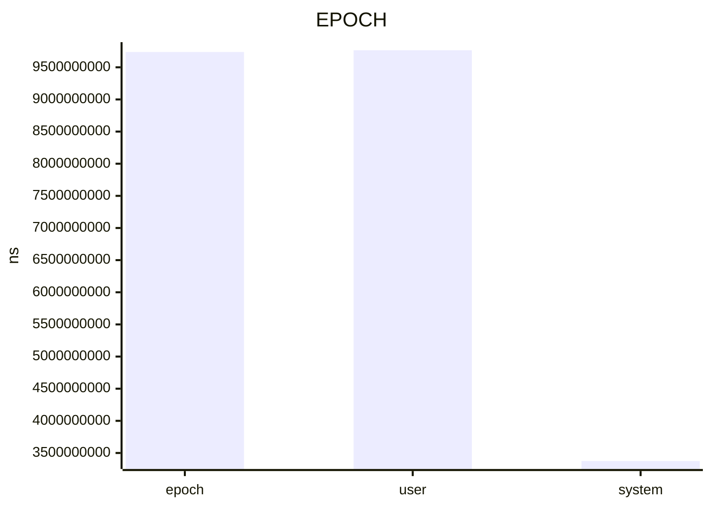

## epoch

+--------+-------+------------+--------------+------------+------------+-------+------+------------+---------------+--------------------+--------------------+
| key    | type  | value      | errorPercent | min        | max        | calls | unit | samples    | baseline      | change             | probability        |
+========+=======+============+==============+============+============+=======+======+============+===============+====================+====================+
| epoch  | float | 9.737955e9 | 0.0          | 9.737955e9 | 9.737955e9 | 1     | ns   | 9.737955e9 | 1.46630272e10 | -33.58837252924144 | 0.3173105078629141 |
+--------+-------+------------+--------------+------------+------------+-------+------+------------+---------------+--------------------+--------------------+
| user   | float | 9.765625e9 | 0.0          | 9.765625e9 | 9.765625e9 | 1     | ns   | 9.765625e9 | 1.4734375e10  | -33.72216330858961 | 0.3173105078629141 |
+--------+-------+------------+--------------+------------+------------+-------+------+------------+---------------+--------------------+--------------------+
| system | float | 3.375e9    | 0.0          | 3.375e9    | 3.375e9    | 1     | ns   | 3.375e9    | 1.2296875e10  | -72.55400254129606 | 0.3173105078629141 |
+--------+-------+------------+--------------+------------+------------+-------+------+------------+---------------+--------------------+--------------------+

## sample

+--------------------------------------------------------------------------------------------------------------------------------------------------------------------------------------------------------------------------------------------------------------------+-------+---------+--------------+---------+---------+-------+-------+---------+----------+--------------------+--------------------+
| key                                                                                                                                                                                                                                                                | type  | value   | errorPercent | min     | max     | calls | unit  | samples | baseline | change             | probability        |
+====================================================================================================================================================================================================================================================================+=======+=========+==============+=========+=========+=======+=======+=========+==========+====================+====================+
| rtl delete boundary descriptor                                                                                                                                                                                                                                     | float | 14.0    | 0.0          | 14.0    | 14.0    | 1     | count | 14      | 17.0     | -17.64705882352941 | 0.3173105078629141 |
+--------------------------------------------------------------------------------------------------------------------------------------------------------------------------------------------------------------------------------------------------------------------+-------+---------+--------------+---------+---------+-------+-------+---------+----------+--------------------+--------------------+
| ldr get dll handle ex                                                                                                                                                                                                                                              | float | 45.0    | 0.0          | 45.0    | 45.0    | 1     | count | 45      | 38.0     | 18.42105263157895  | 0.3173105078629141 |
+--------------------------------------------------------------------------------------------------------------------------------------------------------------------------------------------------------------------------------------------------------------------+-------+---------+--------------+---------+---------+-------+-------+---------+----------+--------------------+--------------------+
| ldr load dll                                                                                                                                                                                                                                                       | float | 27.0    | 0.0          | 27.0    | 27.0    | 1     | count | 27      | 24.0     | 12.5               | 0.3173105078629141 |
+--------------------------------------------------------------------------------------------------------------------------------------------------------------------------------------------------------------------------------------------------------------------+-------+---------+--------------+---------+---------+-------+-------+---------+----------+--------------------+--------------------+
| rtl dos search path U                                                                                                                                                                                                                                              | float | 5.0     | 0.0          | 5.0     | 5.0     | 1     | count | 5       | 6.0      | -16.66666666666666 | 0.3173105078629141 |
+--------------------------------------------------------------------------------------------------------------------------------------------------------------------------------------------------------------------------------------------------------------------+-------+---------+--------------+---------+---------+-------+-------+---------+----------+--------------------+--------------------+
| etw event write no registration                                                                                                                                                                                                                                    | float | 33.0    | 0.0          | 33.0    | 33.0    | 1     | count | 33      | 34.0     | -2.941176470588235 | 0.3173105078629141 |
+--------------------------------------------------------------------------------------------------------------------------------------------------------------------------------------------------------------------------------------------------------------------+-------+---------+--------------+---------+---------+-------+-------+---------+----------+--------------------+--------------------+
| ldr initialize thunk                                                                                                                                                                                                                                               | float | 33.0    | 0.0          | 33.0    | 33.0    | 1     | count | 33      | 36.0     | -8.333333333333332 | 0.3173105078629141 |
+--------------------------------------------------------------------------------------------------------------------------------------------------------------------------------------------------------------------------------------------------------------------+-------+---------+--------------+---------+---------+-------+-------+---------+----------+--------------------+--------------------+
| test open                                                                                                                                                                                                                                                          | float | 1.0     | 0.0          | 1.0     | 1.0     | 1     | count | 1       |          |                    |                    |
+--------------------------------------------------------------------------------------------------------------------------------------------------------------------------------------------------------------------------------------------------------------------+-------+---------+--------------+---------+---------+-------+-------+---------+----------+--------------------+--------------------+
| arm feature usage subscriber flush notification                                                                                                                                                                                                                    | float | 1.0     | 0.0          | 1.0     | 1.0     | 1     | count | 1       | 1.0      | 0.0                | 1.0                |
+--------------------------------------------------------------------------------------------------------------------------------------------------------------------------------------------------------------------------------------------------------------------+-------+---------+--------------+---------+---------+-------+-------+---------+----------+--------------------+--------------------+
| find act ctx section guid                                                                                                                                                                                                                                          | float | 1.0     | 0.0          | 1.0     | 1.0     | 1     | count | 1       | 2.0      | -50.0              | 0.3173105078629141 |
+--------------------------------------------------------------------------------------------------------------------------------------------------------------------------------------------------------------------------------------------------------------------+-------+---------+--------------+---------+---------+-------+-------+---------+----------+--------------------+--------------------+
| get temp path2 W                                                                                                                                                                                                                                                   | float | 3.0     | 0.0          | 3.0     | 3.0     | 1     | count | 3       | 2.0      | 50.0               | 0.3173105078629141 |
+--------------------------------------------------------------------------------------------------------------------------------------------------------------------------------------------------------------------------------------------------------------------+-------+---------+--------------+---------+---------+-------+-------+---------+----------+--------------------+--------------------+
| test recover results                                                                                                                                                                                                                                               | float | 1.0     | 0.0          | 1.0     | 1.0     | 1     | count | 1       |          |                    |                    |
+--------------------------------------------------------------------------------------------------------------------------------------------------------------------------------------------------------------------------------------------------------------------+-------+---------+--------------+---------+---------+-------+-------+---------+----------+--------------------+--------------------+
| load app init dlls                                                                                                                                                                                                                                                 | float | 1.0     | 0.0          | 1.0     | 1.0     | 1     | count | 1       |          |                    |                    |
+--------------------------------------------------------------------------------------------------------------------------------------------------------------------------------------------------------------------------------------------------------------------+-------+---------+--------------+---------+---------+-------+-------+---------+----------+--------------------+--------------------+
| create process internal W                                                                                                                                                                                                                                          | float | 4.0     | 0.0          | 4.0     | 4.0     | 1     | count | 4       | 10.0     | -60.0              | 0.3173105078629141 |
+--------------------------------------------------------------------------------------------------------------------------------------------------------------------------------------------------------------------------------------------------------------------+-------+---------+--------------+---------+---------+-------+-------+---------+----------+--------------------+--------------------+
| rtl wow64 suspend thread                                                                                                                                                                                                                                           | float | 24.0    | 0.0          | 24.0    | 24.0    | 1     | count | 24      | 25.0     | -4.0               | 0.3173105078629141 |
+--------------------------------------------------------------------------------------------------------------------------------------------------------------------------------------------------------------------------------------------------------------------+-------+---------+--------------+---------+---------+-------+-------+---------+----------+--------------------+--------------------+
| rtl raise exception                                                                                                                                                                                                                                                | float | 37.0    | 0.0          | 37.0    | 37.0    | 1     | count | 37      | 31.0     | 19.35483870967742  | 0.3173105078629141 |
+--------------------------------------------------------------------------------------------------------------------------------------------------------------------------------------------------------------------------------------------------------------------+-------+---------+--------------+---------+---------+-------+-------+---------+----------+--------------------+--------------------+
| rtl delete element generic table avl ex                                                                                                                                                                                                                            | float | 17.0    | 0.0          | 17.0    | 17.0    | 1     | count | 17      | 17.0     | 0.0                | 1.0                |
+--------------------------------------------------------------------------------------------------------------------------------------------------------------------------------------------------------------------------------------------------------------------+-------+---------+--------------+---------+---------+-------+-------+---------+----------+--------------------+--------------------+
| ldr get procedure address for caller                                                                                                                                                                                                                               | float | 32.0    | 0.0          | 32.0    | 32.0    | 1     | count | 32      | 34.0     | -5.88235294117647  | 0.3173105078629141 |
+--------------------------------------------------------------------------------------------------------------------------------------------------------------------------------------------------------------------------------------------------------------------+-------+---------+--------------+---------+---------+-------+-------+---------+----------+--------------------+--------------------+
| ldr unload dll                                                                                                                                                                                                                                                     | float | 21.0    | 0.0          | 21.0    | 21.0    | 1     | count | 21      | 23.0     | -8.695652173913043 | 0.3173105078629141 |
+--------------------------------------------------------------------------------------------------------------------------------------------------------------------------------------------------------------------------------------------------------------------+-------+---------+--------------+---------+---------+-------+-------+---------+----------+--------------------+--------------------+
| rtl release SRW lock exclusive                                                                                                                                                                                                                                     | float | 21.0    | 0.0          | 21.0    | 21.0    | 1     | count | 21      | 31.0     | -32.25806451612903 | 0.3173105078629141 |
+--------------------------------------------------------------------------------------------------------------------------------------------------------------------------------------------------------------------------------------------------------------------+-------+---------+--------------+---------+---------+-------+-------+---------+----------+--------------------+--------------------+
| rtl append unicode string to string                                                                                                                                                                                                                                | float | 22.0    | 0.0          | 22.0    | 22.0    | 1     | count | 22      | 22.0     | 0.0                | 1.0                |
+--------------------------------------------------------------------------------------------------------------------------------------------------------------------------------------------------------------------------------------------------------------------+-------+---------+--------------+---------+---------+-------+-------+---------+----------+--------------------+--------------------+
| rtl insert element generic table full avl                                                                                                                                                                                                                          | float | 11.0    | 0.0          | 11.0    | 11.0    | 1     | count | 11      | 15.0     | -26.66666666666667 | 0.3173105078629141 |
+--------------------------------------------------------------------------------------------------------------------------------------------------------------------------------------------------------------------------------------------------------------------+-------+---------+--------------+---------+---------+-------+-------+---------+----------+--------------------+--------------------+
| rtl locate extended feature2                                                                                                                                                                                                                                       | float | 29.0    | 0.0          | 29.0    | 29.0    | 1     | count | 29      | 28.0     | 3.571428571428571  | 0.3173105078629141 |
+--------------------------------------------------------------------------------------------------------------------------------------------------------------------------------------------------------------------------------------------------------------------+-------+---------+--------------+---------+---------+-------+-------+---------+----------+--------------------+--------------------+
| ldr unlock loader lock                                                                                                                                                                                                                                             | float | 5.0     | 0.0          | 5.0     | 5.0     | 1     | count | 5       | 6.0      | -16.66666666666666 | 0.3173105078629141 |
+--------------------------------------------------------------------------------------------------------------------------------------------------------------------------------------------------------------------------------------------------------------------+-------+---------+--------------+---------+---------+-------+-------+---------+----------+--------------------+--------------------+
| rtl free heap                                                                                                                                                                                                                                                      | float | 508.0   | 0.0          | 508.0   | 508.0   | 1     | count | 508     | 774.0    | -34.36692506459949 | 0.3173105078629141 |
+--------------------------------------------------------------------------------------------------------------------------------------------------------------------------------------------------------------------------------------------------------------------+-------+---------+--------------+---------+---------+-------+-------+---------+----------+--------------------+--------------------+
| rtl set environment var                                                                                                                                                                                                                                            | float | 1.0     | 0.0          | 1.0     | 1.0     | 1     | count | 1       |          |                    |                    |
+--------------------------------------------------------------------------------------------------------------------------------------------------------------------------------------------------------------------------------------------------------------------+-------+---------+--------------+---------+---------+-------+-------+---------+----------+--------------------+--------------------+
| rtl set environment variable                                                                                                                                                                                                                                       | float | 1.0     | 0.0          | 1.0     | 1.0     | 1     | count | 1       |          |                    |                    |
+--------------------------------------------------------------------------------------------------------------------------------------------------------------------------------------------------------------------------------------------------------------------+-------+---------+--------------+---------+---------+-------+-------+---------+----------+--------------------+--------------------+
| SE dynamic shim                                                                                                                                                                                                                                                    | float | 7.0     | 0.0          | 7.0     | 7.0     | 1     | count | 7       | 6.0      | 16.66666666666666  | 0.3173105078629141 |
+--------------------------------------------------------------------------------------------------------------------------------------------------------------------------------------------------------------------------------------------------------------------+-------+---------+--------------+---------+---------+-------+-------+---------+----------+--------------------+--------------------+
| SE initialize engine                                                                                                                                                                                                                                               | float | 3.0     | 0.0          | 3.0     | 3.0     | 1     | count | 3       | 4.0      | -25.0              | 0.3173105078629141 |
+--------------------------------------------------------------------------------------------------------------------------------------------------------------------------------------------------------------------------------------------------------------------+-------+---------+--------------+---------+---------+-------+-------+---------+----------+--------------------+--------------------+
| nt set information worker factory                                                                                                                                                                                                                                  | float | 1.0     | 0.0          | 1.0     | 1.0     | 1     | count | 1       |          |                    |                    |
+--------------------------------------------------------------------------------------------------------------------------------------------------------------------------------------------------------------------------------------------------------------------+-------+---------+--------------+---------+---------+-------+-------+---------+----------+--------------------+--------------------+
| tp wait for work                                                                                                                                                                                                                                                   | float | 1.0     | 0.0          | 1.0     | 1.0     | 1     | count | 1       |          |                    |                    |
+--------------------------------------------------------------------------------------------------------------------------------------------------------------------------------------------------------------------------------------------------------------------+-------+---------+--------------+---------+---------+-------+-------+---------+----------+--------------------+--------------------+
| rtl unregister feature configuration change notification                                                                                                                                                                                                           | float | 1.0     | 0.0          | 1.0     | 1.0     | 1     | count | 1       |          |                    |                    |
+--------------------------------------------------------------------------------------------------------------------------------------------------------------------------------------------------------------------------------------------------------------------+-------+---------+--------------+---------+---------+-------+-------+---------+----------+--------------------+--------------------+
| tp callback may run long                                                                                                                                                                                                                                           | float | 1480.0  | 0.0          | 1480.0  | 1480.0  | 1     | count | 1480    | 3865.0   | -61.70763260025873 | 0.3173105078629141 |
+--------------------------------------------------------------------------------------------------------------------------------------------------------------------------------------------------------------------------------------------------------------------+-------+---------+--------------+---------+---------+-------+-------+---------+----------+--------------------+--------------------+
| base thread init thunk                                                                                                                                                                                                                                             | float | 11316.0 | 0.0          | 11316.0 | 11316.0 | 1     | count | 11316   | 18090.0  | -37.44610281923715 | 0.3173105078629141 |
+--------------------------------------------------------------------------------------------------------------------------------------------------------------------------------------------------------------------------------------------------------------------+-------+---------+--------------+---------+---------+-------+-------+---------+----------+--------------------+--------------------+
| rtl user thread start                                                                                                                                                                                                                                              | float | 11315.0 | 0.0          | 11315.0 | 11315.0 | 1     | count | 11315   | 18089.0  | -37.44817292277074 | 0.3173105078629141 |
+--------------------------------------------------------------------------------------------------------------------------------------------------------------------------------------------------------------------------------------------------------------------+-------+---------+--------------+---------+---------+-------+-------+---------+----------+--------------------+--------------------+
| nt protect virtual memory                                                                                                                                                                                                                                          | float | 2.0     | 0.0          | 2.0     | 2.0     | 1     | count | 2       | 4.0      | -50.0              | 0.3173105078629141 |
+--------------------------------------------------------------------------------------------------------------------------------------------------------------------------------------------------------------------------------------------------------------------+-------+---------+--------------+---------+---------+-------+-------+---------+----------+--------------------+--------------------+
| ldr resolve delay loaded API                                                                                                                                                                                                                                       | float | 15.0    | 0.0          | 15.0    | 15.0    | 1     | count | 15      | 14.0     | 7.142857142857142  | 0.3173105078629141 |
+--------------------------------------------------------------------------------------------------------------------------------------------------------------------------------------------------------------------------------------------------------------------+-------+---------+--------------+---------+---------+-------+-------+---------+----------+--------------------+--------------------+
| rtl UTF8 to unicode N                                                                                                                                                                                                                                              | float | 5.0     | 0.0          | 5.0     | 5.0     | 1     | count | 5       | 8.0      | -37.5              | 0.3173105078629141 |
+--------------------------------------------------------------------------------------------------------------------------------------------------------------------------------------------------------------------------------------------------------------------+-------+---------+--------------+---------+---------+-------+-------+---------+----------+--------------------+--------------------+
| rtl valid acl                                                                                                                                                                                                                                                      | float | 21.0    | 0.0          | 21.0    | 21.0    | 1     | count | 21      | 20.0     | 5.0                | 0.3173105078629141 |
+--------------------------------------------------------------------------------------------------------------------------------------------------------------------------------------------------------------------------------------------------------------------+-------+---------+--------------+---------+---------+-------+-------+---------+----------+--------------------+--------------------+
| nt close                                                                                                                                                                                                                                                           | float | 27.0    | 0.0          | 27.0    | 27.0    | 1     | count | 27      | 134.0    | -79.85074626865671 | 0.3173105078629141 |
+--------------------------------------------------------------------------------------------------------------------------------------------------------------------------------------------------------------------------------------------------------------------+-------+---------+--------------+---------+---------+-------+-------+---------+----------+--------------------+--------------------+
| zw query attributes file                                                                                                                                                                                                                                           | float | 17.0    | 0.0          | 17.0    | 17.0    | 1     | count | 17      | 15.0     | 13.33333333333333  | 0.3173105078629141 |
+--------------------------------------------------------------------------------------------------------------------------------------------------------------------------------------------------------------------------------------------------------------------+-------+---------+--------------+---------+---------+-------+-------+---------+----------+--------------------+--------------------+
| ordinal8                                                                                                                                                                                                                                                           | float | 10.0    | 0.0          | 10.0    | 10.0    | 1     | count | 10      | 4.0      | 150.0              | 0.3173105078629141 |
+--------------------------------------------------------------------------------------------------------------------------------------------------------------------------------------------------------------------------------------------------------------------+-------+---------+--------------+---------+---------+-------+-------+---------+----------+--------------------+--------------------+
| rtl get full path name ustr ex                                                                                                                                                                                                                                     | float | 7.0     | 0.0          | 7.0     | 7.0     | 1     | count | 7       | 11.0     | -36.36363636363637 | 0.3173105078629141 |
+--------------------------------------------------------------------------------------------------------------------------------------------------------------------------------------------------------------------------------------------------------------------+-------+---------+--------------+---------+---------+-------+-------+---------+----------+--------------------+--------------------+
| nt open file                                                                                                                                                                                                                                                       | float | 7.0     | 0.0          | 7.0     | 7.0     | 1     | count | 7       | 6.0      | 16.66666666666666  | 0.3173105078629141 |
+--------------------------------------------------------------------------------------------------------------------------------------------------------------------------------------------------------------------------------------------------------------------+-------+---------+--------------+---------+---------+-------+-------+---------+----------+--------------------+--------------------+
| SE dll loaded                                                                                                                                                                                                                                                      | float | 5.0     | 0.0          | 5.0     | 5.0     | 1     | count | 5       | 6.0      | -16.66666666666666 | 0.3173105078629141 |
+--------------------------------------------------------------------------------------------------------------------------------------------------------------------------------------------------------------------------------------------------------------------+-------+---------+--------------+---------+---------+-------+-------+---------+----------+--------------------+--------------------+
| ldr get dll handle by name                                                                                                                                                                                                                                         | float | 5.0     | 0.0          | 5.0     | 5.0     | 1     | count | 5       | 7.0      | -28.57142857142857 | 0.3173105078629141 |
+--------------------------------------------------------------------------------------------------------------------------------------------------------------------------------------------------------------------------------------------------------------------+-------+---------+--------------+---------+---------+-------+-------+---------+----------+--------------------+--------------------+
| rtl release SRW lock shared                                                                                                                                                                                                                                        | float | 1.0     | 0.0          | 1.0     | 1.0     | 1     | count | 1       | 1.0      | 0.0                | 1.0                |
+--------------------------------------------------------------------------------------------------------------------------------------------------------------------------------------------------------------------------------------------------------------------+-------+---------+--------------+---------+---------+-------+-------+---------+----------+--------------------+--------------------+
| ldr find entry for address                                                                                                                                                                                                                                         | float | 1.0     | 0.0          | 1.0     | 1.0     | 1     | count | 1       | 1.0      | 0.0                | 1.0                |
+--------------------------------------------------------------------------------------------------------------------------------------------------------------------------------------------------------------------------------------------------------------------+-------+---------+--------------+---------+---------+-------+-------+---------+----------+--------------------+--------------------+
| rtl unicode to multi byte N                                                                                                                                                                                                                                        | float | 4.0     | 0.0          | 4.0     | 4.0     | 1     | count | 4       | 1.0      | 300.0              | 0.3173105078629141 |
+--------------------------------------------------------------------------------------------------------------------------------------------------------------------------------------------------------------------------------------------------------------------+-------+---------+--------------+---------+---------+-------+-------+---------+----------+--------------------+--------------------+
| wcstombs                                                                                                                                                                                                                                                           | float | 6.0     | 0.0          | 6.0     | 6.0     | 1     | count | 6       | 3.0      | 100.0              | 0.3173105078629141 |
+--------------------------------------------------------------------------------------------------------------------------------------------------------------------------------------------------------------------------------------------------------------------+-------+---------+--------------+---------+---------+-------+-------+---------+----------+--------------------+--------------------+
| vsnprintf                                                                                                                                                                                                                                                          | float | 4.0     | 0.0          | 4.0     | 4.0     | 1     | count | 4       | 2.0      | 100.0              | 0.3173105078629141 |
+--------------------------------------------------------------------------------------------------------------------------------------------------------------------------------------------------------------------------------------------------------------------+-------+---------+--------------+---------+---------+-------+-------+---------+----------+--------------------+--------------------+
| rtl sleep condition variable CS                                                                                                                                                                                                                                    | float | 6.0     | 0.0          | 6.0     | 6.0     | 1     | count | 6       | 2.0      | 200.0              | 0.3173105078629141 |
+--------------------------------------------------------------------------------------------------------------------------------------------------------------------------------------------------------------------------------------------------------------------+-------+---------+--------------+---------+---------+-------+-------+---------+----------+--------------------+--------------------+
| load library ex W                                                                                                                                                                                                                                                  | float | 24.0    | 0.0          | 24.0    | 24.0    | 1     | count | 24      | 20.0     | 20.0               | 0.3173105078629141 |
+--------------------------------------------------------------------------------------------------------------------------------------------------------------------------------------------------------------------------------------------------------------------+-------+---------+--------------+---------+---------+-------+-------+---------+----------+--------------------+--------------------+
| fputws                                                                                                                                                                                                                                                             | float | 1.0     | 0.0          | 1.0     | 1.0     | 1     | count | 1       |          |                    |                    |
+--------------------------------------------------------------------------------------------------------------------------------------------------------------------------------------------------------------------------------------------------------------------+-------+---------+--------------+---------+---------+-------+-------+---------+----------+--------------------+--------------------+
| wcscat s                                                                                                                                                                                                                                                           | float | 1.0     | 0.0          | 1.0     | 1.0     | 1     | count | 1       |          |                    |                    |
+--------------------------------------------------------------------------------------------------------------------------------------------------------------------------------------------------------------------------------------------------------------------+-------+---------+--------------+---------+---------+-------+-------+---------+----------+--------------------+--------------------+
| wcslwr s l                                                                                                                                                                                                                                                         | float | 1.0     | 0.0          | 1.0     | 1.0     | 1     | count | 1       |          |                    |                    |
+--------------------------------------------------------------------------------------------------------------------------------------------------------------------------------------------------------------------------------------------------------------------+-------+---------+--------------+---------+---------+-------+-------+---------+----------+--------------------+--------------------+
| mbrtowc                                                                                                                                                                                                                                                            | float | 1.0     | 0.0          | 1.0     | 1.0     | 1     | count | 1       |          |                    |                    |
+--------------------------------------------------------------------------------------------------------------------------------------------------------------------------------------------------------------------------------------------------------------------+-------+---------+--------------+---------+---------+-------+-------+---------+----------+--------------------+--------------------+
| ftime64                                                                                                                                                                                                                                                            | float | 1.0     | 0.0          | 1.0     | 1.0     | 1     | count | 1       |          |                    |                    |
+--------------------------------------------------------------------------------------------------------------------------------------------------------------------------------------------------------------------------------------------------------------------+-------+---------+--------------+---------+---------+-------+-------+---------+----------+--------------------+--------------------+
| towlower l                                                                                                                                                                                                                                                         | float | 2.0     | 0.0          | 2.0     | 2.0     | 1     | count | 2       |          |                    |                    |
+--------------------------------------------------------------------------------------------------------------------------------------------------------------------------------------------------------------------------------------------------------------------+-------+---------+--------------+---------+---------+-------+-------+---------+----------+--------------------+--------------------+
| exit windows ex                                                                                                                                                                                                                                                    | float | 3.0     | 0.0          | 3.0     | 3.0     | 1     | count | 3       | 1.0      | 200.0              | 0.3173105078629141 |
+--------------------------------------------------------------------------------------------------------------------------------------------------------------------------------------------------------------------------------------------------------------------+-------+---------+--------------+---------+---------+-------+-------+---------+----------+--------------------+--------------------+
| create DXGI factory2                                                                                                                                                                                                                                               | float | 5.0     | 0.0          | 5.0     | 5.0     | 1     | count | 5       | 3.0      | 66.66666666666666  | 0.3173105078629141 |
+--------------------------------------------------------------------------------------------------------------------------------------------------------------------------------------------------------------------------------------------------------------------+-------+---------+--------------+---------+---------+-------+-------+---------+----------+--------------------+--------------------+
| initterm                                                                                                                                                                                                                                                           | float | 4.0     | 0.0          | 4.0     | 4.0     | 1     | count | 4       | 4.0      | 0.0                | 1.0                |
+--------------------------------------------------------------------------------------------------------------------------------------------------------------------------------------------------------------------------------------------------------------------+-------+---------+--------------+---------+---------+-------+-------+---------+----------+--------------------+--------------------+
| set app compat string pointer                                                                                                                                                                                                                                      | float | 4.0     | 0.0          | 4.0     | 4.0     | 1     | count | 4       | 3.0      | 33.33333333333333  | 0.3173105078629141 |
+--------------------------------------------------------------------------------------------------------------------------------------------------------------------------------------------------------------------------------------------------------------------+-------+---------+--------------+---------+---------+-------+-------+---------+----------+--------------------+--------------------+
| rtl image directory entry to data                                                                                                                                                                                                                                  | float | 12.0    | 0.0          | 12.0    | 12.0    | 1     | count | 12      | 9.0      | 33.33333333333333  | 0.3173105078629141 |
+--------------------------------------------------------------------------------------------------------------------------------------------------------------------------------------------------------------------------------------------------------------------+-------+---------+--------------+---------+---------+-------+-------+---------+----------+--------------------+--------------------+
| rect visible                                                                                                                                                                                                                                                       | float | 1.0     | 0.0          | 1.0     | 1.0     | 1     | count | 1       |          |                    |                    |
+--------------------------------------------------------------------------------------------------------------------------------------------------------------------------------------------------------------------------------------------------------------------+-------+---------+--------------+---------+---------+-------+-------+---------+----------+--------------------+--------------------+
| abort path                                                                                                                                                                                                                                                         | float | 1.0     | 0.0          | 1.0     | 1.0     | 1     | count | 1       |          |                    |                    |
+--------------------------------------------------------------------------------------------------------------------------------------------------------------------------------------------------------------------------------------------------------------------+-------+---------+--------------+---------+---------+-------+-------+---------+----------+--------------------+--------------------+
| client thread setup                                                                                                                                                                                                                                                | float | 2.0     | 0.0          | 2.0     | 2.0     | 1     | count | 2       |          |                    |                    |
+--------------------------------------------------------------------------------------------------------------------------------------------------------------------------------------------------------------------------------------------------------------------+-------+---------+--------------+---------+---------+-------+-------+---------+----------+--------------------+--------------------+
| update layered window                                                                                                                                                                                                                                              | float | 2.0     | 0.0          | 2.0     | 2.0     | 1     | count | 2       |          |                    |                    |
+--------------------------------------------------------------------------------------------------------------------------------------------------------------------------------------------------------------------------------------------------------------------+-------+---------+--------------+---------+---------+-------+-------+---------+----------+--------------------+--------------------+
| ki user callback dispatcher                                                                                                                                                                                                                                        | float | 72.0    | 0.0          | 72.0    | 72.0    | 1     | count | 72      | 72.0     | 0.0                | 1.0                |
+--------------------------------------------------------------------------------------------------------------------------------------------------------------------------------------------------------------------------------------------------------------------+-------+---------+--------------+---------+---------+-------+-------+---------+----------+--------------------+--------------------+
| nt gdi init2                                                                                                                                                                                                                                                       | float | 2.0     | 0.0          | 2.0     | 2.0     | 1     | count | 2       | 1.0      | 100.0              | 0.3173105078629141 |
+--------------------------------------------------------------------------------------------------------------------------------------------------------------------------------------------------------------------------------------------------------------------+-------+---------+--------------+---------+---------+-------+-------+---------+----------+--------------------+--------------------+
| set brush attributes                                                                                                                                                                                                                                               | float | 2.0     | 0.0          | 2.0     | 2.0     | 1     | count | 2       | 1.0      | 100.0              | 0.3173105078629141 |
+--------------------------------------------------------------------------------------------------------------------------------------------------------------------------------------------------------------------------------------------------------------------+-------+---------+--------------+---------+---------+-------+-------+---------+----------+--------------------+--------------------+
| create color space W                                                                                                                                                                                                                                               | float | 2.0     | 0.0          | 2.0     | 2.0     | 1     | count | 2       | 1.0      | 100.0              | 0.3173105078629141 |
+--------------------------------------------------------------------------------------------------------------------------------------------------------------------------------------------------------------------------------------------------------------------+-------+---------+--------------+---------+---------+-------+-------+---------+----------+--------------------+--------------------+
| gdi dll initialize                                                                                                                                                                                                                                                 | float | 2.0     | 0.0          | 2.0     | 2.0     | 1     | count | 2       | 1.0      | 100.0              | 0.3173105078629141 |
+--------------------------------------------------------------------------------------------------------------------------------------------------------------------------------------------------------------------------------------------------------------------+-------+---------+--------------+---------+---------+-------+-------+---------+----------+--------------------+--------------------+
| rtl enter critical section                                                                                                                                                                                                                                         | float | 10.0    | 0.0          | 10.0    | 10.0    | 1     | count | 10      | 14.0     | -28.57142857142857 | 0.3173105078629141 |
+--------------------------------------------------------------------------------------------------------------------------------------------------------------------------------------------------------------------------------------------------------------------+-------+---------+--------------+---------+---------+-------+-------+---------+----------+--------------------+--------------------+
| freefls                                                                                                                                                                                                                                                            | float | 2.0     | 0.0          | 2.0     | 2.0     | 1     | count | 2       |          |                    |                    |
+--------------------------------------------------------------------------------------------------------------------------------------------------------------------------------------------------------------------------------------------------------------------+-------+---------+--------------+---------+---------+-------+-------+---------+----------+--------------------+--------------------+
| wgetmainargs                                                                                                                                                                                                                                                       | float | 1.0     | 0.0          | 1.0     | 1.0     | 1     | count | 1       |          |                    |                    |
+--------------------------------------------------------------------------------------------------------------------------------------------------------------------------------------------------------------------------------------------------------------------+-------+---------+--------------+---------+---------+-------+-------+---------+----------+--------------------+--------------------+
| wfindnexti64                                                                                                                                                                                                                                                       | float | 2.0     | 0.0          | 2.0     | 2.0     | 1     | count | 2       | 2.0      | 0.0                | 1.0                |
+--------------------------------------------------------------------------------------------------------------------------------------------------------------------------------------------------------------------------------------------------------------------+-------+---------+--------------+---------+---------+-------+-------+---------+----------+--------------------+--------------------+
| get proc address                                                                                                                                                                                                                                                   | float | 12.0    | 0.0          | 12.0    | 12.0    | 1     | count | 12      | 9.0      | 33.33333333333333  | 0.3173105078629141 |
+--------------------------------------------------------------------------------------------------------------------------------------------------------------------------------------------------------------------------------------------------------------------+-------+---------+--------------+---------+---------+-------+-------+---------+----------+--------------------+--------------------+
| SHELL32 lookup back icon index                                                                                                                                                                                                                                     | float | 2.0     | 0.0          | 2.0     | 2.0     | 1     | count | 2       | 1.0      | 100.0              | 0.3173105078629141 |
+--------------------------------------------------------------------------------------------------------------------------------------------------------------------------------------------------------------------------------------------------------------------+-------+---------+--------------+---------+---------+-------+-------+---------+----------+--------------------+--------------------+
| SH get folder path and sub dir W                                                                                                                                                                                                                                   | float | 1.0     | 0.0          | 1.0     | 1.0     | 1     | count | 1       |          |                    |                    |
+--------------------------------------------------------------------------------------------------------------------------------------------------------------------------------------------------------------------------------------------------------------------+-------+---------+--------------+---------+---------+-------+-------+---------+----------+--------------------+--------------------+
| rtl free memory block lookaside                                                                                                                                                                                                                                    | float | 1.0     | 0.0          | 1.0     | 1.0     | 1     | count | 1       | 1.0      | 0.0                | 1.0                |
+--------------------------------------------------------------------------------------------------------------------------------------------------------------------------------------------------------------------------------------------------------------------+-------+---------+--------------+---------+---------+-------+-------+---------+----------+--------------------+--------------------+
| rtl query internal feature configuration                                                                                                                                                                                                                           | float | 1.0     | 0.0          | 1.0     | 1.0     | 1     | count | 1       | 2.0      | -50.0              | 0.3173105078629141 |
+--------------------------------------------------------------------------------------------------------------------------------------------------------------------------------------------------------------------------------------------------------------------+-------+---------+--------------+---------+---------+-------+-------+---------+----------+--------------------+--------------------+
| rtl query feature configuration                                                                                                                                                                                                                                    | float | 1.0     | 0.0          | 1.0     | 1.0     | 1     | count | 1       | 2.0      | -50.0              | 0.3173105078629141 |
+--------------------------------------------------------------------------------------------------------------------------------------------------------------------------------------------------------------------------------------------------------------------+-------+---------+--------------+---------+---------+-------+-------+---------+----------+--------------------+--------------------+
| rtl notify feature usage                                                                                                                                                                                                                                           | float | 1.0     | 0.0          | 1.0     | 1.0     | 1     | count | 1       |          |                    |                    |
+--------------------------------------------------------------------------------------------------------------------------------------------------------------------------------------------------------------------------------------------------------------------+-------+---------+--------------+---------+---------+-------+-------+---------+----------+--------------------+--------------------+
| rtl query all internal feature configurations                                                                                                                                                                                                                      | float | 1.0     | 0.0          | 1.0     | 1.0     | 1     | count | 1       |          |                    |                    |
+--------------------------------------------------------------------------------------------------------------------------------------------------------------------------------------------------------------------------------------------------------------------+-------+---------+--------------+---------+---------+-------+-------+---------+----------+--------------------+--------------------+
| rtl io encode mem io resource                                                                                                                                                                                                                                      | float | 1.0     | 0.0          | 1.0     | 1.0     | 1     | count | 1       |          |                    |                    |
+--------------------------------------------------------------------------------------------------------------------------------------------------------------------------------------------------------------------------------------------------------------------+-------+---------+--------------+---------+---------+-------+-------+---------+----------+--------------------+--------------------+
| rtl get suite mask                                                                                                                                                                                                                                                 | float | 27.0    | 0.0          | 27.0    | 27.0    | 1     | count | 27      | 18.0     | 50.0               | 0.3173105078629141 |
+--------------------------------------------------------------------------------------------------------------------------------------------------------------------------------------------------------------------------------------------------------------------+-------+---------+--------------+---------+---------+-------+-------+---------+----------+--------------------+--------------------+
| rtl query wnf state data with explicit scope                                                                                                                                                                                                                       | float | 33.0    | 0.0          | 33.0    | 33.0    | 1     | count | 33      | 23.0     | 43.47826086956522  | 0.3173105078629141 |
+--------------------------------------------------------------------------------------------------------------------------------------------------------------------------------------------------------------------------------------------------------------------+-------+---------+--------------+---------+---------+-------+-------+---------+----------+--------------------+--------------------+
| rtl size heap                                                                                                                                                                                                                                                      | float | 1034.0  | 0.0          | 1034.0  | 1034.0  | 1     | count | 1034    | 1552.0   | -33.37628865979381 | 0.3173105078629141 |
+--------------------------------------------------------------------------------------------------------------------------------------------------------------------------------------------------------------------------------------------------------------------+-------+---------+--------------+---------+---------+-------+-------+---------+----------+--------------------+--------------------+
| rtl allocate heap                                                                                                                                                                                                                                                  | float | 882.0   | 0.0          | 882.0   | 882.0   | 1     | count | 882     | 1205.0   | -26.80497925311203 | 0.3173105078629141 |
+--------------------------------------------------------------------------------------------------------------------------------------------------------------------------------------------------------------------------------------------------------------------+-------+---------+--------------+---------+---------+-------+-------+---------+----------+--------------------+--------------------+
| EVE exe                                                                                                                                                                                                                                                            | float | 11164.0 | 0.0          | 11164.0 | 11164.0 | 1     | count | 11164   | 17477.0  | -36.12176002746467 | 0.3173105078629141 |
+--------------------------------------------------------------------------------------------------------------------------------------------------------------------------------------------------------------------------------------------------------------------+-------+---------+--------------+---------+---------+-------+-------+---------+----------+--------------------+--------------------+
| rtl virtual unwind2                                                                                                                                                                                                                                                | float | 10.0    | 0.0          | 10.0    | 10.0    | 1     | count | 10      | 6.0      | 66.66666666666666  | 0.3173105078629141 |
+--------------------------------------------------------------------------------------------------------------------------------------------------------------------------------------------------------------------------------------------------------------------+-------+---------+--------------+---------+---------+-------+-------+---------+----------+--------------------+--------------------+
| rtl walk frame chain                                                                                                                                                                                                                                               | float | 10.0    | 0.0          | 10.0    | 10.0    | 1     | count | 10      | 6.0      | 66.66666666666666  | 0.3173105078629141 |
+--------------------------------------------------------------------------------------------------------------------------------------------------------------------------------------------------------------------------------------------------------------------+-------+---------+--------------+---------+---------+-------+-------+---------+----------+--------------------+--------------------+
| rtl capture stack back trace                                                                                                                                                                                                                                       | float | 10.0    | 0.0          | 10.0    | 10.0    | 1     | count | 10      | 6.0      | 66.66666666666666  | 0.3173105078629141 |
+--------------------------------------------------------------------------------------------------------------------------------------------------------------------------------------------------------------------------------------------------------------------+-------+---------+--------------+---------+---------+-------+-------+---------+----------+--------------------+--------------------+
| SE get proc address for caller                                                                                                                                                                                                                                     | float | 9.0     | 0.0          | 9.0     | 9.0     | 1     | count | 9       | 8.0      | 12.5               | 0.3173105078629141 |
+--------------------------------------------------------------------------------------------------------------------------------------------------------------------------------------------------------------------------------------------------------------------+-------+---------+--------------+---------+---------+-------+-------+---------+----------+--------------------+--------------------+
| co set outgoing call state                                                                                                                                                                                                                                         | float | 1.0     | 0.0          | 1.0     | 1.0     | 1     | count | 1       |          |                    |                    |
+--------------------------------------------------------------------------------------------------------------------------------------------------------------------------------------------------------------------------------------------------------------------+-------+---------+--------------+---------+---------+-------+-------+---------+----------+--------------------+--------------------+
| set error info                                                                                                                                                                                                                                                     | float | 1.0     | 0.0          | 1.0     | 1.0     | 1     | count | 1       |          |                    |                    |
+--------------------------------------------------------------------------------------------------------------------------------------------------------------------------------------------------------------------------------------------------------------------+-------+---------+--------------+---------+---------+-------+-------+---------+----------+--------------------+--------------------+
| C std async stub buffer query interface                                                                                                                                                                                                                            | float | 4.0     | 0.0          | 4.0     | 4.0     | 1     | count | 4       | 6.0      | -33.33333333333333 | 0.3173105078629141 |
+--------------------------------------------------------------------------------------------------------------------------------------------------------------------------------------------------------------------------------------------------------------------+-------+---------+--------------+---------+---------+-------+-------+---------+----------+--------------------+--------------------+
| co uninitialize                                                                                                                                                                                                                                                    | float | 1.0     | 0.0          | 1.0     | 1.0     | 1     | count | 1       | 3.0      | -66.66666666666666 | 0.3173105078629141 |
+--------------------------------------------------------------------------------------------------------------------------------------------------------------------------------------------------------------------------------------------------------------------+-------+---------+--------------+---------+---------+-------+-------+---------+----------+--------------------+--------------------+
| ordinal101                                                                                                                                                                                                                                                         | float | 1.0     | 0.0          | 1.0     | 1.0     | 1     | count | 1       | 1.0      | 0.0                | 1.0                |
+--------------------------------------------------------------------------------------------------------------------------------------------------------------------------------------------------------------------------------------------------------------------+-------+---------+--------------+---------+---------+-------+-------+---------+----------+--------------------+--------------------+
| internal set ole thunk wow ptr                                                                                                                                                                                                                                     | float | 1.0     | 0.0          | 1.0     | 1.0     | 1     | count | 1       | 1.0      | 0.0                | 1.0                |
+--------------------------------------------------------------------------------------------------------------------------------------------------------------------------------------------------------------------------------------------------------------------+-------+---------+--------------+---------+---------+-------+-------+---------+----------+--------------------+--------------------+
| co initialize ex                                                                                                                                                                                                                                                   | float | 1.0     | 0.0          | 1.0     | 1.0     | 1     | count | 1       | 2.0      | -50.0              | 0.3173105078629141 |
+--------------------------------------------------------------------------------------------------------------------------------------------------------------------------------------------------------------------------------------------------------------------+-------+---------+--------------+---------+---------+-------+-------+---------+----------+--------------------+--------------------+
| create bind ctx                                                                                                                                                                                                                                                    | float | 1.0     | 0.0          | 1.0     | 1.0     | 1     | count | 1       | 1.0      | 0.0                | 1.0                |
+--------------------------------------------------------------------------------------------------------------------------------------------------------------------------------------------------------------------------------------------------------------------+-------+---------+--------------+---------+---------+-------+-------+---------+----------+--------------------+--------------------+
| nt user build hwnd list                                                                                                                                                                                                                                            | float | 1.0     | 0.0          | 1.0     | 1.0     | 1     | count | 1       |          |                    |                    |
+--------------------------------------------------------------------------------------------------------------------------------------------------------------------------------------------------------------------------------------------------------------------+-------+---------+--------------+---------+---------+-------+-------+---------+----------+--------------------+--------------------+
| enum windows                                                                                                                                                                                                                                                       | float | 1.0     | 0.0          | 1.0     | 1.0     | 1     | count | 1       | 1.0      | 0.0                | 1.0                |
+--------------------------------------------------------------------------------------------------------------------------------------------------------------------------------------------------------------------------------------------------------------------+-------+---------+--------------+---------+---------+-------+-------+---------+----------+--------------------+--------------------+
| nt allocate virtual memory                                                                                                                                                                                                                                         | float | 10.0    | 0.0          | 10.0    | 10.0    | 1     | count | 10      | 5.0      | 100.0              | 0.3173105078629141 |
+--------------------------------------------------------------------------------------------------------------------------------------------------------------------------------------------------------------------------------------------------------------------+-------+---------+--------------+---------+---------+-------+-------+---------+----------+--------------------+--------------------+
| SH create directory ex A                                                                                                                                                                                                                                           | float | 1.0     | 0.0          | 1.0     | 1.0     | 1     | count | 1       | 1.0      | 0.0                | 1.0                |
+--------------------------------------------------------------------------------------------------------------------------------------------------------------------------------------------------------------------------------------------------------------------+-------+---------+--------------+---------+---------+-------+-------+---------+----------+--------------------+--------------------+
| initterm e                                                                                                                                                                                                                                                         | float | 1.0     | 0.0          | 1.0     | 1.0     | 1     | count | 1       |          |                    |                    |
+--------------------------------------------------------------------------------------------------------------------------------------------------------------------------------------------------------------------------------------------------------------------+-------+---------+--------------+---------+---------+-------+-------+---------+----------+--------------------+--------------------+
| path cleanup spec                                                                                                                                                                                                                                                  | float | 1.0     | 0.0          | 1.0     | 1.0     | 1     | count | 1       | 1.0      | 0.0                | 1.0                |
+--------------------------------------------------------------------------------------------------------------------------------------------------------------------------------------------------------------------------------------------------------------------+-------+---------+--------------+---------+---------+-------+-------+---------+----------+--------------------+--------------------+
| rebase on drive letter                                                                                                                                                                                                                                             | float | 1.0     | 0.0          | 1.0     | 1.0     | 1     | count | 1       |          |                    |                    |
+--------------------------------------------------------------------------------------------------------------------------------------------------------------------------------------------------------------------------------------------------------------------+-------+---------+--------------+---------+---------+-------+-------+---------+----------+--------------------+--------------------+
| SH get special folder path W                                                                                                                                                                                                                                       | float | 3.0     | 0.0          | 3.0     | 3.0     | 1     | count | 3       | 3.0      | 0.0                | 1.0                |
+--------------------------------------------------------------------------------------------------------------------------------------------------------------------------------------------------------------------------------------------------------------------+-------+---------+--------------+---------+---------+-------+-------+---------+----------+--------------------+--------------------+
| dll can unload now                                                                                                                                                                                                                                                 | float | 1.0     | 0.0          | 1.0     | 1.0     | 1     | count | 1       | 2.0      | -50.0              | 0.3173105078629141 |
+--------------------------------------------------------------------------------------------------------------------------------------------------------------------------------------------------------------------------------------------------------------------+-------+---------+--------------+---------+---------+-------+-------+---------+----------+--------------------+--------------------+
| path resolve                                                                                                                                                                                                                                                       | float | 3.0     | 0.0          | 3.0     | 3.0     | 1     | count | 3       | 3.0      | 0.0                | 1.0                |
+--------------------------------------------------------------------------------------------------------------------------------------------------------------------------------------------------------------------------------------------------------------------+-------+---------+--------------+---------+---------+-------+-------+---------+----------+--------------------+--------------------+
| SH get folder path ex                                                                                                                                                                                                                                              | float | 3.0     | 0.0          | 3.0     | 3.0     | 1     | count | 3       | 3.0      | 0.0                | 1.0                |
+--------------------------------------------------------------------------------------------------------------------------------------------------------------------------------------------------------------------------------------------------------------------+-------+---------+--------------+---------+---------+-------+-------+---------+----------+--------------------+--------------------+
| ordinal130                                                                                                                                                                                                                                                         | float | 1.0     | 0.0          | 1.0     | 1.0     | 1     | count | 1       |          |                    |                    |
+--------------------------------------------------------------------------------------------------------------------------------------------------------------------------------------------------------------------------------------------------------------------+-------+---------+--------------+---------+---------+-------+-------+---------+----------+--------------------+--------------------+
| nt free virtual memory                                                                                                                                                                                                                                             | float | 48.0    | 0.0          | 48.0    | 48.0    | 1     | count | 48      | 66.0     | -27.27272727272727 | 0.3173105078629141 |
+--------------------------------------------------------------------------------------------------------------------------------------------------------------------------------------------------------------------------------------------------------------------+-------+---------+--------------+---------+---------+-------+-------+---------+----------+--------------------+--------------------+
| rtl char to integer                                                                                                                                                                                                                                                | float | 48.0    | 0.0          | 48.0    | 48.0    | 1     | count | 48      | 67.0     | -28.35820895522388 | 0.3173105078629141 |
+--------------------------------------------------------------------------------------------------------------------------------------------------------------------------------------------------------------------------------------------------------------------+-------+---------+--------------+---------+---------+-------+-------+---------+----------+--------------------+--------------------+
| D write create factory                                                                                                                                                                                                                                             | float | 2.0     | 0.0          | 2.0     | 2.0     | 1     | count | 2       | 2.0      | 0.0                | 1.0                |
+--------------------------------------------------------------------------------------------------------------------------------------------------------------------------------------------------------------------------------------------------------------------+-------+---------+--------------+---------+---------+-------+-------+---------+----------+--------------------+--------------------+
| D write dll                                                                                                                                                                                                                                                        | float | 5.0     | 0.0          | 5.0     | 5.0     | 1     | count | 5       | 6.0      | -16.66666666666666 | 0.3173105078629141 |
+--------------------------------------------------------------------------------------------------------------------------------------------------------------------------------------------------------------------------------------------------------------------+-------+---------+--------------+---------+---------+-------+-------+---------+----------+--------------------+--------------------+
| zw create thread ex                                                                                                                                                                                                                                                | float | 2.0     | 0.0          | 2.0     | 2.0     | 1     | count | 2       | 4.0      | -50.0              | 0.3173105078629141 |
+--------------------------------------------------------------------------------------------------------------------------------------------------------------------------------------------------------------------------------------------------------------------+-------+---------+--------------+---------+---------+-------+-------+---------+----------+--------------------+--------------------+
| create remote thread ex                                                                                                                                                                                                                                            | float | 2.0     | 0.0          | 2.0     | 2.0     | 1     | count | 2       | 4.0      | -50.0              | 0.3173105078629141 |
+--------------------------------------------------------------------------------------------------------------------------------------------------------------------------------------------------------------------------------------------------------------------+-------+---------+--------------+---------+---------+-------+-------+---------+----------+--------------------+--------------------+
| create thread                                                                                                                                                                                                                                                      | float | 2.0     | 0.0          | 2.0     | 2.0     | 1     | count | 2       | 4.0      | -50.0              | 0.3173105078629141 |
+--------------------------------------------------------------------------------------------------------------------------------------------------------------------------------------------------------------------------------------------------------------------+-------+---------+--------------+---------+---------+-------+-------+---------+----------+--------------------+--------------------+
| get file attributes W                                                                                                                                                                                                                                              | float | 5.0     | 0.0          | 5.0     | 5.0     | 1     | count | 5       | 10.0     | -50.0              | 0.3173105078629141 |
+--------------------------------------------------------------------------------------------------------------------------------------------------------------------------------------------------------------------------------------------------------------------+-------+---------+--------------+---------+---------+-------+-------+---------+----------+--------------------+--------------------+
| get thread flags                                                                                                                                                                                                                                                   | float | 1.0     | 0.0          | 1.0     | 1.0     | 1     | count | 1       | 1.0      | 0.0                | 1.0                |
+--------------------------------------------------------------------------------------------------------------------------------------------------------------------------------------------------------------------------------------------------------------------+-------+---------+--------------+---------+---------+-------+-------+---------+----------+--------------------+--------------------+
| ordinal764                                                                                                                                                                                                                                                         | float | 1.0     | 0.0          | 1.0     | 1.0     | 1     | count | 1       | 1.0      | 0.0                | 1.0                |
+--------------------------------------------------------------------------------------------------------------------------------------------------------------------------------------------------------------------------------------------------------------------+-------+---------+--------------+---------+---------+-------+-------+---------+----------+--------------------+--------------------+
| vsnwprintf                                                                                                                                                                                                                                                         | float | 2.0     | 0.0          | 2.0     | 2.0     | 1     | count | 2       | 1.0      | 100.0              | 0.3173105078629141 |
+--------------------------------------------------------------------------------------------------------------------------------------------------------------------------------------------------------------------------------------------------------------------+-------+---------+--------------+---------+---------+-------+-------+---------+----------+--------------------+--------------------+
| get security descriptor length                                                                                                                                                                                                                                     | float | 1.0     | 0.0          | 1.0     | 1.0     | 1     | count | 1       | 1.0      | 0.0                | 1.0                |
+--------------------------------------------------------------------------------------------------------------------------------------------------------------------------------------------------------------------------------------------------------------------+-------+---------+--------------+---------+---------+-------+-------+---------+----------+--------------------+--------------------+
| time                                                                                                                                                                                                                                                               | float | 1.0     | 0.0          | 1.0     | 1.0     | 1     | count | 1       | 2.0      | -50.0              | 0.3173105078629141 |
+--------------------------------------------------------------------------------------------------------------------------------------------------------------------------------------------------------------------------------------------------------------------+-------+---------+--------------+---------+---------+-------+-------+---------+----------+--------------------+--------------------+
| find packages by package family                                                                                                                                                                                                                                    | float | 2.0     | 0.0          | 2.0     | 2.0     | 1     | count | 2       | 1.0      | 100.0              | 0.3173105078629141 |
+--------------------------------------------------------------------------------------------------------------------------------------------------------------------------------------------------------------------------------------------------------------------+-------+---------+--------------+---------+---------+-------+-------+---------+----------+--------------------+--------------------+
| get packages by package family                                                                                                                                                                                                                                     | float | 2.0     | 0.0          | 2.0     | 2.0     | 1     | count | 2       | 1.0      | 100.0              | 0.3173105078629141 |
+--------------------------------------------------------------------------------------------------------------------------------------------------------------------------------------------------------------------------------------------------------------------+-------+---------+--------------+---------+---------+-------+-------+---------+----------+--------------------+--------------------+
| vk reset event                                                                                                                                                                                                                                                     | float | 63.0    | 0.0          | 63.0    | 63.0    | 1     | count | 63      | 73.0     | -13.6986301369863  | 0.3173105078629141 |
+--------------------------------------------------------------------------------------------------------------------------------------------------------------------------------------------------------------------------------------------------------------------+-------+---------+--------------+---------+---------+-------+-------+---------+----------+--------------------+--------------------+
| tp set timer ex                                                                                                                                                                                                                                                    | float | 2.0     | 0.0          | 2.0     | 2.0     | 1     | count | 2       |          |                    |                    |
+--------------------------------------------------------------------------------------------------------------------------------------------------------------------------------------------------------------------------------------------------------------------+-------+---------+--------------+---------+---------+-------+-------+---------+----------+--------------------+--------------------+
| ordinal1002                                                                                                                                                                                                                                                        | float | 1.0     | 0.0          | 1.0     | 1.0     | 1     | count | 1       |          |                    |                    |
+--------------------------------------------------------------------------------------------------------------------------------------------------------------------------------------------------------------------------------------------------------------------+-------+---------+--------------+---------+---------+-------+-------+---------+----------+--------------------+--------------------+
| crypt get async param                                                                                                                                                                                                                                              | float | 1.0     | 0.0          | 1.0     | 1.0     | 1     | count | 1       |          |                    |                    |
+--------------------------------------------------------------------------------------------------------------------------------------------------------------------------------------------------------------------------------------------------------------------+-------+---------+--------------+---------+---------+-------+-------+---------+----------+--------------------+--------------------+
| crypt enum OID info                                                                                                                                                                                                                                                | float | 1.0     | 0.0          | 1.0     | 1.0     | 1     | count | 1       |          |                    |                    |
+--------------------------------------------------------------------------------------------------------------------------------------------------------------------------------------------------------------------------------------------------------------------+-------+---------+--------------+---------+---------+-------+-------+---------+----------+--------------------+--------------------+
| I crypt get oss global                                                                                                                                                                                                                                             | float | 1.0     | 0.0          | 1.0     | 1.0     | 1     | count | 1       |          |                    |                    |
+--------------------------------------------------------------------------------------------------------------------------------------------------------------------------------------------------------------------------------------------------------------------+-------+---------+--------------+---------+---------+-------+-------+---------+----------+--------------------+--------------------+
| ordinal1005                                                                                                                                                                                                                                                        | float | 1.0     | 0.0          | 1.0     | 1.0     | 1     | count | 1       |          |                    |                    |
+--------------------------------------------------------------------------------------------------------------------------------------------------------------------------------------------------------------------------------------------------------------------+-------+---------+--------------+---------+---------+-------+-------+---------+----------+--------------------+--------------------+
| get proc address for caller                                                                                                                                                                                                                                        | float | 6.0     | 0.0          | 6.0     | 6.0     | 1     | count | 6       | 6.0      | 0.0                | 1.0                |
+--------------------------------------------------------------------------------------------------------------------------------------------------------------------------------------------------------------------------------------------------------------------+-------+---------+--------------+---------+---------+-------+-------+---------+----------+--------------------+--------------------+
| nt create file                                                                                                                                                                                                                                                     | float | 245.0   | 0.0          | 245.0   | 245.0   | 1     | count | 245     | 311.0    | -21.22186495176849 | 0.3173105078629141 |
+--------------------------------------------------------------------------------------------------------------------------------------------------------------------------------------------------------------------------------------------------------------------+-------+---------+--------------+---------+---------+-------+-------+---------+----------+--------------------+--------------------+
| get drive type W                                                                                                                                                                                                                                                   | float | 252.0   | 0.0          | 252.0   | 252.0   | 1     | count | 252     | 321.0    | -21.49532710280374 | 0.3173105078629141 |
+--------------------------------------------------------------------------------------------------------------------------------------------------------------------------------------------------------------------------------------------------------------------+-------+---------+--------------+---------+---------+-------+-------+---------+----------+--------------------+--------------------+
| create file W                                                                                                                                                                                                                                                      | float | 254.0   | 0.0          | 254.0   | 254.0   | 1     | count | 254     | 324.0    | -21.60493827160494 | 0.3173105078629141 |
+--------------------------------------------------------------------------------------------------------------------------------------------------------------------------------------------------------------------------------------------------------------------+-------+---------+--------------+---------+---------+-------+-------+---------+----------+--------------------+--------------------+
| DXGI report adapter configuration                                                                                                                                                                                                                                  | float | 20.0    | 0.0          | 20.0    | 20.0    | 1     | count | 20      | 21.0     | -4.761904761904762 | 0.3173105078629141 |
+--------------------------------------------------------------------------------------------------------------------------------------------------------------------------------------------------------------------------------------------------------------------+-------+---------+--------------+---------+---------+-------+-------+---------+----------+--------------------+--------------------+
| DXGI dump journal                                                                                                                                                                                                                                                  | float | 10.0    | 0.0          | 10.0    | 10.0    | 1     | count | 10      | 8.0      | 25.0               | 0.3173105078629141 |
+--------------------------------------------------------------------------------------------------------------------------------------------------------------------------------------------------------------------------------------------------------------------+-------+---------+--------------+---------+---------+-------+-------+---------+----------+--------------------+--------------------+
| dxgi dll                                                                                                                                                                                                                                                           | float | 27.0    | 0.0          | 27.0    | 27.0    | 1     | count | 27      | 24.0     | 12.5               | 0.3173105078629141 |
+--------------------------------------------------------------------------------------------------------------------------------------------------------------------------------------------------------------------------------------------------------------------+-------+---------+--------------+---------+---------+-------+-------+---------+----------+--------------------+--------------------+
| create DXGI factory1                                                                                                                                                                                                                                               | float | 17.0    | 0.0          | 17.0    | 17.0    | 1     | count | 17      | 16.0     | 6.25               | 0.3173105078629141 |
+--------------------------------------------------------------------------------------------------------------------------------------------------------------------------------------------------------------------------------------------------------------------+-------+---------+--------------+---------+---------+-------+-------+---------+----------+--------------------+--------------------+
| directxdatabasehelper dll                                                                                                                                                                                                                                          | float | 23.0    | 0.0          | 23.0    | 23.0    | 1     | count | 23      | 18.0     | 27.77777777777778  | 0.3173105078629141 |
+--------------------------------------------------------------------------------------------------------------------------------------------------------------------------------------------------------------------------------------------------------------------+-------+---------+--------------+---------+---------+-------+-------+---------+----------+--------------------+--------------------+
| nt gdi dd DDI query adapter info                                                                                                                                                                                                                                   | float | 9.0     | 0.0          | 9.0     | 9.0     | 1     | count | 9       | 21.0     | -57.14285714285714 | 0.3173105078629141 |
+--------------------------------------------------------------------------------------------------------------------------------------------------------------------------------------------------------------------------------------------------------------------+-------+---------+--------------+---------+---------+-------+-------+---------+----------+--------------------+--------------------+
| ordinal218                                                                                                                                                                                                                                                         | float | 5.0     | 0.0          | 5.0     | 5.0     | 1     | count | 5       | 4.0      | 25.0               | 0.3173105078629141 |
+--------------------------------------------------------------------------------------------------------------------------------------------------------------------------------------------------------------------------------------------------------------------+-------+---------+--------------+---------+---------+-------+-------+---------+----------+--------------------+--------------------+
| ordinal241                                                                                                                                                                                                                                                         | float | 5.0     | 0.0          | 5.0     | 5.0     | 1     | count | 5       | 4.0      | 25.0               | 0.3173105078629141 |
+--------------------------------------------------------------------------------------------------------------------------------------------------------------------------------------------------------------------------------------------------------------------+-------+---------+--------------+---------+---------+-------+-------+---------+----------+--------------------+--------------------+
| DX core create adapter factory                                                                                                                                                                                                                                     | float | 2.0     | 0.0          | 2.0     | 2.0     | 1     | count | 2       | 2.0      | 0.0                | 1.0                |
+--------------------------------------------------------------------------------------------------------------------------------------------------------------------------------------------------------------------------------------------------------------------+-------+---------+--------------+---------+---------+-------+-------+---------+----------+--------------------+--------------------+
| termsrv open reg entry                                                                                                                                                                                                                                             | float | 1.0     | 0.0          | 1.0     | 1.0     | 1     | count | 1       |          |                    |                    |
+--------------------------------------------------------------------------------------------------------------------------------------------------------------------------------------------------------------------------------------------------------------------+-------+---------+--------------+---------+---------+-------+-------+---------+----------+--------------------+--------------------+
| map predefined handle internal                                                                                                                                                                                                                                     | float | 4.0     | 0.0          | 4.0     | 4.0     | 1     | count | 4       | 1.0      | 300.0              | 0.3173105078629141 |
+--------------------------------------------------------------------------------------------------------------------------------------------------------------------------------------------------------------------------------------------------------------------+-------+---------+--------------+---------+---------+-------+-------+---------+----------+--------------------+--------------------+
| reg open key ex internal W                                                                                                                                                                                                                                         | float | 4.0     | 0.0          | 4.0     | 4.0     | 1     | count | 4       |          |                    |                    |
+--------------------------------------------------------------------------------------------------------------------------------------------------------------------------------------------------------------------------------------------------------------------+-------+---------+--------------+---------+---------+-------+-------+---------+----------+--------------------+--------------------+
| reg open key ex W                                                                                                                                                                                                                                                  | float | 3.0     | 0.0          | 3.0     | 3.0     | 1     | count | 3       |          |                    |                    |
+--------------------------------------------------------------------------------------------------------------------------------------------------------------------------------------------------------------------------------------------------------------------+-------+---------+--------------+---------+---------+-------+-------+---------+----------+--------------------+--------------------+
| nt device io control file                                                                                                                                                                                                                                          | float | 210.0   | 0.0          | 210.0   | 210.0   | 1     | count | 210     | 1570.0   | -86.62420382165605 | 0.3173105078629141 |
+--------------------------------------------------------------------------------------------------------------------------------------------------------------------------------------------------------------------------------------------------------------------+-------+---------+--------------+---------+---------+-------+-------+---------+----------+--------------------+--------------------+
| device io control                                                                                                                                                                                                                                                  | float | 186.0   | 0.0          | 186.0   | 186.0   | 1     | count | 186     | 1368.0   | -86.40350877192982 | 0.3173105078629141 |
+--------------------------------------------------------------------------------------------------------------------------------------------------------------------------------------------------------------------------------------------------------------------+-------+---------+--------------+---------+---------+-------+-------+---------+----------+--------------------+--------------------+
| CM get device interface list size W                                                                                                                                                                                                                                | float | 1.0     | 0.0          | 1.0     | 1.0     | 1     | count | 1       |          |                    |                    |
+--------------------------------------------------------------------------------------------------------------------------------------------------------------------------------------------------------------------------------------------------------------------+-------+---------+--------------+---------+---------+-------+-------+---------+----------+--------------------+--------------------+
| memcpy                                                                                                                                                                                                                                                             | float | 3.0     | 0.0          | 3.0     | 3.0     | 1     | count | 3       | 7.0      | -57.14285714285714 | 0.3173105078629141 |
+--------------------------------------------------------------------------------------------------------------------------------------------------------------------------------------------------------------------------------------------------------------------+-------+---------+--------------+---------+---------+-------+-------+---------+----------+--------------------+--------------------+
| std::time put unsigned short std::ostreambuf iterator unsigned short std::char traits unsigned short ::do put                                                                                                                                                      | float | 1.0     | 0.0          | 1.0     | 1.0     | 1     | count | 1       |          |                    |                    |
+--------------------------------------------------------------------------------------------------------------------------------------------------------------------------------------------------------------------------------------------------------------------+-------+---------+--------------+---------+---------+-------+-------+---------+----------+--------------------+--------------------+
| std::num put unsigned short std::ostreambuf iterator unsigned short std::char traits unsigned short :: iput                                                                                                                                                        | float | 1.0     | 0.0          | 1.0     | 1.0     | 1     | count | 1       |          |                    |                    |
+--------------------------------------------------------------------------------------------------------------------------------------------------------------------------------------------------------------------------------------------------------------------+-------+---------+--------------+---------+---------+-------+-------+---------+----------+--------------------+--------------------+
| std::num put unsigned short std::ostreambuf iterator unsigned short std::char traits unsigned short ::do put                                                                                                                                                       | float | 1.0     | 0.0          | 1.0     | 1.0     | 1     | count | 1       |          |                    |                    |
+--------------------------------------------------------------------------------------------------------------------------------------------------------------------------------------------------------------------------------------------------------------------+-------+---------+--------------+---------+---------+-------+-------+---------+----------+--------------------+--------------------+
| std::basic ostream unsigned short std::char traits unsigned short ::operator                                                                                                                                                                                       | float | 1.0     | 0.0          | 1.0     | 1.0     | 1     | count | 1       |          |                    |                    |
+--------------------------------------------------------------------------------------------------------------------------------------------------------------------------------------------------------------------------------------------------------------------+-------+---------+--------------+---------+---------+-------+-------+---------+----------+--------------------+--------------------+
| zw open key                                                                                                                                                                                                                                                        | float | 2.0     | 0.0          | 2.0     | 2.0     | 1     | count | 2       | 1.0      | 100.0              | 0.3173105078629141 |
+--------------------------------------------------------------------------------------------------------------------------------------------------------------------------------------------------------------------------------------------------------------------+-------+---------+--------------+---------+---------+-------+-------+---------+----------+--------------------+--------------------+
| nt user attach thread input                                                                                                                                                                                                                                        | float | 3.0     | 0.0          | 3.0     | 3.0     | 1     | count | 3       | 1.0      | 200.0              | 0.3173105078629141 |
+--------------------------------------------------------------------------------------------------------------------------------------------------------------------------------------------------------------------------------------------------------------------+-------+---------+--------------+---------+---------+-------+-------+---------+----------+--------------------+--------------------+
| nt user create window ex                                                                                                                                                                                                                                           | float | 5.0     | 0.0          | 5.0     | 5.0     | 1     | count | 5       | 5.0      | 0.0                | 1.0                |
+--------------------------------------------------------------------------------------------------------------------------------------------------------------------------------------------------------------------------------------------------------------------+-------+---------+--------------+---------+---------+-------+-------+---------+----------+--------------------+--------------------+
| create window ex W                                                                                                                                                                                                                                                 | float | 5.0     | 0.0          | 5.0     | 5.0     | 1     | count | 5       | 5.0      | 0.0                | 1.0                |
+--------------------------------------------------------------------------------------------------------------------------------------------------------------------------------------------------------------------------------------------------------------------+-------+---------+--------------+---------+---------+-------+-------+---------+----------+--------------------+--------------------+
| close handle                                                                                                                                                                                                                                                       | float | 24.0    | 0.0          | 24.0    | 24.0    | 1     | count | 24      | 150.0    | -84.0              | 0.3173105078629141 |
+--------------------------------------------------------------------------------------------------------------------------------------------------------------------------------------------------------------------------------------------------------------------+-------+---------+--------------+---------+---------+-------+-------+---------+----------+--------------------+--------------------+
| nt user enum display devices                                                                                                                                                                                                                                       | float | 1.0     | 0.0          | 1.0     | 1.0     | 1     | count | 1       | 1.0      | 0.0                | 1.0                |
+--------------------------------------------------------------------------------------------------------------------------------------------------------------------------------------------------------------------------------------------------------------------+-------+---------+--------------+---------+---------+-------+-------+---------+----------+--------------------+--------------------+
| enum display devices W                                                                                                                                                                                                                                             | float | 2.0     | 0.0          | 2.0     | 2.0     | 1     | count | 2       | 2.0      | 0.0                | 1.0                |
+--------------------------------------------------------------------------------------------------------------------------------------------------------------------------------------------------------------------------------------------------------------------+-------+---------+--------------+---------+---------+-------+-------+---------+----------+--------------------+--------------------+
| apply compat resolution quirking                                                                                                                                                                                                                                   | float | 13.0    | 0.0          | 13.0    | 13.0    | 1     | count | 13      | 9.0      | 44.44444444444444  | 0.3173105078629141 |
+--------------------------------------------------------------------------------------------------------------------------------------------------------------------------------------------------------------------------------------------------------------------+-------+---------+--------------+---------+---------+-------+-------+---------+----------+--------------------+--------------------+
| nt create section                                                                                                                                                                                                                                                  | float | 2.0     | 0.0          | 2.0     | 2.0     | 1     | count | 2       | 5.0      | -60.0              | 0.3173105078629141 |
+--------------------------------------------------------------------------------------------------------------------------------------------------------------------------------------------------------------------------------------------------------------------+-------+---------+--------------+---------+---------+-------+-------+---------+----------+--------------------+--------------------+
| zw manage hot patch                                                                                                                                                                                                                                                | float | 1.0     | 0.0          | 1.0     | 1.0     | 1     | count | 1       | 1.0      | 0.0                | 1.0                |
+--------------------------------------------------------------------------------------------------------------------------------------------------------------------------------------------------------------------------------------------------------------------+-------+---------+--------------+---------+---------+-------+-------+---------+----------+--------------------+--------------------+
| boost::serialization::singleton boost::archive::detail::iserializer sc xml iarchive SC SI PS ATTR CH ENTRY ::get const instance                                                                                                                                    | float | 21.0    | 0.0          | 21.0    | 21.0    | 1     | count | 21      | 20.0     | 5.0                | 0.3173105078629141 |
+--------------------------------------------------------------------------------------------------------------------------------------------------------------------------------------------------------------------------------------------------------------------+-------+---------+--------------+---------+---------+-------+-------+---------+----------+--------------------+--------------------+
| rtl time to seconds since1970                                                                                                                                                                                                                                      | float | 1.0     | 0.0          | 1.0     | 1.0     | 1     | count | 1       | 1.0      | 0.0                | 1.0                |
+--------------------------------------------------------------------------------------------------------------------------------------------------------------------------------------------------------------------------------------------------------------------+-------+---------+--------------+---------+---------+-------+-------+---------+----------+--------------------+--------------------+
| zw set information key                                                                                                                                                                                                                                             | float | 1.0     | 0.0          | 1.0     | 1.0     | 1     | count | 1       |          |                    |                    |
+--------------------------------------------------------------------------------------------------------------------------------------------------------------------------------------------------------------------------------------------------------------------+-------+---------+--------------+---------+---------+-------+-------+---------+----------+--------------------+--------------------+
| SR cache expand macros                                                                                                                                                                                                                                             | float | 1.0     | 0.0          | 1.0     | 1.0     | 1     | count | 1       |          |                    |                    |
+--------------------------------------------------------------------------------------------------------------------------------------------------------------------------------------------------------------------------------------------------------------------+-------+---------+--------------+---------+---------+-------+-------+---------+----------+--------------------+--------------------+
| SR cache context set field U int64                                                                                                                                                                                                                                 | float | 1.0     | 0.0          | 1.0     | 1.0     | 1     | count | 1       |          |                    |                    |
+--------------------------------------------------------------------------------------------------------------------------------------------------------------------------------------------------------------------------------------------------------------------+-------+---------+--------------+---------+---------+-------+-------+---------+----------+--------------------+--------------------+
| SR cache manager open                                                                                                                                                                                                                                              | float | 1.0     | 0.0          | 1.0     | 1.0     | 1     | count | 1       |          |                    |                    |
+--------------------------------------------------------------------------------------------------------------------------------------------------------------------------------------------------------------------------------------------------------------------+-------+---------+--------------+---------+---------+-------+-------+---------+----------+--------------------+--------------------+
| rtl dos apply file isolation redirection ustr                                                                                                                                                                                                                      | float | 8.0     | 0.0          | 8.0     | 8.0     | 1     | count | 8       | 10.0     | -20.0              | 0.3173105078629141 |
+--------------------------------------------------------------------------------------------------------------------------------------------------------------------------------------------------------------------------------------------------------------------+-------+---------+--------------+---------+---------+-------+-------+---------+----------+--------------------+--------------------+
| rtl get full path name U ex                                                                                                                                                                                                                                        | float | 1.0     | 0.0          | 1.0     | 1.0     | 1     | count | 1       |          |                    |                    |
+--------------------------------------------------------------------------------------------------------------------------------------------------------------------------------------------------------------------------------------------------------------------+-------+---------+--------------+---------+---------+-------+-------+---------+----------+--------------------+--------------------+
| get full path name A                                                                                                                                                                                                                                               | float | 1.0     | 0.0          | 1.0     | 1.0     | 1     | count | 1       |          |                    |                    |
+--------------------------------------------------------------------------------------------------------------------------------------------------------------------------------------------------------------------------------------------------------------------+-------+---------+--------------+---------+---------+-------+-------+---------+----------+--------------------+--------------------+
| CM get depth ex                                                                                                                                                                                                                                                    | float | 1.0     | 0.0          | 1.0     | 1.0     | 1     | count | 1       |          |                    |                    |
+--------------------------------------------------------------------------------------------------------------------------------------------------------------------------------------------------------------------------------------------------------------------+-------+---------+--------------+---------+---------+-------+-------+---------+----------+--------------------+--------------------+
| CM get device ID list ex W                                                                                                                                                                                                                                         | float | 1.0     | 0.0          | 1.0     | 1.0     | 1     | count | 1       |          |                    |                    |
+--------------------------------------------------------------------------------------------------------------------------------------------------------------------------------------------------------------------------------------------------------------------+-------+---------+--------------+---------+---------+-------+-------+---------+----------+--------------------+--------------------+
| CM get device ID list W                                                                                                                                                                                                                                            | float | 1.0     | 0.0          | 1.0     | 1.0     | 1     | count | 1       |          |                    |                    |
+--------------------------------------------------------------------------------------------------------------------------------------------------------------------------------------------------------------------------------------------------------------------+-------+---------+--------------+---------+---------+-------+-------+---------+----------+--------------------+--------------------+
| nt read file                                                                                                                                                                                                                                                       | float | 2.0     | 0.0          | 2.0     | 2.0     | 1     | count | 2       | 1.0      | 100.0              | 0.3173105078629141 |
+--------------------------------------------------------------------------------------------------------------------------------------------------------------------------------------------------------------------------------------------------------------------+-------+---------+--------------+---------+---------+-------+-------+---------+----------+--------------------+--------------------+
| read file                                                                                                                                                                                                                                                          | float | 2.0     | 0.0          | 2.0     | 2.0     | 1     | count | 2       | 1.0      | 100.0              | 0.3173105078629141 |
+--------------------------------------------------------------------------------------------------------------------------------------------------------------------------------------------------------------------------------------------------------------------+-------+---------+--------------+---------+---------+-------+-------+---------+----------+--------------------+--------------------+
| rtl re allocate heap                                                                                                                                                                                                                                               | float | 278.0   | 0.0          | 278.0   | 278.0   | 1     | count | 278     | 579.0    | -51.98618307426598 | 0.3173105078629141 |
+--------------------------------------------------------------------------------------------------------------------------------------------------------------------------------------------------------------------------------------------------------------------+-------+---------+--------------+---------+---------+-------+-------+---------+----------+--------------------+--------------------+
| boost::serialization::singleton std::set boost::serialization::void cast detail::void caster const ptr64 boost::serialization::void cast detail::void caster compare std::allocator boost::serialization::void cast detail::void caster const ptr64 ::is destroyed | float | 33.0    | 0.0          | 33.0    | 33.0    | 1     | count | 33      | 37.0     | -10.81081081081081 | 0.3173105078629141 |
+--------------------------------------------------------------------------------------------------------------------------------------------------------------------------------------------------------------------------------------------------------------------+-------+---------+--------------+---------+---------+-------+-------+---------+----------+--------------------+--------------------+
| vk icd get instance proc addr SG                                                                                                                                                                                                                                   | float | 31.0    | 0.0          | 31.0    | 31.0    | 1     | count | 31      | 39.0     | -20.51282051282051 | 0.3173105078629141 |
+--------------------------------------------------------------------------------------------------------------------------------------------------------------------------------------------------------------------------------------------------------------------+-------+---------+--------------+---------+---------+-------+-------+---------+----------+--------------------+--------------------+
| vk icd negotiate loader ICD interface version                                                                                                                                                                                                                      | float | 19.0    | 0.0          | 19.0    | 19.0    | 1     | count | 19      | 24.0     | -20.83333333333334 | 0.3173105078629141 |
+--------------------------------------------------------------------------------------------------------------------------------------------------------------------------------------------------------------------------------------------------------------------+-------+---------+--------------+---------+---------+-------+-------+---------+----------+--------------------+--------------------+
| get settings blobs all                                                                                                                                                                                                                                             | float | 21.0    | 0.0          | 21.0    | 21.0    | 1     | count | 21      | 24.0     | -12.5              | 0.3173105078629141 |
+--------------------------------------------------------------------------------------------------------------------------------------------------------------------------------------------------------------------------------------------------------------------+-------+---------+--------------+---------+---------+-------+-------+---------+----------+--------------------+--------------------+
| rtl upcase unicode string                                                                                                                                                                                                                                          | float | 113.0   | 0.0          | 113.0   | 113.0   | 1     | count | 113     | 107.0    | 5.607476635514018  | 0.3173105078629141 |
+--------------------------------------------------------------------------------------------------------------------------------------------------------------------------------------------------------------------------------------------------------------------+-------+---------+--------------+---------+---------+-------+-------+---------+----------+--------------------+--------------------+
| setup di open class reg key ex W                                                                                                                                                                                                                                   | float | 2.0     | 0.0          | 2.0     | 2.0     | 1     | count | 2       | 2.0      | 0.0                | 1.0                |
+--------------------------------------------------------------------------------------------------------------------------------------------------------------------------------------------------------------------------------------------------------------------+-------+---------+--------------+---------+---------+-------+-------+---------+----------+--------------------+--------------------+
| p setup di invalidate helper modules                                                                                                                                                                                                                               | float | 1.0     | 0.0          | 1.0     | 1.0     | 1     | count | 1       | 2.0      | -50.0              | 0.3173105078629141 |
+--------------------------------------------------------------------------------------------------------------------------------------------------------------------------------------------------------------------------------------------------------------------+-------+---------+--------------+---------+---------+-------+-------+---------+----------+--------------------+--------------------+
| setup di destroy device info list                                                                                                                                                                                                                                  | float | 1.0     | 0.0          | 1.0     | 1.0     | 1     | count | 1       | 2.0      | -50.0              | 0.3173105078629141 |
+--------------------------------------------------------------------------------------------------------------------------------------------------------------------------------------------------------------------------------------------------------------------+-------+---------+--------------+---------+---------+-------+-------+---------+----------+--------------------+--------------------+
| get drive type A                                                                                                                                                                                                                                                   | float | 4.0     | 0.0          | 4.0     | 4.0     | 1     | count | 4       | 3.0      | 33.33333333333333  | 0.3173105078629141 |
+--------------------------------------------------------------------------------------------------------------------------------------------------------------------------------------------------------------------------------------------------------------------+-------+---------+--------------+---------+---------+-------+-------+---------+----------+--------------------+--------------------+
| create directory W                                                                                                                                                                                                                                                 | float | 4.0     | 0.0          | 4.0     | 4.0     | 1     | count | 4       | 4.0      | 0.0                | 1.0                |
+--------------------------------------------------------------------------------------------------------------------------------------------------------------------------------------------------------------------------------------------------------------------+-------+---------+--------------+---------+---------+-------+-------+---------+----------+--------------------+--------------------+
| boost::serialization::singleton boost::serialization::extended type info typeid SC CONSTANTUSAGE ::singleton boost::serialization::extended type info typeid SC CONSTANTUSAGE                                                                                      | float | 23.0    | 0.0          | 23.0    | 23.0    | 1     | count | 23      | 28.0     | -17.85714285714286 | 0.3173105078629141 |
+--------------------------------------------------------------------------------------------------------------------------------------------------------------------------------------------------------------------------------------------------------------------+-------+---------+--------------+---------+---------+-------+-------+---------+----------+--------------------+--------------------+
| basep release sxs create process utility struct                                                                                                                                                                                                                    | float | 1.0     | 0.0          | 1.0     | 1.0     | 1     | count | 1       |          |                    |                    |
+--------------------------------------------------------------------------------------------------------------------------------------------------------------------------------------------------------------------------------------------------------------------+-------+---------+--------------+---------+---------+-------+-------+---------+----------+--------------------+--------------------+
| create act ctx W worker                                                                                                                                                                                                                                            | float | 2.0     | 0.0          | 2.0     | 2.0     | 1     | count | 2       | 1.0      | 100.0              | 0.3173105078629141 |
+--------------------------------------------------------------------------------------------------------------------------------------------------------------------------------------------------------------------------------------------------------------------+-------+---------+--------------+---------+---------+-------+-------+---------+----------+--------------------+--------------------+
| load library A                                                                                                                                                                                                                                                     | float | 5.0     | 0.0          | 5.0     | 5.0     | 1     | count | 5       | 1.0      | 400.0              | 0.3173105078629141 |
+--------------------------------------------------------------------------------------------------------------------------------------------------------------------------------------------------------------------------------------------------------------------+-------+---------+--------------+---------+---------+-------+-------+---------+----------+--------------------+--------------------+
| wcslen                                                                                                                                                                                                                                                             | float | 2.0     | 0.0          | 2.0     | 2.0     | 1     | count | 2       | 4.0      | -50.0              | 0.3173105078629141 |
+--------------------------------------------------------------------------------------------------------------------------------------------------------------------------------------------------------------------------------------------------------------------+-------+---------+--------------+---------+---------+-------+-------+---------+----------+--------------------+--------------------+
| get environment strings W                                                                                                                                                                                                                                          | float | 1.0     | 0.0          | 1.0     | 1.0     | 1     | count | 1       |          |                    |                    |
+--------------------------------------------------------------------------------------------------------------------------------------------------------------------------------------------------------------------------------------------------------------------+-------+---------+--------------+---------+---------+-------+-------+---------+----------+--------------------+--------------------+
| terminate                                                                                                                                                                                                                                                          | float | 2.0     | 0.0          | 2.0     | 2.0     | 1     | count | 2       |          |                    |                    |
+--------------------------------------------------------------------------------------------------------------------------------------------------------------------------------------------------------------------------------------------------------------------+-------+---------+--------------+---------+---------+-------+-------+---------+----------+--------------------+--------------------+
| load library ex A                                                                                                                                                                                                                                                  | float | 1.0     | 0.0          | 1.0     | 1.0     | 1     | count | 1       | 2.0      | -50.0              | 0.3173105078629141 |
+--------------------------------------------------------------------------------------------------------------------------------------------------------------------------------------------------------------------------------------------------------------------+-------+---------+--------------+---------+---------+-------+-------+---------+----------+--------------------+--------------------+
| rtl run once execute once                                                                                                                                                                                                                                          | float | 1.0     | 0.0          | 1.0     | 1.0     | 1     | count | 1       | 2.0      | -50.0              | 0.3173105078629141 |
+--------------------------------------------------------------------------------------------------------------------------------------------------------------------------------------------------------------------------------------------------------------------+-------+---------+--------------+---------+---------+-------+-------+---------+----------+--------------------+--------------------+
| init once execute once                                                                                                                                                                                                                                             | float | 1.0     | 0.0          | 1.0     | 1.0     | 1     | count | 1       | 1.0      | 0.0                | 1.0                |
+--------------------------------------------------------------------------------------------------------------------------------------------------------------------------------------------------------------------------------------------------------------------+-------+---------+--------------+---------+---------+-------+-------+---------+----------+--------------------+--------------------+
| nt gdi dd DDI create allocation                                                                                                                                                                                                                                    | float | 3.0     | 0.0          | 3.0     | 3.0     | 1     | count | 3       | 4.0      | -25.0              | 0.3173105078629141 |
+--------------------------------------------------------------------------------------------------------------------------------------------------------------------------------------------------------------------------------------------------------------------+-------+---------+--------------+---------+---------+-------+-------+---------+----------+--------------------+--------------------+
| ordinal1                                                                                                                                                                                                                                                           | float | 3.0     | 0.0          | 3.0     | 3.0     | 1     | count | 3       | 4.0      | -25.0              | 0.3173105078629141 |
+--------------------------------------------------------------------------------------------------------------------------------------------------------------------------------------------------------------------------------------------------------------------+-------+---------+--------------+---------+---------+-------+-------+---------+----------+--------------------+--------------------+
| icd present buffers                                                                                                                                                                                                                                                | float | 12.0    | 0.0          | 12.0    | 12.0    | 1     | count | 12      | 14.0     | -14.28571428571428 | 0.3173105078629141 |
+--------------------------------------------------------------------------------------------------------------------------------------------------------------------------------------------------------------------------------------------------------------------+-------+---------+--------------+---------+---------+-------+-------+---------+----------+--------------------+--------------------+
| bcryptprimitives dll                                                                                                                                                                                                                                               | float | 1.0     | 0.0          | 1.0     | 1.0     | 1     | count | 1       | 1.0      | 0.0                | 1.0                |
+--------------------------------------------------------------------------------------------------------------------------------------------------------------------------------------------------------------------------------------------------------------------+-------+---------+--------------+---------+---------+-------+-------+---------+----------+--------------------+--------------------+
| B crypt hash data                                                                                                                                                                                                                                                  | float | 1.0     | 0.0          | 1.0     | 1.0     | 1     | count | 1       | 1.0      | 0.0                | 1.0                |
+--------------------------------------------------------------------------------------------------------------------------------------------------------------------------------------------------------------------------------------------------------------------+-------+---------+--------------+---------+---------+-------+-------+---------+----------+--------------------+--------------------+
| fls set value                                                                                                                                                                                                                                                      | float | 2.0     | 0.0          | 2.0     | 2.0     | 1     | count | 2       |          |                    |                    |
+--------------------------------------------------------------------------------------------------------------------------------------------------------------------------------------------------------------------------------------------------------------------+-------+---------+--------------+---------+---------+-------+-------+---------+----------+--------------------+--------------------+
| o stdio common vswprintf                                                                                                                                                                                                                                           | float | 2.0     | 0.0          | 2.0     | 2.0     | 1     | count | 2       |          |                    |                    |
+--------------------------------------------------------------------------------------------------------------------------------------------------------------------------------------------------------------------------------------------------------------------+-------+---------+--------------+---------+---------+-------+-------+---------+----------+--------------------+--------------------+
| create file mapping W                                                                                                                                                                                                                                              | float | 1.0     | 0.0          | 1.0     | 1.0     | 1     | count | 1       | 5.0      | -80.0              | 0.3173105078629141 |
+--------------------------------------------------------------------------------------------------------------------------------------------------------------------------------------------------------------------------------------------------------------------+-------+---------+--------------+---------+---------+-------+-------+---------+----------+--------------------+--------------------+
| rtl acquire resource exclusive                                                                                                                                                                                                                                     | float | 8.0     | 0.0          | 8.0     | 8.0     | 1     | count | 8       | 10.0     | -20.0              | 0.3173105078629141 |
+--------------------------------------------------------------------------------------------------------------------------------------------------------------------------------------------------------------------------------------------------------------------+-------+---------+--------------+---------+---------+-------+-------+---------+----------+--------------------+--------------------+
| strncpy                                                                                                                                                                                                                                                            | float | 3.0     | 0.0          | 3.0     | 3.0     | 1     | count | 3       | 12.0     | -75.0              | 0.3173105078629141 |
+--------------------------------------------------------------------------------------------------------------------------------------------------------------------------------------------------------------------------------------------------------------------+-------+---------+--------------+---------+---------+-------+-------+---------+----------+--------------------+--------------------+
| get system info                                                                                                                                                                                                                                                    | float | 1.0     | 0.0          | 1.0     | 1.0     | 1     | count | 1       |          |                    |                    |
+--------------------------------------------------------------------------------------------------------------------------------------------------------------------------------------------------------------------------------------------------------------------+-------+---------+--------------+---------+---------+-------+-------+---------+----------+--------------------+--------------------+
| create process W                                                                                                                                                                                                                                                   | float | 3.0     | 0.0          | 3.0     | 3.0     | 1     | count | 3       | 7.0      | -57.14285714285714 | 0.3173105078629141 |
+--------------------------------------------------------------------------------------------------------------------------------------------------------------------------------------------------------------------------------------------------------------------+-------+---------+--------------+---------+---------+-------+-------+---------+----------+--------------------+--------------------+
| rtl acquire release SRW lock exclusive                                                                                                                                                                                                                             | float | 1.0     | 0.0          | 1.0     | 1.0     | 1     | count | 1       |          |                    |                    |
+--------------------------------------------------------------------------------------------------------------------------------------------------------------------------------------------------------------------------------------------------------------------+-------+---------+--------------+---------+---------+-------+-------+---------+----------+--------------------+--------------------+
| zw query full attributes file                                                                                                                                                                                                                                      | float | 512.0   | 0.0          | 512.0   | 512.0   | 1     | count | 512     | 533.0    | -3.939962476547842 | 0.3173105078629141 |
+--------------------------------------------------------------------------------------------------------------------------------------------------------------------------------------------------------------------------------------------------------------------+-------+---------+--------------+---------+---------+-------+-------+---------+----------+--------------------+--------------------+
| get file attributes ex W                                                                                                                                                                                                                                           | float | 526.0   | 0.0          | 526.0   | 526.0   | 1     | count | 526     | 560.0    | -6.071428571428571 | 0.3173105078629141 |
+--------------------------------------------------------------------------------------------------------------------------------------------------------------------------------------------------------------------------------------------------------------------+-------+---------+--------------+---------+---------+-------+-------+---------+----------+--------------------+--------------------+
| nt open section                                                                                                                                                                                                                                                    | float | 1.0     | 0.0          | 1.0     | 1.0     | 1     | count | 1       |          |                    |                    |
+--------------------------------------------------------------------------------------------------------------------------------------------------------------------------------------------------------------------------------------------------------------------+-------+---------+--------------+---------+---------+-------+-------+---------+----------+--------------------+--------------------+
| rtl deactivate activation context unsafe fast                                                                                                                                                                                                                      | float | 5.0     | 0.0          | 5.0     | 5.0     | 1     | count | 5       | 7.0      | -28.57142857142857 | 0.3173105078629141 |
+--------------------------------------------------------------------------------------------------------------------------------------------------------------------------------------------------------------------------------------------------------------------+-------+---------+--------------+---------+---------+-------+-------+---------+----------+--------------------+--------------------+
| nt write file                                                                                                                                                                                                                                                      | float | 4.0     | 0.0          | 4.0     | 4.0     | 1     | count | 4       | 5.0      | -20.0              | 0.3173105078629141 |
+--------------------------------------------------------------------------------------------------------------------------------------------------------------------------------------------------------------------------------------------------------------------+-------+---------+--------------+---------+---------+-------+-------+---------+----------+--------------------+--------------------+
| write file                                                                                                                                                                                                                                                         | float | 4.0     | 0.0          | 4.0     | 4.0     | 1     | count | 4       | 5.0      | -20.0              | 0.3173105078629141 |
+--------------------------------------------------------------------------------------------------------------------------------------------------------------------------------------------------------------------------------------------------------------------+-------+---------+--------------+---------+---------+-------+-------+---------+----------+--------------------+--------------------+
| sdb close database                                                                                                                                                                                                                                                 | float | 1.0     | 0.0          | 1.0     | 1.0     | 1     | count | 1       | 2.0      | -50.0              | 0.3173105078629141 |
+--------------------------------------------------------------------------------------------------------------------------------------------------------------------------------------------------------------------------------------------------------------------+-------+---------+--------------+---------+---------+-------+-------+---------+----------+--------------------+--------------------+
| SE COM hook object                                                                                                                                                                                                                                                 | float | 1.0     | 0.0          | 1.0     | 1.0     | 1     | count | 1       |          |                    |                    |
+--------------------------------------------------------------------------------------------------------------------------------------------------------------------------------------------------------------------------------------------------------------------+-------+---------+--------------+---------+---------+-------+-------+---------+----------+--------------------+--------------------+
| sdb init database ex                                                                                                                                                                                                                                               | float | 1.0     | 0.0          | 1.0     | 1.0     | 1     | count | 1       |          |                    |                    |
+--------------------------------------------------------------------------------------------------------------------------------------------------------------------------------------------------------------------------------------------------------------------+-------+---------+--------------+---------+---------+-------+-------+---------+----------+--------------------+--------------------+
| sdb get tag from tag ID                                                                                                                                                                                                                                            | float | 1.0     | 0.0          | 1.0     | 1.0     | 1     | count | 1       |          |                    |                    |
+--------------------------------------------------------------------------------------------------------------------------------------------------------------------------------------------------------------------------------------------------------------------+-------+---------+--------------+---------+---------+-------+-------+---------+----------+--------------------+--------------------+
| sdb get tag data size                                                                                                                                                                                                                                              | float | 1.0     | 0.0          | 1.0     | 1.0     | 1     | count | 1       |          |                    |                    |
+--------------------------------------------------------------------------------------------------------------------------------------------------------------------------------------------------------------------------------------------------------------------+-------+---------+--------------+---------+---------+-------+-------+---------+----------+--------------------+--------------------+
| sdb find next string indexed tag                                                                                                                                                                                                                                   | float | 1.0     | 0.0          | 1.0     | 1.0     | 1     | count | 1       |          |                    |                    |
+--------------------------------------------------------------------------------------------------------------------------------------------------------------------------------------------------------------------------------------------------------------------+-------+---------+--------------+---------+---------+-------+-------+---------+----------+--------------------+--------------------+
| sdb get next child                                                                                                                                                                                                                                                 | float | 1.0     | 0.0          | 1.0     | 1.0     | 1     | count | 1       |          |                    |                    |
+--------------------------------------------------------------------------------------------------------------------------------------------------------------------------------------------------------------------------------------------------------------------+-------+---------+--------------+---------+---------+-------+-------+---------+----------+--------------------+--------------------+
| sdb find next tag                                                                                                                                                                                                                                                  | float | 1.0     | 0.0          | 1.0     | 1.0     | 1     | count | 1       |          |                    |                    |
+--------------------------------------------------------------------------------------------------------------------------------------------------------------------------------------------------------------------------------------------------------------------+-------+---------+--------------+---------+---------+-------+-------+---------+----------+--------------------+--------------------+
| sdb tag ID to tag ref                                                                                                                                                                                                                                              | float | 1.0     | 0.0          | 1.0     | 1.0     | 1     | count | 1       |          |                    |                    |
+--------------------------------------------------------------------------------------------------------------------------------------------------------------------------------------------------------------------------------------------------------------------+-------+---------+--------------+---------+---------+-------+-------+---------+----------+--------------------+--------------------+
| sdb find next tag ref                                                                                                                                                                                                                                              | float | 1.0     | 0.0          | 1.0     | 1.0     | 1     | count | 1       | 1.0      | 0.0                | 1.0                |
+--------------------------------------------------------------------------------------------------------------------------------------------------------------------------------------------------------------------------------------------------------------------+-------+---------+--------------+---------+---------+-------+-------+---------+----------+--------------------+--------------------+
| zw release worker factory worker                                                                                                                                                                                                                                   | float | 63.0    | 0.0          | 63.0    | 63.0    | 1     | count | 63      | 77.0     | -18.18181818181818 | 0.3173105078629141 |
+--------------------------------------------------------------------------------------------------------------------------------------------------------------------------------------------------------------------------------------------------------------------+-------+---------+--------------+---------+---------+-------+-------+---------+----------+--------------------+--------------------+
| rtl acquire SRW lock exclusive                                                                                                                                                                                                                                     | float | 71.0    | 0.0          | 71.0    | 71.0    | 1     | count | 71      | 70.0     | 1.428571428571429  | 0.3173105078629141 |
+--------------------------------------------------------------------------------------------------------------------------------------------------------------------------------------------------------------------------------------------------------------------+-------+---------+--------------+---------+---------+-------+-------+---------+----------+--------------------+--------------------+
| rtl clear thread work on behalf ticket                                                                                                                                                                                                                             | float | 2.0     | 0.0          | 2.0     | 2.0     | 1     | count | 2       | 1.0      | 100.0              | 0.3173105078629141 |
+--------------------------------------------------------------------------------------------------------------------------------------------------------------------------------------------------------------------------------------------------------------------+-------+---------+--------------+---------+---------+-------+-------+---------+----------+--------------------+--------------------+
| nt map view of section                                                                                                                                                                                                                                             | float | 2.0     | 0.0          | 2.0     | 2.0     | 1     | count | 2       | 4.0      | -50.0              | 0.3173105078629141 |
+--------------------------------------------------------------------------------------------------------------------------------------------------------------------------------------------------------------------------------------------------------------------+-------+---------+--------------+---------+---------+-------+-------+---------+----------+--------------------+--------------------+
| assert                                                                                                                                                                                                                                                             | float | 17.0    | 0.0          | 17.0    | 17.0    | 1     | count | 17      | 28.0     | -39.28571428571428 | 0.3173105078629141 |
+--------------------------------------------------------------------------------------------------------------------------------------------------------------------------------------------------------------------------------------------------------------------+-------+---------+--------------+---------+---------+-------+-------+---------+----------+--------------------+--------------------+
| abort                                                                                                                                                                                                                                                              | float | 162.0   | 0.0          | 162.0   | 162.0   | 1     | count | 162     | 1065.0   | -84.78873239436619 | 0.3173105078629141 |
+--------------------------------------------------------------------------------------------------------------------------------------------------------------------------------------------------------------------------------------------------------------------+-------+---------+--------------+---------+---------+-------+-------+---------+----------+--------------------+--------------------+
| zw trace control                                                                                                                                                                                                                                                   | float | 3.0     | 0.0          | 3.0     | 3.0     | 1     | count | 3       | 1.0      | 200.0              | 0.3173105078629141 |
+--------------------------------------------------------------------------------------------------------------------------------------------------------------------------------------------------------------------------------------------------------------------+-------+---------+--------------+---------+---------+-------+-------+---------+----------+--------------------+--------------------+
| etw event write string                                                                                                                                                                                                                                             | float | 1.0     | 0.0          | 1.0     | 1.0     | 1     | count | 1       |          |                    |                    |
+--------------------------------------------------------------------------------------------------------------------------------------------------------------------------------------------------------------------------------------------------------------------+-------+---------+--------------+---------+---------+-------+-------+---------+----------+--------------------+--------------------+
| query service config2 W                                                                                                                                                                                                                                            | float | 1.0     | 0.0          | 1.0     | 1.0     | 1     | count | 1       |          |                    |                    |
+--------------------------------------------------------------------------------------------------------------------------------------------------------------------------------------------------------------------------------------------------------------------+-------+---------+--------------+---------+---------+-------+-------+---------+----------+--------------------+--------------------+
| local get string for condition                                                                                                                                                                                                                                     | float | 1.0     | 0.0          | 1.0     | 1.0     | 1     | count | 1       |          |                    |                    |
+--------------------------------------------------------------------------------------------------------------------------------------------------------------------------------------------------------------------------------------------------------------------+-------+---------+--------------+---------+---------+-------+-------+---------+----------+--------------------+--------------------+
| rtl nt status to dos error                                                                                                                                                                                                                                         | float | 9.0     | 0.0          | 9.0     | 9.0     | 1     | count | 9       | 18.0     | -50.0              | 0.3173105078629141 |
+--------------------------------------------------------------------------------------------------------------------------------------------------------------------------------------------------------------------------------------------------------------------+-------+---------+--------------+---------+---------+-------+-------+---------+----------+--------------------+--------------------+
| etw notification register                                                                                                                                                                                                                                          | float | 2.0     | 0.0          | 2.0     | 2.0     | 1     | count | 2       | 1.0      | 100.0              | 0.3173105078629141 |
+--------------------------------------------------------------------------------------------------------------------------------------------------------------------------------------------------------------------------------------------------------------------+-------+---------+--------------+---------+---------+-------+-------+---------+----------+--------------------+--------------------+
| etw event register                                                                                                                                                                                                                                                 | float | 2.0     | 0.0          | 2.0     | 2.0     | 1     | count | 2       | 1.0      | 100.0              | 0.3173105078629141 |
+--------------------------------------------------------------------------------------------------------------------------------------------------------------------------------------------------------------------------------------------------------------------+-------+---------+--------------+---------+---------+-------+-------+---------+----------+--------------------+--------------------+
| get secret agreement interface                                                                                                                                                                                                                                     | float | 1.0     | 0.0          | 1.0     | 1.0     | 1     | count | 1       |          |                    |                    |
+--------------------------------------------------------------------------------------------------------------------------------------------------------------------------------------------------------------------------------------------------------------------+-------+---------+--------------+---------+---------+-------+-------+---------+----------+--------------------+--------------------+
| process prng                                                                                                                                                                                                                                                       | float | 1.0     | 0.0          | 1.0     | 1.0     | 1     | count | 1       |          |                    |                    |
+--------------------------------------------------------------------------------------------------------------------------------------------------------------------------------------------------------------------------------------------------------------------+-------+---------+--------------+---------+---------+-------+-------+---------+----------+--------------------+--------------------+
| system function040                                                                                                                                                                                                                                                 | float | 2.0     | 0.0          | 2.0     | 2.0     | 1     | count | 2       |          |                    |                    |
+--------------------------------------------------------------------------------------------------------------------------------------------------------------------------------------------------------------------------------------------------------------------+-------+---------+--------------+---------+---------+-------+-------+---------+----------+--------------------+--------------------+
| system function028                                                                                                                                                                                                                                                 | float | 2.0     | 0.0          | 2.0     | 2.0     | 1     | count | 2       |          |                    |                    |
+--------------------------------------------------------------------------------------------------------------------------------------------------------------------------------------------------------------------------------------------------------------------+-------+---------+--------------+---------+---------+-------+-------+---------+----------+--------------------+--------------------+
| system function036                                                                                                                                                                                                                                                 | float | 2.0     | 0.0          | 2.0     | 2.0     | 1     | count | 2       |          |                    |                    |
+--------------------------------------------------------------------------------------------------------------------------------------------------------------------------------------------------------------------------------------------------------------------+-------+---------+--------------+---------+---------+-------+-------+---------+----------+--------------------+--------------------+
| fts set clientptr                                                                                                                                                                                                                                                  | float | 2.0     | 0.0          | 2.0     | 2.0     | 1     | count | 2       |          |                    |                    |
+--------------------------------------------------------------------------------------------------------------------------------------------------------------------------------------------------------------------------------------------------------------------+-------+---------+--------------+---------+---------+-------+-------+---------+----------+--------------------+--------------------+
| wcstold                                                                                                                                                                                                                                                            | float | 2.0     | 0.0          | 2.0     | 2.0     | 1     | count | 2       |          |                    |                    |
+--------------------------------------------------------------------------------------------------------------------------------------------------------------------------------------------------------------------------------------------------------------------+-------+---------+--------------+---------+---------+-------+-------+---------+----------+--------------------+--------------------+
| arc4random buf                                                                                                                                                                                                                                                     | float | 2.0     | 0.0          | 2.0     | 2.0     | 1     | count | 2       |          |                    |                    |
+--------------------------------------------------------------------------------------------------------------------------------------------------------------------------------------------------------------------------------------------------------------------+-------+---------+--------------+---------+---------+-------+-------+---------+----------+--------------------+--------------------+
| msys dll init                                                                                                                                                                                                                                                      | float | 8.0     | 0.0          | 8.0     | 8.0     | 1     | count | 8       | 10.0     | -20.0              | 0.3173105078629141 |
+--------------------------------------------------------------------------------------------------------------------------------------------------------------------------------------------------------------------------------------------------------------------+-------+---------+--------------+---------+---------+-------+-------+---------+----------+--------------------+--------------------+
| dll entry                                                                                                                                                                                                                                                          | float | 3.0     | 0.0          | 3.0     | 3.0     | 1     | count | 3       | 2.0      | 50.0               | 0.3173105078629141 |
+--------------------------------------------------------------------------------------------------------------------------------------------------------------------------------------------------------------------------------------------------------------------+-------+---------+--------------+---------+---------+-------+-------+---------+----------+--------------------+--------------------+
| cygwin split path                                                                                                                                                                                                                                                  | float | 2.0     | 0.0          | 2.0     | 2.0     | 1     | count | 2       | 3.0      | -33.33333333333333 | 0.3173105078629141 |
+--------------------------------------------------------------------------------------------------------------------------------------------------------------------------------------------------------------------------------------------------------------------+-------+---------+--------------+---------+---------+-------+-------+---------+----------+--------------------+--------------------+
| cuserid                                                                                                                                                                                                                                                            | float | 261.0   | 0.0          | 261.0   | 261.0   | 1     | count | 261     | 1737.0   | -84.97409326424871 | 0.3173105078629141 |
+--------------------------------------------------------------------------------------------------------------------------------------------------------------------------------------------------------------------------------------------------------------------+-------+---------+--------------+---------+---------+-------+-------+---------+----------+--------------------+--------------------+
| strxfrm                                                                                                                                                                                                                                                            | float | 1.0     | 0.0          | 1.0     | 1.0     | 1     | count | 1       | 1.0      | 0.0                | 1.0                |
+--------------------------------------------------------------------------------------------------------------------------------------------------------------------------------------------------------------------------------------------------------------------+-------+---------+--------------+---------+---------+-------+-------+---------+----------+--------------------+--------------------+
| zw alpc send wait receive port                                                                                                                                                                                                                                     | float | 2.0     | 0.0          | 2.0     | 2.0     | 1     | count | 2       | 2.0      | 0.0                | 1.0                |
+--------------------------------------------------------------------------------------------------------------------------------------------------------------------------------------------------------------------------------------------------------------------+-------+---------+--------------+---------+---------+-------+-------+---------+----------+--------------------+--------------------+
| rpc exception filter                                                                                                                                                                                                                                               | float | 2.0     | 0.0          | 2.0     | 2.0     | 1     | count | 2       | 2.0      | 0.0                | 1.0                |
+--------------------------------------------------------------------------------------------------------------------------------------------------------------------------------------------------------------------------------------------------------------------+-------+---------+--------------+---------+---------+-------+-------+---------+----------+--------------------+--------------------+
| ndr client call3                                                                                                                                                                                                                                                   | float | 1.0     | 0.0          | 1.0     | 1.0     | 1     | count | 1       | 2.0      | -50.0              | 0.3173105078629141 |
+--------------------------------------------------------------------------------------------------------------------------------------------------------------------------------------------------------------------------------------------------------------------+-------+---------+--------------+---------+---------+-------+-------+---------+----------+--------------------+--------------------+
| sam open domain                                                                                                                                                                                                                                                    | float | 1.0     | 0.0          | 1.0     | 1.0     | 1     | count | 1       |          |                    |                    |
+--------------------------------------------------------------------------------------------------------------------------------------------------------------------------------------------------------------------------------------------------------------------+-------+---------+--------------+---------+---------+-------+-------+---------+----------+--------------------+--------------------+
| net user get local groups                                                                                                                                                                                                                                          | float | 1.0     | 0.0          | 1.0     | 1.0     | 1     | count | 1       |          |                    |                    |
+--------------------------------------------------------------------------------------------------------------------------------------------------------------------------------------------------------------------------------------------------------------------+-------+---------+--------------+---------+---------+-------+-------+---------+----------+--------------------+--------------------+
| net local group get info                                                                                                                                                                                                                                           | float | 1.0     | 0.0          | 1.0     | 1.0     | 1     | count | 1       |          |                    |                    |
+--------------------------------------------------------------------------------------------------------------------------------------------------------------------------------------------------------------------------------------------------------------------+-------+---------+--------------+---------+---------+-------+-------+---------+----------+--------------------+--------------------+
| endgrent                                                                                                                                                                                                                                                           | float | 1.0     | 0.0          | 1.0     | 1.0     | 1     | count | 1       |          |                    |                    |
+--------------------------------------------------------------------------------------------------------------------------------------------------------------------------------------------------------------------------------------------------------------------+-------+---------+--------------+---------+---------+-------+-------+---------+----------+--------------------+--------------------+
| dlfork                                                                                                                                                                                                                                                             | float | 1.0     | 0.0          | 1.0     | 1.0     | 1     | count | 1       | 1.0      | 0.0                | 1.0                |
+--------------------------------------------------------------------------------------------------------------------------------------------------------------------------------------------------------------------------------------------------------------------+-------+---------+--------------+---------+---------+-------+-------+---------+----------+--------------------+--------------------+
| rtl move memory                                                                                                                                                                                                                                                    | float | 15.0    | 0.0          | 15.0    | 15.0    | 1     | count | 15      | 27.0     | -44.44444444444444 | 0.3173105078629141 |
+--------------------------------------------------------------------------------------------------------------------------------------------------------------------------------------------------------------------------------------------------------------------+-------+---------+--------------+---------+---------+-------+-------+---------+----------+--------------------+--------------------+
| alpc get message from completion list                                                                                                                                                                                                                              | float | 1.0     | 0.0          | 1.0     | 1.0     | 1     | count | 1       | 4.0      | -75.0              | 0.3173105078629141 |
+--------------------------------------------------------------------------------------------------------------------------------------------------------------------------------------------------------------------------------------------------------------------+-------+---------+--------------+---------+---------+-------+-------+---------+----------+--------------------+--------------------+
| unregister scale change event                                                                                                                                                                                                                                      | float | 1.0     | 0.0          | 1.0     | 1.0     | 1     | count | 1       |          |                    |                    |
+--------------------------------------------------------------------------------------------------------------------------------------------------------------------------------------------------------------------------------------------------------------------+-------+---------+--------------+---------+---------+-------+-------+---------+----------+--------------------+--------------------+
| rtl fls set value                                                                                                                                                                                                                                                  | float | 1.0     | 0.0          | 1.0     | 1.0     | 1     | count | 1       |          |                    |                    |
+--------------------------------------------------------------------------------------------------------------------------------------------------------------------------------------------------------------------------------------------------------------------+-------+---------+--------------+---------+---------+-------+-------+---------+----------+--------------------+--------------------+
| set errno                                                                                                                                                                                                                                                          | float | 1.0     | 0.0          | 1.0     | 1.0     | 1     | count | 1       |          |                    |                    |
+--------------------------------------------------------------------------------------------------------------------------------------------------------------------------------------------------------------------------------------------------------------------+-------+---------+--------------+---------+---------+-------+-------+---------+----------+--------------------+--------------------+
| nt user map desktop object                                                                                                                                                                                                                                         | float | 1.0     | 0.0          | 1.0     | 1.0     | 1     | count | 1       |          |                    |                    |
+--------------------------------------------------------------------------------------------------------------------------------------------------------------------------------------------------------------------------------------------------------------------+-------+---------+--------------+---------+---------+-------+-------+---------+----------+--------------------+--------------------+
| get window thread process id                                                                                                                                                                                                                                       | float | 1.0     | 0.0          | 1.0     | 1.0     | 1     | count | 1       | 1.0      | 0.0                | 1.0                |
+--------------------------------------------------------------------------------------------------------------------------------------------------------------------------------------------------------------------------------------------------------------------+-------+---------+--------------+---------+---------+-------+-------+---------+----------+--------------------+--------------------+
| co release server process                                                                                                                                                                                                                                          | float | 2.0     | 0.0          | 2.0     | 2.0     | 1     | count | 2       | 2.0      | 0.0                | 1.0                |
+--------------------------------------------------------------------------------------------------------------------------------------------------------------------------------------------------------------------------------------------------------------------+-------+---------+--------------+---------+---------+-------+-------+---------+----------+--------------------+--------------------+
| ro get activation factory                                                                                                                                                                                                                                          | float | 1.0     | 0.0          | 1.0     | 1.0     | 1     | count | 1       | 2.0      | -50.0              | 0.3173105078629141 |
+--------------------------------------------------------------------------------------------------------------------------------------------------------------------------------------------------------------------------------------------------------------------+-------+---------+--------------+---------+---------+-------+-------+---------+----------+--------------------+--------------------+
| rtl create activation context                                                                                                                                                                                                                                      | float | 1.0     | 0.0          | 1.0     | 1.0     | 1     | count | 1       |          |                    |                    |
+--------------------------------------------------------------------------------------------------------------------------------------------------------------------------------------------------------------------------------------------------------------------+-------+---------+--------------+---------+---------+-------+-------+---------+----------+--------------------+--------------------+
| query new max icons                                                                                                                                                                                                                                                | float | 1.0     | 0.0          | 1.0     | 1.0     | 1     | count | 1       |          |                    |                    |
+--------------------------------------------------------------------------------------------------------------------------------------------------------------------------------------------------------------------------------------------------------------------+-------+---------+--------------+---------+---------+-------+-------+---------+----------+--------------------+--------------------+
| is SHIL inited                                                                                                                                                                                                                                                     | float | 1.0     | 0.0          | 1.0     | 1.0     | 1     | count | 1       |          |                    |                    |
+--------------------------------------------------------------------------------------------------------------------------------------------------------------------------------------------------------------------------------------------------------------------+-------+---------+--------------+---------+---------+-------+-------+---------+----------+--------------------+--------------------+
| ordinal77                                                                                                                                                                                                                                                          | float | 1.0     | 0.0          | 1.0     | 1.0     | 1     | count | 1       |          |                    |                    |
+--------------------------------------------------------------------------------------------------------------------------------------------------------------------------------------------------------------------------------------------------------------------+-------+---------+--------------+---------+---------+-------+-------+---------+----------+--------------------+--------------------+
| SH def extract icon W                                                                                                                                                                                                                                              | float | 3.0     | 0.0          | 3.0     | 3.0     | 1     | count | 3       | 3.0      | 0.0                | 1.0                |
+--------------------------------------------------------------------------------------------------------------------------------------------------------------------------------------------------------------------------------------------------------------------+-------+---------+--------------+---------+---------+-------+-------+---------+----------+--------------------+--------------------+
| extract icon W                                                                                                                                                                                                                                                     | float | 3.0     | 0.0          | 3.0     | 3.0     | 1     | count | 3       | 3.0      | 0.0                | 1.0                |
+--------------------------------------------------------------------------------------------------------------------------------------------------------------------------------------------------------------------------------------------------------------------+-------+---------+--------------+---------+---------+-------+-------+---------+----------+--------------------+--------------------+
| extract associated icon W                                                                                                                                                                                                                                          | float | 3.0     | 0.0          | 3.0     | 3.0     | 1     | count | 3       | 3.0      | 0.0                | 1.0                |
+--------------------------------------------------------------------------------------------------------------------------------------------------------------------------------------------------------------------------------------------------------------------+-------+---------+--------------+---------+---------+-------+-------+---------+----------+--------------------+--------------------+
| nt gdi delete object app                                                                                                                                                                                                                                           | float | 1.0     | 0.0          | 1.0     | 1.0     | 1     | count | 1       |          |                    |                    |
+--------------------------------------------------------------------------------------------------------------------------------------------------------------------------------------------------------------------------------------------------------------------+-------+---------+--------------+---------+---------+-------+-------+---------+----------+--------------------+--------------------+
| internal delete object                                                                                                                                                                                                                                             | float | 1.0     | 0.0          | 1.0     | 1.0     | 1     | count | 1       |          |                    |                    |
+--------------------------------------------------------------------------------------------------------------------------------------------------------------------------------------------------------------------------------------------------------------------+-------+---------+--------------+---------+---------+-------+-------+---------+----------+--------------------+--------------------+
| delete object                                                                                                                                                                                                                                                      | float | 1.0     | 0.0          | 1.0     | 1.0     | 1     | count | 1       |          |                    |                    |
+--------------------------------------------------------------------------------------------------------------------------------------------------------------------------------------------------------------------------------------------------------------------+-------+---------+--------------+---------+---------+-------+-------+---------+----------+--------------------+--------------------+
| DSA destroy                                                                                                                                                                                                                                                        | float | 1.0     | 0.0          | 1.0     | 1.0     | 1     | count | 1       | 1.0      | 0.0                | 1.0                |
+--------------------------------------------------------------------------------------------------------------------------------------------------------------------------------------------------------------------------------------------------------------------+-------+---------+--------------+---------+---------+-------+-------+---------+----------+--------------------+--------------------+
| def subclass proc                                                                                                                                                                                                                                                  | float | 1.0     | 0.0          | 1.0     | 1.0     | 1     | count | 1       | 1.0      | 0.0                | 1.0                |
+--------------------------------------------------------------------------------------------------------------------------------------------------------------------------------------------------------------------------------------------------------------------+-------+---------+--------------+---------+---------+-------+-------+---------+----------+--------------------+--------------------+
| ordinal393                                                                                                                                                                                                                                                         | float | 2.0     | 0.0          | 2.0     | 2.0     | 1     | count | 2       | 2.0      | 0.0                | 1.0                |
+--------------------------------------------------------------------------------------------------------------------------------------------------------------------------------------------------------------------------------------------------------------------+-------+---------+--------------+---------+---------+-------+-------+---------+----------+--------------------+--------------------+
| ole flush clipboard                                                                                                                                                                                                                                                | float | 1.0     | 0.0          | 1.0     | 1.0     | 1     | count | 1       | 1.0      | 0.0                | 1.0                |
+--------------------------------------------------------------------------------------------------------------------------------------------------------------------------------------------------------------------------------------------------------------------+-------+---------+--------------+---------+---------+-------+-------+---------+----------+--------------------+--------------------+
| STGMEDIUM user unmarshal64                                                                                                                                                                                                                                         | float | 1.0     | 0.0          | 1.0     | 1.0     | 1     | count | 1       | 1.0      | 0.0                | 1.0                |
+--------------------------------------------------------------------------------------------------------------------------------------------------------------------------------------------------------------------------------------------------------------------+-------+---------+--------------+---------+---------+-------+-------+---------+----------+--------------------+--------------------+
| revoke drag drop                                                                                                                                                                                                                                                   | float | 2.0     | 0.0          | 2.0     | 2.0     | 1     | count | 2       | 3.0      | -33.33333333333333 | 0.3173105078629141 |
+--------------------------------------------------------------------------------------------------------------------------------------------------------------------------------------------------------------------------------------------------------------------+-------+---------+--------------+---------+---------+-------+-------+---------+----------+--------------------+--------------------+
| register drag drop                                                                                                                                                                                                                                                 | float | 3.0     | 0.0          | 3.0     | 3.0     | 1     | count | 3       | 4.0      | -25.0              | 0.3173105078629141 |
+--------------------------------------------------------------------------------------------------------------------------------------------------------------------------------------------------------------------------------------------------------------------+-------+---------+--------------+---------+---------+-------+-------+---------+----------+--------------------+--------------------+
| zw set event                                                                                                                                                                                                                                                       | float | 5.0     | 0.0          | 5.0     | 5.0     | 1     | count | 5       | 117.0    | -95.72649572649573 | 0.3173105078629141 |
+--------------------------------------------------------------------------------------------------------------------------------------------------------------------------------------------------------------------------------------------------------------------+-------+---------+--------------+---------+---------+-------+-------+---------+----------+--------------------+--------------------+
| zw query value key                                                                                                                                                                                                                                                 | float | 1.0     | 0.0          | 1.0     | 1.0     | 1     | count | 1       | 2.0      | -50.0              | 0.3173105078629141 |
+--------------------------------------------------------------------------------------------------------------------------------------------------------------------------------------------------------------------------------------------------------------------+-------+---------+--------------+---------+---------+-------+-------+---------+----------+--------------------+--------------------+
| reg query value ex W                                                                                                                                                                                                                                               | float | 1.0     | 0.0          | 1.0     | 1.0     | 1     | count | 1       | 3.0      | -66.66666666666666 | 0.3173105078629141 |
+--------------------------------------------------------------------------------------------------------------------------------------------------------------------------------------------------------------------------------------------------------------------+-------+---------+--------------+---------+---------+-------+-------+---------+----------+--------------------+--------------------+
| reg get value W                                                                                                                                                                                                                                                    | float | 1.0     | 0.0          | 1.0     | 1.0     | 1     | count | 1       | 1.0      | 0.0                | 1.0                |
+--------------------------------------------------------------------------------------------------------------------------------------------------------------------------------------------------------------------------------------------------------------------+-------+---------+--------------+---------+---------+-------+-------+---------+----------+--------------------+--------------------+
| co get module architecture                                                                                                                                                                                                                                         | float | 1.0     | 0.0          | 1.0     | 1.0     | 1     | count | 1       |          |                    |                    |
+--------------------------------------------------------------------------------------------------------------------------------------------------------------------------------------------------------------------------------------------------------------------+-------+---------+--------------+---------+---------+-------+-------+---------+----------+--------------------+--------------------+
| co get module type                                                                                                                                                                                                                                                 | float | 1.0     | 0.0          | 1.0     | 1.0     | 1     | count | 1       |          |                    |                    |
+--------------------------------------------------------------------------------------------------------------------------------------------------------------------------------------------------------------------------------------------------------------------+-------+---------+--------------+---------+---------+-------+-------+---------+----------+--------------------+--------------------+
| ordinal68                                                                                                                                                                                                                                                          | float | 1.0     | 0.0          | 1.0     | 1.0     | 1     | count | 1       | 1.0      | 0.0                | 1.0                |
+--------------------------------------------------------------------------------------------------------------------------------------------------------------------------------------------------------------------------------------------------------------------+-------+---------+--------------+---------+---------+-------+-------+---------+----------+--------------------+--------------------+
| IID from string                                                                                                                                                                                                                                                    | float | 2.0     | 0.0          | 2.0     | 2.0     | 1     | count | 2       | 1.0      | 100.0              | 0.3173105078629141 |
+--------------------------------------------------------------------------------------------------------------------------------------------------------------------------------------------------------------------------------------------------------------------+-------+---------+--------------+---------+---------+-------+-------+---------+----------+--------------------+--------------------+
| co get current logical thread id                                                                                                                                                                                                                                   | float | 2.0     | 0.0          | 2.0     | 2.0     | 1     | count | 2       | 1.0      | 100.0              | 0.3173105078629141 |
+--------------------------------------------------------------------------------------------------------------------------------------------------------------------------------------------------------------------------------------------------------------------+-------+---------+--------------+---------+---------+-------+-------+---------+----------+--------------------+--------------------+
| internal C agg id release                                                                                                                                                                                                                                          | float | 2.0     | 0.0          | 2.0     | 2.0     | 1     | count | 2       | 1.0      | 100.0              | 0.3173105078629141 |
+--------------------------------------------------------------------------------------------------------------------------------------------------------------------------------------------------------------------------------------------------------------------+-------+---------+--------------+---------+---------+-------+-------+---------+----------+--------------------+--------------------+
| ro capture error context                                                                                                                                                                                                                                           | float | 2.0     | 0.0          | 2.0     | 2.0     | 1     | count | 2       | 1.0      | 100.0              | 0.3173105078629141 |
+--------------------------------------------------------------------------------------------------------------------------------------------------------------------------------------------------------------------------------------------------------------------+-------+---------+--------------+---------+---------+-------+-------+---------+----------+--------------------+--------------------+
| co get standard marshal                                                                                                                                                                                                                                            | float | 2.0     | 0.0          | 2.0     | 2.0     | 1     | count | 2       | 1.0      | 100.0              | 0.3173105078629141 |
+--------------------------------------------------------------------------------------------------------------------------------------------------------------------------------------------------------------------------------------------------------------------+-------+---------+--------------+---------+---------+-------+-------+---------+----------+--------------------+--------------------+
| co create instance                                                                                                                                                                                                                                                 | float | 2.0     | 0.0          | 2.0     | 2.0     | 1     | count | 2       | 3.0      | -33.33333333333333 | 0.3173105078629141 |
+--------------------------------------------------------------------------------------------------------------------------------------------------------------------------------------------------------------------------------------------------------------------+-------+---------+--------------+---------+---------+-------+-------+---------+----------+--------------------+--------------------+
| ole get clipboard                                                                                                                                                                                                                                                  | float | 3.0     | 0.0          | 3.0     | 3.0     | 1     | count | 3       | 1.0      | 200.0              | 0.3173105078629141 |
+--------------------------------------------------------------------------------------------------------------------------------------------------------------------------------------------------------------------------------------------------------------------+-------+---------+--------------+---------+---------+-------+-------+---------+----------+--------------------+--------------------+
| nt user modify window touch capability                                                                                                                                                                                                                             | float | 1.0     | 0.0          | 1.0     | 1.0     | 1     | count | 1       |          |                    |                    |
+--------------------------------------------------------------------------------------------------------------------------------------------------------------------------------------------------------------------------------------------------------------------+-------+---------+--------------+---------+---------+-------+-------+---------+----------+--------------------+--------------------+
| nt gdi dd DDI enum adapters2                                                                                                                                                                                                                                       | float | 1.0     | 0.0          | 1.0     | 1.0     | 1     | count | 1       |          |                    |                    |
+--------------------------------------------------------------------------------------------------------------------------------------------------------------------------------------------------------------------------------------------------------------------+-------+---------+--------------+---------+---------+-------+-------+---------+----------+--------------------+--------------------+
| D3 D performance set marker                                                                                                                                                                                                                                        | float | 33.0    | 0.0          | 33.0    | 33.0    | 1     | count | 33      | 41.0     | -19.51219512195122 | 0.3173105078629141 |
+--------------------------------------------------------------------------------------------------------------------------------------------------------------------------------------------------------------------------------------------------------------------+-------+---------+--------------+---------+---------+-------+-------+---------+----------+--------------------+--------------------+
| D3 D performance get status                                                                                                                                                                                                                                        | float | 65.0    | 0.0          | 65.0    | 65.0    | 1     | count | 65      | 77.0     | -15.58441558441558 | 0.3173105078629141 |
+--------------------------------------------------------------------------------------------------------------------------------------------------------------------------------------------------------------------------------------------------------------------+-------+---------+--------------+---------+---------+-------+-------+---------+----------+--------------------+--------------------+
| D3 D11 create device and swap chain                                                                                                                                                                                                                                | float | 54.0    | 0.0          | 54.0    | 54.0    | 1     | count | 54      | 65.0     | -16.92307692307692 | 0.3173105078629141 |
+--------------------------------------------------------------------------------------------------------------------------------------------------------------------------------------------------------------------------------------------------------------------+-------+---------+--------------+---------+---------+-------+-------+---------+----------+--------------------+--------------------+
| D3 D performance end event                                                                                                                                                                                                                                         | float | 55.0    | 0.0          | 55.0    | 55.0    | 1     | count | 55      | 65.0     | -15.38461538461539 | 0.3173105078629141 |
+--------------------------------------------------------------------------------------------------------------------------------------------------------------------------------------------------------------------------------------------------------------------+-------+---------+--------------+---------+---------+-------+-------+---------+----------+--------------------+--------------------+
| D3 D11 create device                                                                                                                                                                                                                                               | float | 61.0    | 0.0          | 61.0    | 61.0    | 1     | count | 61      | 74.0     | -17.56756756756757 | 0.3173105078629141 |
+--------------------------------------------------------------------------------------------------------------------------------------------------------------------------------------------------------------------------------------------------------------------+-------+---------+--------------+---------+---------+-------+-------+---------+----------+--------------------+--------------------+
| D3 D11 core create layered device                                                                                                                                                                                                                                  | float | 70.0    | 0.0          | 70.0    | 70.0    | 1     | count | 70      | 85.0     | -17.64705882352941 | 0.3173105078629141 |
+--------------------------------------------------------------------------------------------------------------------------------------------------------------------------------------------------------------------------------------------------------------------+-------+---------+--------------+---------+---------+-------+-------+---------+----------+--------------------+--------------------+
| D3 D11 core create device                                                                                                                                                                                                                                          | float | 49.0    | 0.0          | 49.0    | 49.0    | 1     | count | 49      | 62.0     | -20.96774193548387 | 0.3173105078629141 |
+--------------------------------------------------------------------------------------------------------------------------------------------------------------------------------------------------------------------------------------------------------------------+-------+---------+--------------+---------+---------+-------+-------+---------+----------+--------------------+--------------------+
| rtl ansi char to unicode char                                                                                                                                                                                                                                      | float | 1.0     | 0.0          | 1.0     | 1.0     | 1     | count | 1       |          |                    |                    |
+--------------------------------------------------------------------------------------------------------------------------------------------------------------------------------------------------------------------------------------------------------------------+-------+---------+--------------+---------+---------+-------+-------+---------+----------+--------------------+--------------------+
| amdxx64 dll                                                                                                                                                                                                                                                        | float | 39.0    | 0.0          | 39.0    | 39.0    | 1     | count | 39      | 47.0     | -17.02127659574468 | 0.3173105078629141 |
+--------------------------------------------------------------------------------------------------------------------------------------------------------------------------------------------------------------------------------------------------------------------+-------+---------+--------------+---------+---------+-------+-------+---------+----------+--------------------+--------------------+
| boost::serialization::singleton boost::serialization::extended type info typeid SC CBRCONSTVALUES ::singleton boost::serialization::extended type info typeid SC CBRCONSTVALUES                                                                                    | float | 64.0    | 0.0          | 64.0    | 64.0    | 1     | count | 64      | 78.0     | -17.94871794871795 | 0.3173105078629141 |
+--------------------------------------------------------------------------------------------------------------------------------------------------------------------------------------------------------------------------------------------------------------------+-------+---------+--------------+---------+---------+-------+-------+---------+----------+--------------------+--------------------+
| create direct3 D11 device from DXGI device                                                                                                                                                                                                                         | float | 48.0    | 0.0          | 48.0    | 48.0    | 1     | count | 48      | 62.0     | -22.58064516129032 | 0.3173105078629141 |
+--------------------------------------------------------------------------------------------------------------------------------------------------------------------------------------------------------------------------------------------------------------------+-------+---------+--------------+---------+---------+-------+-------+---------+----------+--------------------+--------------------+
| amd D3 D11 create device and swap chain ext                                                                                                                                                                                                                        | float | 40.0    | 0.0          | 40.0    | 40.0    | 1     | count | 40      | 56.0     | -28.57142857142857 | 0.3173105078629141 |
+--------------------------------------------------------------------------------------------------------------------------------------------------------------------------------------------------------------------------------------------------------------------+-------+---------+--------------+---------+---------+-------+-------+---------+----------+--------------------+--------------------+
| nt apphelp cache control                                                                                                                                                                                                                                           | float | 2.0     | 0.0          | 2.0     | 2.0     | 1     | count | 2       | 7.0      | -71.42857142857143 | 0.3173105078629141 |
+--------------------------------------------------------------------------------------------------------------------------------------------------------------------------------------------------------------------------------------------------------------------+-------+---------+--------------+---------+---------+-------+-------+---------+----------+--------------------+--------------------+
| SE COM lookup                                                                                                                                                                                                                                                      | float | 1.0     | 0.0          | 1.0     | 1.0     | 1     | count | 1       | 1.0      | 0.0                | 1.0                |
+--------------------------------------------------------------------------------------------------------------------------------------------------------------------------------------------------------------------------------------------------------------------+-------+---------+--------------+---------+---------+-------+-------+---------+----------+--------------------+--------------------+
| apphelp check module                                                                                                                                                                                                                                               | float | 1.0     | 0.0          | 1.0     | 1.0     | 1     | count | 1       |          |                    |                    |
+--------------------------------------------------------------------------------------------------------------------------------------------------------------------------------------------------------------------------------------------------------------------+-------+---------+--------------+---------+---------+-------+-------+---------+----------+--------------------+--------------------+
| nt gdi dd DDI escape                                                                                                                                                                                                                                               | float | 5.0     | 0.0          | 5.0     | 5.0     | 1     | count | 5       | 7.0      | -28.57142857142857 | 0.3173105078629141 |
+--------------------------------------------------------------------------------------------------------------------------------------------------------------------------------------------------------------------------------------------------------------------+-------+---------+--------------+---------+---------+-------+-------+---------+----------+--------------------+--------------------+
| amd dx gsa free compiled shader                                                                                                                                                                                                                                    | float | 6.0     | 0.0          | 6.0     | 6.0     | 1     | count | 6       | 6.0      | 0.0                | 1.0                |
+--------------------------------------------------------------------------------------------------------------------------------------------------------------------------------------------------------------------------------------------------------------------+-------+---------+--------------+---------+---------+-------+-------+---------+----------+--------------------+--------------------+
| nt gdi dd DDI lock2                                                                                                                                                                                                                                                | float | 1.0     | 0.0          | 1.0     | 1.0     | 1     | count | 1       |          |                    |                    |
+--------------------------------------------------------------------------------------------------------------------------------------------------------------------------------------------------------------------------------------------------------------------+-------+---------+--------------+---------+---------+-------+-------+---------+----------+--------------------+--------------------+
| zw query system information                                                                                                                                                                                                                                        | float | 1.0     | 0.0          | 1.0     | 1.0     | 1     | count | 1       |          |                    |                    |
+--------------------------------------------------------------------------------------------------------------------------------------------------------------------------------------------------------------------------------------------------------------------+-------+---------+--------------+---------+---------+-------+-------+---------+----------+--------------------+--------------------+
| get time zone information                                                                                                                                                                                                                                          | float | 1.0     | 0.0          | 1.0     | 1.0     | 1     | count | 1       | 1.0      | 0.0                | 1.0                |
+--------------------------------------------------------------------------------------------------------------------------------------------------------------------------------------------------------------------------------------------------------------------+-------+---------+--------------+---------+---------+-------+-------+---------+----------+--------------------+--------------------+
| acl get perm                                                                                                                                                                                                                                                       | float | 2.0     | 0.0          | 2.0     | 2.0     | 1     | count | 2       | 1.0      | 100.0              | 0.3173105078629141 |
+--------------------------------------------------------------------------------------------------------------------------------------------------------------------------------------------------------------------------------------------------------------------+-------+---------+--------------+---------+---------+-------+-------+---------+----------+--------------------+--------------------+
| cfmakeraw                                                                                                                                                                                                                                                          | float | 2.0     | 0.0          | 2.0     | 2.0     | 1     | count | 2       | 2.0      | 0.0                | 1.0                |
+--------------------------------------------------------------------------------------------------------------------------------------------------------------------------------------------------------------------------------------------------------------------+-------+---------+--------------+---------+---------+-------+-------+---------+----------+--------------------+--------------------+
| timegm                                                                                                                                                                                                                                                             | float | 273.0   | 0.0          | 273.0   | 273.0   | 1     | count | 273     | 1781.0   | -84.67153284671532 | 0.3173105078629141 |
+--------------------------------------------------------------------------------------------------------------------------------------------------------------------------------------------------------------------------------------------------------------------+-------+---------+--------------+---------+---------+-------+-------+---------+----------+--------------------+--------------------+
| D2 D1 make rotate matrix                                                                                                                                                                                                                                           | float | 2.0     | 0.0          | 2.0     | 2.0     | 1     | count | 2       | 3.0      | -33.33333333333333 | 0.3173105078629141 |
+--------------------------------------------------------------------------------------------------------------------------------------------------------------------------------------------------------------------------------------------------------------------+-------+---------+--------------+---------+---------+-------+-------+---------+----------+--------------------+--------------------+
| D2 D1 vec3 length                                                                                                                                                                                                                                                  | float | 1.0     | 0.0          | 1.0     | 1.0     | 1     | count | 1       | 2.0      | -50.0              | 0.3173105078629141 |
+--------------------------------------------------------------------------------------------------------------------------------------------------------------------------------------------------------------------------------------------------------------------+-------+---------+--------------+---------+---------+-------+-------+---------+----------+--------------------+--------------------+
| get ip interface entry                                                                                                                                                                                                                                             | float | 2.0     | 0.0          | 2.0     | 2.0     | 1     | count | 2       | 1.0      | 100.0              | 0.3173105078629141 |
+--------------------------------------------------------------------------------------------------------------------------------------------------------------------------------------------------------------------------------------------------------------------+-------+---------+--------------+---------+---------+-------+-------+---------+----------+--------------------+--------------------+
| create ip net entry2                                                                                                                                                                                                                                               | float | 2.0     | 0.0          | 2.0     | 2.0     | 1     | count | 2       | 1.0      | 100.0              | 0.3173105078629141 |
+--------------------------------------------------------------------------------------------------------------------------------------------------------------------------------------------------------------------------------------------------------------------+-------+---------+--------------+---------+---------+-------+-------+---------+----------+--------------------+--------------------+
| get network params                                                                                                                                                                                                                                                 | float | 4.0     | 0.0          | 4.0     | 4.0     | 1     | count | 4       | 3.0      | 33.33333333333333  | 0.3173105078629141 |
+--------------------------------------------------------------------------------------------------------------------------------------------------------------------------------------------------------------------------------------------------------------------+-------+---------+--------------+---------+---------+-------+-------+---------+----------+--------------------+--------------------+
| inet makeaddr                                                                                                                                                                                                                                                      | float | 4.0     | 0.0          | 4.0     | 4.0     | 1     | count | 4       | 3.0      | 33.33333333333333  | 0.3173105078629141 |
+--------------------------------------------------------------------------------------------------------------------------------------------------------------------------------------------------------------------------------------------------------------------+-------+---------+--------------+---------+---------+-------+-------+---------+----------+--------------------+--------------------+
| nulstring                                                                                                                                                                                                                                                          | float | 4.0     | 0.0          | 4.0     | 4.0     | 1     | count | 4       | 2.0      | 100.0              | 0.3173105078629141 |
+--------------------------------------------------------------------------------------------------------------------------------------------------------------------------------------------------------------------------------------------------------------------+-------+---------+--------------+---------+---------+-------+-------+---------+----------+--------------------+--------------------+
| zw alpc connect port ex                                                                                                                                                                                                                                            | float | 1.0     | 0.0          | 1.0     | 1.0     | 1     | count | 1       |          |                    |                    |
+--------------------------------------------------------------------------------------------------------------------------------------------------------------------------------------------------------------------------------------------------------------------+-------+---------+--------------+---------+---------+-------+-------+---------+----------+--------------------+--------------------+
| rpc server register if3                                                                                                                                                                                                                                            | float | 1.0     | 0.0          | 1.0     | 1.0     | 1     | count | 1       |          |                    |                    |
+--------------------------------------------------------------------------------------------------------------------------------------------------------------------------------------------------------------------------------------------------------------------+-------+---------+--------------+---------+---------+-------+-------+---------+----------+--------------------+--------------------+
| ndr dll register proxy                                                                                                                                                                                                                                             | float | 1.0     | 0.0          | 1.0     | 1.0     | 1     | count | 1       | 1.0      | 0.0                | 1.0                |
+--------------------------------------------------------------------------------------------------------------------------------------------------------------------------------------------------------------------------------------------------------------------+-------+---------+--------------+---------+---------+-------+-------+---------+----------+--------------------+--------------------+
| rpc binding bind                                                                                                                                                                                                                                                   | float | 1.0     | 0.0          | 1.0     | 1.0     | 1     | count | 1       |          |                    |                    |
+--------------------------------------------------------------------------------------------------------------------------------------------------------------------------------------------------------------------------------------------------------------------+-------+---------+--------------+---------+---------+-------+-------+---------+----------+--------------------+--------------------+
| dns get ddr info internal                                                                                                                                                                                                                                          | float | 1.0     | 0.0          | 1.0     | 1.0     | 1     | count | 1       | 2.0      | -50.0              | 0.3173105078629141 |
+--------------------------------------------------------------------------------------------------------------------------------------------------------------------------------------------------------------------------------------------------------------------+-------+---------+--------------+---------+---------+-------+-------+---------+----------+--------------------+--------------------+
| dns get adapters info                                                                                                                                                                                                                                              | float | 1.0     | 0.0          | 1.0     | 1.0     | 1     | count | 1       |          |                    |                    |
+--------------------------------------------------------------------------------------------------------------------------------------------------------------------------------------------------------------------------------------------------------------------+-------+---------+--------------+---------+---------+-------+-------+---------+----------+--------------------+--------------------+
| dns get cache records                                                                                                                                                                                                                                              | float | 1.0     | 0.0          | 1.0     | 1.0     | 1     | count | 1       | 1.0      | 0.0                | 1.0                |
+--------------------------------------------------------------------------------------------------------------------------------------------------------------------------------------------------------------------------------------------------------------------+-------+---------+--------------+---------+---------+-------+-------+---------+----------+--------------------+--------------------+
| net info is addr config                                                                                                                                                                                                                                            | float | 1.0     | 0.0          | 1.0     | 1.0     | 1     | count | 1       | 1.0      | 0.0                | 1.0                |
+--------------------------------------------------------------------------------------------------------------------------------------------------------------------------------------------------------------------------------------------------------------------+-------+---------+--------------+---------+---------+-------+-------+---------+----------+--------------------+--------------------+
| dns query config                                                                                                                                                                                                                                                   | float | 2.0     | 0.0          | 2.0     | 2.0     | 1     | count | 2       | 2.0      | 0.0                | 1.0                |
+--------------------------------------------------------------------------------------------------------------------------------------------------------------------------------------------------------------------------------------------------------------------+-------+---------+--------------+---------+---------+-------+-------+---------+----------+--------------------+--------------------+
| nt open key ex                                                                                                                                                                                                                                                     | float | 2.0     | 0.0          | 2.0     | 2.0     | 1     | count | 2       | 1.0      | 100.0              | 0.3173105078629141 |
+--------------------------------------------------------------------------------------------------------------------------------------------------------------------------------------------------------------------------------------------------------------------+-------+---------+--------------+---------+---------+-------+-------+---------+----------+--------------------+--------------------+
| dns service construct instance                                                                                                                                                                                                                                     | float | 1.0     | 0.0          | 1.0     | 1.0     | 1     | count | 1       |          |                    |                    |
+--------------------------------------------------------------------------------------------------------------------------------------------------------------------------------------------------------------------------------------------------------------------+-------+---------+--------------+---------+---------+-------+-------+---------+----------+--------------------+--------------------+
| reg read globals ex                                                                                                                                                                                                                                                | float | 1.0     | 0.0          | 1.0     | 1.0     | 1     | count | 1       |          |                    |                    |
+--------------------------------------------------------------------------------------------------------------------------------------------------------------------------------------------------------------------------------------------------------------------+-------+---------+--------------+---------+---------+-------+-------+---------+----------+--------------------+--------------------+
| open adapter10 2                                                                                                                                                                                                                                                   | float | 1.0     | 0.0          | 1.0     | 1.0     | 1     | count | 1       |          |                    |                    |
+--------------------------------------------------------------------------------------------------------------------------------------------------------------------------------------------------------------------------------------------------------------------+-------+---------+--------------+---------+---------+-------+-------+---------+----------+--------------------+--------------------+
| ordinal199                                                                                                                                                                                                                                                         | float | 1.0     | 0.0          | 1.0     | 1.0     | 1     | count | 1       |          |                    |                    |
+--------------------------------------------------------------------------------------------------------------------------------------------------------------------------------------------------------------------------------------------------------------------+-------+---------+--------------+---------+---------+-------+-------+---------+----------+--------------------+--------------------+
| setpassent                                                                                                                                                                                                                                                         | float | 1.0     | 0.0          | 1.0     | 1.0     | 1     | count | 1       | 3.0      | -66.66666666666666 | 0.3173105078629141 |
+--------------------------------------------------------------------------------------------------------------------------------------------------------------------------------------------------------------------------------------------------------------------+-------+---------+--------------+---------+---------+-------+-------+---------+----------+--------------------+--------------------+
| umask                                                                                                                                                                                                                                                              | float | 1.0     | 0.0          | 1.0     | 1.0     | 1     | count | 1       | 2.0      | -50.0              | 0.3173105078629141 |
+--------------------------------------------------------------------------------------------------------------------------------------------------------------------------------------------------------------------------------------------------------------------+-------+---------+--------------+---------+---------+-------+-------+---------+----------+--------------------+--------------------+
| rtl get current directory U                                                                                                                                                                                                                                        | float | 1.0     | 0.0          | 1.0     | 1.0     | 1     | count | 1       | 1.0      | 0.0                | 1.0                |
+--------------------------------------------------------------------------------------------------------------------------------------------------------------------------------------------------------------------------------------------------------------------+-------+---------+--------------+---------+---------+-------+-------+---------+----------+--------------------+--------------------+
| rtl dos search path ustr                                                                                                                                                                                                                                           | float | 1.0     | 0.0          | 1.0     | 1.0     | 1     | count | 1       | 1.0      | 0.0                | 1.0                |
+--------------------------------------------------------------------------------------------------------------------------------------------------------------------------------------------------------------------------------------------------------------------+-------+---------+--------------+---------+---------+-------+-------+---------+----------+--------------------+--------------------+
| get final path name by handle W                                                                                                                                                                                                                                    | float | 1.0     | 0.0          | 1.0     | 1.0     | 1     | count | 1       | 3.0      | -66.66666666666666 | 0.3173105078629141 |
+--------------------------------------------------------------------------------------------------------------------------------------------------------------------------------------------------------------------------------------------------------------------+-------+---------+--------------+---------+---------+-------+-------+---------+----------+--------------------+--------------------+
| get file version info ex W                                                                                                                                                                                                                                         | float | 1.0     | 0.0          | 1.0     | 1.0     | 1     | count | 1       | 1.0      | 0.0                | 1.0                |
+--------------------------------------------------------------------------------------------------------------------------------------------------------------------------------------------------------------------------------------------------------------------+-------+---------+--------------+---------+---------+-------+-------+---------+----------+--------------------+--------------------+
| truncl                                                                                                                                                                                                                                                             | float | 2.0     | 0.0          | 2.0     | 2.0     | 1     | count | 2       | 2.0      | 0.0                | 1.0                |
+--------------------------------------------------------------------------------------------------------------------------------------------------------------------------------------------------------------------------------------------------------------------+-------+---------+--------------+---------+---------+-------+-------+---------+----------+--------------------+--------------------+
| create pipe                                                                                                                                                                                                                                                        | float | 1.0     | 0.0          | 1.0     | 1.0     | 1     | count | 1       |          |                    |                    |
+--------------------------------------------------------------------------------------------------------------------------------------------------------------------------------------------------------------------------------------------------------------------+-------+---------+--------------+---------+---------+-------+-------+---------+----------+--------------------+--------------------+
| feinitialise                                                                                                                                                                                                                                                       | float | 1.0     | 0.0          | 1.0     | 1.0     | 1     | count | 1       |          |                    |                    |
+--------------------------------------------------------------------------------------------------------------------------------------------------------------------------------------------------------------------------------------------------------------------+-------+---------+--------------+---------+---------+-------+-------+---------+----------+--------------------+--------------------+
| sigfillset                                                                                                                                                                                                                                                         | float | 3.0     | 0.0          | 3.0     | 3.0     | 1     | count | 3       | 4.0      | -25.0              | 0.3173105078629141 |
+--------------------------------------------------------------------------------------------------------------------------------------------------------------------------------------------------------------------------------------------------------------------+-------+---------+--------------+---------+---------+-------+-------+---------+----------+--------------------+--------------------+
| basep query app compat                                                                                                                                                                                                                                             | float | 1.0     | 0.0          | 1.0     | 1.0     | 1     | count | 1       | 3.0      | -66.66666666666666 | 0.3173105078629141 |
+--------------------------------------------------------------------------------------------------------------------------------------------------------------------------------------------------------------------------------------------------------------------+-------+---------+--------------+---------+---------+-------+-------+---------+----------+--------------------+--------------------+
| strlen                                                                                                                                                                                                                                                             | float | 1.0     | 0.0          | 1.0     | 1.0     | 1     | count | 1       | 1.0      | 0.0                | 1.0                |
+--------------------------------------------------------------------------------------------------------------------------------------------------------------------------------------------------------------------------------------------------------------------+-------+---------+--------------+---------+---------+-------+-------+---------+----------+--------------------+--------------------+
| rtl free activation context stack                                                                                                                                                                                                                                  | float | 1.0     | 0.0          | 1.0     | 1.0     | 1     | count | 1       | 4.0      | -75.0              | 0.3173105078629141 |
+--------------------------------------------------------------------------------------------------------------------------------------------------------------------------------------------------------------------------------------------------------------------+-------+---------+--------------+---------+---------+-------+-------+---------+----------+--------------------+--------------------+
| nt create named pipe file                                                                                                                                                                                                                                          | float | 1.0     | 0.0          | 1.0     | 1.0     | 1     | count | 1       |          |                    |                    |
+--------------------------------------------------------------------------------------------------------------------------------------------------------------------------------------------------------------------------------------------------------------------+-------+---------+--------------+---------+---------+-------+-------+---------+----------+--------------------+--------------------+
| create named pipe W                                                                                                                                                                                                                                                | float | 1.0     | 0.0          | 1.0     | 1.0     | 1     | count | 1       |          |                    |                    |
+--------------------------------------------------------------------------------------------------------------------------------------------------------------------------------------------------------------------------------------------------------------------+-------+---------+--------------+---------+---------+-------+-------+---------+----------+--------------------+--------------------+
| create named pipe A                                                                                                                                                                                                                                                | float | 1.0     | 0.0          | 1.0     | 1.0     | 1     | count | 1       |          |                    |                    |
+--------------------------------------------------------------------------------------------------------------------------------------------------------------------------------------------------------------------------------------------------------------------+-------+---------+--------------+---------+---------+-------+-------+---------+----------+--------------------+--------------------+
| nt gdi dd DDI wait for vertical blank event                                                                                                                                                                                                                        | float | 4.0     | 0.0          | 4.0     | 4.0     | 1     | count | 4       | 2.0      | 100.0              | 0.3173105078629141 |
+--------------------------------------------------------------------------------------------------------------------------------------------------------------------------------------------------------------------------------------------------------------------+-------+---------+--------------+---------+---------+-------+-------+---------+----------+--------------------+--------------------+
| ordinal168                                                                                                                                                                                                                                                         | float | 1.0     | 0.0          | 1.0     | 1.0     | 1     | count | 1       |          |                    |                    |
+--------------------------------------------------------------------------------------------------------------------------------------------------------------------------------------------------------------------------------------------------------------------+-------+---------+--------------+---------+---------+-------+-------+---------+----------+--------------------+--------------------+
| dwm flush                                                                                                                                                                                                                                                          | float | 1.0     | 0.0          | 1.0     | 1.0     | 1     | count | 1       |          |                    |                    |
+--------------------------------------------------------------------------------------------------------------------------------------------------------------------------------------------------------------------------------------------------------------------+-------+---------+--------------+---------+---------+-------+-------+---------+----------+--------------------+--------------------+
| dwm extend frame into client area                                                                                                                                                                                                                                  | float | 1.0     | 0.0          | 1.0     | 1.0     | 1     | count | 1       |          |                    |                    |
+--------------------------------------------------------------------------------------------------------------------------------------------------------------------------------------------------------------------------------------------------------------------+-------+---------+--------------+---------+---------+-------+-------+---------+----------+--------------------+--------------------+
| nt user set window pos                                                                                                                                                                                                                                             | float | 5.0     | 0.0          | 5.0     | 5.0     | 1     | count | 5       | 6.0      | -16.66666666666666 | 0.3173105078629141 |
+--------------------------------------------------------------------------------------------------------------------------------------------------------------------------------------------------------------------------------------------------------------------+-------+---------+--------------+---------+---------+-------+-------+---------+----------+--------------------+--------------------+
| bring window to top                                                                                                                                                                                                                                                | float | 5.0     | 0.0          | 5.0     | 5.0     | 1     | count | 5       | 4.0      | 25.0               | 0.3173105078629141 |
+--------------------------------------------------------------------------------------------------------------------------------------------------------------------------------------------------------------------------------------------------------------------+-------+---------+--------------+---------+---------+-------+-------+---------+----------+--------------------+--------------------+
| call window proc W                                                                                                                                                                                                                                                 | float | 68.0    | 0.0          | 68.0    | 68.0    | 1     | count | 68      | 70.0     | -2.857142857142857 | 0.3173105078629141 |
+--------------------------------------------------------------------------------------------------------------------------------------------------------------------------------------------------------------------------------------------------------------------+-------+---------+--------------+---------+---------+-------+-------+---------+----------+--------------------+--------------------+
| get focus                                                                                                                                                                                                                                                          | float | 68.0    | 0.0          | 68.0    | 68.0    | 1     | count | 68      | 69.0     | -1.449275362318841 | 0.3173105078629141 |
+--------------------------------------------------------------------------------------------------------------------------------------------------------------------------------------------------------------------------------------------------------------------+-------+---------+--------------+---------+---------+-------+-------+---------+----------+--------------------+--------------------+
| get window dpi awareness context                                                                                                                                                                                                                                   | float | 70.0    | 0.0          | 70.0    | 70.0    | 1     | count | 70      | 67.0     | 4.477611940298507  | 0.3173105078629141 |
+--------------------------------------------------------------------------------------------------------------------------------------------------------------------------------------------------------------------------------------------------------------------+-------+---------+--------------+---------+---------+-------+-------+---------+----------+--------------------+--------------------+
| TF can uninitialize                                                                                                                                                                                                                                                | float | 2.0     | 0.0          | 2.0     | 2.0     | 1     | count | 2       | 2.0      | 0.0                | 1.0                |
+--------------------------------------------------------------------------------------------------------------------------------------------------------------------------------------------------------------------------------------------------------------------+-------+---------+--------------+---------+---------+-------+-------+---------+----------+--------------------+--------------------+
| ctf ime process cic hotkey                                                                                                                                                                                                                                         | float | 1.0     | 0.0          | 1.0     | 1.0     | 1     | count | 1       |          |                    |                    |
+--------------------------------------------------------------------------------------------------------------------------------------------------------------------------------------------------------------------------------------------------------------------+-------+---------+--------------+---------+---------+-------+-------+---------+----------+--------------------+--------------------+
| text input client wrapper create                                                                                                                                                                                                                                   | float | 1.0     | 0.0          | 1.0     | 1.0     | 1     | count | 1       |          |                    |                    |
+--------------------------------------------------------------------------------------------------------------------------------------------------------------------------------------------------------------------------------------------------------------------+-------+---------+--------------+---------+---------+-------+-------+---------+----------+--------------------+--------------------+
| TF create cic load mutex                                                                                                                                                                                                                                           | float | 1.0     | 0.0          | 1.0     | 1.0     | 1     | count | 1       | 1.0      | 0.0                | 1.0                |
+--------------------------------------------------------------------------------------------------------------------------------------------------------------------------------------------------------------------------------------------------------------------+-------+---------+--------------+---------+---------+-------+-------+---------+----------+--------------------+--------------------+
| ctf ime create thread mgr                                                                                                                                                                                                                                          | float | 1.0     | 0.0          | 1.0     | 1.0     | 1     | count | 1       | 1.0      | 0.0                | 1.0                |
+--------------------------------------------------------------------------------------------------------------------------------------------------------------------------------------------------------------------------------------------------------------------+-------+---------+--------------+---------+---------+-------+-------+---------+----------+--------------------+--------------------+
| ctf imm TIM activate                                                                                                                                                                                                                                               | float | 1.0     | 0.0          | 1.0     | 1.0     | 1     | count | 1       | 1.0      | 0.0                | 1.0                |
+--------------------------------------------------------------------------------------------------------------------------------------------------------------------------------------------------------------------------------------------------------------------+-------+---------+--------------+---------+---------+-------+-------+---------+----------+--------------------+--------------------+
| imm get composition font W                                                                                                                                                                                                                                         | float | 2.0     | 0.0          | 2.0     | 2.0     | 1     | count | 2       | 1.0      | 100.0              | 0.3173105078629141 |
+--------------------------------------------------------------------------------------------------------------------------------------------------------------------------------------------------------------------------------------------------------------------+-------+---------+--------------+---------+---------+-------+-------+---------+----------+--------------------+--------------------+
| imm set active context                                                                                                                                                                                                                                             | float | 4.0     | 0.0          | 4.0     | 4.0     | 1     | count | 4       | 2.0      | 100.0              | 0.3173105078629141 |
+--------------------------------------------------------------------------------------------------------------------------------------------------------------------------------------------------------------------------------------------------------------------+-------+---------+--------------+---------+---------+-------+-------+---------+----------+--------------------+--------------------+
| get app compat flags                                                                                                                                                                                                                                               | float | 3.0     | 0.0          | 3.0     | 3.0     | 1     | count | 3       | 2.0      | 50.0               | 0.3173105078629141 |
+--------------------------------------------------------------------------------------------------------------------------------------------------------------------------------------------------------------------------------------------------------------------+-------+---------+--------------+---------+---------+-------+-------+---------+----------+--------------------+--------------------+
| get capture                                                                                                                                                                                                                                                        | float | 4.0     | 0.0          | 4.0     | 4.0     | 1     | count | 4       | 4.0      | 0.0                | 1.0                |
+--------------------------------------------------------------------------------------------------------------------------------------------------------------------------------------------------------------------------------------------------------------------+-------+---------+--------------+---------+---------+-------+-------+---------+----------+--------------------+--------------------+
| input focus changed                                                                                                                                                                                                                                                | float | 1.0     | 0.0          | 1.0     | 1.0     | 1     | count | 1       |          |                    |                    |
+--------------------------------------------------------------------------------------------------------------------------------------------------------------------------------------------------------------------------------------------------------------------+-------+---------+--------------+---------+---------+-------+-------+---------+----------+--------------------+--------------------+
| text input server create                                                                                                                                                                                                                                           | float | 1.0     | 0.0          | 1.0     | 1.0     | 1     | count | 1       |          |                    |                    |
+--------------------------------------------------------------------------------------------------------------------------------------------------------------------------------------------------------------------------------------------------------------------+-------+---------+--------------+---------+---------+-------+-------+---------+----------+--------------------+--------------------+
| TF get thread flags                                                                                                                                                                                                                                                | float | 1.0     | 0.0          | 1.0     | 1.0     | 1     | count | 1       | 3.0      | -66.66666666666666 | 0.3173105078629141 |
+--------------------------------------------------------------------------------------------------------------------------------------------------------------------------------------------------------------------------------------------------------------------+-------+---------+--------------+---------+---------+-------+-------+---------+----------+--------------------+--------------------+
| ctf ime to ascii ex                                                                                                                                                                                                                                                | float | 1.0     | 0.0          | 1.0     | 1.0     | 1     | count | 1       | 2.0      | -50.0              | 0.3173105078629141 |
+--------------------------------------------------------------------------------------------------------------------------------------------------------------------------------------------------------------------------------------------------------------------+-------+---------+--------------+---------+---------+-------+-------+---------+----------+--------------------+--------------------+
| ctf ime process key                                                                                                                                                                                                                                                | float | 1.0     | 0.0          | 1.0     | 1.0     | 1     | count | 1       |          |                    |                    |
+--------------------------------------------------------------------------------------------------------------------------------------------------------------------------------------------------------------------------------------------------------------------+-------+---------+--------------+---------+---------+-------+-------+---------+----------+--------------------+--------------------+
| imm lock IMC                                                                                                                                                                                                                                                       | float | 1.0     | 0.0          | 1.0     | 1.0     | 1     | count | 1       |          |                    |                    |
+--------------------------------------------------------------------------------------------------------------------------------------------------------------------------------------------------------------------------------------------------------------------+-------+---------+--------------+---------+---------+-------+-------+---------+----------+--------------------+--------------------+
| imm enum input context                                                                                                                                                                                                                                             | float | 1.0     | 0.0          | 1.0     | 1.0     | 1     | count | 1       |          |                    |                    |
+--------------------------------------------------------------------------------------------------------------------------------------------------------------------------------------------------------------------------------------------------------------------+-------+---------+--------------+---------+---------+-------+-------+---------+----------+--------------------+--------------------+
| set window long ptr W                                                                                                                                                                                                                                              | float | 1.0     | 0.0          | 1.0     | 1.0     | 1     | count | 1       | 3.0      | -66.66666666666666 | 0.3173105078629141 |
+--------------------------------------------------------------------------------------------------------------------------------------------------------------------------------------------------------------------------------------------------------------------+-------+---------+--------------+---------+---------+-------+-------+---------+----------+--------------------+--------------------+
| ordinal2536                                                                                                                                                                                                                                                        | float | 1.0     | 0.0          | 1.0     | 1.0     | 1     | count | 1       | 2.0      | -50.0              | 0.3173105078629141 |
+--------------------------------------------------------------------------------------------------------------------------------------------------------------------------------------------------------------------------------------------------------------------+-------+---------+--------------+---------+---------+-------+-------+---------+----------+--------------------+--------------------+
| nt user message call                                                                                                                                                                                                                                               | float | 2.0     | 0.0          | 2.0     | 2.0     | 1     | count | 2       | 2.0      | 0.0                | 1.0                |
+--------------------------------------------------------------------------------------------------------------------------------------------------------------------------------------------------------------------------------------------------------------------+-------+---------+--------------+---------+---------+-------+-------+---------+----------+--------------------+--------------------+
| send message W                                                                                                                                                                                                                                                     | float | 3.0     | 0.0          | 3.0     | 3.0     | 1     | count | 3       | 7.0      | -57.14285714285714 | 0.3173105078629141 |
+--------------------------------------------------------------------------------------------------------------------------------------------------------------------------------------------------------------------------------------------------------------------+-------+---------+--------------+---------+---------+-------+-------+---------+----------+--------------------+--------------------+
| is window enabled                                                                                                                                                                                                                                                  | float | 1.0     | 0.0          | 1.0     | 1.0     | 1     | count | 1       | 2.0      | -50.0              | 0.3173105078629141 |
+--------------------------------------------------------------------------------------------------------------------------------------------------------------------------------------------------------------------------------------------------------------------+-------+---------+--------------+---------+---------+-------+-------+---------+----------+--------------------+--------------------+
| rtl init unicode string                                                                                                                                                                                                                                            | float | 1.0     | 0.0          | 1.0     | 1.0     | 1     | count | 1       |          |                    |                    |
+--------------------------------------------------------------------------------------------------------------------------------------------------------------------------------------------------------------------------------------------------------------------+-------+---------+--------------+---------+---------+-------+-------+---------+----------+--------------------+--------------------+
| get module handle W                                                                                                                                                                                                                                                | float | 1.0     | 0.0          | 1.0     | 1.0     | 1     | count | 1       | 1.0      | 0.0                | 1.0                |
+--------------------------------------------------------------------------------------------------------------------------------------------------------------------------------------------------------------------------------------------------------------------+-------+---------+--------------+---------+---------+-------+-------+---------+----------+--------------------+--------------------+
| accessible object from window timeout                                                                                                                                                                                                                              | float | 1.0     | 0.0          | 1.0     | 1.0     | 1     | count | 1       | 1.0      | 0.0                | 1.0                |
+--------------------------------------------------------------------------------------------------------------------------------------------------------------------------------------------------------------------------------------------------------------------+-------+---------+--------------+---------+---------+-------+-------+---------+----------+--------------------+--------------------+
| accessible object from event                                                                                                                                                                                                                                       | float | 1.0     | 0.0          | 1.0     | 1.0     | 1     | count | 1       | 1.0      | 0.0                | 1.0                |
+--------------------------------------------------------------------------------------------------------------------------------------------------------------------------------------------------------------------------------------------------------------------+-------+---------+--------------+---------+---------+-------+-------+---------+----------+--------------------+--------------------+
| set input scope                                                                                                                                                                                                                                                    | float | 1.0     | 0.0          | 1.0     | 1.0     | 1     | count | 1       | 1.0      | 0.0                | 1.0                |
+--------------------------------------------------------------------------------------------------------------------------------------------------------------------------------------------------------------------------------------------------------------------+-------+---------+--------------+---------+---------+-------+-------+---------+----------+--------------------+--------------------+
| set input scopes2                                                                                                                                                                                                                                                  | float | 1.0     | 0.0          | 1.0     | 1.0     | 1     | count | 1       | 1.0      | 0.0                | 1.0                |
+--------------------------------------------------------------------------------------------------------------------------------------------------------------------------------------------------------------------------------------------------------------------+-------+---------+--------------+---------+---------+-------+-------+---------+----------+--------------------+--------------------+
| register window message A                                                                                                                                                                                                                                          | float | 1.0     | 0.0          | 1.0     | 1.0     | 1     | count | 1       | 1.0      | 0.0                | 1.0                |
+--------------------------------------------------------------------------------------------------------------------------------------------------------------------------------------------------------------------------------------------------------------------+-------+---------+--------------+---------+---------+-------+-------+---------+----------+--------------------+--------------------+
| nt user show window                                                                                                                                                                                                                                                | float | 56.0    | 0.0          | 56.0    | 56.0    | 1     | count | 56      | 59.0     | -5.084745762711865 | 0.3173105078629141 |
+--------------------------------------------------------------------------------------------------------------------------------------------------------------------------------------------------------------------------------------------------------------------+-------+---------+--------------+---------+---------+-------+-------+---------+----------+--------------------+--------------------+
| tp start async io operation                                                                                                                                                                                                                                        | float | 210.0   | 0.0          | 210.0   | 210.0   | 1     | count | 210     | 2057.0   | -89.79095770539621 | 0.3173105078629141 |
+--------------------------------------------------------------------------------------------------------------------------------------------------------------------------------------------------------------------------------------------------------------------+-------+---------+--------------+---------+---------+-------+-------+---------+----------+--------------------+--------------------+
| microsoft internal warp pal dll                                                                                                                                                                                                                                    | float | 1.0     | 0.0          | 1.0     | 1.0     | 1     | count | 1       |          |                    |                    |
+--------------------------------------------------------------------------------------------------------------------------------------------------------------------------------------------------------------------------------------------------------------------+-------+---------+--------------+---------+---------+-------+-------+---------+----------+--------------------+--------------------+
| warp pal create extension factory                                                                                                                                                                                                                                  | float | 1.0     | 0.0          | 1.0     | 1.0     | 1     | count | 1       |          |                    |                    |
+--------------------------------------------------------------------------------------------------------------------------------------------------------------------------------------------------------------------------------------------------------------------+-------+---------+--------------+---------+---------+-------+-------+---------+----------+--------------------+--------------------+
| ordinal2000                                                                                                                                                                                                                                                        | float | 1.0     | 0.0          | 1.0     | 1.0     | 1     | count | 1       |          |                    |                    |
+--------------------------------------------------------------------------------------------------------------------------------------------------------------------------------------------------------------------------------------------------------------------+-------+---------+--------------+---------+---------+-------+-------+---------+----------+--------------------+--------------------+
| ordinal2002                                                                                                                                                                                                                                                        | float | 1.0     | 0.0          | 1.0     | 1.0     | 1     | count | 1       |          |                    |                    |
+--------------------------------------------------------------------------------------------------------------------------------------------------------------------------------------------------------------------------------------------------------------------+-------+---------+--------------+---------+---------+-------+-------+---------+----------+--------------------+--------------------+
| D composition create device2                                                                                                                                                                                                                                       | float | 1.0     | 0.0          | 1.0     | 1.0     | 1     | count | 1       |          |                    |                    |
+--------------------------------------------------------------------------------------------------------------------------------------------------------------------------------------------------------------------------------------------------------------------+-------+---------+--------------+---------+---------+-------+-------+---------+----------+--------------------+--------------------+
| localeconv                                                                                                                                                                                                                                                         | float | 255.0   | 0.0          | 255.0   | 255.0   | 1     | count | 255     | 1735.0   | -85.30259365994236 | 0.3173105078629141 |
+--------------------------------------------------------------------------------------------------------------------------------------------------------------------------------------------------------------------------------------------------------------------+-------+---------+--------------+---------+---------+-------+-------+---------+----------+--------------------+--------------------+
| qsort r                                                                                                                                                                                                                                                            | float | 263.0   | 0.0          | 263.0   | 263.0   | 1     | count | 263     | 1772.0   | -85.15801354401806 | 0.3173105078629141 |
+--------------------------------------------------------------------------------------------------------------------------------------------------------------------------------------------------------------------------------------------------------------------+-------+---------+--------------+---------+---------+-------+-------+---------+----------+--------------------+--------------------+
| init once begin initialize                                                                                                                                                                                                                                         | float | 14.0    | 0.0          | 14.0    | 14.0    | 1     | count | 14      | 29.0     | -51.72413793103448 | 0.3173105078629141 |
+--------------------------------------------------------------------------------------------------------------------------------------------------------------------------------------------------------------------------------------------------------------------+-------+---------+--------------+---------+---------+-------+-------+---------+----------+--------------------+--------------------+
| get overlapped result                                                                                                                                                                                                                                              | float | 8.0     | 0.0          | 8.0     | 8.0     | 1     | count | 8       | 22.0     | -63.63636363636363 | 0.3173105078629141 |
+--------------------------------------------------------------------------------------------------------------------------------------------------------------------------------------------------------------------------------------------------------------------+-------+---------+--------------+---------+---------+-------+-------+---------+----------+--------------------+--------------------+
| D3 DKMT open resource                                                                                                                                                                                                                                              | float | 3.0     | 0.0          | 3.0     | 3.0     | 1     | count | 3       |          |                    |                    |
+--------------------------------------------------------------------------------------------------------------------------------------------------------------------------------------------------------------------------------------------------------------------+-------+---------+--------------+---------+---------+-------+-------+---------+----------+--------------------+--------------------+
| getppid                                                                                                                                                                                                                                                            | float | 253.0   | 0.0          | 253.0   | 253.0   | 1     | count | 253     | 1731.0   | -85.38417099942231 | 0.3173105078629141 |
+--------------------------------------------------------------------------------------------------------------------------------------------------------------------------------------------------------------------------------------------------------------------+-------+---------+--------------+---------+---------+-------+-------+---------+----------+--------------------+--------------------+
| nt user invalidate rect                                                                                                                                                                                                                                            | float | 176.0   | 0.0          | 176.0   | 176.0   | 1     | count | 176     | 312.0    | -43.58974358974359 | 0.3173105078629141 |
+--------------------------------------------------------------------------------------------------------------------------------------------------------------------------------------------------------------------------------------------------------------------+-------+---------+--------------+---------+---------+-------+-------+---------+----------+--------------------+--------------------+
| nt open process                                                                                                                                                                                                                                                    | float | 118.0   | 0.0          | 118.0   | 118.0   | 1     | count | 118     | 696.0    | -83.04597701149426 | 0.3173105078629141 |
+--------------------------------------------------------------------------------------------------------------------------------------------------------------------------------------------------------------------------------------------------------------------+-------+---------+--------------+---------+---------+-------+-------+---------+----------+--------------------+--------------------+
| open process                                                                                                                                                                                                                                                       | float | 118.0   | 0.0          | 118.0   | 118.0   | 1     | count | 118     | 706.0    | -83.28611898016997 | 0.3173105078629141 |
+--------------------------------------------------------------------------------------------------------------------------------------------------------------------------------------------------------------------------------------------------------------------+-------+---------+--------------+---------+---------+-------+-------+---------+----------+--------------------+--------------------+
| nt clear event                                                                                                                                                                                                                                                     | float | 39.0    | 0.0          | 39.0    | 39.0    | 1     | count | 39      | 145.0    | -73.10344827586206 | 0.3173105078629141 |
+--------------------------------------------------------------------------------------------------------------------------------------------------------------------------------------------------------------------------------------------------------------------+-------+---------+--------------+---------+---------+-------+-------+---------+----------+--------------------+--------------------+
| reset event                                                                                                                                                                                                                                                        | float | 40.0    | 0.0          | 40.0    | 40.0    | 1     | count | 40      | 153.0    | -73.85620915032681 | 0.3173105078629141 |
+--------------------------------------------------------------------------------------------------------------------------------------------------------------------------------------------------------------------------------------------------------------------+-------+---------+--------------+---------+---------+-------+-------+---------+----------+--------------------+--------------------+
| mbrtoc16                                                                                                                                                                                                                                                           | float | 2.0     | 0.0          | 2.0     | 2.0     | 1     | count | 2       | 6.0      | -66.66666666666666 | 0.3173105078629141 |
+--------------------------------------------------------------------------------------------------------------------------------------------------------------------------------------------------------------------------------------------------------------------+-------+---------+--------------+---------+---------+-------+-------+---------+----------+--------------------+--------------------+
| nt wait for work via worker factory                                                                                                                                                                                                                                | float | 93.0    | 0.0          | 93.0    | 93.0    | 1     | count | 93      | 421.0    | -77.90973871733968 | 0.3173105078629141 |
+--------------------------------------------------------------------------------------------------------------------------------------------------------------------------------------------------------------------------------------------------------------------+-------+---------+--------------+---------+---------+-------+-------+---------+----------+--------------------+--------------------+
| zw wait for alert by thread id                                                                                                                                                                                                                                     | float | 18.0    | 0.0          | 18.0    | 18.0    | 1     | count | 18      | 25.0     | -28.0              | 0.3173105078629141 |
+--------------------------------------------------------------------------------------------------------------------------------------------------------------------------------------------------------------------------------------------------------------------+-------+---------+--------------+---------+---------+-------+-------+---------+----------+--------------------+--------------------+
| rtl sleep condition variable SRW                                                                                                                                                                                                                                   | float | 27.0    | 0.0          | 27.0    | 27.0    | 1     | count | 27      | 36.0     | -25.0              | 0.3173105078629141 |
+--------------------------------------------------------------------------------------------------------------------------------------------------------------------------------------------------------------------------------------------------------------------+-------+---------+--------------+---------+---------+-------+-------+---------+----------+--------------------+--------------------+
| sleep condition variable SRW                                                                                                                                                                                                                                       | float | 27.0    | 0.0          | 27.0    | 27.0    | 1     | count | 27      | 39.0     | -30.76923076923077 | 0.3173105078629141 |
+--------------------------------------------------------------------------------------------------------------------------------------------------------------------------------------------------------------------------------------------------------------------+-------+---------+--------------+---------+---------+-------+-------+---------+----------+--------------------+--------------------+
| nt gdi get region data                                                                                                                                                                                                                                             | float | 2.0     | 0.0          | 2.0     | 2.0     | 1     | count | 2       |          |                    |                    |
+--------------------------------------------------------------------------------------------------------------------------------------------------------------------------------------------------------------------------------------------------------------------+-------+---------+--------------+---------+---------+-------+-------+---------+----------+--------------------+--------------------+
| get region data                                                                                                                                                                                                                                                    | float | 2.0     | 0.0          | 2.0     | 2.0     | 1     | count | 2       |          |                    |                    |
+--------------------------------------------------------------------------------------------------------------------------------------------------------------------------------------------------------------------------------------------------------------------+-------+---------+--------------+---------+---------+-------+-------+---------+----------+--------------------+--------------------+
| nt user dispatch message                                                                                                                                                                                                                                           | float | 7.0     | 0.0          | 7.0     | 7.0     | 1     | count | 7       | 5.0      | 40.0               | 0.3173105078629141 |
+--------------------------------------------------------------------------------------------------------------------------------------------------------------------------------------------------------------------------------------------------------------------+-------+---------+--------------+---------+---------+-------+-------+---------+----------+--------------------+--------------------+
| is window unicode                                                                                                                                                                                                                                                  | float | 7.0     | 0.0          | 7.0     | 7.0     | 1     | count | 7       | 4.0      | 75.0               | 0.3173105078629141 |
+--------------------------------------------------------------------------------------------------------------------------------------------------------------------------------------------------------------------------------------------------------------------+-------+---------+--------------+---------+---------+-------+-------+---------+----------+--------------------+--------------------+
| rtl dos path name to relative nt path name U with status                                                                                                                                                                                                           | float | 12.0    | 0.0          | 12.0    | 12.0    | 1     | count | 12      | 19.0     | -36.84210526315789 | 0.3173105078629141 |
+--------------------------------------------------------------------------------------------------------------------------------------------------------------------------------------------------------------------------------------------------------------------+-------+---------+--------------+---------+---------+-------+-------+---------+----------+--------------------+--------------------+
| nt user post message                                                                                                                                                                                                                                               | float | 61.0    | 0.0          | 61.0    | 61.0    | 1     | count | 61      | 57.0     | 7.017543859649122  | 0.3173105078629141 |
+--------------------------------------------------------------------------------------------------------------------------------------------------------------------------------------------------------------------------------------------------------------------+-------+---------+--------------+---------+---------+-------+-------+---------+----------+--------------------+--------------------+
| post message W                                                                                                                                                                                                                                                     | float | 61.0    | 0.0          | 61.0    | 61.0    | 1     | count | 61      | 60.0     | 1.666666666666667  | 0.3173105078629141 |
+--------------------------------------------------------------------------------------------------------------------------------------------------------------------------------------------------------------------------------------------------------------------+-------+---------+--------------+---------+---------+-------+-------+---------+----------+--------------------+--------------------+
| exp interlocked pop entry S list end                                                                                                                                                                                                                               | float | 2.0     | 0.0          | 2.0     | 2.0     | 1     | count | 2       | 1.0      | 100.0              | 0.3173105078629141 |
+--------------------------------------------------------------------------------------------------------------------------------------------------------------------------------------------------------------------------------------------------------------------+-------+---------+--------------+---------+---------+-------+-------+---------+----------+--------------------+--------------------+
| nt user get window placement                                                                                                                                                                                                                                       | float | 50.0    | 0.0          | 50.0    | 50.0    | 1     | count | 50      | 56.0     | -10.71428571428571 | 0.3173105078629141 |
+--------------------------------------------------------------------------------------------------------------------------------------------------------------------------------------------------------------------------------------------------------------------+-------+---------+--------------+---------+---------+-------+-------+---------+----------+--------------------+--------------------+
| set event                                                                                                                                                                                                                                                          | float | 5.0     | 0.0          | 5.0     | 5.0     | 1     | count | 5       | 124.0    | -95.96774193548387 | 0.3173105078629141 |
+--------------------------------------------------------------------------------------------------------------------------------------------------------------------------------------------------------------------------------------------------------------------+-------+---------+--------------+---------+---------+-------+-------+---------+----------+--------------------+--------------------+
| nt user get message                                                                                                                                                                                                                                                | float | 41.0    | 0.0          | 41.0    | 41.0    | 1     | count | 41      | 55.0     | -25.45454545454545 | 0.3173105078629141 |
+--------------------------------------------------------------------------------------------------------------------------------------------------------------------------------------------------------------------------------------------------------------------+-------+---------+--------------+---------+---------+-------+-------+---------+----------+--------------------+--------------------+
| get message W                                                                                                                                                                                                                                                      | float | 42.0    | 0.0          | 42.0    | 42.0    | 1     | count | 42      | 55.0     | -23.63636363636364 | 0.3173105078629141 |
+--------------------------------------------------------------------------------------------------------------------------------------------------------------------------------------------------------------------------------------------------------------------+-------+---------+--------------+---------+---------+-------+-------+---------+----------+--------------------+--------------------+
| nt get tick count                                                                                                                                                                                                                                                  | float | 2.0     | 0.0          | 2.0     | 2.0     | 1     | count | 2       | 5.0      | -60.0              | 0.3173105078629141 |
+--------------------------------------------------------------------------------------------------------------------------------------------------------------------------------------------------------------------------------------------------------------------+-------+---------+--------------+---------+---------+-------+-------+---------+----------+--------------------+--------------------+
| nt user validate rgn                                                                                                                                                                                                                                               | float | 1.0     | 0.0          | 1.0     | 1.0     | 1     | count | 1       | 1.0      | 0.0                | 1.0                |
+--------------------------------------------------------------------------------------------------------------------------------------------------------------------------------------------------------------------------------------------------------------------+-------+---------+--------------+---------+---------+-------+-------+---------+----------+--------------------+--------------------+
| nt release mutant                                                                                                                                                                                                                                                  | float | 25.0    | 0.0          | 25.0    | 25.0    | 1     | count | 25      | 193.0    | -87.04663212435233 | 0.3173105078629141 |
+--------------------------------------------------------------------------------------------------------------------------------------------------------------------------------------------------------------------------------------------------------------------+-------+---------+--------------+---------+---------+-------+-------+---------+----------+--------------------+--------------------+
| release mutex                                                                                                                                                                                                                                                      | float | 27.0    | 0.0          | 27.0    | 27.0    | 1     | count | 27      | 197.0    | -86.29441624365482 | 0.3173105078629141 |
+--------------------------------------------------------------------------------------------------------------------------------------------------------------------------------------------------------------------------------------------------------------------+-------+---------+--------------+---------+---------+-------+-------+---------+----------+--------------------+--------------------+
| nt wait for single object                                                                                                                                                                                                                                          | float | 24.0    | 0.0          | 24.0    | 24.0    | 1     | count | 24      | 218.0    | -88.9908256880734  | 0.3173105078629141 |
+--------------------------------------------------------------------------------------------------------------------------------------------------------------------------------------------------------------------------------------------------------------------+-------+---------+--------------+---------+---------+-------+-------+---------+----------+--------------------+--------------------+
| wait for single object ex                                                                                                                                                                                                                                          | float | 24.0    | 0.0          | 24.0    | 24.0    | 1     | count | 24      | 222.0    | -89.18918918918919 | 0.3173105078629141 |
+--------------------------------------------------------------------------------------------------------------------------------------------------------------------------------------------------------------------------------------------------------------------+-------+---------+--------------+---------+---------+-------+-------+---------+----------+--------------------+--------------------+
| nt gdi dd DDI signal synchronization object from gpu2                                                                                                                                                                                                              | float | 2.0     | 0.0          | 2.0     | 2.0     | 1     | count | 2       | 2.0      | 0.0                | 1.0                |
+--------------------------------------------------------------------------------------------------------------------------------------------------------------------------------------------------------------------------------------------------------------------+-------+---------+--------------+---------+---------+-------+-------+---------+----------+--------------------+--------------------+
| rtl get current service session id                                                                                                                                                                                                                                 | float | 2.0     | 0.0          | 2.0     | 2.0     | 1     | count | 2       | 6.0      | -66.66666666666666 | 0.3173105078629141 |
+--------------------------------------------------------------------------------------------------------------------------------------------------------------------------------------------------------------------------------------------------------------------+-------+---------+--------------+---------+---------+-------+-------+---------+----------+--------------------+--------------------+
| get console process list                                                                                                                                                                                                                                           | float | 18.0    | 0.0          | 18.0    | 18.0    | 1     | count | 18      | 177.0    | -89.83050847457628 | 0.3173105078629141 |
+--------------------------------------------------------------------------------------------------------------------------------------------------------------------------------------------------------------------------------------------------------------------+-------+---------+--------------+---------+---------+-------+-------+---------+----------+--------------------+--------------------+
| nt associate wait completion packet                                                                                                                                                                                                                                | float | 28.0    | 0.0          | 28.0    | 28.0    | 1     | count | 28      | 185.0    | -84.86486486486487 | 0.3173105078629141 |
+--------------------------------------------------------------------------------------------------------------------------------------------------------------------------------------------------------------------------------------------------------------------+-------+---------+--------------+---------+---------+-------+-------+---------+----------+--------------------+--------------------+
| tp set wait ex                                                                                                                                                                                                                                                     | float | 31.0    | 0.0          | 31.0    | 31.0    | 1     | count | 31      | 199.0    | -84.42211055276381 | 0.3173105078629141 |
+--------------------------------------------------------------------------------------------------------------------------------------------------------------------------------------------------------------------------------------------------------------------+-------+---------+--------------+---------+---------+-------+-------+---------+----------+--------------------+--------------------+
| nt alert thread by thread id                                                                                                                                                                                                                                       | float | 38.0    | 0.0          | 38.0    | 38.0    | 1     | count | 38      | 23.0     | 65.21739130434783  | 0.3173105078629141 |
+--------------------------------------------------------------------------------------------------------------------------------------------------------------------------------------------------------------------------------------------------------------------+-------+---------+--------------+---------+---------+-------+-------+---------+----------+--------------------+--------------------+
| rtl wake all condition variable                                                                                                                                                                                                                                    | float | 39.0    | 0.0          | 39.0    | 39.0    | 1     | count | 39      | 24.0     | 62.5               | 0.3173105078629141 |
+--------------------------------------------------------------------------------------------------------------------------------------------------------------------------------------------------------------------------------------------------------------------+-------+---------+--------------+---------+---------+-------+-------+---------+----------+--------------------+--------------------+
| rtl query performance counter                                                                                                                                                                                                                                      | float | 16.0    | 0.0          | 16.0    | 16.0    | 1     | count | 16      | 17.0     | -5.88235294117647  | 0.3173105078629141 |
+--------------------------------------------------------------------------------------------------------------------------------------------------------------------------------------------------------------------------------------------------------------------+-------+---------+--------------+---------+---------+-------+-------+---------+----------+--------------------+--------------------+
| nt gdi dd DDI wait for synchronization object from cpu                                                                                                                                                                                                             | float | 1.0     | 0.0          | 1.0     | 1.0     | 1     | count | 1       | 1.0      | 0.0                | 1.0                |
+--------------------------------------------------------------------------------------------------------------------------------------------------------------------------------------------------------------------------------------------------------------------+-------+---------+--------------+---------+---------+-------+-------+---------+----------+--------------------+--------------------+
| nt gdi dd DDI present                                                                                                                                                                                                                                              | float | 2.0     | 0.0          | 2.0     | 2.0     | 1     | count | 2       | 1.0      | 100.0              | 0.3173105078629141 |
+--------------------------------------------------------------------------------------------------------------------------------------------------------------------------------------------------------------------------------------------------------------------+-------+---------+--------------+---------+---------+-------+-------+---------+----------+--------------------+--------------------+
| nt query information process                                                                                                                                                                                                                                       | float | 15.0    | 0.0          | 15.0    | 15.0    | 1     | count | 15      | 107.0    | -85.98130841121495 | 0.3173105078629141 |
+--------------------------------------------------------------------------------------------------------------------------------------------------------------------------------------------------------------------------------------------------------------------+-------+---------+--------------+---------+---------+-------+-------+---------+----------+--------------------+--------------------+
| get exit code process                                                                                                                                                                                                                                              | float | 15.0    | 0.0          | 15.0    | 15.0    | 1     | count | 15      | 110.0    | -86.36363636363636 | 0.3173105078629141 |
+--------------------------------------------------------------------------------------------------------------------------------------------------------------------------------------------------------------------------------------------------------------------+-------+---------+--------------+---------+---------+-------+-------+---------+----------+--------------------+--------------------+
| rtl release relative name                                                                                                                                                                                                                                          | float | 1.0     | 0.0          | 1.0     | 1.0     | 1     | count | 1       | 1.0      | 0.0                | 1.0                |
+--------------------------------------------------------------------------------------------------------------------------------------------------------------------------------------------------------------------------------------------------------------------+-------+---------+--------------+---------+---------+-------+-------+---------+----------+--------------------+--------------------+
| write console output character A                                                                                                                                                                                                                                   | float | 14.0    | 0.0          | 14.0    | 14.0    | 1     | count | 14      | 152.0    | -90.78947368421053 | 0.3173105078629141 |
+--------------------------------------------------------------------------------------------------------------------------------------------------------------------------------------------------------------------------------------------------------------------+-------+---------+--------------+---------+---------+-------+-------+---------+----------+--------------------+--------------------+
| nt user get update rgn                                                                                                                                                                                                                                             | float | 2.0     | 0.0          | 2.0     | 2.0     | 1     | count | 2       | 1.0      | 100.0              | 0.3173105078629141 |
+--------------------------------------------------------------------------------------------------------------------------------------------------------------------------------------------------------------------------------------------------------------------+-------+---------+--------------+---------+---------+-------+-------+---------+----------+--------------------+--------------------+
| get update rgn                                                                                                                                                                                                                                                     | float | 2.0     | 0.0          | 2.0     | 2.0     | 1     | count | 2       | 1.0      | 100.0              | 0.3173105078629141 |
+--------------------------------------------------------------------------------------------------------------------------------------------------------------------------------------------------------------------------------------------------------------------+-------+---------+--------------+---------+---------+-------+-------+---------+----------+--------------------+--------------------+
| nt gdi dd DDI get device state                                                                                                                                                                                                                                     | float | 1.0     | 0.0          | 1.0     | 1.0     | 1     | count | 1       |          |                    |                    |
+--------------------------------------------------------------------------------------------------------------------------------------------------------------------------------------------------------------------------------------------------------------------+-------+---------+--------------+---------+---------+-------+-------+---------+----------+--------------------+--------------------+
| rtl init unicode string ex                                                                                                                                                                                                                                         | float | 1.0     | 0.0          | 1.0     | 1.0     | 1     | count | 1       | 3.0      | -66.66666666666666 | 0.3173105078629141 |
+--------------------------------------------------------------------------------------------------------------------------------------------------------------------------------------------------------------------------------------------------------------------+-------+---------+--------------+---------+---------+-------+-------+---------+----------+--------------------+--------------------+
| rtl set last win32 error                                                                                                                                                                                                                                           | float | 4.0     | 0.0          | 4.0     | 4.0     | 1     | count | 4       | 5.0      | -20.0              | 0.3173105078629141 |
+--------------------------------------------------------------------------------------------------------------------------------------------------------------------------------------------------------------------------------------------------------------------+-------+---------+--------------+---------+---------+-------+-------+---------+----------+--------------------+--------------------+
| getreent                                                                                                                                                                                                                                                           | float | 5.0     | 0.0          | 5.0     | 5.0     | 1     | count | 5       | 14.0     | -64.28571428571429 | 0.3173105078629141 |
+--------------------------------------------------------------------------------------------------------------------------------------------------------------------------------------------------------------------------------------------------------------------+-------+---------+--------------+---------+---------+-------+-------+---------+----------+--------------------+--------------------+
| align rects                                                                                                                                                                                                                                                        | float | 1.0     | 0.0          | 1.0     | 1.0     | 1     | count | 1       |          |                    |                    |
+--------------------------------------------------------------------------------------------------------------------------------------------------------------------------------------------------------------------------------------------------------------------+-------+---------+--------------+---------+---------+-------+-------+---------+----------+--------------------+--------------------+
| screen to client                                                                                                                                                                                                                                                   | float | 2.0     | 0.0          | 2.0     | 2.0     | 1     | count | 2       | 3.0      | -33.33333333333333 | 0.3173105078629141 |
+--------------------------------------------------------------------------------------------------------------------------------------------------------------------------------------------------------------------------------------------------------------------+-------+---------+--------------+---------+---------+-------+-------+---------+----------+--------------------+--------------------+
| nt gdi dd DDI submit command                                                                                                                                                                                                                                       | float | 1.0     | 0.0          | 1.0     | 1.0     | 1     | count | 1       | 3.0      | -66.66666666666666 | 0.3173105078629141 |
+--------------------------------------------------------------------------------------------------------------------------------------------------------------------------------------------------------------------------------------------------------------------+-------+---------+--------------+---------+---------+-------+-------+---------+----------+--------------------+--------------------+
| tp post work                                                                                                                                                                                                                                                       | float | 2.0     | 0.0          | 2.0     | 2.0     | 1     | count | 2       | 1.0      | 100.0              | 0.3173105078629141 |
+--------------------------------------------------------------------------------------------------------------------------------------------------------------------------------------------------------------------------------------------------------------------+-------+---------+--------------+---------+---------+-------+-------+---------+----------+--------------------+--------------------+
| write console W                                                                                                                                                                                                                                                    | float | 15.0    | 0.0          | 15.0    | 15.0    | 1     | count | 15      | 86.0     | -82.55813953488372 | 0.3173105078629141 |
+--------------------------------------------------------------------------------------------------------------------------------------------------------------------------------------------------------------------------------------------------------------------+-------+---------+--------------+---------+---------+-------+-------+---------+----------+--------------------+--------------------+
| get last error                                                                                                                                                                                                                                                     | float | 4.0     | 0.0          | 4.0     | 4.0     | 1     | count | 4       | 1.0      | 300.0              | 0.3173105078629141 |
+--------------------------------------------------------------------------------------------------------------------------------------------------------------------------------------------------------------------------------------------------------------------+-------+---------+--------------+---------+---------+-------+-------+---------+----------+--------------------+--------------------+
| heap free                                                                                                                                                                                                                                                          | float | 14.0    | 0.0          | 14.0    | 14.0    | 1     | count | 14      | 19.0     | -26.31578947368421 | 0.3173105078629141 |
+--------------------------------------------------------------------------------------------------------------------------------------------------------------------------------------------------------------------------------------------------------------------+-------+---------+--------------+---------+---------+-------+-------+---------+----------+--------------------+--------------------+
| rtl leave critical section                                                                                                                                                                                                                                         | float | 3.0     | 0.0          | 3.0     | 3.0     | 1     | count | 3       | 8.0      | -62.5              | 0.3173105078629141 |
+--------------------------------------------------------------------------------------------------------------------------------------------------------------------------------------------------------------------------------------------------------------------+-------+---------+--------------+---------+---------+-------+-------+---------+----------+--------------------+--------------------+
| get client rect                                                                                                                                                                                                                                                    | float | 4.0     | 0.0          | 4.0     | 4.0     | 1     | count | 4       | 8.0      | -50.0              | 0.3173105078629141 |
+--------------------------------------------------------------------------------------------------------------------------------------------------------------------------------------------------------------------------------------------------------------------+-------+---------+--------------+---------+---------+-------+-------+---------+----------+--------------------+--------------------+
| nt gdi dd DDI wait for synchronization object from gpu                                                                                                                                                                                                             | float | 1.0     | 0.0          | 1.0     | 1.0     | 1     | count | 1       | 4.0      | -75.0              | 0.3173105078629141 |
+--------------------------------------------------------------------------------------------------------------------------------------------------------------------------------------------------------------------------------------------------------------------+-------+---------+--------------+---------+---------+-------+-------+---------+----------+--------------------+--------------------+
| get number of console input events                                                                                                                                                                                                                                 | float | 2.0     | 0.0          | 2.0     | 2.0     | 1     | count | 2       | 2.0      | 0.0                | 1.0                |
+--------------------------------------------------------------------------------------------------------------------------------------------------------------------------------------------------------------------------------------------------------------------+-------+---------+--------------+---------+---------+-------+-------+---------+----------+--------------------+--------------------+
| is window                                                                                                                                                                                                                                                          | float | 1.0     | 0.0          | 1.0     | 1.0     | 1     | count | 1       |          |                    |                    |
+--------------------------------------------------------------------------------------------------------------------------------------------------------------------------------------------------------------------------------------------------------------------+-------+---------+--------------+---------+---------+-------+-------+---------+----------+--------------------+--------------------+
| close theme data                                                                                                                                                                                                                                                   | float | 1.0     | 0.0          | 1.0     | 1.0     | 1     | count | 1       | 1.0      | 0.0                | 1.0                |
+--------------------------------------------------------------------------------------------------------------------------------------------------------------------------------------------------------------------------------------------------------------------+-------+---------+--------------+---------+---------+-------+-------+---------+----------+--------------------+--------------------+
| map window points                                                                                                                                                                                                                                                  | float | 3.0     | 0.0          | 3.0     | 3.0     | 1     | count | 3       |          |                    |                    |
+--------------------------------------------------------------------------------------------------------------------------------------------------------------------------------------------------------------------------------------------------------------------+-------+---------+--------------+---------+---------+-------+-------+---------+----------+--------------------+--------------------+
| rtl query information activation context                                                                                                                                                                                                                           | float | 3.0     | 0.0          | 3.0     | 3.0     | 1     | count | 3       | 4.0      | -25.0              | 0.3173105078629141 |
+--------------------------------------------------------------------------------------------------------------------------------------------------------------------------------------------------------------------------------------------------------------------+-------+---------+--------------+---------+---------+-------+-------+---------+----------+--------------------+--------------------+
| tp release work                                                                                                                                                                                                                                                    | float | 3.0     | 0.0          | 3.0     | 3.0     | 1     | count | 3       | 5.0      | -40.0              | 0.3173105078629141 |
+--------------------------------------------------------------------------------------------------------------------------------------------------------------------------------------------------------------------------------------------------------------------+-------+---------+--------------+---------+---------+-------+-------+---------+----------+--------------------+--------------------+
| sb select procedure                                                                                                                                                                                                                                                | float | 6.0     | 0.0          | 6.0     | 6.0     | 1     | count | 6       | 27.0     | -77.77777777777779 | 0.3173105078629141 |
+--------------------------------------------------------------------------------------------------------------------------------------------------------------------------------------------------------------------------------------------------------------------+-------+---------+--------------+---------+---------+-------+-------+---------+----------+--------------------+--------------------+
| get system time precise as file time                                                                                                                                                                                                                               | float | 1.0     | 0.0          | 1.0     | 1.0     | 1     | count | 1       |          |                    |                    |
+--------------------------------------------------------------------------------------------------------------------------------------------------------------------------------------------------------------------------------------------------------------------+-------+---------+--------------+---------+---------+-------+-------+---------+----------+--------------------+--------------------+
| zw unmap view of section ex                                                                                                                                                                                                                                        | float | 2.0     | 0.0          | 2.0     | 2.0     | 1     | count | 2       | 3.0      | -33.33333333333333 | 0.3173105078629141 |
+--------------------------------------------------------------------------------------------------------------------------------------------------------------------------------------------------------------------------------------------------------------------+-------+---------+--------------+---------+---------+-------+-------+---------+----------+--------------------+--------------------+
| unmap view of file                                                                                                                                                                                                                                                 | float | 2.0     | 0.0          | 2.0     | 2.0     | 1     | count | 2       | 3.0      | -33.33333333333333 | 0.3173105078629141 |
+--------------------------------------------------------------------------------------------------------------------------------------------------------------------------------------------------------------------------------------------------------------------+-------+---------+--------------+---------+---------+-------+-------+---------+----------+--------------------+--------------------+
| exp interlocked pop entry S list resume                                                                                                                                                                                                                            | float | 1.0     | 0.0          | 1.0     | 1.0     | 1     | count | 1       | 1.0      | 0.0                | 1.0                |
+--------------------------------------------------------------------------------------------------------------------------------------------------------------------------------------------------------------------------------------------------------------------+-------+---------+--------------+---------+---------+-------+-------+---------+----------+--------------------+--------------------+
| query performance counter                                                                                                                                                                                                                                          | float | 1.0     | 0.0          | 1.0     | 1.0     | 1     | count | 1       | 1.0      | 0.0                | 1.0                |
+--------------------------------------------------------------------------------------------------------------------------------------------------------------------------------------------------------------------------------------------------------------------+-------+---------+--------------+---------+---------+-------+-------+---------+----------+--------------------+--------------------+
| dirname                                                                                                                                                                                                                                                            | float | 1.0     | 0.0          | 1.0     | 1.0     | 1     | count | 1       | 8.0      | -87.5              | 0.3173105078629141 |
+--------------------------------------------------------------------------------------------------------------------------------------------------------------------------------------------------------------------------------------------------------------------+-------+---------+--------------+---------+---------+-------+-------+---------+----------+--------------------+--------------------+
| terminate process on memory exhaustion                                                                                                                                                                                                                             | float | 1.0     | 0.0          | 1.0     | 1.0     | 1     | count | 1       | 6.0      | -83.33333333333334 | 0.3173105078629141 |
+--------------------------------------------------------------------------------------------------------------------------------------------------------------------------------------------------------------------------------------------------------------------+-------+---------+--------------+---------+---------+-------+-------+---------+----------+--------------------+--------------------+
| unguarded readlc active add func                                                                                                                                                                                                                                   | float | 1.0     | 0.0          | 1.0     | 1.0     | 1     | count | 1       |          |                    |                    |
+--------------------------------------------------------------------------------------------------------------------------------------------------------------------------------------------------------------------------------------------------------------------+-------+---------+--------------+---------+---------+-------+-------+---------+----------+--------------------+--------------------+
| get awareness from dpi awareness context                                                                                                                                                                                                                           | float | 2.0     | 0.0          | 2.0     | 2.0     | 1     | count | 2       |          |                    |                    |
+--------------------------------------------------------------------------------------------------------------------------------------------------------------------------------------------------------------------------------------------------------------------+-------+---------+--------------+---------+---------+-------+-------+---------+----------+--------------------+--------------------+
| tp is timer set                                                                                                                                                                                                                                                    | float | 2.0     | 0.0          | 2.0     | 2.0     | 1     | count | 2       | 2.0      | 0.0                | 1.0                |
+--------------------------------------------------------------------------------------------------------------------------------------------------------------------------------------------------------------------------------------------------------------------+-------+---------+--------------+---------+---------+-------+-------+---------+----------+--------------------+--------------------+
| tp set wait                                                                                                                                                                                                                                                        | float | 1.0     | 0.0          | 1.0     | 1.0     | 1     | count | 1       | 2.0      | -50.0              | 0.3173105078629141 |
+--------------------------------------------------------------------------------------------------------------------------------------------------------------------------------------------------------------------------------------------------------------------+-------+---------+--------------+---------+---------+-------+-------+---------+----------+--------------------+--------------------+
| get current thread id                                                                                                                                                                                                                                              | float | 1.0     | 0.0          | 1.0     | 1.0     | 1     | count | 1       | 1.0      | 0.0                | 1.0                |
+--------------------------------------------------------------------------------------------------------------------------------------------------------------------------------------------------------------------------------------------------------------------+-------+---------+--------------+---------+---------+-------+-------+---------+----------+--------------------+--------------------+
| zw set timer                                                                                                                                                                                                                                                       | float | 1.0     | 0.0          | 1.0     | 1.0     | 1     | count | 1       | 1.0      | 0.0                | 1.0                |
+--------------------------------------------------------------------------------------------------------------------------------------------------------------------------------------------------------------------------------------------------------------------+-------+---------+--------------+---------+---------+-------+-------+---------+----------+--------------------+--------------------+
| mbtowc                                                                                                                                                                                                                                                             | float | 1.0     | 0.0          | 1.0     | 1.0     | 1     | count | 1       | 3.0      | -66.66666666666666 | 0.3173105078629141 |
+--------------------------------------------------------------------------------------------------------------------------------------------------------------------------------------------------------------------------------------------------------------------+-------+---------+--------------+---------+---------+-------+-------+---------+----------+--------------------+--------------------+
| zw wait for multiple objects                                                                                                                                                                                                                                       | float | 1.0     | 0.0          | 1.0     | 1.0     | 1     | count | 1       |          |                    |                    |
+--------------------------------------------------------------------------------------------------------------------------------------------------------------------------------------------------------------------------------------------------------------------+-------+---------+--------------+---------+---------+-------+-------+---------+----------+--------------------+--------------------+
| wait for multiple objects ex                                                                                                                                                                                                                                       | float | 1.0     | 0.0          | 1.0     | 1.0     | 1     | count | 1       |          |                    |                    |
+--------------------------------------------------------------------------------------------------------------------------------------------------------------------------------------------------------------------------------------------------------------------+-------+---------+--------------+---------+---------+-------+-------+---------+----------+--------------------+--------------------+
| wait for multiple objects                                                                                                                                                                                                                                          | float | 1.0     | 0.0          | 1.0     | 1.0     | 1     | count | 1       | 1.0      | 0.0                | 1.0                |
+--------------------------------------------------------------------------------------------------------------------------------------------------------------------------------------------------------------------------------------------------------------------+-------+---------+--------------+---------+---------+-------+-------+---------+----------+--------------------+--------------------+
| strtosigno                                                                                                                                                                                                                                                         | float | 1.0     | 0.0          | 1.0     | 1.0     | 1     | count | 1       | 1.0      | 0.0                | 1.0                |
+--------------------------------------------------------------------------------------------------------------------------------------------------------------------------------------------------------------------------------------------------------------------+-------+---------+--------------+---------+---------+-------+-------+---------+----------+--------------------+--------------------+
| main                                                                                                                                                                                                                                                               | float | 1.0     | 0.0          | 1.0     | 1.0     | 1     | count | 1       | 1.0      | 0.0                | 1.0                |
+--------------------------------------------------------------------------------------------------------------------------------------------------------------------------------------------------------------------------------------------------------------------+-------+---------+--------------+---------+---------+-------+-------+---------+----------+--------------------+--------------------+
| div                                                                                                                                                                                                                                                                | float | 1.0     | 0.0          | 1.0     | 1.0     | 1     | count | 1       | 1.0      | 0.0                | 1.0                |
+--------------------------------------------------------------------------------------------------------------------------------------------------------------------------------------------------------------------------------------------------------------------+-------+---------+--------------+---------+---------+-------+-------+---------+----------+--------------------+--------------------+
| ordinal2501                                                                                                                                                                                                                                                        | float | 1.0     | 0.0          | 1.0     | 1.0     | 1     | count | 1       | 1.0      | 0.0                | 1.0                |
+--------------------------------------------------------------------------------------------------------------------------------------------------------------------------------------------------------------------------------------------------------------------+-------+---------+--------------+---------+---------+-------+-------+---------+----------+--------------------+--------------------+
| nt user destroy window                                                                                                                                                                                                                                             | float | 6.0     | 0.0          | 6.0     | 6.0     | 1     | count | 6       | 4.0      | 50.0               | 0.3173105078629141 |
+--------------------------------------------------------------------------------------------------------------------------------------------------------------------------------------------------------------------------------------------------------------------+-------+---------+--------------+---------+---------+-------+-------+---------+----------+--------------------+--------------------+
| delete file W                                                                                                                                                                                                                                                      | float | 1.0     | 0.0          | 1.0     | 1.0     | 1     | count | 1       | 6.0      | -83.33333333333334 | 0.3173105078629141 |
+--------------------------------------------------------------------------------------------------------------------------------------------------------------------------------------------------------------------------------------------------------------------+-------+---------+--------------+---------+---------+-------+-------+---------+----------+--------------------+--------------------+
| remove directory W                                                                                                                                                                                                                                                 | float | 1.0     | 0.0          | 1.0     | 1.0     | 1     | count | 1       | 1.0      | 0.0                | 1.0                |
+--------------------------------------------------------------------------------------------------------------------------------------------------------------------------------------------------------------------------------------------------------------------+-------+---------+--------------+---------+---------+-------+-------+---------+----------+--------------------+--------------------+
| rtl get process preferred UI languages                                                                                                                                                                                                                             | float | 14.0    | 0.0          | 14.0    | 14.0    | 1     | count | 14      | 33.0     | -57.57575757575758 | 0.3173105078629141 |
+--------------------------------------------------------------------------------------------------------------------------------------------------------------------------------------------------------------------------------------------------------------------+-------+---------+--------------+---------+---------+-------+-------+---------+----------+--------------------+--------------------+
| dbg print                                                                                                                                                                                                                                                          | float | 15.0    | 0.0          | 15.0    | 15.0    | 1     | count | 15      | 33.0     | -54.54545454545454 | 0.3173105078629141 |
+--------------------------------------------------------------------------------------------------------------------------------------------------------------------------------------------------------------------------------------------------------------------+-------+---------+--------------+---------+---------+-------+-------+---------+----------+--------------------+--------------------+
| rtl set process preferred UI languages                                                                                                                                                                                                                             | float | 52.0    | 0.0          | 52.0    | 52.0    | 1     | count | 52      | 67.0     | -22.38805970149254 | 0.3173105078629141 |
+--------------------------------------------------------------------------------------------------------------------------------------------------------------------------------------------------------------------------------------------------------------------+-------+---------+--------------+---------+---------+-------+-------+---------+----------+--------------------+--------------------+
| rtl try enter critical section                                                                                                                                                                                                                                     | float | 23.0    | 0.0          | 23.0    | 23.0    | 1     | count | 23      | 30.0     | -23.33333333333333 | 0.3173105078629141 |
+--------------------------------------------------------------------------------------------------------------------------------------------------------------------------------------------------------------------------------------------------------------------+-------+---------+--------------+---------+---------+-------+-------+---------+----------+--------------------+--------------------+
| D2 D1 make skew matrix                                                                                                                                                                                                                                             | float | 1.0     | 0.0          | 1.0     | 1.0     | 1     | count | 1       | 1.0      | 0.0                | 1.0                |
+--------------------------------------------------------------------------------------------------------------------------------------------------------------------------------------------------------------------------------------------------------------------+-------+---------+--------------+---------+---------+-------+-------+---------+----------+--------------------+--------------------+
| D2 D1 invert matrix                                                                                                                                                                                                                                                | float | 1.0     | 0.0          | 1.0     | 1.0     | 1     | count | 1       | 1.0      | 0.0                | 1.0                |
+--------------------------------------------------------------------------------------------------------------------------------------------------------------------------------------------------------------------------------------------------------------------+-------+---------+--------------+---------+---------+-------+-------+---------+----------+--------------------+--------------------+
| zw query information thread                                                                                                                                                                                                                                        | float | 1.0     | 0.0          | 1.0     | 1.0     | 1     | count | 1       | 1.0      | 0.0                | 1.0                |
+--------------------------------------------------------------------------------------------------------------------------------------------------------------------------------------------------------------------------------------------------------------------+-------+---------+--------------+---------+---------+-------+-------+---------+----------+--------------------+--------------------+
| get exit code thread                                                                                                                                                                                                                                               | float | 1.0     | 0.0          | 1.0     | 1.0     | 1     | count | 1       | 1.0      | 0.0                | 1.0                |
+--------------------------------------------------------------------------------------------------------------------------------------------------------------------------------------------------------------------------------------------------------------------+-------+---------+--------------+---------+---------+-------+-------+---------+----------+--------------------+--------------------+
| create DXGI factory                                                                                                                                                                                                                                                | float | 1.0     | 0.0          | 1.0     | 1.0     | 1     | count | 1       | 1.0      | 0.0                | 1.0                |
+--------------------------------------------------------------------------------------------------------------------------------------------------------------------------------------------------------------------------------------------------------------------+-------+---------+--------------+---------+---------+-------+-------+---------+----------+--------------------+--------------------+
| get length sid                                                                                                                                                                                                                                                     | float | 1.0     | 0.0          | 1.0     | 1.0     | 1     | count | 1       |          |                    |                    |
+--------------------------------------------------------------------------------------------------------------------------------------------------------------------------------------------------------------------------------------------------------------------+-------+---------+--------------+---------+---------+-------+-------+---------+----------+--------------------+--------------------+
| query user service name for context                                                                                                                                                                                                                                | float | 1.0     | 0.0          | 1.0     | 1.0     | 1     | count | 1       |          |                    |                    |
+--------------------------------------------------------------------------------------------------------------------------------------------------------------------------------------------------------------------------------------------------------------------+-------+---------+--------------+---------+---------+-------+-------+---------+----------+--------------------+--------------------+
| get security info                                                                                                                                                                                                                                                  | float | 1.0     | 0.0          | 1.0     | 1.0     | 1     | count | 1       |          |                    |                    |
+--------------------------------------------------------------------------------------------------------------------------------------------------------------------------------------------------------------------------------------------------------------------+-------+---------+--------------+---------+---------+-------+-------+---------+----------+--------------------+--------------------+
| replace file ex internal                                                                                                                                                                                                                                           | float | 2.0     | 0.0          | 2.0     | 2.0     | 1     | count | 2       | 1.0      | 100.0              | 0.3173105078629141 |
+--------------------------------------------------------------------------------------------------------------------------------------------------------------------------------------------------------------------------------------------------------------------+-------+---------+--------------+---------+---------+-------+-------+---------+----------+--------------------+--------------------+
| replace file W                                                                                                                                                                                                                                                     | float | 2.0     | 0.0          | 2.0     | 2.0     | 1     | count | 2       | 1.0      | 100.0              | 0.3173105078629141 |
+--------------------------------------------------------------------------------------------------------------------------------------------------------------------------------------------------------------------------------------------------------------------+-------+---------+--------------+---------+---------+-------+-------+---------+----------+--------------------+--------------------+
| nt set information file                                                                                                                                                                                                                                            | float | 1.0     | 0.0          | 1.0     | 1.0     | 1     | count | 1       | 3.0      | -66.66666666666666 | 0.3173105078629141 |
+--------------------------------------------------------------------------------------------------------------------------------------------------------------------------------------------------------------------------------------------------------------------+-------+---------+--------------+---------+---------+-------+-------+---------+----------+--------------------+--------------------+
| nt gdi dd DDI destroy synchronization object                                                                                                                                                                                                                       | float | 1.0     | 0.0          | 1.0     | 1.0     | 1     | count | 1       | 1.0      | 0.0                | 1.0                |
+--------------------------------------------------------------------------------------------------------------------------------------------------------------------------------------------------------------------------------------------------------------------+-------+---------+--------------+---------+---------+-------+-------+---------+----------+--------------------+--------------------+
| zw unmap view of section                                                                                                                                                                                                                                           | float | 1.0     | 0.0          | 1.0     | 1.0     | 1     | count | 1       | 4.0      | -75.0              | 0.3173105078629141 |
+--------------------------------------------------------------------------------------------------------------------------------------------------------------------------------------------------------------------------------------------------------------------+-------+---------+--------------+---------+---------+-------+-------+---------+----------+--------------------+--------------------+
| rtl avl insert node ex                                                                                                                                                                                                                                             | float | 1.0     | 0.0          | 1.0     | 1.0     | 1     | count | 1       | 3.0      | -66.66666666666666 | 0.3173105078629141 |
+--------------------------------------------------------------------------------------------------------------------------------------------------------------------------------------------------------------------------------------------------------------------+-------+---------+--------------+---------+---------+-------+-------+---------+----------+--------------------+--------------------+
| free library                                                                                                                                                                                                                                                       | float | 2.0     | 0.0          | 2.0     | 2.0     | 1     | count | 2       | 5.0      | -60.0              | 0.3173105078629141 |
+--------------------------------------------------------------------------------------------------------------------------------------------------------------------------------------------------------------------------------------------------------------------+-------+---------+--------------+---------+---------+-------+-------+---------+----------+--------------------+--------------------+
| D3 DKMT set vid pn source owner                                                                                                                                                                                                                                    | float | 1.0     | 0.0          | 1.0     | 1.0     | 1     | count | 1       | 3.0      | -66.66666666666666 | 0.3173105078629141 |
+--------------------------------------------------------------------------------------------------------------------------------------------------------------------------------------------------------------------------------------------------------------------+-------+---------+--------------+---------+---------+-------+-------+---------+----------+--------------------+--------------------+
| vk destroy instance                                                                                                                                                                                                                                                | float | 3.0     | 0.0          | 3.0     | 3.0     | 1     | count | 3       | 3.0      | 0.0                | 1.0                |
+--------------------------------------------------------------------------------------------------------------------------------------------------------------------------------------------------------------------------------------------------------------------+-------+---------+--------------+---------+---------+-------+-------+---------+----------+--------------------+--------------------+
| nt gdi dd DDI destroy device                                                                                                                                                                                                                                       | float | 1.0     | 0.0          | 1.0     | 1.0     | 1     | count | 1       |          |                    |                    |
+--------------------------------------------------------------------------------------------------------------------------------------------------------------------------------------------------------------------------------------------------------------------+-------+---------+--------------+---------+---------+-------+-------+---------+----------+--------------------+--------------------+
| setup di report driver not found error                                                                                                                                                                                                                             | float | 1.0     | 0.0          | 1.0     | 1.0     | 1     | count | 1       |          |                    |                    |
+--------------------------------------------------------------------------------------------------------------------------------------------------------------------------------------------------------------------------------------------------------------------+-------+---------+--------------+---------+---------+-------+-------+---------+----------+--------------------+--------------------+
| p setup uninstall catalog                                                                                                                                                                                                                                          | float | 1.0     | 0.0          | 1.0     | 1.0     | 1     | count | 1       |          |                    |                    |
+--------------------------------------------------------------------------------------------------------------------------------------------------------------------------------------------------------------------------------------------------------------------+-------+---------+--------------+---------+---------+-------+-------+---------+----------+--------------------+--------------------+
| bsearch s                                                                                                                                                                                                                                                          | float | 2.0     | 0.0          | 2.0     | 2.0     | 1     | count | 2       | 2.0      | 0.0                | 1.0                |
+--------------------------------------------------------------------------------------------------------------------------------------------------------------------------------------------------------------------------------------------------------------------+-------+---------+--------------+---------+---------+-------+-------+---------+----------+--------------------+--------------------+
| execute onexit table                                                                                                                                                                                                                                               | float | 2.0     | 0.0          | 2.0     | 2.0     | 1     | count | 2       | 2.0      | 0.0                | 1.0                |
+--------------------------------------------------------------------------------------------------------------------------------------------------------------------------------------------------------------------------------------------------------------------+-------+---------+--------------+---------+---------+-------+-------+---------+----------+--------------------+--------------------+
| stricmp l                                                                                                                                                                                                                                                          | float | 2.0     | 0.0          | 2.0     | 2.0     | 1     | count | 2       | 2.0      | 0.0                | 1.0                |
+--------------------------------------------------------------------------------------------------------------------------------------------------------------------------------------------------------------------------------------------------------------------+-------+---------+--------------+---------+---------+-------+-------+---------+----------+--------------------+--------------------+
| ldr shutdown process                                                                                                                                                                                                                                               | float | 2.0     | 0.0          | 2.0     | 2.0     | 1     | count | 2       | 3.0      | -33.33333333333333 | 0.3173105078629141 |
+--------------------------------------------------------------------------------------------------------------------------------------------------------------------------------------------------------------------------------------------------------------------+-------+---------+--------------+---------+---------+-------+-------+---------+----------+--------------------+--------------------+
| rtl exit user process                                                                                                                                                                                                                                              | float | 2.0     | 0.0          | 2.0     | 2.0     | 1     | count | 2       | 3.0      | -33.33333333333333 | 0.3173105078629141 |
+--------------------------------------------------------------------------------------------------------------------------------------------------------------------------------------------------------------------------------------------------------------------+-------+---------+--------------+---------+---------+-------+-------+---------+----------+--------------------+--------------------+
| exit process                                                                                                                                                                                                                                                       | float | 2.0     | 0.0          | 2.0     | 2.0     | 1     | count | 2       | 3.0      | -33.33333333333333 | 0.3173105078629141 |
+--------------------------------------------------------------------------------------------------------------------------------------------------------------------------------------------------------------------------------------------------------------------+-------+---------+--------------+---------+---------+-------+-------+---------+----------+--------------------+--------------------+
| free base                                                                                                                                                                                                                                                          | float | 1.0     | 0.0          | 1.0     | 1.0     | 1     | count | 1       |          |                    |                    |
+--------------------------------------------------------------------------------------------------------------------------------------------------------------------------------------------------------------------------------------------------------------------+-------+---------+--------------+---------+---------+-------+-------+---------+----------+--------------------+--------------------+
| std::ios base:: ios base dtor                                                                                                                                                                                                                                      | float | 1.0     | 0.0          | 1.0     | 1.0     | 1     | count | 1       |          |                    |                    |
+--------------------------------------------------------------------------------------------------------------------------------------------------------------------------------------------------------------------------------------------------------------------+-------+---------+--------------+---------+---------+-------+-------+---------+----------+--------------------+--------------------+
| std:: locinfo:: getfalse                                                                                                                                                                                                                                           | float | 1.0     | 0.0          | 1.0     | 1.0     | 1     | count | 1       |          |                    |                    |
+--------------------------------------------------------------------------------------------------------------------------------------------------------------------------------------------------------------------------------------------------------------------+-------+---------+--------------+---------+---------+-------+-------+---------+----------+--------------------+--------------------+

## cswitch

+--------------------------------------------------------------------------------------------------------------------------------------------------------------------------------------------------------------------------------------------------------------------+-------+---------+--------------+---------+---------+-------+-------+---------+----------+--------------------+--------------------+
| key                                                                                                                                                                                                                                                                | type  | value   | errorPercent | min     | max     | calls | unit  | samples | baseline | change             | probability        |
+====================================================================================================================================================================================================================================================================+=======+=========+==============+=========+=========+=======+=======+=========+==========+====================+====================+
| zw connect port                                                                                                                                                                                                                                                    | float | 2.0     | 0.0          | 2.0     | 2.0     | 1     | count | 2       | 3.0      | -33.33333333333333 | 0.3173105078629141 |
+--------------------------------------------------------------------------------------------------------------------------------------------------------------------------------------------------------------------------------------------------------------------+-------+---------+--------------+---------+---------+-------+-------+---------+----------+--------------------+--------------------+
| rtl create heap                                                                                                                                                                                                                                                    | float | 2.0     | 0.0          | 2.0     | 2.0     | 1     | count | 2       | 3.0      | -33.33333333333333 | 0.3173105078629141 |
+--------------------------------------------------------------------------------------------------------------------------------------------------------------------------------------------------------------------------------------------------------------------+-------+---------+--------------+---------+---------+-------+-------+---------+----------+--------------------+--------------------+
| csr client connect to server                                                                                                                                                                                                                                       | float | 4.0     | 0.0          | 4.0     | 4.0     | 1     | count | 4       | 5.0      | -20.0              | 0.3173105078629141 |
+--------------------------------------------------------------------------------------------------------------------------------------------------------------------------------------------------------------------------------------------------------------------+-------+---------+--------------+---------+---------+-------+-------+---------+----------+--------------------+--------------------+
| lstrcmp W                                                                                                                                                                                                                                                          | float | 11.0    | 0.0          | 11.0    | 11.0    | 1     | count | 11      | 12.0     | -8.333333333333332 | 0.3173105078629141 |
+--------------------------------------------------------------------------------------------------------------------------------------------------------------------------------------------------------------------------------------------------------------------+-------+---------+--------------+---------+---------+-------+-------+---------+----------+--------------------+--------------------+
| create process internal W                                                                                                                                                                                                                                          | float | 12.0    | 0.0          | 12.0    | 12.0    | 1     | count | 12      | 15.0     | -20.0              | 0.3173105078629141 |
+--------------------------------------------------------------------------------------------------------------------------------------------------------------------------------------------------------------------------------------------------------------------+-------+---------+--------------+---------+---------+-------+-------+---------+----------+--------------------+--------------------+
| rtl wow64 suspend thread                                                                                                                                                                                                                                           | float | 32.0    | 0.0          | 32.0    | 32.0    | 1     | count | 32      | 30.0     | 6.666666666666667  | 0.3173105078629141 |
+--------------------------------------------------------------------------------------------------------------------------------------------------------------------------------------------------------------------------------------------------------------------+-------+---------+--------------+---------+---------+-------+-------+---------+----------+--------------------+--------------------+
| rtl raise exception                                                                                                                                                                                                                                                | float | 118.0   | 0.0          | 118.0   | 118.0   | 1     | count | 118     | 129.0    | -8.527131782945736 | 0.3173105078629141 |
+--------------------------------------------------------------------------------------------------------------------------------------------------------------------------------------------------------------------------------------------------------------------+-------+---------+--------------+---------+---------+-------+-------+---------+----------+--------------------+--------------------+
| rtl delete element generic table avl ex                                                                                                                                                                                                                            | float | 26.0    | 0.0          | 26.0    | 26.0    | 1     | count | 26      | 25.0     | 4.0                | 0.3173105078629141 |
+--------------------------------------------------------------------------------------------------------------------------------------------------------------------------------------------------------------------------------------------------------------------+-------+---------+--------------+---------+---------+-------+-------+---------+----------+--------------------+--------------------+
| ldr get procedure address for caller                                                                                                                                                                                                                               | float | 32.0    | 0.0          | 32.0    | 32.0    | 1     | count | 32      | 35.0     | -8.571428571428571 | 0.3173105078629141 |
+--------------------------------------------------------------------------------------------------------------------------------------------------------------------------------------------------------------------------------------------------------------------+-------+---------+--------------+---------+---------+-------+-------+---------+----------+--------------------+--------------------+
| ldr unload dll                                                                                                                                                                                                                                                     | float | 26.0    | 0.0          | 26.0    | 26.0    | 1     | count | 26      | 32.0     | -18.75             | 0.3173105078629141 |
+--------------------------------------------------------------------------------------------------------------------------------------------------------------------------------------------------------------------------------------------------------------------+-------+---------+--------------+---------+---------+-------+-------+---------+----------+--------------------+--------------------+
| ldr get dll handle ex                                                                                                                                                                                                                                              | float | 51.0    | 0.0          | 51.0    | 51.0    | 1     | count | 51      | 61.0     | -16.39344262295082 | 0.3173105078629141 |
+--------------------------------------------------------------------------------------------------------------------------------------------------------------------------------------------------------------------------------------------------------------------+-------+---------+--------------+---------+---------+-------+-------+---------+----------+--------------------+--------------------+
| ldr load dll                                                                                                                                                                                                                                                       | float | 27.0    | 0.0          | 27.0    | 27.0    | 1     | count | 27      | 36.0     | -25.0              | 0.3173105078629141 |
+--------------------------------------------------------------------------------------------------------------------------------------------------------------------------------------------------------------------------------------------------------------------+-------+---------+--------------+---------+---------+-------+-------+---------+----------+--------------------+--------------------+
| rtl dos search path U                                                                                                                                                                                                                                              | float | 6.0     | 0.0          | 6.0     | 6.0     | 1     | count | 6       | 8.0      | -25.0              | 0.3173105078629141 |
+--------------------------------------------------------------------------------------------------------------------------------------------------------------------------------------------------------------------------------------------------------------------+-------+---------+--------------+---------+---------+-------+-------+---------+----------+--------------------+--------------------+
| etw event write no registration                                                                                                                                                                                                                                    | float | 109.0   | 0.0          | 109.0   | 109.0   | 1     | count | 109     | 105.0    | 3.80952380952381   | 0.3173105078629141 |
+--------------------------------------------------------------------------------------------------------------------------------------------------------------------------------------------------------------------------------------------------------------------+-------+---------+--------------+---------+---------+-------+-------+---------+----------+--------------------+--------------------+
| ldr initialize thunk                                                                                                                                                                                                                                               | float | 109.0   | 0.0          | 109.0   | 109.0   | 1     | count | 109     | 105.0    | 3.80952380952381   | 0.3173105078629141 |
+--------------------------------------------------------------------------------------------------------------------------------------------------------------------------------------------------------------------------------------------------------------------+-------+---------+--------------+---------+---------+-------+-------+---------+----------+--------------------+--------------------+
| nt map view of section                                                                                                                                                                                                                                             | float | 8.0     | 0.0          | 8.0     | 8.0     | 1     | count | 8       | 5.0      | 60.0               | 0.3173105078629141 |
+--------------------------------------------------------------------------------------------------------------------------------------------------------------------------------------------------------------------------------------------------------------------+-------+---------+--------------+---------+---------+-------+-------+---------+----------+--------------------+--------------------+
| rtl append unicode string to string                                                                                                                                                                                                                                | float | 24.0    | 0.0          | 24.0    | 24.0    | 1     | count | 24      | 22.0     | 9.090909090909092  | 0.3173105078629141 |
+--------------------------------------------------------------------------------------------------------------------------------------------------------------------------------------------------------------------------------------------------------------------+-------+---------+--------------+---------+---------+-------+-------+---------+----------+--------------------+--------------------+
| rtl insert element generic table full avl                                                                                                                                                                                                                          | float | 24.0    | 0.0          | 24.0    | 24.0    | 1     | count | 24      | 25.0     | -4.0               | 0.3173105078629141 |
+--------------------------------------------------------------------------------------------------------------------------------------------------------------------------------------------------------------------------------------------------------------------+-------+---------+--------------+---------+---------+-------+-------+---------+----------+--------------------+--------------------+
| rtl locate extended feature2                                                                                                                                                                                                                                       | float | 25.0    | 0.0          | 25.0    | 25.0    | 1     | count | 25      | 35.0     | -28.57142857142857 | 0.3173105078629141 |
+--------------------------------------------------------------------------------------------------------------------------------------------------------------------------------------------------------------------------------------------------------------------+-------+---------+--------------+---------+---------+-------+-------+---------+----------+--------------------+--------------------+
| ldr unlock loader lock                                                                                                                                                                                                                                             | float | 2.0     | 0.0          | 2.0     | 2.0     | 1     | count | 2       | 1.0      | 100.0              | 0.3173105078629141 |
+--------------------------------------------------------------------------------------------------------------------------------------------------------------------------------------------------------------------------------------------------------------------+-------+---------+--------------+---------+---------+-------+-------+---------+----------+--------------------+--------------------+
| nt open file                                                                                                                                                                                                                                                       | float | 4.0     | 0.0          | 4.0     | 4.0     | 1     | count | 4       | 8.0      | -50.0              | 0.3173105078629141 |
+--------------------------------------------------------------------------------------------------------------------------------------------------------------------------------------------------------------------------------------------------------------------+-------+---------+--------------+---------+---------+-------+-------+---------+----------+--------------------+--------------------+
| rtl get full path name ustr ex                                                                                                                                                                                                                                     | float | 13.0    | 0.0          | 13.0    | 13.0    | 1     | count | 13      | 20.0     | -35.0              | 0.3173105078629141 |
+--------------------------------------------------------------------------------------------------------------------------------------------------------------------------------------------------------------------------------------------------------------------+-------+---------+--------------+---------+---------+-------+-------+---------+----------+--------------------+--------------------+
| tp callback may run long                                                                                                                                                                                                                                           | float | 46813.0 | 0.0          | 46813.0 | 46813.0 | 1     | count | 46813   | 301092.0 | -84.45226043866991 | 0.3173105078629141 |
+--------------------------------------------------------------------------------------------------------------------------------------------------------------------------------------------------------------------------------------------------------------------+-------+---------+--------------+---------+---------+-------+-------+---------+----------+--------------------+--------------------+
| base thread init thunk                                                                                                                                                                                                                                             | float | 65547.0 | 0.0          | 65547.0 | 65547.0 | 1     | count | 65547   | 317370.0 | -79.34681917005389 | 0.3173105078629141 |
+--------------------------------------------------------------------------------------------------------------------------------------------------------------------------------------------------------------------------------------------------------------------+-------+---------+--------------+---------+---------+-------+-------+---------+----------+--------------------+--------------------+
| rtl user thread start                                                                                                                                                                                                                                              | float | 65547.0 | 0.0          | 65547.0 | 65547.0 | 1     | count | 65547   | 317370.0 | -79.34681917005389 | 0.3173105078629141 |
+--------------------------------------------------------------------------------------------------------------------------------------------------------------------------------------------------------------------------------------------------------------------+-------+---------+--------------+---------+---------+-------+-------+---------+----------+--------------------+--------------------+
| nt wait for work via worker factory                                                                                                                                                                                                                                | float | 46722.0 | 0.0          | 46722.0 | 46722.0 | 1     | count | 46722   | 300699.0 | -84.46220306685423 | 0.3173105078629141 |
+--------------------------------------------------------------------------------------------------------------------------------------------------------------------------------------------------------------------------------------------------------------------+-------+---------+--------------+---------+---------+-------+-------+---------+----------+--------------------+--------------------+
| rtl UTF8 to unicode N                                                                                                                                                                                                                                              | float | 6.0     | 0.0          | 6.0     | 6.0     | 1     | count | 6       | 5.0      | 20.0               | 0.3173105078629141 |
+--------------------------------------------------------------------------------------------------------------------------------------------------------------------------------------------------------------------------------------------------------------------+-------+---------+--------------+---------+---------+-------+-------+---------+----------+--------------------+--------------------+
| rtl valid acl                                                                                                                                                                                                                                                      | float | 29.0    | 0.0          | 29.0    | 29.0    | 1     | count | 29      | 30.0     | -3.333333333333333 | 0.3173105078629141 |
+--------------------------------------------------------------------------------------------------------------------------------------------------------------------------------------------------------------------------------------------------------------------+-------+---------+--------------+---------+---------+-------+-------+---------+----------+--------------------+--------------------+
| zw query attributes file                                                                                                                                                                                                                                           | float | 1.0     | 0.0          | 1.0     | 1.0     | 1     | count | 1       | 8.0      | -87.5              | 0.3173105078629141 |
+--------------------------------------------------------------------------------------------------------------------------------------------------------------------------------------------------------------------------------------------------------------------+-------+---------+--------------+---------+---------+-------+-------+---------+----------+--------------------+--------------------+
| ordinal8                                                                                                                                                                                                                                                           | float | 1.0     | 0.0          | 1.0     | 1.0     | 1     | count | 1       | 7.0      | -85.71428571428571 | 0.3173105078629141 |
+--------------------------------------------------------------------------------------------------------------------------------------------------------------------------------------------------------------------------------------------------------------------+-------+---------+--------------+---------+---------+-------+-------+---------+----------+--------------------+--------------------+
| zw wait for alert by thread id                                                                                                                                                                                                                                     | float | 13632.0 | 0.0          | 13632.0 | 13632.0 | 1     | count | 13632   | 10830.0  | 25.87257617728532  | 0.3173105078629141 |
+--------------------------------------------------------------------------------------------------------------------------------------------------------------------------------------------------------------------------------------------------------------------+-------+---------+--------------+---------+---------+-------+-------+---------+----------+--------------------+--------------------+
| rtl sleep condition variable SRW                                                                                                                                                                                                                                   | float | 13575.0 | 0.0          | 13575.0 | 13575.0 | 1     | count | 13575   | 10768.0  | 26.06797919762259  | 0.3173105078629141 |
+--------------------------------------------------------------------------------------------------------------------------------------------------------------------------------------------------------------------------------------------------------------------+-------+---------+--------------+---------+---------+-------+-------+---------+----------+--------------------+--------------------+
| alpc get message from completion list                                                                                                                                                                                                                              | float | 6.0     | 0.0          | 6.0     | 6.0     | 1     | count | 6       | 5.0      | 20.0               | 0.3173105078629141 |
+--------------------------------------------------------------------------------------------------------------------------------------------------------------------------------------------------------------------------------------------------------------------+-------+---------+--------------+---------+---------+-------+-------+---------+----------+--------------------+--------------------+
| rtl add growable function table                                                                                                                                                                                                                                    | float | 1.0     | 0.0          | 1.0     | 1.0     | 1     | count | 1       | 1.0      | 0.0                | 1.0                |
+--------------------------------------------------------------------------------------------------------------------------------------------------------------------------------------------------------------------------------------------------------------------+-------+---------+--------------+---------+---------+-------+-------+---------+----------+--------------------+--------------------+
| rtl avl insert node ex                                                                                                                                                                                                                                             | float | 2.0     | 0.0          | 2.0     | 2.0     | 1     | count | 2       | 1.0      | 100.0              | 0.3173105078629141 |
+--------------------------------------------------------------------------------------------------------------------------------------------------------------------------------------------------------------------------------------------------------------------+-------+---------+--------------+---------+---------+-------+-------+---------+----------+--------------------+--------------------+
| zw alpc send wait receive port                                                                                                                                                                                                                                     | float | 121.0   | 0.0          | 121.0   | 121.0   | 1     | count | 121     | 120.0    | 0.8333333333333334 | 0.3173105078629141 |
+--------------------------------------------------------------------------------------------------------------------------------------------------------------------------------------------------------------------------------------------------------------------+-------+---------+--------------+---------+---------+-------+-------+---------+----------+--------------------+--------------------+
| csr client call server                                                                                                                                                                                                                                             | float | 14.0    | 0.0          | 14.0    | 14.0    | 1     | count | 14      | 15.0     | -6.666666666666667 | 0.3173105078629141 |
+--------------------------------------------------------------------------------------------------------------------------------------------------------------------------------------------------------------------------------------------------------------------+-------+---------+--------------+---------+---------+-------+-------+---------+----------+--------------------+--------------------+
| heap free                                                                                                                                                                                                                                                          | float | 7.0     | 0.0          | 7.0     | 7.0     | 1     | count | 7       | 10.0     | -30.0              | 0.3173105078629141 |
+--------------------------------------------------------------------------------------------------------------------------------------------------------------------------------------------------------------------------------------------------------------------+-------+---------+--------------+---------+---------+-------+-------+---------+----------+--------------------+--------------------+
| create act ctx W worker                                                                                                                                                                                                                                            | float | 9.0     | 0.0          | 9.0     | 9.0     | 1     | count | 9       | 9.0      | 0.0                | 1.0                |
+--------------------------------------------------------------------------------------------------------------------------------------------------------------------------------------------------------------------------------------------------------------------+-------+---------+--------------+---------+---------+-------+-------+---------+----------+--------------------+--------------------+
| rtl acquire SRW lock exclusive                                                                                                                                                                                                                                     | float | 5.0     | 0.0          | 5.0     | 5.0     | 1     | count | 5       | 15.0     | -66.66666666666666 | 0.3173105078629141 |
+--------------------------------------------------------------------------------------------------------------------------------------------------------------------------------------------------------------------------------------------------------------------+-------+---------+--------------+---------+---------+-------+-------+---------+----------+--------------------+--------------------+
| nt wait for single object                                                                                                                                                                                                                                          | float | 298.0   | 0.0          | 298.0   | 298.0   | 1     | count | 298     | 270.0    | 10.37037037037037  | 0.3173105078629141 |
+--------------------------------------------------------------------------------------------------------------------------------------------------------------------------------------------------------------------------------------------------------------------+-------+---------+--------------+---------+---------+-------+-------+---------+----------+--------------------+--------------------+
| rtl free activation context stack                                                                                                                                                                                                                                  | float | 86.0    | 0.0          | 86.0    | 86.0    | 1     | count | 86      | 92.0     | -6.521739130434782 | 0.3173105078629141 |
+--------------------------------------------------------------------------------------------------------------------------------------------------------------------------------------------------------------------------------------------------------------------+-------+---------+--------------+---------+---------+-------+-------+---------+----------+--------------------+--------------------+
| rtl image directory entry to data                                                                                                                                                                                                                                  | float | 17.0    | 0.0          | 17.0    | 17.0    | 1     | count | 17      | 19.0     | -10.52631578947368 | 0.3173105078629141 |
+--------------------------------------------------------------------------------------------------------------------------------------------------------------------------------------------------------------------------------------------------------------------+-------+---------+--------------+---------+---------+-------+-------+---------+----------+--------------------+--------------------+
| ldr resolve delay loaded API                                                                                                                                                                                                                                       | float | 18.0    | 0.0          | 18.0    | 18.0    | 1     | count | 18      | 22.0     | -18.18181818181818 | 0.3173105078629141 |
+--------------------------------------------------------------------------------------------------------------------------------------------------------------------------------------------------------------------------------------------------------------------+-------+---------+--------------+---------+---------+-------+-------+---------+----------+--------------------+--------------------+
| power determine platform role                                                                                                                                                                                                                                      | float | 2.0     | 0.0          | 2.0     | 2.0     | 1     | count | 2       | 1.0      | 100.0              | 0.3173105078629141 |
+--------------------------------------------------------------------------------------------------------------------------------------------------------------------------------------------------------------------------------------------------------------------+-------+---------+--------------+---------+---------+-------+-------+---------+----------+--------------------+--------------------+
| power unregister from effective power mode notifications                                                                                                                                                                                                           | float | 2.0     | 0.0          | 2.0     | 2.0     | 1     | count | 2       | 1.0      | 100.0              | 0.3173105078629141 |
+--------------------------------------------------------------------------------------------------------------------------------------------------------------------------------------------------------------------------------------------------------------------+-------+---------+--------------+---------+---------+-------+-------+---------+----------+--------------------+--------------------+
| nt query security object                                                                                                                                                                                                                                           | float | 5.0     | 0.0          | 5.0     | 5.0     | 1     | count | 5       | 2.0      | 150.0              | 0.3173105078629141 |
+--------------------------------------------------------------------------------------------------------------------------------------------------------------------------------------------------------------------------------------------------------------------+-------+---------+--------------+---------+---------+-------+-------+---------+----------+--------------------+--------------------+
| SE dynamic shim                                                                                                                                                                                                                                                    | float | 7.0     | 0.0          | 7.0     | 7.0     | 1     | count | 7       | 11.0     | -36.36363636363637 | 0.3173105078629141 |
+--------------------------------------------------------------------------------------------------------------------------------------------------------------------------------------------------------------------------------------------------------------------+-------+---------+--------------+---------+---------+-------+-------+---------+----------+--------------------+--------------------+
| SE dll loaded                                                                                                                                                                                                                                                      | float | 7.0     | 0.0          | 7.0     | 7.0     | 1     | count | 7       | 11.0     | -36.36363636363637 | 0.3173105078629141 |
+--------------------------------------------------------------------------------------------------------------------------------------------------------------------------------------------------------------------------------------------------------------------+-------+---------+--------------+---------+---------+-------+-------+---------+----------+--------------------+--------------------+
| ldr get dll handle by name                                                                                                                                                                                                                                         | float | 7.0     | 0.0          | 7.0     | 7.0     | 1     | count | 7       | 11.0     | -36.36363636363637 | 0.3173105078629141 |
+--------------------------------------------------------------------------------------------------------------------------------------------------------------------------------------------------------------------------------------------------------------------+-------+---------+--------------+---------+---------+-------+-------+---------+----------+--------------------+--------------------+
| exit windows ex                                                                                                                                                                                                                                                    | float | 12.0    | 0.0          | 12.0    | 12.0    | 1     | count | 12      | 13.0     | -7.692307692307693 | 0.3173105078629141 |
+--------------------------------------------------------------------------------------------------------------------------------------------------------------------------------------------------------------------------------------------------------------------+-------+---------+--------------+---------+---------+-------+-------+---------+----------+--------------------+--------------------+
| load library ex W                                                                                                                                                                                                                                                  | float | 21.0    | 0.0          | 21.0    | 21.0    | 1     | count | 21      | 28.0     | -25.0              | 0.3173105078629141 |
+--------------------------------------------------------------------------------------------------------------------------------------------------------------------------------------------------------------------------------------------------------------------+-------+---------+--------------+---------+---------+-------+-------+---------+----------+--------------------+--------------------+
| create DXGI factory2                                                                                                                                                                                                                                               | float | 5.0     | 0.0          | 5.0     | 5.0     | 1     | count | 5       | 4.0      | 25.0               | 0.3173105078629141 |
+--------------------------------------------------------------------------------------------------------------------------------------------------------------------------------------------------------------------------------------------------------------------+-------+---------+--------------+---------+---------+-------+-------+---------+----------+--------------------+--------------------+
| initterm                                                                                                                                                                                                                                                           | float | 4.0     | 0.0          | 4.0     | 4.0     | 1     | count | 4       | 2.0      | 100.0              | 0.3173105078629141 |
+--------------------------------------------------------------------------------------------------------------------------------------------------------------------------------------------------------------------------------------------------------------------+-------+---------+--------------+---------+---------+-------+-------+---------+----------+--------------------+--------------------+
| set app compat string pointer                                                                                                                                                                                                                                      | float | 3.0     | 0.0          | 3.0     | 3.0     | 1     | count | 3       | 3.0      | 0.0                | 1.0                |
+--------------------------------------------------------------------------------------------------------------------------------------------------------------------------------------------------------------------------------------------------------------------+-------+---------+--------------+---------+---------+-------+-------+---------+----------+--------------------+--------------------+
| nt user get thread desktop                                                                                                                                                                                                                                         | float | 4.0     | 0.0          | 4.0     | 4.0     | 1     | count | 4       | 1.0      | 300.0              | 0.3173105078629141 |
+--------------------------------------------------------------------------------------------------------------------------------------------------------------------------------------------------------------------------------------------------------------------+-------+---------+--------------+---------+---------+-------+-------+---------+----------+--------------------+--------------------+
| client thread setup                                                                                                                                                                                                                                                | float | 3.0     | 0.0          | 3.0     | 3.0     | 1     | count | 3       | 4.0      | -25.0              | 0.3173105078629141 |
+--------------------------------------------------------------------------------------------------------------------------------------------------------------------------------------------------------------------------------------------------------------------+-------+---------+--------------+---------+---------+-------+-------+---------+----------+--------------------+--------------------+
| update layered window                                                                                                                                                                                                                                              | float | 3.0     | 0.0          | 3.0     | 3.0     | 1     | count | 3       | 4.0      | -25.0              | 0.3173105078629141 |
+--------------------------------------------------------------------------------------------------------------------------------------------------------------------------------------------------------------------------------------------------------------------+-------+---------+--------------+---------+---------+-------+-------+---------+----------+--------------------+--------------------+
| ki user callback dispatcher                                                                                                                                                                                                                                        | float | 259.0   | 0.0          | 259.0   | 259.0   | 1     | count | 259     | 169.0    | 53.25443786982249  | 0.3173105078629141 |
+--------------------------------------------------------------------------------------------------------------------------------------------------------------------------------------------------------------------------------------------------------------------+-------+---------+--------------+---------+---------+-------+-------+---------+----------+--------------------+--------------------+
| nt gdi init2                                                                                                                                                                                                                                                       | float | 7.0     | 0.0          | 7.0     | 7.0     | 1     | count | 7       | 10.0     | -30.0              | 0.3173105078629141 |
+--------------------------------------------------------------------------------------------------------------------------------------------------------------------------------------------------------------------------------------------------------------------+-------+---------+--------------+---------+---------+-------+-------+---------+----------+--------------------+--------------------+
| set brush attributes                                                                                                                                                                                                                                               | float | 7.0     | 0.0          | 7.0     | 7.0     | 1     | count | 7       | 10.0     | -30.0              | 0.3173105078629141 |
+--------------------------------------------------------------------------------------------------------------------------------------------------------------------------------------------------------------------------------------------------------------------+-------+---------+--------------+---------+---------+-------+-------+---------+----------+--------------------+--------------------+
| create color space W                                                                                                                                                                                                                                               | float | 7.0     | 0.0          | 7.0     | 7.0     | 1     | count | 7       | 10.0     | -30.0              | 0.3173105078629141 |
+--------------------------------------------------------------------------------------------------------------------------------------------------------------------------------------------------------------------------------------------------------------------+-------+---------+--------------+---------+---------+-------+-------+---------+----------+--------------------+--------------------+
| gdi dll initialize                                                                                                                                                                                                                                                 | float | 7.0     | 0.0          | 7.0     | 7.0     | 1     | count | 7       | 10.0     | -30.0              | 0.3173105078629141 |
+--------------------------------------------------------------------------------------------------------------------------------------------------------------------------------------------------------------------------------------------------------------------+-------+---------+--------------+---------+---------+-------+-------+---------+----------+--------------------+--------------------+
| DPA destroy callback                                                                                                                                                                                                                                               | float | 1.0     | 0.0          | 1.0     | 1.0     | 1     | count | 1       | 1.0      | 0.0                | 1.0                |
+--------------------------------------------------------------------------------------------------------------------------------------------------------------------------------------------------------------------------------------------------------------------+-------+---------+--------------+---------+---------+-------+-------+---------+----------+--------------------+--------------------+
| create mapped bitmap                                                                                                                                                                                                                                               | float | 1.0     | 0.0          | 1.0     | 1.0     | 1     | count | 1       | 1.0      | 0.0                | 1.0                |
+--------------------------------------------------------------------------------------------------------------------------------------------------------------------------------------------------------------------------------------------------------------------+-------+---------+--------------+---------+---------+-------+-------+---------+----------+--------------------+--------------------+
| flat SB set scroll info                                                                                                                                                                                                                                            | float | 2.0     | 0.0          | 2.0     | 2.0     | 1     | count | 2       | 4.0      | -50.0              | 0.3173105078629141 |
+--------------------------------------------------------------------------------------------------------------------------------------------------------------------------------------------------------------------------------------------------------------------+-------+---------+--------------+---------+---------+-------+-------+---------+----------+--------------------+--------------------+
| zw alpc connect port                                                                                                                                                                                                                                               | float | 5.0     | 0.0          | 5.0     | 5.0     | 1     | count | 5       | 5.0      | 0.0                | 1.0                |
+--------------------------------------------------------------------------------------------------------------------------------------------------------------------------------------------------------------------------------------------------------------------+-------+---------+--------------+---------+---------+-------+-------+---------+----------+--------------------+--------------------+
| is composition active                                                                                                                                                                                                                                              | float | 6.0     | 0.0          | 6.0     | 6.0     | 1     | count | 6       | 3.0      | 100.0              | 0.3173105078629141 |
+--------------------------------------------------------------------------------------------------------------------------------------------------------------------------------------------------------------------------------------------------------------------+-------+---------+--------------+---------+---------+-------+-------+---------+----------+--------------------+--------------------+
| close theme data                                                                                                                                                                                                                                                   | float | 8.0     | 0.0          | 8.0     | 8.0     | 1     | count | 8       | 9.0      | -11.11111111111111 | 0.3173105078629141 |
+--------------------------------------------------------------------------------------------------------------------------------------------------------------------------------------------------------------------------------------------------------------------+-------+---------+--------------+---------+---------+-------+-------+---------+----------+--------------------+--------------------+
| theme init api hook                                                                                                                                                                                                                                                | float | 3.0     | 0.0          | 3.0     | 3.0     | 1     | count | 3       | 3.0      | 0.0                | 1.0                |
+--------------------------------------------------------------------------------------------------------------------------------------------------------------------------------------------------------------------------------------------------------------------+-------+---------+--------------+---------+---------+-------+-------+---------+----------+--------------------+--------------------+
| user32 initialize imm entry table                                                                                                                                                                                                                                  | float | 7.0     | 0.0          | 7.0     | 7.0     | 1     | count | 7       | 6.0      | 16.66666666666666  | 0.3173105078629141 |
+--------------------------------------------------------------------------------------------------------------------------------------------------------------------------------------------------------------------------------------------------------------------+-------+---------+--------------+---------+---------+-------+-------+---------+----------+--------------------+--------------------+
| nt user create window ex                                                                                                                                                                                                                                           | float | 35.0    | 0.0          | 35.0    | 35.0    | 1     | count | 35      | 30.0     | 16.66666666666666  | 0.3173105078629141 |
+--------------------------------------------------------------------------------------------------------------------------------------------------------------------------------------------------------------------------------------------------------------------+-------+---------+--------------+---------+---------+-------+-------+---------+----------+--------------------+--------------------+
| create window ex W                                                                                                                                                                                                                                                 | float | 35.0    | 0.0          | 35.0    | 35.0    | 1     | count | 35      | 30.0     | 16.66666666666666  | 0.3173105078629141 |
+--------------------------------------------------------------------------------------------------------------------------------------------------------------------------------------------------------------------------------------------------------------------+-------+---------+--------------+---------+---------+-------+-------+---------+----------+--------------------+--------------------+
| ordinal93                                                                                                                                                                                                                                                          | float | 5.0     | 0.0          | 5.0     | 5.0     | 1     | count | 5       | 5.0      | 0.0                | 1.0                |
+--------------------------------------------------------------------------------------------------------------------------------------------------------------------------------------------------------------------------------------------------------------------+-------+---------+--------------+---------+---------+-------+-------+---------+----------+--------------------+--------------------+
| co initialize ex                                                                                                                                                                                                                                                   | float | 12.0    | 0.0          | 12.0    | 12.0    | 1     | count | 12      | 11.0     | 9.090909090909092  | 0.3173105078629141 |
+--------------------------------------------------------------------------------------------------------------------------------------------------------------------------------------------------------------------------------------------------------------------+-------+---------+--------------+---------+---------+-------+-------+---------+----------+--------------------+--------------------+
| create bind ctx                                                                                                                                                                                                                                                    | float | 4.0     | 0.0          | 4.0     | 4.0     | 1     | count | 4       | 6.0      | -33.33333333333333 | 0.3173105078629141 |
+--------------------------------------------------------------------------------------------------------------------------------------------------------------------------------------------------------------------------------------------------------------------+-------+---------+--------------+---------+---------+-------+-------+---------+----------+--------------------+--------------------+
| EVE exe                                                                                                                                                                                                                                                            | float | 18361.0 | 0.0          | 18361.0 | 18361.0 | 1     | count | 18361   | 16041.0  | 14.4629387195312   | 0.3173105078629141 |
+--------------------------------------------------------------------------------------------------------------------------------------------------------------------------------------------------------------------------------------------------------------------+-------+---------+--------------+---------+---------+-------+-------+---------+----------+--------------------+--------------------+
| nt user set window long ptr                                                                                                                                                                                                                                        | float | 9.0     | 0.0          | 9.0     | 9.0     | 1     | count | 9       | 9.0      | 0.0                | 1.0                |
+--------------------------------------------------------------------------------------------------------------------------------------------------------------------------------------------------------------------------------------------------------------------+-------+---------+--------------+---------+---------+-------+-------+---------+----------+--------------------+--------------------+
| get focus                                                                                                                                                                                                                                                          | float | 221.0   | 0.0          | 221.0   | 221.0   | 1     | count | 221     | 133.0    | 66.16541353383458  | 0.3173105078629141 |
+--------------------------------------------------------------------------------------------------------------------------------------------------------------------------------------------------------------------------------------------------------------------+-------+---------+--------------+---------+---------+-------+-------+---------+----------+--------------------+--------------------+
| ordinal75                                                                                                                                                                                                                                                          | float | 22.0    | 0.0          | 22.0    | 22.0    | 1     | count | 22      | 20.0     | 10.0               | 0.3173105078629141 |
+--------------------------------------------------------------------------------------------------------------------------------------------------------------------------------------------------------------------------------------------------------------------+-------+---------+--------------+---------+---------+-------+-------+---------+----------+--------------------+--------------------+
| send message W                                                                                                                                                                                                                                                     | float | 24.0    | 0.0          | 24.0    | 24.0    | 1     | count | 24      | 22.0     | 9.090909090909092  | 0.3173105078629141 |
+--------------------------------------------------------------------------------------------------------------------------------------------------------------------------------------------------------------------------------------------------------------------+-------+---------+--------------+---------+---------+-------+-------+---------+----------+--------------------+--------------------+
| co query client blanket                                                                                                                                                                                                                                            | float | 1.0     | 0.0          | 1.0     | 1.0     | 1     | count | 1       | 1.0      | 0.0                | 1.0                |
+--------------------------------------------------------------------------------------------------------------------------------------------------------------------------------------------------------------------------------------------------------------------+-------+---------+--------------+---------+---------+-------+-------+---------+----------+--------------------+--------------------+
| call window proc W                                                                                                                                                                                                                                                 | float | 220.0   | 0.0          | 220.0   | 220.0   | 1     | count | 220     | 131.0    | 67.93893129770993  | 0.3173105078629141 |
+--------------------------------------------------------------------------------------------------------------------------------------------------------------------------------------------------------------------------------------------------------------------+-------+---------+--------------+---------+---------+-------+-------+---------+----------+--------------------+--------------------+
| find window W                                                                                                                                                                                                                                                      | float | 15.0    | 0.0          | 15.0    | 15.0    | 1     | count | 15      | 12.0     | 25.0               | 0.3173105078629141 |
+--------------------------------------------------------------------------------------------------------------------------------------------------------------------------------------------------------------------------------------------------------------------+-------+---------+--------------+---------+---------+-------+-------+---------+----------+--------------------+--------------------+
| get capture                                                                                                                                                                                                                                                        | float | 31.0    | 0.0          | 31.0    | 31.0    | 1     | count | 31      | 33.0     | -6.060606060606061 | 0.3173105078629141 |
+--------------------------------------------------------------------------------------------------------------------------------------------------------------------------------------------------------------------------------------------------------------------+-------+---------+--------------+---------+---------+-------+-------+---------+----------+--------------------+--------------------+
| TF init system                                                                                                                                                                                                                                                     | float | 1.0     | 0.0          | 1.0     | 1.0     | 1     | count | 1       |          |                    |                    |
+--------------------------------------------------------------------------------------------------------------------------------------------------------------------------------------------------------------------------------------------------------------------+-------+---------+--------------+---------+---------+-------+-------+---------+----------+--------------------+--------------------+
| TF is ctfmon running                                                                                                                                                                                                                                               | float | 1.0     | 0.0          | 1.0     | 1.0     | 1     | count | 1       |          |                    |                    |
+--------------------------------------------------------------------------------------------------------------------------------------------------------------------------------------------------------------------------------------------------------------------+-------+---------+--------------+---------+---------+-------+-------+---------+----------+--------------------+--------------------+
| msctf dll                                                                                                                                                                                                                                                          | float | 7.0     | 0.0          | 7.0     | 7.0     | 1     | count | 7       | 4.0      | 75.0               | 0.3173105078629141 |
+--------------------------------------------------------------------------------------------------------------------------------------------------------------------------------------------------------------------------------------------------------------------+-------+---------+--------------+---------+---------+-------+-------+---------+----------+--------------------+--------------------+
| ctf ime to ascii ex                                                                                                                                                                                                                                                | float | 3.0     | 0.0          | 3.0     | 3.0     | 1     | count | 3       | 4.0      | -25.0              | 0.3173105078629141 |
+--------------------------------------------------------------------------------------------------------------------------------------------------------------------------------------------------------------------------------------------------------------------+-------+---------+--------------+---------+---------+-------+-------+---------+----------+--------------------+--------------------+
| ctf imm notify                                                                                                                                                                                                                                                     | float | 1.0     | 0.0          | 1.0     | 1.0     | 1     | count | 1       | 1.0      | 0.0                | 1.0                |
+--------------------------------------------------------------------------------------------------------------------------------------------------------------------------------------------------------------------------------------------------------------------+-------+---------+--------------+---------+---------+-------+-------+---------+----------+--------------------+--------------------+
| ctf imm is text frame service disabled                                                                                                                                                                                                                             | float | 1.0     | 0.0          | 1.0     | 1.0     | 1     | count | 1       | 1.0      | 0.0                | 1.0                |
+--------------------------------------------------------------------------------------------------------------------------------------------------------------------------------------------------------------------------------------------------------------------+-------+---------+--------------+---------+---------+-------+-------+---------+----------+--------------------+--------------------+
| ctf imm dispatch def ime message                                                                                                                                                                                                                                   | float | 1.0     | 0.0          | 1.0     | 1.0     | 1     | count | 1       | 1.0      | 0.0                | 1.0                |
+--------------------------------------------------------------------------------------------------------------------------------------------------------------------------------------------------------------------------------------------------------------------+-------+---------+--------------+---------+---------+-------+-------+---------+----------+--------------------+--------------------+
| nt user message call                                                                                                                                                                                                                                               | float | 43.0    | 0.0          | 43.0    | 43.0    | 1     | count | 43      | 37.0     | 16.21621621621622  | 0.3173105078629141 |
+--------------------------------------------------------------------------------------------------------------------------------------------------------------------------------------------------------------------------------------------------------------------+-------+---------+--------------+---------+---------+-------+-------+---------+----------+--------------------+--------------------+
| is window enabled                                                                                                                                                                                                                                                  | float | 15.0    | 0.0          | 15.0    | 15.0    | 1     | count | 15      | 15.0     | 0.0                | 1.0                |
+--------------------------------------------------------------------------------------------------------------------------------------------------------------------------------------------------------------------------------------------------------------------+-------+---------+--------------+---------+---------+-------+-------+---------+----------+--------------------+--------------------+
| nt user get ime info ex                                                                                                                                                                                                                                            | float | 1.0     | 0.0          | 1.0     | 1.0     | 1     | count | 1       | 1.0      | 0.0                | 1.0                |
+--------------------------------------------------------------------------------------------------------------------------------------------------------------------------------------------------------------------------------------------------------------------+-------+---------+--------------+---------+---------+-------+-------+---------+----------+--------------------+--------------------+
| imm load IME                                                                                                                                                                                                                                                       | float | 2.0     | 0.0          | 2.0     | 2.0     | 1     | count | 2       | 2.0      | 0.0                | 1.0                |
+--------------------------------------------------------------------------------------------------------------------------------------------------------------------------------------------------------------------------------------------------------------------+-------+---------+--------------+---------+---------+-------+-------+---------+----------+--------------------+--------------------+
| get window dpi awareness context                                                                                                                                                                                                                                   | float | 211.0   | 0.0          | 211.0   | 211.0   | 1     | count | 211     | 116.0    | 81.89655172413794  | 0.3173105078629141 |
+--------------------------------------------------------------------------------------------------------------------------------------------------------------------------------------------------------------------------------------------------------------------+-------+---------+--------------+---------+---------+-------+-------+---------+----------+--------------------+--------------------+
| get locale info helper                                                                                                                                                                                                                                             | float | 1.0     | 0.0          | 1.0     | 1.0     | 1     | count | 1       | 1.0      | 0.0                | 1.0                |
+--------------------------------------------------------------------------------------------------------------------------------------------------------------------------------------------------------------------------------------------------------------------+-------+---------+--------------+---------+---------+-------+-------+---------+----------+--------------------+--------------------+
| get locale info W                                                                                                                                                                                                                                                  | float | 1.0     | 0.0          | 1.0     | 1.0     | 1     | count | 1       | 1.0      | 0.0                | 1.0                |
+--------------------------------------------------------------------------------------------------------------------------------------------------------------------------------------------------------------------------------------------------------------------+-------+---------+--------------+---------+---------+-------+-------+---------+----------+--------------------+--------------------+
| translate charset info                                                                                                                                                                                                                                             | float | 1.0     | 0.0          | 1.0     | 1.0     | 1     | count | 1       | 1.0      | 0.0                | 1.0                |
+--------------------------------------------------------------------------------------------------------------------------------------------------------------------------------------------------------------------------------------------------------------------+-------+---------+--------------+---------+---------+-------+-------+---------+----------+--------------------+--------------------+
| ordinal138                                                                                                                                                                                                                                                         | float | 3.0     | 0.0          | 3.0     | 3.0     | 1     | count | 3       |          |                    |                    |
+--------------------------------------------------------------------------------------------------------------------------------------------------------------------------------------------------------------------------------------------------------------------+-------+---------+--------------+---------+---------+-------+-------+---------+----------+--------------------+--------------------+
| ordinal49                                                                                                                                                                                                                                                          | float | 3.0     | 0.0          | 3.0     | 3.0     | 1     | count | 3       |          |                    |                    |
+--------------------------------------------------------------------------------------------------------------------------------------------------------------------------------------------------------------------------------------------------------------------+-------+---------+--------------+---------+---------+-------+-------+---------+----------+--------------------+--------------------+
| nt close                                                                                                                                                                                                                                                           | float | 11.0    | 0.0          | 11.0    | 11.0    | 1     | count | 11      | 23.0     | -52.17391304347826 | 0.3173105078629141 |
+--------------------------------------------------------------------------------------------------------------------------------------------------------------------------------------------------------------------------------------------------------------------+-------+---------+--------------+---------+---------+-------+-------+---------+----------+--------------------+--------------------+
| SHELL32 lookup back icon index                                                                                                                                                                                                                                     | float | 2.0     | 0.0          | 2.0     | 2.0     | 1     | count | 2       | 1.0      | 100.0              | 0.3173105078629141 |
+--------------------------------------------------------------------------------------------------------------------------------------------------------------------------------------------------------------------------------------------------------------------+-------+---------+--------------+---------+---------+-------+-------+---------+----------+--------------------+--------------------+
| path cleanup spec                                                                                                                                                                                                                                                  | float | 2.0     | 0.0          | 2.0     | 2.0     | 1     | count | 2       | 1.0      | 100.0              | 0.3173105078629141 |
+--------------------------------------------------------------------------------------------------------------------------------------------------------------------------------------------------------------------------------------------------------------------+-------+---------+--------------+---------+---------+-------+-------+---------+----------+--------------------+--------------------+
| nt create file                                                                                                                                                                                                                                                     | float | 27.0    | 0.0          | 27.0    | 27.0    | 1     | count | 27      | 50.0     | -46.0              | 0.3173105078629141 |
+--------------------------------------------------------------------------------------------------------------------------------------------------------------------------------------------------------------------------------------------------------------------+-------+---------+--------------+---------+---------+-------+-------+---------+----------+--------------------+--------------------+
| attach console                                                                                                                                                                                                                                                     | float | 6.0     | 0.0          | 6.0     | 6.0     | 1     | count | 6       | 6.0      | 0.0                | 1.0                |
+--------------------------------------------------------------------------------------------------------------------------------------------------------------------------------------------------------------------------------------------------------------------+-------+---------+--------------+---------+---------+-------+-------+---------+----------+--------------------+--------------------+
| nt device io control file                                                                                                                                                                                                                                          | float | 29711.0 | 0.0          | 29711.0 | 29711.0 | 1     | count | 29711   | 296723.0 | -89.98695753278309 | 0.3173105078629141 |
+--------------------------------------------------------------------------------------------------------------------------------------------------------------------------------------------------------------------------------------------------------------------+-------+---------+--------------+---------+---------+-------+-------+---------+----------+--------------------+--------------------+
| get drive type W                                                                                                                                                                                                                                                   | float | 23.0    | 0.0          | 23.0    | 23.0    | 1     | count | 23      | 46.0     | -50.0              | 0.3173105078629141 |
+--------------------------------------------------------------------------------------------------------------------------------------------------------------------------------------------------------------------------------------------------------------------+-------+---------+--------------+---------+---------+-------+-------+---------+----------+--------------------+--------------------+
| create file W                                                                                                                                                                                                                                                      | float | 23.0    | 0.0          | 23.0    | 23.0    | 1     | count | 23      | 46.0     | -50.0              | 0.3173105078629141 |
+--------------------------------------------------------------------------------------------------------------------------------------------------------------------------------------------------------------------------------------------------------------------+-------+---------+--------------+---------+---------+-------+-------+---------+----------+--------------------+--------------------+
| D write dll                                                                                                                                                                                                                                                        | float | 6.0     | 0.0          | 6.0     | 6.0     | 1     | count | 6       | 6.0      | 0.0                | 1.0                |
+--------------------------------------------------------------------------------------------------------------------------------------------------------------------------------------------------------------------------------------------------------------------+-------+---------+--------------+---------+---------+-------+-------+---------+----------+--------------------+--------------------+
| rtl allocate heap                                                                                                                                                                                                                                                  | float | 51.0    | 0.0          | 51.0    | 51.0    | 1     | count | 51      | 107.0    | -52.33644859813084 | 0.3173105078629141 |
+--------------------------------------------------------------------------------------------------------------------------------------------------------------------------------------------------------------------------------------------------------------------+-------+---------+--------------+---------+---------+-------+-------+---------+----------+--------------------+--------------------+
| rtl get suite mask                                                                                                                                                                                                                                                 | float | 6.0     | 0.0          | 6.0     | 6.0     | 1     | count | 6       | 2.0      | 200.0              | 0.3173105078629141 |
+--------------------------------------------------------------------------------------------------------------------------------------------------------------------------------------------------------------------------------------------------------------------+-------+---------+--------------+---------+---------+-------+-------+---------+----------+--------------------+--------------------+
| rtl query wnf state data with explicit scope                                                                                                                                                                                                                       | float | 11.0    | 0.0          | 11.0    | 11.0    | 1     | count | 11      | 6.0      | 83.33333333333334  | 0.3173105078629141 |
+--------------------------------------------------------------------------------------------------------------------------------------------------------------------------------------------------------------------------------------------------------------------+-------+---------+--------------+---------+---------+-------+-------+---------+----------+--------------------+--------------------+
| rtl size heap                                                                                                                                                                                                                                                      | float | 55.0    | 0.0          | 55.0    | 55.0    | 1     | count | 55      | 132.0    | -58.33333333333334 | 0.3173105078629141 |
+--------------------------------------------------------------------------------------------------------------------------------------------------------------------------------------------------------------------------------------------------------------------+-------+---------+--------------+---------+---------+-------+-------+---------+----------+--------------------+--------------------+
| calloc base                                                                                                                                                                                                                                                        | float | 2.0     | 0.0          | 2.0     | 2.0     | 1     | count | 2       |          |                    |                    |
+--------------------------------------------------------------------------------------------------------------------------------------------------------------------------------------------------------------------------------------------------------------------+-------+---------+--------------+---------+---------+-------+-------+---------+----------+--------------------+--------------------+
| towlower l                                                                                                                                                                                                                                                         | float | 2.0     | 0.0          | 2.0     | 2.0     | 1     | count | 2       |          |                    |                    |
+--------------------------------------------------------------------------------------------------------------------------------------------------------------------------------------------------------------------------------------------------------------------+-------+---------+--------------+---------+---------+-------+-------+---------+----------+--------------------+--------------------+
| set errno                                                                                                                                                                                                                                                          | float | 2.0     | 0.0          | 2.0     | 2.0     | 1     | count | 2       |          |                    |                    |
+--------------------------------------------------------------------------------------------------------------------------------------------------------------------------------------------------------------------------------------------------------------------+-------+---------+--------------+---------+---------+-------+-------+---------+----------+--------------------+--------------------+
| rtl sleep condition variable CS                                                                                                                                                                                                                                    | float | 46.0    | 0.0          | 46.0    | 46.0    | 1     | count | 46      | 53.0     | -13.20754716981132 | 0.3173105078629141 |
+--------------------------------------------------------------------------------------------------------------------------------------------------------------------------------------------------------------------------------------------------------------------+-------+---------+--------------+---------+---------+-------+-------+---------+----------+--------------------+--------------------+
| rtl enter critical section                                                                                                                                                                                                                                         | float | 15.0    | 0.0          | 15.0    | 15.0    | 1     | count | 15      | 24.0     | -37.5              | 0.3173105078629141 |
+--------------------------------------------------------------------------------------------------------------------------------------------------------------------------------------------------------------------------------------------------------------------+-------+---------+--------------+---------+---------+-------+-------+---------+----------+--------------------+--------------------+
| nt user map desktop object                                                                                                                                                                                                                                         | float | 147.0   | 0.0          | 147.0   | 147.0   | 1     | count | 147     | 146.0    | 0.684931506849315  | 0.3173105078629141 |
+--------------------------------------------------------------------------------------------------------------------------------------------------------------------------------------------------------------------------------------------------------------------+-------+---------+--------------+---------+---------+-------+-------+---------+----------+--------------------+--------------------+
| get window thread process id                                                                                                                                                                                                                                       | float | 147.0   | 0.0          | 147.0   | 147.0   | 1     | count | 147     | 146.0    | 0.684931506849315  | 0.3173105078629141 |
+--------------------------------------------------------------------------------------------------------------------------------------------------------------------------------------------------------------------------------------------------------------------+-------+---------+--------------+---------+---------+-------+-------+---------+----------+--------------------+--------------------+
| nt user attach thread input                                                                                                                                                                                                                                        | float | 13.0    | 0.0          | 13.0    | 13.0    | 1     | count | 13      | 10.0     | 30.0               | 0.3173105078629141 |
+--------------------------------------------------------------------------------------------------------------------------------------------------------------------------------------------------------------------------------------------------------------------+-------+---------+--------------+---------+---------+-------+-------+---------+----------+--------------------+--------------------+
| get security descriptor length                                                                                                                                                                                                                                     | float | 1.0     | 0.0          | 1.0     | 1.0     | 1     | count | 1       | 2.0      | -50.0              | 0.3173105078629141 |
+--------------------------------------------------------------------------------------------------------------------------------------------------------------------------------------------------------------------------------------------------------------------+-------+---------+--------------+---------+---------+-------+-------+---------+----------+--------------------+--------------------+
| time                                                                                                                                                                                                                                                               | float | 1.0     | 0.0          | 1.0     | 1.0     | 1     | count | 1       | 2.0      | -50.0              | 0.3173105078629141 |
+--------------------------------------------------------------------------------------------------------------------------------------------------------------------------------------------------------------------------------------------------------------------+-------+---------+--------------+---------+---------+-------+-------+---------+----------+--------------------+--------------------+
| find packages by package family                                                                                                                                                                                                                                    | float | 1.0     | 0.0          | 1.0     | 1.0     | 1     | count | 1       | 2.0      | -50.0              | 0.3173105078629141 |
+--------------------------------------------------------------------------------------------------------------------------------------------------------------------------------------------------------------------------------------------------------------------+-------+---------+--------------+---------+---------+-------+-------+---------+----------+--------------------+--------------------+
| get packages by package family                                                                                                                                                                                                                                     | float | 1.0     | 0.0          | 1.0     | 1.0     | 1     | count | 1       | 2.0      | -50.0              | 0.3173105078629141 |
+--------------------------------------------------------------------------------------------------------------------------------------------------------------------------------------------------------------------------------------------------------------------+-------+---------+--------------+---------+---------+-------+-------+---------+----------+--------------------+--------------------+
| vk reset event                                                                                                                                                                                                                                                     | float | 53.0    | 0.0          | 53.0    | 53.0    | 1     | count | 53      | 65.0     | -18.46153846153846 | 0.3173105078629141 |
+--------------------------------------------------------------------------------------------------------------------------------------------------------------------------------------------------------------------------------------------------------------------+-------+---------+--------------+---------+---------+-------+-------+---------+----------+--------------------+--------------------+
| rtl release SRW lock exclusive                                                                                                                                                                                                                                     | float | 7.0     | 0.0          | 7.0     | 7.0     | 1     | count | 7       | 12.0     | -41.66666666666667 | 0.3173105078629141 |
+--------------------------------------------------------------------------------------------------------------------------------------------------------------------------------------------------------------------------------------------------------------------+-------+---------+--------------+---------+---------+-------+-------+---------+----------+--------------------+--------------------+
| get proc address for caller                                                                                                                                                                                                                                        | float | 6.0     | 0.0          | 6.0     | 6.0     | 1     | count | 6       | 7.0      | -14.28571428571428 | 0.3173105078629141 |
+--------------------------------------------------------------------------------------------------------------------------------------------------------------------------------------------------------------------------------------------------------------------+-------+---------+--------------+---------+---------+-------+-------+---------+----------+--------------------+--------------------+
| rpc binding from string binding W                                                                                                                                                                                                                                  | float | 12.0    | 0.0          | 12.0    | 12.0    | 1     | count | 12      | 13.0     | -7.692307692307693 | 0.3173105078629141 |
+--------------------------------------------------------------------------------------------------------------------------------------------------------------------------------------------------------------------------------------------------------------------+-------+---------+--------------+---------+---------+-------+-------+---------+----------+--------------------+--------------------+
| ndr dll register proxy                                                                                                                                                                                                                                             | float | 15.0    | 0.0          | 15.0    | 15.0    | 1     | count | 15      | 15.0     | 0.0                | 1.0                |
+--------------------------------------------------------------------------------------------------------------------------------------------------------------------------------------------------------------------------------------------------------------------+-------+---------+--------------+---------+---------+-------+-------+---------+----------+--------------------+--------------------+
| rpc binding bind                                                                                                                                                                                                                                                   | float | 15.0    | 0.0          | 15.0    | 15.0    | 1     | count | 15      | 15.0     | 0.0                | 1.0                |
+--------------------------------------------------------------------------------------------------------------------------------------------------------------------------------------------------------------------------------------------------------------------+-------+---------+--------------+---------+---------+-------+-------+---------+----------+--------------------+--------------------+
| tower construct                                                                                                                                                                                                                                                    | float | 1.0     | 0.0          | 1.0     | 1.0     | 1     | count | 1       | 2.0      | -50.0              | 0.3173105078629141 |
+--------------------------------------------------------------------------------------------------------------------------------------------------------------------------------------------------------------------------------------------------------------------+-------+---------+--------------+---------+---------+-------+-------+---------+----------+--------------------+--------------------+
| I rpc B cache free                                                                                                                                                                                                                                                 | float | 4.0     | 0.0          | 4.0     | 4.0     | 1     | count | 4       | 5.0      | -20.0              | 0.3173105078629141 |
+--------------------------------------------------------------------------------------------------------------------------------------------------------------------------------------------------------------------------------------------------------------------+-------+---------+--------------+---------+---------+-------+-------+---------+----------+--------------------+--------------------+
| rpc exception filter                                                                                                                                                                                                                                               | float | 86.0    | 0.0          | 86.0    | 86.0    | 1     | count | 86      | 84.0     | 2.380952380952381  | 0.3173105078629141 |
+--------------------------------------------------------------------------------------------------------------------------------------------------------------------------------------------------------------------------------------------------------------------+-------+---------+--------------+---------+---------+-------+-------+---------+----------+--------------------+--------------------+
| free game config store client                                                                                                                                                                                                                                      | float | 7.0     | 0.0          | 7.0     | 7.0     | 1     | count | 7       | 7.0      | 0.0                | 1.0                |
+--------------------------------------------------------------------------------------------------------------------------------------------------------------------------------------------------------------------------------------------------------------------+-------+---------+--------------+---------+---------+-------+-------+---------+----------+--------------------+--------------------+
| create game config store client                                                                                                                                                                                                                                    | float | 5.0     | 0.0          | 5.0     | 5.0     | 1     | count | 5       | 6.0      | -16.66666666666666 | 0.3173105078629141 |
+--------------------------------------------------------------------------------------------------------------------------------------------------------------------------------------------------------------------------------------------------------------------+-------+---------+--------------+---------+---------+-------+-------+---------+----------+--------------------+--------------------+
| DXGI report adapter configuration                                                                                                                                                                                                                                  | float | 7.0     | 0.0          | 7.0     | 7.0     | 1     | count | 7       | 11.0     | -36.36363636363637 | 0.3173105078629141 |
+--------------------------------------------------------------------------------------------------------------------------------------------------------------------------------------------------------------------------------------------------------------------+-------+---------+--------------+---------+---------+-------+-------+---------+----------+--------------------+--------------------+
| DXGI dump journal                                                                                                                                                                                                                                                  | float | 7.0     | 0.0          | 7.0     | 7.0     | 1     | count | 7       | 8.0      | -12.5              | 0.3173105078629141 |
+--------------------------------------------------------------------------------------------------------------------------------------------------------------------------------------------------------------------------------------------------------------------+-------+---------+--------------+---------+---------+-------+-------+---------+----------+--------------------+--------------------+
| dxgi dll                                                                                                                                                                                                                                                           | float | 86.0    | 0.0          | 86.0    | 86.0    | 1     | count | 86      | 69.0     | 24.63768115942029  | 0.3173105078629141 |
+--------------------------------------------------------------------------------------------------------------------------------------------------------------------------------------------------------------------------------------------------------------------+-------+---------+--------------+---------+---------+-------+-------+---------+----------+--------------------+--------------------+
| create DXGI factory1                                                                                                                                                                                                                                               | float | 7.0     | 0.0          | 7.0     | 7.0     | 1     | count | 7       | 10.0     | -30.0              | 0.3173105078629141 |
+--------------------------------------------------------------------------------------------------------------------------------------------------------------------------------------------------------------------------------------------------------------------+-------+---------+--------------+---------+---------+-------+-------+---------+----------+--------------------+--------------------+
| ndr client call3                                                                                                                                                                                                                                                   | float | 77.0    | 0.0          | 77.0    | 77.0    | 1     | count | 77      | 75.0     | 2.666666666666667  | 0.3173105078629141 |
+--------------------------------------------------------------------------------------------------------------------------------------------------------------------------------------------------------------------------------------------------------------------+-------+---------+--------------+---------+---------+-------+-------+---------+----------+--------------------+--------------------+
| zw alpc connect port ex                                                                                                                                                                                                                                            | float | 6.0     | 0.0          | 6.0     | 6.0     | 1     | count | 6       | 6.0      | 0.0                | 1.0                |
+--------------------------------------------------------------------------------------------------------------------------------------------------------------------------------------------------------------------------------------------------------------------+-------+---------+--------------+---------+---------+-------+-------+---------+----------+--------------------+--------------------+
| rpc server register if3                                                                                                                                                                                                                                            | float | 7.0     | 0.0          | 7.0     | 7.0     | 1     | count | 7       | 7.0      | 0.0                | 1.0                |
+--------------------------------------------------------------------------------------------------------------------------------------------------------------------------------------------------------------------------------------------------------------------+-------+---------+--------------+---------+---------+-------+-------+---------+----------+--------------------+--------------------+
| resource policy revert process affinity mask                                                                                                                                                                                                                       | float | 2.0     | 0.0          | 2.0     | 2.0     | 1     | count | 2       | 1.0      | 100.0              | 0.3173105078629141 |
+--------------------------------------------------------------------------------------------------------------------------------------------------------------------------------------------------------------------------------------------------------------------+-------+---------+--------------+---------+---------+-------+-------+---------+----------+--------------------+--------------------+
| nt user get object information                                                                                                                                                                                                                                     | float | 1.0     | 0.0          | 1.0     | 1.0     | 1     | count | 1       |          |                    |                    |
+--------------------------------------------------------------------------------------------------------------------------------------------------------------------------------------------------------------------------------------------------------------------+-------+---------+--------------+---------+---------+-------+-------+---------+----------+--------------------+--------------------+
| nt read file                                                                                                                                                                                                                                                       | float | 2.0     | 0.0          | 2.0     | 2.0     | 1     | count | 2       | 1.0      | 100.0              | 0.3173105078629141 |
+--------------------------------------------------------------------------------------------------------------------------------------------------------------------------------------------------------------------------------------------------------------------+-------+---------+--------------+---------+---------+-------+-------+---------+----------+--------------------+--------------------+
| read file                                                                                                                                                                                                                                                          | float | 2.0     | 0.0          | 2.0     | 2.0     | 1     | count | 2       | 1.0      | 100.0              | 0.3173105078629141 |
+--------------------------------------------------------------------------------------------------------------------------------------------------------------------------------------------------------------------------------------------------------------------+-------+---------+--------------+---------+---------+-------+-------+---------+----------+--------------------+--------------------+
| nt gdi dd DDI create device                                                                                                                                                                                                                                        | float | 1.0     | 0.0          | 1.0     | 1.0     | 1     | count | 1       |          |                    |                    |
+--------------------------------------------------------------------------------------------------------------------------------------------------------------------------------------------------------------------------------------------------------------------+-------+---------+--------------+---------+---------+-------+-------+---------+----------+--------------------+--------------------+
| vk icd get instance proc addr SG                                                                                                                                                                                                                                   | float | 131.0   | 0.0          | 131.0   | 131.0   | 1     | count | 131     | 171.0    | -23.39181286549707 | 0.3173105078629141 |
+--------------------------------------------------------------------------------------------------------------------------------------------------------------------------------------------------------------------------------------------------------------------+-------+---------+--------------+---------+---------+-------+-------+---------+----------+--------------------+--------------------+
| vk icd negotiate loader ICD interface version                                                                                                                                                                                                                      | float | 18.0    | 0.0          | 18.0    | 18.0    | 1     | count | 18      | 27.0     | -33.33333333333333 | 0.3173105078629141 |
+--------------------------------------------------------------------------------------------------------------------------------------------------------------------------------------------------------------------------------------------------------------------+-------+---------+--------------+---------+---------+-------+-------+---------+----------+--------------------+--------------------+
| get settings blobs all                                                                                                                                                                                                                                             | float | 19.0    | 0.0          | 19.0    | 19.0    | 1     | count | 19      | 24.0     | -20.83333333333334 | 0.3173105078629141 |
+--------------------------------------------------------------------------------------------------------------------------------------------------------------------------------------------------------------------------------------------------------------------+-------+---------+--------------+---------+---------+-------+-------+---------+----------+--------------------+--------------------+
| nt gdi dd DDI wait for synchronization object from cpu                                                                                                                                                                                                             | float | 33.0    | 0.0          | 33.0    | 33.0    | 1     | count | 33      | 31.0     | 6.451612903225806  | 0.3173105078629141 |
+--------------------------------------------------------------------------------------------------------------------------------------------------------------------------------------------------------------------------------------------------------------------+-------+---------+--------------+---------+---------+-------+-------+---------+----------+--------------------+--------------------+
| nt gdi dd DDI lock2                                                                                                                                                                                                                                                | float | 8.0     | 0.0          | 8.0     | 8.0     | 1     | count | 8       | 7.0      | 14.28571428571428  | 0.3173105078629141 |
+--------------------------------------------------------------------------------------------------------------------------------------------------------------------------------------------------------------------------------------------------------------------+-------+---------+--------------+---------+---------+-------+-------+---------+----------+--------------------+--------------------+
| get drive type A                                                                                                                                                                                                                                                   | float | 1.0     | 0.0          | 1.0     | 1.0     | 1     | count | 1       | 1.0      | 0.0                | 1.0                |
+--------------------------------------------------------------------------------------------------------------------------------------------------------------------------------------------------------------------------------------------------------------------+-------+---------+--------------+---------+---------+-------+-------+---------+----------+--------------------+--------------------+
| create directory W                                                                                                                                                                                                                                                 | float | 2.0     | 0.0          | 2.0     | 2.0     | 1     | count | 2       | 1.0      | 100.0              | 0.3173105078629141 |
+--------------------------------------------------------------------------------------------------------------------------------------------------------------------------------------------------------------------------------------------------------------------+-------+---------+--------------+---------+---------+-------+-------+---------+----------+--------------------+--------------------+
| boost::serialization::singleton boost::archive::detail::iserializer sc xml iarchive SC SI PS ATTR CH ENTRY ::get const instance                                                                                                                                    | float | 3.0     | 0.0          | 3.0     | 3.0     | 1     | count | 3       | 4.0      | -25.0              | 0.3173105078629141 |
+--------------------------------------------------------------------------------------------------------------------------------------------------------------------------------------------------------------------------------------------------------------------+-------+---------+--------------+---------+---------+-------+-------+---------+----------+--------------------+--------------------+
| boost::serialization::singleton boost::serialization::extended type info typeid SC CONSTANTUSAGE ::singleton boost::serialization::extended type info typeid SC CONSTANTUSAGE                                                                                      | float | 103.0   | 0.0          | 103.0   | 103.0   | 1     | count | 103     | 135.0    | -23.70370370370371 | 0.3173105078629141 |
+--------------------------------------------------------------------------------------------------------------------------------------------------------------------------------------------------------------------------------------------------------------------+-------+---------+--------------+---------+---------+-------+-------+---------+----------+--------------------+--------------------+
| load library A                                                                                                                                                                                                                                                     | float | 2.0     | 0.0          | 2.0     | 2.0     | 1     | count | 2       | 6.0      | -66.66666666666666 | 0.3173105078629141 |
+--------------------------------------------------------------------------------------------------------------------------------------------------------------------------------------------------------------------------------------------------------------------+-------+---------+--------------+---------+---------+-------+-------+---------+----------+--------------------+--------------------+
| boost::serialization::singleton std::set boost::serialization::void cast detail::void caster const ptr64 boost::serialization::void cast detail::void caster compare std::allocator boost::serialization::void cast detail::void caster const ptr64 ::is destroyed | float | 121.0   | 0.0          | 121.0   | 121.0   | 1     | count | 121     | 108.0    | 12.03703703703704  | 0.3173105078629141 |
+--------------------------------------------------------------------------------------------------------------------------------------------------------------------------------------------------------------------------------------------------------------------+-------+---------+--------------+---------+---------+-------+-------+---------+----------+--------------------+--------------------+
| load library ex A                                                                                                                                                                                                                                                  | float | 1.0     | 0.0          | 1.0     | 1.0     | 1     | count | 1       | 3.0      | -66.66666666666666 | 0.3173105078629141 |
+--------------------------------------------------------------------------------------------------------------------------------------------------------------------------------------------------------------------------------------------------------------------+-------+---------+--------------+---------+---------+-------+-------+---------+----------+--------------------+--------------------+
| rtl run once execute once                                                                                                                                                                                                                                          | float | 2.0     | 0.0          | 2.0     | 2.0     | 1     | count | 2       | 2.0      | 0.0                | 1.0                |
+--------------------------------------------------------------------------------------------------------------------------------------------------------------------------------------------------------------------------------------------------------------------+-------+---------+--------------+---------+---------+-------+-------+---------+----------+--------------------+--------------------+
| init once execute once                                                                                                                                                                                                                                             | float | 2.0     | 0.0          | 2.0     | 2.0     | 1     | count | 2       | 2.0      | 0.0                | 1.0                |
+--------------------------------------------------------------------------------------------------------------------------------------------------------------------------------------------------------------------------------------------------------------------+-------+---------+--------------+---------+---------+-------+-------+---------+----------+--------------------+--------------------+
| nt user build hwnd list                                                                                                                                                                                                                                            | float | 1.0     | 0.0          | 1.0     | 1.0     | 1     | count | 1       | 1.0      | 0.0                | 1.0                |
+--------------------------------------------------------------------------------------------------------------------------------------------------------------------------------------------------------------------------------------------------------------------+-------+---------+--------------+---------+---------+-------+-------+---------+----------+--------------------+--------------------+
| enum windows                                                                                                                                                                                                                                                       | float | 1.0     | 0.0          | 1.0     | 1.0     | 1     | count | 1       | 1.0      | 0.0                | 1.0                |
+--------------------------------------------------------------------------------------------------------------------------------------------------------------------------------------------------------------------------------------------------------------------+-------+---------+--------------+---------+---------+-------+-------+---------+----------+--------------------+--------------------+
| amdihk64 dll                                                                                                                                                                                                                                                       | float | 2.0     | 0.0          | 2.0     | 2.0     | 1     | count | 2       | 2.0      | 0.0                | 1.0                |
+--------------------------------------------------------------------------------------------------------------------------------------------------------------------------------------------------------------------------------------------------------------------+-------+---------+--------------+---------+---------+-------+-------+---------+----------+--------------------+--------------------+
| init                                                                                                                                                                                                                                                               | float | 1.0     | 0.0          | 1.0     | 1.0     | 1     | count | 1       | 1.0      | 0.0                | 1.0                |
+--------------------------------------------------------------------------------------------------------------------------------------------------------------------------------------------------------------------------------------------------------------------+-------+---------+--------------+---------+---------+-------+-------+---------+----------+--------------------+--------------------+
| icd present buffers                                                                                                                                                                                                                                                | float | 30.0    | 0.0          | 30.0    | 30.0    | 1     | count | 30      | 30.0     | 0.0                | 1.0                |
+--------------------------------------------------------------------------------------------------------------------------------------------------------------------------------------------------------------------------------------------------------------------+-------+---------+--------------+---------+---------+-------+-------+---------+----------+--------------------+--------------------+
| nt gdi dd DDI create allocation                                                                                                                                                                                                                                    | float | 4.0     | 0.0          | 4.0     | 4.0     | 1     | count | 4       | 1.0      | 300.0              | 0.3173105078629141 |
+--------------------------------------------------------------------------------------------------------------------------------------------------------------------------------------------------------------------------------------------------------------------+-------+---------+--------------+---------+---------+-------+-------+---------+----------+--------------------+--------------------+
| ordinal1                                                                                                                                                                                                                                                           | float | 4.0     | 0.0          | 4.0     | 4.0     | 1     | count | 4       | 1.0      | 300.0              | 0.3173105078629141 |
+--------------------------------------------------------------------------------------------------------------------------------------------------------------------------------------------------------------------------------------------------------------------+-------+---------+--------------+---------+---------+-------+-------+---------+----------+--------------------+--------------------+
| nt gdi dd DDI map gpu virtual address                                                                                                                                                                                                                              | float | 5.0     | 0.0          | 5.0     | 5.0     | 1     | count | 5       | 6.0      | -16.66666666666666 | 0.3173105078629141 |
+--------------------------------------------------------------------------------------------------------------------------------------------------------------------------------------------------------------------------------------------------------------------+-------+---------+--------------+---------+---------+-------+-------+---------+----------+--------------------+--------------------+
| sleep condition variable SRW                                                                                                                                                                                                                                       | float | 13572.0 | 0.0          | 13572.0 | 13572.0 | 1     | count | 13572   | 10760.0  | 26.13382899628253  | 0.3173105078629141 |
+--------------------------------------------------------------------------------------------------------------------------------------------------------------------------------------------------------------------------------------------------------------------+-------+---------+--------------+---------+---------+-------+-------+---------+----------+--------------------+--------------------+
| close handle                                                                                                                                                                                                                                                       | float | 1.0     | 0.0          | 1.0     | 1.0     | 1     | count | 1       | 4.0      | -75.0              | 0.3173105078629141 |
+--------------------------------------------------------------------------------------------------------------------------------------------------------------------------------------------------------------------------------------------------------------------+-------+---------+--------------+---------+---------+-------+-------+---------+----------+--------------------+--------------------+
| tp start async io operation                                                                                                                                                                                                                                        | float | 19.0    | 0.0          | 19.0    | 19.0    | 1     | count | 19      | 286.0    | -93.35664335664336 | 0.3173105078629141 |
+--------------------------------------------------------------------------------------------------------------------------------------------------------------------------------------------------------------------------------------------------------------------+-------+---------+--------------+---------+---------+-------+-------+---------+----------+--------------------+--------------------+
| tp wait for work                                                                                                                                                                                                                                                   | float | 10.0    | 0.0          | 10.0    | 10.0    | 1     | count | 10      | 10.0     | 0.0                | 1.0                |
+--------------------------------------------------------------------------------------------------------------------------------------------------------------------------------------------------------------------------------------------------------------------+-------+---------+--------------+---------+---------+-------+-------+---------+----------+--------------------+--------------------+
| rtl upcase unicode string                                                                                                                                                                                                                                          | float | 1.0     | 0.0          | 1.0     | 1.0     | 1     | count | 1       | 4.0      | -75.0              | 0.3173105078629141 |
+--------------------------------------------------------------------------------------------------------------------------------------------------------------------------------------------------------------------------------------------------------------------+-------+---------+--------------+---------+---------+-------+-------+---------+----------+--------------------+--------------------+
| create process W                                                                                                                                                                                                                                                   | float | 2.0     | 0.0          | 2.0     | 2.0     | 1     | count | 2       | 4.0      | -50.0              | 0.3173105078629141 |
+--------------------------------------------------------------------------------------------------------------------------------------------------------------------------------------------------------------------------------------------------------------------+-------+---------+--------------+---------+---------+-------+-------+---------+----------+--------------------+--------------------+
| rtl acquire resource exclusive                                                                                                                                                                                                                                     | float | 1.0     | 0.0          | 1.0     | 1.0     | 1     | count | 1       |          |                    |                    |
+--------------------------------------------------------------------------------------------------------------------------------------------------------------------------------------------------------------------------------------------------------------------+-------+---------+--------------+---------+---------+-------+-------+---------+----------+--------------------+--------------------+
| sdb init database ex                                                                                                                                                                                                                                               | float | 1.0     | 0.0          | 1.0     | 1.0     | 1     | count | 1       |          |                    |                    |
+--------------------------------------------------------------------------------------------------------------------------------------------------------------------------------------------------------------------------------------------------------------------+-------+---------+--------------+---------+---------+-------+-------+---------+----------+--------------------+--------------------+
| SE initialize engine                                                                                                                                                                                                                                               | float | 1.0     | 0.0          | 1.0     | 1.0     | 1     | count | 1       |          |                    |                    |
+--------------------------------------------------------------------------------------------------------------------------------------------------------------------------------------------------------------------------------------------------------------------+-------+---------+--------------+---------+---------+-------+-------+---------+----------+--------------------+--------------------+
| assert                                                                                                                                                                                                                                                             | float | 486.0   | 0.0          | 486.0   | 486.0   | 1     | count | 486     | 651.0    | -25.34562211981567 | 0.3173105078629141 |
+--------------------------------------------------------------------------------------------------------------------------------------------------------------------------------------------------------------------------------------------------------------------+-------+---------+--------------+---------+---------+-------+-------+---------+----------+--------------------+--------------------+
| system function040                                                                                                                                                                                                                                                 | float | 3.0     | 0.0          | 3.0     | 3.0     | 1     | count | 3       | 1.0      | 200.0              | 0.3173105078629141 |
+--------------------------------------------------------------------------------------------------------------------------------------------------------------------------------------------------------------------------------------------------------------------+-------+---------+--------------+---------+---------+-------+-------+---------+----------+--------------------+--------------------+
| system function028                                                                                                                                                                                                                                                 | float | 3.0     | 0.0          | 3.0     | 3.0     | 1     | count | 3       | 1.0      | 200.0              | 0.3173105078629141 |
+--------------------------------------------------------------------------------------------------------------------------------------------------------------------------------------------------------------------------------------------------------------------+-------+---------+--------------+---------+---------+-------+-------+---------+----------+--------------------+--------------------+
| system function036                                                                                                                                                                                                                                                 | float | 3.0     | 0.0          | 3.0     | 3.0     | 1     | count | 3       | 1.0      | 200.0              | 0.3173105078629141 |
+--------------------------------------------------------------------------------------------------------------------------------------------------------------------------------------------------------------------------------------------------------------------+-------+---------+--------------+---------+---------+-------+-------+---------+----------+--------------------+--------------------+
| fts set clientptr                                                                                                                                                                                                                                                  | float | 3.0     | 0.0          | 3.0     | 3.0     | 1     | count | 3       | 1.0      | 200.0              | 0.3173105078629141 |
+--------------------------------------------------------------------------------------------------------------------------------------------------------------------------------------------------------------------------------------------------------------------+-------+---------+--------------+---------+---------+-------+-------+---------+----------+--------------------+--------------------+
| wcstold                                                                                                                                                                                                                                                            | float | 3.0     | 0.0          | 3.0     | 3.0     | 1     | count | 3       | 1.0      | 200.0              | 0.3173105078629141 |
+--------------------------------------------------------------------------------------------------------------------------------------------------------------------------------------------------------------------------------------------------------------------+-------+---------+--------------+---------+---------+-------+-------+---------+----------+--------------------+--------------------+
| arc4random buf                                                                                                                                                                                                                                                     | float | 3.0     | 0.0          | 3.0     | 3.0     | 1     | count | 3       | 1.0      | 200.0              | 0.3173105078629141 |
+--------------------------------------------------------------------------------------------------------------------------------------------------------------------------------------------------------------------------------------------------------------------+-------+---------+--------------+---------+---------+-------+-------+---------+----------+--------------------+--------------------+
| msys dll init                                                                                                                                                                                                                                                      | float | 122.0   | 0.0          | 122.0   | 122.0   | 1     | count | 122     | 120.0    | 1.666666666666667  | 0.3173105078629141 |
+--------------------------------------------------------------------------------------------------------------------------------------------------------------------------------------------------------------------------------------------------------------------+-------+---------+--------------+---------+---------+-------+-------+---------+----------+--------------------+--------------------+
| dll entry                                                                                                                                                                                                                                                          | float | 6.0     | 0.0          | 6.0     | 6.0     | 1     | count | 6       | 4.0      | 50.0               | 0.3173105078629141 |
+--------------------------------------------------------------------------------------------------------------------------------------------------------------------------------------------------------------------------------------------------------------------+-------+---------+--------------+---------+---------+-------+-------+---------+----------+--------------------+--------------------+
| get string type ex W                                                                                                                                                                                                                                               | float | 2.0     | 0.0          | 2.0     | 2.0     | 1     | count | 2       | 2.0      | 0.0                | 1.0                |
+--------------------------------------------------------------------------------------------------------------------------------------------------------------------------------------------------------------------------------------------------------------------+-------+---------+--------------+---------+---------+-------+-------+---------+----------+--------------------+--------------------+
| internal enum system locales                                                                                                                                                                                                                                       | float | 2.0     | 0.0          | 2.0     | 2.0     | 1     | count | 2       | 2.0      | 0.0                | 1.0                |
+--------------------------------------------------------------------------------------------------------------------------------------------------------------------------------------------------------------------------------------------------------------------+-------+---------+--------------+---------+---------+-------+-------+---------+----------+--------------------+--------------------+
| enum system locales ex                                                                                                                                                                                                                                             | float | 2.0     | 0.0          | 2.0     | 2.0     | 1     | count | 2       | 2.0      | 0.0                | 1.0                |
+--------------------------------------------------------------------------------------------------------------------------------------------------------------------------------------------------------------------------------------------------------------------+-------+---------+--------------+---------+---------+-------+-------+---------+----------+--------------------+--------------------+
| ntohs                                                                                                                                                                                                                                                              | float | 2.0     | 0.0          | 2.0     | 2.0     | 1     | count | 2       | 2.0      | 0.0                | 1.0                |
+--------------------------------------------------------------------------------------------------------------------------------------------------------------------------------------------------------------------------------------------------------------------+-------+---------+--------------+---------+---------+-------+-------+---------+----------+--------------------+--------------------+
| localeconv                                                                                                                                                                                                                                                         | float | 29472.0 | 0.0          | 29472.0 | 29472.0 | 1     | count | 29472   | 296229.0 | -90.05094031982014 | 0.3173105078629141 |
+--------------------------------------------------------------------------------------------------------------------------------------------------------------------------------------------------------------------------------------------------------------------+-------+---------+--------------+---------+---------+-------+-------+---------+----------+--------------------+--------------------+
| difftime                                                                                                                                                                                                                                                           | float | 2.0     | 0.0          | 2.0     | 2.0     | 1     | count | 2       | 2.0      | 0.0                | 1.0                |
+--------------------------------------------------------------------------------------------------------------------------------------------------------------------------------------------------------------------------------------------------------------------+-------+---------+--------------+---------+---------+-------+-------+---------+----------+--------------------+--------------------+
| strxfrm                                                                                                                                                                                                                                                            | float | 2.0     | 0.0          | 2.0     | 2.0     | 1     | count | 2       | 2.0      | 0.0                | 1.0                |
+--------------------------------------------------------------------------------------------------------------------------------------------------------------------------------------------------------------------------------------------------------------------+-------+---------+--------------+---------+---------+-------+-------+---------+----------+--------------------+--------------------+
| reg enum key W                                                                                                                                                                                                                                                     | float | 4.0     | 0.0          | 4.0     | 4.0     | 1     | count | 4       | 3.0      | 33.33333333333333  | 0.3173105078629141 |
+--------------------------------------------------------------------------------------------------------------------------------------------------------------------------------------------------------------------------------------------------------------------+-------+---------+--------------+---------+---------+-------+-------+---------+----------+--------------------+--------------------+
| rpc ss destroy client context                                                                                                                                                                                                                                      | float | 4.0     | 0.0          | 4.0     | 4.0     | 1     | count | 4       | 3.0      | 33.33333333333333  | 0.3173105078629141 |
+--------------------------------------------------------------------------------------------------------------------------------------------------------------------------------------------------------------------------------------------------------------------+-------+---------+--------------+---------+---------+-------+-------+---------+----------+--------------------+--------------------+
| is valid sid                                                                                                                                                                                                                                                       | float | 7.0     | 0.0          | 7.0     | 7.0     | 1     | count | 7       | 6.0      | 16.66666666666666  | 0.3173105078629141 |
+--------------------------------------------------------------------------------------------------------------------------------------------------------------------------------------------------------------------------------------------------------------------+-------+---------+--------------+---------+---------+-------+-------+---------+----------+--------------------+--------------------+
| lookup privilege value W                                                                                                                                                                                                                                           | float | 11.0    | 0.0          | 11.0    | 11.0    | 1     | count | 11      | 9.0      | 22.22222222222222  | 0.3173105078629141 |
+--------------------------------------------------------------------------------------------------------------------------------------------------------------------------------------------------------------------------------------------------------------------+-------+---------+--------------+---------+---------+-------+-------+---------+----------+--------------------+--------------------+
| issetugid                                                                                                                                                                                                                                                          | float | 4.0     | 0.0          | 4.0     | 4.0     | 1     | count | 4       | 3.0      | 33.33333333333333  | 0.3173105078629141 |
+--------------------------------------------------------------------------------------------------------------------------------------------------------------------------------------------------------------------------------------------------------------------+-------+---------+--------------+---------+---------+-------+-------+---------+----------+--------------------+--------------------+
| ttyslot                                                                                                                                                                                                                                                            | float | 7.0     | 0.0          | 7.0     | 7.0     | 1     | count | 7       | 5.0      | 40.0               | 0.3173105078629141 |
+--------------------------------------------------------------------------------------------------------------------------------------------------------------------------------------------------------------------------------------------------------------------+-------+---------+--------------+---------+---------+-------+-------+---------+----------+--------------------+--------------------+
| cuserid                                                                                                                                                                                                                                                            | float | 29939.0 | 0.0          | 29939.0 | 29939.0 | 1     | count | 29939   | 296860.0 | -89.91477464124503 | 0.3173105078629141 |
+--------------------------------------------------------------------------------------------------------------------------------------------------------------------------------------------------------------------------------------------------------------------+-------+---------+--------------+---------+---------+-------+-------+---------+----------+--------------------+--------------------+
| lsa lookup privilege name                                                                                                                                                                                                                                          | float | 4.0     | 0.0          | 4.0     | 4.0     | 1     | count | 4       | 4.0      | 0.0                | 1.0                |
+--------------------------------------------------------------------------------------------------------------------------------------------------------------------------------------------------------------------------------------------------------------------+-------+---------+--------------+---------+---------+-------+-------+---------+----------+--------------------+--------------------+
| I rpc negotiate transfer syntax                                                                                                                                                                                                                                    | float | 6.0     | 0.0          | 6.0     | 6.0     | 1     | count | 6       | 6.0      | 0.0                | 1.0                |
+--------------------------------------------------------------------------------------------------------------------------------------------------------------------------------------------------------------------------------------------------------------------+-------+---------+--------------+---------+---------+-------+-------+---------+----------+--------------------+--------------------+
| lsa lookup open local policy                                                                                                                                                                                                                                       | float | 8.0     | 0.0          | 8.0     | 8.0     | 1     | count | 8       | 7.0      | 14.28571428571428  | 0.3173105078629141 |
+--------------------------------------------------------------------------------------------------------------------------------------------------------------------------------------------------------------------------------------------------------------------+-------+---------+--------------+---------+---------+-------+-------+---------+----------+--------------------+--------------------+
| lookup account sid local W                                                                                                                                                                                                                                         | float | 13.0    | 0.0          | 13.0    | 13.0    | 1     | count | 13      | 13.0     | 0.0                | 1.0                |
+--------------------------------------------------------------------------------------------------------------------------------------------------------------------------------------------------------------------------------------------------------------------+-------+---------+--------------+---------+---------+-------+-------+---------+----------+--------------------+--------------------+
| lookup account sid W                                                                                                                                                                                                                                               | float | 8.0     | 0.0          | 8.0     | 8.0     | 1     | count | 8       | 8.0      | 0.0                | 1.0                |
+--------------------------------------------------------------------------------------------------------------------------------------------------------------------------------------------------------------------------------------------------------------------+-------+---------+--------------+---------+---------+-------+-------+---------+----------+--------------------+--------------------+
| lsa lookup close                                                                                                                                                                                                                                                   | float | 7.0     | 0.0          | 7.0     | 7.0     | 1     | count | 7       | 7.0      | 0.0                | 1.0                |
+--------------------------------------------------------------------------------------------------------------------------------------------------------------------------------------------------------------------------------------------------------------------+-------+---------+--------------+---------+---------+-------+-------+---------+----------+--------------------+--------------------+
| abort                                                                                                                                                                                                                                                              | float | 29478.0 | 0.0          | 29478.0 | 29478.0 | 1     | count | 29478   | 296226.0 | -90.04881408114075 | 0.3173105078629141 |
+--------------------------------------------------------------------------------------------------------------------------------------------------------------------------------------------------------------------------------------------------------------------+-------+---------+--------------+---------+---------+-------+-------+---------+----------+--------------------+--------------------+
| net local group get info                                                                                                                                                                                                                                           | float | 19.0    | 0.0          | 19.0    | 19.0    | 1     | count | 19      | 20.0     | -5.0               | 0.3173105078629141 |
+--------------------------------------------------------------------------------------------------------------------------------------------------------------------------------------------------------------------------------------------------------------------+-------+---------+--------------+---------+---------+-------+-------+---------+----------+--------------------+--------------------+
| net local group add members                                                                                                                                                                                                                                        | float | 1.0     | 0.0          | 1.0     | 1.0     | 1     | count | 1       | 1.0      | 0.0                | 1.0                |
+--------------------------------------------------------------------------------------------------------------------------------------------------------------------------------------------------------------------------------------------------------------------+-------+---------+--------------+---------+---------+-------+-------+---------+----------+--------------------+--------------------+
| net user get info                                                                                                                                                                                                                                                  | float | 17.0    | 0.0          | 17.0    | 17.0    | 1     | count | 17      | 18.0     | -5.555555555555555 | 0.3173105078629141 |
+--------------------------------------------------------------------------------------------------------------------------------------------------------------------------------------------------------------------------------------------------------------------+-------+---------+--------------+---------+---------+-------+-------+---------+----------+--------------------+--------------------+
| sam free memory                                                                                                                                                                                                                                                    | float | 5.0     | 0.0          | 5.0     | 5.0     | 1     | count | 5       | 5.0      | 0.0                | 1.0                |
+--------------------------------------------------------------------------------------------------------------------------------------------------------------------------------------------------------------------------------------------------------------------+-------+---------+--------------+---------+---------+-------+-------+---------+----------+--------------------+--------------------+
| sam connect                                                                                                                                                                                                                                                        | float | 5.0     | 0.0          | 5.0     | 5.0     | 1     | count | 5       | 5.0      | 0.0                | 1.0                |
+--------------------------------------------------------------------------------------------------------------------------------------------------------------------------------------------------------------------------------------------------------------------+-------+---------+--------------+---------+---------+-------+-------+---------+----------+--------------------+--------------------+
| sam enumerate domains in sam server                                                                                                                                                                                                                                | float | 1.0     | 0.0          | 1.0     | 1.0     | 1     | count | 1       | 2.0      | -50.0              | 0.3173105078629141 |
+--------------------------------------------------------------------------------------------------------------------------------------------------------------------------------------------------------------------------------------------------------------------+-------+---------+--------------+---------+---------+-------+-------+---------+----------+--------------------+--------------------+
| sam lookup domain in sam server                                                                                                                                                                                                                                    | float | 2.0     | 0.0          | 2.0     | 2.0     | 1     | count | 2       | 2.0      | 0.0                | 1.0                |
+--------------------------------------------------------------------------------------------------------------------------------------------------------------------------------------------------------------------------------------------------------------------+-------+---------+--------------+---------+---------+-------+-------+---------+----------+--------------------+--------------------+
| sam open domain                                                                                                                                                                                                                                                    | float | 5.0     | 0.0          | 5.0     | 5.0     | 1     | count | 5       | 5.0      | 0.0                | 1.0                |
+--------------------------------------------------------------------------------------------------------------------------------------------------------------------------------------------------------------------------------------------------------------------+-------+---------+--------------+---------+---------+-------+-------+---------+----------+--------------------+--------------------+
| sam open user                                                                                                                                                                                                                                                      | float | 1.0     | 0.0          | 1.0     | 1.0     | 1     | count | 1       | 1.0      | 0.0                | 1.0                |
+--------------------------------------------------------------------------------------------------------------------------------------------------------------------------------------------------------------------------------------------------------------------+-------+---------+--------------+---------+---------+-------+-------+---------+----------+--------------------+--------------------+
| net user enum                                                                                                                                                                                                                                                      | float | 6.0     | 0.0          | 6.0     | 6.0     | 1     | count | 6       | 6.0      | 0.0                | 1.0                |
+--------------------------------------------------------------------------------------------------------------------------------------------------------------------------------------------------------------------------------------------------------------------+-------+---------+--------------+---------+---------+-------+-------+---------+----------+--------------------+--------------------+
| sam query information user                                                                                                                                                                                                                                         | float | 1.0     | 0.0          | 1.0     | 1.0     | 1     | count | 1       | 1.0      | 0.0                | 1.0                |
+--------------------------------------------------------------------------------------------------------------------------------------------------------------------------------------------------------------------------------------------------------------------+-------+---------+--------------+---------+---------+-------+-------+---------+----------+--------------------+--------------------+
| sam query security object                                                                                                                                                                                                                                          | float | 1.0     | 0.0          | 1.0     | 1.0     | 1     | count | 1       | 1.0      | 0.0                | 1.0                |
+--------------------------------------------------------------------------------------------------------------------------------------------------------------------------------------------------------------------------------------------------------------------+-------+---------+--------------+---------+---------+-------+-------+---------+----------+--------------------+--------------------+
| sam get groups for user                                                                                                                                                                                                                                            | float | 1.0     | 0.0          | 1.0     | 1.0     | 1     | count | 1       | 1.0      | 0.0                | 1.0                |
+--------------------------------------------------------------------------------------------------------------------------------------------------------------------------------------------------------------------------------------------------------------------+-------+---------+--------------+---------+---------+-------+-------+---------+----------+--------------------+--------------------+
| sam get alias membership                                                                                                                                                                                                                                           | float | 1.0     | 0.0          | 1.0     | 1.0     | 1     | count | 1       | 1.0      | 0.0                | 1.0                |
+--------------------------------------------------------------------------------------------------------------------------------------------------------------------------------------------------------------------------------------------------------------------+-------+---------+--------------+---------+---------+-------+-------+---------+----------+--------------------+--------------------+
| sam close handle                                                                                                                                                                                                                                                   | float | 10.0    | 0.0          | 10.0    | 10.0    | 1     | count | 10      | 10.0     | 0.0                | 1.0                |
+--------------------------------------------------------------------------------------------------------------------------------------------------------------------------------------------------------------------------------------------------------------------+-------+---------+--------------+---------+---------+-------+-------+---------+----------+--------------------+--------------------+
| net user get local groups                                                                                                                                                                                                                                          | float | 11.0    | 0.0          | 11.0    | 11.0    | 1     | count | 11      | 12.0     | -8.333333333333332 | 0.3173105078629141 |
+--------------------------------------------------------------------------------------------------------------------------------------------------------------------------------------------------------------------------------------------------------------------+-------+---------+--------------+---------+---------+-------+-------+---------+----------+--------------------+--------------------+
| sam set information alias                                                                                                                                                                                                                                          | float | 3.0     | 0.0          | 3.0     | 3.0     | 1     | count | 3       | 4.0      | -25.0              | 0.3173105078629141 |
+--------------------------------------------------------------------------------------------------------------------------------------------------------------------------------------------------------------------------------------------------------------------+-------+---------+--------------+---------+---------+-------+-------+---------+----------+--------------------+--------------------+
| sam lookup names in domain                                                                                                                                                                                                                                         | float | 3.0     | 0.0          | 3.0     | 3.0     | 1     | count | 3       | 4.0      | -25.0              | 0.3173105078629141 |
+--------------------------------------------------------------------------------------------------------------------------------------------------------------------------------------------------------------------------------------------------------------------+-------+---------+--------------+---------+---------+-------+-------+---------+----------+--------------------+--------------------+
| endgrent                                                                                                                                                                                                                                                           | float | 12.0    | 0.0          | 12.0    | 12.0    | 1     | count | 12      | 13.0     | -7.692307692307693 | 0.3173105078629141 |
+--------------------------------------------------------------------------------------------------------------------------------------------------------------------------------------------------------------------------------------------------------------------+-------+---------+--------------+---------+---------+-------+-------+---------+----------+--------------------+--------------------+
| lsa lookup sids                                                                                                                                                                                                                                                    | float | 1.0     | 0.0          | 1.0     | 1.0     | 1     | count | 1       | 1.0      | 0.0                | 1.0                |
+--------------------------------------------------------------------------------------------------------------------------------------------------------------------------------------------------------------------------------------------------------------------+-------+---------+--------------+---------+---------+-------+-------+---------+----------+--------------------+--------------------+
| sam open alias                                                                                                                                                                                                                                                     | float | 1.0     | 0.0          | 1.0     | 1.0     | 1     | count | 1       | 1.0      | 0.0                | 1.0                |
+--------------------------------------------------------------------------------------------------------------------------------------------------------------------------------------------------------------------------------------------------------------------+-------+---------+--------------+---------+---------+-------+-------+---------+----------+--------------------+--------------------+
| sam query information alias                                                                                                                                                                                                                                        | float | 2.0     | 0.0          | 2.0     | 2.0     | 1     | count | 2       | 2.0      | 0.0                | 1.0                |
+--------------------------------------------------------------------------------------------------------------------------------------------------------------------------------------------------------------------------------------------------------------------+-------+---------+--------------+---------+---------+-------+-------+---------+----------+--------------------+--------------------+
| get console screen buffer info ex                                                                                                                                                                                                                                  | float | 26.0    | 0.0          | 26.0    | 26.0    | 1     | count | 26      | 26.0     | 0.0                | 1.0                |
+--------------------------------------------------------------------------------------------------------------------------------------------------------------------------------------------------------------------------------------------------------------------+-------+---------+--------------+---------+---------+-------+-------+---------+----------+--------------------+--------------------+
| get console screen buffer info                                                                                                                                                                                                                                     | float | 6.0     | 0.0          | 6.0     | 6.0     | 1     | count | 6       | 6.0      | 0.0                | 1.0                |
+--------------------------------------------------------------------------------------------------------------------------------------------------------------------------------------------------------------------------------------------------------------------+-------+---------+--------------+---------+---------+-------+-------+---------+----------+--------------------+--------------------+
| dlfork                                                                                                                                                                                                                                                             | float | 56.0    | 0.0          | 56.0    | 56.0    | 1     | count | 56      | 54.0     | 3.703703703703703  | 0.3173105078629141 |
+--------------------------------------------------------------------------------------------------------------------------------------------------------------------------------------------------------------------------------------------------------------------+-------+---------+--------------+---------+---------+-------+-------+---------+----------+--------------------+--------------------+
| get console window                                                                                                                                                                                                                                                 | float | 2.0     | 0.0          | 2.0     | 2.0     | 1     | count | 2       | 2.0      | 0.0                | 1.0                |
+--------------------------------------------------------------------------------------------------------------------------------------------------------------------------------------------------------------------------------------------------------------------+-------+---------+--------------+---------+---------+-------+-------+---------+----------+--------------------+--------------------+
| rtl get UI language info                                                                                                                                                                                                                                           | float | 1.0     | 0.0          | 1.0     | 1.0     | 1     | count | 1       |          |                    |                    |
+--------------------------------------------------------------------------------------------------------------------------------------------------------------------------------------------------------------------------------------------------------------------+-------+---------+--------------+---------+---------+-------+-------+---------+----------+--------------------+--------------------+
| ldr res search resource                                                                                                                                                                                                                                            | float | 1.0     | 0.0          | 1.0     | 1.0     | 1     | count | 1       |          |                    |                    |
+--------------------------------------------------------------------------------------------------------------------------------------------------------------------------------------------------------------------------------------------------------------------+-------+---------+--------------+---------+---------+-------+-------+---------+----------+--------------------+--------------------+
| ldr res find resource directory                                                                                                                                                                                                                                    | float | 1.0     | 0.0          | 1.0     | 1.0     | 1     | count | 1       |          |                    |                    |
+--------------------------------------------------------------------------------------------------------------------------------------------------------------------------------------------------------------------------------------------------------------------+-------+---------+--------------+---------+---------+-------+-------+---------+----------+--------------------+--------------------+
| rtl deactivate activation context unsafe fast                                                                                                                                                                                                                      | float | 2.0     | 0.0          | 2.0     | 2.0     | 1     | count | 2       | 1.0      | 100.0              | 0.3173105078629141 |
+--------------------------------------------------------------------------------------------------------------------------------------------------------------------------------------------------------------------------------------------------------------------+-------+---------+--------------+---------+---------+-------+-------+---------+----------+--------------------+--------------------+
| wcslen                                                                                                                                                                                                                                                             | float | 1.0     | 0.0          | 1.0     | 1.0     | 1     | count | 1       |          |                    |                    |
+--------------------------------------------------------------------------------------------------------------------------------------------------------------------------------------------------------------------------------------------------------------------+-------+---------+--------------+---------+---------+-------+-------+---------+----------+--------------------+--------------------+
| rtl init unicode string                                                                                                                                                                                                                                            | float | 1.0     | 0.0          | 1.0     | 1.0     | 1     | count | 1       |          |                    |                    |
+--------------------------------------------------------------------------------------------------------------------------------------------------------------------------------------------------------------------------------------------------------------------+-------+---------+--------------+---------+---------+-------+-------+---------+----------+--------------------+--------------------+
| initialize lpk hooks                                                                                                                                                                                                                                               | float | 1.0     | 0.0          | 1.0     | 1.0     | 1     | count | 1       |          |                    |                    |
+--------------------------------------------------------------------------------------------------------------------------------------------------------------------------------------------------------------------------------------------------------------------+-------+---------+--------------+---------+---------+-------+-------+---------+----------+--------------------+--------------------+
| nt user set windows hook ex                                                                                                                                                                                                                                        | float | 1.0     | 0.0          | 1.0     | 1.0     | 1     | count | 1       | 1.0      | 0.0                | 1.0                |
+--------------------------------------------------------------------------------------------------------------------------------------------------------------------------------------------------------------------------------------------------------------------+-------+---------+--------------+---------+---------+-------+-------+---------+----------+--------------------+--------------------+
| set windows hook ex AW                                                                                                                                                                                                                                             | float | 15.0    | 0.0          | 15.0    | 15.0    | 1     | count | 15      | 19.0     | -21.05263157894737 | 0.3173105078629141 |
+--------------------------------------------------------------------------------------------------------------------------------------------------------------------------------------------------------------------------------------------------------------------+-------+---------+--------------+---------+---------+-------+-------+---------+----------+--------------------+--------------------+
| set windows hook ex W                                                                                                                                                                                                                                              | float | 1.0     | 0.0          | 1.0     | 1.0     | 1     | count | 1       | 1.0      | 0.0                | 1.0                |
+--------------------------------------------------------------------------------------------------------------------------------------------------------------------------------------------------------------------------------------------------------------------+-------+---------+--------------+---------+---------+-------+-------+---------+----------+--------------------+--------------------+
| nt gdi create compatible DC                                                                                                                                                                                                                                        | float | 7.0     | 0.0          | 7.0     | 7.0     | 1     | count | 7       | 2.0      | 250.0              | 0.3173105078629141 |
+--------------------------------------------------------------------------------------------------------------------------------------------------------------------------------------------------------------------------------------------------------------------+-------+---------+--------------+---------+---------+-------+-------+---------+----------+--------------------+--------------------+
| create compatible DC                                                                                                                                                                                                                                               | float | 7.0     | 0.0          | 7.0     | 7.0     | 1     | count | 7       | 2.0      | 250.0              | 0.3173105078629141 |
+--------------------------------------------------------------------------------------------------------------------------------------------------------------------------------------------------------------------------------------------------------------------+-------+---------+--------------+---------+---------+-------+-------+---------+----------+--------------------+--------------------+
| def raw input proc                                                                                                                                                                                                                                                 | float | 2.0     | 0.0          | 2.0     | 2.0     | 1     | count | 2       | 2.0      | 0.0                | 1.0                |
+--------------------------------------------------------------------------------------------------------------------------------------------------------------------------------------------------------------------------------------------------------------------+-------+---------+--------------+---------+---------+-------+-------+---------+----------+--------------------+--------------------+
| create icon indirect                                                                                                                                                                                                                                               | float | 7.0     | 0.0          | 7.0     | 7.0     | 1     | count | 7       | 8.0      | -12.5              | 0.3173105078629141 |
+--------------------------------------------------------------------------------------------------------------------------------------------------------------------------------------------------------------------------------------------------------------------+-------+---------+--------------+---------+---------+-------+-------+---------+----------+--------------------+--------------------+
| copy icon                                                                                                                                                                                                                                                          | float | 6.0     | 0.0          | 6.0     | 6.0     | 1     | count | 6       | 9.0      | -33.33333333333333 | 0.3173105078629141 |
+--------------------------------------------------------------------------------------------------------------------------------------------------------------------------------------------------------------------------------------------------------------------+-------+---------+--------------+---------+---------+-------+-------+---------+----------+--------------------+--------------------+
| create icon from resource ex                                                                                                                                                                                                                                       | float | 6.0     | 0.0          | 6.0     | 6.0     | 1     | count | 6       | 9.0      | -33.33333333333333 | 0.3173105078629141 |
+--------------------------------------------------------------------------------------------------------------------------------------------------------------------------------------------------------------------------------------------------------------------+-------+---------+--------------+---------+---------+-------+-------+---------+----------+--------------------+--------------------+
| scroll window ex                                                                                                                                                                                                                                                   | float | 6.0     | 0.0          | 6.0     | 6.0     | 1     | count | 6       | 9.0      | -33.33333333333333 | 0.3173105078629141 |
+--------------------------------------------------------------------------------------------------------------------------------------------------------------------------------------------------------------------------------------------------------------------+-------+---------+--------------+---------+---------+-------+-------+---------+----------+--------------------+--------------------+
| get string table entry                                                                                                                                                                                                                                             | float | 6.0     | 0.0          | 6.0     | 6.0     | 1     | count | 6       | 9.0      | -33.33333333333333 | 0.3173105078629141 |
+--------------------------------------------------------------------------------------------------------------------------------------------------------------------------------------------------------------------------------------------------------------------+-------+---------+--------------+---------+---------+-------+-------+---------+----------+--------------------+--------------------+
| enum resource names ex W                                                                                                                                                                                                                                           | float | 6.0     | 0.0          | 6.0     | 6.0     | 1     | count | 6       | 9.0      | -33.33333333333333 | 0.3173105078629141 |
+--------------------------------------------------------------------------------------------------------------------------------------------------------------------------------------------------------------------------------------------------------------------+-------+---------+--------------+---------+---------+-------+-------+---------+----------+--------------------+--------------------+
| private extract icons W                                                                                                                                                                                                                                            | float | 6.0     | 0.0          | 6.0     | 6.0     | 1     | count | 6       | 9.0      | -33.33333333333333 | 0.3173105078629141 |
+--------------------------------------------------------------------------------------------------------------------------------------------------------------------------------------------------------------------------------------------------------------------+-------+---------+--------------+---------+---------+-------+-------+---------+----------+--------------------+--------------------+
| SH def extract icon W                                                                                                                                                                                                                                              | float | 23.0    | 0.0          | 23.0    | 23.0    | 1     | count | 23      | 13.0     | 76.92307692307693  | 0.3173105078629141 |
+--------------------------------------------------------------------------------------------------------------------------------------------------------------------------------------------------------------------------------------------------------------------+-------+---------+--------------+---------+---------+-------+-------+---------+----------+--------------------+--------------------+
| extract icon W                                                                                                                                                                                                                                                     | float | 23.0    | 0.0          | 23.0    | 23.0    | 1     | count | 23      | 13.0     | 76.92307692307693  | 0.3173105078629141 |
+--------------------------------------------------------------------------------------------------------------------------------------------------------------------------------------------------------------------------------------------------------------------+-------+---------+--------------+---------+---------+-------+-------+---------+----------+--------------------+--------------------+
| extract associated icon W                                                                                                                                                                                                                                          | float | 23.0    | 0.0          | 23.0    | 23.0    | 1     | count | 23      | 13.0     | 76.92307692307693  | 0.3173105078629141 |
+--------------------------------------------------------------------------------------------------------------------------------------------------------------------------------------------------------------------------------------------------------------------+-------+---------+--------------+---------+---------+-------+-------+---------+----------+--------------------+--------------------+
| nt user remote connect state                                                                                                                                                                                                                                       | float | 1.0     | 0.0          | 1.0     | 1.0     | 1     | count | 1       | 1.0      | 0.0                | 1.0                |
+--------------------------------------------------------------------------------------------------------------------------------------------------------------------------------------------------------------------------------------------------------------------+-------+---------+--------------+---------+---------+-------+-------+---------+----------+--------------------+--------------------+
| nt user get process UI context information                                                                                                                                                                                                                         | float | 1.0     | 0.0          | 1.0     | 1.0     | 1     | count | 1       | 1.0      | 0.0                | 1.0                |
+--------------------------------------------------------------------------------------------------------------------------------------------------------------------------------------------------------------------------------------------------------------------+-------+---------+--------------+---------+---------+-------+-------+---------+----------+--------------------+--------------------+
| nt user release DC                                                                                                                                                                                                                                                 | float | 3.0     | 0.0          | 3.0     | 3.0     | 1     | count | 3       | 1.0      | 200.0              | 0.3173105078629141 |
+--------------------------------------------------------------------------------------------------------------------------------------------------------------------------------------------------------------------------------------------------------------------+-------+---------+--------------+---------+---------+-------+-------+---------+----------+--------------------+--------------------+
| nt user select palette                                                                                                                                                                                                                                             | float | 2.0     | 0.0          | 2.0     | 2.0     | 1     | count | 2       | 4.0      | -50.0              | 0.3173105078629141 |
+--------------------------------------------------------------------------------------------------------------------------------------------------------------------------------------------------------------------------------------------------------------------+-------+---------+--------------+---------+---------+-------+-------+---------+----------+--------------------+--------------------+
| set DI bits                                                                                                                                                                                                                                                        | float | 2.0     | 0.0          | 2.0     | 2.0     | 1     | count | 2       | 4.0      | -50.0              | 0.3173105078629141 |
+--------------------------------------------------------------------------------------------------------------------------------------------------------------------------------------------------------------------------------------------------------------------+-------+---------+--------------+---------+---------+-------+-------+---------+----------+--------------------+--------------------+
| nt user create empty cursor object                                                                                                                                                                                                                                 | float | 2.0     | 0.0          | 2.0     | 2.0     | 1     | count | 2       |          |                    |                    |
+--------------------------------------------------------------------------------------------------------------------------------------------------------------------------------------------------------------------------------------------------------------------+-------+---------+--------------+---------+---------+-------+-------+---------+----------+--------------------+--------------------+
| nt user set cursor icon data ex                                                                                                                                                                                                                                    | float | 2.0     | 0.0          | 2.0     | 2.0     | 1     | count | 2       | 1.0      | 100.0              | 0.3173105078629141 |
+--------------------------------------------------------------------------------------------------------------------------------------------------------------------------------------------------------------------------------------------------------------------+-------+---------+--------------+---------+---------+-------+-------+---------+----------+--------------------+--------------------+
| nt user get keyboard layout                                                                                                                                                                                                                                        | float | 1.0     | 0.0          | 1.0     | 1.0     | 1     | count | 1       | 1.0      | 0.0                | 1.0                |
+--------------------------------------------------------------------------------------------------------------------------------------------------------------------------------------------------------------------------------------------------------------------+-------+---------+--------------+---------+---------+-------+-------+---------+----------+--------------------+--------------------+
| get keyboard layout                                                                                                                                                                                                                                                | float | 1.0     | 0.0          | 1.0     | 1.0     | 1     | count | 1       | 1.0      | 0.0                | 1.0                |
+--------------------------------------------------------------------------------------------------------------------------------------------------------------------------------------------------------------------------------------------------------------------+-------+---------+--------------+---------+---------+-------+-------+---------+----------+--------------------+--------------------+
| write console output character A                                                                                                                                                                                                                                   | float | 19667.0 | 0.0          | 19667.0 | 19667.0 | 1     | count | 19667   | 197451.0 | -90.03955411722401 | 0.3173105078629141 |
+--------------------------------------------------------------------------------------------------------------------------------------------------------------------------------------------------------------------------------------------------------------------+-------+---------+--------------+---------+---------+-------+-------+---------+----------+--------------------+--------------------+
| get console process list                                                                                                                                                                                                                                           | float | 19667.0 | 0.0          | 19667.0 | 19667.0 | 1     | count | 19667   | 197452.0 | -90.03960456212143 | 0.3173105078629141 |
+--------------------------------------------------------------------------------------------------------------------------------------------------------------------------------------------------------------------------------------------------------------------+-------+---------+--------------+---------+---------+-------+-------+---------+----------+--------------------+--------------------+
| get console mode                                                                                                                                                                                                                                                   | float | 13.0    | 0.0          | 13.0    | 13.0    | 1     | count | 13      | 13.0     | 0.0                | 1.0                |
+--------------------------------------------------------------------------------------------------------------------------------------------------------------------------------------------------------------------------------------------------------------------+-------+---------+--------------+---------+---------+-------+-------+---------+----------+--------------------+--------------------+
| ordinal77                                                                                                                                                                                                                                                          | float | 1.0     | 0.0          | 1.0     | 1.0     | 1     | count | 1       | 1.0      | 0.0                | 1.0                |
+--------------------------------------------------------------------------------------------------------------------------------------------------------------------------------------------------------------------------------------------------------------------+-------+---------+--------------+---------+---------+-------+-------+---------+----------+--------------------+--------------------+
| query new max icons                                                                                                                                                                                                                                                | float | 1.0     | 0.0          | 1.0     | 1.0     | 1     | count | 1       | 1.0      | 0.0                | 1.0                |
+--------------------------------------------------------------------------------------------------------------------------------------------------------------------------------------------------------------------------------------------------------------------+-------+---------+--------------+---------+---------+-------+-------+---------+----------+--------------------+--------------------+
| is SHIL inited                                                                                                                                                                                                                                                     | float | 1.0     | 0.0          | 1.0     | 1.0     | 1     | count | 1       | 1.0      | 0.0                | 1.0                |
+--------------------------------------------------------------------------------------------------------------------------------------------------------------------------------------------------------------------------------------------------------------------+-------+---------+--------------+---------+---------+-------+-------+---------+----------+--------------------+--------------------+
| set console mode                                                                                                                                                                                                                                                   | float | 17.0    | 0.0          | 17.0    | 17.0    | 1     | count | 17      | 17.0     | 0.0                | 1.0                |
+--------------------------------------------------------------------------------------------------------------------------------------------------------------------------------------------------------------------------------------------------------------------+-------+---------+--------------+---------+---------+-------+-------+---------+----------+--------------------+--------------------+
| wait for single object ex                                                                                                                                                                                                                                          | float | 215.0   | 0.0          | 215.0   | 215.0   | 1     | count | 215     | 184.0    | 16.84782608695652  | 0.3173105078629141 |
+--------------------------------------------------------------------------------------------------------------------------------------------------------------------------------------------------------------------------------------------------------------------+-------+---------+--------------+---------+---------+-------+-------+---------+----------+--------------------+--------------------+
| ordinal414                                                                                                                                                                                                                                                         | float | 1.0     | 0.0          | 1.0     | 1.0     | 1     | count | 1       | 3.0      | -66.66666666666666 | 0.3173105078629141 |
+--------------------------------------------------------------------------------------------------------------------------------------------------------------------------------------------------------------------------------------------------------------------+-------+---------+--------------+---------+---------+-------+-------+---------+----------+--------------------+--------------------+
| DSA destroy                                                                                                                                                                                                                                                        | float | 1.0     | 0.0          | 1.0     | 1.0     | 1     | count | 1       | 3.0      | -66.66666666666666 | 0.3173105078629141 |
+--------------------------------------------------------------------------------------------------------------------------------------------------------------------------------------------------------------------------------------------------------------------+-------+---------+--------------+---------+---------+-------+-------+---------+----------+--------------------+--------------------+
| def subclass proc                                                                                                                                                                                                                                                  | float | 9.0     | 0.0          | 9.0     | 9.0     | 1     | count | 9       | 3.0      | 200.0              | 0.3173105078629141 |
+--------------------------------------------------------------------------------------------------------------------------------------------------------------------------------------------------------------------------------------------------------------------+-------+---------+--------------+---------+---------+-------+-------+---------+----------+--------------------+--------------------+
| ordinal393                                                                                                                                                                                                                                                         | float | 16.0    | 0.0          | 16.0    | 16.0    | 1     | count | 16      | 3.0      | 433.3333333333333  | 0.3173105078629141 |
+--------------------------------------------------------------------------------------------------------------------------------------------------------------------------------------------------------------------------------------------------------------------+-------+---------+--------------+---------+---------+-------+-------+---------+----------+--------------------+--------------------+
| nt user get icon info                                                                                                                                                                                                                                              | float | 1.0     | 0.0          | 1.0     | 1.0     | 1     | count | 1       |          |                    |                    |
+--------------------------------------------------------------------------------------------------------------------------------------------------------------------------------------------------------------------------------------------------------------------+-------+---------+--------------+---------+---------+-------+-------+---------+----------+--------------------+--------------------+
| get icon info                                                                                                                                                                                                                                                      | float | 1.0     | 0.0          | 1.0     | 1.0     | 1     | count | 1       |          |                    |                    |
+--------------------------------------------------------------------------------------------------------------------------------------------------------------------------------------------------------------------------------------------------------------------+-------+---------+--------------+---------+---------+-------+-------+---------+----------+--------------------+--------------------+
| nt user get DC                                                                                                                                                                                                                                                     | float | 2.0     | 0.0          | 2.0     | 2.0     | 1     | count | 2       | 1.0      | 100.0              | 0.3173105078629141 |
+--------------------------------------------------------------------------------------------------------------------------------------------------------------------------------------------------------------------------------------------------------------------+-------+---------+--------------+---------+---------+-------+-------+---------+----------+--------------------+--------------------+
| image list co create instance                                                                                                                                                                                                                                      | float | 3.0     | 0.0          | 3.0     | 3.0     | 1     | count | 3       |          |                    |                    |
+--------------------------------------------------------------------------------------------------------------------------------------------------------------------------------------------------------------------------------------------------------------------+-------+---------+--------------+---------+---------+-------+-------+---------+----------+--------------------+--------------------+
| zw delay execution                                                                                                                                                                                                                                                 | float | 6.0     | 0.0          | 6.0     | 6.0     | 1     | count | 6       | 6.0      | 0.0                | 1.0                |
+--------------------------------------------------------------------------------------------------------------------------------------------------------------------------------------------------------------------------------------------------------------------+-------+---------+--------------+---------+---------+-------+-------+---------+----------+--------------------+--------------------+
| rtl delay execution                                                                                                                                                                                                                                                | float | 6.0     | 0.0          | 6.0     | 6.0     | 1     | count | 6       | 6.0      | 0.0                | 1.0                |
+--------------------------------------------------------------------------------------------------------------------------------------------------------------------------------------------------------------------------------------------------------------------+-------+---------+--------------+---------+---------+-------+-------+---------+----------+--------------------+--------------------+
| sleep ex                                                                                                                                                                                                                                                           | float | 6.0     | 0.0          | 6.0     | 6.0     | 1     | count | 6       | 6.0      | 0.0                | 1.0                |
+--------------------------------------------------------------------------------------------------------------------------------------------------------------------------------------------------------------------------------------------------------------------+-------+---------+--------------+---------+---------+-------+-------+---------+----------+--------------------+--------------------+
| DSA enum callback                                                                                                                                                                                                                                                  | float | 6.0     | 0.0          | 6.0     | 6.0     | 1     | count | 6       |          |                    |                    |
+--------------------------------------------------------------------------------------------------------------------------------------------------------------------------------------------------------------------------------------------------------------------+-------+---------+--------------+---------+---------+-------+-------+---------+----------+--------------------+--------------------+
| nt gdi delete object app                                                                                                                                                                                                                                           | float | 1.0     | 0.0          | 1.0     | 1.0     | 1     | count | 1       |          |                    |                    |
+--------------------------------------------------------------------------------------------------------------------------------------------------------------------------------------------------------------------------------------------------------------------+-------+---------+--------------+---------+---------+-------+-------+---------+----------+--------------------+--------------------+
| internal delete DC                                                                                                                                                                                                                                                 | float | 1.0     | 0.0          | 1.0     | 1.0     | 1     | count | 1       |          |                    |                    |
+--------------------------------------------------------------------------------------------------------------------------------------------------------------------------------------------------------------------------------------------------------------------+-------+---------+--------------+---------+---------+-------+-------+---------+----------+--------------------+--------------------+
| delete DC                                                                                                                                                                                                                                                          | float | 1.0     | 0.0          | 1.0     | 1.0     | 1     | count | 1       |          |                    |                    |
+--------------------------------------------------------------------------------------------------------------------------------------------------------------------------------------------------------------------------------------------------------------------+-------+---------+--------------+---------+---------+-------+-------+---------+----------+--------------------+--------------------+
| nt gdi select bitmap                                                                                                                                                                                                                                               | float | 1.0     | 0.0          | 1.0     | 1.0     | 1     | count | 1       |          |                    |                    |
+--------------------------------------------------------------------------------------------------------------------------------------------------------------------------------------------------------------------------------------------------------------------+-------+---------+--------------+---------+---------+-------+-------+---------+----------+--------------------+--------------------+
| select object impl                                                                                                                                                                                                                                                 | float | 1.0     | 0.0          | 1.0     | 1.0     | 1     | count | 1       |          |                    |                    |
+--------------------------------------------------------------------------------------------------------------------------------------------------------------------------------------------------------------------------------------------------------------------+-------+---------+--------------+---------+---------+-------+-------+---------+----------+--------------------+--------------------+
| select object                                                                                                                                                                                                                                                      | float | 1.0     | 0.0          | 1.0     | 1.0     | 1     | count | 1       |          |                    |                    |
+--------------------------------------------------------------------------------------------------------------------------------------------------------------------------------------------------------------------------------------------------------------------+-------+---------+--------------+---------+---------+-------+-------+---------+----------+--------------------+--------------------+
| call next hook ex                                                                                                                                                                                                                                                  | float | 33.0    | 0.0          | 33.0    | 33.0    | 1     | count | 33      | 29.0     | 13.79310344827586  | 0.3173105078629141 |
+--------------------------------------------------------------------------------------------------------------------------------------------------------------------------------------------------------------------------------------------------------------------+-------+---------+--------------+---------+---------+-------+-------+---------+----------+--------------------+--------------------+
| post message W                                                                                                                                                                                                                                                     | float | 477.0   | 0.0          | 477.0   | 477.0   | 1     | count | 477     | 326.0    | 46.31901840490797  | 0.3173105078629141 |
+--------------------------------------------------------------------------------------------------------------------------------------------------------------------------------------------------------------------------------------------------------------------+-------+---------+--------------+---------+---------+-------+-------+---------+----------+--------------------+--------------------+
| nt user get ancestor                                                                                                                                                                                                                                               | float | 2.0     | 0.0          | 2.0     | 2.0     | 1     | count | 2       |          |                    |                    |
+--------------------------------------------------------------------------------------------------------------------------------------------------------------------------------------------------------------------------------------------------------------------+-------+---------+--------------+---------+---------+-------+-------+---------+----------+--------------------+--------------------+
| ordinal178                                                                                                                                                                                                                                                         | float | 4.0     | 0.0          | 4.0     | 4.0     | 1     | count | 4       | 4.0      | 0.0                | 1.0                |
+--------------------------------------------------------------------------------------------------------------------------------------------------------------------------------------------------------------------------------------------------------------------+-------+---------+--------------+---------+---------+-------+-------+---------+----------+--------------------+--------------------+
| co treat as class                                                                                                                                                                                                                                                  | float | 5.0     | 0.0          | 5.0     | 5.0     | 1     | count | 5       | 5.0      | 0.0                | 1.0                |
+--------------------------------------------------------------------------------------------------------------------------------------------------------------------------------------------------------------------------------------------------------------------+-------+---------+--------------+---------+---------+-------+-------+---------+----------+--------------------+--------------------+
| co get marshal size max                                                                                                                                                                                                                                            | float | 5.0     | 0.0          | 5.0     | 5.0     | 1     | count | 5       | 5.0      | 0.0                | 1.0                |
+--------------------------------------------------------------------------------------------------------------------------------------------------------------------------------------------------------------------------------------------------------------------+-------+---------+--------------+---------+---------+-------+-------+---------+----------+--------------------+--------------------+
| co initialize security                                                                                                                                                                                                                                             | float | 10.0    | 0.0          | 10.0    | 10.0    | 1     | count | 10      | 11.0     | -9.090909090909092 | 0.3173105078629141 |
+--------------------------------------------------------------------------------------------------------------------------------------------------------------------------------------------------------------------------------------------------------------------+-------+---------+--------------+---------+---------+-------+-------+---------+----------+--------------------+--------------------+
| C std stub buffer query interface                                                                                                                                                                                                                                  | float | 13.0    | 0.0          | 13.0    | 13.0    | 1     | count | 13      | 12.0     | 8.333333333333332  | 0.3173105078629141 |
+--------------------------------------------------------------------------------------------------------------------------------------------------------------------------------------------------------------------------------------------------------------------+-------+---------+--------------+---------+---------+-------+-------+---------+----------+--------------------+--------------------+
| windows delete string                                                                                                                                                                                                                                              | float | 12.0    | 0.0          | 12.0    | 12.0    | 1     | count | 12      | 12.0     | 0.0                | 1.0                |
+--------------------------------------------------------------------------------------------------------------------------------------------------------------------------------------------------------------------------------------------------------------------+-------+---------+--------------+---------+---------+-------+-------+---------+----------+--------------------+--------------------+
| C std async stub buffer query interface                                                                                                                                                                                                                            | float | 13.0    | 0.0          | 13.0    | 13.0    | 1     | count | 13      | 13.0     | 0.0                | 1.0                |
+--------------------------------------------------------------------------------------------------------------------------------------------------------------------------------------------------------------------------------------------------------------------+-------+---------+--------------+---------+---------+-------+-------+---------+----------+--------------------+--------------------+
| internal register window prop interface2                                                                                                                                                                                                                           | float | 13.0    | 0.0          | 13.0    | 13.0    | 1     | count | 13      | 13.0     | 0.0                | 1.0                |
+--------------------------------------------------------------------------------------------------------------------------------------------------------------------------------------------------------------------------------------------------------------------+-------+---------+--------------+---------+---------+-------+-------+---------+----------+--------------------+--------------------+
| revoke drag drop                                                                                                                                                                                                                                                   | float | 17.0    | 0.0          | 17.0    | 17.0    | 1     | count | 17      | 15.0     | 13.33333333333333  | 0.3173105078629141 |
+--------------------------------------------------------------------------------------------------------------------------------------------------------------------------------------------------------------------------------------------------------------------+-------+---------+--------------+---------+---------+-------+-------+---------+----------+--------------------+--------------------+
| register drag drop                                                                                                                                                                                                                                                 | float | 19.0    | 0.0          | 19.0    | 19.0    | 1     | count | 19      | 19.0     | 0.0                | 1.0                |
+--------------------------------------------------------------------------------------------------------------------------------------------------------------------------------------------------------------------------------------------------------------------+-------+---------+--------------+---------+---------+-------+-------+---------+----------+--------------------+--------------------+
| I rpc send receive                                                                                                                                                                                                                                                 | float | 8.0     | 0.0          | 8.0     | 8.0     | 1     | count | 8       | 7.0      | 14.28571428571428  | 0.3173105078629141 |
+--------------------------------------------------------------------------------------------------------------------------------------------------------------------------------------------------------------------------------------------------------------------+-------+---------+--------------+---------+---------+-------+-------+---------+----------+--------------------+--------------------+
| ndr correlation free                                                                                                                                                                                                                                               | float | 8.0     | 0.0          | 8.0     | 8.0     | 1     | count | 8       | 7.0      | 14.28571428571428  | 0.3173105078629141 |
+--------------------------------------------------------------------------------------------------------------------------------------------------------------------------------------------------------------------------------------------------------------------+-------+---------+--------------+---------+---------+-------+-------+---------+----------+--------------------+--------------------+
| ndrp client call2                                                                                                                                                                                                                                                  | float | 8.0     | 0.0          | 8.0     | 8.0     | 1     | count | 8       | 7.0      | 14.28571428571428  | 0.3173105078629141 |
+--------------------------------------------------------------------------------------------------------------------------------------------------------------------------------------------------------------------------------------------------------------------+-------+---------+--------------+---------+---------+-------+-------+---------+----------+--------------------+--------------------+
| ndr client call2                                                                                                                                                                                                                                                   | float | 8.0     | 0.0          | 8.0     | 8.0     | 1     | count | 8       | 7.0      | 14.28571428571428  | 0.3173105078629141 |
+--------------------------------------------------------------------------------------------------------------------------------------------------------------------------------------------------------------------------------------------------------------------+-------+---------+--------------+---------+---------+-------+-------+---------+----------+--------------------+--------------------+
| process prng guid                                                                                                                                                                                                                                                  | float | 1.0     | 0.0          | 1.0     | 1.0     | 1     | count | 1       |          |                    |                    |
+--------------------------------------------------------------------------------------------------------------------------------------------------------------------------------------------------------------------------------------------------------------------+-------+---------+--------------+---------+---------+-------+-------+---------+----------+--------------------+--------------------+
| get cipher interface                                                                                                                                                                                                                                               | float | 1.0     | 0.0          | 1.0     | 1.0     | 1     | count | 1       |          |                    |                    |
+--------------------------------------------------------------------------------------------------------------------------------------------------------------------------------------------------------------------------------------------------------------------+-------+---------+--------------+---------+---------+-------+-------+---------+----------+--------------------+--------------------+
| process prng                                                                                                                                                                                                                                                       | float | 1.0     | 0.0          | 1.0     | 1.0     | 1     | count | 1       |          |                    |                    |
+--------------------------------------------------------------------------------------------------------------------------------------------------------------------------------------------------------------------------------------------------------------------+-------+---------+--------------+---------+---------+-------+-------+---------+----------+--------------------+--------------------+
| set error info                                                                                                                                                                                                                                                     | float | 1.0     | 0.0          | 1.0     | 1.0     | 1     | count | 1       |          |                    |                    |
+--------------------------------------------------------------------------------------------------------------------------------------------------------------------------------------------------------------------------------------------------------------------+-------+---------+--------------+---------+---------+-------+-------+---------+----------+--------------------+--------------------+
| internal reg open class key                                                                                                                                                                                                                                        | float | 1.0     | 0.0          | 1.0     | 1.0     | 1     | count | 1       |          |                    |                    |
+--------------------------------------------------------------------------------------------------------------------------------------------------------------------------------------------------------------------------------------------------------------------+-------+---------+--------------+---------+---------+-------+-------+---------+----------+--------------------+--------------------+
| rpc impersonate client                                                                                                                                                                                                                                             | float | 1.0     | 0.0          | 1.0     | 1.0     | 1     | count | 1       | 1.0      | 0.0                | 1.0                |
+--------------------------------------------------------------------------------------------------------------------------------------------------------------------------------------------------------------------------------------------------------------------+-------+---------+--------------+---------+---------+-------+-------+---------+----------+--------------------+--------------------+
| I rpc get buffer with object                                                                                                                                                                                                                                       | float | 1.0     | 0.0          | 1.0     | 1.0     | 1     | count | 1       | 1.0      | 0.0                | 1.0                |
+--------------------------------------------------------------------------------------------------------------------------------------------------------------------------------------------------------------------------------------------------------------------+-------+---------+--------------+---------+---------+-------+-------+---------+----------+--------------------+--------------------+
| internal irot get object3                                                                                                                                                                                                                                          | float | 4.0     | 0.0          | 4.0     | 4.0     | 1     | count | 4       | 3.0      | 33.33333333333333  | 0.3173105078629141 |
+--------------------------------------------------------------------------------------------------------------------------------------------------------------------------------------------------------------------------------------------------------------------+-------+---------+--------------+---------+---------+-------+-------+---------+----------+--------------------+--------------------+
| nt set information process                                                                                                                                                                                                                                         | float | 1.0     | 0.0          | 1.0     | 1.0     | 1     | count | 1       |          |                    |                    |
+--------------------------------------------------------------------------------------------------------------------------------------------------------------------------------------------------------------------------------------------------------------------+-------+---------+--------------+---------+---------+-------+-------+---------+----------+--------------------+--------------------+
| co release server process                                                                                                                                                                                                                                          | float | 1.0     | 0.0          | 1.0     | 1.0     | 1     | count | 1       | 1.0      | 0.0                | 1.0                |
+--------------------------------------------------------------------------------------------------------------------------------------------------------------------------------------------------------------------------------------------------------------------+-------+---------+--------------+---------+---------+-------+-------+---------+----------+--------------------+--------------------+
| IID from string                                                                                                                                                                                                                                                    | float | 1.0     | 0.0          | 1.0     | 1.0     | 1     | count | 1       |          |                    |                    |
+--------------------------------------------------------------------------------------------------------------------------------------------------------------------------------------------------------------------------------------------------------------------+-------+---------+--------------+---------+---------+-------+-------+---------+----------+--------------------+--------------------+
| co get current logical thread id                                                                                                                                                                                                                                   | float | 1.0     | 0.0          | 1.0     | 1.0     | 1     | count | 1       |          |                    |                    |
+--------------------------------------------------------------------------------------------------------------------------------------------------------------------------------------------------------------------------------------------------------------------+-------+---------+--------------+---------+---------+-------+-------+---------+----------+--------------------+--------------------+
| internal C agg id release                                                                                                                                                                                                                                          | float | 1.0     | 0.0          | 1.0     | 1.0     | 1     | count | 1       |          |                    |                    |
+--------------------------------------------------------------------------------------------------------------------------------------------------------------------------------------------------------------------------------------------------------------------+-------+---------+--------------+---------+---------+-------+-------+---------+----------+--------------------+--------------------+
| ro capture error context                                                                                                                                                                                                                                           | float | 1.0     | 0.0          | 1.0     | 1.0     | 1     | count | 1       |          |                    |                    |
+--------------------------------------------------------------------------------------------------------------------------------------------------------------------------------------------------------------------------------------------------------------------+-------+---------+--------------+---------+---------+-------+-------+---------+----------+--------------------+--------------------+
| co get standard marshal                                                                                                                                                                                                                                            | float | 1.0     | 0.0          | 1.0     | 1.0     | 1     | count | 1       |          |                    |                    |
+--------------------------------------------------------------------------------------------------------------------------------------------------------------------------------------------------------------------------------------------------------------------+-------+---------+--------------+---------+---------+-------+-------+---------+----------+--------------------+--------------------+
| co create instance                                                                                                                                                                                                                                                 | float | 11.0    | 0.0          | 11.0    | 11.0    | 1     | count | 11      | 10.0     | 10.0               | 0.3173105078629141 |
+--------------------------------------------------------------------------------------------------------------------------------------------------------------------------------------------------------------------------------------------------------------------+-------+---------+--------------+---------+---------+-------+-------+---------+----------+--------------------+--------------------+
| ole get clipboard                                                                                                                                                                                                                                                  | float | 1.0     | 0.0          | 1.0     | 1.0     | 1     | count | 1       |          |                    |                    |
+--------------------------------------------------------------------------------------------------------------------------------------------------------------------------------------------------------------------------------------------------------------------+-------+---------+--------------+---------+---------+-------+-------+---------+----------+--------------------+--------------------+
| ro get agile reference                                                                                                                                                                                                                                             | float | 1.0     | 0.0          | 1.0     | 1.0     | 1     | count | 1       |          |                    |                    |
+--------------------------------------------------------------------------------------------------------------------------------------------------------------------------------------------------------------------------------------------------------------------+-------+---------+--------------+---------+---------+-------+-------+---------+----------+--------------------+--------------------+
| ordinal504                                                                                                                                                                                                                                                         | float | 1.0     | 0.0          | 1.0     | 1.0     | 1     | count | 1       |          |                    |                    |
+--------------------------------------------------------------------------------------------------------------------------------------------------------------------------------------------------------------------------------------------------------------------+-------+---------+--------------+---------+---------+-------+-------+---------+----------+--------------------+--------------------+
| co marshal interface                                                                                                                                                                                                                                               | float | 1.0     | 0.0          | 1.0     | 1.0     | 1     | count | 1       |          |                    |                    |
+--------------------------------------------------------------------------------------------------------------------------------------------------------------------------------------------------------------------------------------------------------------------+-------+---------+--------------+---------+---------+-------+-------+---------+----------+--------------------+--------------------+
| bi pt query brokered event                                                                                                                                                                                                                                         | float | 1.0     | 0.0          | 1.0     | 1.0     | 1     | count | 1       | 1.0      | 0.0                | 1.0                |
+--------------------------------------------------------------------------------------------------------------------------------------------------------------------------------------------------------------------------------------------------------------------+-------+---------+--------------+---------+---------+-------+-------+---------+----------+--------------------+--------------------+
| ordinal14                                                                                                                                                                                                                                                          | float | 5.0     | 0.0          | 5.0     | 5.0     | 1     | count | 5       | 4.0      | 25.0               | 0.3173105078629141 |
+--------------------------------------------------------------------------------------------------------------------------------------------------------------------------------------------------------------------------------------------------------------------+-------+---------+--------------+---------+---------+-------+-------+---------+----------+--------------------+--------------------+
| ordinal5                                                                                                                                                                                                                                                           | float | 5.0     | 0.0          | 5.0     | 5.0     | 1     | count | 5       | 3.0      | 66.66666666666666  | 0.3173105078629141 |
+--------------------------------------------------------------------------------------------------------------------------------------------------------------------------------------------------------------------------------------------------------------------+-------+---------+--------------+---------+---------+-------+-------+---------+----------+--------------------+--------------------+
| ordinal6                                                                                                                                                                                                                                                           | float | 5.0     | 0.0          | 5.0     | 5.0     | 1     | count | 5       | 4.0      | 25.0               | 0.3173105078629141 |
+--------------------------------------------------------------------------------------------------------------------------------------------------------------------------------------------------------------------------------------------------------------------+-------+---------+--------------+---------+---------+-------+-------+---------+----------+--------------------+--------------------+
| dll get class object                                                                                                                                                                                                                                               | float | 5.0     | 0.0          | 5.0     | 5.0     | 1     | count | 5       | 4.0      | 25.0               | 0.3173105078629141 |
+--------------------------------------------------------------------------------------------------------------------------------------------------------------------------------------------------------------------------------------------------------------------+-------+---------+--------------+---------+---------+-------+-------+---------+----------+--------------------+--------------------+
| enumerate trace guids ex                                                                                                                                                                                                                                           | float | 4.0     | 0.0          | 4.0     | 4.0     | 1     | count | 4       | 3.0      | 33.33333333333333  | 0.3173105078629141 |
+--------------------------------------------------------------------------------------------------------------------------------------------------------------------------------------------------------------------------------------------------------------------+-------+---------+--------------+---------+---------+-------+-------+---------+----------+--------------------+--------------------+
| convert security descriptor to string security descriptor W                                                                                                                                                                                                        | float | 4.0     | 0.0          | 4.0     | 4.0     | 1     | count | 4       | 3.0      | 33.33333333333333  | 0.3173105078629141 |
+--------------------------------------------------------------------------------------------------------------------------------------------------------------------------------------------------------------------------------------------------------------------+-------+---------+--------------+---------+---------+-------+-------+---------+----------+--------------------+--------------------+
| convert string security descriptor to security descriptor W                                                                                                                                                                                                        | float | 10.0    | 0.0          | 10.0    | 10.0    | 1     | count | 10      | 9.0      | 11.11111111111111  | 0.3173105078629141 |
+--------------------------------------------------------------------------------------------------------------------------------------------------------------------------------------------------------------------------------------------------------------------+-------+---------+--------------+---------+---------+-------+-------+---------+----------+--------------------+--------------------+
| lsa lookup get domain info                                                                                                                                                                                                                                         | float | 2.0     | 0.0          | 2.0     | 2.0     | 1     | count | 2       | 2.0      | 0.0                | 1.0                |
+--------------------------------------------------------------------------------------------------------------------------------------------------------------------------------------------------------------------------------------------------------------------+-------+---------+--------------+---------+---------+-------+-------+---------+----------+--------------------+--------------------+
| nt user change window message filter ex                                                                                                                                                                                                                            | float | 5.0     | 0.0          | 5.0     | 5.0     | 1     | count | 5       | 2.0      | 150.0              | 0.3173105078629141 |
+--------------------------------------------------------------------------------------------------------------------------------------------------------------------------------------------------------------------------------------------------------------------+-------+---------+--------------+---------+---------+-------+-------+---------+----------+--------------------+--------------------+
| nt user get system menu                                                                                                                                                                                                                                            | float | 1.0     | 0.0          | 1.0     | 1.0     | 1     | count | 1       |          |                    |                    |
+--------------------------------------------------------------------------------------------------------------------------------------------------------------------------------------------------------------------------------------------------------------------+-------+---------+--------------+---------+---------+-------+-------+---------+----------+--------------------+--------------------+
| get system menu                                                                                                                                                                                                                                                    | float | 1.0     | 0.0          | 1.0     | 1.0     | 1     | count | 1       |          |                    |                    |
+--------------------------------------------------------------------------------------------------------------------------------------------------------------------------------------------------------------------------------------------------------------------+-------+---------+--------------+---------+---------+-------+-------+---------+----------+--------------------+--------------------+
| to unicode ex                                                                                                                                                                                                                                                      | float | 1.0     | 0.0          | 1.0     | 1.0     | 1     | count | 1       | 1.0      | 0.0                | 1.0                |
+--------------------------------------------------------------------------------------------------------------------------------------------------------------------------------------------------------------------------------------------------------------------+-------+---------+--------------+---------+---------+-------+-------+---------+----------+--------------------+--------------------+
| set window text W                                                                                                                                                                                                                                                  | float | 1.0     | 0.0          | 1.0     | 1.0     | 1     | count | 1       | 1.0      | 0.0                | 1.0                |
+--------------------------------------------------------------------------------------------------------------------------------------------------------------------------------------------------------------------------------------------------------------------+-------+---------+--------------+---------+---------+-------+-------+---------+----------+--------------------+--------------------+
| boost::serialization::singleton boost::serialization::extended type info typeid SC CBRCONSTVALUES ::singleton boost::serialization::extended type info typeid SC CBRCONSTVALUES                                                                                    | float | 229.0   | 0.0          | 229.0   | 229.0   | 1     | count | 229     | 199.0    | 15.07537688442211  | 0.3173105078629141 |
+--------------------------------------------------------------------------------------------------------------------------------------------------------------------------------------------------------------------------------------------------------------------+-------+---------+--------------+---------+---------+-------+-------+---------+----------+--------------------+--------------------+
| create direct3 D11 device from DXGI device                                                                                                                                                                                                                         | float | 74.0    | 0.0          | 74.0    | 74.0    | 1     | count | 74      | 78.0     | -5.128205128205128 | 0.3173105078629141 |
+--------------------------------------------------------------------------------------------------------------------------------------------------------------------------------------------------------------------------------------------------------------------+-------+---------+--------------+---------+---------+-------+-------+---------+----------+--------------------+--------------------+
| D3 D performance get status                                                                                                                                                                                                                                        | float | 78.0    | 0.0          | 78.0    | 78.0    | 1     | count | 78      | 83.0     | -6.024096385542169 | 0.3173105078629141 |
+--------------------------------------------------------------------------------------------------------------------------------------------------------------------------------------------------------------------------------------------------------------------+-------+---------+--------------+---------+---------+-------+-------+---------+----------+--------------------+--------------------+
| D3 D11 core create layered device                                                                                                                                                                                                                                  | float | 156.0   | 0.0          | 156.0   | 156.0   | 1     | count | 156     | 139.0    | 12.23021582733813  | 0.3173105078629141 |
+--------------------------------------------------------------------------------------------------------------------------------------------------------------------------------------------------------------------------------------------------------------------+-------+---------+--------------+---------+---------+-------+-------+---------+----------+--------------------+--------------------+
| D3 D11 core create device                                                                                                                                                                                                                                          | float | 33.0    | 0.0          | 33.0    | 33.0    | 1     | count | 33      | 34.0     | -2.941176470588235 | 0.3173105078629141 |
+--------------------------------------------------------------------------------------------------------------------------------------------------------------------------------------------------------------------------------------------------------------------+-------+---------+--------------+---------+---------+-------+-------+---------+----------+--------------------+--------------------+
| D3 D11 create device and swap chain                                                                                                                                                                                                                                | float | 33.0    | 0.0          | 33.0    | 33.0    | 1     | count | 33      | 35.0     | -5.714285714285714 | 0.3173105078629141 |
+--------------------------------------------------------------------------------------------------------------------------------------------------------------------------------------------------------------------------------------------------------------------+-------+---------+--------------+---------+---------+-------+-------+---------+----------+--------------------+--------------------+
| D3 D performance end event                                                                                                                                                                                                                                         | float | 33.0    | 0.0          | 33.0    | 33.0    | 1     | count | 33      | 35.0     | -5.714285714285714 | 0.3173105078629141 |
+--------------------------------------------------------------------------------------------------------------------------------------------------------------------------------------------------------------------------------------------------------------------+-------+---------+--------------+---------+---------+-------+-------+---------+----------+--------------------+--------------------+
| D3 D11 create device                                                                                                                                                                                                                                               | float | 76.0    | 0.0          | 76.0    | 76.0    | 1     | count | 76      | 80.0     | -5.0               | 0.3173105078629141 |
+--------------------------------------------------------------------------------------------------------------------------------------------------------------------------------------------------------------------------------------------------------------------+-------+---------+--------------+---------+---------+-------+-------+---------+----------+--------------------+--------------------+
| convert string sid to sid W                                                                                                                                                                                                                                        | float | 6.0     | 0.0          | 6.0     | 6.0     | 1     | count | 6       | 6.0      | 0.0                | 1.0                |
+--------------------------------------------------------------------------------------------------------------------------------------------------------------------------------------------------------------------------------------------------------------------+-------+---------+--------------+---------+---------+-------+-------+---------+----------+--------------------+--------------------+
| convert string security descriptor to security descriptor A                                                                                                                                                                                                        | float | 6.0     | 0.0          | 6.0     | 6.0     | 1     | count | 6       | 6.0      | 0.0                | 1.0                |
+--------------------------------------------------------------------------------------------------------------------------------------------------------------------------------------------------------------------------------------------------------------------+-------+---------+--------------+---------+---------+-------+-------+---------+----------+--------------------+--------------------+
| amd dx gsa free compiled shader                                                                                                                                                                                                                                    | float | 7.0     | 0.0          | 7.0     | 7.0     | 1     | count | 7       | 7.0      | 0.0                | 1.0                |
+--------------------------------------------------------------------------------------------------------------------------------------------------------------------------------------------------------------------------------------------------------------------+-------+---------+--------------+---------+---------+-------+-------+---------+----------+--------------------+--------------------+
| amdxx64 dll                                                                                                                                                                                                                                                        | float | 110.0   | 0.0          | 110.0   | 110.0   | 1     | count | 110     | 109.0    | 0.9174311926605505 | 0.3173105078629141 |
+--------------------------------------------------------------------------------------------------------------------------------------------------------------------------------------------------------------------------------------------------------------------+-------+---------+--------------+---------+---------+-------+-------+---------+----------+--------------------+--------------------+
| D3 D performance set marker                                                                                                                                                                                                                                        | float | 32.0    | 0.0          | 32.0    | 32.0    | 1     | count | 32      | 29.0     | 10.3448275862069   | 0.3173105078629141 |
+--------------------------------------------------------------------------------------------------------------------------------------------------------------------------------------------------------------------------------------------------------------------+-------+---------+--------------+---------+---------+-------+-------+---------+----------+--------------------+--------------------+
| get temp path2 W                                                                                                                                                                                                                                                   | float | 1.0     | 0.0          | 1.0     | 1.0     | 1     | count | 1       |          |                    |                    |
+--------------------------------------------------------------------------------------------------------------------------------------------------------------------------------------------------------------------------------------------------------------------+-------+---------+--------------+---------+---------+-------+-------+---------+----------+--------------------+--------------------+
| amd D3 D11 create device and swap chain ext                                                                                                                                                                                                                        | float | 43.0    | 0.0          | 43.0    | 43.0    | 1     | count | 43      | 42.0     | 2.380952380952381  | 0.3173105078629141 |
+--------------------------------------------------------------------------------------------------------------------------------------------------------------------------------------------------------------------------------------------------------------------+-------+---------+--------------+---------+---------+-------+-------+---------+----------+--------------------+--------------------+
| zw wait for multiple objects                                                                                                                                                                                                                                       | float | 268.0   | 0.0          | 268.0   | 268.0   | 1     | count | 268     | 384.0    | -30.20833333333333 | 0.3173105078629141 |
+--------------------------------------------------------------------------------------------------------------------------------------------------------------------------------------------------------------------------------------------------------------------+-------+---------+--------------+---------+---------+-------+-------+---------+----------+--------------------+--------------------+
| wait for multiple objects ex                                                                                                                                                                                                                                       | float | 268.0   | 0.0          | 268.0   | 268.0   | 1     | count | 268     | 384.0    | -30.20833333333333 | 0.3173105078629141 |
+--------------------------------------------------------------------------------------------------------------------------------------------------------------------------------------------------------------------------------------------------------------------+-------+---------+--------------+---------+---------+-------+-------+---------+----------+--------------------+--------------------+
| wait for multiple objects                                                                                                                                                                                                                                          | float | 268.0   | 0.0          | 268.0   | 268.0   | 1     | count | 268     | 384.0    | -30.20833333333333 | 0.3173105078629141 |
+--------------------------------------------------------------------------------------------------------------------------------------------------------------------------------------------------------------------------------------------------------------------+-------+---------+--------------+---------+---------+-------+-------+---------+----------+--------------------+--------------------+
| get number of console input events                                                                                                                                                                                                                                 | float | 174.0   | 0.0          | 174.0   | 174.0   | 1     | count | 174     | 256.0    | -32.03125          | 0.3173105078629141 |
+--------------------------------------------------------------------------------------------------------------------------------------------------------------------------------------------------------------------------------------------------------------------+-------+---------+--------------+---------+---------+-------+-------+---------+----------+--------------------+--------------------+
| peek console input A                                                                                                                                                                                                                                               | float | 1.0     | 0.0          | 1.0     | 1.0     | 1     | count | 1       | 1.0      | 0.0                | 1.0                |
+--------------------------------------------------------------------------------------------------------------------------------------------------------------------------------------------------------------------------------------------------------------------+-------+---------+--------------+---------+---------+-------+-------+---------+----------+--------------------+--------------------+
| read console input W                                                                                                                                                                                                                                               | float | 1.0     | 0.0          | 1.0     | 1.0     | 1     | count | 1       | 1.0      | 0.0                | 1.0                |
+--------------------------------------------------------------------------------------------------------------------------------------------------------------------------------------------------------------------------------------------------------------------+-------+---------+--------------+---------+---------+-------+-------+---------+----------+--------------------+--------------------+
| D2 D1 make rotate matrix                                                                                                                                                                                                                                           | float | 1.0     | 0.0          | 1.0     | 1.0     | 1     | count | 1       |          |                    |                    |
+--------------------------------------------------------------------------------------------------------------------------------------------------------------------------------------------------------------------------------------------------------------------+-------+---------+--------------+---------+---------+-------+-------+---------+----------+--------------------+--------------------+
| D2 D1 vec3 length                                                                                                                                                                                                                                                  | float | 1.0     | 0.0          | 1.0     | 1.0     | 1     | count | 1       |          |                    |                    |
+--------------------------------------------------------------------------------------------------------------------------------------------------------------------------------------------------------------------------------------------------------------------+-------+---------+--------------+---------+---------+-------+-------+---------+----------+--------------------+--------------------+
| get ip interface entry                                                                                                                                                                                                                                             | float | 3.0     | 0.0          | 3.0     | 3.0     | 1     | count | 3       | 1.0      | 200.0              | 0.3173105078629141 |
+--------------------------------------------------------------------------------------------------------------------------------------------------------------------------------------------------------------------------------------------------------------------+-------+---------+--------------+---------+---------+-------+-------+---------+----------+--------------------+--------------------+
| create ip net entry2                                                                                                                                                                                                                                               | float | 3.0     | 0.0          | 3.0     | 3.0     | 1     | count | 3       | 1.0      | 200.0              | 0.3173105078629141 |
+--------------------------------------------------------------------------------------------------------------------------------------------------------------------------------------------------------------------------------------------------------------------+-------+---------+--------------+---------+---------+-------+-------+---------+----------+--------------------+--------------------+
| get network params                                                                                                                                                                                                                                                 | float | 12.0    | 0.0          | 12.0    | 12.0    | 1     | count | 12      | 10.0     | 20.0               | 0.3173105078629141 |
+--------------------------------------------------------------------------------------------------------------------------------------------------------------------------------------------------------------------------------------------------------------------+-------+---------+--------------+---------+---------+-------+-------+---------+----------+--------------------+--------------------+
| inet makeaddr                                                                                                                                                                                                                                                      | float | 12.0    | 0.0          | 12.0    | 12.0    | 1     | count | 12      | 10.0     | 20.0               | 0.3173105078629141 |
+--------------------------------------------------------------------------------------------------------------------------------------------------------------------------------------------------------------------------------------------------------------------+-------+---------+--------------+---------+---------+-------+-------+---------+----------+--------------------+--------------------+
| timegm                                                                                                                                                                                                                                                             | float | 29489.0 | 0.0          | 29489.0 | 29489.0 | 1     | count | 29489   | 296245.0 | -90.04573916859357 | 0.3173105078629141 |
+--------------------------------------------------------------------------------------------------------------------------------------------------------------------------------------------------------------------------------------------------------------------+-------+---------+--------------+---------+---------+-------+-------+---------+----------+--------------------+--------------------+
| nulstring                                                                                                                                                                                                                                                          | float | 8.0     | 0.0          | 8.0     | 8.0     | 1     | count | 8       | 6.0      | 33.33333333333333  | 0.3173105078629141 |
+--------------------------------------------------------------------------------------------------------------------------------------------------------------------------------------------------------------------------------------------------------------------+-------+---------+--------------+---------+---------+-------+-------+---------+----------+--------------------+--------------------+
| zw open key                                                                                                                                                                                                                                                        | float | 1.0     | 0.0          | 1.0     | 1.0     | 1     | count | 1       |          |                    |                    |
+--------------------------------------------------------------------------------------------------------------------------------------------------------------------------------------------------------------------------------------------------------------------+-------+---------+--------------+---------+---------+-------+-------+---------+----------+--------------------+--------------------+
| directxdatabasehelper dll                                                                                                                                                                                                                                          | float | 1.0     | 0.0          | 1.0     | 1.0     | 1     | count | 1       | 1.0      | 0.0                | 1.0                |
+--------------------------------------------------------------------------------------------------------------------------------------------------------------------------------------------------------------------------------------------------------------------+-------+---------+--------------+---------+---------+-------+-------+---------+----------+--------------------+--------------------+
| dns get ddr info internal                                                                                                                                                                                                                                          | float | 2.0     | 0.0          | 2.0     | 2.0     | 1     | count | 2       | 2.0      | 0.0                | 1.0                |
+--------------------------------------------------------------------------------------------------------------------------------------------------------------------------------------------------------------------------------------------------------------------+-------+---------+--------------+---------+---------+-------+-------+---------+----------+--------------------+--------------------+
| dns get adapters info                                                                                                                                                                                                                                              | float | 2.0     | 0.0          | 2.0     | 2.0     | 1     | count | 2       | 2.0      | 0.0                | 1.0                |
+--------------------------------------------------------------------------------------------------------------------------------------------------------------------------------------------------------------------------------------------------------------------+-------+---------+--------------+---------+---------+-------+-------+---------+----------+--------------------+--------------------+
| dns get cache records                                                                                                                                                                                                                                              | float | 8.0     | 0.0          | 8.0     | 8.0     | 1     | count | 8       | 8.0      | 0.0                | 1.0                |
+--------------------------------------------------------------------------------------------------------------------------------------------------------------------------------------------------------------------------------------------------------------------+-------+---------+--------------+---------+---------+-------+-------+---------+----------+--------------------+--------------------+
| net info is addr config                                                                                                                                                                                                                                            | float | 8.0     | 0.0          | 8.0     | 8.0     | 1     | count | 8       | 8.0      | 0.0                | 1.0                |
+--------------------------------------------------------------------------------------------------------------------------------------------------------------------------------------------------------------------------------------------------------------------+-------+---------+--------------+---------+---------+-------+-------+---------+----------+--------------------+--------------------+
| dns query config                                                                                                                                                                                                                                                   | float | 8.0     | 0.0          | 8.0     | 8.0     | 1     | count | 8       | 8.0      | 0.0                | 1.0                |
+--------------------------------------------------------------------------------------------------------------------------------------------------------------------------------------------------------------------------------------------------------------------+-------+---------+--------------+---------+---------+-------+-------+---------+----------+--------------------+--------------------+
| nsi get all parameters                                                                                                                                                                                                                                             | float | 1.0     | 0.0          | 1.0     | 1.0     | 1     | count | 1       |          |                    |                    |
+--------------------------------------------------------------------------------------------------------------------------------------------------------------------------------------------------------------------------------------------------------------------+-------+---------+--------------+---------+---------+-------+-------+---------+----------+--------------------+--------------------+
| get ip statistics ex                                                                                                                                                                                                                                               | float | 1.0     | 0.0          | 1.0     | 1.0     | 1     | count | 1       | 1.0      | 0.0                | 1.0                |
+--------------------------------------------------------------------------------------------------------------------------------------------------------------------------------------------------------------------------------------------------------------------+-------+---------+--------------+---------+---------+-------+-------+---------+----------+--------------------+--------------------+
| nt user set window pos                                                                                                                                                                                                                                             | float | 26.0    | 0.0          | 26.0    | 26.0    | 1     | count | 26      | 23.0     | 13.04347826086956  | 0.3173105078629141 |
+--------------------------------------------------------------------------------------------------------------------------------------------------------------------------------------------------------------------------------------------------------------------+-------+---------+--------------+---------+---------+-------+-------+---------+----------+--------------------+--------------------+
| get console CP                                                                                                                                                                                                                                                     | float | 1.0     | 0.0          | 1.0     | 1.0     | 1     | count | 1       | 1.0      | 0.0                | 1.0                |
+--------------------------------------------------------------------------------------------------------------------------------------------------------------------------------------------------------------------------------------------------------------------+-------+---------+--------------+---------+---------+-------+-------+---------+----------+--------------------+--------------------+
| sigfillset                                                                                                                                                                                                                                                         | float | 4.0     | 0.0          | 4.0     | 4.0     | 1     | count | 4       | 6.0      | -33.33333333333333 | 0.3173105078629141 |
+--------------------------------------------------------------------------------------------------------------------------------------------------------------------------------------------------------------------------------------------------------------------+-------+---------+--------------+---------+---------+-------+-------+---------+----------+--------------------+--------------------+
| enum display devices W                                                                                                                                                                                                                                             | float | 5.0     | 0.0          | 5.0     | 5.0     | 1     | count | 5       | 6.0      | -16.66666666666666 | 0.3173105078629141 |
+--------------------------------------------------------------------------------------------------------------------------------------------------------------------------------------------------------------------------------------------------------------------+-------+---------+--------------+---------+---------+-------+-------+---------+----------+--------------------+--------------------+
| nt user show window                                                                                                                                                                                                                                                | float | 39.0    | 0.0          | 39.0    | 39.0    | 1     | count | 39      | 46.0     | -15.21739130434783 | 0.3173105078629141 |
+--------------------------------------------------------------------------------------------------------------------------------------------------------------------------------------------------------------------------------------------------------------------+-------+---------+--------------+---------+---------+-------+-------+---------+----------+--------------------+--------------------+
| nt user get window placement                                                                                                                                                                                                                                       | float | 491.0   | 0.0          | 491.0   | 491.0   | 1     | count | 491     | 360.0    | 36.38888888888889  | 0.3173105078629141 |
+--------------------------------------------------------------------------------------------------------------------------------------------------------------------------------------------------------------------------------------------------------------------+-------+---------+--------------+---------+---------+-------+-------+---------+----------+--------------------+--------------------+
| ordinal169                                                                                                                                                                                                                                                         | float | 1.0     | 0.0          | 1.0     | 1.0     | 1     | count | 1       | 1.0      | 0.0                | 1.0                |
+--------------------------------------------------------------------------------------------------------------------------------------------------------------------------------------------------------------------------------------------------------------------+-------+---------+--------------+---------+---------+-------+-------+---------+----------+--------------------+--------------------+
| dwm flush                                                                                                                                                                                                                                                          | float | 14.0    | 0.0          | 14.0    | 14.0    | 1     | count | 14      | 12.0     | 16.66666666666666  | 0.3173105078629141 |
+--------------------------------------------------------------------------------------------------------------------------------------------------------------------------------------------------------------------------------------------------------------------+-------+---------+--------------+---------+---------+-------+-------+---------+----------+--------------------+--------------------+
| ordinal168                                                                                                                                                                                                                                                         | float | 13.0    | 0.0          | 13.0    | 13.0    | 1     | count | 13      | 12.0     | 8.333333333333332  | 0.3173105078629141 |
+--------------------------------------------------------------------------------------------------------------------------------------------------------------------------------------------------------------------------------------------------------------------+-------+---------+--------------+---------+---------+-------+-------+---------+----------+--------------------+--------------------+
| dwm extend frame into client area                                                                                                                                                                                                                                  | float | 7.0     | 0.0          | 7.0     | 7.0     | 1     | count | 7       | 7.0      | 0.0                | 1.0                |
+--------------------------------------------------------------------------------------------------------------------------------------------------------------------------------------------------------------------------------------------------------------------+-------+---------+--------------+---------+---------+-------+-------+---------+----------+--------------------+--------------------+
| getppid                                                                                                                                                                                                                                                            | float | 29470.0 | 0.0          | 29470.0 | 29470.0 | 1     | count | 29470   | 296227.0 | -90.05154830586002 | 0.3173105078629141 |
+--------------------------------------------------------------------------------------------------------------------------------------------------------------------------------------------------------------------------------------------------------------------+-------+---------+--------------+---------+---------+-------+-------+---------+----------+--------------------+--------------------+
| qsort r                                                                                                                                                                                                                                                            | float | 29471.0 | 0.0          | 29471.0 | 29471.0 | 1     | count | 29471   | 296227.0 | -90.05121072690876 | 0.3173105078629141 |
+--------------------------------------------------------------------------------------------------------------------------------------------------------------------------------------------------------------------------------------------------------------------+-------+---------+--------------+---------+---------+-------+-------+---------+----------+--------------------+--------------------+
| write console W                                                                                                                                                                                                                                                    | float | 9813.0  | 0.0          | 9813.0  | 9813.0  | 1     | count | 9813    | 98760.0  | -90.06379100850546 | 0.3173105078629141 |
+--------------------------------------------------------------------------------------------------------------------------------------------------------------------------------------------------------------------------------------------------------------------+-------+---------+--------------+---------+---------+-------+-------+---------+----------+--------------------+--------------------+
| nt gdi dd DDI wait for vertical blank event                                                                                                                                                                                                                        | float | 504.0   | 0.0          | 504.0   | 504.0   | 1     | count | 504     | 736.0    | -31.52173913043478 | 0.3173105078629141 |
+--------------------------------------------------------------------------------------------------------------------------------------------------------------------------------------------------------------------------------------------------------------------+-------+---------+--------------+---------+---------+-------+-------+---------+----------+--------------------+--------------------+
| apply compat resolution quirking                                                                                                                                                                                                                                   | float | 504.0   | 0.0          | 504.0   | 504.0   | 1     | count | 504     | 740.0    | -31.89189189189189 | 0.3173105078629141 |
+--------------------------------------------------------------------------------------------------------------------------------------------------------------------------------------------------------------------------------------------------------------------+-------+---------+--------------+---------+---------+-------+-------+---------+----------+--------------------+--------------------+
| bring window to top                                                                                                                                                                                                                                                | float | 21.0    | 0.0          | 21.0    | 21.0    | 1     | count | 21      | 19.0     | 10.52631578947368  | 0.3173105078629141 |
+--------------------------------------------------------------------------------------------------------------------------------------------------------------------------------------------------------------------------------------------------------------------+-------+---------+--------------+---------+---------+-------+-------+---------+----------+--------------------+--------------------+
| TF can uninitialize                                                                                                                                                                                                                                                | float | 30.0    | 0.0          | 30.0    | 30.0    | 1     | count | 30      | 37.0     | -18.91891891891892 | 0.3173105078629141 |
+--------------------------------------------------------------------------------------------------------------------------------------------------------------------------------------------------------------------------------------------------------------------+-------+---------+--------------+---------+---------+-------+-------+---------+----------+--------------------+--------------------+
| ctf ime process cic hotkey                                                                                                                                                                                                                                         | float | 9.0     | 0.0          | 9.0     | 9.0     | 1     | count | 9       | 7.0      | 28.57142857142857  | 0.3173105078629141 |
+--------------------------------------------------------------------------------------------------------------------------------------------------------------------------------------------------------------------------------------------------------------------+-------+---------+--------------+---------+---------+-------+-------+---------+----------+--------------------+--------------------+
| text input client wrapper create                                                                                                                                                                                                                                   | float | 13.0    | 0.0          | 13.0    | 13.0    | 1     | count | 13      | 12.0     | 8.333333333333332  | 0.3173105078629141 |
+--------------------------------------------------------------------------------------------------------------------------------------------------------------------------------------------------------------------------------------------------------------------+-------+---------+--------------+---------+---------+-------+-------+---------+----------+--------------------+--------------------+
| TF create cic load mutex                                                                                                                                                                                                                                           | float | 30.0    | 0.0          | 30.0    | 30.0    | 1     | count | 30      | 34.0     | -11.76470588235294 | 0.3173105078629141 |
+--------------------------------------------------------------------------------------------------------------------------------------------------------------------------------------------------------------------------------------------------------------------+-------+---------+--------------+---------+---------+-------+-------+---------+----------+--------------------+--------------------+
| ctf ime create thread mgr                                                                                                                                                                                                                                          | float | 10.0    | 0.0          | 10.0    | 10.0    | 1     | count | 10      | 9.0      | 11.11111111111111  | 0.3173105078629141 |
+--------------------------------------------------------------------------------------------------------------------------------------------------------------------------------------------------------------------------------------------------------------------+-------+---------+--------------+---------+---------+-------+-------+---------+----------+--------------------+--------------------+
| ctf imm TIM activate                                                                                                                                                                                                                                               | float | 10.0    | 0.0          | 10.0    | 10.0    | 1     | count | 10      | 9.0      | 11.11111111111111  | 0.3173105078629141 |
+--------------------------------------------------------------------------------------------------------------------------------------------------------------------------------------------------------------------------------------------------------------------+-------+---------+--------------+---------+---------+-------+-------+---------+----------+--------------------+--------------------+
| imm get composition font W                                                                                                                                                                                                                                         | float | 11.0    | 0.0          | 11.0    | 11.0    | 1     | count | 11      | 11.0     | 0.0                | 1.0                |
+--------------------------------------------------------------------------------------------------------------------------------------------------------------------------------------------------------------------------------------------------------------------+-------+---------+--------------+---------+---------+-------+-------+---------+----------+--------------------+--------------------+
| imm set active context                                                                                                                                                                                                                                             | float | 20.0    | 0.0          | 20.0    | 20.0    | 1     | count | 20      | 18.0     | 11.11111111111111  | 0.3173105078629141 |
+--------------------------------------------------------------------------------------------------------------------------------------------------------------------------------------------------------------------------------------------------------------------+-------+---------+--------------+---------+---------+-------+-------+---------+----------+--------------------+--------------------+
| get app compat flags                                                                                                                                                                                                                                               | float | 18.0    | 0.0          | 18.0    | 18.0    | 1     | count | 18      | 16.0     | 12.5               | 0.3173105078629141 |
+--------------------------------------------------------------------------------------------------------------------------------------------------------------------------------------------------------------------------------------------------------------------+-------+---------+--------------+---------+---------+-------+-------+---------+----------+--------------------+--------------------+
| ctf ime dispatch def ime message                                                                                                                                                                                                                                   | float | 3.0     | 0.0          | 3.0     | 3.0     | 1     | count | 3       | 1.0      | 200.0              | 0.3173105078629141 |
+--------------------------------------------------------------------------------------------------------------------------------------------------------------------------------------------------------------------------------------------------------------------+-------+---------+--------------+---------+---------+-------+-------+---------+----------+--------------------+--------------------+
| has deferred input for core dispatcher                                                                                                                                                                                                                             | float | 2.0     | 0.0          | 2.0     | 2.0     | 1     | count | 2       | 2.0      | 0.0                | 1.0                |
+--------------------------------------------------------------------------------------------------------------------------------------------------------------------------------------------------------------------------------------------------------------------+-------+---------+--------------+---------+---------+-------+-------+---------+----------+--------------------+--------------------+
| TF get thread mgr                                                                                                                                                                                                                                                  | float | 2.0     | 0.0          | 2.0     | 2.0     | 1     | count | 2       | 2.0      | 0.0                | 1.0                |
+--------------------------------------------------------------------------------------------------------------------------------------------------------------------------------------------------------------------------------------------------------------------+-------+---------+--------------+---------+---------+-------+-------+---------+----------+--------------------+--------------------+
| TF get thread flags                                                                                                                                                                                                                                                | float | 20.0    | 0.0          | 20.0    | 20.0    | 1     | count | 20      | 26.0     | -23.07692307692308 | 0.3173105078629141 |
+--------------------------------------------------------------------------------------------------------------------------------------------------------------------------------------------------------------------------------------------------------------------+-------+---------+--------------+---------+---------+-------+-------+---------+----------+--------------------+--------------------+
| ctf ime process key                                                                                                                                                                                                                                                | float | 1.0     | 0.0          | 1.0     | 1.0     | 1     | count | 1       | 2.0      | -50.0              | 0.3173105078629141 |
+--------------------------------------------------------------------------------------------------------------------------------------------------------------------------------------------------------------------------------------------------------------------+-------+---------+--------------+---------+---------+-------+-------+---------+----------+--------------------+--------------------+
| imm lock IMC                                                                                                                                                                                                                                                       | float | 1.0     | 0.0          | 1.0     | 1.0     | 1     | count | 1       | 2.0      | -50.0              | 0.3173105078629141 |
+--------------------------------------------------------------------------------------------------------------------------------------------------------------------------------------------------------------------------------------------------------------------+-------+---------+--------------+---------+---------+-------+-------+---------+----------+--------------------+--------------------+
| imm enum input context                                                                                                                                                                                                                                             | float | 2.0     | 0.0          | 2.0     | 2.0     | 1     | count | 2       | 2.0      | 0.0                | 1.0                |
+--------------------------------------------------------------------------------------------------------------------------------------------------------------------------------------------------------------------------------------------------------------------+-------+---------+--------------+---------+---------+-------+-------+---------+----------+--------------------+--------------------+
| set window long ptr W                                                                                                                                                                                                                                              | float | 28.0    | 0.0          | 28.0    | 28.0    | 1     | count | 28      | 42.0     | -33.33333333333333 | 0.3173105078629141 |
+--------------------------------------------------------------------------------------------------------------------------------------------------------------------------------------------------------------------------------------------------------------------+-------+---------+--------------+---------+---------+-------+-------+---------+----------+--------------------+--------------------+
| ordinal2536                                                                                                                                                                                                                                                        | float | 10.0    | 0.0          | 10.0    | 10.0    | 1     | count | 10      | 15.0     | -33.33333333333333 | 0.3173105078629141 |
+--------------------------------------------------------------------------------------------------------------------------------------------------------------------------------------------------------------------------------------------------------------------+-------+---------+--------------+---------+---------+-------+-------+---------+----------+--------------------+--------------------+
| nt user set focus                                                                                                                                                                                                                                                  | float | 1.0     | 0.0          | 1.0     | 1.0     | 1     | count | 1       |          |                    |                    |
+--------------------------------------------------------------------------------------------------------------------------------------------------------------------------------------------------------------------------------------------------------------------+-------+---------+--------------+---------+---------+-------+-------+---------+----------+--------------------+--------------------+
| zw create thread ex                                                                                                                                                                                                                                                | float | 1.0     | 0.0          | 1.0     | 1.0     | 1     | count | 1       |          |                    |                    |
+--------------------------------------------------------------------------------------------------------------------------------------------------------------------------------------------------------------------------------------------------------------------+-------+---------+--------------+---------+---------+-------+-------+---------+----------+--------------------+--------------------+
| create remote thread ex                                                                                                                                                                                                                                            | float | 1.0     | 0.0          | 1.0     | 1.0     | 1     | count | 1       |          |                    |                    |
+--------------------------------------------------------------------------------------------------------------------------------------------------------------------------------------------------------------------------------------------------------------------+-------+---------+--------------+---------+---------+-------+-------+---------+----------+--------------------+--------------------+
| create thread                                                                                                                                                                                                                                                      | float | 1.0     | 0.0          | 1.0     | 1.0     | 1     | count | 1       |          |                    |                    |
+--------------------------------------------------------------------------------------------------------------------------------------------------------------------------------------------------------------------------------------------------------------------+-------+---------+--------------+---------+---------+-------+-------+---------+----------+--------------------+--------------------+
| nt gdi dd DDI unlock2                                                                                                                                                                                                                                              | float | 1.0     | 0.0          | 1.0     | 1.0     | 1     | count | 1       |          |                    |                    |
+--------------------------------------------------------------------------------------------------------------------------------------------------------------------------------------------------------------------------------------------------------------------+-------+---------+--------------+---------+---------+-------+-------+---------+----------+--------------------+--------------------+
| nt gdi dd DDI destroy allocation2                                                                                                                                                                                                                                  | float | 19.0    | 0.0          | 19.0    | 19.0    | 1     | count | 19      | 22.0     | -13.63636363636363 | 0.3173105078629141 |
+--------------------------------------------------------------------------------------------------------------------------------------------------------------------------------------------------------------------------------------------------------------------+-------+---------+--------------+---------+---------+-------+-------+---------+----------+--------------------+--------------------+
| nt gdi dd DDI reserve gpu virtual address                                                                                                                                                                                                                          | float | 1.0     | 0.0          | 1.0     | 1.0     | 1     | count | 1       |          |                    |                    |
+--------------------------------------------------------------------------------------------------------------------------------------------------------------------------------------------------------------------------------------------------------------------+-------+---------+--------------+---------+---------+-------+-------+---------+----------+--------------------+--------------------+
| nt user get update rgn                                                                                                                                                                                                                                             | float | 54.0    | 0.0          | 54.0    | 54.0    | 1     | count | 54      | 13.0     | 315.3846153846154  | 0.3173105078629141 |
+--------------------------------------------------------------------------------------------------------------------------------------------------------------------------------------------------------------------------------------------------------------------+-------+---------+--------------+---------+---------+-------+-------+---------+----------+--------------------+--------------------+
| get update rgn                                                                                                                                                                                                                                                     | float | 54.0    | 0.0          | 54.0    | 54.0    | 1     | count | 54      | 13.0     | 315.3846153846154  | 0.3173105078629141 |
+--------------------------------------------------------------------------------------------------------------------------------------------------------------------------------------------------------------------------------------------------------------------+-------+---------+--------------+---------+---------+-------+-------+---------+----------+--------------------+--------------------+
| nt user validate rgn                                                                                                                                                                                                                                               | float | 78.0    | 0.0          | 78.0    | 78.0    | 1     | count | 78      | 19.0     | 310.5263157894737  | 0.3173105078629141 |
+--------------------------------------------------------------------------------------------------------------------------------------------------------------------------------------------------------------------------------------------------------------------+-------+---------+--------------+---------+---------+-------+-------+---------+----------+--------------------+--------------------+
| nt user invalidate rect                                                                                                                                                                                                                                            | float | 1003.0  | 0.0          | 1003.0  | 1003.0  | 1     | count | 1003    | 907.0    | 10.58434399117971  | 0.3173105078629141 |
+--------------------------------------------------------------------------------------------------------------------------------------------------------------------------------------------------------------------------------------------------------------------+-------+---------+--------------+---------+---------+-------+-------+---------+----------+--------------------+--------------------+
| nt gdi dd DDI present                                                                                                                                                                                                                                              | float | 2.0     | 0.0          | 2.0     | 2.0     | 1     | count | 2       | 1.0      | 100.0              | 0.3173105078629141 |
+--------------------------------------------------------------------------------------------------------------------------------------------------------------------------------------------------------------------------------------------------------------------+-------+---------+--------------+---------+---------+-------+-------+---------+----------+--------------------+--------------------+
| nt user get message                                                                                                                                                                                                                                                | float | 422.0   | 0.0          | 422.0   | 422.0   | 1     | count | 422     | 279.0    | 51.25448028673835  | 0.3173105078629141 |
+--------------------------------------------------------------------------------------------------------------------------------------------------------------------------------------------------------------------------------------------------------------------+-------+---------+--------------+---------+---------+-------+-------+---------+----------+--------------------+--------------------+
| get message W                                                                                                                                                                                                                                                      | float | 422.0   | 0.0          | 422.0   | 422.0   | 1     | count | 422     | 279.0    | 51.25448028673835  | 0.3173105078629141 |
+--------------------------------------------------------------------------------------------------------------------------------------------------------------------------------------------------------------------------------------------------------------------+-------+---------+--------------+---------+---------+-------+-------+---------+----------+--------------------+--------------------+
| nt user post message                                                                                                                                                                                                                                               | float | 420.0   | 0.0          | 420.0   | 420.0   | 1     | count | 420     | 269.0    | 56.13382899628253  | 0.3173105078629141 |
+--------------------------------------------------------------------------------------------------------------------------------------------------------------------------------------------------------------------------------------------------------------------+-------+---------+--------------+---------+---------+-------+-------+---------+----------+--------------------+--------------------+
| nt user dispatch message                                                                                                                                                                                                                                           | float | 293.0   | 0.0          | 293.0   | 293.0   | 1     | count | 293     | 94.0     | 211.7021276595745  | 0.3173105078629141 |
+--------------------------------------------------------------------------------------------------------------------------------------------------------------------------------------------------------------------------------------------------------------------+-------+---------+--------------+---------+---------+-------+-------+---------+----------+--------------------+--------------------+
| is window unicode                                                                                                                                                                                                                                                  | float | 294.0   | 0.0          | 294.0   | 294.0   | 1     | count | 294     | 95.0     | 209.4736842105263  | 0.3173105078629141 |
+--------------------------------------------------------------------------------------------------------------------------------------------------------------------------------------------------------------------------------------------------------------------+-------+---------+--------------+---------+---------+-------+-------+---------+----------+--------------------+--------------------+
| rtl free heap                                                                                                                                                                                                                                                      | float | 31.0    | 0.0          | 31.0    | 31.0    | 1     | count | 31      | 62.0     | -50.0              | 0.3173105078629141 |
+--------------------------------------------------------------------------------------------------------------------------------------------------------------------------------------------------------------------------------------------------------------------+-------+---------+--------------+---------+---------+-------+-------+---------+----------+--------------------+--------------------+
| get file attributes ex W                                                                                                                                                                                                                                           | float | 41.0    | 0.0          | 41.0    | 41.0    | 1     | count | 41      | 16.0     | 156.25             | 0.3173105078629141 |
+--------------------------------------------------------------------------------------------------------------------------------------------------------------------------------------------------------------------------------------------------------------------+-------+---------+--------------+---------+---------+-------+-------+---------+----------+--------------------+--------------------+
| rtl re allocate heap                                                                                                                                                                                                                                               | float | 14.0    | 0.0          | 14.0    | 14.0    | 1     | count | 14      | 54.0     | -74.07407407407408 | 0.3173105078629141 |
+--------------------------------------------------------------------------------------------------------------------------------------------------------------------------------------------------------------------------------------------------------------------+-------+---------+--------------+---------+---------+-------+-------+---------+----------+--------------------+--------------------+
| nt query information process                                                                                                                                                                                                                                       | float | 1.0     | 0.0          | 1.0     | 1.0     | 1     | count | 1       | 2.0      | -50.0              | 0.3173105078629141 |
+--------------------------------------------------------------------------------------------------------------------------------------------------------------------------------------------------------------------------------------------------------------------+-------+---------+--------------+---------+---------+-------+-------+---------+----------+--------------------+--------------------+
| get exit code process                                                                                                                                                                                                                                              | float | 2.0     | 0.0          | 2.0     | 2.0     | 1     | count | 2       | 2.0      | 0.0                | 1.0                |
+--------------------------------------------------------------------------------------------------------------------------------------------------------------------------------------------------------------------------------------------------------------------+-------+---------+--------------+---------+---------+-------+-------+---------+----------+--------------------+--------------------+
| nt user kill timer                                                                                                                                                                                                                                                 | float | 5.0     | 0.0          | 5.0     | 5.0     | 1     | count | 5       | 4.0      | 25.0               | 0.3173105078629141 |
+--------------------------------------------------------------------------------------------------------------------------------------------------------------------------------------------------------------------------------------------------------------------+-------+---------+--------------+---------+---------+-------+-------+---------+----------+--------------------+--------------------+
| nt alert thread by thread id                                                                                                                                                                                                                                       | float | 6.0     | 0.0          | 6.0     | 6.0     | 1     | count | 6       | 8.0      | -25.0              | 0.3173105078629141 |
+--------------------------------------------------------------------------------------------------------------------------------------------------------------------------------------------------------------------------------------------------------------------+-------+---------+--------------+---------+---------+-------+-------+---------+----------+--------------------+--------------------+
| rtl wake all condition variable                                                                                                                                                                                                                                    | float | 7.0     | 0.0          | 7.0     | 7.0     | 1     | count | 7       | 8.0      | -12.5              | 0.3173105078629141 |
+--------------------------------------------------------------------------------------------------------------------------------------------------------------------------------------------------------------------------------------------------------------------+-------+---------+--------------+---------+---------+-------+-------+---------+----------+--------------------+--------------------+
| nt gdi dd DDI signal synchronization object from gpu2                                                                                                                                                                                                              | float | 1.0     | 0.0          | 1.0     | 1.0     | 1     | count | 1       | 1.0      | 0.0                | 1.0                |
+--------------------------------------------------------------------------------------------------------------------------------------------------------------------------------------------------------------------------------------------------------------------+-------+---------+--------------+---------+---------+-------+-------+---------+----------+--------------------+--------------------+
| zw release worker factory worker                                                                                                                                                                                                                                   | float | 5.0     | 0.0          | 5.0     | 5.0     | 1     | count | 5       | 9.0      | -44.44444444444444 | 0.3173105078629141 |
+--------------------------------------------------------------------------------------------------------------------------------------------------------------------------------------------------------------------------------------------------------------------+-------+---------+--------------+---------+---------+-------+-------+---------+----------+--------------------+--------------------+
| device io control                                                                                                                                                                                                                                                  | float | 9.0     | 0.0          | 9.0     | 9.0     | 1     | count | 9       | 214.0    | -95.79439252336449 | 0.3173105078629141 |
+--------------------------------------------------------------------------------------------------------------------------------------------------------------------------------------------------------------------------------------------------------------------+-------+---------+--------------+---------+---------+-------+-------+---------+----------+--------------------+--------------------+
| zw query full attributes file                                                                                                                                                                                                                                      | float | 39.0    | 0.0          | 39.0    | 39.0    | 1     | count | 39      | 15.0     | 160.0              | 0.3173105078629141 |
+--------------------------------------------------------------------------------------------------------------------------------------------------------------------------------------------------------------------------------------------------------------------+-------+---------+--------------+---------+---------+-------+-------+---------+----------+--------------------+--------------------+
| rtl delete boundary descriptor                                                                                                                                                                                                                                     | float | 1.0     | 0.0          | 1.0     | 1.0     | 1     | count | 1       | 1.0      | 0.0                | 1.0                |
+--------------------------------------------------------------------------------------------------------------------------------------------------------------------------------------------------------------------------------------------------------------------+-------+---------+--------------+---------+---------+-------+-------+---------+----------+--------------------+--------------------+
| rtl dos path name to relative nt path name U with status                                                                                                                                                                                                           | float | 1.0     | 0.0          | 1.0     | 1.0     | 1     | count | 1       | 1.0      | 0.0                | 1.0                |
+--------------------------------------------------------------------------------------------------------------------------------------------------------------------------------------------------------------------------------------------------------------------+-------+---------+--------------+---------+---------+-------+-------+---------+----------+--------------------+--------------------+
| nt open process                                                                                                                                                                                                                                                    | float | 5.0     | 0.0          | 5.0     | 5.0     | 1     | count | 5       | 19.0     | -73.68421052631578 | 0.3173105078629141 |
+--------------------------------------------------------------------------------------------------------------------------------------------------------------------------------------------------------------------------------------------------------------------+-------+---------+--------------+---------+---------+-------+-------+---------+----------+--------------------+--------------------+
| open process                                                                                                                                                                                                                                                       | float | 5.0     | 0.0          | 5.0     | 5.0     | 1     | count | 5       | 20.0     | -75.0              | 0.3173105078629141 |
+--------------------------------------------------------------------------------------------------------------------------------------------------------------------------------------------------------------------------------------------------------------------+-------+---------+--------------+---------+---------+-------+-------+---------+----------+--------------------+--------------------+
| rtl query performance counter                                                                                                                                                                                                                                      | float | 1.0     | 0.0          | 1.0     | 1.0     | 1     | count | 1       | 3.0      | -66.66666666666666 | 0.3173105078629141 |
+--------------------------------------------------------------------------------------------------------------------------------------------------------------------------------------------------------------------------------------------------------------------+-------+---------+--------------+---------+---------+-------+-------+---------+----------+--------------------+--------------------+
| nt allocate virtual memory                                                                                                                                                                                                                                         | float | 1.0     | 0.0          | 1.0     | 1.0     | 1     | count | 1       | 1.0      | 0.0                | 1.0                |
+--------------------------------------------------------------------------------------------------------------------------------------------------------------------------------------------------------------------------------------------------------------------+-------+---------+--------------+---------+---------+-------+-------+---------+----------+--------------------+--------------------+
| getreent                                                                                                                                                                                                                                                           | float | 1.0     | 0.0          | 1.0     | 1.0     | 1     | count | 1       |          |                    |                    |
+--------------------------------------------------------------------------------------------------------------------------------------------------------------------------------------------------------------------------------------------------------------------+-------+---------+--------------+---------+---------+-------+-------+---------+----------+--------------------+--------------------+
| strncpy                                                                                                                                                                                                                                                            | float | 1.0     | 0.0          | 1.0     | 1.0     | 1     | count | 1       |          |                    |                    |
+--------------------------------------------------------------------------------------------------------------------------------------------------------------------------------------------------------------------------------------------------------------------+-------+---------+--------------+---------+---------+-------+-------+---------+----------+--------------------+--------------------+
| rtl leave critical section                                                                                                                                                                                                                                         | float | 1.0     | 0.0          | 1.0     | 1.0     | 1     | count | 1       |          |                    |                    |
+--------------------------------------------------------------------------------------------------------------------------------------------------------------------------------------------------------------------------------------------------------------------+-------+---------+--------------+---------+---------+-------+-------+---------+----------+--------------------+--------------------+
| get parent                                                                                                                                                                                                                                                         | float | 1.0     | 0.0          | 1.0     | 1.0     | 1     | count | 1       |          |                    |                    |
+--------------------------------------------------------------------------------------------------------------------------------------------------------------------------------------------------------------------------------------------------------------------+-------+---------+--------------+---------+---------+-------+-------+---------+----------+--------------------+--------------------+
| truncl                                                                                                                                                                                                                                                             | float | 8.0     | 0.0          | 8.0     | 8.0     | 1     | count | 8       | 10.0     | -20.0              | 0.3173105078629141 |
+--------------------------------------------------------------------------------------------------------------------------------------------------------------------------------------------------------------------------------------------------------------------+-------+---------+--------------+---------+---------+-------+-------+---------+----------+--------------------+--------------------+
| strtosigno                                                                                                                                                                                                                                                         | float | 8.0     | 0.0          | 8.0     | 8.0     | 1     | count | 8       | 10.0     | -20.0              | 0.3173105078629141 |
+--------------------------------------------------------------------------------------------------------------------------------------------------------------------------------------------------------------------------------------------------------------------+-------+---------+--------------+---------+---------+-------+-------+---------+----------+--------------------+--------------------+
| main                                                                                                                                                                                                                                                               | float | 8.0     | 0.0          | 8.0     | 8.0     | 1     | count | 8       | 10.0     | -20.0              | 0.3173105078629141 |
+--------------------------------------------------------------------------------------------------------------------------------------------------------------------------------------------------------------------------------------------------------------------+-------+---------+--------------+---------+---------+-------+-------+---------+----------+--------------------+--------------------+
| div                                                                                                                                                                                                                                                                | float | 8.0     | 0.0          | 8.0     | 8.0     | 1     | count | 8       | 10.0     | -20.0              | 0.3173105078629141 |
+--------------------------------------------------------------------------------------------------------------------------------------------------------------------------------------------------------------------------------------------------------------------+-------+---------+--------------+---------+---------+-------+-------+---------+----------+--------------------+--------------------+
| dirname                                                                                                                                                                                                                                                            | float | 1.0     | 0.0          | 1.0     | 1.0     | 1     | count | 1       | 1.0      | 0.0                | 1.0                |
+--------------------------------------------------------------------------------------------------------------------------------------------------------------------------------------------------------------------------------------------------------------------+-------+---------+--------------+---------+---------+-------+-------+---------+----------+--------------------+--------------------+
| nt notify change directory file ex                                                                                                                                                                                                                                 | float | 1.0     | 0.0          | 1.0     | 1.0     | 1     | count | 1       | 1.0      | 0.0                | 1.0                |
+--------------------------------------------------------------------------------------------------------------------------------------------------------------------------------------------------------------------------------------------------------------------+-------+---------+--------------+---------+---------+-------+-------+---------+----------+--------------------+--------------------+
| read directory changes W                                                                                                                                                                                                                                           | float | 1.0     | 0.0          | 1.0     | 1.0     | 1     | count | 1       | 1.0      | 0.0                | 1.0                |
+--------------------------------------------------------------------------------------------------------------------------------------------------------------------------------------------------------------------------------------------------------------------+-------+---------+--------------+---------+---------+-------+-------+---------+----------+--------------------+--------------------+
| zw cancel io file ex                                                                                                                                                                                                                                               | float | 1.0     | 0.0          | 1.0     | 1.0     | 1     | count | 1       | 2.0      | -50.0              | 0.3173105078629141 |
+--------------------------------------------------------------------------------------------------------------------------------------------------------------------------------------------------------------------------------------------------------------------+-------+---------+--------------+---------+---------+-------+-------+---------+----------+--------------------+--------------------+
| cancel io ex                                                                                                                                                                                                                                                       | float | 1.0     | 0.0          | 1.0     | 1.0     | 1     | count | 1       | 2.0      | -50.0              | 0.3173105078629141 |
+--------------------------------------------------------------------------------------------------------------------------------------------------------------------------------------------------------------------------------------------------------------------+-------+---------+--------------+---------+---------+-------+-------+---------+----------+--------------------+--------------------+
| nt user remove prop                                                                                                                                                                                                                                                | float | 7.0     | 0.0          | 7.0     | 7.0     | 1     | count | 7       | 10.0     | -30.0              | 0.3173105078629141 |
+--------------------------------------------------------------------------------------------------------------------------------------------------------------------------------------------------------------------------------------------------------------------+-------+---------+--------------+---------+---------+-------+-------+---------+----------+--------------------+--------------------+
| remove prop W                                                                                                                                                                                                                                                      | float | 7.0     | 0.0          | 7.0     | 7.0     | 1     | count | 7       | 10.0     | -30.0              | 0.3173105078629141 |
+--------------------------------------------------------------------------------------------------------------------------------------------------------------------------------------------------------------------------------------------------------------------+-------+---------+--------------+---------+---------+-------+-------+---------+----------+--------------------+--------------------+
| nt user get prop                                                                                                                                                                                                                                                   | float | 6.0     | 0.0          | 6.0     | 6.0     | 1     | count | 6       | 6.0      | 0.0                | 1.0                |
+--------------------------------------------------------------------------------------------------------------------------------------------------------------------------------------------------------------------------------------------------------------------+-------+---------+--------------+---------+---------+-------+-------+---------+----------+--------------------+--------------------+
| get prop W                                                                                                                                                                                                                                                         | float | 6.0     | 0.0          | 6.0     | 6.0     | 1     | count | 6       | 6.0      | 0.0                | 1.0                |
+--------------------------------------------------------------------------------------------------------------------------------------------------------------------------------------------------------------------------------------------------------------------+-------+---------+--------------+---------+---------+-------+-------+---------+----------+--------------------+--------------------+
| internal revoke window prop interface                                                                                                                                                                                                                              | float | 3.0     | 0.0          | 3.0     | 3.0     | 1     | count | 3       | 3.0      | 0.0                | 1.0                |
+--------------------------------------------------------------------------------------------------------------------------------------------------------------------------------------------------------------------------------------------------------------------+-------+---------+--------------+---------+---------+-------+-------+---------+----------+--------------------+--------------------+
| clean ROT for apartment                                                                                                                                                                                                                                            | float | 1.0     | 0.0          | 1.0     | 1.0     | 1     | count | 1       | 1.0      | 0.0                | 1.0                |
+--------------------------------------------------------------------------------------------------------------------------------------------------------------------------------------------------------------------------------------------------------------------+-------+---------+--------------+---------+---------+-------+-------+---------+----------+--------------------+--------------------+
| zw unmap view of section ex                                                                                                                                                                                                                                        | float | 1.0     | 0.0          | 1.0     | 1.0     | 1     | count | 1       | 7.0      | -85.71428571428571 | 0.3173105078629141 |
+--------------------------------------------------------------------------------------------------------------------------------------------------------------------------------------------------------------------------------------------------------------------+-------+---------+--------------+---------+---------+-------+-------+---------+----------+--------------------+--------------------+
| unmap view of file                                                                                                                                                                                                                                                 | float | 1.0     | 0.0          | 1.0     | 1.0     | 1     | count | 1       | 7.0      | -85.71428571428571 | 0.3173105078629141 |
+--------------------------------------------------------------------------------------------------------------------------------------------------------------------------------------------------------------------------------------------------------------------+-------+---------+--------------+---------+---------+-------+-------+---------+----------+--------------------+--------------------+
| ordinal9                                                                                                                                                                                                                                                           | float | 1.0     | 0.0          | 1.0     | 1.0     | 1     | count | 1       | 1.0      | 0.0                | 1.0                |
+--------------------------------------------------------------------------------------------------------------------------------------------------------------------------------------------------------------------------------------------------------------------+-------+---------+--------------+---------+---------+-------+-------+---------+----------+--------------------+--------------------+
| nt user destroy window                                                                                                                                                                                                                                             | float | 48.0    | 0.0          | 48.0    | 48.0    | 1     | count | 48      | 47.0     | 2.127659574468085  | 0.3173105078629141 |
+--------------------------------------------------------------------------------------------------------------------------------------------------------------------------------------------------------------------------------------------------------------------+-------+---------+--------------+---------+---------+-------+-------+---------+----------+--------------------+--------------------+
| is dialog message A                                                                                                                                                                                                                                                | float | 4.0     | 0.0          | 4.0     | 4.0     | 1     | count | 4       | 1.0      | 300.0              | 0.3173105078629141 |
+--------------------------------------------------------------------------------------------------------------------------------------------------------------------------------------------------------------------------------------------------------------------+-------+---------+--------------+---------+---------+-------+-------+---------+----------+--------------------+--------------------+
| nt user set timer                                                                                                                                                                                                                                                  | float | 1.0     | 0.0          | 1.0     | 1.0     | 1     | count | 1       |          |                    |                    |
+--------------------------------------------------------------------------------------------------------------------------------------------------------------------------------------------------------------------------------------------------------------------+-------+---------+--------------+---------+---------+-------+-------+---------+----------+--------------------+--------------------+
| nt user unhook win event                                                                                                                                                                                                                                           | float | 1.0     | 0.0          | 1.0     | 1.0     | 1     | count | 1       | 3.0      | -66.66666666666666 | 0.3173105078629141 |
+--------------------------------------------------------------------------------------------------------------------------------------------------------------------------------------------------------------------------------------------------------------------+-------+---------+--------------+---------+---------+-------+-------+---------+----------+--------------------+--------------------+
| ordinal162                                                                                                                                                                                                                                                         | float | 1.0     | 0.0          | 1.0     | 1.0     | 1     | count | 1       |          |                    |                    |
+--------------------------------------------------------------------------------------------------------------------------------------------------------------------------------------------------------------------------------------------------------------------+-------+---------+--------------+---------+---------+-------+-------+---------+----------+--------------------+--------------------+
| register window message A                                                                                                                                                                                                                                          | float | 1.0     | 0.0          | 1.0     | 1.0     | 1     | count | 1       |          |                    |                    |
+--------------------------------------------------------------------------------------------------------------------------------------------------------------------------------------------------------------------------------------------------------------------+-------+---------+--------------+---------+---------+-------+-------+---------+----------+--------------------+--------------------+
| delete file W                                                                                                                                                                                                                                                      | float | 1.0     | 0.0          | 1.0     | 1.0     | 1     | count | 1       | 1.0      | 0.0                | 1.0                |
+--------------------------------------------------------------------------------------------------------------------------------------------------------------------------------------------------------------------------------------------------------------------+-------+---------+--------------+---------+---------+-------+-------+---------+----------+--------------------+--------------------+
| rtl set process preferred UI languages                                                                                                                                                                                                                             | float | 3.0     | 0.0          | 3.0     | 3.0     | 1     | count | 3       | 2.0      | 50.0               | 0.3173105078629141 |
+--------------------------------------------------------------------------------------------------------------------------------------------------------------------------------------------------------------------------------------------------------------------+-------+---------+--------------+---------+---------+-------+-------+---------+----------+--------------------+--------------------+
| nt write file                                                                                                                                                                                                                                                      | float | 1.0     | 0.0          | 1.0     | 1.0     | 1     | count | 1       | 9.0      | -88.88888888888889 | 0.3173105078629141 |
+--------------------------------------------------------------------------------------------------------------------------------------------------------------------------------------------------------------------------------------------------------------------+-------+---------+--------------+---------+---------+-------+-------+---------+----------+--------------------+--------------------+
| write file                                                                                                                                                                                                                                                         | float | 1.0     | 0.0          | 1.0     | 1.0     | 1     | count | 1       | 9.0      | -88.88888888888889 | 0.3173105078629141 |
+--------------------------------------------------------------------------------------------------------------------------------------------------------------------------------------------------------------------------------------------------------------------+-------+---------+--------------+---------+---------+-------+-------+---------+----------+--------------------+--------------------+
| nt free virtual memory                                                                                                                                                                                                                                             | float | 2.0     | 0.0          | 2.0     | 2.0     | 1     | count | 2       | 1.0      | 100.0              | 0.3173105078629141 |
+--------------------------------------------------------------------------------------------------------------------------------------------------------------------------------------------------------------------------------------------------------------------+-------+---------+--------------+---------+---------+-------+-------+---------+----------+--------------------+--------------------+
| rtl char to integer                                                                                                                                                                                                                                                | float | 2.0     | 0.0          | 2.0     | 2.0     | 1     | count | 2       | 1.0      | 100.0              | 0.3173105078629141 |
+--------------------------------------------------------------------------------------------------------------------------------------------------------------------------------------------------------------------------------------------------------------------+-------+---------+--------------+---------+---------+-------+-------+---------+----------+--------------------+--------------------+
| rtl get process preferred UI languages                                                                                                                                                                                                                             | float | 2.0     | 0.0          | 2.0     | 2.0     | 1     | count | 2       | 1.0      | 100.0              | 0.3173105078629141 |
+--------------------------------------------------------------------------------------------------------------------------------------------------------------------------------------------------------------------------------------------------------------------+-------+---------+--------------+---------+---------+-------+-------+---------+----------+--------------------+--------------------+
| dbg print                                                                                                                                                                                                                                                          | float | 2.0     | 0.0          | 2.0     | 2.0     | 1     | count | 2       | 2.0      | 0.0                | 1.0                |
+--------------------------------------------------------------------------------------------------------------------------------------------------------------------------------------------------------------------------------------------------------------------+-------+---------+--------------+---------+---------+-------+-------+---------+----------+--------------------+--------------------+
| zw unmap view of section                                                                                                                                                                                                                                           | float | 1.0     | 0.0          | 1.0     | 1.0     | 1     | count | 1       | 1.0      | 0.0                | 1.0                |
+--------------------------------------------------------------------------------------------------------------------------------------------------------------------------------------------------------------------------------------------------------------------+-------+---------+--------------+---------+---------+-------+-------+---------+----------+--------------------+--------------------+
| rtl query information activation context                                                                                                                                                                                                                           | float | 1.0     | 0.0          | 1.0     | 1.0     | 1     | count | 1       |          |                    |                    |
+--------------------------------------------------------------------------------------------------------------------------------------------------------------------------------------------------------------------------------------------------------------------+-------+---------+--------------+---------+---------+-------+-------+---------+----------+--------------------+--------------------+
| free library                                                                                                                                                                                                                                                       | float | 1.0     | 0.0          | 1.0     | 1.0     | 1     | count | 1       |          |                    |                    |
+--------------------------------------------------------------------------------------------------------------------------------------------------------------------------------------------------------------------------------------------------------------------+-------+---------+--------------+---------+---------+-------+-------+---------+----------+--------------------+--------------------+
| D3 DKMT set vid pn source owner                                                                                                                                                                                                                                    | float | 1.0     | 0.0          | 1.0     | 1.0     | 1     | count | 1       |          |                    |                    |
+--------------------------------------------------------------------------------------------------------------------------------------------------------------------------------------------------------------------------------------------------------------------+-------+---------+--------------+---------+---------+-------+-------+---------+----------+--------------------+--------------------+
| sleep condition variable CS                                                                                                                                                                                                                                        | float | 38.0    | 0.0          | 38.0    | 38.0    | 1     | count | 38      | 40.0     | -5.0               | 0.3173105078629141 |
+--------------------------------------------------------------------------------------------------------------------------------------------------------------------------------------------------------------------------------------------------------------------+-------+---------+--------------+---------+---------+-------+-------+---------+----------+--------------------+--------------------+
| nt gdi dd DDI free gpu virtual address                                                                                                                                                                                                                             | float | 18.0    | 0.0          | 18.0    | 18.0    | 1     | count | 18      | 17.0     | 5.88235294117647   | 0.3173105078629141 |
+--------------------------------------------------------------------------------------------------------------------------------------------------------------------------------------------------------------------------------------------------------------------+-------+---------+--------------+---------+---------+-------+-------+---------+----------+--------------------+--------------------+
| nt gdi dd DDI destroy device                                                                                                                                                                                                                                       | float | 2.0     | 0.0          | 2.0     | 2.0     | 1     | count | 2       | 1.0      | 100.0              | 0.3173105078629141 |
+--------------------------------------------------------------------------------------------------------------------------------------------------------------------------------------------------------------------------------------------------------------------+-------+---------+--------------+---------+---------+-------+-------+---------+----------+--------------------+--------------------+
| replace file ex internal                                                                                                                                                                                                                                           | float | 2.0     | 0.0          | 2.0     | 2.0     | 1     | count | 2       | 3.0      | -33.33333333333333 | 0.3173105078629141 |
+--------------------------------------------------------------------------------------------------------------------------------------------------------------------------------------------------------------------------------------------------------------------+-------+---------+--------------+---------+---------+-------+-------+---------+----------+--------------------+--------------------+
| replace file W                                                                                                                                                                                                                                                     | float | 2.0     | 0.0          | 2.0     | 2.0     | 1     | count | 2       | 3.0      | -33.33333333333333 | 0.3173105078629141 |
+--------------------------------------------------------------------------------------------------------------------------------------------------------------------------------------------------------------------------------------------------------------------+-------+---------+--------------+---------+---------+-------+-------+---------+----------+--------------------+--------------------+
| get length sid                                                                                                                                                                                                                                                     | float | 1.0     | 0.0          | 1.0     | 1.0     | 1     | count | 1       |          |                    |                    |
+--------------------------------------------------------------------------------------------------------------------------------------------------------------------------------------------------------------------------------------------------------------------+-------+---------+--------------+---------+---------+-------+-------+---------+----------+--------------------+--------------------+
| query user service name for context                                                                                                                                                                                                                                | float | 1.0     | 0.0          | 1.0     | 1.0     | 1     | count | 1       |          |                    |                    |
+--------------------------------------------------------------------------------------------------------------------------------------------------------------------------------------------------------------------------------------------------------------------+-------+---------+--------------+---------+---------+-------+-------+---------+----------+--------------------+--------------------+
| get security info                                                                                                                                                                                                                                                  | float | 1.0     | 0.0          | 1.0     | 1.0     | 1     | count | 1       |          |                    |                    |
+--------------------------------------------------------------------------------------------------------------------------------------------------------------------------------------------------------------------------------------------------------------------+-------+---------+--------------+---------+---------+-------+-------+---------+----------+--------------------+--------------------+
| terminate                                                                                                                                                                                                                                                          | float | 1.0     | 0.0          | 1.0     | 1.0     | 1     | count | 1       | 1.0      | 0.0                | 1.0                |
+--------------------------------------------------------------------------------------------------------------------------------------------------------------------------------------------------------------------------------------------------------------------+-------+---------+--------------+---------+---------+-------+-------+---------+----------+--------------------+--------------------+
| vk destroy instance                                                                                                                                                                                                                                                | float | 8.0     | 0.0          | 8.0     | 8.0     | 1     | count | 8       | 8.0      | 0.0                | 1.0                |
+--------------------------------------------------------------------------------------------------------------------------------------------------------------------------------------------------------------------------------------------------------------------+-------+---------+--------------+---------+---------+-------+-------+---------+----------+--------------------+--------------------+
| nt user get thread state                                                                                                                                                                                                                                           | float | 1.0     | 0.0          | 1.0     | 1.0     | 1     | count | 1       | 1.0      | 0.0                | 1.0                |
+--------------------------------------------------------------------------------------------------------------------------------------------------------------------------------------------------------------------------------------------------------------------+-------+---------+--------------+---------+---------+-------+-------+---------+----------+--------------------+--------------------+
| TF notify                                                                                                                                                                                                                                                          | float | 22.0    | 0.0          | 22.0    | 22.0    | 1     | count | 22      | 28.0     | -21.42857142857143 | 0.3173105078629141 |
+--------------------------------------------------------------------------------------------------------------------------------------------------------------------------------------------------------------------------------------------------------------------+-------+---------+--------------+---------+---------+-------+-------+---------+----------+--------------------+--------------------+
| get last active popup                                                                                                                                                                                                                                              | float | 22.0    | 0.0          | 22.0    | 22.0    | 1     | count | 22      | 28.0     | -21.42857142857143 | 0.3173105078629141 |
+--------------------------------------------------------------------------------------------------------------------------------------------------------------------------------------------------------------------------------------------------------------------+-------+---------+--------------+---------+---------+-------+-------+---------+----------+--------------------+--------------------+
| nt user build himc list                                                                                                                                                                                                                                            | float | 1.0     | 0.0          | 1.0     | 1.0     | 1     | count | 1       |          |                    |                    |
+--------------------------------------------------------------------------------------------------------------------------------------------------------------------------------------------------------------------------------------------------------------------+-------+---------+--------------+---------+---------+-------+-------+---------+----------+--------------------+--------------------+
| ctf ime destroy thread mgr                                                                                                                                                                                                                                         | float | 21.0    | 0.0          | 21.0    | 21.0    | 1     | count | 21      | 27.0     | -22.22222222222222 | 0.3173105078629141 |
+--------------------------------------------------------------------------------------------------------------------------------------------------------------------------------------------------------------------------------------------------------------------+-------+---------+--------------+---------+---------+-------+-------+---------+----------+--------------------+--------------------+
| ctf imm co uninitialize                                                                                                                                                                                                                                            | float | 21.0    | 0.0          | 21.0    | 21.0    | 1     | count | 21      | 27.0     | -22.22222222222222 | 0.3173105078629141 |
+--------------------------------------------------------------------------------------------------------------------------------------------------------------------------------------------------------------------------------------------------------------------+-------+---------+--------------+---------+---------+-------+-------+---------+----------+--------------------+--------------------+
| nt user set window FNID                                                                                                                                                                                                                                            | float | 1.0     | 0.0          | 1.0     | 1.0     | 1     | count | 1       | 2.0      | -50.0              | 0.3173105078629141 |
+--------------------------------------------------------------------------------------------------------------------------------------------------------------------------------------------------------------------------------------------------------------------+-------+---------+--------------+---------+---------+-------+-------+---------+----------+--------------------+--------------------+
| ctf ime create input context                                                                                                                                                                                                                                       | float | 1.0     | 0.0          | 1.0     | 1.0     | 1     | count | 1       | 1.0      | 0.0                | 1.0                |
+--------------------------------------------------------------------------------------------------------------------------------------------------------------------------------------------------------------------------------------------------------------------+-------+---------+--------------+---------+---------+-------+-------+---------+----------+--------------------+--------------------+
| ordinal16                                                                                                                                                                                                                                                          | float | 1.0     | 0.0          | 1.0     | 1.0     | 1     | count | 1       | 1.0      | 0.0                | 1.0                |
+--------------------------------------------------------------------------------------------------------------------------------------------------------------------------------------------------------------------------------------------------------------------+-------+---------+--------------+---------+---------+-------+-------+---------+----------+--------------------+--------------------+
| nt user get atom name                                                                                                                                                                                                                                              | float | 1.0     | 0.0          | 1.0     | 1.0     | 1     | count | 1       | 1.0      | 0.0                | 1.0                |
+--------------------------------------------------------------------------------------------------------------------------------------------------------------------------------------------------------------------------------------------------------------------+-------+---------+--------------+---------+---------+-------+-------+---------+----------+--------------------+--------------------+
| unregister class W                                                                                                                                                                                                                                                 | float | 2.0     | 0.0          | 2.0     | 2.0     | 1     | count | 2       | 2.0      | 0.0                | 1.0                |
+--------------------------------------------------------------------------------------------------------------------------------------------------------------------------------------------------------------------------------------------------------------------+-------+---------+--------------+---------+---------+-------+-------+---------+----------+--------------------+--------------------+
| nt user unregister class                                                                                                                                                                                                                                           | float | 1.0     | 0.0          | 1.0     | 1.0     | 1     | count | 1       | 1.0      | 0.0                | 1.0                |
+--------------------------------------------------------------------------------------------------------------------------------------------------------------------------------------------------------------------------------------------------------------------+-------+---------+--------------+---------+---------+-------+-------+---------+----------+--------------------+--------------------+
| nt user peek message                                                                                                                                                                                                                                               | float | 1.0     | 0.0          | 1.0     | 1.0     | 1     | count | 1       | 1.0      | 0.0                | 1.0                |
+--------------------------------------------------------------------------------------------------------------------------------------------------------------------------------------------------------------------------------------------------------------------+-------+---------+--------------+---------+---------+-------+-------+---------+----------+--------------------+--------------------+
| peek message W                                                                                                                                                                                                                                                     | float | 1.0     | 0.0          | 1.0     | 1.0     | 1     | count | 1       | 1.0      | 0.0                | 1.0                |
+--------------------------------------------------------------------------------------------------------------------------------------------------------------------------------------------------------------------------------------------------------------------+-------+---------+--------------+---------+---------+-------+-------+---------+----------+--------------------+--------------------+
| ro report failed delegate                                                                                                                                                                                                                                          | float | 1.0     | 0.0          | 1.0     | 1.0     | 1     | count | 1       | 1.0      | 0.0                | 1.0                |
+--------------------------------------------------------------------------------------------------------------------------------------------------------------------------------------------------------------------------------------------------------------------+-------+---------+--------------+---------+---------+-------+-------+---------+----------+--------------------+--------------------+
| co decrement MTA usage                                                                                                                                                                                                                                             | float | 9.0     | 0.0          | 9.0     | 9.0     | 1     | count | 9       | 8.0      | 12.5               | 0.3173105078629141 |
+--------------------------------------------------------------------------------------------------------------------------------------------------------------------------------------------------------------------------------------------------------------------+-------+---------+--------------+---------+---------+-------+-------+---------+----------+--------------------+--------------------+
| co uninitialize                                                                                                                                                                                                                                                    | float | 10.0    | 0.0          | 10.0    | 10.0    | 1     | count | 10      | 10.0     | 0.0                | 1.0                |
+--------------------------------------------------------------------------------------------------------------------------------------------------------------------------------------------------------------------------------------------------------------------+-------+---------+--------------+---------+---------+-------+-------+---------+----------+--------------------+--------------------+
| co resume class objects                                                                                                                                                                                                                                            | float | 1.0     | 0.0          | 1.0     | 1.0     | 1     | count | 1       | 1.0      | 0.0                | 1.0                |
+--------------------------------------------------------------------------------------------------------------------------------------------------------------------------------------------------------------------------------------------------------------------+-------+---------+--------------+---------+---------+-------+-------+---------+----------+--------------------+--------------------+
| release func descs                                                                                                                                                                                                                                                 | float | 7.0     | 0.0          | 7.0     | 7.0     | 1     | count | 7       | 6.0      | 16.66666666666666  | 0.3173105078629141 |
+--------------------------------------------------------------------------------------------------------------------------------------------------------------------------------------------------------------------------------------------------------------------+-------+---------+--------------+---------+---------+-------+-------+---------+----------+--------------------+--------------------+
| HSTRING user size64                                                                                                                                                                                                                                                | float | 5.0     | 0.0          | 5.0     | 5.0     | 1     | count | 5       | 4.0      | 25.0               | 0.3173105078629141 |
+--------------------------------------------------------------------------------------------------------------------------------------------------------------------------------------------------------------------------------------------------------------------+-------+---------+--------------+---------+---------+-------+-------+---------+----------+--------------------+--------------------+
| ordinal68                                                                                                                                                                                                                                                          | float | 1.0     | 0.0          | 1.0     | 1.0     | 1     | count | 1       | 2.0      | -50.0              | 0.3173105078629141 |
+--------------------------------------------------------------------------------------------------------------------------------------------------------------------------------------------------------------------------------------------------------------------+-------+---------+--------------+---------+---------+-------+-------+---------+----------+--------------------+--------------------+
| prog ID from CLSID                                                                                                                                                                                                                                                 | float | 1.0     | 0.0          | 1.0     | 1.0     | 1     | count | 1       | 2.0      | -50.0              | 0.3173105078629141 |
+--------------------------------------------------------------------------------------------------------------------------------------------------------------------------------------------------------------------------------------------------------------------+-------+---------+--------------+---------+---------+-------+-------+---------+----------+--------------------+--------------------+



```mermaid
xychart-beta
title "SAMPLE"
x-axis ["RtlDeleteBoundaryDescriptor", "LdrGetDllHandleEx", "LdrLoadDll", "RtlDosSearchPath-U", "EtwEventWriteNoRegistration", "LdrInitializeThunk", "TestOpen", "ArmFeatureUsageSubscriberFlushNotification", "FindActCtxSectionGuid", "GetTempPath2W", "TestRecoverResults", "LoadAppInitDlls", "CreateProcessInternalW", "RtlWow64SuspendThread", "RtlRaiseException", "RtlDeleteElementGenericTableAvlEx", "LdrGetProcedureAddressForCaller", "LdrUnloadDll", "RtlReleaseSRWLockExclusive", "RtlAppendUnicodeStringToString", "RtlInsertElementGenericTableFullAvl", "RtlLocateExtendedFeature2", "LdrUnlockLoaderLock", "RtlFreeHeap", "RtlSetEnvironmentVar", "RtlSetEnvironmentVariable", "SE-DynamicShim", "SE-InitializeEngine", "NtSetInformationWorkerFactory", "TpWaitForWork", "RtlUnregisterFeatureConfigurationChangeNotification", "TpCallbackMayRunLong", "BaseThreadInitThunk", "RtlUserThreadStart", "NtProtectVirtualMemory", "LdrResolveDelayLoadedAPI", "RtlUTF8ToUnicodeN", "RtlValidAcl", "NtClose", "ZwQueryAttributesFile", "Ordinal8", "RtlGetFullPathName-UstrEx", "NtOpenFile", "SE-DllLoaded", "LdrGetDllHandleByName", "RtlReleaseSRWLockShared", "LdrFindEntryForAddress", "RtlUnicodeToMultiByteN", "wcstombs", "vsnprintf", "RtlSleepConditionVariableCS", "LoadLibraryExW", "fputws", "wcscat-s", "wcslwr-s-l", "mbrtowc", "ftime64", "towlower-l", "ExitWindowsEx", "CreateDXGIFactory2", "initterm", "SetAppCompatStringPointer", "RtlImageDirectoryEntryToData", "RectVisible", "AbortPath", "ClientThreadSetup", "UpdateLayeredWindow", "KiUserCallbackDispatcher", "NtGdiInit2", "SetBrushAttributes", "CreateColorSpaceW", "GdiDllInitialize", "RtlEnterCriticalSection", "freefls", "-wgetmainargs", "wfindnexti64", "GetProcAddress", "SHELL32-LookupBackIconIndex", "SHGetFolderPathAndSubDirW", "RtlFreeMemoryBlockLookaside", "RtlQueryInternalFeatureConfiguration", "RtlQueryFeatureConfiguration", "RtlNotifyFeatureUsage", "RtlQueryAllInternalFeatureConfigurations", "RtlIoEncodeMemIoResource", "RtlGetSuiteMask", "RtlQueryWnfStateDataWithExplicitScope", "RtlSizeHeap", "RtlAllocateHeap", "EVE-exe", "RtlVirtualUnwind2", "RtlWalkFrameChain", "RtlCaptureStackBackTrace", "SE-GetProcAddressForCaller", "CoSetOutgoingCallState", "SetErrorInfo", "CStdAsyncStubBuffer-QueryInterface", "CoUninitialize", "Ordinal101", "InternalSetOleThunkWowPtr", "CoInitializeEx", "CreateBindCtx", "NtUserBuildHwndList", "EnumWindows", "NtAllocateVirtualMemory", "SHCreateDirectoryExA", "initterm-e", "PathCleanupSpec", "RebaseOnDriveLetter", "SHGetSpecialFolderPathW", "DllCanUnloadNow", "PathResolve", "SHGetFolderPathEx", "Ordinal130", "NtFreeVirtualMemory", "RtlCharToInteger", "DWriteCreateFactory", "DWrite-dll", "ZwCreateThreadEx", "CreateRemoteThreadEx", "CreateThread", "GetFileAttributesW", "GetThreadFlags", "Ordinal764", "vsnwprintf", "GetSecurityDescriptorLength", "time", "FindPackagesByPackageFamily", "GetPackagesByPackageFamily", "vkResetEvent", "TpSetTimerEx", "Ordinal1002", "CryptGetAsyncParam", "CryptEnumOIDInfo", "I-CryptGetOssGlobal", "Ordinal1005", "GetProcAddressForCaller", "NtCreateFile", "GetDriveTypeW", "CreateFileW", "DXGIReportAdapterConfiguration", "DXGIDumpJournal", "dxgi-dll", "CreateDXGIFactory1", "directxdatabasehelper-dll", "NtGdiDdDDIQueryAdapterInfo", "Ordinal218", "Ordinal241", "DXCoreCreateAdapterFactory", "TermsrvOpenRegEntry", "MapPredefinedHandleInternal", "RegOpenKeyExInternalW", "RegOpenKeyExW", "NtDeviceIoControlFile", "DeviceIoControl", "CM-Get-Device-Interface-List-SizeW", "memcpy", "std::time-put-unsigned-short-std::ostreambuf-iterator-unsigned-short-std::char-traits-unsigned-short-----::do-put", "std::num-put-unsigned-short-std::ostreambuf-iterator-unsigned-short-std::char-traits-unsigned-short-----::-Iput", "std::num-put-unsigned-short-std::ostreambuf-iterator-unsigned-short-std::char-traits-unsigned-short-----::do-put", "std::basic-ostream-unsigned-short-std::char-traits-unsigned-short---::operator--", "ZwOpenKey", "NtUserAttachThreadInput", "NtUserCreateWindowEx", "CreateWindowExW", "CloseHandle", "NtUserEnumDisplayDevices", "EnumDisplayDevicesW", "ApplyCompatResolutionQuirking", "NtCreateSection", "ZwManageHotPatch", "boost::serialization::singleton-boost::archive::detail::iserializer-sc-xml-iarchive--SC-SI-PS-ATTR-CH-ENTRY---::get-const-instance", "RtlTimeToSecondsSince1970", "ZwSetInformationKey", "SRCache-ExpandMacros", "SRCacheContext-SetField-UInt64", "SRCacheManager-Open", "RtlDosApplyFileIsolationRedirection-Ustr", "RtlGetFullPathName-UEx", "GetFullPathNameA", "CM-Get-Depth-Ex", "CM-Get-Device-ID-List-ExW", "CM-Get-Device-ID-ListW", "NtReadFile", "ReadFile", "RtlReAllocateHeap", "boost::serialization::singleton-std::set-boost::serialization::void-cast-detail::void-caster-const-----ptr64-boost::serialization::void-cast-detail::void-caster-compare-std::allocator-boost::serialization::void-cast-detail::void-caster-const-----ptr64-----::is-destroyed", "vk-icdGetInstanceProcAddrSG", "vk-icdNegotiateLoaderICDInterfaceVersion", "GetSettingsBlobsAll", "RtlUpcaseUnicodeString", "SetupDiOpenClassRegKeyExW", "pSetupDiInvalidateHelperModules", "SetupDiDestroyDeviceInfoList", "GetDriveTypeA", "CreateDirectoryW", "boost::serialization::singleton-boost::serialization::extended-type-info-typeid--SC-CONSTANTUSAGE---::singleton-boost::serialization::extended-type-info-typeid--SC-CONSTANTUSAGE---", "BasepReleaseSxsCreateProcessUtilityStruct", "CreateActCtxWWorker", "LoadLibraryA", "wcslen", "GetEnvironmentStringsW", "Terminate", "LoadLibraryExA", "RtlRunOnceExecuteOnce", "InitOnceExecuteOnce", "NtGdiDdDDICreateAllocation", "Ordinal1", "IcdPresentBuffers", "bcryptprimitives-dll", "BCryptHashData", "FlsSetValue", "o---stdio-common-vswprintf", "CreateFileMappingW", "RtlAcquireResourceExclusive", "strncpy", "GetSystemInfo", "CreateProcessW", "RtlAcquireReleaseSRWLockExclusive", "ZwQueryFullAttributesFile", "GetFileAttributesExW", "NtOpenSection", "RtlDeactivateActivationContextUnsafeFast", "NtWriteFile", "WriteFile", "SdbCloseDatabase", "SE-COM-HookObject", "SdbInitDatabaseEx", "SdbGetTagFromTagID", "SdbGetTagDataSize", "SdbFindNextStringIndexedTag", "SdbGetNextChild", "SdbFindNextTag", "SdbTagIDToTagRef", "SdbFindNextTagRef", "ZwReleaseWorkerFactoryWorker", "RtlAcquireSRWLockExclusive", "RtlClearThreadWorkOnBehalfTicket", "NtMapViewOfSection", "-assert", "abort", "ZwTraceControl", "EtwEventWriteString", "QueryServiceConfig2W", "LocalGetStringForCondition", "RtlNtStatusToDosError", "EtwNotificationRegister", "EtwEventRegister", "GetSecretAgreementInterface", "ProcessPrng", "SystemFunction040", "SystemFunction028", "SystemFunction036", "fts-set-clientptr", "wcstold", "arc4random-buf", "msys-dll-init", "dll-entry", "cygwin-split-path", "cuserid", "strxfrm", "ZwAlpcSendWaitReceivePort", "RpcExceptionFilter", "NdrClientCall3", "SamOpenDomain", "NetUserGetLocalGroups", "NetLocalGroupGetInfo", "endgrent", "dlfork", "RtlMoveMemory", "AlpcGetMessageFromCompletionList", "UnregisterScaleChangeEvent", "RtlFlsSetValue", "set-errno", "NtUserMapDesktopObject", "GetWindowThreadProcessId", "CoReleaseServerProcess", "RoGetActivationFactory", "RtlCreateActivationContext", "QueryNewMaxIcons", "IsSHILInited", "Ordinal77", "SHDefExtractIconW", "ExtractIconW", "ExtractAssociatedIconW", "NtGdiDeleteObjectApp", "InternalDeleteObject", "DeleteObject", "DSA-Destroy", "DefSubclassProc", "Ordinal393", "OleFlushClipboard", "STGMEDIUM-UserUnmarshal64", "RevokeDragDrop", "RegisterDragDrop", "ZwSetEvent", "ZwQueryValueKey", "RegQueryValueExW", "RegGetValueW", "CoGetModuleArchitecture", "CoGetModuleType", "Ordinal68", "IIDFromString", "CoGetCurrentLogicalThreadId", "InternalCAggIdRelease", "RoCaptureErrorContext", "CoGetStandardMarshal", "CoCreateInstance", "OleGetClipboard", "NtUserModifyWindowTouchCapability", "NtGdiDdDDIEnumAdapters2", "D3DPerformance-SetMarker", "D3DPerformance-GetStatus", "D3D11CreateDeviceAndSwapChain", "D3DPerformance-EndEvent", "D3D11CreateDevice", "D3D11CoreCreateLayeredDevice", "D3D11CoreCreateDevice", "RtlAnsiCharToUnicodeChar", "amdxx64-dll", "boost::serialization::singleton-boost::serialization::extended-type-info-typeid--SC-CBRCONSTVALUES---::singleton-boost::serialization::extended-type-info-typeid--SC-CBRCONSTVALUES---", "CreateDirect3D11DeviceFromDXGIDevice", "AmdD3D11CreateDeviceAndSwapChainExt", "NtApphelpCacheControl", "SE-COM-Lookup", "ApphelpCheckModule", "NtGdiDdDDIEscape", "AmdDxGsaFreeCompiledShader", "NtGdiDdDDILock2", "ZwQuerySystemInformation", "GetTimeZoneInformation", "acl-get-perm", "cfmakeraw", "timegm", "D2D1MakeRotateMatrix", "D2D1Vec3Length", "GetIpInterfaceEntry", "CreateIpNetEntry2", "GetNetworkParams", "inet-makeaddr", "nulstring", "ZwAlpcConnectPortEx", "RpcServerRegisterIf3", "NdrDllRegisterProxy", "RpcBindingBind", "DnsGetDdrInfoInternal", "DnsGetAdaptersInfo", "DnsGetCacheRecords", "NetInfo-IsAddrConfig", "DnsQueryConfig", "NtOpenKeyEx", "DnsServiceConstructInstance", "Reg-ReadGlobalsEx", "OpenAdapter10-2", "Ordinal199", "setpassent", "umask", "RtlGetCurrentDirectory-U", "RtlDosSearchPath-Ustr", "GetFinalPathNameByHandleW", "GetFileVersionInfoExW", "truncl", "CreatePipe", "feinitialise", "sigfillset", "BasepQueryAppCompat", "strlen", "RtlFreeActivationContextStack", "NtCreateNamedPipeFile", "CreateNamedPipeW", "CreateNamedPipeA", "NtGdiDdDDIWaitForVerticalBlankEvent", "Ordinal168", "DwmFlush", "DwmExtendFrameIntoClientArea", "NtUserSetWindowPos", "BringWindowToTop", "CallWindowProcW", "GetFocus", "GetWindowDpiAwarenessContext", "TF-CanUninitialize", "CtfImeProcessCicHotkey", "TextInputClientWrapperCreate", "TF-CreateCicLoadMutex", "CtfImeCreateThreadMgr", "CtfImmTIMActivate", "ImmGetCompositionFontW", "ImmSetActiveContext", "GetAppCompatFlags", "GetCapture", "InputFocusChanged", "TextInputServerCreate", "TF-GetThreadFlags", "CtfImeToAsciiEx", "CtfImeProcessKey", "ImmLockIMC", "ImmEnumInputContext", "SetWindowLongPtrW", "Ordinal2536", "NtUserMessageCall", "SendMessageW", "IsWindowEnabled", "RtlInitUnicodeString", "GetModuleHandleW", "AccessibleObjectFromWindowTimeout", "AccessibleObjectFromEvent", "SetInputScope", "SetInputScopes2", "RegisterWindowMessageA", "NtUserShowWindow", "TpStartAsyncIoOperation", "Microsoft-Internal-WarpPal-dll", "WarpPalCreateExtensionFactory", "Ordinal2000", "Ordinal2002", "DCompositionCreateDevice2", "localeconv", "qsort-r", "InitOnceBeginInitialize", "GetOverlappedResult", "D3DKMTOpenResource", "getppid", "NtUserInvalidateRect", "NtOpenProcess", "OpenProcess", "NtClearEvent", "ResetEvent", "mbrtoc16", "NtWaitForWorkViaWorkerFactory", "ZwWaitForAlertByThreadId", "RtlSleepConditionVariableSRW", "SleepConditionVariableSRW", "NtGdiGetRegionData", "GetRegionData", "NtUserDispatchMessage", "IsWindowUnicode", "RtlDosPathNameToRelativeNtPathName-U-WithStatus", "NtUserPostMessage", "PostMessageW", "ExpInterlockedPopEntrySListEnd", "NtUserGetWindowPlacement", "SetEvent", "NtUserGetMessage", "GetMessageW", "NtGetTickCount", "NtUserValidateRgn", "NtReleaseMutant", "ReleaseMutex", "NtWaitForSingleObject", "WaitForSingleObjectEx", "NtGdiDdDDISignalSynchronizationObjectFromGpu2", "RtlGetCurrentServiceSessionId", "GetConsoleProcessList", "NtAssociateWaitCompletionPacket", "TpSetWaitEx", "NtAlertThreadByThreadId", "RtlWakeAllConditionVariable", "RtlQueryPerformanceCounter", "NtGdiDdDDIWaitForSynchronizationObjectFromCpu", "NtGdiDdDDIPresent", "NtQueryInformationProcess", "GetExitCodeProcess", "RtlReleaseRelativeName", "WriteConsoleOutputCharacterA", "NtUserGetUpdateRgn", "GetUpdateRgn", "NtGdiDdDDIGetDeviceState", "RtlInitUnicodeStringEx", "RtlSetLastWin32Error", "-getreent", "AlignRects", "ScreenToClient", "NtGdiDdDDISubmitCommand", "TpPostWork", "WriteConsoleW", "GetLastError", "HeapFree", "RtlLeaveCriticalSection", "GetClientRect", "NtGdiDdDDIWaitForSynchronizationObjectFromGpu", "GetNumberOfConsoleInputEvents", "IsWindow", "CloseThemeData", "MapWindowPoints", "RtlQueryInformationActivationContext", "TpReleaseWork", "SbSelectProcedure", "GetSystemTimePreciseAsFileTime", "ZwUnmapViewOfSectionEx", "UnmapViewOfFile", "ExpInterlockedPopEntrySListResume", "QueryPerformanceCounter", "dirname", "TerminateProcessOnMemoryExhaustion", "--unguarded-readlc-active-add-func", "GetAwarenessFromDpiAwarenessContext", "TpIsTimerSet", "TpSetWait", "GetCurrentThreadId", "ZwSetTimer", "mbtowc", "ZwWaitForMultipleObjects", "WaitForMultipleObjectsEx", "WaitForMultipleObjects", "strtosigno", "-main", "div", "Ordinal2501", "NtUserDestroyWindow", "DeleteFileW", "RemoveDirectoryW", "RtlGetProcessPreferredUILanguages", "DbgPrint", "RtlSetProcessPreferredUILanguages", "RtlTryEnterCriticalSection", "D2D1MakeSkewMatrix", "D2D1InvertMatrix", "ZwQueryInformationThread", "GetExitCodeThread", "CreateDXGIFactory", "GetLengthSid", "QueryUserServiceNameForContext", "GetSecurityInfo", "ReplaceFileExInternal", "ReplaceFileW", "NtSetInformationFile", "NtGdiDdDDIDestroySynchronizationObject", "ZwUnmapViewOfSection", "RtlAvlInsertNodeEx", "FreeLibrary", "D3DKMTSetVidPnSourceOwner", "vkDestroyInstance", "NtGdiDdDDIDestroyDevice", "SetupDiReportDriverNotFoundError", "pSetupUninstallCatalog", "bsearch-s", "execute-onexit-table", "stricmp-l", "LdrShutdownProcess", "RtlExitUserProcess", "ExitProcess", "free-base", "std::ios-base::-Ios-base-dtor", "std::-Locinfo::-Getfalse"]
y-axis "count"
bar [14.00000000000000000, 45.00000000000000000, 27.00000000000000000, 5.00000000000000000, 33.00000000000000000, 33.00000000000000000, 1.00000000000000000, 1.00000000000000000, 1.00000000000000000, 3.00000000000000000, 1.00000000000000000, 1.00000000000000000, 4.00000000000000000, 24.00000000000000000, 37.00000000000000000, 17.00000000000000000, 32.00000000000000000, 21.00000000000000000, 21.00000000000000000, 22.00000000000000000, 11.00000000000000000, 29.00000000000000000, 5.00000000000000000, 508.00000000000000000, 1.00000000000000000, 1.00000000000000000, 7.00000000000000000, 3.00000000000000000, 1.00000000000000000, 1.00000000000000000, 1.00000000000000000, 1480.00000000000000000, 11316.00000000000000000, 11315.00000000000000000, 2.00000000000000000, 15.00000000000000000, 5.00000000000000000, 21.00000000000000000, 27.00000000000000000, 17.00000000000000000, 10.00000000000000000, 7.00000000000000000, 7.00000000000000000, 5.00000000000000000, 5.00000000000000000, 1.00000000000000000, 1.00000000000000000, 4.00000000000000000, 6.00000000000000000, 4.00000000000000000, 6.00000000000000000, 24.00000000000000000, 1.00000000000000000, 1.00000000000000000, 1.00000000000000000, 1.00000000000000000, 1.00000000000000000, 2.00000000000000000, 3.00000000000000000, 5.00000000000000000, 4.00000000000000000, 4.00000000000000000, 12.00000000000000000, 1.00000000000000000, 1.00000000000000000, 2.00000000000000000, 2.00000000000000000, 72.00000000000000000, 2.00000000000000000, 2.00000000000000000, 2.00000000000000000, 2.00000000000000000, 10.00000000000000000, 2.00000000000000000, 1.00000000000000000, 2.00000000000000000, 12.00000000000000000, 2.00000000000000000, 1.00000000000000000, 1.00000000000000000, 1.00000000000000000, 1.00000000000000000, 1.00000000000000000, 1.00000000000000000, 1.00000000000000000, 27.00000000000000000, 33.00000000000000000, 1034.00000000000000000, 882.00000000000000000, 11164.00000000000000000, 10.00000000000000000, 10.00000000000000000, 10.00000000000000000, 9.00000000000000000, 1.00000000000000000, 1.00000000000000000, 4.00000000000000000, 1.00000000000000000, 1.00000000000000000, 1.00000000000000000, 1.00000000000000000, 1.00000000000000000, 1.00000000000000000, 1.00000000000000000, 10.00000000000000000, 1.00000000000000000, 1.00000000000000000, 1.00000000000000000, 1.00000000000000000, 3.00000000000000000, 1.00000000000000000, 3.00000000000000000, 3.00000000000000000, 1.00000000000000000, 48.00000000000000000, 48.00000000000000000, 2.00000000000000000, 5.00000000000000000, 2.00000000000000000, 2.00000000000000000, 2.00000000000000000, 5.00000000000000000, 1.00000000000000000, 1.00000000000000000, 2.00000000000000000, 1.00000000000000000, 1.00000000000000000, 2.00000000000000000, 2.00000000000000000, 63.00000000000000000, 2.00000000000000000, 1.00000000000000000, 1.00000000000000000, 1.00000000000000000, 1.00000000000000000, 1.00000000000000000, 6.00000000000000000, 245.00000000000000000, 252.00000000000000000, 254.00000000000000000, 20.00000000000000000, 10.00000000000000000, 27.00000000000000000, 17.00000000000000000, 23.00000000000000000, 9.00000000000000000, 5.00000000000000000, 5.00000000000000000, 2.00000000000000000, 1.00000000000000000, 4.00000000000000000, 4.00000000000000000, 3.00000000000000000, 210.00000000000000000, 186.00000000000000000, 1.00000000000000000, 3.00000000000000000, 1.00000000000000000, 1.00000000000000000, 1.00000000000000000, 1.00000000000000000, 2.00000000000000000, 3.00000000000000000, 5.00000000000000000, 5.00000000000000000, 24.00000000000000000, 1.00000000000000000, 2.00000000000000000, 13.00000000000000000, 2.00000000000000000, 1.00000000000000000, 21.00000000000000000, 1.00000000000000000, 1.00000000000000000, 1.00000000000000000, 1.00000000000000000, 1.00000000000000000, 8.00000000000000000, 1.00000000000000000, 1.00000000000000000, 1.00000000000000000, 1.00000000000000000, 1.00000000000000000, 2.00000000000000000, 2.00000000000000000, 278.00000000000000000, 33.00000000000000000, 31.00000000000000000, 19.00000000000000000, 21.00000000000000000, 113.00000000000000000, 2.00000000000000000, 1.00000000000000000, 1.00000000000000000, 4.00000000000000000, 4.00000000000000000, 23.00000000000000000, 1.00000000000000000, 2.00000000000000000, 5.00000000000000000, 2.00000000000000000, 1.00000000000000000, 2.00000000000000000, 1.00000000000000000, 1.00000000000000000, 1.00000000000000000, 3.00000000000000000, 3.00000000000000000, 12.00000000000000000, 1.00000000000000000, 1.00000000000000000, 2.00000000000000000, 2.00000000000000000, 1.00000000000000000, 8.00000000000000000, 3.00000000000000000, 1.00000000000000000, 3.00000000000000000, 1.00000000000000000, 512.00000000000000000, 526.00000000000000000, 1.00000000000000000, 5.00000000000000000, 4.00000000000000000, 4.00000000000000000, 1.00000000000000000, 1.00000000000000000, 1.00000000000000000, 1.00000000000000000, 1.00000000000000000, 1.00000000000000000, 1.00000000000000000, 1.00000000000000000, 1.00000000000000000, 1.00000000000000000, 63.00000000000000000, 71.00000000000000000, 2.00000000000000000, 2.00000000000000000, 17.00000000000000000, 162.00000000000000000, 3.00000000000000000, 1.00000000000000000, 1.00000000000000000, 1.00000000000000000, 9.00000000000000000, 2.00000000000000000, 2.00000000000000000, 1.00000000000000000, 1.00000000000000000, 2.00000000000000000, 2.00000000000000000, 2.00000000000000000, 2.00000000000000000, 2.00000000000000000, 2.00000000000000000, 8.00000000000000000, 3.00000000000000000, 2.00000000000000000, 261.00000000000000000, 1.00000000000000000, 2.00000000000000000, 2.00000000000000000, 1.00000000000000000, 1.00000000000000000, 1.00000000000000000, 1.00000000000000000, 1.00000000000000000, 1.00000000000000000, 15.00000000000000000, 1.00000000000000000, 1.00000000000000000, 1.00000000000000000, 1.00000000000000000, 1.00000000000000000, 1.00000000000000000, 2.00000000000000000, 1.00000000000000000, 1.00000000000000000, 1.00000000000000000, 1.00000000000000000, 1.00000000000000000, 3.00000000000000000, 3.00000000000000000, 3.00000000000000000, 1.00000000000000000, 1.00000000000000000, 1.00000000000000000, 1.00000000000000000, 1.00000000000000000, 2.00000000000000000, 1.00000000000000000, 1.00000000000000000, 2.00000000000000000, 3.00000000000000000, 5.00000000000000000, 1.00000000000000000, 1.00000000000000000, 1.00000000000000000, 1.00000000000000000, 1.00000000000000000, 1.00000000000000000, 2.00000000000000000, 2.00000000000000000, 2.00000000000000000, 2.00000000000000000, 2.00000000000000000, 2.00000000000000000, 3.00000000000000000, 1.00000000000000000, 1.00000000000000000, 33.00000000000000000, 65.00000000000000000, 54.00000000000000000, 55.00000000000000000, 61.00000000000000000, 70.00000000000000000, 49.00000000000000000, 1.00000000000000000, 39.00000000000000000, 64.00000000000000000, 48.00000000000000000, 40.00000000000000000, 2.00000000000000000, 1.00000000000000000, 1.00000000000000000, 5.00000000000000000, 6.00000000000000000, 1.00000000000000000, 1.00000000000000000, 1.00000000000000000, 2.00000000000000000, 2.00000000000000000, 273.00000000000000000, 2.00000000000000000, 1.00000000000000000, 2.00000000000000000, 2.00000000000000000, 4.00000000000000000, 4.00000000000000000, 4.00000000000000000, 1.00000000000000000, 1.00000000000000000, 1.00000000000000000, 1.00000000000000000, 1.00000000000000000, 1.00000000000000000, 1.00000000000000000, 1.00000000000000000, 2.00000000000000000, 2.00000000000000000, 1.00000000000000000, 1.00000000000000000, 1.00000000000000000, 1.00000000000000000, 1.00000000000000000, 1.00000000000000000, 1.00000000000000000, 1.00000000000000000, 1.00000000000000000, 1.00000000000000000, 2.00000000000000000, 1.00000000000000000, 1.00000000000000000, 3.00000000000000000, 1.00000000000000000, 1.00000000000000000, 1.00000000000000000, 1.00000000000000000, 1.00000000000000000, 1.00000000000000000, 4.00000000000000000, 1.00000000000000000, 1.00000000000000000, 1.00000000000000000, 5.00000000000000000, 5.00000000000000000, 68.00000000000000000, 68.00000000000000000, 70.00000000000000000, 2.00000000000000000, 1.00000000000000000, 1.00000000000000000, 1.00000000000000000, 1.00000000000000000, 1.00000000000000000, 2.00000000000000000, 4.00000000000000000, 3.00000000000000000, 4.00000000000000000, 1.00000000000000000, 1.00000000000000000, 1.00000000000000000, 1.00000000000000000, 1.00000000000000000, 1.00000000000000000, 1.00000000000000000, 1.00000000000000000, 1.00000000000000000, 2.00000000000000000, 3.00000000000000000, 1.00000000000000000, 1.00000000000000000, 1.00000000000000000, 1.00000000000000000, 1.00000000000000000, 1.00000000000000000, 1.00000000000000000, 1.00000000000000000, 56.00000000000000000, 210.00000000000000000, 1.00000000000000000, 1.00000000000000000, 1.00000000000000000, 1.00000000000000000, 1.00000000000000000, 255.00000000000000000, 263.00000000000000000, 14.00000000000000000, 8.00000000000000000, 3.00000000000000000, 253.00000000000000000, 176.00000000000000000, 118.00000000000000000, 118.00000000000000000, 39.00000000000000000, 40.00000000000000000, 2.00000000000000000, 93.00000000000000000, 18.00000000000000000, 27.00000000000000000, 27.00000000000000000, 2.00000000000000000, 2.00000000000000000, 7.00000000000000000, 7.00000000000000000, 12.00000000000000000, 61.00000000000000000, 61.00000000000000000, 2.00000000000000000, 50.00000000000000000, 5.00000000000000000, 41.00000000000000000, 42.00000000000000000, 2.00000000000000000, 1.00000000000000000, 25.00000000000000000, 27.00000000000000000, 24.00000000000000000, 24.00000000000000000, 2.00000000000000000, 2.00000000000000000, 18.00000000000000000, 28.00000000000000000, 31.00000000000000000, 38.00000000000000000, 39.00000000000000000, 16.00000000000000000, 1.00000000000000000, 2.00000000000000000, 15.00000000000000000, 15.00000000000000000, 1.00000000000000000, 14.00000000000000000, 2.00000000000000000, 2.00000000000000000, 1.00000000000000000, 1.00000000000000000, 4.00000000000000000, 5.00000000000000000, 1.00000000000000000, 2.00000000000000000, 1.00000000000000000, 2.00000000000000000, 15.00000000000000000, 4.00000000000000000, 14.00000000000000000, 3.00000000000000000, 4.00000000000000000, 1.00000000000000000, 2.00000000000000000, 1.00000000000000000, 1.00000000000000000, 3.00000000000000000, 3.00000000000000000, 3.00000000000000000, 6.00000000000000000, 1.00000000000000000, 2.00000000000000000, 2.00000000000000000, 1.00000000000000000, 1.00000000000000000, 1.00000000000000000, 1.00000000000000000, 1.00000000000000000, 2.00000000000000000, 2.00000000000000000, 1.00000000000000000, 1.00000000000000000, 1.00000000000000000, 1.00000000000000000, 1.00000000000000000, 1.00000000000000000, 1.00000000000000000, 1.00000000000000000, 1.00000000000000000, 1.00000000000000000, 1.00000000000000000, 6.00000000000000000, 1.00000000000000000, 1.00000000000000000, 14.00000000000000000, 15.00000000000000000, 52.00000000000000000, 23.00000000000000000, 1.00000000000000000, 1.00000000000000000, 1.00000000000000000, 1.00000000000000000, 1.00000000000000000, 1.00000000000000000, 1.00000000000000000, 1.00000000000000000, 2.00000000000000000, 2.00000000000000000, 1.00000000000000000, 1.00000000000000000, 1.00000000000000000, 1.00000000000000000, 2.00000000000000000, 1.00000000000000000, 3.00000000000000000, 1.00000000000000000, 1.00000000000000000, 1.00000000000000000, 2.00000000000000000, 2.00000000000000000, 2.00000000000000000, 2.00000000000000000, 2.00000000000000000, 2.00000000000000000, 1.00000000000000000, 1.00000000000000000, 1.00000000000000000]
```

```mermaid
xychart-beta
title "CSWITCH"
x-axis ["ZwConnectPort", "RtlCreateHeap", "CsrClientConnectToServer", "lstrcmpW", "CreateProcessInternalW", "RtlWow64SuspendThread", "RtlRaiseException", "RtlDeleteElementGenericTableAvlEx", "LdrGetProcedureAddressForCaller", "LdrUnloadDll", "LdrGetDllHandleEx", "LdrLoadDll", "RtlDosSearchPath-U", "EtwEventWriteNoRegistration", "LdrInitializeThunk", "NtMapViewOfSection", "RtlAppendUnicodeStringToString", "RtlInsertElementGenericTableFullAvl", "RtlLocateExtendedFeature2", "LdrUnlockLoaderLock", "NtOpenFile", "RtlGetFullPathName-UstrEx", "TpCallbackMayRunLong", "BaseThreadInitThunk", "RtlUserThreadStart", "NtWaitForWorkViaWorkerFactory", "RtlUTF8ToUnicodeN", "RtlValidAcl", "ZwQueryAttributesFile", "Ordinal8", "ZwWaitForAlertByThreadId", "RtlSleepConditionVariableSRW", "AlpcGetMessageFromCompletionList", "RtlAddGrowableFunctionTable", "RtlAvlInsertNodeEx", "ZwAlpcSendWaitReceivePort", "CsrClientCallServer", "HeapFree", "CreateActCtxWWorker", "RtlAcquireSRWLockExclusive", "NtWaitForSingleObject", "RtlFreeActivationContextStack", "RtlImageDirectoryEntryToData", "LdrResolveDelayLoadedAPI", "PowerDeterminePlatformRole", "PowerUnregisterFromEffectivePowerModeNotifications", "NtQuerySecurityObject", "SE-DynamicShim", "SE-DllLoaded", "LdrGetDllHandleByName", "ExitWindowsEx", "LoadLibraryExW", "CreateDXGIFactory2", "initterm", "SetAppCompatStringPointer", "NtUserGetThreadDesktop", "ClientThreadSetup", "UpdateLayeredWindow", "KiUserCallbackDispatcher", "NtGdiInit2", "SetBrushAttributes", "CreateColorSpaceW", "GdiDllInitialize", "DPA-DestroyCallback", "CreateMappedBitmap", "FlatSB-SetScrollInfo", "ZwAlpcConnectPort", "IsCompositionActive", "CloseThemeData", "ThemeInitApiHook", "User32InitializeImmEntryTable", "NtUserCreateWindowEx", "CreateWindowExW", "Ordinal93", "CoInitializeEx", "CreateBindCtx", "EVE-exe", "NtUserSetWindowLongPtr", "GetFocus", "Ordinal75", "SendMessageW", "CoQueryClientBlanket", "CallWindowProcW", "FindWindowW", "GetCapture", "TF-InitSystem", "TF-IsCtfmonRunning", "msctf-dll", "CtfImeToAsciiEx", "CtfImmNotify", "CtfImmIsTextFrameServiceDisabled", "CtfImmDispatchDefImeMessage", "NtUserMessageCall", "IsWindowEnabled", "NtUserGetImeInfoEx", "ImmLoadIME", "GetWindowDpiAwarenessContext", "GetLocaleInfoHelper", "GetLocaleInfoW", "TranslateCharsetInfo", "Ordinal138", "Ordinal49", "NtClose", "SHELL32-LookupBackIconIndex", "PathCleanupSpec", "NtCreateFile", "AttachConsole", "NtDeviceIoControlFile", "GetDriveTypeW", "CreateFileW", "DWrite-dll", "RtlAllocateHeap", "RtlGetSuiteMask", "RtlQueryWnfStateDataWithExplicitScope", "RtlSizeHeap", "calloc-base", "towlower-l", "set-errno", "RtlSleepConditionVariableCS", "RtlEnterCriticalSection", "NtUserMapDesktopObject", "GetWindowThreadProcessId", "NtUserAttachThreadInput", "GetSecurityDescriptorLength", "time", "FindPackagesByPackageFamily", "GetPackagesByPackageFamily", "vkResetEvent", "RtlReleaseSRWLockExclusive", "GetProcAddressForCaller", "RpcBindingFromStringBindingW", "NdrDllRegisterProxy", "RpcBindingBind", "TowerConstruct", "I-RpcBCacheFree", "RpcExceptionFilter", "FreeGameConfigStoreClient", "CreateGameConfigStoreClient", "DXGIReportAdapterConfiguration", "DXGIDumpJournal", "dxgi-dll", "CreateDXGIFactory1", "NdrClientCall3", "ZwAlpcConnectPortEx", "RpcServerRegisterIf3", "ResourcePolicy-RevertProcessAffinityMask", "NtUserGetObjectInformation", "NtReadFile", "ReadFile", "NtGdiDdDDICreateDevice", "vk-icdGetInstanceProcAddrSG", "vk-icdNegotiateLoaderICDInterfaceVersion", "GetSettingsBlobsAll", "NtGdiDdDDIWaitForSynchronizationObjectFromCpu", "NtGdiDdDDILock2", "GetDriveTypeA", "CreateDirectoryW", "boost::serialization::singleton-boost::archive::detail::iserializer-sc-xml-iarchive--SC-SI-PS-ATTR-CH-ENTRY---::get-const-instance", "boost::serialization::singleton-boost::serialization::extended-type-info-typeid--SC-CONSTANTUSAGE---::singleton-boost::serialization::extended-type-info-typeid--SC-CONSTANTUSAGE---", "LoadLibraryA", "boost::serialization::singleton-std::set-boost::serialization::void-cast-detail::void-caster-const-----ptr64-boost::serialization::void-cast-detail::void-caster-compare-std::allocator-boost::serialization::void-cast-detail::void-caster-const-----ptr64-----::is-destroyed", "LoadLibraryExA", "RtlRunOnceExecuteOnce", "InitOnceExecuteOnce", "NtUserBuildHwndList", "EnumWindows", "amdihk64-dll", "Init", "IcdPresentBuffers", "NtGdiDdDDICreateAllocation", "Ordinal1", "NtGdiDdDDIMapGpuVirtualAddress", "SleepConditionVariableSRW", "CloseHandle", "TpStartAsyncIoOperation", "TpWaitForWork", "RtlUpcaseUnicodeString", "CreateProcessW", "RtlAcquireResourceExclusive", "SdbInitDatabaseEx", "SE-InitializeEngine", "-assert", "SystemFunction040", "SystemFunction028", "SystemFunction036", "fts-set-clientptr", "wcstold", "arc4random-buf", "msys-dll-init", "dll-entry", "GetStringTypeExW", "Internal-EnumSystemLocales", "EnumSystemLocalesEx", "ntohs", "localeconv", "difftime", "strxfrm", "RegEnumKeyW", "RpcSsDestroyClientContext", "IsValidSid", "LookupPrivilegeValueW", "issetugid", "ttyslot", "cuserid", "LsaLookupPrivilegeName", "I-RpcNegotiateTransferSyntax", "LsaLookupOpenLocalPolicy", "LookupAccountSidLocalW", "LookupAccountSidW", "LsaLookupClose", "abort", "NetLocalGroupGetInfo", "NetLocalGroupAddMembers", "NetUserGetInfo", "SamFreeMemory", "SamConnect", "SamEnumerateDomainsInSamServer", "SamLookupDomainInSamServer", "SamOpenDomain", "SamOpenUser", "NetUserEnum", "SamQueryInformationUser", "SamQuerySecurityObject", "SamGetGroupsForUser", "SamGetAliasMembership", "SamCloseHandle", "NetUserGetLocalGroups", "SamSetInformationAlias", "SamLookupNamesInDomain", "endgrent", "LsaLookupSids", "SamOpenAlias", "SamQueryInformationAlias", "GetConsoleScreenBufferInfoEx", "GetConsoleScreenBufferInfo", "dlfork", "GetConsoleWindow", "RtlGetUILanguageInfo", "LdrResSearchResource", "LdrResFindResourceDirectory", "RtlDeactivateActivationContextUnsafeFast", "wcslen", "RtlInitUnicodeString", "InitializeLpkHooks", "NtUserSetWindowsHookEx", "SetWindowsHookExAW", "SetWindowsHookExW", "NtGdiCreateCompatibleDC", "CreateCompatibleDC", "DefRawInputProc", "CreateIconIndirect", "CopyIcon", "CreateIconFromResourceEx", "ScrollWindowEx", "GetStringTableEntry", "EnumResourceNamesExW", "PrivateExtractIconsW", "SHDefExtractIconW", "ExtractIconW", "ExtractAssociatedIconW", "NtUserRemoteConnectState", "NtUserGetProcessUIContextInformation", "NtUserReleaseDC", "NtUserSelectPalette", "SetDIBits", "NtUserCreateEmptyCursorObject", "NtUserSetCursorIconDataEx", "NtUserGetKeyboardLayout", "GetKeyboardLayout", "WriteConsoleOutputCharacterA", "GetConsoleProcessList", "GetConsoleMode", "Ordinal77", "QueryNewMaxIcons", "IsSHILInited", "SetConsoleMode", "WaitForSingleObjectEx", "Ordinal414", "DSA-Destroy", "DefSubclassProc", "Ordinal393", "NtUserGetIconInfo", "GetIconInfo", "NtUserGetDC", "ImageList-CoCreateInstance", "ZwDelayExecution", "RtlDelayExecution", "SleepEx", "DSA-EnumCallback", "NtGdiDeleteObjectApp", "InternalDeleteDC", "DeleteDC", "NtGdiSelectBitmap", "SelectObjectImpl", "SelectObject", "CallNextHookEx", "PostMessageW", "NtUserGetAncestor", "Ordinal178", "CoTreatAsClass", "CoGetMarshalSizeMax", "CoInitializeSecurity", "CStdStubBuffer-QueryInterface", "WindowsDeleteString", "CStdAsyncStubBuffer-QueryInterface", "InternalRegisterWindowPropInterface2", "RevokeDragDrop", "RegisterDragDrop", "I-RpcSendReceive", "NdrCorrelationFree", "NdrpClientCall2", "NdrClientCall2", "ProcessPrngGuid", "GetCipherInterface", "ProcessPrng", "SetErrorInfo", "InternalRegOpenClassKey", "RpcImpersonateClient", "I-RpcGetBufferWithObject", "InternalIrotGetObject3", "NtSetInformationProcess", "CoReleaseServerProcess", "IIDFromString", "CoGetCurrentLogicalThreadId", "InternalCAggIdRelease", "RoCaptureErrorContext", "CoGetStandardMarshal", "CoCreateInstance", "OleGetClipboard", "RoGetAgileReference", "Ordinal504", "CoMarshalInterface", "BiPtQueryBrokeredEvent", "Ordinal14", "Ordinal5", "Ordinal6", "DllGetClassObject", "EnumerateTraceGuidsEx", "ConvertSecurityDescriptorToStringSecurityDescriptorW", "ConvertStringSecurityDescriptorToSecurityDescriptorW", "LsaLookupGetDomainInfo", "NtUserChangeWindowMessageFilterEx", "NtUserGetSystemMenu", "GetSystemMenu", "ToUnicodeEx", "SetWindowTextW", "boost::serialization::singleton-boost::serialization::extended-type-info-typeid--SC-CBRCONSTVALUES---::singleton-boost::serialization::extended-type-info-typeid--SC-CBRCONSTVALUES---", "CreateDirect3D11DeviceFromDXGIDevice", "D3DPerformance-GetStatus", "D3D11CoreCreateLayeredDevice", "D3D11CoreCreateDevice", "D3D11CreateDeviceAndSwapChain", "D3DPerformance-EndEvent", "D3D11CreateDevice", "ConvertStringSidToSidW", "ConvertStringSecurityDescriptorToSecurityDescriptorA", "AmdDxGsaFreeCompiledShader", "amdxx64-dll", "D3DPerformance-SetMarker", "GetTempPath2W", "AmdD3D11CreateDeviceAndSwapChainExt", "ZwWaitForMultipleObjects", "WaitForMultipleObjectsEx", "WaitForMultipleObjects", "GetNumberOfConsoleInputEvents", "PeekConsoleInputA", "ReadConsoleInputW", "D2D1MakeRotateMatrix", "D2D1Vec3Length", "GetIpInterfaceEntry", "CreateIpNetEntry2", "GetNetworkParams", "inet-makeaddr", "timegm", "nulstring", "ZwOpenKey", "directxdatabasehelper-dll", "DnsGetDdrInfoInternal", "DnsGetAdaptersInfo", "DnsGetCacheRecords", "NetInfo-IsAddrConfig", "DnsQueryConfig", "NsiGetAllParameters", "GetIpStatisticsEx", "NtUserSetWindowPos", "GetConsoleCP", "sigfillset", "EnumDisplayDevicesW", "NtUserShowWindow", "NtUserGetWindowPlacement", "Ordinal169", "DwmFlush", "Ordinal168", "DwmExtendFrameIntoClientArea", "getppid", "qsort-r", "WriteConsoleW", "NtGdiDdDDIWaitForVerticalBlankEvent", "ApplyCompatResolutionQuirking", "BringWindowToTop", "TF-CanUninitialize", "CtfImeProcessCicHotkey", "TextInputClientWrapperCreate", "TF-CreateCicLoadMutex", "CtfImeCreateThreadMgr", "CtfImmTIMActivate", "ImmGetCompositionFontW", "ImmSetActiveContext", "GetAppCompatFlags", "CtfImeDispatchDefImeMessage", "HasDeferredInputForCoreDispatcher", "TF-GetThreadMgr", "TF-GetThreadFlags", "CtfImeProcessKey", "ImmLockIMC", "ImmEnumInputContext", "SetWindowLongPtrW", "Ordinal2536", "NtUserSetFocus", "ZwCreateThreadEx", "CreateRemoteThreadEx", "CreateThread", "NtGdiDdDDIUnlock2", "NtGdiDdDDIDestroyAllocation2", "NtGdiDdDDIReserveGpuVirtualAddress", "NtUserGetUpdateRgn", "GetUpdateRgn", "NtUserValidateRgn", "NtUserInvalidateRect", "NtGdiDdDDIPresent", "NtUserGetMessage", "GetMessageW", "NtUserPostMessage", "NtUserDispatchMessage", "IsWindowUnicode", "RtlFreeHeap", "GetFileAttributesExW", "RtlReAllocateHeap", "NtQueryInformationProcess", "GetExitCodeProcess", "NtUserKillTimer", "NtAlertThreadByThreadId", "RtlWakeAllConditionVariable", "NtGdiDdDDISignalSynchronizationObjectFromGpu2", "ZwReleaseWorkerFactoryWorker", "DeviceIoControl", "ZwQueryFullAttributesFile", "RtlDeleteBoundaryDescriptor", "RtlDosPathNameToRelativeNtPathName-U-WithStatus", "NtOpenProcess", "OpenProcess", "RtlQueryPerformanceCounter", "NtAllocateVirtualMemory", "-getreent", "strncpy", "RtlLeaveCriticalSection", "GetParent", "truncl", "strtosigno", "-main", "div", "dirname", "NtNotifyChangeDirectoryFileEx", "ReadDirectoryChangesW", "ZwCancelIoFileEx", "CancelIoEx", "NtUserRemoveProp", "RemovePropW", "NtUserGetProp", "GetPropW", "InternalRevokeWindowPropInterface", "CleanROTForApartment", "ZwUnmapViewOfSectionEx", "UnmapViewOfFile", "Ordinal9", "NtUserDestroyWindow", "IsDialogMessageA", "NtUserSetTimer", "NtUserUnhookWinEvent", "Ordinal162", "RegisterWindowMessageA", "DeleteFileW", "RtlSetProcessPreferredUILanguages", "NtWriteFile", "WriteFile", "NtFreeVirtualMemory", "RtlCharToInteger", "RtlGetProcessPreferredUILanguages", "DbgPrint", "ZwUnmapViewOfSection", "RtlQueryInformationActivationContext", "FreeLibrary", "D3DKMTSetVidPnSourceOwner", "SleepConditionVariableCS", "NtGdiDdDDIFreeGpuVirtualAddress", "NtGdiDdDDIDestroyDevice", "ReplaceFileExInternal", "ReplaceFileW", "GetLengthSid", "QueryUserServiceNameForContext", "GetSecurityInfo", "Terminate", "vkDestroyInstance", "NtUserGetThreadState", "TF-Notify", "GetLastActivePopup", "NtUserBuildHimcList", "CtfImeDestroyThreadMgr", "CtfImmCoUninitialize", "NtUserSetWindowFNID", "CtfImeCreateInputContext", "Ordinal16", "NtUserGetAtomName", "UnregisterClassW", "NtUserUnregisterClass", "NtUserPeekMessage", "PeekMessageW", "RoReportFailedDelegate", "CoDecrementMTAUsage", "CoUninitialize", "CoResumeClassObjects", "ReleaseFuncDescs", "HSTRING-UserSize64", "Ordinal68", "ProgIDFromCLSID"]
y-axis "count"
bar [2.00000000000000000, 2.00000000000000000, 4.00000000000000000, 11.00000000000000000, 12.00000000000000000, 32.00000000000000000, 118.00000000000000000, 26.00000000000000000, 32.00000000000000000, 26.00000000000000000, 51.00000000000000000, 27.00000000000000000, 6.00000000000000000, 109.00000000000000000, 109.00000000000000000, 8.00000000000000000, 24.00000000000000000, 24.00000000000000000, 25.00000000000000000, 2.00000000000000000, 4.00000000000000000, 13.00000000000000000, 46813.00000000000000000, 65547.00000000000000000, 65547.00000000000000000, 46722.00000000000000000, 6.00000000000000000, 29.00000000000000000, 1.00000000000000000, 1.00000000000000000, 13632.00000000000000000, 13575.00000000000000000, 6.00000000000000000, 1.00000000000000000, 2.00000000000000000, 121.00000000000000000, 14.00000000000000000, 7.00000000000000000, 9.00000000000000000, 5.00000000000000000, 298.00000000000000000, 86.00000000000000000, 17.00000000000000000, 18.00000000000000000, 2.00000000000000000, 2.00000000000000000, 5.00000000000000000, 7.00000000000000000, 7.00000000000000000, 7.00000000000000000, 12.00000000000000000, 21.00000000000000000, 5.00000000000000000, 4.00000000000000000, 3.00000000000000000, 4.00000000000000000, 3.00000000000000000, 3.00000000000000000, 259.00000000000000000, 7.00000000000000000, 7.00000000000000000, 7.00000000000000000, 7.00000000000000000, 1.00000000000000000, 1.00000000000000000, 2.00000000000000000, 5.00000000000000000, 6.00000000000000000, 8.00000000000000000, 3.00000000000000000, 7.00000000000000000, 35.00000000000000000, 35.00000000000000000, 5.00000000000000000, 12.00000000000000000, 4.00000000000000000, 18361.00000000000000000, 9.00000000000000000, 221.00000000000000000, 22.00000000000000000, 24.00000000000000000, 1.00000000000000000, 220.00000000000000000, 15.00000000000000000, 31.00000000000000000, 1.00000000000000000, 1.00000000000000000, 7.00000000000000000, 3.00000000000000000, 1.00000000000000000, 1.00000000000000000, 1.00000000000000000, 43.00000000000000000, 15.00000000000000000, 1.00000000000000000, 2.00000000000000000, 211.00000000000000000, 1.00000000000000000, 1.00000000000000000, 1.00000000000000000, 3.00000000000000000, 3.00000000000000000, 11.00000000000000000, 2.00000000000000000, 2.00000000000000000, 27.00000000000000000, 6.00000000000000000, 29711.00000000000000000, 23.00000000000000000, 23.00000000000000000, 6.00000000000000000, 51.00000000000000000, 6.00000000000000000, 11.00000000000000000, 55.00000000000000000, 2.00000000000000000, 2.00000000000000000, 2.00000000000000000, 46.00000000000000000, 15.00000000000000000, 147.00000000000000000, 147.00000000000000000, 13.00000000000000000, 1.00000000000000000, 1.00000000000000000, 1.00000000000000000, 1.00000000000000000, 53.00000000000000000, 7.00000000000000000, 6.00000000000000000, 12.00000000000000000, 15.00000000000000000, 15.00000000000000000, 1.00000000000000000, 4.00000000000000000, 86.00000000000000000, 7.00000000000000000, 5.00000000000000000, 7.00000000000000000, 7.00000000000000000, 86.00000000000000000, 7.00000000000000000, 77.00000000000000000, 6.00000000000000000, 7.00000000000000000, 2.00000000000000000, 1.00000000000000000, 2.00000000000000000, 2.00000000000000000, 1.00000000000000000, 131.00000000000000000, 18.00000000000000000, 19.00000000000000000, 33.00000000000000000, 8.00000000000000000, 1.00000000000000000, 2.00000000000000000, 3.00000000000000000, 103.00000000000000000, 2.00000000000000000, 121.00000000000000000, 1.00000000000000000, 2.00000000000000000, 2.00000000000000000, 1.00000000000000000, 1.00000000000000000, 2.00000000000000000, 1.00000000000000000, 30.00000000000000000, 4.00000000000000000, 4.00000000000000000, 5.00000000000000000, 13572.00000000000000000, 1.00000000000000000, 19.00000000000000000, 10.00000000000000000, 1.00000000000000000, 2.00000000000000000, 1.00000000000000000, 1.00000000000000000, 1.00000000000000000, 486.00000000000000000, 3.00000000000000000, 3.00000000000000000, 3.00000000000000000, 3.00000000000000000, 3.00000000000000000, 3.00000000000000000, 122.00000000000000000, 6.00000000000000000, 2.00000000000000000, 2.00000000000000000, 2.00000000000000000, 2.00000000000000000, 29472.00000000000000000, 2.00000000000000000, 2.00000000000000000, 4.00000000000000000, 4.00000000000000000, 7.00000000000000000, 11.00000000000000000, 4.00000000000000000, 7.00000000000000000, 29939.00000000000000000, 4.00000000000000000, 6.00000000000000000, 8.00000000000000000, 13.00000000000000000, 8.00000000000000000, 7.00000000000000000, 29478.00000000000000000, 19.00000000000000000, 1.00000000000000000, 17.00000000000000000, 5.00000000000000000, 5.00000000000000000, 1.00000000000000000, 2.00000000000000000, 5.00000000000000000, 1.00000000000000000, 6.00000000000000000, 1.00000000000000000, 1.00000000000000000, 1.00000000000000000, 1.00000000000000000, 10.00000000000000000, 11.00000000000000000, 3.00000000000000000, 3.00000000000000000, 12.00000000000000000, 1.00000000000000000, 1.00000000000000000, 2.00000000000000000, 26.00000000000000000, 6.00000000000000000, 56.00000000000000000, 2.00000000000000000, 1.00000000000000000, 1.00000000000000000, 1.00000000000000000, 2.00000000000000000, 1.00000000000000000, 1.00000000000000000, 1.00000000000000000, 1.00000000000000000, 15.00000000000000000, 1.00000000000000000, 7.00000000000000000, 7.00000000000000000, 2.00000000000000000, 7.00000000000000000, 6.00000000000000000, 6.00000000000000000, 6.00000000000000000, 6.00000000000000000, 6.00000000000000000, 6.00000000000000000, 23.00000000000000000, 23.00000000000000000, 23.00000000000000000, 1.00000000000000000, 1.00000000000000000, 3.00000000000000000, 2.00000000000000000, 2.00000000000000000, 2.00000000000000000, 2.00000000000000000, 1.00000000000000000, 1.00000000000000000, 19667.00000000000000000, 19667.00000000000000000, 13.00000000000000000, 1.00000000000000000, 1.00000000000000000, 1.00000000000000000, 17.00000000000000000, 215.00000000000000000, 1.00000000000000000, 1.00000000000000000, 9.00000000000000000, 16.00000000000000000, 1.00000000000000000, 1.00000000000000000, 2.00000000000000000, 3.00000000000000000, 6.00000000000000000, 6.00000000000000000, 6.00000000000000000, 6.00000000000000000, 1.00000000000000000, 1.00000000000000000, 1.00000000000000000, 1.00000000000000000, 1.00000000000000000, 1.00000000000000000, 33.00000000000000000, 477.00000000000000000, 2.00000000000000000, 4.00000000000000000, 5.00000000000000000, 5.00000000000000000, 10.00000000000000000, 13.00000000000000000, 12.00000000000000000, 13.00000000000000000, 13.00000000000000000, 17.00000000000000000, 19.00000000000000000, 8.00000000000000000, 8.00000000000000000, 8.00000000000000000, 8.00000000000000000, 1.00000000000000000, 1.00000000000000000, 1.00000000000000000, 1.00000000000000000, 1.00000000000000000, 1.00000000000000000, 1.00000000000000000, 4.00000000000000000, 1.00000000000000000, 1.00000000000000000, 1.00000000000000000, 1.00000000000000000, 1.00000000000000000, 1.00000000000000000, 1.00000000000000000, 11.00000000000000000, 1.00000000000000000, 1.00000000000000000, 1.00000000000000000, 1.00000000000000000, 1.00000000000000000, 5.00000000000000000, 5.00000000000000000, 5.00000000000000000, 5.00000000000000000, 4.00000000000000000, 4.00000000000000000, 10.00000000000000000, 2.00000000000000000, 5.00000000000000000, 1.00000000000000000, 1.00000000000000000, 1.00000000000000000, 1.00000000000000000, 229.00000000000000000, 74.00000000000000000, 78.00000000000000000, 156.00000000000000000, 33.00000000000000000, 33.00000000000000000, 33.00000000000000000, 76.00000000000000000, 6.00000000000000000, 6.00000000000000000, 7.00000000000000000, 110.00000000000000000, 32.00000000000000000, 1.00000000000000000, 43.00000000000000000, 268.00000000000000000, 268.00000000000000000, 268.00000000000000000, 174.00000000000000000, 1.00000000000000000, 1.00000000000000000, 1.00000000000000000, 1.00000000000000000, 3.00000000000000000, 3.00000000000000000, 12.00000000000000000, 12.00000000000000000, 29489.00000000000000000, 8.00000000000000000, 1.00000000000000000, 1.00000000000000000, 2.00000000000000000, 2.00000000000000000, 8.00000000000000000, 8.00000000000000000, 8.00000000000000000, 1.00000000000000000, 1.00000000000000000, 26.00000000000000000, 1.00000000000000000, 4.00000000000000000, 5.00000000000000000, 39.00000000000000000, 491.00000000000000000, 1.00000000000000000, 14.00000000000000000, 13.00000000000000000, 7.00000000000000000, 29470.00000000000000000, 29471.00000000000000000, 9813.00000000000000000, 504.00000000000000000, 504.00000000000000000, 21.00000000000000000, 30.00000000000000000, 9.00000000000000000, 13.00000000000000000, 30.00000000000000000, 10.00000000000000000, 10.00000000000000000, 11.00000000000000000, 20.00000000000000000, 18.00000000000000000, 3.00000000000000000, 2.00000000000000000, 2.00000000000000000, 20.00000000000000000, 1.00000000000000000, 1.00000000000000000, 2.00000000000000000, 28.00000000000000000, 10.00000000000000000, 1.00000000000000000, 1.00000000000000000, 1.00000000000000000, 1.00000000000000000, 1.00000000000000000, 19.00000000000000000, 1.00000000000000000, 54.00000000000000000, 54.00000000000000000, 78.00000000000000000, 1003.00000000000000000, 2.00000000000000000, 422.00000000000000000, 422.00000000000000000, 420.00000000000000000, 293.00000000000000000, 294.00000000000000000, 31.00000000000000000, 41.00000000000000000, 14.00000000000000000, 1.00000000000000000, 2.00000000000000000, 5.00000000000000000, 6.00000000000000000, 7.00000000000000000, 1.00000000000000000, 5.00000000000000000, 9.00000000000000000, 39.00000000000000000, 1.00000000000000000, 1.00000000000000000, 5.00000000000000000, 5.00000000000000000, 1.00000000000000000, 1.00000000000000000, 1.00000000000000000, 1.00000000000000000, 1.00000000000000000, 1.00000000000000000, 8.00000000000000000, 8.00000000000000000, 8.00000000000000000, 8.00000000000000000, 1.00000000000000000, 1.00000000000000000, 1.00000000000000000, 1.00000000000000000, 1.00000000000000000, 7.00000000000000000, 7.00000000000000000, 6.00000000000000000, 6.00000000000000000, 3.00000000000000000, 1.00000000000000000, 1.00000000000000000, 1.00000000000000000, 1.00000000000000000, 48.00000000000000000, 4.00000000000000000, 1.00000000000000000, 1.00000000000000000, 1.00000000000000000, 1.00000000000000000, 1.00000000000000000, 3.00000000000000000, 1.00000000000000000, 1.00000000000000000, 2.00000000000000000, 2.00000000000000000, 2.00000000000000000, 2.00000000000000000, 1.00000000000000000, 1.00000000000000000, 1.00000000000000000, 1.00000000000000000, 38.00000000000000000, 18.00000000000000000, 2.00000000000000000, 2.00000000000000000, 2.00000000000000000, 1.00000000000000000, 1.00000000000000000, 1.00000000000000000, 1.00000000000000000, 8.00000000000000000, 1.00000000000000000, 22.00000000000000000, 22.00000000000000000, 1.00000000000000000, 21.00000000000000000, 21.00000000000000000, 1.00000000000000000, 1.00000000000000000, 1.00000000000000000, 1.00000000000000000, 2.00000000000000000, 1.00000000000000000, 1.00000000000000000, 1.00000000000000000, 1.00000000000000000, 9.00000000000000000, 10.00000000000000000, 1.00000000000000000, 7.00000000000000000, 5.00000000000000000, 1.00000000000000000, 1.00000000000000000]
```
