# Markdown Graphics Harness

This file is the single validation corpus for the markdown renderer. Every section below covers one feature, with a minimal case and a tricky case.

## ATX Headings

# Heading 1
## Heading 2
### Heading 3
#### Heading 4
##### Heading 5
###### Heading 6

## Closing hashes ##

### Closing hashes with spaces ###   

####### Seven hashes is a paragraph

#Not a heading

## Setext Headings

Setext Heading One
==================

Setext Heading Two
------------------

Multi line
setext heading
===

## Fenced Code

```
plain fence without info string
```

```cpp
#include <iostream>

int main()
{
    std::cout << "hello" << std::endl;
    return 0;
}
```

~~~python
def greet(name):
    return f"hello {name}"
~~~

````markdown
```
a fence inside a longer fence
```
````

```cpp title="info string with words"
int x { 0 };
```

```
unterminated blank lines inside

    and indentation preserved
```

## Indented Code

    indented code block
    second line

        deeper indentation

Paragraph, then:

    code right after a paragraph and a blank line

## HTML Blocks

<script>
if (a < b) { alert ("type 1 raw"); }

still raw after blank line
</script>

<pre>
type 1 pre
   keeps   spacing

blank line inside
</pre>

<style>
p { color: red; }

h1 { color: blue; }
</style>

<!-- type 2 comment
spanning lines -->

<?php echo "type 3 processing instruction"; ?>

<!DOCTYPE html>

<![CDATA[
type 5 cdata < > &
]]>

<div class="block">
type 6 block tag

</div>

<table>
<tr><td>cell</td></tr>
</table>

<my-element attr="value">
type 7 any complete tag on its own line
</my-element>

Paragraph before <span>inline</span> html is not a block.

## Blockquotes

> Simple quote.

> Multi line quote
> second line
> third line

> Outer
>
> > Nested
> >
> > > Third level

> Lazy continuation
still part of the quote

> # Heading in quote
>
> - list in quote
> - second item
>
>     code in quote

>No space after marker

## Bullet Lists

- dash one
- dash two
- dash three

* star one
* star two

+ plus one
+ plus two

- tight
- items
- here

- loose

- items

- here

- nested
  - child one
  - child two
    - grandchild
  - child three
- back to top

- item with paragraphs

  second paragraph in item

      code in item

- item with quote

  > quoted

## Ordered Lists

1. one
2. two
3. three

5. starts at five
6. six
7. seven

1) paren delimiter
2) second

1. all
1. ones
1. here

1. outer
   1. inner
   2. inner two
2. outer two

10. ten
11. eleven

- mixed
  1. ordered in bullet
  2. second

## Thematic Breaks

***

---

___

- - -

 * * *

_ _ _

Text above
***
Text below

## Link Reference Definitions

A [full reference][alpha] link, a [collapsed][] link, and a [shortcut] link.

A [case INSENSITIVE][ALPHA] reference.

An image reference ![logo][logo-ref] in text.

[alpha]: https://example.com/alpha "Alpha Title"
[collapsed]: <https://example.com/collapsed>
[shortcut]: https://example.com/shortcut 'Single Quoted'
[logo-ref]: JRENG_logo.png "Logo"

[undefined reference][nothing] stays literal.

## Paragraphs

First paragraph on a single line.

Second paragraph
with a soft break
across three lines.

Third paragraph with lazy
    indented continuation line
and a final line.

   Leading spaces up to three are ignored.

## Emphasis and Strong

*emphasis* and _emphasis_

**strong** and __strong__

***strong emphasis*** and ___strong emphasis___

*a **b** c* and **a *b* c**

*** and ** and * alone

intraword snake_case_name stays literal but intra*word*star emphasises

foo*bar*baz and foo_bar_baz

*foo**bar**baz*

**foo*bar*baz**

***foo** bar*

***foo* bar**

*foo **bar***

2 * 3 * 4 is arithmetic

_ not emphasis _ and * not emphasis *

**unclosed strong and *unclosed emphasis

*(parenthesised)* and **"quoted"**

## Code Spans

`code span` and ``code with ` backtick`` and ```double `` inside```

` leading and trailing space stripped `

`  two spaces keep one each side  `

`` ` `` single backtick alone

`a  b` collapses nothing

`<span>not html</span>` and `*not emphasis*`

`unterminated span

## Links

[inline](https://example.com) and [with title](https://example.com "Title") and [single](https://example.com 'Single').

[angle destination](<https://example.com/a b>) and [empty]() and [fragment](#links).

[nested **strong** and `code`](https://example.com)

[parens](https://example.com/a(b)c) and [escaped](https://example.com/a\)b)

[link with *emphasis* inside][alpha]

## Images

An inline image  inside a sentence, with text after.


![reference image][logo-ref]


[](https://example.com)

## Autolinks

<https://example.com/path?query=1&b=2>

<mail@example.com>

<mailto:someone@example.com>

<not an autolink>

## Raw Inline HTML

Text with <em>raw emphasis</em>, <b>bold</b>, <br> a break tag, <span class="x">span</span>, and <!-- inline comment --> comment.

An unclosed <span tag and a lone < character and a > character.

## Hard and Soft Breaks

Hard break with two trailing spaces  
next line.

Hard break with backslash\
next line.

Soft break
next line.

Trailing backslash at the end of a paragraph\

Spaces at the end of a paragraph  

## Backslash Escapes and Entities

\*not emphasis\* \_not\_ \# not heading \[not link\] \`not code\`

\\ backslash, \! bang, \< less, \> greater, \| pipe, \~ tilde

\a is not an escape

Named &copy; &amp; &lt; &gt; &quot; &nbsp; &hellip; entity.

Decimal &#35; &#9731; and hex &#x1F600; &#xD7; entity.

Invalid &notanentity; &#xZZ; &amp literal.

&copy; at the start of a paragraph.

## Pipe Tables

| Left | Center | Right |
|:-----|:------:|------:|
| a | b | c |
| longer left | longer center | longer right |
| `code` | **bold** | [link](https://example.com) |

Header | Without | Outer Pipes
--- | --- | ---
1 | 2 | 3
4 | 5

| Escaped \| pipe | Empty |
|---|---|
| x \| y | |
| | z |

| Only header |
|---|

## Strikethrough

~one~ tilde and ~~two~~ tildes

~~strike **with strong** inside~~

Inline ~~~three~~~ tildes is not strikethrough

~ lone tilde ~ and ~~ spaced ~~

## Task Lists

- [ ] open task
- [x] done task
- [X] done upper case
- [ ] task with **bold** and `code`
  - [x] nested done
  - [ ] nested open

1. [ ] ordered open
2. [x] ordered done

- [] not a task
- [x]not a task either

## Extended Autolinks

Visit www.example.com for details.

Visit https://example.com/path?x=1 today.

Write to someone@example.com please.

Trailing punctuation: https://example.com/path. and (https://example.com/inner) and www.example.com/a_b_c.

## Grid Tables

+-------------+-------------+-------------+
| Header One  | Header Two  | Header Three|
+=============+=============+=============+
| cell a      | cell b      | cell c      |
+-------------+-------------+-------------+
| row two     | multi line  | third       |
|             | cell text   |             |
|             | continues   |             |
+-------------+-------------+-------------+

+-----------+-------------------------+
| Name      | Description             |
+===========+=========================+
| item      | - bullet in cell        |
|           | - second bullet         |
+-----------+-------------------------+
| other     | *emphasis* and `code`   |
+-----------+-------------------------+

## Text Shaping

Emoji: 😀 😂 👍🏽 👨‍👩‍👧 🇮🇩 🇯🇵 ❤️ ✨ 🧑🏿‍💻 1️⃣

CJK: 日本語の文章はここにあります。中文句子也在这里。한국어 문장도 있습니다。

Mixed: latin 日本語 latin 😀 latin العربية עברית देवनागरी

Private Use Area icons: U+E0A0  U+F015  U+E0B0  U+F07B  U+F121  between words.

Combining marks: e◌́ n◌̃ a◌̈ and ligatures: fi fl ffi -> => != <= >= ===

Wide mixed line: ｆｕｌｌｗｉｄｔｈ ＡＢＣ １２３ and halfwidth ｶﾀｶﾅ.

## Long Prose

A terminal emulator draws text on a grid, but a document renderer draws text on a page whose width changes whenever the window is resized. The renderer must break each paragraph into lines that fit the available width, measure every glyph with the font that the style selects, and keep the result stable while the user scrolls. When the width shrinks, words that fitted before must move to the next line, and when it grows, words must flow back. The break positions depend only on the text, the font metrics and the width, so the same input always gives the same lines, and a scroll offset can be turned into a row without any search through the whole document.

Shaping is the step that turns a string of code points into a sequence of glyphs. For plain Latin text the mapping is nearly one to one, but ligatures merge several letters into one glyph, combining marks attach to the base letter that precedes them, and emoji sequences join several code points with zero width joiners into a single picture. A family of three people is one visible symbol made from five code points, and a flag is two regional indicators that must never be split across a line break. A renderer that treats every code point as one cell will draw these sequences as broken fragments, so the segmentation by grapheme cluster has to happen before the line is measured.

Wrapping long prose also tests the cost of the renderer. A page of six hundred words contains roughly four thousand glyphs, and a scroll gesture asks for a new frame every few milliseconds. If every frame measures every word again, the cost grows with the length of the document and the interface stutters. If the measurement happens once when the document is built, and each frame reads the finished rows in place, the cost of a frame depends only on the number of visible rows. This is why the harness keeps one long paragraph in the file: it shows at once whether the row index, the viewport and the glyph cache agree with each other.

Inline structure inside a long paragraph adds another test. A sentence may contain emphasis that begins in one line and ends in the next, a code span whose monospace advance differs from the surrounding proportional text, and a link whose underline must follow the wrapped fragments. The line breaker may split a styled run at a space, but it must never lose the style on the second half. In the same way, a very long word without any space, such as a path or a hash, has no break opportunity, and the renderer must either let it overflow or cut it at the width, but it may never loop for ever trying to find a place to break it.

Selection and search complete the picture. When the user drags the pointer over wrapped text, the renderer maps a position in pixels to a position in the text and highlights a rectangle for each covered line. The mapping must agree with the shaping, so a click on the right half of a wide glyph chooses the position after it and a click on the left half chooses the position before it. A search for a phrase that crosses a line break must still highlight both fragments, and the match must stay in view when the document scrolls to reveal it.

Finally, the tail of the document should end cleanly. The last line of the last paragraph carries no trailing break, the bottom margin keeps the final row away from the edge of the window, and the maximum scroll offset equals the height of the content minus the height of the viewport. If the content is shorter than the viewport, the offset stays at zero. These small rules are easy to get wrong by one row, which is the reason the long paragraph sits beside the diagrams: both reach the end of the scroll range and both must stop at exactly the same place.

A very long word without any break opportunity: supercalifragilisticexpialidocious_supercalifragilisticexpialidocious_supercalifragilisticexpialidocious_/Users/someone/Documents/Poems/dev/eve/markdown/markdown.md

# Mermaid

## 00 — info

```mermaid
info
```

## 01 — pie

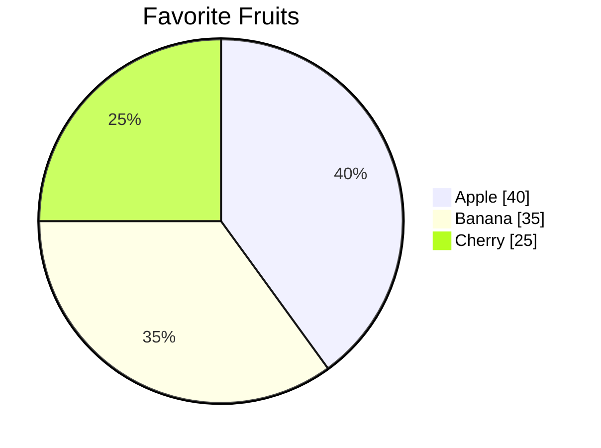

## 02 — packet

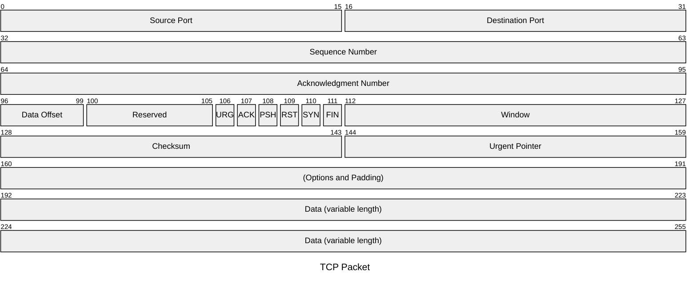

## 03 — packet-beta

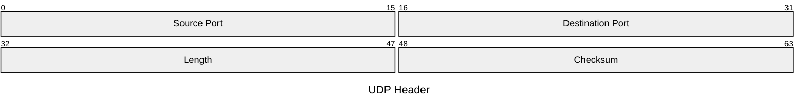

## 04 — xychart


## 05 — xychart-beta

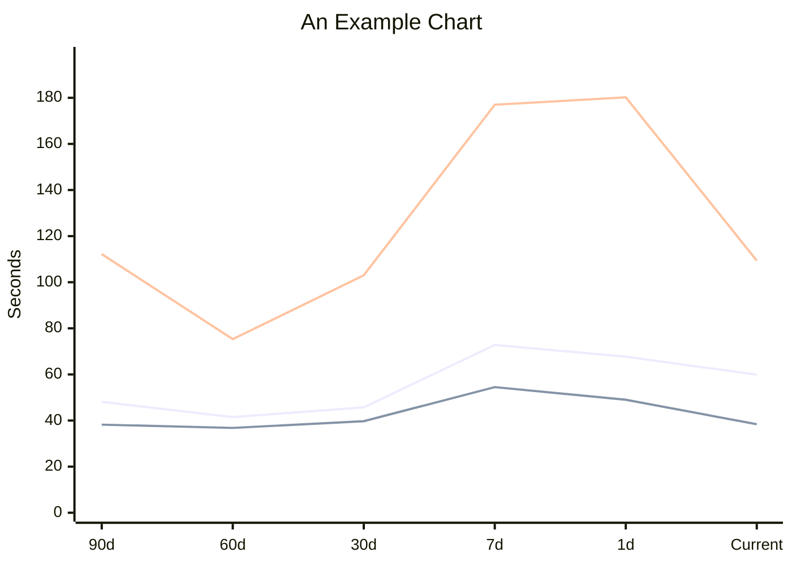

## 06 — radar-beta

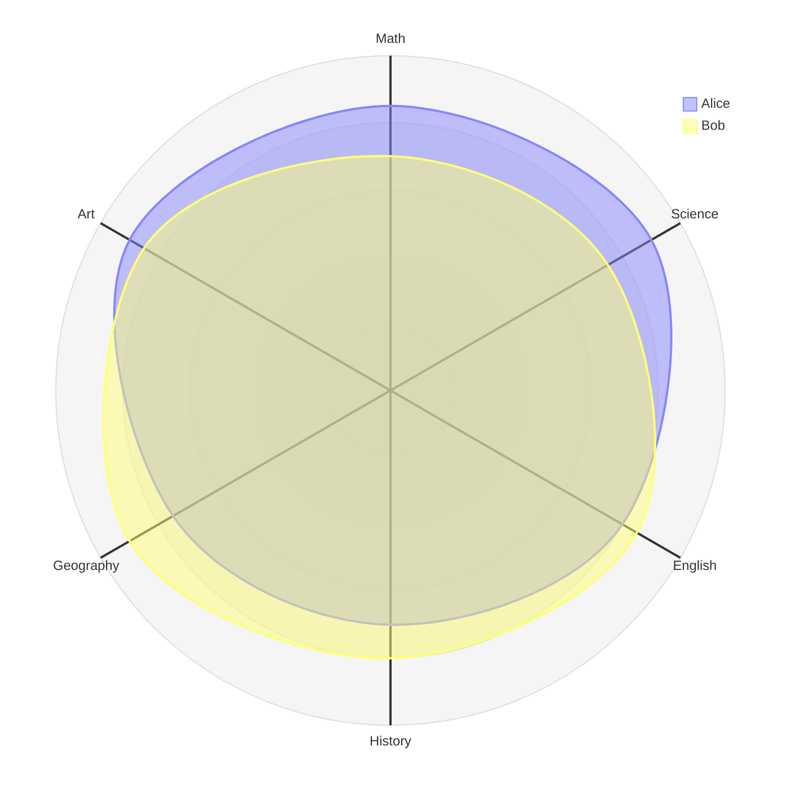

## 07 — venn-beta

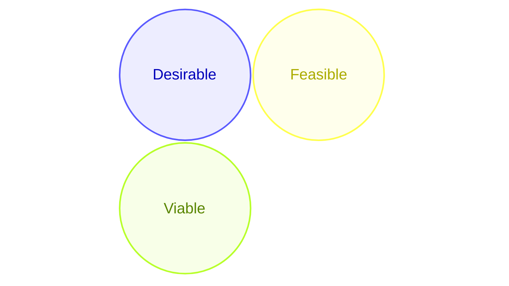

## 08 — quadrantChart


## 09 — timeline

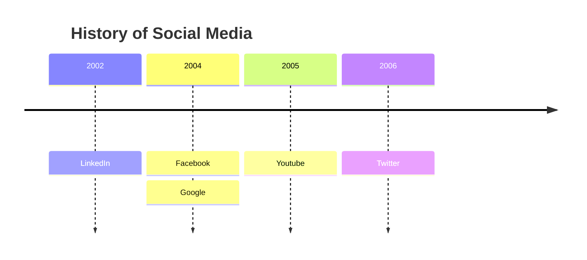

## 10 — journey

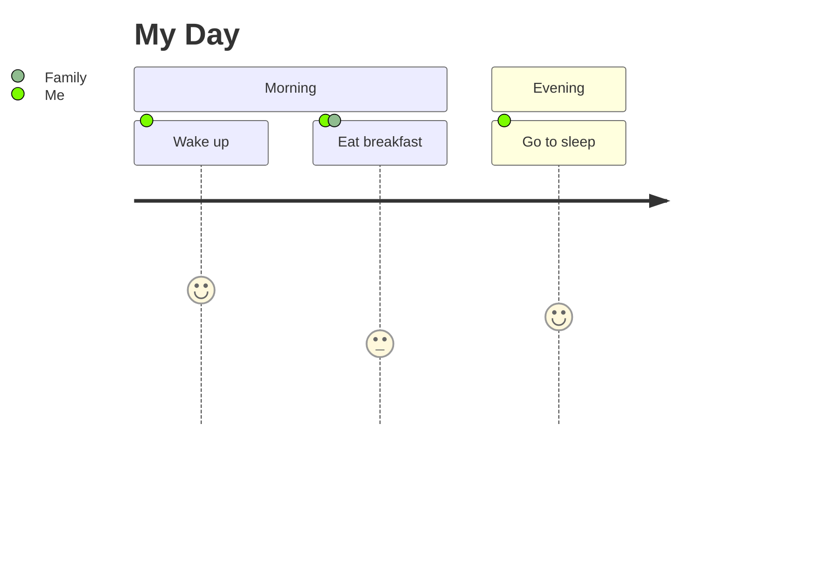

## 11 — gantt

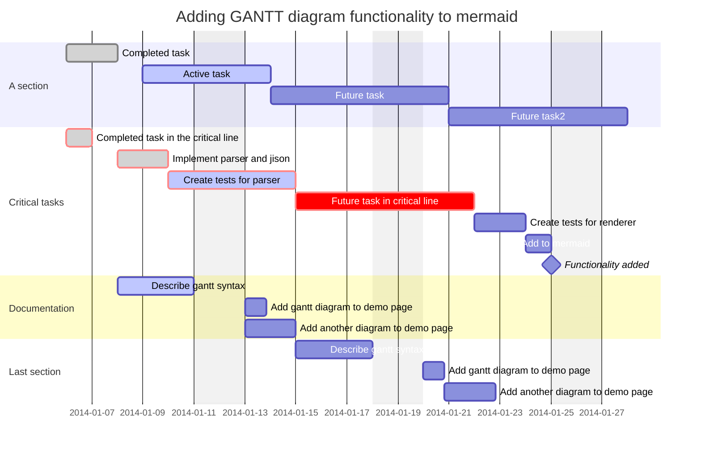

## 12 — kanban

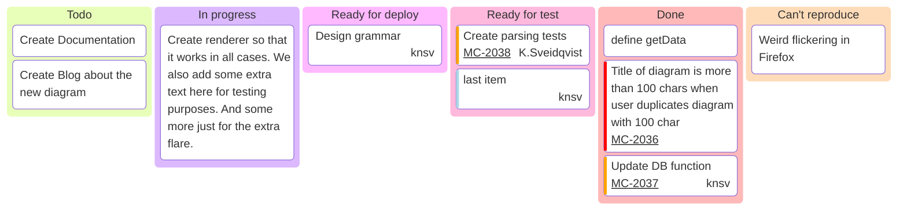

## 13 — treeView-beta


## 14 — cynefin-beta

```mermaid
cynefin-beta
  title Strategy Categorization

  complex
    "Market research"

  complicated
    "Competitive analysis"

  clear
    "Standard pricing"

  chaotic
    "Crisis management"

  complex --> complicated : "Pattern identified"
  complicated --> clear : "Best practice codified"
  clear --> chaotic : "Complacency"
  chaotic --> complex : "Stabilized"

```

## 15 — treemap-beta

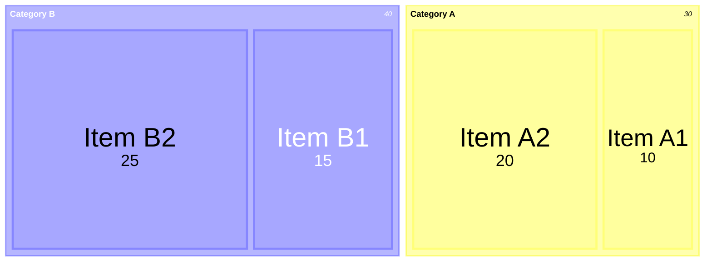

## 16 — mindmap

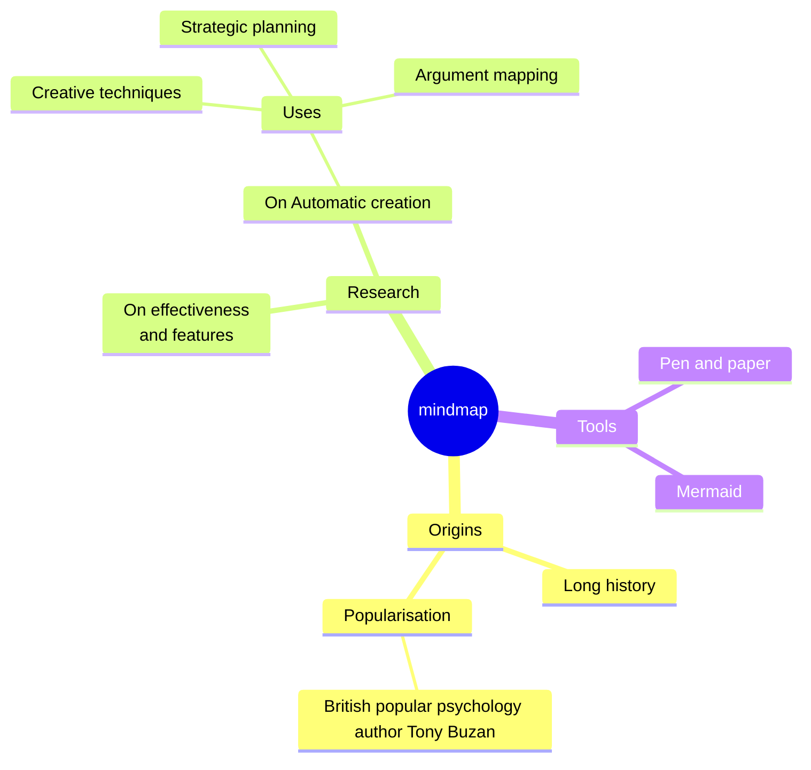

## 17 — ishikawa

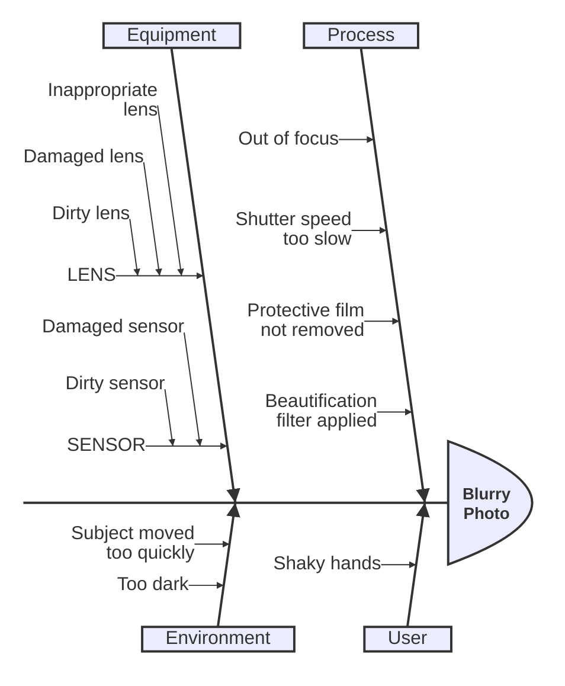

## 18 — wardley-beta

```mermaid
wardley-beta
title Software Platform Strategy
size [1100, 800]

evolution Genesis@0.25 -> Custom@0.5 -> Product@0.75 -> Commodity@1.0

anchor Customer [0.90, 0.95]

component "Mobile App" [0.80, 0.85] (build)
component "Web App" [0.75, 0.80] label [-60, 10] (build)
component "API Gateway" [0.70, 0.65] (buy)
component "Auth Service" [0.60, 0.55] (outsource)
component "Database" [0.50, 0.45] (buy) (inertia)
component "Cloud Platform" [0.30, 0.95] (market)

Customer -> "Mobile App"
Customer -> "Web App"
"Mobile App" -> "API Gateway"
"Web App" -> "API Gateway"
"API Gateway" -> "Auth Service"
"API Gateway" -> "Database"
"Database" -> "Cloud Platform"

evolve "API Gateway" 0.85
evolve "Database" 0.75

accelerator "Cloud Native" [0.20, 0.85]
deaccelerator "Legacy Data" [0.45, 0.35]

annotations [0.10, 0.20]
annotation 1,[0.78, 0.82] "User touchpoints"
annotation 2,[0.70, 0.60] "Integration layer"
annotation 3,[0.50, 0.40] "Data persistence"

note "Build mobile-first experience" [0.85, 0.90]
note "Migrate to cloud-native database" [0.60, 0.50]

```

## 19 — erDiagram

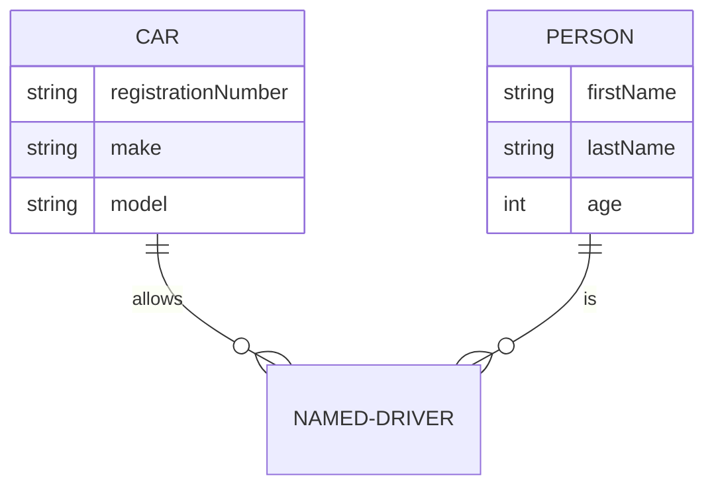

## 20 — stateDiagram

```mermaid
---
title: Simple sample
---
stateDiagram
    [*] --> Still
    Still --> [*]

    Still --> Moving
    Moving --> Still
    Moving --> Crash
    Crash --> [*]

```

## 21 — stateDiagram-v2

```mermaid
stateDiagram-v2
    [*] --> First
    state First {
        [*] --> second
        second --> [*]
    }

    [*] --> NamedComposite
    NamedComposite: Another Composite
    state NamedComposite {
        [*] --> namedSimple
        namedSimple --> [*]
        namedSimple: Another simple
    }

```

## 22 — classDiagram

```mermaid
classDiagram
    class Animal {
        +String name
        +makeSound()
    }
    class Dog
    Animal <|-- Dog
```

## 23 — classDiagram-v2

```mermaid
classDiagram-v2

classA -- classB : Inheritance
classA -- classC : link
classC -- classD : link
classB -- classD
```

## 24 — requirementDiagram

```mermaid
requirementDiagram

requirement test_req {
id: 1
text: the test text.
risk: high
verifymethod: test
}

functionalRequirement test_req2 {
id: 1.1
text: the second test text.
risk: low
verifymethod: inspection
}

performanceRequirement test_req3 {
id: 1.2
text: the third test text.
risk: medium
verifymethod: demonstration
}

interfaceRequirement test_req4 {
id: 1.2.1
text: the fourth test text.
risk: medium
verifymethod: analysis
}

physicalRequirement test_req5 {
id: 1.2.2
text: the fifth test text.
risk: medium
verifymethod: analysis
}

designConstraint test_req6 {
id: 1.2.3
text: the sixth test text.
risk: medium
verifymethod: analysis
}

element test_entity {
type: simulation
}

element test_entity2 {
type: word doc
docRef: reqs/test_entity
}

element test_entity3 {
type: "test suite"
docRef: github.com/all_the_tests
}


test_entity - satisfies -> test_req2
test_req - traces -> test_req2
test_req - contains -> test_req3
test_req3 - contains -> test_req4
test_req4 - derives -> test_req5
test_req5 - refines -> test_req6
test_entity3 - verifies -> test_req5
test_req <- copies - test_entity2
```

## 25 — graph

```mermaid
graph TD
    A[Start] --> B{Decision}
    B -->|Yes| C[Process]
    B -->|No| D[End]
    subgraph Cluster
        C --> E[Finish]
    end
```

## 26 — flowchart

```mermaid
flowchart TB
    c1-->a2
    subgraph one
    a1-->a2
    end
    subgraph two
    b1-->b2
    end
    subgraph three
    c1-->c2
    end

```

## 27 — flowchart-elk

```mermaid
flowchart-elk TD
      A[Christmas] -->|Get money| B(Go shopping)
      B --> C{Let me think}
      C -->|One| D[Laptop]
      C -->|Two| E[iPhone]
      C -->|Three| F[fa:fa-car Car]
```

## 28 — block

```mermaid
block
columns 1
  db(("DB"))
  blockArrowId6<["&nbsp;&nbsp;&nbsp;"]>(down)
  block:ID
    A
    B["A wide one in the middle"]
    C
  end
  space
  D
  ID --> D
  C --> D
  style B fill:#939,stroke:#333,stroke-width:4px

```

## 29 — block-beta

```mermaid
block-beta
  columns 2
  block
    id2["I am a wide one"]
    id1
  end
  id["Next row"]
```

## 30 — architecture-beta

```mermaid
architecture-beta
    service left_disk(disk)[Disk]
    service top_disk(disk)[Disk]
    service bottom_disk(disk)[Disk]
    service top_gateway(internet)[Gateway]
    service bottom_gateway(internet)[Gateway]
    junction junctionCenter
    junction junctionRight

    left_disk:R -- L:junctionCenter
    top_disk:B -- T:junctionCenter
    bottom_disk:T -- B:junctionCenter
    junctionCenter:R -- L:junctionRight
    top_gateway:B -- T:junctionRight
    bottom_gateway:T -- B:junctionRight

```

## 31 — gitGraph

```mermaid
    gitGraph
       commit id: "1"
       commit id: "2"
       branch nice_feature
       checkout nice_feature
       commit id: "3"
       checkout main
       commit id: "4"
       checkout nice_feature
       branch very_nice_feature
       checkout very_nice_feature
       commit id: "5"
       checkout main
       commit id: "6"
       checkout nice_feature
       commit id: "7"
       checkout main
       merge nice_feature id: "customID" tag: "customTag" type: REVERSE
       checkout very_nice_feature
       commit id: "8"
       checkout main
       commit id: "9"

```

## 32 — sankey

```mermaid
---
config:
  sankey:
    showValues: false
---
sankey

Agricultural 'waste',Bio-conversion,124.729
Bio-conversion,Liquid,0.597
Bio-conversion,Losses,26.862
Bio-conversion,Solid,280.322
Bio-conversion,Gas,81.144
Biofuel imports,Liquid,35
Biomass imports,Solid,35
Coal imports,Coal,11.606
Coal reserves,Coal,63.965
Coal,Solid,75.571
District heating,Industry,10.639
District heating,Heating and cooling - commercial,22.505
District heating,Heating and cooling - homes,46.184
Electricity grid,Over generation / exports,104.453
Electricity grid,Heating and cooling - homes,113.726
Electricity grid,H2 conversion,27.14
Electricity grid,Industry,342.165
Electricity grid,Road transport,37.797
Electricity grid,Agriculture,4.412
Electricity grid,Heating and cooling - commercial,40.858
Electricity grid,Losses,56.691
Electricity grid,Rail transport,7.863
Electricity grid,Lighting & appliances - commercial,90.008
Electricity grid,Lighting & appliances - homes,93.494
Gas imports,Ngas,40.719
Gas reserves,Ngas,82.233
Gas,Heating and cooling - commercial,0.129
Gas,Losses,1.401
Gas,Thermal generation,151.891
Gas,Agriculture,2.096
Gas,Industry,48.58
Geothermal,Electricity grid,7.013
H2 conversion,H2,20.897
H2 conversion,Losses,6.242
H2,Road transport,20.897
Hydro,Electricity grid,6.995
Liquid,Industry,121.066
Liquid,International shipping,128.69
Liquid,Road transport,135.835
Liquid,Domestic aviation,14.458
Liquid,International aviation,206.267
Liquid,Agriculture,3.64
Liquid,National navigation,33.218
Liquid,Rail transport,4.413
Marine algae,Bio-conversion,4.375
Ngas,Gas,122.952
Nuclear,Thermal generation,839.978
Oil imports,Oil,504.287
Oil reserves,Oil,107.703
Oil,Liquid,611.99
Other waste,Solid,56.587
Other waste,Bio-conversion,77.81
Pumped heat,Heating and cooling - homes,193.026
Pumped heat,Heating and cooling - commercial,70.672
Solar PV,Electricity grid,59.901
Solar Thermal,Heating and cooling - homes,19.263
Solar,Solar Thermal,19.263
Solar,Solar PV,59.901
Solid,Agriculture,0.882
Solid,Thermal generation,400.12
Solid,Industry,46.477
Thermal generation,Electricity grid,525.531
Thermal generation,Losses,787.129
Thermal generation,District heating,79.329
Tidal,Electricity grid,9.452
UK land based bioenergy,Bio-conversion,182.01
Wave,Electricity grid,19.013
Wind,Electricity grid,289.366

```

## 33 — sankey-beta

```mermaid
sankey-beta

sourceNode,targetNode,10
```

## 34 — sequenceDiagram

```mermaid
sequenceDiagram
    participant Alice
    participant Bob
    Alice->>Bob: Hello Bob
    activate Bob
    Bob-->>Alice: Hi Alice
    deactivate Bob
    Note over Alice,Bob: They greeted each other
```

## 35 — swimlane-beta

```mermaid
swimlane-beta LR
  subgraph Intake
    start([Start])
    task[Do work]
    fix[Fix issues]
  end

  subgraph Review
    decision{Ready?}
  end

  subgraph Complete
    done((Done))
  end

  start --> task --> decision
  decision -->|Yes| done
  decision -->|No| fix
  fix --> task

```

## 36 — eventmodeling

```mermaid
eventmodeling

timeframe 01 ui CartUI
timeframe 02 command AddItem
timeframe 03 event ItemAdded

resetframe 04 event External.InventoryChanged
timeframe 05 processor InventoryProcessor
timeframe 06 command ChangeInventory
timeframe 07 event Cart.InventoryChanged

rf 02 evt CartCreated
rf 03 evt ItemAdded
rf 04 evt ItemRemoved
rf 05 evt CartCleared
tf 01 rmo CartUI ->> 02 ->> 03 ->> 04 ->> 05

```

## 37 — railroad-beta

```mermaid
railroad-beta
title Expression Grammar

expression = sequence(
    nonterminal("term"),
    zeroOrMore(sequence(
        choice(terminal("+"), terminal("-")),
        nonterminal("term")
    ))
) ;
term = sequence(
    nonterminal("factor"),
    zeroOrMore(sequence(
        choice(terminal("*"), terminal("/")),
        nonterminal("factor")
    ))
) ;
factor = choice(
    nonterminal("number"),
    sequence(terminal("("), nonterminal("expression"), terminal(")"))
) ;
number = oneOrMore(nonterminal("digit")) ;
digit = choice(terminal("0"), terminal("1"), terminal("2"), terminal("3"), terminal("4"), terminal("5"), terminal("6"), terminal("7"), terminal("8"), terminal("9")) ;
```

## 38 — railroad-ebnf-beta

```mermaid
railroad-ebnf-beta
title "Digit Definition"

digit = "0" | "1" | "2" | "3" | "4" | "5" | "6" | "7" | "8" | "9" ;
```

## 39 — railroad-abnf-beta

```mermaid
railroad-abnf-beta
title "Email Address"

address = local-part "@" domain ;
local-part = 1*( ALPHA / DIGIT / "." / "-" ) ;
domain = label *( "." label ) ;
label = 1*( ALPHA / DIGIT / "-" ) ;
```

## 40 — railroad-peg-beta

```mermaid
railroad-peg-beta
title "Identifiers (keywords excluded)"

Identifier <- !Keyword Letter Letter* ;
Keyword <- "if" / "else" / "while" ;
Letter <- "a" / "b" / "c" / "_" ;
```

## 41 — C4Context

```mermaid
    C4Context
      title System Context diagram for Internet Banking System
      Enterprise_Boundary(b0, "BankBoundary0") {
        Person(customerA, "Banking Customer A", "A customer of the bank, with personal bank accounts.")
        Person(customerB, "Banking Customer B")
        Person_Ext(customerC, "Banking Customer C", "desc")

        Person(customerD, "Banking Customer D", "A customer of the bank, <br/> with personal bank accounts.")

        System(SystemAA, "Internet Banking System", "Allows customers to view information about their bank accounts, and make payments.")

        Enterprise_Boundary(b1, "BankBoundary") {

          SystemDb_Ext(SystemE, "Mainframe Banking System", "Stores all of the core banking information about customers, accounts, transactions, etc.")

          System_Boundary(b2, "BankBoundary2") {
            System(SystemA, "Banking System A")
            System(SystemB, "Banking System B", "A system of the bank, with personal bank accounts. next line.")
          }

          System_Ext(SystemC, "E-mail system", "The internal Microsoft Exchange e-mail system.")
          SystemDb(SystemD, "Banking System D Database", "A system of the bank, with personal bank accounts.")

          Boundary(b3, "BankBoundary3", "boundary") {
            SystemQueue(SystemF, "Banking System F Queue", "A system of the bank.")
            SystemQueue_Ext(SystemG, "Banking System G Queue", "A system of the bank, with personal bank accounts.")
          }
        }
      }

      BiRel(customerA, SystemAA, "Uses")
      BiRel(SystemAA, SystemE, "Uses")
      Rel(SystemAA, SystemC, "Sends e-mails", "SMTP")
      Rel(SystemC, customerA, "Sends e-mails to")

      UpdateElementStyle(customerA, $fontColor="red", $bgColor="grey", $borderColor="red")
      UpdateRelStyle(customerA, SystemAA, $textColor="blue", $lineColor="blue", $offsetX="5")
      UpdateRelStyle(SystemAA, SystemE, $textColor="blue", $lineColor="blue", $offsetY="-10")
      UpdateRelStyle(SystemAA, SystemC, $textColor="blue", $lineColor="blue", $offsetY="-40", $offsetX="-50")
      UpdateRelStyle(SystemC, customerA, $textColor="red", $lineColor="red", $offsetX="-50", $offsetY="20")

      UpdateLayoutConfig($c4ShapeInRow="3", $c4BoundaryInRow="1")


```

## 42 — C4Container

```mermaid
    C4Container
    title Container diagram for Internet Banking System

    System_Ext(email_system, "E-Mail System", "The internal Microsoft Exchange system", $tags="v1.0")
    Person(customer, Customer, "A customer of the bank, with personal bank accounts", $tags="v1.0")

    Container_Boundary(c1, "Internet Banking") {
        Container(spa, "Single-Page App", "JavaScript, Angular", "Provides all the Internet banking functionality to customers via their web browser")
        Container_Ext(mobile_app, "Mobile App", "C#, Xamarin", "Provides a limited subset of the Internet banking functionality to customers via their mobile device")
        Container(web_app, "Web Application", "Java, Spring MVC", "Delivers the static content and the Internet banking SPA")
        ContainerDb(database, "Database", "SQL Database", "Stores user registration information, hashed auth credentials, access logs, etc.")
        ContainerDb_Ext(backend_api, "API Application", "Java, Docker Container", "Provides Internet banking functionality via API")

    }

    System_Ext(banking_system, "Mainframe Banking System", "Stores all of the core banking information about customers, accounts, transactions, etc.")

    Rel(customer, web_app, "Uses", "HTTPS")
    UpdateRelStyle(customer, web_app, $offsetY="60", $offsetX="90")
    Rel(customer, spa, "Uses", "HTTPS")
    UpdateRelStyle(customer, spa, $offsetY="-40")
    Rel(customer, mobile_app, "Uses")
    UpdateRelStyle(customer, mobile_app, $offsetY="-30")

    Rel(web_app, spa, "Delivers")
    UpdateRelStyle(web_app, spa, $offsetX="130")
    Rel(spa, backend_api, "Uses", "async, JSON/HTTPS")
    Rel(mobile_app, backend_api, "Uses", "async, JSON/HTTPS")
    Rel_Back(database, backend_api, "Reads from and writes to", "sync, JDBC")

    Rel(email_system, customer, "Sends e-mails to")
    UpdateRelStyle(email_system, customer, $offsetX="-45")
    Rel(backend_api, email_system, "Sends e-mails using", "sync, SMTP")
    UpdateRelStyle(backend_api, email_system, $offsetY="-60")
    Rel(backend_api, banking_system, "Uses", "sync/async, XML/HTTPS")
    UpdateRelStyle(backend_api, banking_system, $offsetY="-50", $offsetX="-140")


```

## 43 — C4Component

```mermaid
    C4Component
    title Component diagram for Internet Banking System - API Application

    Container(spa, "Single Page Application", "javascript and angular", "Provides all the internet banking functionality to customers via their web browser.")
    Container(ma, "Mobile App", "Xamarin", "Provides a limited subset to the internet banking functionality to customers via their mobile device.")
    ContainerDb(db, "Database", "Relational Database Schema", "Stores user registration information, hashed authentication credentials, access logs, etc.")
    System_Ext(mbs, "Mainframe Banking System", "Stores all of the core banking information about customers, accounts, transactions, etc.")

    Container_Boundary(api, "API Application") {
        Component(sign, "Sign In Controller", "MVC Rest Controller", "Allows users to sign in to the internet banking system")
        Component(accounts, "Accounts Summary Controller", "MVC Rest Controller", "Provides customers with a summary of their bank accounts")
        Component(security, "Security Component", "Spring Bean", "Provides functionality related to singing in, changing passwords, etc.")
        Component(mbsfacade, "Mainframe Banking System Facade", "Spring Bean", "A facade onto the mainframe banking system.")

        Rel(sign, security, "Uses")
        Rel(accounts, mbsfacade, "Uses")
        Rel(security, db, "Read & write to", "JDBC")
        Rel(mbsfacade, mbs, "Uses", "XML/HTTPS")
    }

    Rel_Back(spa, sign, "Uses", "JSON/HTTPS")
    Rel(spa, accounts, "Uses", "JSON/HTTPS")

    Rel(ma, sign, "Uses", "JSON/HTTPS")
    Rel(ma, accounts, "Uses", "JSON/HTTPS")

    UpdateRelStyle(spa, sign, $offsetY="-40")
    UpdateRelStyle(spa, accounts, $offsetX="40", $offsetY="40")

    UpdateRelStyle(ma, sign, $offsetX="-90", $offsetY="40")
    UpdateRelStyle(ma, accounts, $offsetY="-40")

        UpdateRelStyle(sign, security, $offsetX="-160", $offsetY="10")
        UpdateRelStyle(accounts, mbsfacade, $offsetX="140", $offsetY="10")
        UpdateRelStyle(security, db, $offsetY="-40")
        UpdateRelStyle(mbsfacade, mbs, $offsetY="-40")


```

## 44 — C4Dynamic

```mermaid
    C4Dynamic
    title Dynamic diagram for Internet Banking System - API Application

    ContainerDb(c4, "Database", "Relational Database Schema", "Stores user registration information, hashed authentication credentials, access logs, etc.")
    Container(c1, "Single-Page Application", "JavaScript and Angular", "Provides all of the Internet banking functionality to customers via their web browser.")
    Container_Boundary(b, "API Application") {
      Component(c3, "Security Component", "Spring Bean", "Provides functionality Related to signing in, changing passwords, etc.")
      Component(c2, "Sign In Controller", "Spring MVC Rest Controller", "Allows users to sign in to the Internet Banking System.")
    }
    Rel(c1, c2, "Submits credentials to", "JSON/HTTPS")
    Rel(c2, c3, "Calls isAuthenticated() on")
    Rel(c3, c4, "select * from users where username = ?", "JDBC")

    UpdateRelStyle(c1, c2, $textColor="red", $offsetY="-40")
    UpdateRelStyle(c2, c3, $textColor="red", $offsetX="-40", $offsetY="60")
    UpdateRelStyle(c3, c4, $textColor="red", $offsetY="-40", $offsetX="10")


```

## 45 — C4Deployment

```mermaid
    C4Deployment
    title Deployment Diagram for Internet Banking System - Live

    Deployment_Node(mob, "Customer's mobile device", "Apple IOS or Android"){
        Container(mobile, "Mobile App", "Xamarin", "Provides a limited subset of the Internet Banking functionality to customers via their mobile device.")
    }

    Deployment_Node(comp, "Customer's computer", "Microsoft Windows or Apple macOS"){
        Deployment_Node(browser, "Web Browser", "Google Chrome, Mozilla Firefox,<br/> Apple Safari or Microsoft Edge"){
            Container(spa, "Single Page Application", "JavaScript and Angular", "Provides all of the Internet Banking functionality to customers via their web browser.")
        }
    }

    Deployment_Node(plc, "Big Bank plc", "Big Bank plc data center"){
        Deployment_Node(dn, "bigbank-api*** x8", "Ubuntu 16.04 LTS"){
            Deployment_Node(apache, "Apache Tomcat", "Apache Tomcat 8.x"){
                Container(api, "API Application", "Java and Spring MVC", "Provides Internet Banking functionality via a JSON/HTTPS API.")
            }
        }
        Deployment_Node(bb2, "bigbank-web*** x4", "Ubuntu 16.04 LTS"){
            Deployment_Node(apache2, "Apache Tomcat", "Apache Tomcat 8.x"){
                Container(web, "Web Application", "Java and Spring MVC", "Delivers the static content and the Internet Banking single page application.")
            }
        }
        Deployment_Node(bigbankdb01, "bigbank-db01", "Ubuntu 16.04 LTS"){
            Deployment_Node(oracle, "Oracle - Primary", "Oracle 12c"){
                ContainerDb(db, "Database", "Relational Database Schema", "Stores user registration information, hashed authentication credentials, access logs, etc.")
            }
        }
        Deployment_Node(bigbankdb02, "bigbank-db02", "Ubuntu 16.04 LTS") {
            Deployment_Node(oracle2, "Oracle - Secondary", "Oracle 12c") {
                ContainerDb(db2, "Database", "Relational Database Schema", "Stores user registration information, hashed authentication credentials, access logs, etc.")
            }
        }
    }

    Rel(mobile, api, "Makes API calls to", "json/HTTPS")
    Rel(spa, api, "Makes API calls to", "json/HTTPS")
    Rel_U(web, spa, "Delivers to the customer's web browser")
    Rel(api, db, "Reads from and writes to", "JDBC")
    Rel(api, db2, "Reads from and writes to", "JDBC")
    Rel_R(db, db2, "Replicates data to")

    UpdateRelStyle(spa, api, $offsetY="-40")
    UpdateRelStyle(web, spa, $offsetY="-40")
    UpdateRelStyle(api, db, $offsetY="-20", $offsetX="5")
    UpdateRelStyle(api, db2, $offsetX="-40", $offsetY="-20")
    UpdateRelStyle(db, db2, $offsetY="-10")


```

# CAST: Codegen Annotated Source of Truth

**Version 0.1.0** — this guide tracks SPEC version 0.9.

You see this guide because you ran `cast --help`, or because `cast` could not find a `spell.md` in the current directory.

CAST reads your data (tables), your shapes (templates), and your wiring (the manifest), and writes files. It knows nothing about any programming language. It resolves references, iterates rows, and replaces tokens — nothing else.

This guide tells you how to use CAST. `SPEC.md` fixes the rules that this guide describes. Where this guide and SPEC disagree, SPEC is right and this guide is wrong.

---

## Command Line

Arguments select what runs. They never carry generation rules.

- `cast` — find `spell.md` here, format each declared markdown file, regenerate each declared output, then run the default-flow `## toolchain` rows
- `cast <path>/spell.md` — the same, with a specific manifest
- `cast spell.md <directory>` — write each declared output under that directory in place of the declared paths
- `cast --format -i spell.md` — format only, in place: the manifest and each markdown file that its index declares; no generation
- `cast spell.md --no-format` or `cast --no-format spell.md` — generate only, no formatting
- `cast spell.md --<word>` — after format and generate, run only the `## toolchain`
  rows whose `argument` cell equals `word`; the default-flow rows do not run
- `cast --pack <archive> … <item> [--link=<name>=<target>] …` — write one archive, `zip` or `dmg`, from the items on the line; no manifest (see pack)
- `cast --version` — the version and the source commit, the same stamp that the generated banners embed
- `cast --help` — this guide
- `--line-wrap n` — a value pair, in any position on the line; it composes with
  `--format`, `--no-format` and the manifest argument. It must be a positive integer —
  any other value is fatal. It overrides the style file's `line-wrap` row, and the
  default is 100. It breaks a paragraph at UAX #14 line-break opportunities only: a
  token wider than the wrap stands whole on its own line. Grid cells wrap only where
  the style file's `## format` names a column

The default order is format, then generate, then the default-flow toolchain rows. A manifest run finds its style file before it reads anything, with or without `--no-format` (see Style File). `--format` and `--no-format` exclude each other. `--no-format` takes one manifest, one flag, nothing else on the line.

### --format — a markdown formatter

`cast --format` formats any markdown file with the command line of clang-format:

```
cast --format [-i] [--style=file:<path>] [--assume-filename=<path>] [--line-wrap n] [<file> ...]
```

- `cast --format a.md` — write the canonical text of `a.md` to stdout; the file does not change
- `cast --format -i a.md b.md` — write each file in place, write-if-different; stdout stays empty
- `cast --format` or `cast --format -` — read stdin, write stdout
- `--style=file:<path>` — use this style file, any name; `--style=file` searches, the default
- `--assume-filename=<path>` — the stdin input only (no file argument, or `-`): start the style search at this path; a diagnostic names its file

Flag words match exactly: `--line-wrap=40` or `--format=x` is an unknown flag.

A manifest with `-i` formats the manifest and each markdown file that its index declares. A manifest without `-i` prints the manifest file only. A file argument wins over stdin. The flags read in any position.

On success the exit is 0 and stdout holds only the canonical text, LF line ends, UTF-8 — no success line, no screen clear. On failure the exit is non-zero, stdout is empty, and stderr holds the diagnostic; for stdin without `--assume-filename`, the file part is `<stdin>`. `-i` with stdin is fatal. Any other dash argument is an unknown flag, and is fatal.

---

## Sync

`cast --sync [--style=file:<path>] <source-root> <target-root>` mirrors one framework's kernel onto another's. It composes with nothing else on the line — no manifest, no other flag except `--style=file:<path>` — and a `--sync` line without exactly its two roots is fatal.

Sync writes the target, thus the target's style file formats each re-canonicalized `.md` file: `--style=file:<path>` first, then `.cast-format` or `_cast-format` in `<target-root>/cast/`, else none (no column reflows, wrap 100). Sync does no directory search. A style file in the source root has no effect.

Each root carries a `user-modules-info.md` file at its top level: `## identity` (`key | value | boundary`), `## module` (`name | class`, plus data columns manifest wiring reads, never sync), `## submodule` (`module | path | class`, plus data columns manifest wiring reads, never sync), `## region` (`begin | end`), and `## ignore` (`value`). The two roots must differ. Sync reads exactly these five tables — any other table in the file belongs to the manifest and is never read by sync.

The transform is one ordered replacement list, longest source first — sources of equal length order by their text, descending, and sources with equal text keep their authored row order, so the list is total. Each `## identity` key present in both files contributes a pair — source value to target value — except `namespace`, which contributes no plain pair: its bare word occurs inside unrelated names, so it never replaces on its own. When two or more rows share a byte-equal source value, the first authored row contributes the pair and the later rows contribute none. Three keys also compose, and each must be present in both files: `namespace` adds exactly two pairs, `namespace <source>` to `namespace <target>` and `<source>::` to `<target>::`; `filePrefix` and `macroPrefix` contribute their plain pairs, and `filePrefix` also transforms every path segment — directory and file names alike. A row whose `boundary` cell is `word` matches whole words only; every other row matches plain text.

A `## module` row whose class is `kernel` names a directory — every other class value is provision. At each root, every kernel row's directory must exist, and every `<filePrefix>*` directory on disk must be declared. After the path transform, the two files' kernel module sets must correspond one to one. Root-relative paths use `/` on every host. A `## submodule` row names one file: `module` names its kernel directory, and `path` names its path inside it. At each root, the files under the kernel directories, less each file that matches an `## ignore` row (`*` wildcards), must be exactly the files that the `## submodule` rows name — except that at the target, a kernel row's file can be absent, because sync writes it. After the path transform, the two files' kernel submodule rows must correspond one to one. Sync walks the source's kernel submodule rows. A source file that cannot be read is fatal. A file with a NUL byte in its first 8000 bytes copies byte-for-byte. Every other file transforms as text and normalizes to LF. A `.md` file re-canonicalizes through the formatter after the transform only when its kernel scope's own name carries no `filePrefix` — the data scopes, never the module directories. Every write is write-if-different, and a write that fails is fatal. Before a write, a target file whose on-disk name differs from the transformed path only by case is renamed to the transformed path, so the target name matches the transformed path on every host; a rename that fails is fatal as an output that cannot be written. A provision row is never walked, never written, and never deleted.

A source text file that already contains a pair's target value is fatal — the transform must be invertible, and a target token on the source side proves it is not.

A `## region` row names a delimiter pair. When the target file exists, and both the transformed text and the target file hold the pair's `begin` line and a later `end` line, the lines between the delimiters come from the target file. Thus each root keeps the regions that its own manifest writes.

The report is the written paths, one per line, nothing else. Zero lines is the pass: the roots are in sync.

---

## The Three Artifacts

Everything lives flat in one data directory.

| Artifact  | What it is                                               |
| --------- | -------------------------------------------------------- |
| `spell.md`| the manifest — what gets generated, from what, into what |
| `*.md`    | data tables                                              |
| `*.cast`  | template files — any number, each holding code shapes    |

The manifest's index declares each input file one time. CAST parses exactly what you declare — it never scans a directory. Generated outputs are build artifacts. Do not edit them.

---

## Writing Tables

### Rows

CAST decides a table's row boundaries one time, for the whole table:

- if the body has a border between rows, borders delimit rows
- if it has none, and no line starts with an empty first cell, each `|` line is one row
- if it has none, and some line starts with an empty first cell, the whole body is one row

```
+-------------+-------+          +-------------+-------+
| key         | value |          | key         | value |
+=============+=======+          +=============+=======+
| block quote | 3     |          | block quote | 3     |
+-------------+-------+          | code fence  | 4     |
| code fence  | 4     |          +-------------+-------+
+-------------+-------+
   two rows, borders delimit        two rows, one line each
```

Row order is authored order. CAST never sorts.

### Columns

Column names are yours. Name a column for what it produces, because a template addresses it by that name — a column called `value` fills `:::value:::`.

Four column names are reserved everywhere: `format`, `description`, `brief`, and `value`. Inside the manifest's wiring tables, four more are reserved: `list`, `separator`, `structure`, `file`. A data table — wherever it lives, the manifest included — can use any of those four words as an ordinary column.

### Cells

A cell is one of these forms:

| Cell           | Meaning                                                                       |
| -------------- | ----------------------------------------------------------------------------- |
| plain text     | that text, after markdown backslash escapes                                   |
| `` `text` ``   | `toLiteral` of those bytes — quoted and escaped, ready to drop into a literal |
| a fenced block | the same, over a datum that spans lines                                       |
| empty          | nothing — an empty string                                                     |

An empty cell is not an error and is not a special case. It is string replacement as nothing, in every table, reserved or not. A token that it fills renders empty. A template line left empty by its only placeholder elides for free, exactly like each other emptied placeholder line. An empty `format` cell formats nothing: CAST writes the value verbatim.

Backticks are not decoration and are not an escape. A backtick **is** the `toLiteral` operation, thus a backticked cell never needs a `format` column beside it.

A code span cannot hold a line break. When the datum has one, author the cell as a fence. Each line between the delimiters is one line of the value, and line breaks join the lines:

```
+-------------------------------+-----------------------------------+
| alertNewerVersionPresetSuffix | ```                               |
|                               |                                   |
|                               | To use this preset correctly:     |
|                               | ```                               |
+-------------------------------+-----------------------------------+
```

That cell's value begins with a line break, because the fence's first content line is empty. Write the real characters. `toLiteral` turns them into `\n` for you.

Pipes delimit a cell on each line that the cell spans. In a grid table, the first space after the opening pipe is padding. The spaces before the closing pipe are padding. `|this|` and `| this |` are the same datum, and the formatter rewrites the first as the second. Every other byte is data, inside a fence too. A second space after the opening pipe is a leading space of the value. Indentation inside a fence survives. A pipe table keeps GFM: both sides of a cell are trimmed.

A plain cell reads through the markdown inline parse. A backslash before an ASCII punctuation character is an escape: CAST keeps the character and drops the backslash. Thus `x\\y` reads `x\y`, and `\<x\>` reads `<x>`. A backtick span or a fence has no such escapes — its bytes are the value.

A cell in a column that the style file's `## format` names is one line of value. When the formatter wraps it, the rows are layout. A break at a space moves that space to the start of the next row. A cut inside a long token moves nothing. The reader joins the rows with nothing between. Thus the value reads the same at every width, and the formatter never adds a character. Such a value has no line break of its own; write a newline inside it as the two characters `\n`. A cell in any other column keeps your lines as lines, and the formatter never rewraps it. A fence keeps your lines in every column. The row scanner has one escape, the pipe: `\|` is a data pipe.

You can also write a space as `U+0020` and put `fromUTF8` in the row's `format` cell:

```
+-------------------------------+------------------------------------------+----------+
| alertNewerVersionPresetSuffix | ```                                      | fromUTF8 |
|                               |                                          |          |
|                               | please install the newest version:U+0020 |          |
|                               | ```                                      |          |
+-------------------------------+------------------------------------------+----------+
```

`fromUTF8` decodes each `U+XXXX` token in the value and touches no other byte.

To put a `|` inside a cell, write `\|`. The scanner reads the backslash run before a pipe by parity: an odd run escapes the pipe and is halved, an even run leaves a delimiter. Thus a datum that is a backslash followed by a pipe is written ```\\\|``` — two backslashes for the data backslash, then the escaped pipe.

### Format

`format` is a column. It binds to the column immediately to its left, and it names **exactly one** operation. It is optional — CAST writes a column with no `format` beside it exactly as authored.

```
| key | format | value | format |
| key | format | value |
| key | value  | format |
| key | value  |
```

CAST rejects `| format | format |` — a format has no format.

No chaining exists. If a datum needs a different shape, author it in that shape:

```
+------+-------------+-------------+-----------+
| type | name        | value       | format    |
+======+=============+=============+===========+
| @id  | circleCross | circleCross | toLiteral |
+------+-------------+-------------+-----------+

name  ->  circleCross      verbatim
value ->  "circleCross"    circleCross, quoted and escaped by toLiteral
```

The table declares the formatting. A template never formats anything.

### Documentation

Three doc channels exist, all data:

- **row** — a column named `description`. An item shape's `:::[description]:::` renders it as documentation, in the output language's comment syntax. A plain `:::description:::` reads the same cell as text, like each other column. The cell is prose: no `toLiteral`, no `@` lookup.
- **table** — write a paragraph or a fenced block between the `## table name` heading and the table. A shape-level `:::[description]:::` falls back to it when no reference names something else.
- **fence** — a fenced block that carries an info string, anywhere in a data file, not bound to a table. The info string is its name, and the fence text is its prose. Address it — or a table — by name with a `- [description]: @file:<name>` bullet in the manifest's list column, at the shape line's own `>` count. A wrapper shape declared across several rows carries the same reference on each declaring row, exactly like a binding.

At shape level, with no description reference authored, `:::[description]:::` falls back to the documentation of the first table that the shape's own sources address, in authored order. With no source that addresses a table, it falls back to the documentation of the row's own table.

You never author the comment frame (`/** @brief ... */`, `///< ...`) yourself — you write prose only. CAST renders the frame from the comment-syntax table, keyed by the output file's extension — except when the file's exact name has a row in the manifest-syntax table (`CMakeLists.txt` is CMake, not text; that row's value replaces the extension as the key):

- the marker alone on its line — block form. Multi-line prose renders one prose line per output line. Single-line prose renders open, text, close on one line.
- the marker inline, after content — single-line form: the language's comment glyph, then the text, its lines joined by one space.

A missing description is not an error — the marker renders empty, and an emptied line trims or collapses like each other placeholder line.

### The banner

Each generated file carries the CAST banner, in that file's own comment syntax, with the file's documentation joined to it. You never author it.

By default it goes at the top. Write `:::[banner]:::` in a template and it goes there in place of the top — wherever the marker sits, in any shape, one time per occurrence. That is how a shell script keeps `#!` on line 1 and an XML file keeps its declaration on line 1: the template holds line 1, thus the template places the banner.

A language with no block comment — shell, TOML, YAML — gets its single-line marker on each banner line. A file whose render uses a fence marked `[no-banner]` gets no banner at all.

CAST writes an output whose extension names no comment syntax — or which has no extension — in C syntax. CAST does not refuse it.

### The date

Write `:::[date:format]:::` in a template and CAST puts the date there. You always state the format, inside the brackets, after the colon. No default format exists. `[date:` with no closing bracket is not the date token: it is an ordinary named token. `:::[date]:::` is the fatal `unknown reserved name`.

| Pattern | Replacement                                    |
| ------- | ---------------------------------------------- |
| `yyyy`  | the year, four digits                          |
| `yy`    | the last two digits of the year                |
| `mm`    | the month, two digits, `01` to `12`            |
| `dd`    | the day of the month, two digits, `01` to `31` |

CAST reads the format from left to right and takes the longest pattern at each position. Each other character is literal. The patterns are lower case. On 2 October 2026, `:::[date:yyyy]:::` renders `2026`, and `:::[date:mm-dd-yy]:::` renders `10-02-26`. An empty format renders empty.

The date is the UTC date. CAST reads the clock one time in each run, thus each date token of one run shows the same date. Every format is legal: the date token stops no run.

### Uniqueness

Within one table, each identity column's entries — `name`, `key`, `alias`, `file` — must be unique, compared byte for byte. `circleCross` and `CircleCross` are two different entries. Each other column is payload — `value`, `type`, `format`, `description` — and payload repeats by design: many rows can map to the same payload. The manifest's wiring tables are exempt — wiring repeats templates, separators and files by design.

---

## References

The `@` sigil is part of the name. A cell that starts with `@` is a reference. Anything else is data. You cannot confuse the two.

### The index

Any file can declare `## index`. It is file-local — a `@` cell resolves against the index of the file that it is written in, never another file's. It can carry a `format` column like each other table — an index datum is formatted like a cell (`@space` declares `U+0020` with `fromUTF8`).

```
## index

+---------+------------------+
| alias   | symbol           |
+=========+==================+
| @id     | juce::Identifier |
| @string | juce::String     |
+---------+------------------+
```

The manifest's own index declares the input files:

```
| @identifiers | identifiers.md |
```

### Addressing

```
@file : table : column
```

Write the table part only when you need it. You can omit it when the table has its file's name, or when the file holds exactly one table — the index never counts for that purpose.

CAST stops with an error if an alias is undeclared, declared two times, points at a missing file, or names a table or column that does not exist.

### Filtering rows by a cell

```
@file : table : column = value
```

Add `=value` to the column part, and the address selects only that table's rows whose `column` cell equals `value`, byte for byte. `value` can be empty. An empty `value` matches a row whose cell is itself blank — nothing (see Cells). Thus one table serves two disjoint row sets — a compiler-stage split, say — without a second table:

```
+-------------------+-------------+----------+--------+
| name              | mac         | win      | stage  |
+===================+=============+==========+========+
| optimization      | -O3         | /O2      |        |
| deadCodeStripping | -dead_strip | /OPT:REF | linker |
+-------------------+-------------+----------+--------+
```

`@project-info:release:stage=` selects the compiler rows (`stage` blank). `@project-info:release:stage=linker` selects the linker rows — one table, two wiring lines, no duplication.

---

## Templates

Code shapes live in `.cast` files — as many as you declare in the index. Each is markdown: fenced code blocks, and the fence's info string is the block's name. A shape is addressed like each other reference: `@code:namespace` is the `namespace` block of the file that the `@code` alias names. Two files can both have an `entry` block — `@code:entry` and `@cmake:entry` are different shapes.

A fence name can open with one bracket group — `[sh]script`, `[no-banner]script`. The group is part of the name and part of the address, matched byte for byte: `@code:[sh]script`. Nothing after the group is read, thus `[sh]-script` is a different, equally legal name. Two words are legal inside it: an extension without its dot, which tells CAST what language the file is and outranks the file's own extension; or `no-banner`, which means the file carries no banner. Any other word stops the run.

````markdown
```identifier
inline const :::type::: :::name::: { juce::String::fromUTF8 (:::value:::) };
```

```entry
{ :::[list]::: },
```
````

A block is the literal text of the output. Braces, keywords, punctuation — all authored, all verbatim. No conditionals, no loops, and no formatting exist. Target-language directives (`#if`, `#endif`) are literal text like everything else — CAST never reads them, and slots inside such an arm take sources by the ordinary arity law. Comment frames are the one exception: CAST renders them itself, from the comment-syntax table (see Documentation) — never author one in a template.

Square brackets mark a name that CAST reserves — `:::[list]:::`, `:::[description]:::`, `:::[banner]:::`, `:::[date:format]:::`, and the bullets `- [list]:`, `- [description]:`, `- [begin]:` and `- [end]:`. A bracketed name outside this set is the fatal `unknown reserved name`, thus `:::[comment]:::` and `- [comment]:` stop CAST. Everything without brackets is yours, thus `:::list:::` and `- description:` are ordinary names of your own. Column names are the exception: a table already scopes its columns, thus reserved column names carry no brackets. A column named `comment` is an ordinary column.

Token names are yours — free text, matched exactly as you wrote them. `:::macro-guard:::` pairs with `- macro-guard:`, and `:::keyType:::` pairs with a `keyType` column. You never reshape a name to please the engine. Two fences can use the same token name — each shape's own suppliers feed its own occurrences, thus an outer shape's binding never leaks into a wrapper's token of the same name.

**`:::[list]:::` is the one expansion token.** A block's occurrence count is its arity: each occurrence takes one source, its items joined by that source's separator. Where the marker sits decides the axis:

- at **column 0** — vertical: the join fills line by line, each line indented by the source line's `>` count
- **inside a line** — horizontal: the join lands in place, unindented

```
struct :::name:::          vertical — items stack, indent from the wiring
{
:::[list]:::
};

{ :::[list]::: },            horizontal — items join in place, e.g. by ", "
```

Each other `:::token:::` is a named token. The binding, map row, or column of that name replaces it (see Maps under The Manifest). A token carries no operation — `:::token:op:::` is not a form. Do not author the quotes around a literal. `toLiteral` supplies them, and a doubled pair produces `""value""`.

A join of more than one item from a single-line shape aligns their token columns. Fill spaces land in the literal between two tokens, right after that literal's first run of whitespace. The fill size matches the widest replacement that any item in the join gives that token. Fill never lands inside a token's own replacement, thus a quoted include path still emits verbatim. Nothing pads before the first token or after the last token, and no emitted line carries trailing whitespace. A single item, a multi-line shape, or a single-line shape that carries an inline `:::[list]:::` renders unpadded — no column limit and no wrapping exist.

---

## The Manifest

`spell.md` reserves four column names:

```
+------+-----------+-----------+------+
| list | separator | structure | file |
+======+===========+===========+======+
```

`separator` is optional. Blank means newline.

A wiring table is any manifest table with a `structure` column — `## output` and `## output index` in every project here. Nothing else is wiring: your index, `## toolchain`, and any plain data table that you keep in the manifest are data, and a column named `file` in them is just a column. A data table can live right beside the wiring that reads it — an address whose first part names no index alias names a table of the writing file itself, thus `@headers` in the manifest addresses a `## headers` table in the same file. Aliases are scoped to the index. A manifest never aliases its own file.

### list — what iterates

`- [list]: <source>` lines. Each one paired with a structure `- [list]:` line is an expansion, and the source says what feeds it:

- an address — `- [list]: @xml:XmlTokenType` iterates that table's rows. When the addressed table carries a `file` column, the row that matches the writing row's own file is excluded — a file never lists itself, the same as the column-name form below
- a column address — `- [list]: @colours:colours:key` names one column of the enclosing expansion's table. It feeds an **inline** `:::[list]:::`, never a column-0 one. With one inline slot, every column address fills it, joined by the separator line: `{ :::[list]::: },` with `key` and `alt` and a `comma` separator whose text is `,` gives `{ foo,bar },`. With two or more slots, slot k takes the k-th column address: `{ :::[list]::: = :::[list]::: },` gives `{ foo = bar },`. Fewer addresses fill the trailing slots, and the leading slots render empty; more addresses than slots is fatal
- a cell-match filter — `- [list]: @file:table:column=value` iterates only that table's rows whose `column` cell equals `value`, byte for byte (see Filtering rows by a cell)
- a column name — `- [list]: file` iterates the unique values of that column, in first-appearance order, and excludes the value that belongs to the writing row's own file: a file never lists itself
- a binding name — `- [list]: instance` selects the rows that declare a binding of that name, blank or valued. It walks the wiring tables in manifest order and each table's rows in authored order

To declare the binding is what selects the row — a blank cell only changes where its value comes from. Bindings inside a wrapper's chain (see Wrappers) are the wrapper's private render data and are never selected. CAST tries a bare source name as a column first, thus never give a selector the same name as a wiring-table column. A row can declare several selector bindings. Each name selects its own rows, and two selectors on one row feed two slots by ordinal like any two sources.

A `- [list]:` line with no structure partner at its `>` count is a **map** for that count's shape paragraph — see Maps.

### structure — what shape

Two lines name a shape. `@code:namespace` renders it one time. `- [list]: @code:<id>` renders it one time per item of the line's source. Both are sources: each fills one `:::[list]:::` of the shape above it. A named bullet binds one token of the nearest bare shape line above it at its `>` count: `- name: jam` fills its `:::name:::`. A named bullet never binds an item shape (`- [list]: @code:<id>`). An item shape takes each token from a map or from the column of that name in its source row, so put per-row values in row columns.

A named bullet whose value is a shape address is a **wrapper** — a third way that a shape enters, through a named token in place of a `:::[list]:::` slot. See Wrappers below.

### Arity — how deep

A shape's arity is how many times its block names `:::[list]:::`. It consumes that many of the source lines that follow, in order, and each of those consumes its own arity first. Nesting comes from the template. You never author it. A wrapper counts like a shape line, not a source: it consumes its own arity's worth of lines and fills a named token — it never occupies a `:::[list]:::` slot.

### Indent — where

`> ` count is indentation, nothing else:

```
- [list]: ...            renders at column 0
> - [list]: ...          renders at one tab
> > > - [list]: ...      renders at three tabs
```

One tab is four spaces, **absolute** — measured from column 0 of the output file, not from the enclosing shape. The list and separator columns carry the same count as the structure line that they pair with, and CAST reads it: a line pairs with the line that carries the same `>` count at the same ordinal within that count. One symbol, one meaning, in all three columns.

### Pairing — always by order

The list column's `- [list]:` lines pair with the structure column's `- [list]:` lines by `>` count and by ordinal within that count. A shape's `:::[list]:::` occurrences, top to bottom, take the sources that follow it in the same order.

```
+------------------------------------+---------------------------------+
| list                               | structure                       |
+====================================+=================================+
| > > > - [list]: @tokens:token type | @code:namespace                 |
| > > - [list]: @tokens:token type   | - name: map                     |
|                                    | @code:bimap                     |
|                                    | - name: TemplateTokenType       |
|                                    | - type: int                     |
|                                    | > > > - [list]: @code:map-entry |
|                                    | > > - [list]: @code:enum        |
+------------------------------------+---------------------------------+
```

The namespace names `:::[list]:::` one time, thus it takes the next source — the bimap, rendered one time at column 0. The bimap names it two times — map region first, enum region second — thus it takes the next two: map-entry at three tabs, then enum at two. To match the template, the tables and the expression is yours. CAST reads the expression and generates. Its one check is the walk — a source line that no shape consumes would render nowhere, so it stops the run, and the diagnostic names the block and the row. To supply fewer is legal: your sources fill a shape's trailing slots, and the leading unfilled slots render empty.

### Wrappers — a shape in a named token

Sometimes a slot needs a name. A fence whose slots are all anonymous `:::[list]:::` says nothing about which one is the guard. Give the slot its own token and fill it with a **wrapper** — a binding whose value is a shape address:

````markdown
```line
:::macro:::

:::[list]:::
:::macro-guard:::
```

```macro-guard
#if :::macro:::
:::[list]:::
#endif // :::macro:::
```
````

```
+--------------------+----------------------------------+------------+
| list               | structure                        | file       |
+====================+==================================+============+
| - [list]: @headers | @code:line                       | @Generated |
|                    | - macro: #pragma once            |            |
|                    |                                  |            |
|                    | - [list]: @code:include          |            |
|                    | - macro-guard: @code:macro-guard |            |
|                    | - macro: @guiBasics              |            |
|                    |                                  |            |
|                    | > @code:include                  |            |
|                    | > - file: ColourId.h             |            |
+--------------------+----------------------------------+------------+
```

`- macro-guard: @code:macro-guard` fills `:::macro-guard:::` with the guard shape's rendering. From that line on, the wrapper reads like any shape line: the bullets after it bind **its** tokens (`- macro: @guiBasics` fills the guard's `:::macro:::`, not the line shape's — each shape reads its own), and it consumes the next source lines up to its own arity — here the bare `include`, indented one tab, named by its own bindings. Same arity, same scope, same indent law as each other wrapper. The guard's one `:::[list]:::` collapses a whole group when you feed it an expansion in place of a bare line.

Everything that the wrapper consumes is its private render data. Its bindings select nothing — `- file: ColourId.h` above names the guarded include and never enters the `- [list]: @headers` include list.

### Maps — straight replacement

A block full of named tokens and no rows to iterate — a build manifest, a config file — reads its values from a table one row per token:

```
+----------------------------------+---------------------------+-------------+
| list                             | structure                 | file        |
+==================================+===========================+=============+
| - [list]: @project-info:cmake    | @cmake:cmake              | @CMakeLists |
| > - [list]: @project-info:module | > - [list]: @cmake:module |             |
+----------------------------------+---------------------------+-------------+

## cmake
| key            | value  |
| minimumVersion | 4.2.0  |
| cxxStandard    | 17     |
```

`:::minimumVersion:::` in the `cmake` block takes the `value` of the row whose first column is `minimumVersion`. The first column is the key — `key | value`, or `name | type | value | description`, any table whose first column is an identity. The same table under a `- [list]:` expansion is rows. Under a shape paragraph it is a map. The reader decides, never the table.

Map lines are the list column's `- [list]:` lines at a `>` count beyond the structure column's `- [list]:` lines at that count, first in order. Column-address lines (`@file:table:column`, the inline sources) are never counted — the address form tells them apart. Map lines belong to that count's shape paragraphs in order. A blank `- [list]:` closes one paragraph's group and starts the next. Fewer groups than paragraphs fill the last paragraphs — the same slot law as expansions. A different `>` count is a different scope. A map line with no paragraph at its count stops the run. So does a map table with no `value` column.

### separator — how items join

`- [list]:` lines that mirror the list column's lines. The line at a given ordinal joins that expansion's items. Blank or absent joins by newline. Anything else joins by that text — `@code:<id>` names a block whose text is the join, and `@space` names an index datum (`U+0020` with `fromUTF8`) for a join of one space.

The leading `>`-less separator line is the row join: rows merged into one file join their diverging values by it.

### file — merging rows into one file

Rows that declare the same `file` render as one merged shape, and the wrap emits one time per file. Merging is per line. At each structure line, rows that carry the same value emit it one time. Rows whose values differ emit each value, in authored row order, joined by the first row's row-join line, with one blank line on each side. A group of one row merges to itself.

Same-file rows must be authored contiguously — a row for a file already closed by an intervening row of another file is a fatal error.

### file documentation — a `- [description]:` binding, wired to a table

The four wiring columns carry no file documentation. A file's documentation is a `- [description]:` binding in the **structure** cell of the file group's first row. First appearance counts in authored order — the same rule that decides output-file ordering. The binding's value is a table address: `@file:table:column`, or the local form `@table:column` for a data table of the manifest itself. Aliases are scoped to the index, thus a manifest never aliases its own file. The addressed table carries a `file` column and documentation columns. CAST reads the row whose `file` matches the group's own output file. It takes the cell of the column that the address names — the `description` column when the address names none. CAST writes the resolved text between the banner and the file's own text, in the file's comment syntax. No binding, no matching row, or a blank cell writes nothing extra.

This is the pattern for real projects: one small `## headers` table holds every file's header prose in one place — a `brief` column for the doc block, a `description` column for a single-liner — and every output group points one binding at it.

```markdown
## headers

| file    | brief                           | description |
| Out.h   | ```                             |         |
|         | @file Out.h                     |         |
|         | @brief One generated namespace. |         |
|         | ```                             |         |

## output

| list                  | separator | structure                    | file    |
| - [list]: @data:rows    |           | @code:namespace              | @Out.h  |
|                       |           | - macro: #pragma once        |         |
|                       |           | - name: Out                  |         |
|                       |           | - [description]: @headers:brief    |         |
|                       |           | - [list]: @code:entry          |         |
```

The file match, not the row, decides which prose comes back. To declare `## headers` as a table that CAST also lists an output's includes from (`- [list]: @headers`, per "Declared membership instead of a derived sweep" below) needs no extra care: the self-exclusion law (a file never lists itself) already keeps a file's own row out of its own include sweep, even though the same table supplies that file's header.

The `@` sigil law (a `@`-sigiled value is a reference, never data) separates this binding's two readers. A `- [description]:` binding whose value is plain text is per-item prose, the same as always: the item-shape reader finds the binding before it falls to the source row's own `description` column, and renders the bound text. The file-documentation reader resolves only the address-valued form. A reader that renders prose never treats a reference as its prose. One structure cell can carry both — the sigil decides which reader takes which.

### toolchain — commands after the write

`## toolchain` is an optional table, `| argument | command | flag |`, reserved by name — not by file. CAST looks it up across each file that the manifest's index declares. Thus a project that keeps its codegen manifest and its toolchain data apart declares `## toolchain` in the data file, not `spell.md` itself. Its rows run after each output has written, in authored order, one child process per row. A failed row fails the run — never the writes already on disk.

`argument` is optional and, when declared, selects which rows run. A blank `argument` cell marks a default-flow row. `cast spell.md`, with no trailing flag, runs only those. `cast spell.md --<word>` runs only the rows whose `argument` cell equals `word` — a `word` that matches no row is fatal.

```
+----------+---------+----------------------------------------------------------+
| argument | command | flag                                                     |
+==========+=========+==========================================================+
|          | cmake   | -S . -B Builds/Ninja -G Ninja -DCMAKE_BUILD_TYPE=Release |
+----------+---------+----------------------------------------------------------+
|          | cmake   | --build Builds/Ninja                                     |
+----------+---------+----------------------------------------------------------+
| debug    | cmake   | -S . -B Builds/Debug -G Ninja -DCMAKE_BUILD_TYPE=Debug   |
+----------+---------+----------------------------------------------------------+
| debug    | cmake   | --build Builds/Debug                                     |
+----------+---------+----------------------------------------------------------+
```

`cast spell.md` configures and builds `Builds/Ninja` in Release. `cast spell.md --debug` configures and builds `Builds/Debug` in Debug — the two default-flow rows do not run.

### pack — archives after the build

`cast --pack` packs one archive. It reads no manifest and no table. The build system knows each value and passes it on the command line. CAST is the tool that packs; the build system decides what to pack and when.

```
cast --pack <archive> [--<layout-key>=<n> ...] [--background=<path>] <item> [--link=<name>=<target>] [...]
```

The first argument that is not an option is the archive path. Each argument after it that is not an option is an item path: one row for each root entry, in row order. `--link=<name>=<target>` gives a link to the nearest item before it. A link is optional: an item with no `--link` has no link. The value splits at its first `=`: the text before it is the link name, and the text after it is the link target. Each path resolves against the working directory. These lines are fatal: a line with no archive or no item; a `--link` before the first item; a second `--link` on one item; a `--link` whose name or target is empty.

The extension of the archive selects its format: `zip` or `dmg`, compared with case. Any other extension is fatal.

Each item is one row. The item is the path of one file or folder. It enters the root of the archive under its own file name. A folder enters with its full hierarchy. An item that does not exist is fatal. When the item has a `--link`, the root of the archive also gets a symbolic link. Its name is the link name, and its target is the link target text, verbatim. CAST does not resolve it. The link is the drag-and-drop install target of the item on the same row. Two rows that give the root one name, as an item file name or a link name, are fatal.

**Layout options.** The layout options are numbers of points, each in the form `--<key>=<n>` with an integer `n`. An absent option takes its default:

| Option             | Default |
| ------------------ | ------- |
| `--icon-size`      | 64      |
| `--bundle-column`  | 150     |
| `--link-column`    | 450     |
| `--first-row`      | 80      |
| `--row-spacing`    | 120     |
| `--window-left`    | 100     |
| `--window-top`     | 100     |

A value that is not an integer is fatal. The item of row i is at x `bundle-column`, and its link is at x `link-column`. Both are at y `first-row` + i × `row-spacing`, where the first row is row 0. The window opens at `window-left`, `window-top`. Its width is `bundle-column` + `link-column`. Its height is `first-row` + the row count × `row-spacing`.

The view shows icons of `icon-size` points, with no toolbar, no status bar, no sidebar, no tab view and no sort order. The other view settings are the values that Finder writes for a new icon view: grid spacing 100, text size 12, labels on the bottom, icon previews on and item information off.

**Background.** `--background=<path>` names the background image. Without it, the background is white. A background file that does not exist is fatal. A layout option or `--background` with a `.zip` archive is fatal.

**Icon.** Each bundle shows its own icon after the archive is extracted. No format is named.

- On Windows, the build puts the icon on the bundle: `desktop.ini`, `Plugin.ico` and the System attribute on the folder. The zip records them.
- On macOS, CAST packs both formats from a stage. CAST clones each item into the stage. When the clone has an XML `Contents/Info.plist` with a `CFBundleIconFile` key, CAST writes a custom Finder icon on the clone:
  1. The file `Icon\r` in the bundle root, with an empty data fork.
  2. Its resource fork: one `icns` resource, ID -16455, that holds the bytes of `Contents/Resources/<CFBundleIconFile>` unchanged.
  3. Its Finder information: the invisible flag.
  4. The Finder information of the bundle folder: the custom-icon flag.
- A bundle icon that its `Info.plist` names and that does not exist is fatal.
- The build artefacts stay unchanged. Only the clones in the stage get the icon.

**Zip.** CAST writes the zip itself, on each host.

- Each entry records the Unix host in its version-made-by field and the Unix mode of its file, folder or symbolic link.
- On a host with no Unix mode, a file records 0644, and a folder and a symbolic link record 0755.
- A link entry records 0755 on each host.
- On Windows, the low byte of the external attributes of each entry records its ReadOnly, Hidden, System and Directory attribute bits.
- On macOS, each entry with Finder information or a resource fork adds one AppleDouble entry, `__MACOSX/<parent>/._<name>`, after the entries of its item. The AppleDouble holds the Finder information and the resource fork, with no other extended attribute. An AppleDouble entry records 0644.
- A symbolic link entry holds its target text and is stored. Each other file is deflated.
- Each entry records the time 1980-01-01 00:00, the first value of the zip time field.
- CAST walks each folder in the order of the entry names, compared by code point with case.

Thus the same inputs, with the same attributes, give the same zip bytes. An archive with more than 65535 entries or more than 4 GiB of bytes cannot be written, and that is fatal. The write is write-if-different.

**Dmg.** A `.dmg` archive is valid on macOS only. On each other host it is fatal. CAST makes a new stage folder beside the archive. The stage never replaces a folder that already exists. CAST clones each item into the stage, writes the icon of each clone, adds each link, clones the background image to `.background.<ext>` in the stage when `--background` is given, and writes the `.DS_Store` of the stage. Then it runs one child process by the toolchain law:

```
hdiutil create -ov -srcfolder <stage> -volname <name> -fs HFS+ -format UDZO <archive>
```

`<name>` is the file name of the archive without its extension. CAST removes the stage folder when the process ends. A stage folder that cannot be removed is fatal. CAST mounts no image.

The `.DS_Store` record set is `bwsp`, `icvp` and `vSrn` on the folder, and one `Iloc` for each item and each link. The records sort by name, folded to lower case, then by record code. The records fill one node of 2048 bytes. Records that do not fit are fatal.

**The pack signs nothing.** The build system signs, notarizes and staples the archive after the pack.

Example — the post-build call of a plugin project:

```
add_custom_command(TARGET post-build POST_BUILD
    COMMAND cast --pack "${CAST_PACK_ARCHIVE}" ${CAST_PACK_LAYOUT} "${CAST_PACK_ITEMS}"
    VERBATIM
    COMMAND_EXPAND_LISTS
    USES_TERMINAL)
```

`CAST_PACK_ITEMS` holds one item for each plugin format. On macOS, `--link=<format>=<install folder>` follows each bundle. On Windows, the list holds the items only. `CAST_PACK_LAYOUT` holds the layout options and `--background`, on macOS only.

With the defaults and five rows, the dmg window is 600 points wide (150 + 450) and 680 points high (80 + 5 × 120). Row 0 is at y 80, and each next row is 120 points lower.

### Style File — column widths and line wrap

The formatter configuration lives in a style file, like `.clang-format` — never in the manifest. The search finds two names, `.cast-format` and `_cast-format`; when one directory holds both, `.cast-format` wins. `--style=file:<path>` takes any name.

The first match wins:

1. `--style=file:<path>` on the line.
2. For a manifest run (`cast spell.md`, `cast --format -i spell.md`): the style file beside the manifest.
3. The directory of the formatted file, then each parent directory. For stdin: the `--assume-filename` path, else the working directory.
4. None: no column reflows, and the wrap is 100 or `--line-wrap n`.

Each input uses one style file, or none; two style files never merge. A manifest run is one input — its style covers every file its index declares. Several files on one `--format` line each find their own.

The style file holds one `## format` table, `| name | width |`. A `## format` table in any other file is an ordinary data table: no formatter meaning, no error. One reserved row, `line-wrap`, sets the paragraph wrap; `--line-wrap n` overrides it. It is not a column. `name` is a column name and an identity column: a column named two times is the duplicate fatal. `width` is that column's wrap width, a positive integer. Every grid table that carries a column of that name reflows its body cells at that width. A named cell is one line of value: its rows join with nothing first, then the text wraps, and each break moves the space it consumed to the start of the next row. A column the table does not name keeps its natural width and its lines. No style file means no column reflows. A split is layout only. The reader joins a named cell's rows with nothing between, so the value reads the same at every width. Nothing is added. A fenced cell is verbatim and never rewraps. The table is data the reader depends on: to unname a column whose cells are wrapped, first format at a width that holds every value on one row, then remove the row — otherwise the wrapped rows read as your lines. A grid table whose body has no border between rows never splits.

```
+-------------+-------+
| name        | width |
+=============+=======+
| description | 40    |
| line-wrap   | 100   |
+-------------+-------+
```

A style-file header row without `name` or `width`, or a `width` cell that is not a positive integer, is fatal. CAST checks the style file before it reads any input.

### Regions — patching an existing file

An output row whose structure declares `- [begin]:` and `- [end]:` bindings does not create a file — it patches one that already exists. CAST finds the first line containing the resolved `[begin]` value, then the first later line containing the resolved `[end]` value, and replaces every line strictly between them with the rendered shape. The delimiter lines stay, and everything outside them stays byte for byte. No banner renders, and no file documentation renders — the file already carries its own framing, and the delimiter pair marks where CAST's own ownership begins and ends.

```
+------+-----------+----------------------------+----------+
| list | separator | structure                  | file     |
+======+===========+============================+==========+
|      |           | - [begin]: BEGIN_GENERATED | @Out.h   |
|      |           | - [end]: END_GENERATED     |          |
|      |           | @code:namespace            |          |
+------+-----------+----------------------------+----------+
```

A `[begin]` binding with no `[end]`, or the reverse, is fatal. A delimiter value that matches no line, or an `[end]` value whose first match is at or before `[begin]`, is fatal. A region row's own file must already exist — CAST does not create it. One file is either region-written or whole-written: a file shared between a region row and a whole-file row is fatal. A file can hold more than one region. Consecutive same-file region rows with the same delimiters merge like any other same-file rows (see file — merging rows into one file). Rows with other delimiters patch their own region, in manifest order. Region rows that write one region again after rows of another region of the same file are fatal. Two regions of one file that overlap are fatal.

---

## Operations

Operations are optional. A table can carry finished text and use none at all.

**Case** — `toUpper`, `toTitle`, `toPascal`, `toCamel`, `toKebab`, `toSnake`, `toScreamingSnake`

An all-uppercase word is an abbreviation and survives each case operation in each position: `UI scale` becomes `UIScale`, and `fail hazard URI` becomes `failHazardURI`.

**Encoding** — `toLiteral`, `toUTF8`, `fromUTF8`, `toHex`, `toCodepoint`, `fromCodepoint`

`toLiteral` produces a complete string literal: it quotes the value, escapes backslashes and quotes, turns control characters into their named escapes, and turns bytes above `0x7F` into hex escapes. Quoting and escaping are one operation and never travel separately. To write a cell in backticks is the same thing, spelled shorter.

Write the real character, not its escape. A line break in the datum comes out as `\n`. A `"` comes out as `\"`. `©` comes out as `\xc2\xa9`.

An escape that you cannot write as a real character is written as its escape sequence, and `toLiteral` passes it through: a backslash followed by a data-declared escape character is an authored escape and survives verbatim — `\n` authors a line break. A backslash followed by a backslash is one literal backslash, doubled on output — `\\n` authors the two characters backslash-n. Both stay expressible.

`fromUTF8` decodes each `U+XXXX` token in the value and touches no other byte. It is the way to write a space at the very end of a line, which the padding would otherwise swallow; a leading space is data after the first (see "A cell is one of these forms").

A `format` cell names one operation, never two. The one composition that CAST performs is its own — a backticked or fenced cell is quoted and escaped first, and the cell's operation then applies to that value. That is how `fromUTF8` reaches inside a finished literal.

**Text** — `join`, `toFileName`

**Comment** — `toComment`, `toCommentBlock`, `brief`

The comment family exists for the banner that CAST stamps and for the `:::[description]:::` marker, both formatted for the output file's language.

---

## Cookbook

### Constants from a declaration table

```markdown
## identifiers

+------+--------------------+-----------------------+-----------+
| type | name               | value                 | format    |
+======+====================+=======================+===========+
| @id  | circleCross        | circleCross           | toLiteral |
| @id  | applicationSupport | `Application Support` |           |
| @id  | cdataOpen          | `<![CDATA[`           |           |
+------+--------------------+-----------------------+-----------+
```

````markdown
```identifier
inline const :::type::: :::name::: { juce::String::fromUTF8 (:::value:::) };
```
````

```cpp
inline const juce::Identifier circleCross { juce::String::fromUTF8 ("circleCross") };
inline const juce::Identifier applicationSupport { juce::String::fromUTF8 ("Application Support") };
inline const juce::Identifier cdataOpen { juce::String::fromUTF8 ("<![CDATA[") };
```

Row one's `value` is authored plain text, quoted by its `toLiteral` format. Rows two and three are backticked, which already means `toLiteral` — thus their `format` cell stays empty. A blank `value` cell would render an empty string, not `circleCross` — every value that a row needs is authored on that row.

### Any-arity entries with explicit column addresses

```markdown
## colours

+-----+------------+
| key | value      |
+=====+============+
| 0   | 0xff000000 |
| 1   | 0xffcd0000 |
+-----+------------+
```

````markdown
```entry
{ :::[list]::: },
```
````

```
+--------------------------------------+--------------------+---------------------------+
| list                                 | separator          | structure                 |
+======================================+====================+===========================+
| > > - [list]: @colours               | > > - [list]: `, ` | ...                       |
| > > - [list]: @colours:colours:key   |                    | > > - [list]: @code:entry |
| > > - [list]: @colours:colours:value |                    |                           |
+--------------------------------------+--------------------+---------------------------+
```

```cpp
        { 0, 0xff000000 },
        { 1, 0xffcd0000 },
```

Rows stack vertically at two tabs. `@colours` is the entry's own source. The two column-address lines that follow it, at the same two tabs, name `key` then `value` explicitly — one line per column — and join horizontally into the inline `:::[list]:::` by the separator authored at the source line's own ordinal, `, `. A third column tomorrow is one more address line, same template.

### Wrapping a shape in another

```markdown
## output

+----------------------------+------------------------+----------+
| list                       | structure              | file     |
+============================+========================+==========+
| > - [list]: @xml:token:key | @code:namespace        | @jam_Xml |
|                            | - name: jam            |          |
|                            | @code:bimap            |          |
|                            | - name: XmlTokenType   |          |
|                            | > - [list]: @code:pair |          |
+----------------------------+------------------------+----------+
```

The namespace names `:::[list]:::` one time, thus it takes the next source — the bimap, rendered one time at column 0. The bimap names it one time, thus it takes the wiring line: rows of `@xml:token:key`, each through `@code:pair`, at one tab.

### Guarding one member of an expansion

The Wrappers section's example, end to end, is the pattern for "everything in this list, plus one that only exists behind a macro": the plain includes come through the `- [list]: @headers` selector, the guarded include comes through the `:::macro-guard:::` wrapper with its own bindings, and the output is

```cpp
#pragma once

#include "ProjectInfo.h"
...
#if JUCE_MODULE_AVAILABLE_juce_gui_basics
#include "ColourId.h"
#endif // JUCE_MODULE_AVAILABLE_juce_gui_basics
```

One guard, one include — and because the wrapper's slot is an ordinary slot, to feed it `> - [list]: <selector>` in place of a bare line collapses any number of same-macro members into the one region.

### Declared membership instead of a derived sweep

When a derived source starts to sweep in rows that you never meant — `- [list]: file` collects a build manifest into an include list — declare the membership as data, in the manifest itself:

```markdown
## headers

| file          |
| ProjectInfo.h |
| Identifiers.h |
```

and wire `- [list]: @headers` — the first part names no index alias, thus it names the manifest's own table. The list is now exactly what the table says, and the next member is one row.

### Named commands, wired as wrapper tokens

A generated build step — `codesign`, `notarize`, an install copy — is a command that
never changes shape. Only its parameters (an identity, a path, a profile) come from
data. Author the command one time, as its own named fence, with the parameters as
ordinary tokens:

````markdown
```codesign
COMMAND codesign --force --options runtime --entitlements "${CMAKE_SOURCE_DIR}/:::entitlementsPath:::" --sign ":::identity:::" $<TARGET_FILE:${PROJECT_NAME}>
```
````

Wire it as a wrapper — a named binding, not a `:::[list]:::` slot — so the frame around it
stays one constant, dumb `add_custom_command`:

```
| list | separator | structure                    | file        |
|      |           | - codesign: @cmake:codesign  | @CMakeLists |
```

`:::identity:::` and `:::entitlementsPath:::` resolve the same way that each other token
does — through the row's own maps (`- [list]: @project-info:signing` declared earlier in
the same wiring row). To delete the wrapper line deletes the step. The command text
itself is never duplicated, never baked into the frame, and never repeated per
platform or per build.

### Compile options and link options, one `configuration` column

A per-platform, per-configuration option set needs one table for compile options and one table for link options. Each table has a `configuration` column. The `configuration` cell of a row names the configuration that the row serves: `all` for every configuration, `Release`, or `Debug`. A `configuration` cell is never blank, thus no blank cell carries a meaning. A cell-match filter (see Filtering rows by a cell) selects the rows of one configuration:

```markdown
## compile option

+------------------+---------------+-------------+-------------+
| name             | configuration | mac         | win         |
+==================+===============+=============+=============+
| shadow           | all           | -Wno-shadow | -Wno-shadow |
| fullOptimization | Release       | -O3         | /clang:-O3  |
| debugSymbols     | Debug         | -g          | /Z7         |
+------------------+---------------+-------------+-------------+

## link option

+-------------------+---------------+-------------+----------+
| name              | configuration | mac         | win      |
+===================+===============+=============+==========+
| deadCodeStripping | Release       | -dead_strip | /OPT:REF |
+-------------------+---------------+-------------+----------+
```

```
+--------------------------------------------------------------+----------------------+----------------------+
| list                                                         | separator            | structure            |
+==============================================================+======================+======================+
| - [list]: @project-info:compile option:configuration=all     | - [list]: @semicolon | - [list]: @cmake:mac |
| - [list]: @project-info:compile option:configuration=Release | - [list]: @semicolon | - [list]: @cmake:mac |
| - [list]: @project-info:link option:configuration=Release    | - [list]: @semicolon | - [list]: @cmake:mac |
| - [list]: @project-info:compile option:configuration=Debug   | - [list]: @semicolon | - [list]: @cmake:mac |
+--------------------------------------------------------------+----------------------+----------------------+
```

The `compile option` table holds every compiler option, and the `link option` table holds every linker option. The `configuration` filter splits each table: `configuration=all` selects the options of every configuration, `configuration=Release` selects the Release options, and `configuration=Debug` selects the Debug options. Each wiring line names its own table and its own `configuration` value. The mac and win rows work the same way. Both read through their own column in the `@cmake:mac` / `@cmake:win` shape. A row with a blank `mac` or `win` cell contributes nothing to that platform's join — nothing is nothing, not an omitted row.

---

## Canonical Markdown

CAST rewrites each declared markdown file to canonical form, write-if-different, and prints the canonical form of each file or stdin text on a `--format` line.

- layout only — cell content, row order and authored borders all survive; a column that the style file's `## format` names reflows at its width, backtick literals included; a fenced cell is never rewrapped
- the formatter re-emits borders exactly where you authored them. It neither adds nor removes one
- columns pad to their widest cell, on each line of each cell, a fence's content lines included — the right edge is always aligned, and `|this|` comes back as `| this |`
- `format (format (x)) == format (x)` — a canonical file reformats to itself, byte for byte
- a value reads the same before and after `--format`, at every width — a split is layout, never a change of value
- a malformed table is reported with its `path:line`, and the file is never rewritten

A grid-table body cell in a column that the style file's `## format` names (see Style File)
reflows at that width. A named cell is one line of value. Its rows join with nothing
first, then the text breaks at UAX #14 opportunities, and each break moves the space it
consumed to the start of the next row. A run with no opportunity that is wider than the
width is cut at the width by display width. A backtick literal breaks like any other
text. Every row boundary is proven against the reader — the rows must read back as the
value — and moves one character earlier until it does. The reader joins the rows with
nothing between (see "A cell is one of these forms"). A fenced cell is verbatim: the
formatter never rewraps its lines. A column that the style file does not name keeps its
natural width — no split. A grid table whose body has no border between rows never
splits — a split line would carry an empty first cell, and the row law would then read
the body differently. A paragraph reflows at the line wrap —
`--line-wrap`, else the style file's `line-wrap` row, else 100 — at UAX #14 opportunities only; a token wider than the wrap
stands whole. A paragraph never breaks inside a backtick span, at any depth — a line ending there would read as a space. No wrapped line starts a block. The format stays a fixpoint under every
rule.

A metadata block (pandoc `yaml_metadata_block`) passes through byte for byte. It opens
with a `---` line at the top level of the document, the next line is not blank, and it
closes at the first `---` or `...` line; spaces or tabs can follow a delimiter. Without a
closing line the lines are ordinary markdown. A `---` under a paragraph is a setext
underline, not an opening line. Inside a blockquote, a list item, or a table cell there
is no metadata block. CAST does not parse the block as YAML, does not validate it, and
reads no table from it. One blank line separates it from the next block.

---

## Determinism and Failure

Your tables, your templates, your manifest, and the binary determine the output bytes. No timestamps, no paths, no host state. The date token is the one exception: it renders the UTC date of the run. Files use LF.

A zip archive is an output. A dmg archive is the product of `hdiutil`, the same as each other toolchain product, and the byte guarantee does not cover it.

Write-if-different: a second run produces an empty diff, except for a file that carries a date token: that file changes when its rendered date changes, and at no other time.

No warnings exist. Every failure is fatal, exits non-zero, and writes no output file. Diagnostics name the true physical line in the file, not the row's ordinal position:

```
identifiers.md:412 (name): duplicate "circleCross"
spell.md:133 (structure): template not found: namespace
spell.md:36 (structure): nested shape has more than one candidate
spell.md:36 (structure): unknown reserved name: [comment]
```

These failures belong to the toolchain and to `--pack`. Each one is fatal:

- a toolchain row whose process cannot start or exits nonzero — the `hdiutil` process of a pack included
- a `--pack` line with no archive or no item, or a `--link` before the first item, a second `--link` on one item, or a `--link` whose name or target is empty
- a `--pack` layout value that is not an integer, or a layout option or `--background` with a `.zip` archive
- a `--pack` archive whose extension is neither `zip` nor `dmg`
- a `.dmg` archive on a host other than macOS
- a `--pack` item or background file that does not exist
- a bundle icon that its `Info.plist` names and that does not exist
- two rows of one archive that give its root one name
- an archive or its stage folder that cannot be written or removed, or `.DS_Store` records that exceed one node
- a `--<word>` argument that matches no toolchain row's `argument` cell

A failure of the configure-phase run stops your build before compilation starts. A `--pack` failure stops the post-build step.

---

## CMake Integration

- **No discovery.** Carry the exact per-platform `cast` binaries. Do not use `find_program()`. Do not assert versions.
- **Source of truth** for the binary is `~/Documents/Poems/dev/cast`.
- **Invocation** is `codegen.cmake`, included before `project()`.
- **Dependencies** for `CMAKE_CONFIGURE_DEPENDS` come from the manifest — never hand-maintained.
- **Role.** CMake is a dispatcher. It never implements generation logic.
